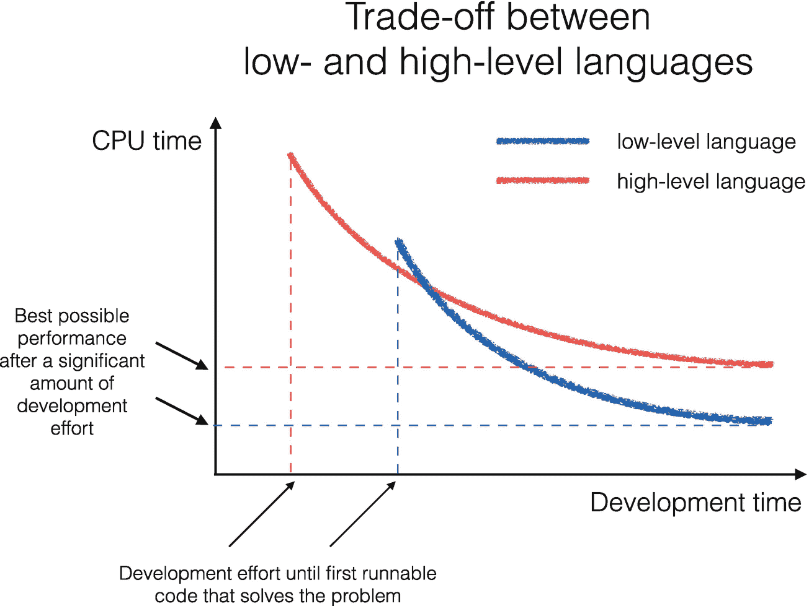
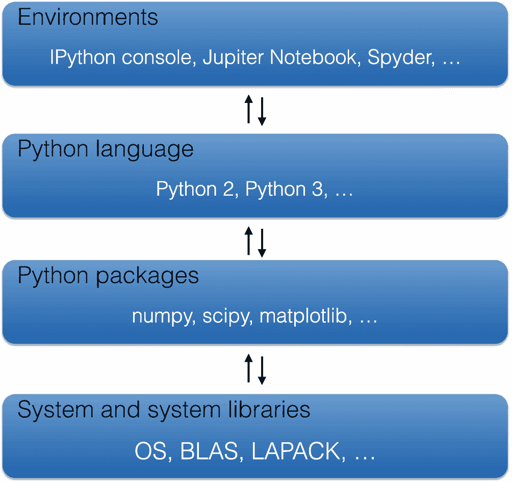

# 1. Python 计算入门

本书旨在介绍如何使用 Python 进行数值计算。Python 是一种高级、通用的解释型编程语言，广泛应用于科学计算和工程领域。作为一种通用语言，Python 并非专门为数值计算而设计，但其众多特性使其非常适合此任务。首先，Python 以其简洁、易读的代码语法而闻名。良好的代码可读性提高了可维护性，这通常会导致更少的错误和更优的整体应用，同时也支持快速代码开发。这种可读性和表现力在探索性和交互式计算中至关重要，因为这类计算需要快速迭代以测试各种想法和模型。

在计算问题求解中，考虑算法及其实现的性能当然很重要。追求高效的高性能代码是自然而然的事，而对于许多计算问题，最优性能确实至关重要。在这种情况下，可能有必要使用低级编程语言，例如 C 或 Fortran，以便从运行代码的硬件中获得最佳性能。然而，最佳运行时性能并非总是最合适的目标。考虑使用特定编程语言或环境实现问题解决方案所需的开发时间也同样重要。虽然低级编程语言可以实现尽可能好的运行时性能，但使用像 Python 这样的高级语言通常能缩短开发时间，并且通常能产生更灵活、可扩展性更强的代码。

这些相互冲突的目标呈现了一种权衡：高性能伴随长开发时间，与较低性能但更短开发时间之间的取舍。图 1-1 对此概念进行了示意性展示。在选择用于解决特定问题的计算环境时，必须考虑这种权衡，并决定是开发投入的人力时间更有价值，还是运行计算消耗的 CPU 时间更有价值。值得注意的是，CPU 时间已经很便宜，并且还在变得更便宜，但人力时间却很昂贵。特别是，您自己的时间当然是非常宝贵的资源。这有力地支持了通过使用高级编程语言和环境（如 Python 及其科学计算库）来最小化开发时间，而非计算运行时间。



**图 1-1** 低级与高级编程语言之间的权衡。当投入大量开发时间实现某个问题的解决方案时，低级语言通常能提供最佳性能；然而，在像 Python 这样的高级语言中，获得第一个可运行代码来解决该问题所需的开发时间通常更短。

一种部分避免了高级与低级语言之间权衡的解决方案是采用多语言模型，即使用高级语言来接口用低级语言编写的库和软件包。在高级科学计算环境中，这种与低级语言（例如 Fortran、C 或 C++）编写的软件包之间的互操作能力是一个重要需求。Python 擅长此类集成，因此 Python 已成为流行的“胶水语言”，用于设置和控制那些利用低级编程语言编写的代码来处理耗时数值计算的任务。这是 Python 成为数值计算流行语言的重要原因。多语言模型使得能够在高级语言中快速开发代码，同时保留低级语言的大部分性能。

多语言模型带来的一个结果是，使用 Python 进行科学和技术计算所涉及的远不止 Python 语言本身。事实上，Python 语言只是提供完整科学计算环境的整个软件与解决方案生态系统的一部分。这个生态系统包括开发工具和交互式编程环境，例如专门为科学计算设计的 `Spyder` 和 `IPython`。它还包含大量的用于科学计算的 Python 包。这个面向科学的库生态系统涵盖了从通用核心库（如 `NumPy`、`SciPy` 和 `Matplotlib`）到针对特定问题领域的更专门的库。在 Python 科学计算栈中，另一个关键层存在于各种 Python 模块之下：许多科学 Python 库以某种方式接口了底层高性能科学软件包，例如用于底层向量、矩阵和线性代数例程的优化 `LAPACK` 和 `BLAS` 库^(¹)，或其他用于特定计算任务的专门库。这些库通常用编译型低级语言实现，因此可以做到优化且高效。没有这些库提供的基础，使用 Python 进行科学计算将不切实际。图 1-2 概述了用于 Python 计算的软件栈的各层。



**图 1-2** 从用户角度自上而下地概述了 Python 科学计算环境中的组件和层次。用户通常只与最上面的三层交互，但最底层构成了软件栈中非常重要的一部分。


### 提示

SciPy 组织及其网站 [`www.scipy.org`](http://www.scipy.org) 为科学 Python 生态系统中的核心包提供了集中式信息资源，并列出了其他专业包以及相关文档和教程。因此，在使用 Python 进行科学和技术计算时，它是一个宝贵的资源。另一个优秀的资源是官方 Python 维基上的*数值与科学*页面：[`http://wiki.python.org/moin/NumericAndScientific`](http://wiki.python.org/moin/NumericAndScientific)。

除了 Python 为何能提供良好计算环境的技术原因外，同样重要的是 Python 及其科学计算库是免费且开源的。这消除了用户在使用该环境开发应用时，在部署和分发方面所面临的经济限制。同样重要的是，它使得专注的用户能够全面了解语言本身及领域特定包是如何实现的，以及采用了哪些方法。对于以透明性和可重复性为标志的学术工作而言，这越来越被认为是研究中所用软件的重要要求。对于商业用途，它提供了使用该环境并将其集成到产品中、以及将解决方案分发给客户的自由度。所有用户都受益于无需支付许可费用，否则这些费用可能会阻碍在大型计算环境（如集群和云计算平台）上的部署。

Python 科学计算生态系统的社交部分是其成功的另一个重要方面。围绕核心包和许多特定领域的项目，已经形成了活跃的用户社区。项目特定的邮件列表、Stack Overflow 群组和问题追踪器（例如在 Github 上，[`www.github.com`](http://www.github.com)）通常非常活跃，提供了讨论问题和获得帮助的论坛，同时也为参与这些工具的开发提供了途径。Python 计算社区还在世界各地的许多场所组织年度会议和聚会，例如 SciPy（[`http://conference.scipy.org`](http://conference.scipy.org)）和 PyData（[`http://pydata.org`](http://pydata.org)）系列会议。

## 使用 Python 进行计算的环境

有许多不同的环境适合使用 Python 进行科学和技术计算。与专有计算产品中常见的单一推荐环境相比，这种多样性既有优点也有缺点：多样性提供了灵活性和活力，有助于针对特定用例进行专业化，但另一方面，它也可能让新用户感到困惑和分心，并且建立一个完整的生产环境可能更加复杂。在此，我概述了科学计算的常见环境，以便权衡它们的优缺点，并根据不同情况和目的做出明智的选择。这里讨论的三种环境是：

- Python 解释器或 IPython 控制台，用于交互式运行代码。配合文本编辑器编写代码，可提供轻量级开发环境。
- Jupyter Notebook，这是一个 Web 应用程序，可通过 Web 浏览器编写和执行 Python 代码。该环境非常适合数值计算、分析和问题解决，因为它允许将代码、代码产生的输出、相关技术文档以及分析和解释全部收集在一个文档中。
- Spyder 集成开发环境，可用于编写和交互式运行 Python 代码。Spyder 这样的 IDE 是开发库和可重用 Python 模块的绝佳工具。

所有这些环境都有其合理的用例，使用哪一种在很大程度上取决于个人偏好。不过，我特别推荐探索 Jupyter Notebook 环境，因为它非常适合交互式和探索性计算及数据分析，其中数据、代码、文档和结果紧密相连。对于开发 Python 模块和包，我推荐使用 Spyder IDE，因为它集成了代码分析工具和 Python 调试器。

Python 以及使用 Python 进行科学计算所需的其他软件栈，可以通过多种方式安装和配置，通常安装细节也因系统而异。在附录 1 中，我们将介绍一种流行的跨平台方法，用于安装本书所需的工具和库。

#### Python

Python 编程语言及其标准解释器实现会频繁更新并通过新版本发布。^(²) 目前，有两个活跃的 Python 版本可用于生产环境：Python 2 和 Python 3。本书将使用 Python 3，它实际上已经取代了 Python 2。然而，对于一些遗留应用程序，如果它们包含尚未与 Python 3 兼容的库，使用 Python 2 可能仍是唯一选择。有时，在机构提供的环境中（例如高性能集群或大学的计算机系统）也可能只有 Python 2 可用。为此类环境开发 Python 代码时，可能有必要使用 Python 2，但在其他情况下，我强烈建议在新项目中使用 Python 3。还应注意，许多主要的 Python 库现已停止支持 Python 2，而绝大多数面向计算的 Python 库现已支持 Python 3。就本书而言，我们要求 Python 2 系列使用 2.7 或更高版本，或首选使用 Python 3 系列中的 3.2 或更高版本。


### 解释器

执行 Python 代码的标准方式是通过 Python 解释器直接运行程序。在大多数系统上，使用 `python` 命令来调用 Python 解释器。当将一个 Python 源文件作为参数传递给此命令时，文件中的 Python 代码将被执行。

```
$ python hello.py
Hello from Python!
```

这里的文件 `hello.py` 包含单行代码：

```
print("Hello from Python!")
```

要查看已安装的 Python 版本，可以调用带有 `--version` 参数的 `python` 命令：

```
$ python --version
Python 3.6.5
```

同一系统上安装多个 Python 版本是很常见的。每个 Python 版本维护自己的库集，并提供自己的解释器命令（因此每个 Python 环境可以安装不同的库）。在许多系统上，可以通过诸如 `python2.7` 和 `python3.6` 等命令来调用特定版本的 Python 解释器。还可以设置独立于系统提供的环境的*虚拟* Python 环境。这有许多优点，我强烈建议你熟悉这种使用 Python 的方式。附录 A 提供了如何设置和使用这类环境的详细信息。

除了执行 Python 脚本文件外，Python 解释器还可以用作交互式控制台（也称为 REPL：读取-求值-输出-循环）。在命令提示符下输入 `python`（不带任何 Python 文件作为参数）将以交互模式启动 Python 解释器。此时，你会看到如下提示符：

```
$ python
Python 3.6.1 |Continuum Analytics, Inc.| (default, May 11 2017, 13:04:09)
[GCC 4.2.1 Compatible Apple LLVM 6.0 (clang-600.0.57)] on darwin
Type "help", "copyright", "credits" or "license" for more information.
>>>
```

在此可以输入 Python 代码，对于每条语句，解释器会计算代码并将结果打印到屏幕上。Python 解释器本身已经为交互式探索 Python 代码提供了一个非常有用的环境，特别是自 Python 3.4 发布以来，它包含了基本设施，例如命令历史和基本自动补全（在 Python 2 中默认不可用）。

## IPython 控制台

尽管标准 Python 解释器提供的交互式命令行界面在 Python 3 的最近版本中得到了极大改进，但在某些方面它仍然比较基础，并且自身并不能提供令人满意的交互式计算环境。IPython^(³) 是一个增强的 Python 命令行 REPL 环境，具有用于交互式和探索式计算的其他功能。例如，IPython 提供了改进的命令历史浏览（也在会话之间）、输入和输出缓存系统、改进的自动补全、更详细且更有帮助的异常回溯等等。事实上，IPython 现在远不止是一个增强的 Python 命令行界面，我们将在本章及全书中更详细地探讨这一点。例如，在底层，IPython 是一个客户端-服务器应用程序，它将前端（用户界面）与执行 Python 代码的后端（内核）分离。这使得多种类型的用户界面能够与同一个内核通信和协同工作，并且用户界面应用程序可以使用 IPython 强大的并行计算框架连接多个内核。

运行 `ipython` 命令将启动 IPython 命令提示符：

```
$ ipython
Python 3.6.1 |Continuum Analytics, Inc.| (default, May 11 2017, 13:04:09)
Type 'copyright', 'credits' or 'license' for more information
IPython 6.4.0 -- An enhanced Interactive Python. Type '?' for help.
In [1]:
```

### 注意事项

请注意，每个 IPython 安装都对应一个特定版本的 Python，如果你系统上有多个 Python 版本，那么你也可能有多个 IPython 版本。在许多系统上，使用命令 `ipython2` 调用 Python 2 的 IPython，使用 `ipython3` 调用 Python 3 的 IPython，尽管具体设置因系统而异。请注意，这里的“2”和“3”指的是 Python 版本，这与 IPython 本身的版本（在撰写本文时为 6.4.0）不同。

在接下来的章节中，我将简要概述 IPython 的一些与交互式计算最相关的功能。值得注意的是，IPython 在 Python 科学计算中被用于许多不同的场景，例如，作为 Jupyter Notebook 应用和 Spyder IDE 中的内核，这些将在本章后面更详细地介绍。花时间熟悉 IPython 所提供的技巧和技术，以提高你在交互式计算中的工作效率，是非常值得的。

### 输入与输出缓存

在 IPython 控制台中，输入提示符表示为 `In [1]:`，相应的输出表示为 `Out [1]:`，其中方括号内的数字会随着每次新的输入和输出递增。这些输入和输出在 IPython 中被称为*单元*。之前单元的输入和输出都可以通过 IPython 自动创建的 `In` 和 `Out` 变量来访问。`In` 和 `Out` 变量分别是一个列表和一个字典，可以使用单元编号进行索引。例如，考虑以下 IPython 会话：

```
In [1]: 3 * 3
Out[1]: 9
In [2]: In[1]
Out[2]: '3 * 3'
In [3]: Out[1]
Out[3]: 9
In [4]: In
Out[4]: [", '3 * 3', 'In[1]', 'Out[1]', 'In']
In [5]: Out
Out[5]: {1: 9, 2: '3 * 3', 3: 9, 4: [", '3 * 3', 'In[1]', 'Out[1]', 'In', 'Out']}
```

这里，第一个输入是 `3 * 3`，结果是 `9`，之后可以通过 `In[1]` 和 `Out[1]` 获取。单个下划线 `_` 是引用最近一次输出的简写符号，而双下划线 `__` 则指代最近一次输出之前的输出。输入和输出缓存在交互式和探索式计算中通常很有用，因为即使计算的结果没有显式赋值给变量，也可以访问它。

请注意，当执行一个单元时，输入单元中最后一条语句的值默认会显示在对应的输出单元中，除非该语句是一个赋值语句，或者该值是 Python 的 null 值 `None`。可以通过在语句末尾加上分号来抑制输出：

```
In [6]: 1 + 2
Out[6]: 3
In [7]: 1 + 2;    # 分号抑制了输出
In [8]: x = 1     # 赋值语句没有输出
In [9]: x = 2; x  # 这是两条语句。'x'的值显示在输出中
Out[9]: 2
```

### 自动补全与对象自省

在 IPython 中，按下 `TAB` 键会激活自动补全，它会显示一个符号（变量、函数、类等）列表，这些符号的名称是已输入内容的有效补全。IPython 中的自动补全是上下文相关的，当在类实例名称之后调用时，它会在当前命名空间或类的属性和方法中查找匹配的变量和函数。例如，`os.<TAB>` 会生成 `os` 模块中的变量、函数和类的列表，而在输入 `os.w` 后按下 `TAB` 键会列出 `os` 模块中以 `w` 开头的符号：

```
In [10]: import os
In [11]: os.w
os.wait  os.wait3  os.wait4  os.waitpid  os.walk  os.write  os.writev
```

此功能称为对象自省，它是交互式探索 Python 对象属性的强大工具。对象自省适用于模块、类及其属性和方法，也适用于函数及其参数。


