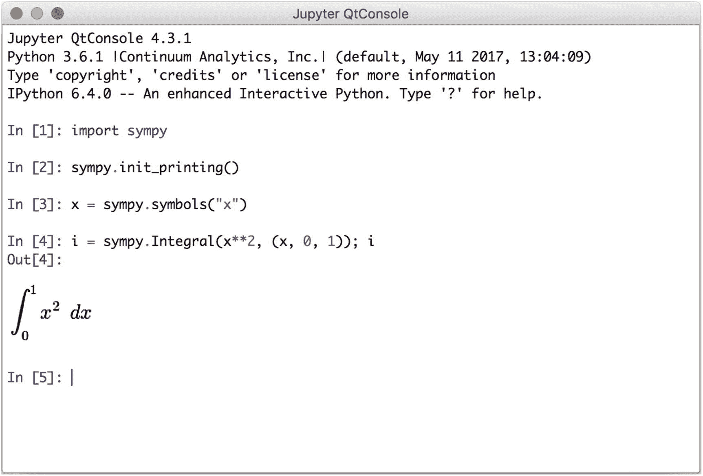
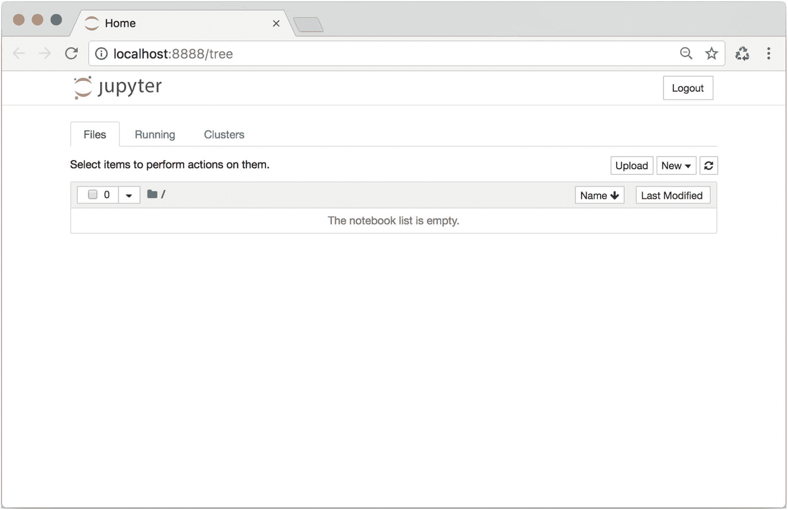
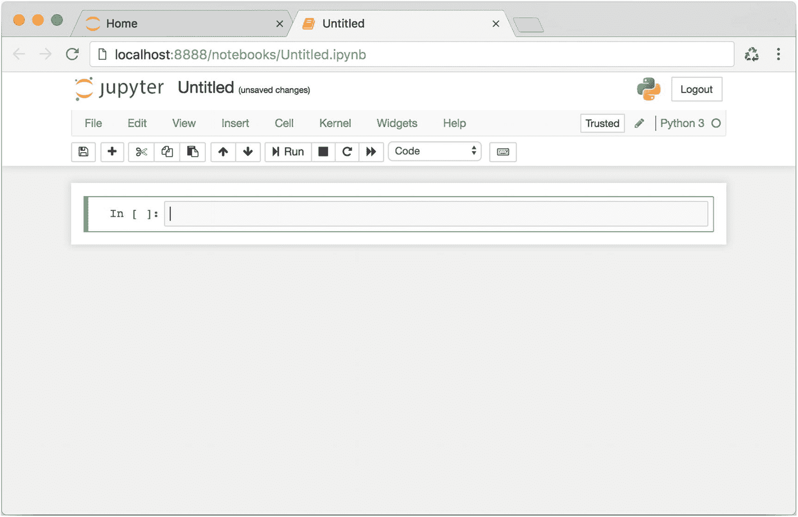
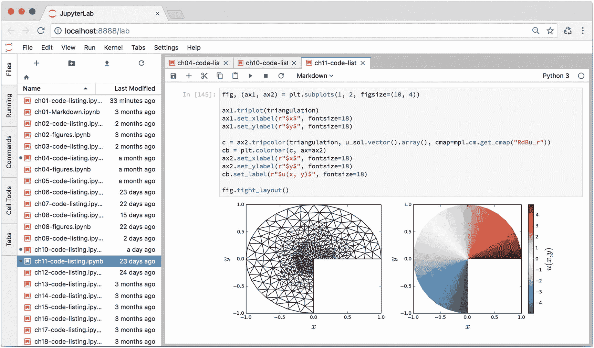
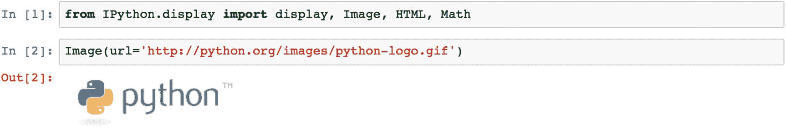
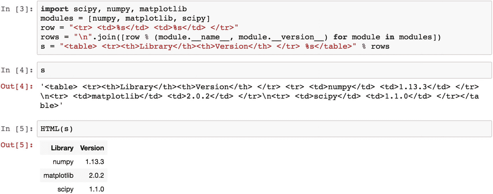
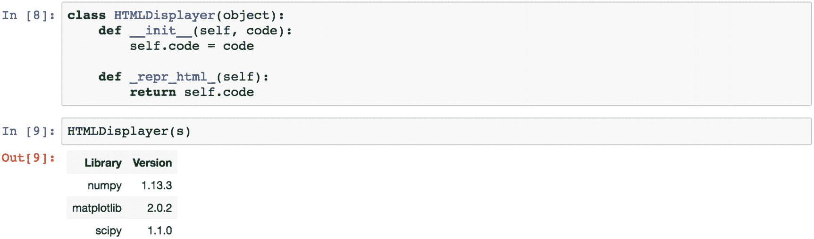
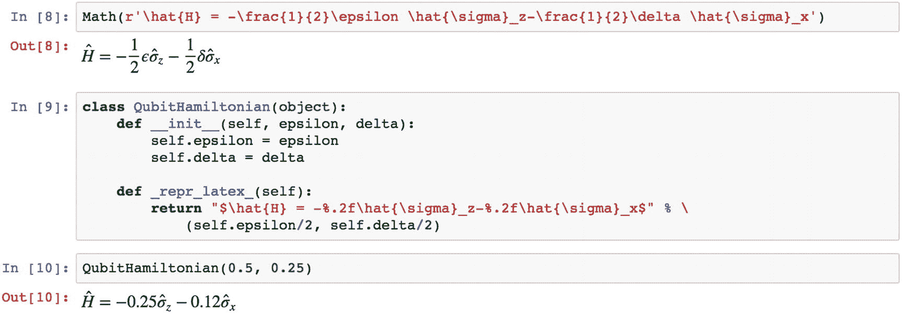
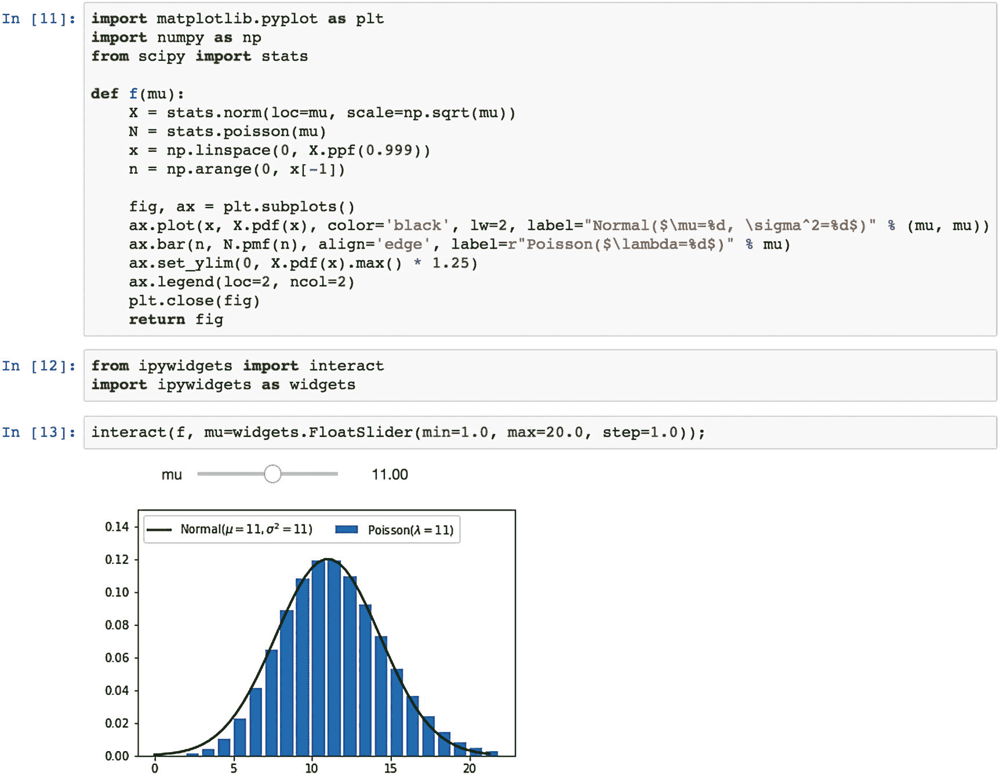
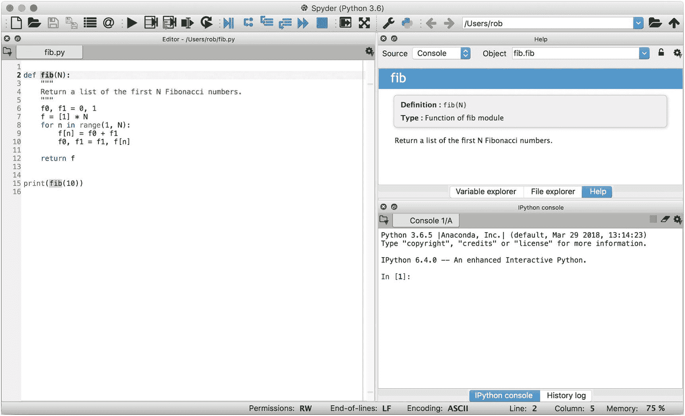

# 文档

对象内省对于探索模块及其成员类和函数的 API 非常方便，结合 Python 代码中通常提供的文档字符串（即“docstring”），它为几乎所有已安装且可导入的 Python 模块提供了内置的动态参考手册。在 Python 对象后加上问号，可以显示该对象的文档字符串。这类似于 Python 函数`help`。对象后也可以加上两个问号，此时 IPython 会尝试显示更详细的文档，包括 Python 源代码（如果可用）。例如，要显示`math`库中`cos`函数的帮助信息：

```
In [12]: import math
In [13]: math.cos?
类型:        builtin_function_or_method
字符串形式: 
文档字符串:
cos(x)
返回 x（以弧度为单位）的余弦值。
```

可以为 Python 模块、函数、类及其属性和方法指定文档字符串。因此，一个文档完善的模块会在代码本身中包含完整的 API 文档。从开发者的角度来看，能够将代码与实现一同进行文档化是很方便的。这鼓励了文档的编写和维护，且 Python 模块往往文档完善。

## 与系统 Shell 的交互

IPython 还为 Python 语言提供了扩展，使其能方便地与底层系统进行交互。跟在感叹号后的任何内容都会使用系统 shell（如 bash shell）来执行。例如，在类 UNIX 系统（如 Linux 或 Mac OS X）上，可以使用以下命令列出当前目录中的文件：

```
In[14]: !ls
file1.py    file2.py    file3.py
```

在 Microsoft Windows 上，等效命令是`!dir`。这种与操作系统交互的方法是一个非常强大的功能，使得浏览文件系统以及将 IPython 控制台用作系统 shell 变得轻而易举。跟在感叹号后的命令所生成的输出可以轻松捕获到 Python 变量中。例如，使用`!ls`生成的文件列表可以通过以下方式存储到 Python 列表中：

```
In[15]: files = !ls
In[16]: len(files)

In[17] : files
['file1.py', 'file2.py', 'file3.py']
```

同样，我们可以通过在变量名前加上`$`符号，将 Python 变量的值传递给 shell 命令：

```
In[18]: file = "file1.py"
In[19]: !ls -l $file
-rw-r--r--  1 rob  staff 131 Oct 22 16:38 file1.py
```

这种 IPython 控制台与系统 shell 之间的双向通信，在处理数据文件等场景下会非常方便。

## IPython 扩展

IPython 提供了一些扩展命令，在 IPython 术语中被称为魔法函数。这些命令都以一个或两个`%`符号开头。单个`%`符号用于单行命令，两个`%`符号用于操作单元格（多行）的命令。要查看所有可用的扩展命令列表，可以输入`%lsmagic`，每个命令的文档可以通过输入魔法命令后跟一个问号来获取：

```
In[20]: %lsmagic?
类型:            Magic function
字符串形式:    >
命名空间:       IPython internal
文件:           /usr/local/lib/python3.6/site-packages/IPython/core/magics/basic.py
定义:     %lsmagic(self, parameter_s=")
文档字符串:      列出当前可用的魔法函数。
```

### 文件系统导航

除了上一节中描述的系统 shell 交互功能外，IPython 还提供了用于浏览和探索文件系统的命令。这些命令对于 UNIX shell 用户来说会很熟悉：`%ls`（列出文件）、`%pwd`（返回当前工作目录）、`%cd`（更改工作目录）、`%cp`（复制文件）、`%less`（在分页器中显示文件内容）以及`%%writefile filename`（将单元格内容写入文件`filename`）。注意，IPython 中的自动补全功能也对当前工作目录中的文件生效，这使得 IPython 在探索文件系统时和系统 shell 一样方便。值得一提的是，这些 IPython 命令是系统无关的，因此既可以在类 UNIX 操作系统上使用，也可以在 Windows 上使用。

### 从 IPython 控制台运行脚本

`%run`命令是一个重要且有用的扩展，或许也是 IPython 控制台最重要的特性之一。使用此命令，可以在交互式 IPython 会话中执行外部的 Python 源代码文件。在多次运行脚本之间保持会话活动，使得在脚本执行完毕后，可以交互式地探索脚本中定义的变量和函数。为了演示此功能，考虑一个包含以下代码的脚本文件`fib.py`：

```
def fib(n):
"""
返回一个包含前 n 个斐波那契数的列表。
"""
f0, f1 = 0, 1
f = [1] * n
for i in range(1, n):
f[i] = f0 + f1
f0, f1 = f1, f[i]
return f
print(fib(10))
```

该脚本定义了一个函数，生成*n*个斐波那契数的序列，并将*n*=10 的结果打印到标准输出。可以使用标准的 Python 解释器从系统终端运行它：

```
$ python fib.py
[1, 1, 2, 3, 5, 8, 13, 21, 34, 55]
```

也可以从交互式 IPython 会话中运行，它会输出相同的结果，但还会将文件中定义的符号添加到本地命名空间中，这样在发出`%run`命令后，`fib`函数就可以在交互式会话中使用了。

```
In [21]: %run fib.py
Out[22]: [1, 1, 2, 3, 5, 8, 13, 21, 34, 55]
In [23]: %who
fib
In [23]: fib(6)
Out[23]: [1, 1, 2, 3, 5, 8]
```

在前面的示例中，我们还使用了`%who`命令，它会列出所有已定义的符号（变量和函数）。`%whos`命令类似，但在适用时会提供关于每个符号的类型和值的更详细信息。

### 调试器

IPython 包含一个方便的调试器模式，可以在 Python 异常（错误）发生后进行事后调用。当一个未捕获异常的追溯信息打印到 IPython 控制台后，可以使用 IPython 命令`%debug`直接步入 Python 调试器。这种可能性消除了需要使用调试器从头开始重新运行程序，或者采用在代码中散布 print 语句这种常见调试方法的需求。如果异常是意外发生的，并且耗时计算已进行到很晚的阶段，那么这可以大大节省时间。

为了了解如何使用`%debug`命令，考虑下面这个对之前定义的`fib`函数的错误调用。之所以错误，是因为向函数传递了一个浮点数，而该函数实现时假设传递给它的参数是整数。在第 7 行，代码遇到了类型错误，Python 解释器抛出了一个`TypeError`类型的异常。IPython 捕获此异常并在控制台上打印出有用的调用序列追溯信息。如果我们不清楚为什么第 7 行的代码包含错误，那么在 IPython 控制台中输入`%debug`进入调试器可能会很有用。然后，我们可以访问异常发生处的本地命名空间，这使我们能够更详细地探究引发异常的原因。

```
In [24]: fib(1.0)

TypeError                                 Traceback (most recent call last)
 in ()
----> 1 fib.fib(1.0)
/Users/rob/code/fib.py in fib(n)
5     """
6     f0, f1 = 0, 1
----> 7     f = [1] * n
8     for i in range(1, n):
9         f[n] = f0 + f1
TypeError: 无法将序列与非整数类型'float'相乘
In [25]: %debug
> /Users/rob/code/fib.py(7)fib()
6    f0, f1 = 0, 1
----> 7    f = [1] * n
8     for i in range(1, n):
ipdb> print(n)
1.0
```


### 提示

在调试器提示符处输入问号可显示帮助菜单，其中列出了可用的命令：

`ipdb> ?`

有关 Python 调试器及其功能的更多信息，也可在 Python 标准库文档中查阅：[`http://docs.python.org/3/library/pdb.html`](http://docs.python.org/3/library/pdb.html)。

#### 重置

重置 IPython 会话的命名空间通常有助于确保程序在纯净环境中运行，不受现有变量和函数的干扰。`%reset` 命令提供了此功能（使用标志 `-f` 可强制重置）。使用此命令通常可以消除常见的退出-重启控制台循环的需要。虽然在使用 `%reset` 命令后需要重新导入模块，但重要的是要知道，即使模块自上次导入后已发生更改，在 `%reset` 后的新导入也不会导入新模块，而是重新启用上次导入时缓存的模块版本。在开发 Python 模块时，这通常不是期望的行为。在这种情况下，通常可以使用 `IPython.lib.deepreload` 中的 `reload` 函数来重新导入之前已导入（且之后已更新）的模块。然而，此方法并非始终有效，因为某些库在导入时运行的代码仅预期运行一次。在这种情况下，唯一的选择可能是终止并重新启动 IPython 解释器。

#### 计时与代码性能分析

`%timeit` 和 `%time` 命令提供了简单的基准测试功能，在寻找性能瓶颈和尝试优化代码时非常有用。`%timeit` 命令会多次运行一条 Python 语句，并给出运行时间的估算（对多行单元格可使用 `%%timeit` 实现相同功能）。语句运行的确切次数是根据启发式算法确定的，除非使用 `-n` 和 `-r` 标志显式设置。详细信息请参见 `%timeit?`。`%timeit` 命令不返回表达式的结果值。如果需要计算结果，可以使用 `%time` 或 `%%time`（用于多行单元格）命令，但 `%time` 和 `%%time` 仅运行语句一次，因此对平均运行时间的估算不太准确。

以下示例展示了 `%timeit` 和 `%time` 命令的典型用法：

```
In [26]: %timeit fib(100)
100000 loops, best of 3: 16.9 μs per loop
In [27]: result = %time fib(100)
CPU times: user 33 μs, sys: 0 ns, total: 33 μs
Wall time: 48.2
```

虽然 `%timeit` 和 `%time` 命令对于衡量计算的运行时间很有用，但它们不提供关于计算中哪部分耗时更多的详细信息。此类分析需要更复杂的代码性能分析工具，例如 Python 标准库模块 `cProfile` 提供的工具。^(⁶) 在 IPython 中，可以通过 `%prun` 命令（用于语句）和带 `-p` 标志的 `%run` 命令（用于运行外部脚本文件）来访问 Python 性能分析器。性能分析器的输出相当详细，并且可以使用 `%prun` 和 `%run -p` 命令的可选标志进行定制（有关可用选项的详细说明，请参见 `%prun?`）。

例如，考虑一个模拟 *N* 个随机游走者各走 *M* 步，然后计算任意游走者离起点最远距离的函数：

```
In [28]: import numpy as np
In [29]: def random_walker_max_distance(M, N):
...:     """
...:     模拟 N 个随机游走者走 M 步，并返回任意游走者离起点最远的距离。
...:     """
...:     trajectories = [np.random.randn(M).cumsum() for _ in range(N)]
...:     return np.max(np.abs(trajectories))
```

使用 `%prun` 通过性能分析器调用此函数会得到以下输出，其中包括每个函数被调用的次数，以及每个函数中花费的总时间和累积时间的细分。从这些信息中我们可以得出结论，在这个简单的例子中，对函数 `np.random.randn` 的调用消耗了大部分的计算时间。

```
In [30]: %prun random_walker_max_distance(400, 10000)
20008 function calls in 0.254 seconds
Ordered by: internal time
ncalls  tottime  percall  cumtime  percall filename:lineno(function)
10000    0.169    0.000    0.169    0.000 {method 'randn' of 'mtrand.RandomState' objects}
10000    0.036    0.000    0.036    0.000 {method 'cumsum' of 'numpy.ndarray' objects}
1    0.030    0.030    0.249    0.249 :18(random_walker_max_distance)
1    0.012    0.012    0.217    0.217 :19()
1    0.005    0.005    0.254    0.254 :1()
1    0.002    0.002    0.002    0.002 {method 'reduce' of 'numpy.ufunc' objects}
1    0.000    0.000    0.254    0.254 {built-in method exec}
1    0.000    0.000    0.002    0.002 _methods.py:25(_amax)
1    0.000    0.000    0.002    0.002 fromnumeric.py:2050(amax)
1    0.000    0.000    0.000    0.000 {method 'disable' of '_lsprof.Profiler' objects}
```

#### 将解释器和文本编辑器作为开发环境

原则上，Python 或 IPython 解释器加一个好的文本编辑器，就足以构成一个功能完整的 Python 开发环境。实际上，这种简单的设置是许多经验丰富的程序员首选的开发环境。然而，在以下章节中，我们将探讨 Jupyter Notebook 和集成开发环境 Spyder。这些环境提供了更丰富的功能，能在处理交互式和探索性计算应用时提高生产效率。

## Jupyter

Jupyter 项目^(⁷)是从 IPython 项目衍生出来的，它包括了与 Python 无关的前端——最著名的是 notebook 应用，我们将在下一节中详细讨论——以及通信框架，该框架使得能够将前端与被称为内核的计算后端分离。在 Jupyter 项目创建之前，notebook 应用及其底层框架是 IPython 项目的一部分。然而，由于 notebook 前端与语言无关——它也可以与多种其他语言一起使用，如 R 和 Julia——因此它被分离出来成为一个独立项目，以更好地服务于更广泛的计算社区，并避免被认为偏向 Python。现在，IPython 的剩余角色是专注于 Python 特定的应用，例如交互式 Python 控制台，并为 Jupyter 环境提供 Python 内核。

在 Jupyter 框架中，前端与被称为内核的计算后端进行通信。前端可以注册多个内核，例如，用于不同的编程语言、不同版本的 Python 或不同的 Python 环境。内核维护解释器的状态并执行实际计算，而前端管理代码的输入和组织方式，以及计算结果如何呈现给用户。

在本节中，我们将讨论 Jupyter QtConsole 和 Notebook 前端，并简要介绍它们一些丰富的显示和交互功能，以及 notebook 提供的工作流组织方式。Jupyter Notebook 是我在本书中通常推荐的计算工作的 Python 环境，本书其余部分的代码列表应被理解为 notebook 中的单元格。


### Jupyter QtConsole

Jupyter QtConsole 是一个增强型控制台应用程序，可替代标准的 IPython 控制台。通过向 `jupyter` 命令传递 `qtconsole` 参数来启动 QtConsole：

```
$ jupyter qtconsole
```

这将在控制台中打开一个新的 IPython 应用程序，该控制台能够显示富媒体对象，例如图像、图形和数学公式。Jupyter QtConsole 还提供基于菜单的机制来显示自动补全结果，并且在输入函数或方法调用的左括号时，会弹出一个窗口显示函数的文档字符串。Jupyter QtConsole 的截图如图 1-3 所示。



图 1-3

Jupyter QtConsole 应用程序截图

### Jupyter Notebook

除了交互式控制台，Jupyter 还提供了使其闻名的基于 Web 的笔记本应用程序。在进行数据分析和计算问题求解时，笔记本相比传统开发环境具有许多优势。尤其是，笔记本环境允许编写和运行代码、显示代码产生的输出、以及记录和解释代码与结果——所有这些都在一个文档中完成。这意味着整个分析工作流程都保存在一个文件中，该文件可以保存、恢复并在以后重用。相比之下，当使用文本编辑器或 IDE 时，代码、相应的数据文件和图形以及文档会分散在文件系统中的多个文件中，要保持这样的工作流程有序组织需要付出巨大的努力和纪律性。

Jupyter Notebook 拥有一个丰富的显示系统，可以将方程、图像和视频等媒体作为嵌入对象显示在笔记本中。还可以使用 Jupyter 的控件系统，通过 HTML 和 JavaScript 创建用户界面（UI）元素。这些控件可用于创建交互式应用程序，将 Web 应用程序与在 IPython 内核（服务器端）中执行的 Python 代码连接起来。Jupyter Notebook 的这些特性以及许多其他特性使其成为交互式和文学化计算的绝佳环境，我们将在本书中看到相关示例。

要启动 Jupyter Notebook 环境，需向 `jupyter` 命令行应用程序传递 `notebook` 参数。

```
$ jupyter notebook
```

这将启动一个笔记本内核和一个 Web 应用程序，默认情况下，该应用程序会在本地主机的 8888 端口上启动一个 Web 服务器，可通过 Web 浏览器中的本地地址 `http://localhost:8888/` 进行访问。^(⁸) 默认情况下，运行 `jupyter notebook` 会在默认的 Web 浏览器中打开一个仪表板网页。该仪表板列出了从启动 Jupyter Notebook 的目录中可用的所有笔记本，以及一个简单的目录浏览器，可用于导航相对于笔记本服务器启动位置的子目录，并从中打开笔记本。图 1-4 显示了一个 Web 浏览器和 Jupyter Notebook 仪表板页面的截图。



图 1-4

Jupyter Notebook 仪表板页面截图

点击“New”按钮会创建一个新的笔记本，并在浏览器的新页面中打开它（见图 1-5）。新创建的笔记本根据未使用文件名的可用性，会被命名为 `Untitled`、`Untitled1` 等。可以通过点击笔记本页面顶部的标题字段来重命名笔记本。Jupyter Notebook 文件以 JSON 文件格式存储，并使用文件扩展名 `ipynb`。Jupyter Notebook 文件并非纯 Python 代码，但如有必要，可以通过“File ➤ Download as ➤ Python”或 Jupyter 实用程序 `nbconvert`（参见下一节）轻松提取笔记本中的 Python 代码。



图 1-5

一个新建的空 Jupyter Notebook

### Jupyter Lab

Jupyter Lab 是 Jupyter 项目推出的一个新式开发环境。它将 Jupyter Notebook 界面与文件浏览器、文本编辑器、Shell 和 IPython 控制台结合在一个基于 Web 的类 IDE 环境中；见图 1-6。



图 1-6

Jupyter Lab 界面，包含一个文件浏览器（左侧）和一个多标签笔记本编辑器（右侧）。这里显示的笔记本展示了第 11 章示例中的代码和输出。

Jupyter Lab 环境整合了笔记本环境的诸多优势和传统 IDE 的长处。在同一个 Web 前端中访问 Shell 控制台和文本编辑器，对于在远程系统（例如计算集群或云）上运行的 Jupyter 服务器上工作时也非常方便。

### 单元格类型

笔记本的主要内容，位于菜单栏和工具栏下方，被组织为输入和输出单元格。单元格可以是几种类型之一，所选单元格的类型可以使用工具栏中的单元格类型下拉菜单（初始显示为“Code”）进行更改。最重要的类型有：

*   **Code（代码）**：一个代码单元格可以包含任意数量的多行 Python 代码。按下 Shift-Enter 键会将单元格中的代码发送到内核进程，内核会使用 Python 解释器对其进行求值。结果会被发送回浏览器并显示在相应的输出单元格中。

*   **Markdown**：Markdown 单元格的内容可以包含标记过的纯文本，这些文本会使用 Markdown 语言和 HTML 进行解释。Markdown 单元格还可以包含 LaTeX 格式的方程，这些方程会使用基于 JavaScript 的 LaTeX 引擎 MathJax 在笔记本中渲染。

*   **Headings（标题）**：标题单元格可用于将笔记本划分为不同的章节。

*   **Raw（原始）**：原始文本单元格会不经任何处理直接显示。


### 编辑单元格

通过菜单栏和工具栏，可以添加、移除、上移、下移、剪切和粘贴单元格等操作。这些功能也映射到了键盘快捷键上，在使用 Jupyter Notebook 时既方便又省时。Notebook 采用双模式输入界面，包含编辑模式和命令模式。点击单元格或当单元格获得焦点时按下键盘上的 `Enter` 键，即可进入编辑模式。进入编辑模式后，可以编辑输入单元格的内容。按 `ESC` 键或使用 `Shift-Enter` 执行单元格即可退出编辑模式。在命令模式下，可以使用上下方向键在单元格之间移动焦点，并且许多键盘快捷键已映射到可通过工具栏和菜单栏使用的基本单元格操作。表 1-1 总结了 Jupyter Notebook 命令模式下最重要的键盘快捷键。

表 1-1

Jupyter Notebook 命令模式键盘快捷键汇总

| 键盘快捷键 | 说明 |
| --- | --- |
| `b` | 在当前选中单元格*下方*创建一个新单元格。 |
| `a` | 在当前选中单元格*上方*创建一个新单元格。 |
| `d-d` | 删除当前选中的单元格。 |
| `1` 到 `6` | 1 至 6 级标题单元格。 |
| `x` | 剪切当前选中的单元格。 |
| `c` | 复制当前选中的单元格。 |
| `v` | 从剪贴板粘贴单元格。 |
| `m` | 将单元格转换为 Markdown 单元格。 |
| `y` | 将单元格转换为代码单元格。 |
| `Up` | 选择上一个单元格。 |
| `Down` | 选择下一个单元格。 |
| `Enter` | 进入编辑模式。 |
| `Escape` | 退出编辑模式。 |
| `Shift-Enter` | 运行该单元格。 |
| `h` | 显示帮助窗口，其中包含所有可用快捷键的列表。 |
| `0-0` | 重启内核。 |
| `i-i` | 中断正在执行的单元格。 |
| `s` | 保存 Notebook。 |

当 Notebook 单元格正在执行时，输入提示编号会以星号 `In[*]` 表示，并且页面右上角的指示器会显示 IPython 内核正忙。可以使用菜单选项“Kernel ➤ Interrupt”（内核 ➤ 中断）或在命令模式下键入 `i-i`（即连续按两次 `i` 键）来中断单元格的执行。

### Markdown 单元格

Jupyter Notebook 的关键特性之一是，代码单元格和输出单元格可以通过文本单元格中的文档进行补充。文本输入单元格被称为 Markdown 单元格。输入文本会使用 Markdown 标记语言进行解释和重新格式化。Markdown 语言被设计成一种轻量级的排版系统，允许带有简单标记规则的文本转换为 HTML 和其他格式，以实现更丰富的显示效果。其标记规则设计得用户友好，并且以纯文本格式阅读时也清晰易读。例如，一段文本可以通过用星号包围 `*text*` 使其显示为*斜体*，通过用双星号包围 `**text**` 使其显示为**粗体**。Markdown 还允许创建编号列表、项目符号列表、表格和超链接。Jupyter 支持的一个 Markdown 扩展是，可以使用 JavaScript LaTeX 库 MathJax 以 LaTeX 格式排版数学表达式。充分利用 Jupyter Notebook 的功能包括：使用 Markdown 单元格及其提供的多种丰富显示选项，为代码和生成的输出提供详尽的文档说明。表 1-2 介绍了可在 Jupyter Notebook Markdown 单元格中使用的基本 Markdown 和方程格式化功能。

表 1-2

Jupyter Notebook Markdown 单元格的 Markdown 语法汇总

| 功能 | 示例语法 |
| --- | --- |
| 斜体 | `*text*` |
| 粗体 | `**text**` |
| 删除线 | `~~text~~` |
| 等宽字体 | `` `text` `` |
| URL | `[URL text](http://www.example.com)` |
| 新段落 | 用空行分隔两段文本。 |
| 逐字文本 | 以四个空格开始的行将原样显示，不进行任何进一步处理，并使用等宽字体。这对于类似代码的文本段很有用。`␣␣␣␣def func(x):``␣␣␣␣    return x ** 2` |
| 表格 | `&#124; A &#124; B &#124; C &#124;``&#124;---&#124;---&#124;---&#124;``&#124; 1 &#124; 2 &#124; 3 &#124;``&#124; 4 &#124; 5 &#124; 6 &#124;` |
| 水平线 | 包含三个破折号的行将呈现为水平分隔线：`---` |
| 标题 | `# 1 级标题``## 2 级标题``### 3 级标题`... |
| 引用块 | 以“>”开头的行将呈现为引用块。`> 此处的文本会缩进并与` `> 正文部分分开。` |
| 无序列表 | `* 项目一``* 项目二``* 项目三` |
| 有序列表 | `1\. 项目一``2\. 项目二``3\. 项目三` |
| 图片 | `` ^(⁹) 或 `` |
| 内联 LaTeX 方程 | `$\LaTeX$` |
| 显示 LaTeX 方程（居中并位于新行） | `$$\LaTeX$$` 或 `\begin{env}...\end{env}`，其中 `env` 可以是 LaTeX 环境，例如 `equation`、`eqnarray`、`align` 等。 |

Markdown 单元格也可以包含 HTML 代码，Jupyter Notebook 界面会将其显示为渲染后的 HTML。这对 Jupyter Notebook 来说是一个非常强大的功能，但其缺点是此类 HTML 代码无法使用 `nbconvert` 工具（参见本章后续部分）转换为其他格式，例如 PDF。因此，通常最好尽可能使用 Markdown 格式，仅在绝对必要时才求助于 HTML。

更多关于 MathJax 和 Markdown 的信息，请分别访问项目网站 [`www.mathjax.com`](http://www.mathjax.com) 和 [`http://daringfireball.net/projects/markdown`](http://daringfireball.net/projects/markdown)。


### 丰富的输出显示

笔记本单元格中最后一条语句产生的结果通常会显示在对应的输出单元格中，就像标准 Python 解释器或 IPython 控制台那样。默认的输出单元格式是对象的字符串表示，例如由 `__repr__` 方法生成。然而，笔记本环境支持更丰富的输出格式，因为它原则上允许在输出单元格区域显示任意 HTML。`IPython.display` 模块提供了几个类和函数，使得在笔记本中通过编程方式呈现格式化输出变得很容易。例如，`Image` 类提供了一种在笔记本中显示来自本地文件系统或在线资源的图像的方法，如图 1-7 所示。同一模块中其他有用的类包括用于渲染 HTML 代码的 `HTML` 类和用于渲染 LaTeX 表达式的 `Math` 类。`display` 函数可用于显式请求一个对象在输出区域被渲染和显示。



**图 1-7** 一个丰富的 Jupyter Notebook 输出单元格格式化示例，其中使用 `Image` 类在单元格输出区域显示了一张图片

使用 `HTML` 类在笔记本中渲染 HTML 代码的示例如图 1-8 所示。这里，我们首先构造一个包含 HTML 代码的字符串，该代码用于创建显示一组 Python 库版本信息的表格。然后，通过创建 `HTML` 类的实例，这段 HTML 代码就会被渲染到输出单元格区域。由于这条语句是相应输入单元格中的最后一条（也是唯一一条）语句，Jupyter 会在输出单元格区域渲染该对象的表示。



**图 1-8** 另一个丰富的 Jupyter Notebook 输出单元格格式化示例，其中使用 `HTML` 类渲染并显示了一个包含模块版本信息的 HTML 表格

对于一个对象要能以 HTML 格式的表示形式显示，我们只需在类定义中添加一个名为 `_repr_hmtl_` 的方法。例如，我们可以轻松实现自己原始版本的 `HTML` 类，并用它来渲染与上一个示例相同的 HTML 代码，如图 1-9 所示。



**图 1-9** 另一个在 Jupyter Notebook 中使用实现了 `_repr_hmtl_` 方法的类来渲染 HTML 代码的示例

除了上文所示的 `_repr_hmtl_`，Jupyter 还支持大量其他的表示方法，例如 `_repr_png_`、`_repr_svg_` 和 `_repr_latex_` 等等。前两者可用于在笔记本输出单元格中生成和显示图形，例如 Matplotlib 库（参见下面的交互示例和第 4 章）就使用了它们。使用 `_repr_latex_` 方法的 `Math` 类可用于在 Jupyter Notebook 中渲染数学公式。这在科学和技术应用中通常非常有用。使用 `Math` 类和 `_repr_latex_` 方法渲染公式的示例如图 1-10 所示。



**图 1-10** 一个展示如何使用 `Math` 类渲染 LaTeX 公式，以及如何使用 `_repr_latex_` 方法生成对象 LaTeX 格式表示的示例

通过使用 Jupyter 识别的各种表示方法，或使用 `IPython.display` 模块中的便捷类，我们在塑造 Jupyter Notebook 中结果的呈现方式上具有极大的灵活性。然而，可能性远不止于此：Jupyter Notebook 一个令人兴奋的特性是，可以使用小部件（UI 组件）库或直接使用 Javascript 和 HTML 创建前端与后端内核之间具有双向通信的交互式应用。例如，使用 `ipywidgets` 库中的 `interact` 函数，我们可以非常轻松地创建一个交互式图形，它接受一个由 UI 滑块确定的输入参数，如图 1-11 所示。



**图 1-11** 一个使用 IPython 小部件 `interact` 创建的交互式应用示例。`interact` 小部件提供了一个滑块 UI 元素，允许改变输入参数的值。当拖动滑块时，提供的函数会被重新评估，在此例中会渲染出一个新图形。

在图 1-11 的示例中，我们绘制了正态分布和泊松分布的分布函数，其中分布的均值和方差取自 `interact` 函数创建的 UI 对象。通过来回移动滑块，我们可以看到正态分布和泊松分布（方差相等时）如何随着分布均值的增加而相互逼近，以及它们在均值较小时表现得非常不同。像这样的交互式图形是建立直觉和探索计算问题的绝佳工具，而 Jupyter Notebook 为这类研究提供了极佳的支持。^(¹⁰)

### nbconvert

Jupyter Notebook 可以使用 `nbconvert` 应用程序转换为多种不同的只读格式，其调用方式是将 `nbconvert` 作为第一个参数传递给 `jupyter` 命令行。支持的格式包括 PDF 和 HTML 等。当与同事共享笔记本或在线发布笔记本时，如果读者不需要运行代码，而主要是查看笔记本中包含的结果，那么将 Jupyter Notebook 转换为 PDF 或 HTML 会非常有用。

#### HTML

在笔记本网页界面中，菜单选项“文件 ➤ 下载为 ➤ HTML (.html)”可用于生成一个代表笔记本静态视图的 HTML 文档。也可以使用 `nbconvert` 应用程序从命令行提示符生成 HTML 文档。例如，可以使用以下命令将一个名为 `Notebook.ipynb` 的笔记本转换为 HTML：

```
$ jupyter nbconvert --to html Notebook.ipynb
```

这将生成一个在样式表和 JavaScript 资源（从公共 CDN 服务器加载）方面自包含的 HTML 页面，并且可以按原样在线发布。但是，使用 Markdown 或 HTML 标签的图像资源不会被包含在内，必须与生成的 HTML 文件一起分发。

对于 Jupyter Notebook 的在线公开发布，Jupyter 项目提供了一个名为 `nbviewer` 的便捷 Web 服务，可通过 [`http://nbviewer.jupyter.org`](http://nbviewer.jupyter.org) 访问。通过向它提供一个公共笔记本文件的 URL，`nbviewer` 应用程序会自动将笔记本转换为 HTML 并显示结果。这种发布 Jupyter Notebook 方法的众多好处之一在于，笔记本作者只需维护一个文件——笔记本文件本身——当它被更新并上传到其在线位置时，`nbviewer` 提供的笔记本静态视图也会自动更新。但是，这要求将源笔记本发布到一个可公开访问的 URL 上，因此它只能用于公开共享。


### 提示

Jupyter 项目维护了一个 Wiki 页面，收录了许多有趣的在线 Jupyter Notebook，地址为 [`http://github.com/jupyter/jupyter/wiki/A-gallery-of-interesting-Jupyter-Notebooks`](http://github.com/jupyter/jupyter/wiki/A-gallery-of-interesting-Jupyter-Notebooks)。这些 Notebook 展示了 IPython 和 Jupyter 的许多高级特性，是深入学习 Jupyter Notebook 及其涵盖的众多主题的绝佳资源。

#### PDF

将 Jupyter Notebook 转换为 PDF 格式需要先将 Notebook 转换为 LaTeX，再将 LaTeX 文档编译成 PDF。执行 LaTeX 到 PDF 的转换，系统上必须安装 LaTeX 环境（关于安装这些工具的建议，请参阅附录 A）。`nbconvert` 应用程序可以通过 `--to pdf` 参数一步完成从 Notebook 到 LaTeX 以及从 LaTeX 到 PDF 的转换（使用 `--to latex` 参数可以获取中间的 LaTeX 源码）：

```
$ jupyter nbconvert --to pdf Notebook.ipynb
```

可以使用 `--template name` 参数指定生成文档的样式，内置的模板包括 `base`、`article` 和 `report`（这些模板可以在 Jupyter 安装目录下的 `nbconvert/templates/latex` 目录中找到）。通过扩展现有模板，可以轻松定制生成文档的外观。例如，在 LaTeX 中，通常需要包含 Jupyter Notebook 中不存在的文档附加信息，如文档标题（如果与 Notebook 文件名不同）和作者。通过创建自定义模板，可以将这些信息添加到由 `nbconvert` 生成的 LaTeX 文档中。例如，以下模板扩展了内置的 `article` 模板并覆盖了 `title` 和 `author` 块：

```
((*- extends 'article.tplx' -*))
((* block title *)) \title{文档标题} ((* endblock title *))
((* block author *)) \author{作者姓名} ((* endblock author *))
```

假设将此模板保存为名为 `custom_template.tplx` 的文件，则可以使用以下命令将此 Notebook 转换为使用此自定义模板的 PDF：

```
$ jupyter nbconvert --to pdf --template custom_template.tplx Notebook.ipynb
```

生成的结果是 LaTeX 和 PDF 文档，其中的标题和作者字段已按模板中的要求设置。

#### Python

采用 JSON 文件格式的 Jupyter Notebook 可以使用 `nbconvert` 应用程序并指定 `python` 格式来转换为纯 Python 代码：

```
$ jupyter nbconvert --to python Notebook.ipynb
```

这将生成 `Notebook.py` 文件，其中仅包含可执行的 Python 代码（或者如果在 Notebook 中使用了 IPython 扩展，则生成的文件可用 `ipython` 执行）。Notebook 中的非代码内容也会作为注释包含在生成的 Python 文件中，这些注释不会妨碍 Python 解释器解释该文件。将 Notebook 转换为纯 Python 代码非常有用，例如，在使用 Jupyter Notebook 开发需要导入到其他 Python 文件或 Notebook 的函数和类时。

## Spyder：集成开发环境

集成开发环境（IDE）是一种增强型文本编辑器，还提供集成代码执行、文档和调试等功能。许多免费和商业 IDE 环境都对基于 Python 的项目提供了良好的支持。`Spyder` 是一款优秀的免费 IDE，特别适合使用 Python 进行计算和数据分析。本节的其余部分将重点介绍 `Spyder` 并更详细地探索其特性。当然，还有许多其他合适的 IDE。例如，`Eclipse` 是一款流行且强大的多语言 IDE，其 `PyDev` 扩展提供了良好的 Python 环境。`PyCharm` 是另一款强大的 Python IDE，近年来在 Python 开发者中获得了显著的 popularity，而 `Atom` IDE 则是另一个极好的选择。对于之前使用过这些工具中任一种的读者来说，它们也可以成为进行计算工作的高效且熟悉的环境。

然而，`Spyder` IDE 是专门为 Python 编程而创建的，特别是用于 Python 科学计算。因此，它具有对交互式和探索式计算有用的特性：最值得注意的是，在 IDE 中直接集成了 IPython 控制台。`Spyder` 用户界面由几个可选窗格组成，可以在 IDE 应用程序中以不同方式排列这些窗格。最重要的窗格有：

* 源代码编辑器
* Python 和 IPython 解释器以及系统 Shell 的控制台
* 对象检查器，用于显示 Python 对象的文档
* 变量浏览器
* 文件浏览器
* 命令历史
* 性能分析器

每个窗格都可以根据用户的偏好和需求，通过“视图 ➤ 窗格”菜单选项来设置显示或隐藏。此外，窗格可以组织成带标签的组。在默认布局中，显示了三个窗格组：左侧窗格组包含源代码编辑器；右上窗格组包含变量浏览器、文件浏览器和对象检查器；右下窗格组包含 Python 和 IPython 控制台。

在 Shell 提示符下运行 `spyder` 命令即可启动 `Spyder` IDE。`Spyder` 应用程序默认布局的屏幕截图请参见图 1-12。



图 1-12：`Spyder` IDE 应用程序的屏幕截图。左侧面板显示代码编辑器，右上方面板显示对象检查器（帮助查看器），右下方面板显示 IPython 控制台。

### 源代码编辑器

`Spyder` 中的源代码编辑器支持代码高亮、智能自动补全、同时处理多个打开的文件、括号匹配、缩进指导以及现代源代码编辑器应具备的许多其他功能。使用 IDE 的额外好处是，编辑器中的代码可以作为整体（快捷键 F5）或选定部分（快捷键 F9）在附加的 Python 或 IPython 控制台中运行，并且连续运行之间会保持会话持久性。

此外，`Spyder` 编辑器对使用 `pylint`、`pyflakes` 和 `pep8` 进行静态代码检查提供了非常有用的支持，这些是分析 Python 源代码并报告错误（如未定义符号、语法错误、编码风格违规等）的外部工具。此类警告和错误会逐行显示，在编辑器左侧边距中，紧挨行号旁边，显示为一个带有感叹号的黄色三角形。静态代码检查在 Python 编程中极为重要。由于 Python 是一种解释型且惰性求值的语言，简单的错误（如未定义符号）可能直到运行时执行到有问题的代码行时才会被发现，对于很少使用的代码路径，有时这类错误可能很难发现。`Spyder` 编辑器中的实时静态代码检查和编码风格检查可以在首选项窗口的“编辑器”部分中激活或停用（在 OS X 菜单中为 Python ➤ 首选项，在 Linux 和 Windows 中为工具 ➤ 首选项）。在编辑器部分，我建议勾选“代码内省/分析”选项卡中的“代码分析”和“样式分析”复选框。


好的，作为高级文档工程师和翻译员，我将遵循您的注意事项，将给定的英文文本翻译成中文。


### 提示

Python 语言用途广泛，可以用极其多样的风格和方式来编写等价的 Python 源代码。然而，一项名为 `PEP8` 的 Python 编码风格标准已被提出，以鼓励 Python 代码的统一外观。我强烈建议学习 `PEP8` 编码风格标准，并在代码中遵循它。`PEP8` 描述在 [`www.python.org/dev/peps/pep-0008`](http://www.python.org/dev/peps/pep-0008)。

### Spyder 中的控制台

集成的 Python 和 IPython 控制台可用于执行在文本编辑器窗口中正在编辑的文件，或者用于运行交互式输入的 Python 代码。当从编辑器执行 Python 源代码文件时，脚本中创建的命名空间变量会保留在控制台的 IPython 或 Python 会话中。这是一个重要的特性，除了作为传统的 IDE 应用程序外，它还使 Spyder 成为一个交互式计算环境，因为它允许在脚本执行完毕后探索变量的值。Spyder 支持同时打开多个 Python 和 IPython 控制台，例如，可以通过“控制台 ➤ 打开一个 IPython 控制台”菜单启动一个新的 IPython 控制台。当从编辑器运行脚本时，通过按下 `F5` 或按下工具栏中的运行按钮，脚本默认会在最近激活的控制台中运行。这使得可以为不同的脚本或项目维护具有独立命名空间的不同控制台。

如果可能，请使用 `%reset` 命令和 `reload` 函数来清除命名空间并重新加载已更新的模块。如果这还不够，可以通过控制台面板右上角图标的下拉菜单，重启与 IPython 控制台对应的 IPython 内核或 Python 解释器。最后，一个实用的功能是，可以通过右键单击控制台窗口，并在弹出菜单中选择“另存为 HTML/XML”来将 IPython 控制台会话导出为 HTML 文件。

### 对象检查器

对象检查器（帮助窗格）在编写 Python 代码时是一个极大的辅助工具。它可以显示使用编辑器创建的源代码中定义的对象以及系统上安装的库模块中定义的符号的富格式文档字符串。对象检查器面板顶部的对象文本字段可用于键入要显示其文档字符串的模块、函数或类的名称。模块和符号无需导入到本地命名空间即可使用对象检查器显示其文档字符串。编辑器或控制台中对象的文档也可以通过光标选中对象并使用快捷键 `Ctrl-i`（在 OS X 上是 `Cmd-i` ）在对象检查器中打开。甚至可以在输入可调用对象的左括号时自动显示其文档字符串。这会立即提醒您该可调用对象的参数及其顺序，这可以极大地提高生产力。要激活此功能，请导航到“首选项”窗口中的“帮助”页面，并选中“自动连接”部分中的复选框。

## 总结

在本章中，我们介绍了用于科学和技术计算的 Python 环境。实际上，这个环境是一个由库和计算工具组成的完整生态系统，它不仅包括 Python 软件，还包括从底层数值计算库到图形用户界面应用程序和 Web 应用程序的一切。在这个多语言生态系统中，Python 是将所有内容整合到一个连贯且高效的计算环境中的语言。IPython 是 Python 计算环境的核心组件，我们在介绍 Jupyter Notebook 和 Spyder IDE 提供的更高级用户环境之前，简要地探讨了它的一些最重要的特性。这些工具是进行大部分探索性和交互式计算时所使用的工具。在本书的其余部分，我们将专注于使用 Python 库进行计算，假设我们在 IPython、Jupyter Notebook 或 Spyder 提供的其中一个环境中工作。

## 延伸阅读

Jupyter Notebook 是一个特别丰富的交互式计算平台，也是一个非常活跃开发的软件。Jupyter Notebook 中最新发展之一是它的控件系统，这些是用户界面组件，可用于在显示 notebook 的浏览器中创建交互式界面。本书中我们只是简要地涉及到 Jupyter 控件，但它是 Jupyter 项目中一个非常有趣且发展迅速的部分，我确实建议探索它们在交互式计算中的潜在应用。Jupyter Notebook 控件以及 Jupyter 的许多其他部分，都通过 Jupyter Notebook 形式的示例进行了文档化，可在此处获取：[`http://nbviewer.ipython.org/github/ipython/ipython/tree/master/examples`](http://nbviewer.ipython.org/github/ipython/ipython/tree/master/examples)。关于这个主题还有两本有趣的书（Rossant, *Learning IPython for Interactive Computing and Data Visualization*, 2013; Rossant, *IPython Interactive Computing and Visualization Cookbook*, 2014），我强烈推荐。

