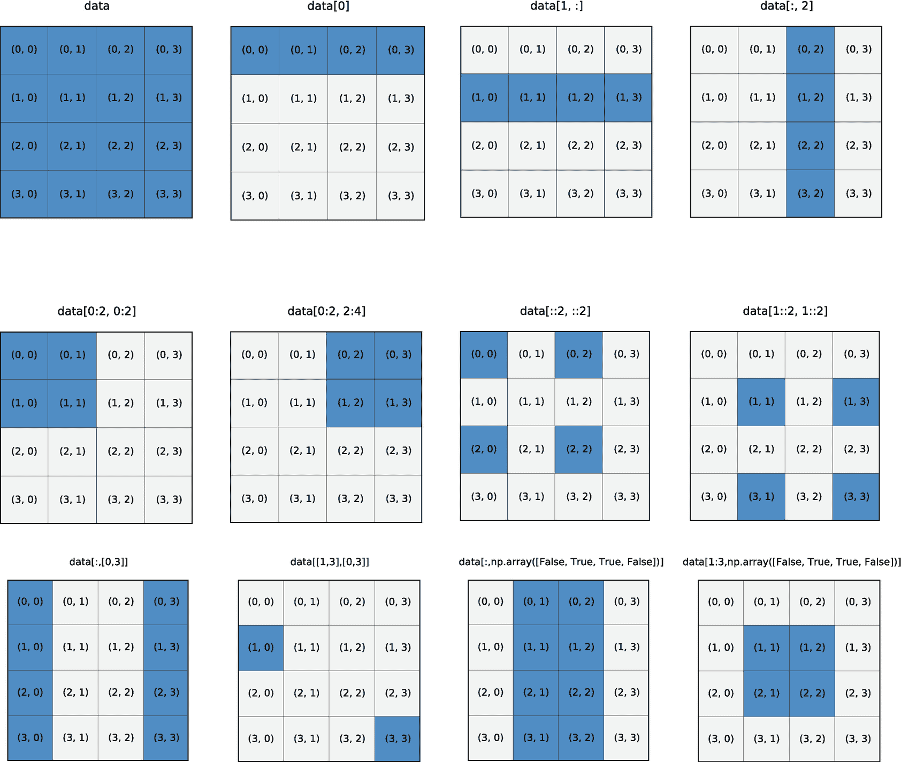
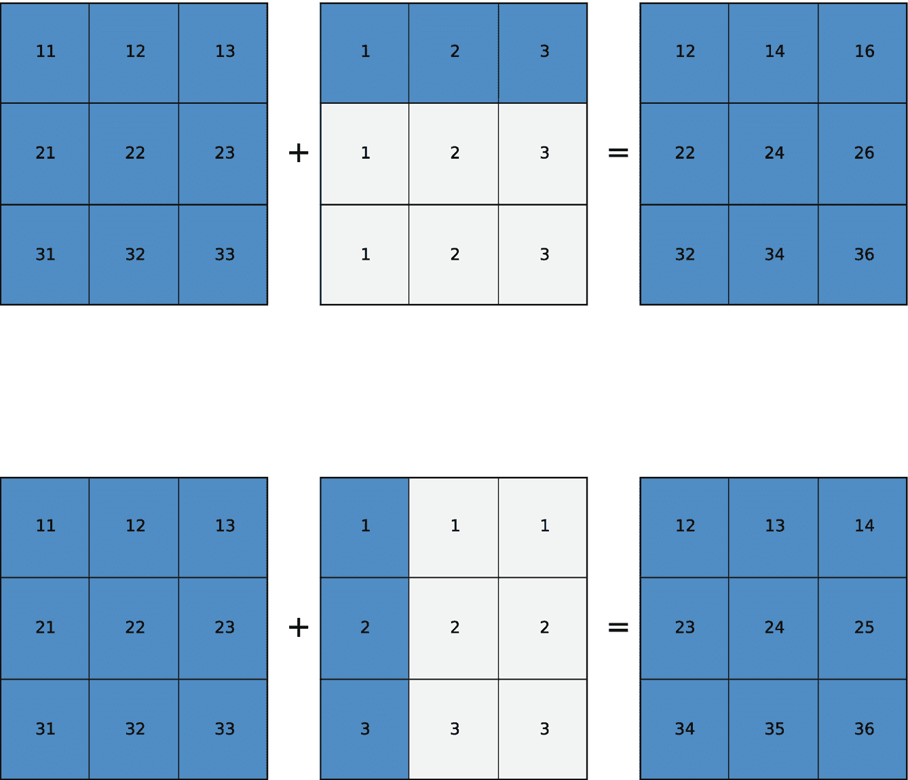
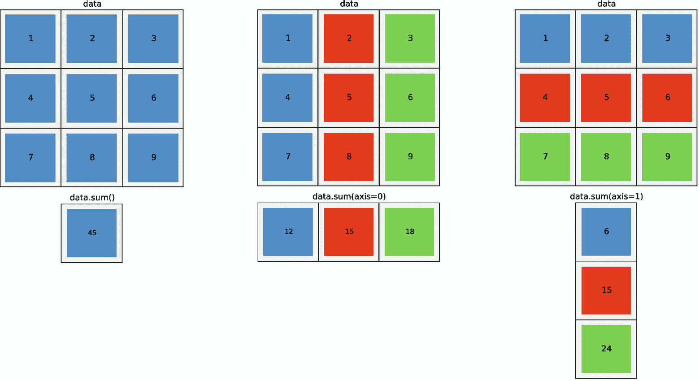

# 2. 向量、矩阵和多维数组

向量、矩阵和更高维度的数组是数值计算中的基本工具。当必须对一组输入值重复进行计算时，很自然且有利的做法是将数据表示为数组，并将计算表示为数组运算。以这种方式表述的计算被称为向量化。^(²⁰) 向量化计算通过对数组数据应用批量操作，消除了许多对数组元素的显式循环。其结果是代码更加简洁且更易于维护，并且可以将（例如，逐元素）数组运算的实现委托给更高效的低层库。因此，向量化计算可能比逐个元素的顺序计算快得多。这对于像 Python 这样的解释型语言尤其重要，因为逐个元素地循环数组会带来显著的性能开销。

在 Python 的科学计算环境中，`NumPy` 库提供了用于处理数组的高效数据结构。`NumPy` 的核心是用 C 实现的，并提供了用于处理和加工数组的高效函数。乍一看，`NumPy` 数组与 Python 的列表数据结构有些相似。但一个重要的区别是，虽然 Python 列表是对象的通用容器，但 `NumPy` 数组是同质的且具有固定大小的类型化数组。同质意味着数组中的所有元素具有相同的数据类型。固定大小意味着无法调整数组大小（除非创建一个新数组）。由于这些及其他原因，作用于 `NumPy` 数组的操作和函数可能比使用 Python 列表高效得多。除了数组的数据结构外，`NumPy` 还提供了大量作用于这些数据结构的基本运算符和函数，以及包含更高级算法（如线性代数和快速傅里叶变换）的子模块。

在本章中，我们首先介绍基本的 `NumPy` 数组数据结构以及创建此类 `NumPy` 数组的各种方法。接下来，我们将研究用于操作数组和使用数组进行计算的运算。`NumPy` 提供的多维数据数组是几乎所有 Python 数值库的基础。因此，花时间熟悉 `NumPy` 并理解其工作原理非常重要。

### NumPy

`NumPy` 库提供了用于表示多种数组的数据结构，以及用于操作此类数组的方法和函数。`NumPy` 几乎是所有 Python 科学或技术库的数值后端。因此，它是 Python 科学计算生态系统中非常重要的一部分。在撰写本文时，`NumPy` 的最新版本是 1.14.2。更多关于 `NumPy` 的信息，请访问 [www.numpy.org](http://www.numpy.org)。

## 导入模块

为了使用 `NumPy` 库，我们需要在程序中导入它。按照惯例，`numpy` 模块以别名 `np` 导入，如下所示：

```python
In [1]: import numpy as np
```

之后，我们可以使用 `np` 命名空间访问 `numpy` 模块中的函数和类。在本书中，我们假定 `NumPy` 模块都是这样导入的。

### NumPy 数组对象

`NumPy` 库的核心是用于表示同质数据多维数组的数据结构。同质指数组中的所有元素具有相同的数据类型。^((21)) `NumPy` 中用于多维数组的主要数据结构是 `ndarray` 类。除了存储在数组中的数据外，该数据结构还包含关于数组的重要元数据，例如其形状、大小、数据类型和其他属性。有关这些属性的更详细描述，请参见表 2-1。包含描述的完整属性列表可在 `ndarray` 的文档字符串（`docstring`）中找到，可以通过在 Python 解释器中调用 `help(np.ndarray)` 或在 IPython 控制台中调用 `np.ndarray?` 来访问。

**表 2-1** `ndarray` 类的基本属性

| 属性 | 描述 |

| --- | --- |

| `Shape` | 一个元组，包含数组每个维度（轴）的元素数量（即长度）。 |

| `Size` | 数组中的总元素数。 |

| `Ndim` | 维度的数量（轴数）。 |

| `nbytes` | 用于存储数据的字节数。 |

| `dtype` | 数组元素的数据类型。 |

下面的示例演示了如何访问 `ndarray` 类的实例 `data` 的这些属性：

```python
In [2]: data = np.array([[1, 2], [3, 4], [5, 6]])
In [3]: type(data)
Out[3]: 
In [4]: data
Out[4]: array([[1, 2],
[3, 4],
[5, 6]])
In [5]: data.ndim
Out[5]: 2
In [6]: data.shape
Out[6]: (3, 2)
In [7]: data.size
Out[7]: 6
In [8]: data.dtype
Out[8]: dtype('int64')
In [9]: data.nbytes
Out[9]: 48
```

这里，`ndarray` 实例 `data` 是使用函数 `np.array` 从一个嵌套的 Python 列表创建的。从数据以及各种规则创建 `ndarray` 实例的更多方法将在本章后面介绍。在前面的示例中，数据是一个形状为 3×2（由 `data.shape` 指示）的二维数组（`data.ndim`），总共包含六个元素（`data.size`），类型为 `int64`（`data.dtype`），总大小为 48 字节（`data.nbytes`）。

#### 数据类型

在上一节中，我们遇到了 `ndarray` 对象的 `dtype` 属性。该属性描述了数组中每个元素的数据类型（请记住，由于 `NumPy` 数组是同质的，所有元素都具有相同的数据类型）。`NumPy` 支持的基本数值数据类型如表 2-2 所示。也支持非数值数据类型，例如字符串、对象和用户定义的复合类型。

**表 2-2** `NumPy` 中可用的基本数值数据类型

| `dtype` | 变体 | 描述 |

| --- | --- | --- |

| `int` | `int8, int16, int32, int64` | 整数 |

| `uint` | `uint8, uint16, uint32, uint64` | 无符号（非负）整数 |

| `bool` | `Bool` | 布尔值（`True` 或 `False`） |

| `float` | `float16, float32, float64, float128` | 浮点数 |

| `complex` | `complex64, complex128, complex256` | 复数值浮点数 |

对于数值计算，最重要的数据类型是 `int`（用于整数）、`float`（用于浮点数）和 `complex`（用于复数浮点数）。这些数据类型都有不同的位大小，例如 `int32` 表示 32 位整数，`int64` 表示 64 位整数，等等。这相比于标准的 Python 类型（它只提供一种整数类型和一种浮点数类型）提供了对数据类型更精细的控制。通常，不需要显式选择数据类型的位大小来进行工作，但通常需要显式选择是使用整数、浮点数还是复数值数组。

下面的示例演示如何使用 `dtype` 参数生成整数、浮点数和复数值元素的数组：

```python
In [10]: np.array([1, 2, 3], dtype=np.int)
Out[10]: array([1, 2, 3])
In [11]: np.array([1, 2, 3], dtype=np.float)
Out[11]: array([ 1.,  2.,  3.])
In [12]: np.array([1, 2, 3], dtype=np.complex)
Out[12]: array([ 1.+0.j,  2.+0.j,  3.+0.j])
```

一旦创建了 `NumPy` 数组，其 `dtype` 就不能更改，除非创建一个包含类型转换后数组值的新副本。数组的类型转换非常简单，可以使用 `np.array` 函数：

```python
In [13]: data = np.array([1, 2, 3], dtype=np.float)
In [14]: data
Out[14]: array([ 1.,  2.,  3.])
In [15]: data.dtype
Out[15]: dtype('float64')
In [16]: data = np.array(data, dtype=np.int)
In [17]: data.dtype
Out[17]: dtype('int64')
In [18]: data
Out[18]: array([1, 2, 3])
```

或者使用 `ndarray` 类的 `astype` 方法：

```python
In [19]: data = np.array([1, 2, 3], dtype=np.float)
In [20]: data
Out[20]: array([ 1.,  2.,  3.])
In [21]: data.astype(np.int)
Out[21]: array([1, 2, 3])
```

使用 `NumPy` 数组进行计算时，如果操作需要，数据类型可能会从一种类型提升为另一种类型。例如，将浮点值数组和复数值数组相加，结果数组是一个复数值数组：

# NumPy数组的数据类型与内存排列

## 数据类型设置与转换

```
In [22]: d1 = np.array([1, 2, 3], dtype=float)
In [23]: d2 = np.array([1, 2, 3], dtype=complex)
In [24]: d1 + d2
Out[24]: array([ 2.+0.j,  4.+0.j,  6.+0.j])
In [25]: (d1 + d2).dtype
Out[25]: dtype('complex128')
```

在某些情况下，根据应用程序及其要求，将数据类型适当地设置为例如 `int` 或 `complex` 来创建数组是至关重要的。默认类型是 `float`。考虑以下示例：

```
In [26]: np.sqrt(np.array([-1, 0, 1]))
Out[26]: RuntimeWarning: invalid value encountered in sqrt
array([ nan,   0.,   1.])
In [27]: np.sqrt(np.array([-1, 0, 1], dtype=complex))
Out[27]: array([ 0.+1.j,  0.+0.j,  1.+0.j])
```

这里，使用 `np.sqrt` 函数计算数组中每个元素的平方根，根据数组的数据类型会得到不同的结果。只有当数组的数据类型是 `complex` 时，`-1` 的平方根才会得到虚数单位（在 Python 中表示为 `1j`）。

## 实部和虚部

无论 `dtype` 属性的值如何，所有 NumPy 数组实例都有 `real` 和 `imag` 属性，分别用于提取数组的实部和虚部：

```
In [28]: data = np.array([1, 2, 3], dtype=complex)
In [29]: data
Out[29]: array([ 1.+0.j,  2.+0.j,  3.+0.j])
In [30]: data.real
Out[30]: array([ 1.,  2.,  3.])
In [31]: data.imag
Out[31]: array([ 0.,  0.,  0.])
```

`np.real` 和 `np.imag` 函数也提供相同的功能，它们也可以应用于其他类似数组的对象，例如 Python 列表。请注意，Python 本身支持复数，并且 `imag` 和 `real` 属性也可用于 Python 标量。

## 数组数据在内存中的排列顺序

多维数组在内存中是以连续数据的形式存储的。在这个内存段中如何排列数组元素，存在多种选择。考虑一个包含行和列的二维数组：一种可能的存储方式是将行依次连续存储，另一种同样有效的方式是将列依次连续存储。前者称为行主序格式，后者称为列主序格式。使用行主序还是列主序是约定俗成的，例如，C 编程语言使用行主序格式，而 Fortran 使用列主序格式。创建或重塑 NumPy 数组时，可以通过关键字参数 `order='C'` 指定行主序格式，通过关键字参数 `order='F'` 指定列主序格式。默认格式是行主序。当 NumPy 数组用于与用 C 或 Fortran 编写的软件接口时，`'C'` 或 `'F'` 的排序方式尤其重要，这在用 Python 进行数值计算时经常需要。

行主序和列主序是多种映射策略中的特例，这些策略用于将索引（用于定位元素）映射到该元素在数组内存段中的偏移量。通常，NumPy 数组的属性 `ndarray.strides` 精确定义了这种映射方式。`strides` 属性是一个元组，其长度与数组的轴（维度）数量相同。`strides` 中的每个值，都是在为给定的索引表达式计算内存偏移量（以字节为单位）时，对应轴的索引需要乘以的系数。

例如，考虑一个 C 顺序的数组 `A`，形状为 `(2, 3)`，这对应于一个二维数组，其第一维和第二维分别有 2 个和 3 个元素。如果数据类型是 `int32`，则每个元素占用 4 个字节，因此该数组的总内存缓冲区大小为 2 × 3 × 4 = 24 字节。此数组的 `strides` 属性为 (4 × 3, 4 × 1) = (12, 4)，因为 `A[n, m]` 中 `m` 每增加 1，内存偏移量就增加一个项目，即 4 字节。同样地，`n` 每增加 1，内存偏移量就增加三个项目，即 12 字节（因为数组的第二维长度为 3）。另一方面，如果同一个数组以 `'F'` 顺序存储，那么 `strides` 将是 (4, 8)。使用步幅来描述数组索引到内存偏移量的映射非常巧妙，因为它可以用来描述不同的映射策略，并且许多常见的数组操作（例如转置）只需更改 `strides` 属性即可实现，这可以避免在内存中移动数据。仅需更改 `strides` 属性的操作会产生新的 `ndarray` 对象，这些对象引用与原始数组相同的数据。这样的数组被称为视图。为了提高效率，NumPy 在对数组应用操作时，会尽量创建视图而不是副本。这通常是一件好事，但重要的是要意识到，某些数组操作产生的是视图而不是新的独立数组，因为修改视图中的数据也会同时修改原始数组中的数据。在本章后面，我们将看到此行为的几个示例。

## 创建数组

在上一节中，我们介绍了 NumPy 用于表示数组的基本数据结构——`ndarray` 类，以及该类的基本属性。在本节中，我们将重点介绍 NumPy 库中可用于创建 `ndarray` 实例的函数。

根据数组的属性及其应用场景，可以通过多种方式生成数组。例如，正如我们在上一节所看到的，初始化一个 `ndarray` 实例的一种方法是在 Python 列表上使用 `np.array` 函数，该函数可以显式定义列表。然而，这种方法显然仅限于小数组。在许多情况下，需要生成元素遵循某种规则（如填充常量值、递增整数、均匀间隔的数字、随机数等）的数组。在其他情况下，我们可能需要从存储在文件中的数据创建数组。需求多种多样，NumPy 库为此提供了一整套用于生成各种类型数组的函数。在本节中，我们将更详细地介绍其中许多函数。有关完整列表，请参阅 NumPy 参考手册或通过键入 `help(np)` 或使用自动补全功能 `np.<TAB>` 获取的文档字符串。表 2-3 总结了一些常用的数组生成函数。

**表 2-3** NumPy 生成数组的函数汇总

| 函数名 | 数组类型 |
| --- | --- |
| `np.array` | 创建一个数组，其元素由类数组对象（例如，可以是（嵌套的）Python 列表、元组、可迭代序列或另一个 `ndarray` 实例）提供。 |
| `np.zeros` | 创建具有指定维度和数据类型的数组，并用零填充。 |
| `np.ones` | 创建具有指定维度和数据类型的数组，并用一填充。 |
| `np.diag` | 创建一个对角数组，沿对角线有指定值，其余位置为零。 |
| `np.arange` | 创建在指定的起始值、结束值和增量值之间均匀间隔的数组。 |
| `np.linspace` | 创建在指定的起始值和结束值之间均匀间隔的数组，使用指定数量的元素。 |
| `np.logspace` | 创建一个数组，其值在给定的起始值和结束值之间按对数刻度分布。 |
| `np.meshgrid` | 从一维坐标向量生成坐标矩阵（以及更高维的坐标数组）。 |
| `np.fromfunction` | 创建一个数组，并用给定函数计算的值填充，该函数针对给定数组大小的每个索引组合进行求值。 |
| `np.fromfile` | 从二进制（或文本）文件中的数据创建数组。NumPy 还提供了一个对应的函数 `np.tofile`，可以用它将 NumPy 数组存储到磁盘，之后使用 `np.fromfile` 读回。 |
| `np.genfromtxt`, `np.loadtxt` | 从文本文件（例如逗号分隔值 (CSV) 文件）读取的数据创建数组。`np.genfromtxt` 函数还支持包含缺失值的数据文件。 |
| `np.random.rand` | 生成一个数组，其中的随机数在 0 和 1 之间均匀分布。`np.random` 模块中还提供了其他类型的分布。 |

### 从列表和其他类数组对象创建数组

使用 `np.array` 函数，可以从显式的 Python 列表、可迭代表达式和其他类数组对象（例如其他 `ndarray` 实例）构建 NumPy 数组。例如，要从 Python 列表创建一维数组，我们只需将 Python 列表作为参数传递给 `np.array` 函数：

```
In [32]: np.array([1, 2, 3, 4])
Out[32]: array([1, 2, 3, 4])
In [33]: data.ndim
Out[33]: 1
In [34]: data.shape
Out[34]: (4,)
```

要创建一个与上例数据相同的二维数组，我们可以使用嵌套的 Python 列表：

### 由常量值填充的数组

`np.zeros` 和 `np.ones` 函数分别创建并返回由 0 和 1 填充的数组。它们将整数或元组作为第一个参数，该参数描述数组每个维度上的元素数量。例如，要创建一个 2×3 的零填充数组和一个长度为 4 的 1 填充数组，我们可以使用：

```
In [38]: np.zeros((2, 3))
Out[38]: array([[ 0.,  0.,  0.],
                [ 0.,  0.,  0.]])
In [39]: np.ones(4)
Out[39]: array([ 1.,  1.,  1., 1.])
```

与其他数组生成函数一样，`np.zeros` 和 `np.ones` 函数也接受一个可选的关键字参数，用于指定数组中元素的数据类型。默认情况下，数据类型是 `float64`，可以通过显式指定 `dtype` 参数将其更改为所需类型。

```
In [40]: data = np.ones(4)
In [41]: data.dtype
Out[41]: dtype('float64')
In [42]: data = np.ones(4, dtype=np.int64)
In [43]: data.dtype
Out[43]: dtype('int64')
```

可以通过先创建一个全为 1 的数组，然后将该数组乘以所需的填充值来生成一个填充了任意常量值的数组。不过，NumPy 也提供了 `np.full` 函数，可以一步完成此操作。以下两种构建具有十个元素的数组的方法（在此示例中，元素被初始化为数值 5.4）会产生相同的结果，但使用 `np.full` 效率稍高，因为它避免了乘法运算。

```
In [44]: x1 = 5.4 * np.ones(10)
In [45]: x2 = np.full(10, 5.4)
```

也可以使用 `np.fill` 函数将已创建的数组填充为常量值，该函数接受一个数组和一个值作为参数，并将数组中的所有元素设置为给定值。因此，以下两种创建数组的方法会得到相同的结果：

```
In [46]: x1 = np.empty(5)
In [47]: x1.fill(3.0)
In [48]: x1
Out[48]: array([ 3.,  3.,  3.,  3.,  3.])
In [49]: x2 = np.full(5, 3.0)
In [50]: x2
Out[50]: array([ 3.,  3.,  3.,  3.,  3.])
```

在最后一个例子中，我们还使用了 `np.empty` 函数，它会生成一个指定大小但值未初始化的数组。只有在能够通过其他方式（例如对数组元素进行显式循环或进行其他显式赋值）保证所有元素都被初始化时，才应使用此函数。本章稍后将更详细地介绍此函数。

### 由递增序列填充的数组

在数值计算中，通常需要生成在起始值和结束值之间均匀间隔的数组。NumPy 提供了两个类似的函数来创建此类数组：`np.arange` 和 `np.linspace`。两个函数都接受三个参数，其中前两个参数是起始值和结束值。`np.arange` 的第三个参数是增量，而 `np.linspace` 的第三个参数是数组中点的总数。

例如，要生成值在 1 到 10 之间、增量为 1 的数组，我们可以使用以下任一方法：

```
In [51]: np.arange(0.0, 10, 1)
Out[51]: array([ 0.,  1.,  2.,  3.,  4.,  5.,  6.,  7.,  8.,  9.])
In [52]: np.linspace(0, 10, 11)
Out[52]: array([ 0.,  1.,  2.,  3.,  4.,  5.,  6.,  7.,  8.,  9.,  10.])
```

但是，请注意 `np.arange` 不包含结束值 (10)，而默认情况下 `np.linspace` 包含结束值（尽管可以使用可选的 `endpoint` 关键字参数更改此行为）。使用 `np.arange` 还是 `np.linspace` 主要取决于个人偏好，但通常建议在增量是非整数时使用 `np.linspace`。

### 由对数序列填充的数组

`np.logspace` 函数与 `np.linspace` 类似，但数组中元素之间的增量是对数分布的，并且前两个参数（用于起始值和结束值）是可选的 `base` 关键字参数（默认为 10）的幂。例如，要生成一个值在 1 到 100 之间呈对数分布的数组，我们可以使用：

```
In [53]: np.logspace(0, 2, 5)  # 5 个数据点，范围从 10**0=1 到 10**2=100
Out[53]: array([ 1\. , 3.16227766, 10\. , 31.6227766 , 100.])
```

### 网格数组

多维坐标网格可以使用 `np.meshgrid` 函数生成。给定两个一维坐标数组（即包含沿给定维度的坐标集的数组），我们可以使用 `np.meshgrid` 函数生成二维坐标数组。以下示例对此进行了说明：

```
In [54]: x = np.array([-1, 0, 1])
In [55]: y = np.array([-2, 0, 2])
In [56]: X, Y = np.meshgrid(x, y)
In [57]: X
Out[57]: array([[-1,  0,  1],
                [-1,  0,  1],
                [-1,  0,  1]])
In [58]: Y
Out[58]: array([[-2, -2, -2],
                [ 0,  0,  0],
                [ 2,  2,  2]])
```

二维坐标数组（如本例中的 `X` 和 `Y`）的一个常见用例是评估关于两个变量 *x* 和 *y* 的函数。这在绘制两个变量的函数（如彩色图、等高线图）时非常有用。例如，要评估前一节中 `x` 和 `y` 数组所有值组合上的表达式 (*x*+*y*)²，我们可以使用二维坐标数组 `X` 和 `Y`：

```
In [59]: Z = (X + Y) ** 2
In [60]: Z
Out[60]: array([[9, 4, 1],
                [1, 0, 1],
                [1, 4, 9]])
```

也可以通过向 `np.meshgrid` 函数传递更多数组作为参数来生成更高维的坐标数组。或者，也可以使用 `np.mgrid` 和 `np.ogrid` 函数生成坐标数组，它们使用的是基于索引和切片对象的略微不同的语法。有关详细信息，请参阅它们的文档字符串或 NumPy 文档。

### 创建未初始化的数组

要创建特定大小和数据类型的数组，但不对数组中的元素进行任何特定值的初始化，我们可以使用 `np.empty` 函数。使用此函数（例如，与创建由零值元素初始化的数组的 `np.zeros` 相比）的优势在于可以避免初始化步骤。如果保证所有元素稍后在代码中都会被初始化，这可以节省一点时间，特别是在处理大型数组时。为了说明 `np.empty` 函数的用法，请考虑以下示例：

```
In [61]: np.empty(3, dtype=np.float)
Out[61]: array([  1.28822975e-231,   1.28822975e-231,   2.13677905e-314])
```

这里我们生成了一个包含三个 `float` 类型元素的新数组。不能保证这些元素具有任何特定值，实际值会随时间变化。因此，在使用数组之前，必须显式分配所有值，这一点非常重要；否则可能会出现不可预测的错误。通常，`np.zeros` 函数是比 `np.empty` 更安全的选择，如果性能提升不是很重要，最好使用 `np.zeros` 来最大程度地减少由于 `np.empty` 返回的数组中存在未初始化值而导致出现细微且难以复现的错误的可能性。

### 创建具有其他数组属性的数组

通常需要创建与另一个数组共享属性（例如形状和数据类型）的新数组。NumPy 为此提供了一系列函数：`np.ones_like`、`np.zeros_like`、`np.full_like` 和 `np.empty_like`。一个典型的用例是函数接受类型和大小未指定的数组作为参数，并且需要相同大小和类型的工作数组。例如，以下函数给出了这种情况的一个基本示例：

```python
def f(x):
    y = np.ones_like(x)
    # 使用 x 和 y 进行计算
    return y
```

在该函数体的第一行，使用 `np.ones_like` 创建了一个新数组 `y`，它生成一个与 `x` 具有相同大小和数据类型且填充了 1 的数组。

### 创建矩阵数组

矩阵，即二维数组，是数值计算中的一个重要情况。NumPy 提供了生成常用矩阵的函数。特别地，函数 `np.identity` 生成一个对角线元素为 1、其余元素为 0 的方阵：

```
In [62]: np.identity(4)
Out[62]: array([[ 1.,  0.,  0.,  0.],
                [ 0.,  1.,  0.,  0.],
                [ 0.,  0.,  1.,  0.],
                [ 0.,  0.,  0.,  1.]])
```

类似的函数 `numpy.eye` 生成对角线（可选偏移）上元素为 1 的矩阵。下面的示例说明了这一点，它分别生成了主对角线之上和之下非零对角线元素的矩阵：

```
In [63]: np.eye(3, k=1)
Out[63]: array([[ 0.,  1.,  0.],
                [ 0.,  0.,  1.],
                [ 0.,  0.,  0.]])
In [64]: np.eye(3, k=-1)
Out[64]: array([[ 0.,  0.,  0.],
                [ 1.,  0.,  0.],
                [ 0.,  1.,  0.]])
```

要构造一个对角线为任意一维数组的矩阵，我们可以使用 `np.diag` 函数（该函数也接受可选的关键字参数 `k` 来指定对角线的偏移量），如下所示：

```
In [65]: np.diag(np.arange(0, 20, 5))
Out[65]: array([[ 0,  0,  0,  0],
                [ 0,  5,  0,  0],
                [ 0,  0, 10,  0],
                [ 0,  0,  0, 15]])
```

这里我们给 `np.arange` 函数提供了第三个参数，它指定了该函数返回数组中元素的枚举步长。因此，生成的数组包含值 `[0, 5, 10, 15]`，`np.diag` 函数将其插入到一个二维矩阵的对角线上。

## 索引与切片

NumPy 数组的元素和子数组是使用也适用于 Python 列表的标准方括号表示法来访问的。在方括号内，为不同元素选择类型使用了多种不同的索引格式。通常，方括号内的表达式是一个元组，其中元组中的每个项指定了从数组的每个轴（维度）中选择哪些元素。

### 一维数组

在单个轴上，整数用于选择单个元素，所谓的切片用于选择元素的范围和序列。正整数用于从数组开头索引元素（索引从 0 开始），负整数用于从数组末尾索引元素，其中最后一个元素的索引为 -1，倒数第二个元素的索引为 -2，依此类推。

切片使用也适用于 Python 列表的 `:` 表示法来指定。在这种表示法中，可以使用 `m:n` 这样的表达式来选择一系列元素，它选择从 `m` 开始到 `n` − 1 结束的元素（注意，不包含第 `n` 个元素）。切片 `m:n` 也可以更明确地写成 `m : n : 1`，其中数字 1 指定应选择 `m` 和 `n` 之间的每个元素。要选择 `m` 和 `n` 之间每隔一个元素，使用 `m : n : 2`；要选择每隔 `p` 个元素，使用 `m : n : p`，依此类推。如果 `p` 为负数，元素将按相反顺序返回，从 `m` 开始到 `n`+1 结束（这意味着在这种情况下 `m` 必须大于 `n`）。有关 NumPy 数组索引和切片操作的总结，请参见表 2-4。

`表 2-4` 数组索引和切片表达式示例

| 表达式 | 描述 |
| --- | --- |
| `a[m]` | 选择索引为 `m` 的元素，其中 `m` 是整数（从 0 开始计数）。 |
| `a[-m]` | 从列表末尾选择第 `n` 个元素，其中 `n` 是整数。列表中的最后一个元素索引为 -1，倒数第二个元素为 -2，依此类推。 |
| `a[m:n]` | 选择索引从 `m` 开始到 `n` − 1 结束的元素（`m` 和 `n` 是整数）。 |
| `a[:]` 或 `a[0:-1]` | 选择给定轴上的所有元素。 |
| `a[:n]` | 选择从索引 0 开始到索引 `n` − 1（整数）的元素。 |
| `a[m:]` 或 `a[m:-1]` | 选择从索引 `m`（整数）开始一直到数组中最后一个元素的元素。 |
| `a[m:n:p]` | 选择索引从 `m` 到 `n`（不含）的元素，步长为 `p`。 |
| `a[::-1]` | 按相反顺序选择所有元素。 |

以下示例演示了 NumPy 数组的索引和切片操作。首先，考虑一个具有单个轴（维度）且包含 0 到 10 之间整数序列的数组：

```
In [66]: a = np.arange(0, 11)
In [67]: a
Out[67]: array([ 0,  1,  2,  3,  4,  5,  6,  7,  8,  9, 10])
```

注意，结束值 11 不包含在数组中。要从此数组中选择特定元素，例如第一个、最后一个和第五个元素，我们可以使用整数索引：

```
In [68]: a[0]  # 第一个元素
Out[68]: 0
In [69]: a[-1] # 最后一个元素
Out[69]: 10
In [70]: a[4]  # 第五个元素，索引为 4
Out[70]: 4
```

要选择一个范围元素，例如从第二个到倒数第二个元素，分别选择每个元素和每隔一个元素，我们可以使用索引切片：

```
In [71]: a[1:-1]
Out[71]: array([1, 2, 3, 4, 5, 6, 7, 8, 9])
In [72]: a[1:-1:2]
Out[72]: array([1, 3, 5, 7, 9])
```

要选择数组中的前五个和后五个元素，我们可以使用切片 `:5` 和 `-5:`，因为如果在 `m:n` 中省略了 `m` 或 `n`，则默认值分别是数组的开头和结尾。

```
In [73]: a[:5]
Out[73]: array([0, 1, 2, 3, 4])
In [74]: a[-5:]
Out[74]: array([6, 7, 8, 9, 10])
```

要反转数组并只选择每隔一个值，我们可以使用切片 `::-2`，如下例所示：

```
In [75]: a[::-2]
Out[75]: array([10,  8,  6,  4,  2,  0])
```

### 多维数组

对于多维数组，上一节介绍的元素选择方法可以应用于每个轴（维度）。结果是经过缩减的数组，其中每个元素都符合给定的选择规则。作为一个具体示例，考虑以下二维数组：

```
In [76]: f = lambda m, n: n + 10 * m
In [77]: A = np.fromfunction(f, (6, 6), dtype=int)
In [78]: A
Out[78]: array([[ 0,  1,  2,  3,  4,  5],
                [10, 11, 12, 13, 14, 15],
                [20, 21, 22, 23, 24, 25],
                [30, 31, 32, 33, 34, 35],
                [40, 41, 42, 43, 44, 45],
                [50, 51, 52, 53, 54, 55]])
```

我们可以使用切片和整数索引的组合，从这个二维数组中提取列和行：

```
In [79]: A[:, 1]  # 第二列
Out[79]: array([ 1, 11, 21, 31, 41, 51])
In [80]: A[1, :]  # 第二行
Out[80]: array([10, 11, 12, 13, 14, 15])
```

通过在数组的每个轴上应用切片，我们可以提取子数组（在这个二维示例中是子矩阵）：

```
In [81]: A[:3, :3]  # 上半部分对角线块矩阵
Out[81]: array([[ 0,  1,  2],
                [10, 11, 12],
                [20, 21, 22]])
In [82]: A[3:, :3]  # 左下非对角线块矩阵
Out[82]: array([[30, 31, 32],
                [40, 41, 42],
                [50, 51, 52]])
```

使用不等于 1 的元素间距，可以提取由非连续元素组成的子矩阵：

```
In [83]: A[::2, ::2]  # 从 0, 0 开始，每隔一个元素
Out[83]: array([[ 0,  2,  4],
                [20, 22, 24],
                [40, 42, 44]])
In [84]: A[1::2, 1::3]  # 从 1, 1 开始，每隔两个和三个元素
Out[84]: array([[11, 14],
                [31, 34],
                [51, 54]])
```

这种从多维数组中提取数据子集的能力是一个简单但非常强大的功能，具有许多数据处理应用。

### 视图

通过切片操作从数组中提取的子数组是同一底层数组数据的另一种*视图*。也就是说，它们是与原始数组引用内存中相同数据的数组，但具有不同的 `strides` 配置。当视图中的元素被赋予新值时，原始数组的值也会随之更新。例如，

# 数组索引与重塑

```
In [85]: B = A[1:5, 1:5]
In [86]: B
Out[86]: array([[11, 12, 13, 14],
[21, 22, 23, 24],
[31, 32, 33, 34],
[41, 42, 43, 44]])
In [87]: B[:, :] = 0
In [88]: A
Out[88]: array([[ 0,  1,  2,  3,  4,  5],
[10,  0,  0,  0,  0, 15],
[20,  0,  0,  0,  0, 25],
[30,  0,  0,  0,  0, 35],
[40,  0,  0,  0,  0, 45],
[50, 51, 52, 53, 54, 55]])
```

这里，给从数组`A`创建的数组`B`中的元素赋新值，也会修改`A`中的值（因为两个数组引用的是内存中的相同数据）。提取子数组生成的是视图而非独立的新数组，这一特性省去了复制数据的需要，提升了性能。当需要的是副本而非视图时，可以通过调用`ndarray`实例的`copy`方法来显式复制视图。

```
In [89]: C = B[1:3, 1:3].copy()
In [90]: C
Out[90]: array([[0, 0],
[0, 0]])
In [91]: C[:, :] = 1  # 这不会影响 B，因为 C 是视图 B[1:3, 1:3] 的副本
In [92]: C
Out[92]: array([[1, 1],
[1, 1]])
In [93]: B
Out[93]: array([[0, 0, 0, 0],
[0, 0, 0, 0],
[0, 0, 0, 0],
[0, 0, 0, 0]])
```

除了`ndarray`类的`copy`方法外，还可以使用函数`np.copy`来复制数组，或者等效地，在使用关键字参数`copy=True`的情况下使用`np.array`函数。

### 花式索引和布尔值索引

在上一节中，我们研究了如何用整数和切片来索引NumPy数组，以提取单个元素或元素范围。NumPy提供了另一种便捷的数组索引方法，称为花式索引。使用花式索引，可以通过另一个NumPy数组、Python列表或整数序列来索引数组，这些值的具体取值得以选择被索引数组中的元素。为了阐明这个概念，请考虑以下示例：我们首先创建一个包含11个浮点数的NumPy数组，然后用另一个NumPy数组（以及Python列表）来索引该数组，以从原始数组中提取索引为0、2和4的元素：

```
In [94]: A = np.linspace(0, 1, 11)
Out[94]: array([ 0\. ,  0.1,  0.2,  0.3,  0.4,  0.5,  0.6,  0.7,  0.8,  0.9,  1\. ])
In [95]: A[np.array([0, 2, 4])]
Out[95]: array([ 0\. ,  0.2,  0.4])
In [96]: A[[0, 2, 4]]  # 同样可以通过用 Python 列表索引来实现
Out[96]: array([ 0\. ,  0.2,  0.4])
```

这种索引方法可以沿多维NumPy数组的每个轴（维度）使用。它要求用于索引的数组或列表中的元素必须是整数。

NumPy数组索引的另一种变体是使用布尔值索引数组。在这种情况下，每个元素（其值为`True`或`False`）表示是否从具有相应索引的列表中选择该元素。也就是说，如果布尔值索引数组中的元素 *n* 为`True`，则从被索引数组中选择元素 *n*；如果值为`False`，则不选择元素 *n*。当需要从数组中过滤出元素时，这种索引方法非常方便。例如，要从数组`A`（如上一节所定义）中选择所有值超过0.5的元素，我们可以将对NumPy数组应用比较运算符与使用布尔值数组进行索引结合起来：

```
In [97]: A > 0.5
Out[97]: array([False, False, False, False, False, False, True, True, True, True, True], dtype=bool)
In [98]: A[A > 0.5]
Out[98]: array([ 0.6,  0.7,  0.8,  0.9,  1\. ])
```

与使用切片创建的数组不同，使用花式索引和布尔值索引返回的数组不是视图，而是独立的新数组。尽管如此，仍然可以为使用花式索引选出的元素赋值：

```
In [99]: A = np.arange(10)
In [100]: indices = [2, 4, 6]
In [101]: B = A[indices]
In [102]: B[0] = -1  # 这不会影响 A
In [103]: A
Out[103]: array([0, 1, 2, 3, 4, 5, 6, 7, 8, 9])
In [104]: A[indices] = -1  # 这会改变 A
In [105]: A
Out[105]: array([ 0,  1, -1,  3, -1,  5, -1,  7,  8,  9])
```

对于布尔值索引也是如此：

```
In [106]: A = np.arange(10)
In [107]: B = A[A > 5]
In [108]: B[0] = -1  # 这不会影响 A
In [109]: A
Out[109]: array([0, 1, 2, 3, 4, 5, 6, 7, 8, 9])
In [110]: A[A > 5] = -1  # 这会改变 A
In [111]: A
Out[111]: array([ 0,  1,  2,  3,  4,  5, -1, -1, -1, -1])
```

关于NumPy数组不同索引方法的可视化总结见图`2-1`。请注意，我们在这里讨论的每种索引类型都可以独立地应用于数组的每个维度。



`图 2-1` NumPy数组索引方法的可视化总结。这些图表表示形状为 `(4, 4)` 的NumPy数组，高亮显示的元素是使用数组块表示上方的索引表达式选出的元素。

## 重塑与调整大小

处理数组形式的数据时，经常需要重新排列数组并改变其解释方式。例如，一个 *N* × *N* 的矩阵数组可以重排成长度为 *N*² 的向量，或者一组一维数组可以串联在一起或并排堆叠形成矩阵。NumPy为此类操作提供了丰富的函数集。表`2-5`汇总了其中部分函数。

**表 2-5.** 用于操作数组维度和形状的NumPy函数汇总

| 函数/方法 | 描述 |
| --- | --- |
| `np.reshape`, `np.ndarray.reshape` | 重塑一个N维数组。元素总数必须保持不变。 |
| `np.ndarray.flatten` | 创建一个N维数组的副本，并将其重新解释为一维数组（即所有维度被压缩为一个）。 |
| `np.ravel`, `np.ndarray.ravel` | 创建一个N维数组的视图（如果可能，否则为副本），并将其解释为一维数组。 |
| `np.squeeze` | 移除长度为1的轴。 |
| `np.expand_dims`, `np.newaxis` | 向数组添加一个长度为1的新轴（维度），其中`np.newaxis`用于数组索引。 |
| `np.transpose`, `np.ndarray.transpose`, `np.ndarray.T` | 转置数组。转置操作对应于反转（或更一般地，置换）数组的轴。 |
| `np.hstack` | 水平堆叠数组列表（沿轴1）：例如，给定一个列向量列表，追加列以形成矩阵。 |
| `np.vstack` | 垂直堆叠数组列表（沿轴0）：例如，给定一个行向量列表，追加行以形成矩阵。 |
| `np.dstack` | 深度堆叠数组（沿轴2）。 |
| `np.concatenate` | 通过沿给定轴依次追加数组来创建新数组。 |
| `np.resize` | 调整数组大小。创建原始数组的新副本，尺寸为指定大小。必要时，将重复原始数组以填充新数组。 |
| `np.append` | 向数组追加一个元素。创建数组的新副本。 |
| `np.insert` | 在指定位置插入一个新元素。创建数组的新副本。 |
| `np.delete` | 删除指定位置的一个元素。创建数组的新副本。 |

重塑数组不需要修改底层数组数据；它仅通过重新定义数组的`strides`属性来改变数据的解释方式。这种操作的一个例子是将2 × 2数组（矩阵）重新解释为1 × 4数组（向量）。在NumPy中，可以使用`np.reshape`函数或`ndarray`类的`reshape`方法来重新配置底层数据的解释方式。它接受一个数组和该数组的新形状作为参数：

```
In [112]: data = np.array([[1, 2], [3, 4]])
In [113]: np.reshape(data, (1, 4))
Out[113]: array([[1, 2, 3, 4]])
In [114]: data.reshape(4)
Out[114]: array([1, 2, 3, 4])
```

要求数组的新形状必须与原始尺寸中的元素数量匹配。但是，轴的数目（维度）不需要保持不变，如前面示例所示，在第一个例子中，新数组的维度为 `2`，形状为 `(1, 4)`，而在第二个例子中，新数组的维度为 `1`，形状为 `(4,)`。这个例子还展示了两种不同的调用重塑操作的方式：使用 `np.reshape` 函数和 `ndarray` 的 `reshape` 方法。请注意，重塑数组会生成该数组的一个视图，如果需要数组的独立副本，则必须显式复制该视图（例如，使用 `np.copy`）。

`np.ravel`（及其对应的 `ndarray` 方法）是重塑的一种特殊情况，它会折叠数组的所有维度，并返回一个展平的一维数组，其长度与原始数组中的元素总数相对应。`ndarray` 的 `flatten` 方法执行相同的功能，但返回的是副本而不是视图。

```
In [115]: data = np.array([[1, 2], [3, 4]])
In [116]: data
Out[116]: array([[1, 2],
       [3, 4]])
In [117]: data.flatten()
Out[117]: array([ 1,  2,  3,  4])
In [118]: data.flatten().shape
Out[118]: (4,)
```

`np.ravel` 和 `np.flatten` 将数组的轴折叠成一维数组，而向数组中引入新轴也是可行的，可以通过使用 `np.reshape` 实现，或者在添加新的空轴时，使用索引标记和 `np.newaxis` 关键字（放在新轴的位置）。在以下示例中，数组 `data` 有一个轴，因此通常应使用包含一个元素的元组对其进行索引。但是，如果使用包含多个元素的元组进行索引，并且元组中额外的索引值为 `np.newaxis`，则会添加相应的新轴：

```
In [119]: data = np.arange(0, 5)
In [120]: column = data[:, np.newaxis]
In [121]: column
Out[121]: array([[0],
       [1],
       [2],
       [3],
       [4]])
In [122]: row = data[np.newaxis, :]
In [123]: row
Out[123]: array([[0, 1, 2, 3, 4]])
```

函数 `np.expand_dims` 也可用于向数组添加新维度，在前面的示例中，表达式 `data[:, np.newaxis]` 等同于 `np.expand_dims(data, axis=1)`，而 `data[np.newaxis, :]` 等同于 `np.expand_dims(data, axis=0)`。这里的 `axis` 参数指定了新轴相对于现有轴的插入位置。

到目前为止，我们研究了以不影响底层数据的方式重新排列数组的方法。在本章前面，我们还研究了如何使用各种索引技术提取子数组。除了重塑和选择子数组之外，通常还需要将数组合并成更大的数组，例如，将单独计算或测量的数据系列连接成更高维度的数组，如矩阵。为此，NumPy 提供了函数 `np.vstack`，用于垂直堆叠（例如，将行堆叠成矩阵），以及 `np.hstack`，用于水平堆叠（例如，将列堆叠成矩阵）。函数 `np.concatenate` 提供了类似的功能，但它接受一个关键字参数 `axis`，用于指定数组要沿其连接的轴。

传递给 `np.hstack`、`np.vstack` 和 `np.concatenate` 的数组的形状对于实现所需的数组连接类型至关重要。例如，考虑以下情况：假设我们有一维数组数据，想要垂直堆叠它们以获得一个矩阵，其中的行由这些一维数组组成。我们可以使用 `np.vstack` 来实现：

```
In [124]: data = np.arange(5)
In [125]: data
Out[125]: array([0, 1, 2, 3, 4])
In [126]: np.vstack((data, data, data))
Out[126]: array([[0, 1, 2, 3, 4],
       [0, 1, 2, 3, 4],
       [0, 1, 2, 3, 4]])
```

如果我们想水平堆叠数组，以获得一个矩阵，其中数组作为列向量，我们可能会首先尝试使用 `np.hstack` 进行类似操作：

```
In [127]: data = np.arange(5)
In [128]: data
Out[128]: array([0, 1, 2, 3, 4])
In [129]: np.hstack((data, data, data))
Out[129]: array([0, 1, 2, 3, 4, 0, 1, 2, 3, 4, 0, 1, 2, 3, 4])
```

这确实水平堆叠了数组，但并非此处预期的方式。为了让 `np.hstack` 将输入数组视为列并相应地堆叠它们，我们需要将输入数组变成形状为 `(1, 5)` 的二维数组，而不是形状为 `(5,)` 的一维数组。如前所述，我们可以通过使用 `np.newaxis` 进行索引来插入一个新轴：

```
In [130]: data = data[:, np.newaxis]
In [131]: np.hstack((data, data, data))
Out[131]: array([[0, 0, 0],
       [1, 1, 1],
       [2, 2, 2],
       [3, 3, 3],
       [4, 4, 4]])
```

当堆叠的数组与最终数组具有相同数量的维度，并且输入数组是沿着长度为 1 的轴进行堆叠时，水平堆叠、垂直堆叠以及使用 `np.concatenate` 拼接数组的函数行为最为清晰。

NumPy 数组一旦创建，其元素个数便无法更改。例如，要使用 `np.append`、`np.insert` 和 `np.delete` 等函数在 NumPy 数组中插入、追加和删除元素，必须创建一个新数组并将数据复制到其中。有时人们可能会想用这些函数来增大或缩小 NumPy 数组的大小，但由于创建新数组和复制数据的开销，通常最好预先分配好数组大小，使其后续无需调整大小。

## 向量化表达式

将数值数据存储在数组中的目的是能够使用简洁的向量化表达式来处理数据，这些表达式表示应用于数组中所有元素的批处理操作。高效使用向量化表达式可以省去许多显式的 `for` 循环。这带来了更简洁的代码、更好的可维护性和更高的性能。NumPy 实现了与大多数基础数学函数和运算符相对应的函数和向量化操作。其中许多函数和操作都是按元素对数组进行运算，而二元运算要求表达式中的所有数组大小兼容。兼容大小的含义通常是，表达式中的变量代表标量或大小和形状相同的数组。更一般地说，如果数组可以通过*广播*转换为相同的形状和大小，那么涉及两个数组的二元运算就是明确定义的。

在标量与数组的运算中，广播指的是将标量分布开，并对数组中的每个元素应用该运算。当表达式包含大小不同的数组时，如果较小的数组可以根据 NumPy 的广播规则*广播*（即“有效扩展”）以匹配较大的数组，那么该运算仍然可能是明确定义的：如果两个数组的各个轴长度相等，或者其中任何一个轴的长度为 1，则一个数组可以在另一个数组上进行广播。如果两个数组的轴数不相等，则从左侧向轴数较少的数组中填充长度为 1 的新轴，直到两个数组的维数一致。

图 2-2 展示了两个简单的数组广播示例：一个 3×3 矩阵分别与一个 1×3 行向量和一个 3×1 列向量相加，两种情况下的结果都是一个 3×3 矩阵。然而，这两个结果矩阵中的元素是不同的，因为根据 NumPy 的广播规则，行向量和列向量的元素广播到较大数组形状的方式不同，具体取决于数组的形状。



图 2-2

行向量和列向量广播到矩阵形状的可视化。高亮元素代表数组的真实元素，而浅灰色阴影元素描述了较小数组元素的广播方式。

### 算术运算

NumPy 数组的标准算术运算执行的是按元素操作。例如，考虑大小相等的数组的加法、减法、乘法和除法：

# NumPy 数组算术运算与逐元素函数

## 数组间的基本运算
```python
In [132]: x = np.array([[1, 2], [3, 4]])
In [133]: y = np.array([[5, 6], [7, 8]])
In [134]: x + y
Out[134]: array([[ 6,  8], [10, 12]])
In [135]: y - x
Out[135]: array([[4, 4], [4, 4]])
In [136]: x * y
Out[136]: array([[ 5, 12], [21, 32]])
In [137]: y / x
Out[137]: array([[ 5.        ,  3.        ], [ 2.33333333,  2.        ]])
```

在标量和数组之间的运算中，标量值会应用于数组中的每个元素，这正如你所预期的那样：
```python
In [138]: x * 2
Out[138]: array([[2, 4], [6, 8]])
In [139]: 2 ** x
Out[139]: array([[ 2,  4], [ 8, 16]])
In [140]: y / 2
Out[140]: array([[ 2.5,  3. ], [ 3.5,  4. ]])
In [141]: (y / 2).dtype
Out[141]: dtype('float64')
```
注意，如果计算需要，表达式结果数组的 `dtype` 可能会提升，如前面的示例所示：整数数组与整数标量进行除法运算，结果得到一个 `dtype` 为 `np.float64` 的数组。

## 数组广播
如果对大小或形状不兼容的数组执行算术运算，则会引发 `ValueError` 异常：
```python
In [142]: x = np.array([1, 2, 3, 4]).reshape(2, 2)
In [143]: z = np.array([1, 2, 3, 4])
In [144]: x / z
ValueError                                Traceback (most recent call last)
<ipython-input-144-3d3c3d3c3d3c> in <module>()
----> 1 x / z
ValueError: operands could not be broadcast together with shapes (2,2) (4,)
```
这里数组 `x` 的形状为 `(2, 2)`，而数组 `z` 的形状为 `(4,)`，无法广播成与 `(2, 2)` 兼容的形式。另一方面，如果 `z` 的形状为 `(2,)`、`(2, 1)` 或 `(1, 2)`，那么它可以沿着长度为 1 的轴有效重复数组 `z` 来广播成形状 `(2, 2)`。让我们首先考虑一个形状为 `(1, 2)` 的数组 `z` 的示例，其中第一个轴（轴 0）的长度为 1：
```python
In [145]: z = np.array([[2, 4]])
In [146]: z.shape
Out[146]: (1, 2)
```
用数组 `z` 除以数组 `x`，等价于用通过重复（这里使用 `np.concatenate`）行向量 `z` 构建的数组 `zz` 来除以 `x`，得到的数组 `zz` 与 `x` 维度相同：
```python
In [147]: x / z
Out[147]: array([[ 0.5,  0.5], [ 1.5,  1. ]])
In [148]: zz = np.concatenate([z, z], axis=0)
In [149]: zz
Out[149]: array([[2, 4], [2, 4]])
In [150]: x / zz
Out[150]: array([[ 0.5,  0.5], [ 1.5,  1. ]])
```
让我们再考虑一个数组 `z` 形状为 `(2, 1)` 且第二个轴（轴 1）长度为 1 的示例：
```python
In [151]: z = np.array([[2], [4]])
In [152]: z.shape
Out[152]: (2, 1)
```
在这种情况下，用 `z` 除以 `x` 等价于用通过重复列向量 `z` 构建的数组 `zz` 来除以 `x`，直到得到一个与 `x` 维度相同的矩阵。
```python
In [153]: x / z
Out[153]: array([[ 0.5 ,  1.  ], [ 0.75,  1.  ]])
In [154]: zz = np.concatenate([z, z], axis=1)
In [155]: zz
Out[155]: array([[2, 2], [4, 4]])
In [156]: x / zz
Out[156]: array([[ 0.5 ,  1.  ], [ 0.75,  1.  ]])
```
总之，这些示例展示了在执行 `x / z` 运算时，形状为 `(1, 2)` 和 `(2, 1)` 的数组如何广播到数组 `x` 的形状 `(2, 2)`。在这两种情况下，运算 `x / z` 的结果等同于：先将较小的数组 `z` 沿其长度为 1 的轴重复，得到一个与 `x` 形状相同的新数组 `zz`，然后执行大小相等的数组运算 `x / zz`。然而，广播的实现并不会显式地执行这种扩展和相应的内存复制，但用这种方式来思考数组广播是有帮助的。

表 2-6 汇总了用于 NumPy 数组算术运算的运算符。这些运算符使用了 Python 中的标准符号。对一个或两个数组进行算术运算的结果是一个新的独立数组，其在内存中拥有自己的数据。因此，计算复杂的算术表达式可能会触发多次内存分配和复制操作，当处理大型数组时，这会导致较大的内存占用并对性能产生负面影响。在这种情况下，使用原地运算（见表 2-6）可以减少内存占用并提高性能。作为原地运算符的示例，考虑以下两个具有相同效果的语句：

**表 2-6** 用于 NumPy 数组逐元素算术运算的运算符

| 运算符 | 运算 |
| --- | --- |
| `+`, `+=` | 加法 |
| `-`, `-=` | 减法 |
| `*`, `*=` | 乘法 |
| `/`, `/=` | 除法 |
| `//`, `//=` | 整数除法 |
| `**`, `**=` | 乘方 |

```python
In [157]: x = x + y
In [158]: x += y
```
这两个表达式具有相同的效果，但在第一种情况下，`x` 被重新赋值给一个新数组；而在第二种情况下，数组 `x` 的值是原地更新的。大量使用原地运算符往往会损害代码的可读性，因此应仅在必要时使用原地运算符。

## 逐元素初等数学函数
除了使用运算符的算术表达式外，NumPy 还提供了向量化函数，用于对许多初等数学函数和运算进行逐元素计算。表 2-7 总结了 NumPy 中的初等数学函数。这些函数中的每一个都将一个数组（任意维度）作为输入，并返回一个形状相同的新数组，其中输入数组中的每个元素都应用了该函数。输出数组的数据类型不一定与输入数组相同。

**表 2-7** 用于逐元素初等数学函数的 NumPy 函数选择

| NumPy 函数 | 描述 |
| --- | --- |
| `np.cos`, `np.sin`, `np.tan` | 三角函数。 |
| `np.arccos`, `np.arcsin`, `np.arctan` | 反三角函数。 |
| `np.cosh`, `np.sinh`, `np.tanh` | 双曲三角函数。 |
| `np.arccosh`, `np.arcsinh`, `np.arctanh` | 反双曲三角函数。 |
| `np.sqrt` | 平方根。 |
| `np.exp` | 指数函数。 |
| `np.log`, `np.log2`, `np.log10` | 分别为以 `e`、`2` 和 `10` 为底的对数。 |

例如，`np.sin` 函数（仅接受一个参数）用于计算数组中所有值的正弦值：
```python
In [159]: x = np.linspace(-1, 1, 11)
In [160]: x
Out[160]: array([-1. , -0.8, -0.6, -0.4, -0.2,  0. ,  0.2,  0.4,  0.6,  0.8,  1.])
In [161]: y = np.sin(np.pi * x)
In [162]: np.round(y, decimals=4)
Out[162]: array([-0., -0.5878, -0.9511, -0.9511, -0.5878, 0., 0.5878, 0.9511, 0.9511, 0.5878, 0.])
```
这里我们还使用了常数 `np.pi` 和函数 `np.round` 来将 `y` 的值四舍五入到四位小数。与 `np.sin` 函数类似，许多初等数学函数接受一个输入数组并生成一个输出数组。相比之下，许多数学运算符函数（表 2-8）则对两个输入数组进行操作并返回一个数组。

### 表 2-8 用于逐元素数学运算的 NumPy 函数总结

| NumPy 函数 | 描述 |
| --- | --- |
| `np.add`, `np.subtract`, `np.multiply`, `np.divide` | 两个 NumPy 数组的加法、减法、乘法和除法。 |
| `np.power` | 将第一个输入参数提升到第二个输入参数的幂次（逐元素应用）。 |
| `np.remainder` | 除法的余数。 |
| `np.reciprocal` | 每个元素的倒数。 |
| `np.real`, `np.imag`, `np.conj` | 输入数组中元素的实部、虚部和复共轭。 |
| `np.sign`, `np.abs` | 符号和绝对值。 |
| `np.floor`, `np.ceil`, `np.rint` | 转换为整数值。 |
| `np.round` | 四舍五入到指定位数的小数。 |

```
In [163]: np.add(np.sin(x) ** 2, np.cos(x) ** 2)
Out[163]: array([ 1.,  1.,  1.,  1.,  1.,  1.,  1.,  1.,  1.,  1.,  1.])
In [164]: np.sin(x) ** 2 + np.cos(x) ** 2
Out[164]: array([ 1.,  1.,  1.,  1.,  1.,  1.,  1.,  1.,  1.,  1.,  1.])
```

请注意，在这个例子中，`np.add` 和运算符 `+` 是等价的，在常规使用中应使用运算符。

有时需要定义新的函数来对 NumPy 数组进行逐元素运算。实现此类函数的一个好方法是将其表示为已有的 NumPy 运算符和表达式，但如果这样做不可行，`np.vectorize` 函数可以成为一个方便的工具。该函数接受一个非向量化函数并返回一个向量化函数。例如，考虑以下 `heaviside` 阶跃函数的实现，它适用于标量输入：

```
In [165]: def heaviside(x):
...:     return 1 if x > 0 else 0
In [166]: heaviside(-1)
Out[166]: 0
In [167]: heaviside(1.5)
Out[167]: 1
```

然而，遗憾的是，这个函数不适用于 NumPy 数组输入：

```
In [168]: x = np.linspace(-5, 5, 11)
In [169]: heaviside(x)
...
ValueError: The truth value of an array with more than one element is ambiguous. Use a.any() or a.all()
```

使用 `np.vectorize`，可以将标量的 `heaviside` 函数转换为一个向量化函数，使其能够接受 NumPy 数组作为输入：

```
In [170]: heaviside = np.vectorize(heaviside)
In [171]: heaviside(x)
Out[171]: array([0, 0, 0, 0, 0, 0, 1, 1, 1, 1, 1])
```

尽管 `np.vectorize` 返回的函数可以处理数组，但它会相对较慢，因为必须为数组中的每个元素调用原始函数。使用布尔值数组进行算术运算，有更好的方法来实现这个特定函数，本章后面将讨论这一点：

```
In [172]: def heaviside(x):
...:     return 1.0 * (x > 0)
```

尽管如此，`np.vectorize` 通常是一种快速且便捷的方法，可以将为标量输入编写的函数向量化。

除了表 2-7 中总结的 NumPy 初等数学函数之外，NumPy 中还有许多用于数学运算的函数。表 2-8 给出了其中一部分函数的总结。

## 聚合函数

NumPy 提供了另一组用于计算 NumPy 数组聚合值的函数，这些函数以数组作为输入，默认返回一个标量作为输出。例如，输入数组中数值的平均值、标准差和方差等统计量，以及计算数组元素和与积的函数，都属于聚合函数。

表 2-9 给出了聚合函数的汇总。所有这些函数也可以作为 `ndarray` 类的方法使用。例如，下面的示例中 `np.mean(data)` 和 `data.mean()` 是等价的：

### 表 2-9 NumPy 用于计算 NumPy 数组聚合值的函数

| NumPy 函数 | 描述 |
| --- | --- |
| `np.mean` | 数组中所有值的平均值。 |
| `np.std` | 标准差。 |
| `np.var` | 方差。 |
| `np.sum` | 所有元素的和。 |
| `np.prod` | 所有元素的乘积。 |
| `np.cumsum` | 所有元素的累积和。 |
| `np.cumprod` | 所有元素的累积乘积。 |
| `np.min, np.max` | 数组中的最小值/最大值。 |
| `np.argmin, np.argmax` | 数组中最小值/最大值的索引。 |
| `np.all` | 如果参数数组中的所有元素都不为零，则返回 `True`。 |
| `np.any` | 如果参数数组中的任何元素不为零，则返回 `True`。 |

```
In [173]: data = np.random.normal(size=(15,15))
In [174]: np.mean(data)
Out[174]: -0.032423651106794522
In [175]: data.mean()
Out[175]: -0.032423651106794522
```

默认情况下，表 2-9 中的函数会对整个输入数组进行聚合。通过在这些函数及其对应的 `ndarray` 方法中使用 `axis` 关键字参数，可以控制聚合操作在数组的哪个轴上进行。`axis` 参数可以是一个整数，用于指定要聚合的轴。在许多情况下，`axis` 参数也可以是一个整数元组，用于指定要聚合的多个轴。以下示例演示了在形状为 `(5, 10, 15)` 的数组上调用聚合函数 `np.sum` 时，如何根据 `axis` 参数的值来减少数组的维度：

```
In [176]: data = np.random.normal(size=(5, 10, 15))
In [177]: data.sum(axis=0).shape
Out[177]: (10, 15)
In [178]: data.sum(axis=(0, 2)).shape
Out[178]: (10,)
In [179]: data.sum()
Out[179]: -31.983793284860798
```

图 2-3 直观地展示了对一个 3×3 数组的所有元素、沿着第一个轴以及沿着第二个轴进行聚合的情况。在此示例中，`data` 数组填充了 1 到 9 的整数：



### 图 2-3 对形状为 3×3 的二维数组沿所有轴（左）、第一个轴（中）和第二个轴（右）进行数组聚合函数的示意

```
In [180]: data = np.arange(1,10).reshape(3,3)
In [181]: data
Out[181]: array([[1, 2, 3],
                 [4, 5, 6],
                 [7, 8, 9]])
```

我们分别计算整个数组、沿轴 0 和沿轴 1 的聚合和：

```
In [182]: data.sum()
Out[182]: 45
In [183]: data.sum(axis=0)
Out[183]: array([12, 15, 18])
In [184]: data.sum(axis=1)
Out[184]: array([ 6, 15, 24])
```

## 布尔数组与条件表达式

在使用 NumPy 数组进行计算时，经常需要比较不同数组中的元素，并根据这些比较的结果执行条件计算。与算术运算符一样，NumPy 数组可以使用常用的比较运算符，例如 `>`、`<`、`>=`、`<=`、`==` 和 `!=`，并且比较是逐元素进行的。广播规则同样适用于比较运算符，如果两个运算符具有兼容的形状和大小，比较的结果将是一个包含布尔值（`dtype` 为 `np.bool`）的新数组，用于给出每个元素比较的结果：

```
In [185]: a = np.array([1, 2, 3, 4])
In [186]: b = np.array([4, 3, 2, 1])
In [187]: a < b
Out[187]: array([ True,  True, False, False], dtype=bool)
```

为了在例如 `if` 语句中使用数组间比较的结果，我们需要以某种合适的方式聚合结果数组的布尔值，以获得单个 `True` 或 `False` 值。一种常见的用例是根据具体情况应用 `np.all` 或 `np.any` 聚合函数：

```
In [188]: np.all(a < b)
Out[188]: False
In [189]: np.any(a < b)
Out[189]: True
In [190]: if np.all(a < b):
...:     print("All elements in a are smaller than their corresponding element in b")
...: elif np.any(a < b):
...:     print("Some elements in a are smaller than their corresponding element in b")
...: else:
...:     print("All elements in b are smaller than their corresponding element in a")
Some elements in a are smaller than their corresponding element in b
```

然而，布尔值数组的优势在于，它们通常可以完全避免使用条件 `if` 语句。通过在算术表达式中使用布尔值数组，可以以向量化形式编写条件计算。当与标量数字或另一个具有数值数据类型的 NumPy 数组一起出现在算术表达式中时，布尔数组会被转换为数值数组，其值分别为 0 和 1，分别对应 `False` 和 `True`。

```
In [191]: x = np.array([-2, -1, 0, 1, 2])
In [192]: x > 0
Out[192]: array([False, False, False,  True,  True], dtype=bool)
In [193]: 1 * (x > 0)
Out[193]: array([0, 0, 0, 1, 1])
In [194]: x * (x > 0)
Out[194]: array([0, 0, 0, 1, 2])
```

这是条件计算的一个有用特性，例如在定义分段函数时。例如，如果需要定义一个描述给定高度、宽度和位置的脉冲函数，我们可以通过将高度（一个标量变量）与两个表示脉冲空间范围的布尔值数组相乘来实现：

```
In [195]: def pulse(x, position, height, width):
...:     return height * (x >= position) * (x <= (position + width))
In [196]: x = np.linspace(-5, 5, 11)
In [197]: pulse(x, position=-2, height=1, width=5)
Out[197]: array([0, 0, 0, 1, 1, 1, 1, 1, 1, 0, 0])
In [198]: pulse(x, position=1, height=1, width=5)
Out[198]: array([0, 0, 0, 0, 0, 0, 1, 1, 1, 1, 1])
```

在这个例子中，表达式 `(x >= position) * (x <= (position + width))` 是两个布尔值数组的乘法，在此情况下乘法运算符充当了逐元素的 `AND` 运算符。函数 `pulse` 也可以使用 NumPy 的逐元素 `AND` 操作函数 `np.logical_and` 来实现：

```
In [199]: def pulse(x, position, height, width):
...:     return height * np.logical_and(x >= position, x <= (position + width))
```

## 条件运算与逻辑运算

NumPy 还提供了其他逻辑运算的函数，例如 `NOT`、`OR` 和 `XOR`，以及根据给定条件（`np.where`）、条件列表（`np.select`）和索引数组（`np.choose`）从不同数组中选择值的函数。表 2-10 总结了此类函数，以下示例展示了其中一些函数的基本用法。`np.where` 函数根据一个布尔值数组条件（第一个参数），从两个数组（第二和第三个参数）中选择元素。对于条件为 `True` 的元素，将选择第二个参数数组中的对应值；如果条件为 `False`，则选择第三个参数数组中的元素：

**表 2-10** 用于条件与逻辑表达式的 NumPy 函数

| 函数 | 描述 |
| --- | --- |
| `np.where` | 根据条件数组的值，从两个数组中选取值。 |
| `np.choose` | 根据给定索引数组的值，从一组数组中选取值。 |
| `np.select` | 根据条件列表，从一组数组中选取值。 |
| `np.nonzero` | 返回一个包含非零元素索引的数组。 |
| `np.logical_and` | 执行逐元素的 `AND` 操作。 |
| `np.logical_or, np.logical_xor` | 逐元素的 `OR`/`XOR` 操作。 |
| `np.logical_not` | 逐元素的 `NOT` 操作（取反）。 |

```
In [200]: x = np.linspace(-4, 4, 9)
In [201]: np.where(x < 0, x**2, x**3)
Out[201]: array([ 16.,   9.,   4.,   1.,   0.,   1.,   8.,  27.,  64.])
```

`np.select` 函数的用法类似，但它的第一个参数不是单个布尔值条件数组，而是一个布尔值条件数组的列表，以及一个对应的值数组列表：

```
In [202]: np.select([x = 2],
...:           [x**2  , x**3 , x**4])
Out[202]: array([  16.,    9.,    4.,   -1.,    0.,    1.,   16.,   81.,  256.])
```

`np.choose` 函数的第一个参数是一个包含索引的列表或数组，这些索引决定了从给定数组列表中的哪个数组选取元素：

```
In [203]: np.choose([0, 0, 0, 1, 1, 1, 2, 2, 2],
...:            [x**2,  x**3,  x**4])
Out[203]: array([  16.,    9.,    4.,   -1.,    0.,    1.,   16.,   81.,  256.])
```

函数 `np.nonzero` 返回一个索引元组，可用于索引数组（例如，作为条件依据的那个数组）。这与使用 `abs(x) > 2` 直接索引数组得到的结果相同，但它使用的是由 `np.nonzero` 返回的索引进行花式索引，而不是布尔值数组索引。

```
In [204]: np.nonzero(abs(x) > 2)
Out[204]: (array([0, 1, 7, 8]),)
In [205]: x[np.nonzero(abs(x) > 2)]
Out[205]: array([-4., -3.,  3.,  4.])
In [206]: x[abs(x) > 2]
Out[206]: array([-4., -3.,  3.,  4.])
```

## 集合运算

Python 语言提供了便捷的 `set` 数据结构，用于管理无序的唯一对象集合。NumPy 数组类 `ndarray` 也可用于描述此类集合，并且 NumPy 包含了用于对存储为 NumPy 数组的集合进行操作的函数。这些函数总结在表 2-11 中。使用 NumPy 数组来描述和操作集合，可以以向量化形式表达某些操作。例如，可以使用 `np.in1d` 函数测试 NumPy 数组中的值是否包含在某个集合中，该函数会测试其第一个参数的每个元素是否存在于作为第二个参数传递的数组中。为了解其工作原理，请看以下示例：首先，为了确保 NumPy 数组是一个合适的集合，我们可以使用 `np.unique` 函数，该函数返回一个包含唯一值的新数组：

**表 2-11** 用于集合操作的 NumPy 函数

| 函数 | 描述 |
| --- | --- |
| `np.unique` | 创建一个包含唯一元素的新数组，其中每个值仅出现一次。 |
| `np.in1d` | 测试一个数组中的元素是否存在于另一个数组中。 |
| `np.intersect1d` | 返回一个数组，包含两个给定数组中都存在的元素。 |
| `np.setdiff1d` | 返回一个数组，包含存在于第一个给定数组但不在第二个给定数组中的元素。 |
| `np.union1d` | 返回一个数组，包含存在于两个给定数组中的任何一个或两个中的元素。 |

# NumPy 数组与矩阵运算

此处，测试了 `a` 中的每个元素是否存在于集合 `b` 中，结果是一个布尔值数组。请注意，我们可以使用 `in` 关键字来测试单个元素是否存在于用 NumPy 数组表示的集合中：

要测试 `a` 是否是 `b` 的子集，我们可以像前面的示例一样，使用 `np.in1d` 以及聚合函数 `np.all`（或相应的 `ndarray` 方法）：

标准的集合运算：并集（属于任一集合或两个集合的元素）、交集（属于两个集合的元素）和差集（属于一个集合但不属于另一个集合的元素），分别由 `np.union1d`、`np.intersect1d` 和 `np.setdiff1d` 提供：

### 数组运算

除了逐元素和聚合函数外，一些操作将数组视为整体进行处理，并生成一个大小相同的变换后的数组。此类操作的一个例子是转置，它会翻转数组的轴顺序。对于二维数组（即矩阵）的特殊情况，转置只是简单地交换行和列：

转置函数 `np.transpose` 也作为 `ndarray` 的一个方法存在，并且作为特殊方法名称 `ndarray.T` 存在。对于任意的 N 维数组，转置操作会反转所有轴，从以下示例可以看出（注意，此处使用 `shape` 属性来显示数组每个轴上的值数量）：

`np.fliplr`（左右翻转）和 `np.flipud`（上下翻转）函数执行类似于转置的操作：它们重新排列数组的元素，使得行（`np.fliplr`）或列（`np.flipud`）中的元素顺序反转，并且输出数组的形状与输入相同。`np.rot90` 函数将数组前两个轴中的元素旋转 90 度，与转置函数一样，它可以改变数组的形状。表 2-12 总结了用于常见数组操作的 NumPy 函数。

**表 2-12** 用于数组操作的 NumPy 函数总结

| 函数 | 描述 |
| --- | --- |
| `np.transpose`、`np.ndarray.transpose`、`np.ndarray.T` | 数组的转置（反转轴）。 |
| `np.fliplr`/`np.flipud` | 反转每行/每列中的元素。 |
| `np.rot90` | 将沿前两个轴的元素旋转 90 度。 |
| `np.sort`、`np.ndarray.sort` | 沿指定轴对数组元素进行排序（默认轴为数组的最后一个轴）。`np.ndarray` 的方法 `sort` 执行原地排序，会修改输入数组。 |

### 矩阵与向量运算

到目前为止，我们讨论了一般的 N 维数组。此类数组的主要应用之一是表示向量、矩阵和张量等数学概念，在这种情况下，我们经常需要计算向量和矩阵运算，例如标量（内）积、点（矩阵）积和张量（外）积。表 2-13 总结了 NumPy 中用于矩阵运算的函数。

**表 2-13** NumPy 矩阵运算函数总结

| NumPy 函数 | 描述 |
| --- | --- |
| `np.dot` | 两个给定数组（表示向量、数组或张量）之间的矩阵乘法（点积）。 |
| `np.inner` | 两个表示向量的数组之间的标量乘法（内积）。 |
| `np.cross` | 两个表示向量的数组之间的叉积。 |
| `np.tensordot` | 沿多维数组指定轴的点积。 |
| `np.outer` | 两个表示向量的数组之间的外积（向量的张量积）。 |
| `np.kron` | 表示矩阵的数组和高维数组之间的克罗内克积（矩阵的张量积）。 |
| `np.einsum` | 计算多维数组的爱因斯坦求和约定。 |

在 NumPy 中，`*` 运算符用于逐元素乘法。因此，对于两个二维数组 `A` 和 `B`，表达式 `A * B` 并不计算矩阵乘积（这与许多其他计算环境不同）。目前没有用于表示矩阵乘法的运算符，^(²³) 而是使用 NumPy 函数 `np.dot` 来实现此目的。`ndarray` 类中也有相应的方法。要计算两个矩阵 `A` 和 `B` 的乘积，其大小分别为 `N` × `M` 和 `M` × `P`，结果是一个大小为 `N` × `P` 的矩阵，我们可以使用：

`np.dot` 函数也可用于矩阵-向量乘法（即，将表示矩阵的二维数组与表示向量的一维数组相乘）。例如，

在此示例中，`x` 可以是形状为 `(1, 3)` 的二维数组，也可以是形状为 `(3,)` 的一维数组。除了函数 `np.dot` 之外，`ndarray` 中还有一个相应的方法 `dot`，可以像下面这个示例一样使用：

遗憾的是，当使用 `np.dot` 或 `np.ndarray.dot` 时，复杂的矩阵乘法表达式往往会变得复杂且难以阅读。例如，即使像相似变换 `A' = BAB^(-1)` 这样相对简单的矩阵表达式，也必须用相对隐晦的嵌套表达式来表示，^(²⁴) 例如：

或者

为了改善这种情况，NumPy 提供了一种名为 `matrix` 的替代 `ndarray` 的数据结构，对于该结构，像 `A * B` 这样的表达式被实现为矩阵乘法。它还提供了一些方便的专用属性，例如 `matrix.I` 用于逆矩阵，`matrix.H` 用于矩阵的复共轭转置。使用此 `matrix` 类的实例，我们可以使用可读性更高的表达式：

### 总结

本章我们简要介绍了使用 NumPy 库进行基于数组的编程，这可以作为本书后续各章的参考。NumPy 是使用 Python 进行计算的核心库，它为几乎所有 Python 计算库提供了基础。熟悉 NumPy 库及其使用模式是使用 Python 进行科学和技术计算的基本技能。我们首先介绍了 NumPy 用于 N 维数组的数据结构——`ndarray` 对象，然后讨论了用于创建和操作数组的函数，包括用于从数组中提取元素的索引和切片。我们还讨论了用于使用 `ndarray` 对象执行计算的函数和运算符，重点介绍了用于高效数组计算的向量化表达式和运算符。在本书的其余部分，我们将看到适用于科学计算特定领域的高级库的示例，这些库使用了 NumPy 提供的数组框架。

### 延伸阅读

NumPy 库是多本书的主题，包括 NumPy 创建者 T. Oliphant 所著的 *《NumPy 指南》*，可免费在线获取，网址为 [`http://web.mit.edu/dvp/Public/numpybook.pdf`](http://web.mit.edu/dvp/Public/numpybook.pdf) ，以及 Ivan Idris 的一系列著作：*《NumPy 初学者指南》* (2015)、*《NumPy Cookbook》* (2012) 和 *《学习 NumPy 数组》* (2014)。NumPy 在 McKinney (2013) 中也有相当详细的介绍。

```
In [239]: A = np.matrix(A)
In [240]: B = np.matrix(B)
In [241]: Ap = B * A * B.I
```

这看起来可能是一个实用的折衷方案，但不幸的是，使用 `matrix` 类确实有一些缺点，因此通常不鼓励使用它。反对使用 `matrix` 的主要理由是，像 `A * B` 这样的表达式是上下文相关的：也就是说，不能立即清楚 `A * B` 表示逐元素乘法还是矩阵乘法，因为它取决于 `A` 和 `B` 的类型，这会造成另一个代码可读性问题。如果 `A` 和 `B` 是用户提供给函数的参数，这可能是一个特别相关的问题，在这种情况下，有必要使用例如 `np.asmatrix` 或函数 `np.matrix` 将所有输入数组显式转换为 `matrix` 实例（因为无法保证用户使用类型为 `matrix` 而不是 `ndarray` 的参数调用函数）。`np.asmatrix` 函数以 `np.matrix` 实例的形式创建原始数组的视图。这不会增加多少计算成本，但在 `ndarray` 和 `matrix` 之间显式地来回转换数组确实抵消了矩阵表达式可读性提高的大部分好处。一个相关的问题是，一些对数组和矩阵进行操作的函数可能不尊重输入的类型，即使使用类型为 `matrix` 的输入参数调用，也可能返回 `ndarray`。这样，类型为 `matrix` 的矩阵可能会被意外转换为 `ndarray`，这反过来会改变像 `A * B` 这样的表达式的行为。使用 NumPy 的数组和矩阵函数时，不太可能出现此类行为，但使用其他包中的函数时，这种情况并非不可能发生。然而，尽管有所有这些反对过度使用 `matrix` 矩阵的论点，我个人认为，对于复杂的矩阵表达式，使用 `matrix` 类实例是一个重要的用例，在这些情况下，一个好的做法是：在计算前显式地将数组转换为矩阵，并在计算后显式地将结果转换回 `ndarray` 类型，遵循以下模式：

```
In [242]: A = np.asmatrix(A)
In [243]: B = np.asmatrix(B)
In [244]: Ap = B * A * B.I
In [245]: Ap = np.asarray(Ap)
```

两个表示向量的数组之间的内积（标量积）可以使用 `np.inner` 函数计算：

```
In [246]: np.inner(x, x)
Out[246]: 5
```

或者，等价地使用 `np.dot`：

```
In [247]: np.dot(x, x)
Out[247]: 5
```

主要区别在于 `np.inner` 期望两个输入参数具有相同的维度，而 `np.dot` 可以分别接受形状为 1 × *N* 和 *N* × 1 的输入向量：

```
In [248]: y = x[:, np.newaxis]
In [249]: y
Out[249]: array([[0],
[1],
[2]])
In [250]: np.dot(y.T, y)
Out[250]: array([[5]])
```

内积将两个向量映射为一个标量，而外积则执行互补操作，将两个向量映射为一个矩阵。

```
In [251]: x = np.array([1, 2, 3])
In [252]: np.outer(x, x)
Out[252]: array([[1, 2, 3],
[2, 4, 6],
[3, 6, 9]])
```

外积也可以使用函数 `np.kron` 通过克罗内克积来计算，然而，与 `np.outer` 不同，如果输入数组的形状分别为 `(M, N)` 和 `(P, Q)`，则 `np.kron` 生成一个形状为 `(M*P, N*Q)` 的输出数组。因此，对于长度分别为 M 和 P 的两个一维数组，结果数组的形状为 `(M*P,)`：

```
In [253]: np.kron(x, x)
Out[253]: array([1, 2, 3, 2, 4, 6, 3, 6, 9])
```

为了得到与 `np.outer(x, x)` 对应的结果，输入数组 `x` 必须在 `np.kron` 的第一个和第二个参数中分别扩展为形状 `(N, 1)` 和 `(1, N)`：

```
In [254]: np.kron(x[:, np.newaxis], x[np.newaxis, :])
Out[254]: array([[1, 2, 3],
[2, 4, 6],
[3, 6, 9]])
```

一般来说，尽管 `np.outer` 函数主要设计用于向量输入，但 `np.kron` 函数可用于计算任意维度数组的张量积（但两个输入必须具有相同数量的轴）。例如，要计算两个 2×2 矩阵的张量积，可以使用：

```
In [255]: np.kron(np.ones((2,2)), np.identity(2))
Out[255]: array([[ 1.,  0.,  1.,  0.],
[ 0.,  1.,  0.,  1.],
[ 1.,  0.,  1.,  0.],
[ 0.,  1.,  0.,  1.]])
In [256]: np.kron(np.identity(2), np.ones((2,2)))
Out[256]: array([[ 1.,  1.,  0.,  0.],
[ 1.,  1.,  0.,  0.],
[ 0.,  0.,  1.,  1.],
[ 0.,  0.,  1.,  1.]])
```

在使用多维数组时，通常可以利用爱因斯坦求和约定简洁地表达常见的数组操作，该约定假设对表达式中出现多次的每个索引进行隐式求和。例如，两个向量 `x` 和 `y` 之间的标量积可以简洁地表示为 `x[n]y[n]`，而两个矩阵 `A` 和 `B` 的矩阵乘法可以表示为 `A[mk]B[kn]`。NumPy 提供了 `np.einsum` 函数来执行爱因斯坦求和。它的第一个参数是一个索引表达式，后跟表达式中包含的任意数量的数组。索引表达式是一个由逗号分隔索引的字符串，每个逗号分隔每个数组的索引。每个数组可以有任意数量的索引。例如，标量积表达式 `x[n]y[n]` 可以使用 `np.einsum` 和索引表达式 `"n,n"` 来求值，即使用 `np.einsum("n,n", x, y)`：

```
In [257]: x = np.array([1, 2, 3, 4])
In [258]: y = np.array([5, 6, 7, 8])
In [259]: np.einsum("n,n", x, y)
Out[259]: 70
In [260]: np.inner(x, y)
Out[260]: 70
```

类似地，矩阵乘法 `A[mk]B[kn]` 可以使用 `np.einsum` 和索引表达式 `"mk,kn"` 来求值：

```
In [261]: A = np.arange(9).reshape(3, 3)
In [262]: B = A.T
In [263]: np.einsum("mk,kn", A, B)
Out[263]: array([[  5,  14,  23],
[ 14,  50,  86],
[ 23,  86, 149]])
In [264]: np.alltrue(np.einsum("mk,kn", A, B) == np.dot(A, B))
Out[264]: True
```

在处理多维数组时，爱因斯坦求和约定特别方便，因为定义操作的索引表达式明确指出了执行的是哪个操作以及在哪些轴上执行。而使用例如 `np.tensordot` 进行的等效计算，可能需要指定要计算点积的轴。