# 3. 符号计算

与前一章介绍的基于数值数组的计算相比，符号计算是一种完全不同的计算范式。在符号计算软件（也称为计算机代数系统，CAS）中，数学对象和表达式的表示形式会被分析性地变换和处理。符号计算主要是利用计算机来自动化那些原则上可以用纸笔手工完成的分析计算。然而，通过使用计算机代数系统来自动化数学表达式的记账和操作，可以比手工操作更深入地进行分析计算。符号计算是检查和调试手工完成的分析计算的好工具，但更重要的是，它使得进行那些原本可能无法实现的分析成为可能。

分析和符号计算是科学和技术计算领域的关键部分，即使对于只能通过数值方法解决的问题（这很常见，因为分析方法在许多实际问题中并不可行），在诉诸数值技术之前，尽可能地扩展分析所能达到的极限，也会产生巨大的影响。例如，这可以减少最终需要解决的数值问题的复杂性或规模。换句话说，与其直接使用数值方法以原始形式处理问题，不如先使用分析方法简化问题。

在科学计算的 Python 环境中，用于符号计算的主要模块是 SymPy（符号 Python）。SymPy 完全用 Python 编写，为各种分析和符号问题提供了工具。在本章中，我们将详细探讨如何使用 `SymPy` 进行 Python 符号计算。

## SymPy

符号 Python（SymPy）库旨在提供一个功能齐全的计算机代数系统。与许多其他 CAS 不同，`SymPy` 主要是一个库，而不是一个完整的环境。这使得 `SymPy` 非常适合集成到也使用其他 Python 库的应用程序和计算中。在撰写本文时，最新版本是 1.1.1。有关 `SymPy` 的更多信息，请访问 [`www.sympy.org`](http://www.sympy.org) 和 [`https://github.com/sympy/sympy/wiki/Faq`](https://github.com/sympy/sympy/wiki/Faq)。

### 导入 SymPy

`SymPy` 项目提供了名为 `sympy` 的 Python 模块。在使用 `SymPy` 时，通常使用 `from sympy import *` 导入该模块中的所有符号，但为了清晰并避免 `SymPy` 与 `NumPy` 和 `SciPy`（见后续章节）等其他包的函数及变量之间发生命名空间冲突，这里我们将完整地导入该库为 `sympy`。在本书的其余部分，我们将假定 `SymPy` 是以这种方式导入的。

```
In [1]: import sympy
In [2]: sympy.init_printing()
```

这里我们还调用了 `sympy.init_printing()` 函数，该函数会配置 `SymPy` 的打印系统，以显示格式良好的数学表达式，本章后面会看到这样的例子。在 Jupyter Notebook 中，这会设置打印，使得 `MathJax` JavaScript 库渲染 `SymPy` 表达式，并在笔记本的浏览器页面上显示结果。

为了方便以及保证本章示例代码的可读性，我们还将假设以下常用符号是从 `SymPy` 显式导入到局部命名空间中的：

```
In [3]: from sympy import I, pi, oo
```

### 注意

请注意，`NumPy` 与 `SymPy` 以及许多其他库都提供了大量同名函数和变量。但这些符号很少可以互换。例如，`numpy.pi` 是数学符号 *π* 的数值近似，而 `sympy.pi` 则是 *π* 的符号表示。因此，切勿混淆它们，例如在符号计算时使用 `numpy.pi` 代替 `sympy.pi`，反之亦然。这一原则同样适用于许多基础数学函数，例如 `numpy.sin` 与 `sympy.sin`。因此，在使用 Python 进行运算并涉及多个包时，务必一致地使用命名空间。

## 符号

`SymPy` 的一项核心特性是将数学符号表示为 Python 对象。在 `SymPy` 库中，例如，`sympy.Symbol` 类即可用于此目的。`Symbol` 的实例具有一个名称和一组属性，这些属性描述了其特性，以及用于查询这些属性和对符号对象进行操作的方法。符号本身并无太多实际用途，但符号可被用作表达式树中的节点来表示代数表达式（参见下一节）。使用 `SymPy` 建立和分析问题的首要步骤之一，就是为描述问题所需的各种数学变量和量创建符号。

符号名称是一个字符串，可选地可包含类似 LaTeX 的标记，以便在例如 IPython 的富显示系统中良好地显示符号名称。`Symbol` 对象的名称在创建时设定。在 `SymPy` 中，可以通过几种不同方式创建符号，例如使用 `sympy.Symbol`、`sympy.symbols` 和 `sympy.var`。通常，我们希望将 `SymPy` 符号与同名的 Python 变量或与符号名称密切对应的变量关联起来。例如，要创建一个名为 `x` 的符号，并将其绑定到同名的 Python 变量，我们可以使用 `Symbol` 类的构造函数，并将包含符号名称的字符串作为第一个参数传入：

```
In [4]: x = sympy.Symbol("x")
```

变量 `x` 现在代表一个抽象的数学符号 *x*，默认情况下，关于它的信息非常少。此时，`x` 可以表示例如实数、整数、复数、函数以及许多其他可能性。在许多情况下，使用这个抽象且未指定的 `Symbol` 对象来表示数学符号就足够了，但有时需要向 `SymPy` 库提供更多关于 `Symbol` 对象所表示符号确切类型的提示。这有助于 `SymPy` 更高效地操作或简化解析表达式。我们可以通过向创建符号的函数（例如 `Symbol`）添加可选的关键字参数，从而附加各种假设来缩小符号可能的属性范围。表 3-1 总结了可与 `Symbol` 类实例关联的一组常用假设。例如，如果我们有一个数学变量 `y`，已知它是实数，我们可以在创建相应符号实例时使用 `real=True` 关键字参数。我们可以通过使用 `Symbol` 类的 `is_real` 属性来验证 `SymPy` 确实识别出该符号是实数：

```
In [5]: y = sympy.Symbol("y", real=True)
In [6]: y.is_real
Out[6]: True
```

另一方面，如果我们使用 `is_real` 来查询先前定义的符号 `x`（该符号未明确指定为实数，因此可以表示实数和非实数变量），则会得到 `None` 作为结果：

```
In [7]: x.is_real is None
Out[7]: True
```

请注意，如果已知符号为实数，`is_real` 返回 `True`；如果已知符号非实数，返回 `False`；如果未知该符号是否为实数，则返回 `None`。其他查询 `Symbol` 对象假设的属性（见表 3-1）以相同方式工作。关于一个 `is_real` 属性为 `False` 的符号示例，请参考

**表 3-1** `Symbol` 对象的选定假设及其对应关键字。完整列表请参阅 `sympy.Symbol` 的文档字符串

| 假设关键字参数 | 属性 | 描述 |
| --- | --- | --- |
| `real`，`imaginary` | `is_real`，`is_imaginary` | 指定一个符号代表实数或虚数。 |
| `positive`，`negative` | `is_positive`，`is_negative` | 指定一个符号为正或负。 |
| `integer` | `is_integer` | 该符号代表一个整数。 |
| `odd`，`even` | `is_odd`，`is_even` | 该符号代表一个奇数或偶数整数。 |
| `prime` | `is_prime` | 该符号是一个质数，因此也是一个整数。 |
| `finite`，`infinite` | `is_finite`，`is_infinite` | 该符号代表一个有限或无穷的量。 |

```
In [8]: sympy.Symbol("z", imaginary=True).is_real
Out[8]: False
```

在表 3-1 的假设中，创建新符号时需要明确指定的最重要假设是 `real` 和 `positive`。在适用的情况下，将这些假设添加到符号中通常可以帮助 `SymPy` 将各种表达式简化到超出其他可能程度的水平。思考以下简单示例：

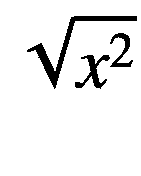

```
In  [9]: x = sympy.Symbol("x")
In [10]: y = sympy.Symbol("y", positive=True)
In [11]: sympy.sqrt(x ** 2)
Out[11]:
```

```
In [12]: sympy.sqrt(y ** 2)
Out[12]: y
```

## 符号

这里我们创建了两个符号，`x` 和 `y`，并使用 SymPy 函数 `sympy.sqrt` 计算了该符号平方的平方根。如果在计算时对该符号一无所知，则无法进行简化。另一方面，如果已知该符号代表正数，那么显然 $$ \sqrt{y²}=y $$，SymPy 在后面的示例中正确识别了这一点。

当处理代表整数（而非实数）的数学符号时，在创建相应的 SymPy 符号时明确指定这一点也很有用，例如使用 `integer=True`，或适用时使用 `even=True` 或 `odd=True`。这同样可以使 SymPy 分析性地简化某些表达式和函数求值，例如以下示例：

```
In [13]: n1 = sympy.Symbol("n")
In [13]: n2 = sympy.Symbol("n", integer=True)
In [13]: n3 = sympy.Symbol("n", odd=True)
In [14]: sympy.cos(n1 * pi)
Out[14]: cos(πn)
In [15]: sympy.cos(n2 * pi)
Out[15]: (–1)n
In [16]: sympy.cos(n3 * pi)
Out[16]: –1
```

为了构建一个非平凡的数学问题，通常需要定义大量符号。逐一使用 `Symbol` 指定每个符号可能变得繁琐，为了方便，SymPy 包含一个函数 `sympy.symbols`，用于在一次函数调用中创建多个符号。该函数接受一个由逗号分隔的符号名称字符串，以及一组任意的关键字参数（适用于所有符号），并返回一个包含新创建符号的元组。使用 Python 的元组解包语法结合对 `sympy.symbols` 的调用，是一种创建符号的便捷方式：

```
In [17]: a, b, c = sympy.symbols("a, b, c", negative=True)
In [18]: d, e, f = sympy.symbols("d, e, f", positive=True)
```

## 数字

将数学符号表示为 Python 对象的目的是将它们用于表示数学表达式的表达式树中。为了实现这一点，我们还需要表示其他数学对象，例如数字、函数和常量。在本节中，我们将介绍 SymPy 用于表示数字对象的类。所有这些类都具有许多与`Symbol`实例共享的方法和属性，这使得我们在表示表达式时可以将符号和数字同等对待。

例如，在上一节中，我们看到`Symbol`实例具有用于查询符号对象属性的属性，例如`is_real`。当在 SymPy 中操作符号表达式时，我们需要能够对所有类型的对象使用相同的属性，包括例如整数和浮点数这样的数字。因此，我们不能直接使用 Python 内置的整数对象 `int` 和浮点数对象 `float` 等。相反，SymPy 提供了`sympy.Integer`和`sympy.Float`类来表示 SymPy 框架内的整数和浮点数。在使用 SymPy 时，了解这种区别很重要，但幸运的是，我们很少需要关心创建 `sympy.Integer` 和 `sympy.Float` 类型的对象来表示特定数字，因为当 Python 数字出现在 SymPy 表达式中时，SymPy 会自动将它们提升为这些类的实例。然而，为了演示 Python 内置数字类型与 SymPy 中相应类型之间的差异，在下面的示例中，我们显式创建了`sympy.Integer`和`sympy.Float`的实例，并使用它们的一些属性来查询其属性：

```
In [19]: i = sympy.Integer(19)
In [20]: type(i)
Out[20]: sympy.core.numbers.Integer
In [21]: i.is_Integer, i.is_real, i.is_odd
Out[21]: (True, True, True)
In [22]: f = sympy.Float(2.3)
In [23]: type(f)
Out[23]: sympy.core.numbers.Float
In [24]: f.is_Integer, f.is_real, f.is_odd
Out[24]: (False, True, False)
```

### 提示

我们可以使用标准的类型转换 `int(i)` 和 `float(f)` 将 `sympy.Integer` 和 `sympy.Float` 的实例转换回 Python 内置类型。

要创建数字或更一般的任意表达式的 SymPy 表示，我们还可以使用 `sympy.sympify` 函数。此函数接受各种输入并推导出 SymPy 兼容的表达式，从而无需显式指定要创建的对象类型。对于简单的数字输入，我们可以使用

```
In [25]: i, f = sympy.sympify(19), sympy.sympify(2.3)
In [26]: type(i), type(f)
Out[26]: (sympy.core.numbers.Integer, sympy.core.numbers.Float)
```

#### 整数

在上一节中，我们已经使用 `Integer` 类来表示整数。值得指出的是，假设 `integer=True` 的 `Symbol` 实例与 `Integer` 的实例之间存在差异。虽然 `integer=True` 的 `Symbol` 代表某个整数，但 `Integer` 实例代表一个具体的整数。对于这两种情况，`is_integer` 属性都为 `True`，但还有一个名为 `is_Integer` 的属性（注意大写 I），它只对 `Integer` 实例为 `True`。通常，名称形式为 `is_Name` 的属性表示该对象是否为 `Name` 类型，名称形式为 `is_name` 的属性表示该对象是否已知满足条件 `name`。因此，还有一个 `is_Symbol` 属性，它对 `Symbol` 实例为 `True`。

```
In [27]: n = sympy.Symbol("n", integer=True)
In [28]: n.is_integer, n.is_Integer, n.is_positive, n.is_Symbol
Out[28]: (True, False, None, True)
In [29]: i = sympy.Integer(19)
In [30]: i.is_integer, i.is_Integer, i.is_positive, i.is_Symbol
Out[30]: (True, True, True, False)
```

SymPy 中的整数是任意精度的，这意味着它们没有固定的下限和上限，而当使用特定位大小表示整数时（例如在 NumPy 中），会存在这种限制。因此，可以处理非常大的数字，如下例所示：

```
In [31]: i ** 50
Out[31]: 8663234049605954426644038200675212212900743262211018069459689001
In [32]: sympy.factorial(100)
Out[32]: 93326215443944152681699238856266700490715968264381621468592963895217599993229915608941463976156518286253697920827223758251185210916864000000000000000000000000
```

#### 浮点数

我们也在前面的章节中遇到了 `sympy.Float` 类型。与 `Integer` 一样，`Float` 是任意精度的，这与 Python 内置的 `float` 类型和 NumPy 中的浮点类型形成对比。这意味着 `Float` 可以表示具有任意小数位数的浮点数。当使用其构造函数创建 `Float` 实例时，有两个参数：第一个参数是 Python 浮点数或表示浮点数的字符串，第二个（可选）参数是 `Float` 对象的精度（有效十进制数字位数）。例如，众所周知，实数 0.3 不能精确地表示为普通的固定位大小的浮点数，当将 0.3 打印到 20 位有效数字时，它显示为 `0.2999999999999999888977698`。SymPy `Float` 对象可以表示实数 0.3，而没有浮点数的局限性：

```
In [33]: "%.25f" % 0.3  # 创建一个 25 位小数的字符串表示形式
Out[33]: '0.2999999999999999888977698'
In [34]: sympy.Float(0.3, 25)
Out[34]: 0.2999999999999999888977698
In [35]: sympy.Float('0.3', 25)
Out[35]: 0.3
```

但是，请注意，要正确地将 0.3 表示为 `Float` 对象，必须从字符串 `'0.3'` 而不是 Python 浮点数 0.3 初始化它，因为后者已经包含浮点误差。

### 有理数
有理数是两个整数的分数 `p`/`q`，即分子 `p` 和分母 `q`。SymPy 使用 `sympy.Rational` 类表示这种类型的数字。可以通过使用 `sympy.Rational` 并将分子和分母作为参数来显式创建有理数：
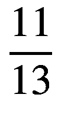
```
In [36]: sympy.Rational(11, 13)
Out[36]:
```
或者，它们可以是 SymPy 执行的简化结果。在这两种情况下，有理数与整数之间的算术运算结果仍然是有理数。
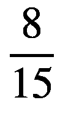
```
In [37]: r1 = sympy.Rational(2, 3)
In [38]: r2 = sympy.Rational(4, 5)
In [39]: r1 * r2
Out[39]:
```

```
In [40]: r1 / r2
Out[40]:
```

### 常量和特殊符号
SymPy 为各种数学常数和特殊对象提供了预定义的符号，例如虚数单位 `i` 和无穷大。这些内容总结在表 3-2 中，以及它们在 SymPy 中对应的符号。请特别注意，虚数单位在 SymPy 中写作 `I`。
**表 3-2** 选定的数学常数和特殊符号及其在 SymPy 中对应的符号
| 数学符号 | SymPy 符号 | 描述 |
| --- | --- | --- |
| `π` | `sympy.pi` | 圆的周长与直径之比。 |
| `e` | `sympy.E` | 自然对数的底数，`e` = exp(1)。 |
| `γ` | `sympy.EulerGamma` | 欧拉常数。 |
| `i` | `sympy.I` | 虚数单位。 |
| `∞` | `sympy.oo` | 无穷大。 |

## 函数
在 SymPy 中，表示函数的对象可以通过 `sympy.Function` 创建。与 `Symbol` 类似，这个 `Function` 对象也将名称作为第一个参数。SymPy 区分了已定义函数和未定义函数，以及已应用函数和未应用函数。使用 `Function` 创建函数会得到一个未定义（抽象）且未应用的函数，该函数有名称但无法求值，因为其表达式（即函数体）未定义。这种函数可以表示任意输入变量数量的任意函数，因为它也尚未应用于任何特定的符号或输入变量。一个未应用的函数可以通过将代表函数定义域的输入符号作为参数来调用该函数实例，从而应用于一组输入符号。结果仍然是一个未求值的函数，但该函数已经应用于指定的输入变量，因此具有一组相关变量。作为这些概念的示例，请考虑以下代码清单，其中我们创建了一个未定义函数 `f`，并将其应用于符号 `x`，以及另一个函数 `g`，我们将其直接应用于符号集 `x, y, z`：
```
In [41]: x, y, z = sympy.symbols("x, y, z")
In [42]: f = sympy.Function("f")
In [43]: type(f)
Out[43]: sympy.core.function.UndefinedFunction
In [44]: f(x)
Out[44]: f(x)
In [45]: g = sympy.Function("g")(x, y, z)
In [46]: g
Out[46]: g(x, y, z)
In [47]: g.free_symbols
Out[47]: {x, y, z}
```
这里我们还使用了属性 `free_symbols`，它返回给定表达式（本例中为已应用的未定义函数 `g`）中包含的唯一符号集合，以证明已应用的函数确实与一组特定的输入符号相关联。这在本章后面的内容中（例如，当我们考虑抽象函数的导数时）将很重要。未定义函数的一个重要应用是指定微分方程，换句话说，当已知函数的方程，但函数本身未知时。
与未定义函数相反，已定义函数是具有特定实现并且可以对所有有效输入参数进行数值求值的函数。可以通过子类化 `sympy.Function` 等方式来定义此类函数，但在大多数情况下，使用 SymPy 提供的数学函数就足够了。自然，SymPy 内置了许多标准数学函数，这些函数可在全局 SymPy 命名空间中获得（有关可用的大量函数的完整列表，请参阅 `sympy.functions.elementary`、`sympy.functions.combinatorial` 和 `sympy.functions.special` 及其子包的模块文档，使用 Python 的 `help` 函数）。例如，正弦函数的 SymPy 函数可作为 `sympy.sin` 使用（按照我们的导入约定）。请注意，这并非 Python 意义上的函数（实际上，它是 `sympy.Function` 的子类），它表示一个未求值的 sin 函数，可应用于数值、符号或表达式。
```
In [48]: sympy.sin
Out[48]: sympy.functions.elementary.trigonometric.sin
In [49]: sympy.sin(x)
Out[49]: sin(x)
In [50]: sympy.sin(pi * 1.5)
Out[50]: -1
```
当应用于抽象符号（例如 `x`）时，`sin` 函数保持未求值状态，但在可能的情况下，它会求值为数值，例如，当应用于一个数字时，或者在某些情况下，当应用于具有某些属性的表达式时，如下例所示：
```
In [51]: n = sympy.Symbol("n", integer=True)
In [52]: sympy.sin(pi * n)
Out[52]: 0
```
SymPy 中的第三种函数是 lambda 函数，或称匿名函数，它们没有关联的名称，但具有可求值的特定函数体。Lambda 函数可以通过 `sympy.Lambda` 创建：
```
In [53]: h = sympy.Lambda(x, x**2)
In [54]: h
Out[54]:
```
```
In [55]: h(5)
Out[55]: 25
In [56]: h(1 + x)
Out[56]: (1 + x)²
```

## 表达式
前面几节介绍的各种符号是表达数学表达式所需的基本构建块。在 SymPy 中，数学表达式被表示为树，其中叶子是符号，节点是表示数学运算的类实例。这些类的示例有：用于基本算术运算符的 `Add`、`Mul` 和 `Pow`，以及用于解析数学运算的 `Sum`、`Product`、`Integral` 和 `Derivative`。此外，还有许多其他用于数学运算的类，我们将在本章后面看到更多示例。
例如，考虑数学表达式 1+2*x*²+3*x*³。要在 SymPy 中表示它，我们只需要创建符号 `x`，然后将表达式编写为 Python 代码：
```
In [54]: x = sympy.Symbol("x")
In [55]: expr = 1 + 2 * x**2 + 3 * x**3
In [56]: expr
Out[56]: 3*x³ + 2*x² + 1
```
这里 `expr` 是 `Add` 的一个实例，其子表达式为 `1`、`2*x**2` 和 `3*x**3`。`expr` 的整个表达式树在图 [3-1] 中可视化。请注意，我们不需要显式构造表达式树，因为它会由包含符号和运算符的表达式自动构建而成。尽管如此，要理解 SymPy 的工作原理，了解表达式如何表示是很重要的。
**图 3-1** – 表达式 `1 + 2*x**2 + 3*x**3` 的表达式树可视化
可以使用 `args` 属性显式遍历表达式树，所有 SymPy 运算和符号都提供该属性。对于运算符，`args` 属性是一个包含子表达式的元组，这些子表达式通过运算符类实现的规则组合在一起。对于符号，`args` 属性是一个空元组，表示它是表达式树中的一个叶子。以下示例演示了如何显式访问表达式树：
```
In [57]: expr.args
Out[57]: (1, 2*x², 3*x³)
In [58]: expr.args[1]
Out[58]: 2*x²
In [59]: expr.args[1].args[1]
Out[59]: x²
In [60]: expr.args[1].args[1].args[0]
Out[60]: x
In [61]: expr.args[1].args[1].args[0].args
Out[61]: ()
```
在 SymPy 的基本使用中，很少需要显式操作表达式树，但当下一节中介绍的用于操作表达式的方法不足以满足需求时，能够实现自己的、使用 `args` 属性遍历和操作表达式树的函数会很有用。

## 操作表达式

操作表达式树是 SymPy 的主要任务之一，并且提供了许多用于不同类型转换的函数。总体思路是，可以使用简化函数和重写函数在数学上等价的表达式树之间进行转换。这些函数通常不会改变传递给它们的表达式，而是创建一个对应于修改后表达式的新表达式。因此，SymPy 中的表达式应被视为不可变对象（不能被更改）。我们在本节中考虑的所有函数都将 SymPy 表达式视为不可变对象，并返回新的表达式树，而不是原地修改表达式。

### 简化

对数学表达式最理想的操作就是将其简化。这或许也是最模糊的操作，因为要从算法上判断一个表达式对人类而言是否比另一个更简单并非易事，而且通常而言，采用何种方法才能得到更简单的表达式也并不明确。尽管如此，黑箱简化仍是任何计算机代数系统（CAS）的重要组成部分，SymPy 包含了 `sympy.simplify` 函数，它尝试使用多种方法和途径来简化给定的表达式。该简化函数也可以通过 `simplify` 方法来调用，如下例所示。

```
In [67]: expr = 2 * (x**2 - x) - x * (x + 1)
In [68]: expr
Out[68]: 2x2 – x(x+1)–2x
In [69]: sympy.simplify(expr)
Out[69]: x(x–3)
In [70]: expr.simplify()
Out[70]: x(x–3)
In [71]: expr
Out[71]: 2x2 – x(x+1)–2x
```

注意，如上所述，这里的 `sympy.simplify(expr)` 和 `expr.simplify()` 都会返回新的表达式树，而保持表达式 `expr` 不变。在这个例子中，表达式 `expr` 可以通过展开乘积、抵消项，然后再对表达式进行因式分解来简化。通常，`sympy.simplify` 会尝试多种不同的策略，并同样会简化例如三角函数和幂次表达式，如下所示：

```
In [72]: expr = 2 * sympy.cos(x) * sympy.sin(x)
In [73]: expr
Out[73]: 2 sin(x)cos(x)
In [74]: sympy.simplify(expr)
Out[74]: sin(2x)
```

以及

```
In [75]: expr = sympy.exp(x) * sympy.exp(y)
In [76]: expr
Out[76]: exp(x)exp(y)
In [77]: sympy.simplify(expr)
Out[77]: exp(x+y)
```

每种特定类型的简化也可以使用更专门的函数来完成，例如分别用于三角简化和幂次简化的 `sympy.trigsimp` 和 `sympy.powsimp`。这些函数只执行其名称所指明的简化操作，而保持表达式的其他部分原样不变。表 3-3 给出了简化函数的总结。当确切的简化步骤已知时，通常最好依赖更具体的简化函数，因为它们的操作定义更明确，并且在 SymPy 未来版本中发生变化的可能性更小。另一方面，`sympy.simplify` 函数依赖于启发式方法，这些方法未来可能会发生变化，从而对特定的输入表达式产生不同的结果。

**表 3-3** 用于简化表达式的 SymPy 精选函数总结

| 函数 | 描述 |
| --- | --- |
| `sympy.simplify` | 尝试多种方法和途径以获得给定表达式的更简化形式。 |
| `sympy.trigsimp` | 尝试使用三角恒等式简化表达式。 |
| `sympy.powsimp` | 尝试使用幂次法则简化表达式。 |
| `sympy.compsimp` | 简化组合表达式。 |
| `sympy.ratsimp` | 通过写成公分母形式来简化表达式。 |

### 展开

当 `sympy.simplify` 提供的黑箱简化未能产生令人满意的结果时，通常可以通过手动使用更具体的代数运算来指导 SymPy，从而取得进展。在这个过程中，一个重要的工具是以各种方式展开表达式。函数 `sympy.expand` 根据可选关键字参数的值执行多种展开。默认情况下，该函数将乘积分配到加法项上，得到一个完全展开的表达式。例如，形如 (`x`+1)(`x`+2) 的乘积可以展开为 `x`²+3`x`+2，使用以下方法：

```
In [78]: expr = (x + 1) * (x + 2)
In [79]: sympy.expand(expr)
Out[79]: x2 + 3x + 2
```

一些可用的关键字参数包括 `mul=True` 用于展开乘积（如前面的例子），`trig=True` 用于三角展开，

```
In [80]: sympy.sin(x + y).expand(trig=True)
Out[80]: sin(x)cos(y) + sin(y)cos(x)
```

`log=True` 用于展开对数，

```
In [81]: a, b = sympy.symbols("a, b", positive=True)
In [82]: sympy.log(a * b).expand(log=True)
Out[82]: log(a) + log(b)
```

`complex=True` 用于分离表达式的实部和虚部，

```
In [83]: sympy.exp(I*a + b).expand(complex=True)
Out[83]: ieb sin(a) + eb cos(a)
```

以及 `power_base=True` 和 `power_exp=True`，分别用于展开幂次表达式的底数和指数。

```
In [84]: sympy.expand((a * b)**x, power_base=True)
Out[84]: axbx
In [85]: sympy.exp((a-b)*x).expand(power_exp=True)
Out[85]: eiaxe–ibx
```

将这些关键字参数设置为 `True` 来调用 `sympy.expand` 函数，等同于分别调用更专门的函数 `sympy.expand_mul`、`sympy.expand_trig`、`sympy.expand_log`、`sympy.expand_complex`、`sympy.expand_power_base` 和 `sympy.expand_power_exp`，但 `sympy.expand` 函数的一个优点是可以在一次函数调用中执行多种类型的展开。

### 因式分解、收集与合并

`sympy.expand` 函数的一个常见用法模式是：先展开一个表达式，让 SymPy 抵消项或因子，然后再对表达式进行因式分解或合并。`sympy.factor` 函数尝试尽可能地将表达式因式分解，在某种意义上与 `mul=True` 时的 `sympy.expand` 相反。它可用于对代数表达式进行因式分解，例如：

```
In [86]: sympy.factor(x**2 - 1)
Out[86]: (x – 1)(x + 1)
In [87]: sympy.factor(x * sympy.cos(y) + sympy.sin(z) * x)
Out[87]: x(sin(x) + cos(y))
```

上一节中其他类型展开的逆运算，可以使用 `sympy.trigsimp`、`sympy.powsimp` 和 `sympy.logcombine` 来执行，例如

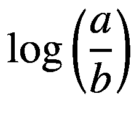

```
In [90]: sympy.logcombine(sympy.log(a) - sympy.log(b))
Out[90]:
```

在处理数学表达式时，通常需要对因式分解进行精细控制。SymPy 函数 `sympy.collect` 对包含给定符号或符号列表的项进行因式分解。例如，`x`+`y`+`xyz` 无法完全因式分解，但我们可以部分地对包含 `x` 或 `y` 的项进行分解：

```
In [89]: expr = x + y + x * y * z
In [90]: expr.collect(x)
Out[90]: x(yz + 1) + y
In [91]: expr.collect(y)
Out[91]: x + y(xz + 1)
```

通过向 `sympy.collect` 函数或对应的 `collect` 方法传递一个符号或表达式的列表，我们可以在一次函数调用中收集多个符号。此外，当使用返回新表达式的 `collect` 方法时，可以通过以下方式链式调用多个方法：

```
#### 分离、合并与约分

我们在此要讨论的最后一种数学化简类型是分数的重写。函数`sympy.apart`和`sympy.together`分别用于将分数重写为部分分式，以及将多个部分分式合并为单个分数，使用方法如下：

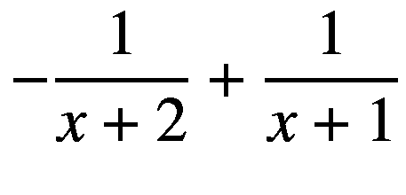

```
In [95]: sympy.apart(1/(x**2 + 3*x + 2), x)
Out[95]:
```

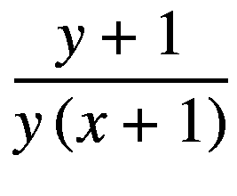

```
In [96]: sympy.together(1 / (y * x + y) + 1 / (1+x))
Out[96]:
```

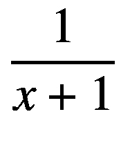

```
In [97]: sympy.cancel(y / (y * x + y))
Out[97]:
```

在第一个例子中，我们使用`sympy.apart`将表达式`(x**2+3*x+2)**(-1)`重写为部分分式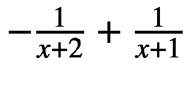，并使用`sympy.together`将分数之和`1/(y*x+y) + 1/(1+x)`合并为单个分数的形式。在这个例子中，我们还使用了函数`sympy.cancel`来约去表达式`y/(y*x+y)`中分子与分母的公共因子。

#### 代换

前面几节主要讨论使用各种数学恒等式重写表达式。另一种常用的数学表达式操作是代换表达式中的符号或子表达式。例如，我们可能想进行变量代换，将变量`x`替换为`y`，或者将某个符号替换为另一个表达式。在 SymPy 中有两种方法可以执行代换：`subs`和`replace`。通常`subs`是最合适的选择，但在某些情况下，`replace`提供了更强大的工具，例如，它可以基于通配符表达式进行替换（详情请参阅`sympy.Symbol.replace`的文档字符串）。

在`subs`最基本的用法中，该方法在表达式上调用，待替换的符号或表达式（`x`）作为第一个参数，新的符号或表达式（`y`）作为第二个参数。结果是表达式中所有出现`x`的地方都被替换为`y`：

```
In [98]: (x + y).subs(x, y)
Out[98]: 2y
In [99]: sympy.sin(x * sympy.exp(x)).subs(x, y)
Out[99]: sin(yey)
```

当需要执行多个代换时，不必链式调用多个`subs`，我们可以向`subs`传递一个字典作为第一个且唯一的参数，这个字典将旧的符号或表达式映射到新的符号或表达式：

```
In [100]: sympy.sin(x * z).subs({z: sympy.exp(y), x: y, sympy.sin: sympy.cos})
Out[100]: cos(yey)
```

`subs`方法的一个典型应用是将数值代入符号，以便进行数值计算（详见下一节）。一种便捷的做法是定义一个字典，将符号映射到数值，然后将这个字典作为参数传递给`subs`方法。例如，考虑：

```
In [101]: expr = x * y + z**2 *x
In [102]: values = {x: 1.25, y: 0.4, z: 3.2}
In [103]: expr.subs(values)
Out[103]: 13.3
```

## 数值计算

即使是在处理符号数学时，几乎迟早都需要对符号表达式进行数值计算，例如，在生成图表或具体的数值结果时。可以使用`sympy.N`函数或 SymPy 表达式实例的`evalf`方法来计算 SymPy 表达式的数值：

```
In [104]: sympy.N(1 + pi)
Out[104]: 4.14159265358979
In [105]: sympy.N(pi, 50)
Out[105]: 3.1415926535897932384626433832795028841971693993751
In [106]: (x + 1/pi).evalf(10)
Out[106]: x + 0.3183098862
```

`sympy.N`和`evalf`方法都接受一个可选参数，用于指定表达式要计算到的有效数字位数，如上一个示例所示，其中利用了 SymPy 的多精度浮点数功能将 *π* 的值计算到了 50 位数字。

当我们需要针对一系列输入值对表达式进行数值计算时，原则上可以遍历这些值并连续调用`evalf`，例如：

```
In [114]: expr = sympy.sin(pi * x * sympy.exp(x))
In [115]: [expr.subs(x, xx).evalf(3) for xx in range(0, 10)]
Out[115]: [0,0.774,0.642,0.722,0.944,0.205,0.974,0.977,-0.870,-0.695]
```

然而，这种方法相当缓慢，SymPy 提供了一种更高效的方法来执行此操作，即使用`sympy.lambdify`函数。该函数接受一组自由符号和一个表达式作为参数，并生成一个能够高效计算表达式数值的函数。生成的函数接受的参数数量与作为`sympy.lambdify`第一个参数传递的自由符号数量相同。

```
In [109]: expr_func = sympy.lambdify(x, expr)
In [110]: expr_func(1.0)
Out[110]: 0.773942685266709
```

注意，函数`expr_func`期望传入数值（标量）作为参数，因此，我们不能向此函数传递符号；它严格用于数值计算。上例中创建的`expr_func`是一个标量函数，不能直接兼容第 2 章中讨论的 NumPy 数组形式的向量化输入。不过，SymPy 也能够生成支持 NumPy 数组的函数：通过将可选参数`'numpy'`作为第三个参数传递给`sympy.lambdify`，SymPy 会创建一个接受 NumPy 数组作为输入的向量化函数。这通常是一种对于大量输入参数进行符号表达式数值计算的高效方式。以下代码示例说明了如何将 SymPy 表达式`expr`转换为支持 NumPy 数组的向量化函数，并对其进行高效计算：

```
In [111]: expr_func = sympy.lambdify(x, expr, 'numpy')
In [112]: import numpy as np
In [113]: xvalues = np.arange(0, 10)
In [114]: expr_func(xvalues)
Out[114]: array([ 0\.        ,  0.77394269,  0.64198244,  0.72163867,  0.94361635,
0.20523391,  0.97398794,  0.97734066, -0.87034418, -0.69512687])
```

这种从 SymPy 表达式生成数据的方法对于绘图和许多其他数据导向的应用非常有用。

## 微积分

到目前为止，我们已经了解了如何在 SymPy 中表示数学表达式，以及如何对这些表达式进行基本的化简和转换。有了这个框架，我们现在可以探索符号微积分（或称为分析），它是应用数学的基石，在科学和工程领域有着广泛的应用。微积分的核心概念是：当输入变量变化时函数的变化（通过导数和微分来量化），以及函数在输入区间上的累积（通过积分来量化）。在本节中，我们将探讨如何在 SymPy 中计算函数的导数和积分。

### 导数

函数的导数描述其在给定点的变化率。在 SymPy 中，我们可以使用`sympy.diff`或 SymPy 表达式实例的`diff`方法来计算函数的导数。这些函数的参数是一个符号或若干符号，函数或表达式将关于这些符号求导。为了表示抽象函数 *f*(*x*) 关于 *x* 的一阶导数，我们可以这样做：

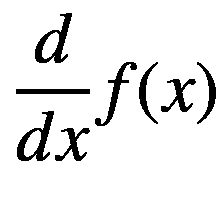
```

在 SymPy 中，我们首先来了解导数的基本表示方法。

通过定义符号变量和函数，我们可以使用 `sympy.diff` 来计算一阶导数：

```python
In [119]: f = sympy.Function('f')(x)
In [120]: sympy.diff(f, x)               # 等价于 f.diff(x)
Out[120]:
```

而要表示高阶导数，我们只需在调用 `sympy.diff` 的参数列表中重复符号 `x`，或者等价地，在符号后指定一个整数作为参数，该整数定义了表达式应关于该符号求导的次数：

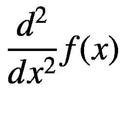

```python
In [117]: sympy.diff(f, x, x)
Out[117]:
```

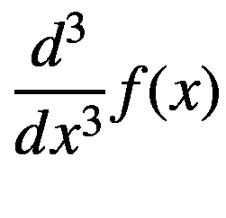

```python
In [118]: sympy.diff(f, x, 3)   # 等价于 sympy.diff(f, x, x, x)
Out[118]:
```

这种方法很容易扩展到多元函数：

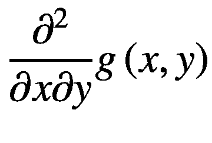

```python
In [119]: g = sympy.Function('g')(x, y)
In [120]: g.diff(x, y)          # 等价于 sympy.diff(g, x, y)
Out[120]:
```

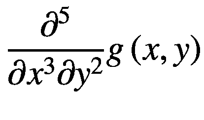

```python
In [121]: g.diff(x, 3, y, 2)    # 等价于 sympy.diff(g, x, x, x, y, y)
Out[121]:
```

到目前为止，这些示例只涉及未定义函数的形式导数。自然，我们也可以计算已定义函数和表达式的导数，这会得到对应于已求导表达式的新表达式。例如，使用 `sympy.diff` 我们可以轻松计算任意数学表达式的导数，例如多项式：

```python
In [122]: expr = x**4 + x**3 + x**2 + x + 1
In [123]: expr.diff(x)
Out[123]: 4x3 + 3x2 + 2x+1
In [124]: expr.diff(x, x)
Out[124]: 2(6x2 + 3x + 1)
In [125]: expr = (x + 1)**3 * y ** 2 * (z - 1)
In [126]: expr.diff(x, y, z)
Out[126]: 6y(x + 1)2
```

以及三角函数和其他更复杂的数学表达式：

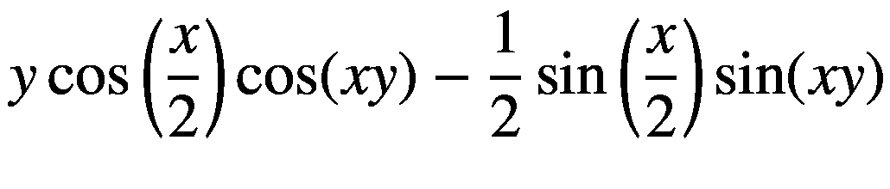

```python
In [127]: expr = sympy.sin(x * y) * sympy.cos(x / 2)
In [128]: expr.diff(x)
Out[128]:
```

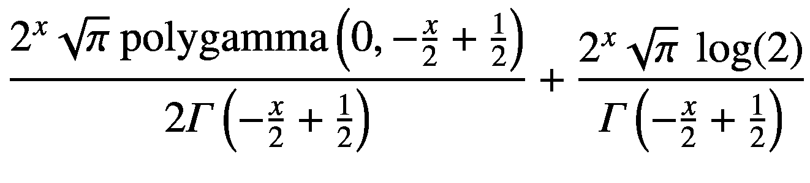

```python
In [129]: expr = sympy.special.polynomials.hermite(x, 0)
In [130]: expr.diff(x).doit()
Out[130]:
```

导数通常相对容易计算，`sympy.diff` 应该能够计算 SymPy 中定义的大多数标准数学函数的导数。

请注意，在这些示例中，对表达式直接调用 `sympy.diff` 会立即得到一个新表达式。如果我们想符号化地表示一个具体表达式的导数，可以创建一个 `sympy.Derivative` 类的实例，将表达式作为第一个参数传递，后面跟着要对其求导的符号：

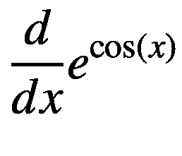

```python
In [131]: d = sympy.Derivative(sympy.exp(sympy.cos(x)), x)
In [132]: d
Out[132]:
```

这种导数的形式表示随后可以通过在 `sympy.Derivative` 实例上调用 `doit` 方法来求值：

```python
In [133]: d.doit()
Out[133]: –ecos(x) sin(x)
```

这种延迟求值的模式在 SymPy 中反复出现，在形式表达式被求值为特定结果之前，完全控制其求值时机在许多情况下都很有用，特别是对于那些在作为形式表达式表示时（而非求值后）可以简化或操作的表达式。

### 积分

在 SymPy 中，积分使用函数 `sympy.integrate` 来计算，而形式积分可以使用 `sympy.Integral` 来表示（与 `sympy.Derivative` 的情况类似，可以通过调用 `doit` 方法来显式计算）。积分有两种基本形式：定积分和不定积分。定积分有指定的积分限，可以理解为面积或体积；而不定积分没有积分限，表示的是原函数（函数导数的逆运算）。SymPy 使用 `sympy.integrate` 函数来处理不定积分和定积分。

如果调用 `sympy.integrate` 函数时只传入一个表达式作为参数，则会计算不定积分。另一方面，如果同时向 `sympy.integrate` 函数传入一个形式为 `(x, a, b)` 的元组，其中 `x` 是积分变量，`a` 和 `b` 是积分限，则会计算定积分。因此，对于单变量函数 *f*(*x*)，不定积分和定积分的计算方式如下：

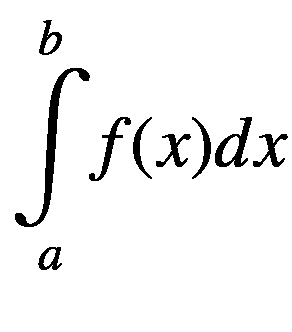

```python
In [135]: a, b, x, y = sympy.symbols("a, b, x, y")
...: f = sympy.Function("f")(x)
In [136]: sympy.integrate(f)
Out[136]: ∫ f(x)dx
In [137]: sympy.integrate(f, (x, a, b))
Out[137]:
```

当这些方法应用于显式函数时，积分会相应地计算：

```python
In [138]: sympy.integrate(sympy.sin(x))
Out[138]: –cos(x)
In [139]: sympy.integrate(sympy.sin(x), (x, a, b))
Out[139]: cos(a) – cos(b)
```

定积分还可以包含延伸到负无穷大和/或正无穷大的积分限，这需要使用 SymPy 的无穷大符号 `oo`：

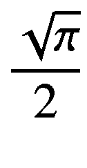

```python
In [139]: sympy.integrate(sympy.exp(-x**2), (x, 0, oo))
Out[139]:
```

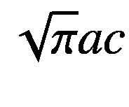

```python
In [140]: a, b, c = sympy.symbols("a, b, c", positive=True)
In [141]: sympy.integrate(a * sympy.exp(-((x-b)/c)**2), (x, -oo, oo))
Out[141]:
```

符号计算积分通常是一个难题，SymPy 无法对所有积分都给出符号结果。当 SymPy 无法计算一个积分时，会返回一个 `sympy.Integral` 的实例，它代表形式积分。

```python
In [142]: sympy.integrate(sympy.sin(x * sympy.cos(x)))
Out[142]: ∫sin(x cos(x))dx
```

多变量表达式也可以使用 `sympy.integrate` 进行积分。对于多变量表达式的不定积分，必须显式指定积分变量：

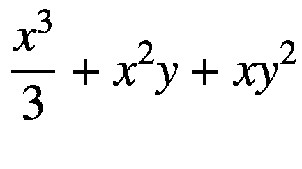

```
In [140]: expr = sympy.sin(x*sympy.exp(y))
In [141]: sympy.integrate(expr, x)
Out[141]: –e–ycos(xey)
In [142]: expr = (x + y)**2
In [143]: sympy.integrate(expr, x)
Out[143]:
```

通过传递多个符号，或包含符号及其积分限的多个元组，我们可以执行多重积分：

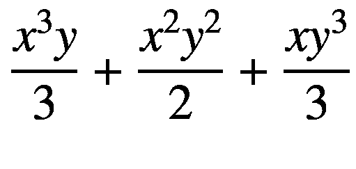

```
In [144]: sympy.integrate(expr, x, y)
Out[144]:
```


```
In [145]: sympy.integrate(expr, (x, 0, 1), (y, 0, 1))
Out[145]:
```

### 级数

级数展开是许多计算学科中的重要工具。通过级数展开，任意函数都可以写成多项式形式，其系数由函数在展开点处的导数给出。通过在某个阶数 `n` 处截断级数展开，可以得到函数的 `n` 阶近似。在 SymPy 中，函数或表达式的级数展开可以使用 `sympy.series` 函数或 SymPy 表达式实例可用的 `series` 方法计算。`sympy.series` 的第一个参数是要展开的函数或表达式，后面跟着一个符号，指明相对于哪个变量进行展开（对于单变量表达式和函数，可以省略）。此外，还可以指定进行级数展开的具体点（使用 `x0` 关键字参数，默认 `x0=0`）、指定展开的阶数（使用 `n` 关键字参数，默认 `n=6`）以及指定计算级数的方向，即从 `x0` 的下方还是上方展开（使用 `dir` 关键字参数，默认为 `dir='+'`）。

对于一个未定义的函数 `f(x)`，围绕 `x0=0` 展开到六阶的计算方法如下：


```
In [147]: x, y = sympy.symbols("x, y")
In [148]: f = sympy.Function("f")(x)
In [149]: sympy.series(f, x)
Out[149]:
```

要改变函数展开的点，我们像下面的例子一样指定 `x0` 参数：

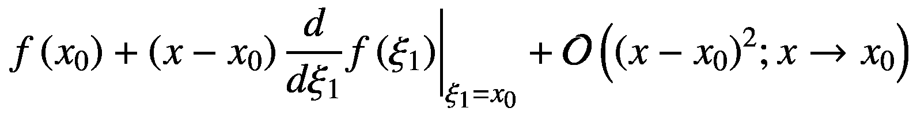

```
In [147]: x0 = sympy.Symbol("{x_0}")
In [151]: f.series(x, x0, n=2)
Out[151]:
```

这里我们还指定了 `n=2`，以请求一个只包含到二阶项的级数展开。请注意，由于截断项产生的误差由阶数对象 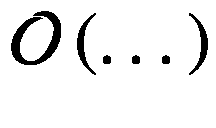 表示。阶数对象对于在级数展开计算（例如，乘以或加上不同的展开式）中跟踪表达式的阶数非常有用。然而，对于具体的数值计算，需要从表达式中移除阶数项，这可以通过 `removeO` 方法完成：

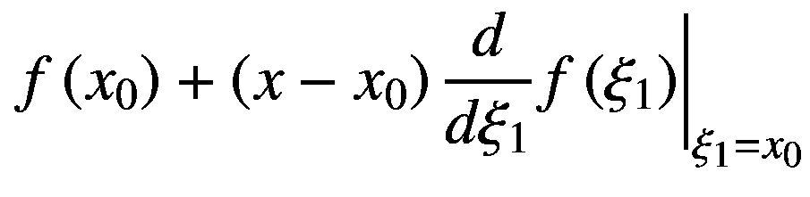

```
In [152]: f.series(x, x0, n=2).removeO()
Out[152]:
```

虽然前面展示的展开是针对未指定的函数 `f(x)` 计算的，但我们自然也可以计算特定函数和表达式的级数展开，在这些情况下，我们会得到具体的计算结果。例如，我们可以轻松地生成许多标准数学函数的著名展开式：

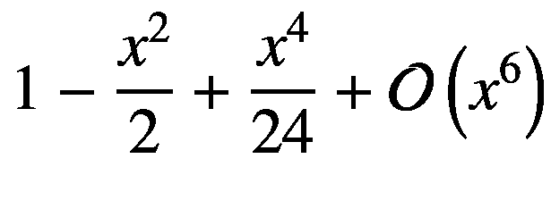

```
In [153]: sympy.cos(x).series()
Out[153]:
```

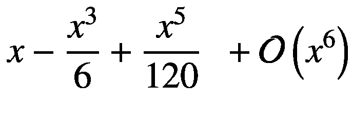

```
In [154]: sympy.sin(x).series()
Out[154]:
```

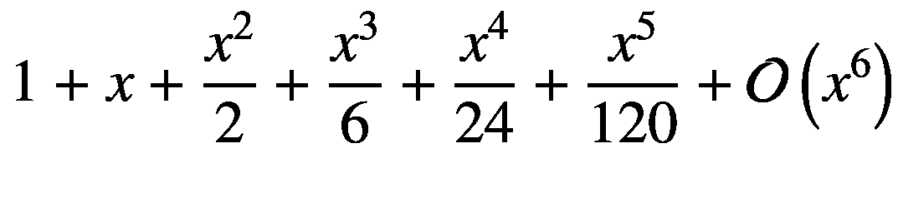

```
In [155]: sympy.exp(x).series()
Out[155]:
```

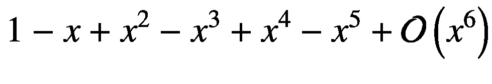

```
In [156]: (1/(1+x)).series()
Out[156]:
```

以及符号和函数的任意表达式，这些表达式通常也可以是多元函数：

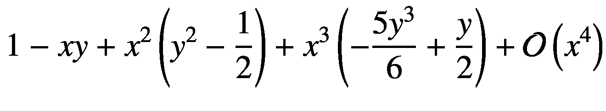

```
In [157]: expr = sympy.cos(x) / (1 + sympy.sin(x * y))
In [158]: expr.series(x, n=4)
Out[158]:
```

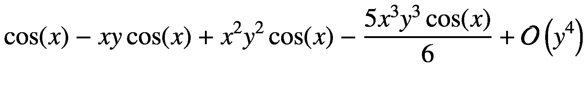

```
In [159]: expr.series(y, n=4)
Out[159]:
```

### 极限

微积分中的另一个重要工具是极限，它表示当一个因变量趋近于某个特定值，或变量趋近于负无穷或正无穷时，函数的值。极限的一个例子是导数的定义之一：

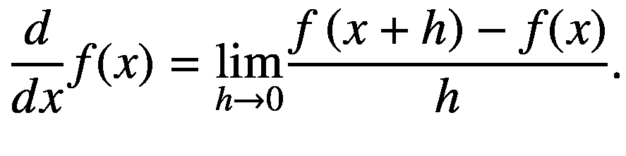

### 使用 SymPy 计算极限
虽然极限更像是一个理论工具，其实际应用不如级数展开等广泛，但能够使用 SymPy 计算极限仍然很实用。在 SymPy 中，可以使用 `sympy.limit` 函数来计算极限，该函数接受一个表达式、它所依赖的符号以及该符号在极限中趋近的值。例如，要计算函数 `sin(x) / x` 当变量 `x` 趋近于零时的极限，即 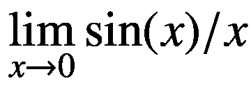，我们可以使用
```
In [161]: sympy.limit(sympy.sin(x) / x, x, 0)
Out[161]: 1
```
这里我们得到了这个极限的著名答案 1。我们还可以使用 `sympy.limit` 来计算符号极限，这可以通过使用前面的定义来计算导数来说明（尽管使用 `sympy.diff` 当然更高效）：
```
In [162]: f = sympy.Function('f')
...: x, h = sympy.symbols("x, h")
In [163]: diff_limit = (f(x + h) - f(x))/h
In [164]: sympy.limit(diff_limit.subs(f, sympy.cos), h, 0)
Out[164]: –sin(x)
In [165]: sympy.limit(diff_limit.subs(f, sympy.sin), h, 0)
Out[165]: cos(x)
```
一个更实用的极限使用示例是寻找函数的渐近行为，例如，当其因变量趋近于无穷大时。例如，考虑函数 `f(x) = (x² − 3*x) / (2*x − 2)`，假设我们对该函数在大 `x` 情况下的依赖关系感兴趣。它将是 `f(x) → p*x + q` 的形式，我们可以如下使用 `sympy.limit` 计算 `p` 和 `q`：
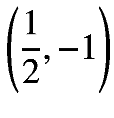
```
In [166]: expr = (x**2 - 3*x) / (2*x - 2)
In [167]: p = sympy.limit(expr/x, x, sympy.oo)
In [168]: q = sympy.limit(expr - p*x, x, sympy.oo)
In [169]: p, q
Out[169]:
```
因此，`f(x)` 在 `x` 变大时的渐近行为是线性函数 `f(x) → x/2 − 1`。

### 求和与求积
求和与求积可以使用 SymPy 类 `sympy.Sum` 和 `sympy.Product` 进行符号化表示。它们都将表达式作为第一个参数，并将一个形式为 `(n, n1, n2)` 的元组作为第二个参数，其中 `n` 是一个符号，`n1` 和 `n2` 分别是该符号 `n` 在求和或求积中的下限和上限。创建 `sympy.Sum` 或 `sympy.Product` 对象后，可以使用 `doit` 方法对它们进行求值：
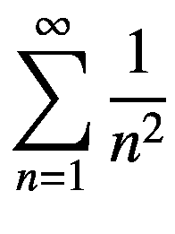
```
In [171]: n = sympy.symbols("n", integer=True)
In [172]: x = sympy.Sum(1/(n**2), (n, 1, oo))
In [173]: x
Out[173]:
```
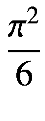
```
In [174]: x.doit()
Out[174]:
```
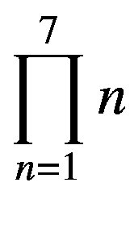
```
In [175]: x = sympy.Product(n, (n, 1, 7))
In [176]: x
Out[176]:
```
```
In [177]: x.doit()
Out[177]: 5040
```
请注意，前面示例中的求和将上限指定为无穷大。因此，很明显，这个求和不是通过显式求和来计算的，而是通过解析方式计算的。SymPy 可以计算许多此类求和，包括当求和项包含除求和索引之外的其他符号变量时，如下例所示：
```
In [178]: x = sympy.Symbol("x")
In [179]: sympy.Sum((x)**n/(sympy.factorial(n)), (n, 1, oo)).doit().simplify()
Out[179]: ex – 1
```

### 方程求解
方程求解是数学的基础组成部分，其应用几乎遍及科学与技术的各个分支，因此极为重要。`SymPy` 能够符号化地求解多种多样的方程，尽管许多方程即便是理论上也无法解析求解。如果一个方程或方程组可以解析求解，那么`SymPy`很有希望能找到解。若不能，数值方法或许是唯一的选择。

在最简单的形式中，方程求解涉及单个未知变量的单个方程，且没有额外参数：例如，找到满足二次多项式方程 `x²+2x – 3 = 0` 的`x`值。这个方程当然很容易求解，即便用手算也行，但在`SymPy`中，我们可以使用函数 `sympy.solve` 来找到满足该方程的`x`的解：
```
In [170]: x = sympy.Symbol("x")
In [171]: sympy.solve(x**2 + 2*x - 3)
Out[171]: [–3,1]
```
也就是说，解是 `x=-3` 和 `x=1`。`sympy.solve` 函数的参数是一个表达式，求解时将假设该表达式等于零。当此表达式包含多个符号时，必须将待求解的变量作为第二个参数给出。例如，
![$$ \left[\frac{1}{2a}\left(-b+\sqrt{-4 ac+{b}²}\right),-\frac{1}{2a}\left(b+\sqrt{-4 ac+{b}²}\right)\right] $$](images/332789_2_En_3_Chapter/332789_2_En_3_Chapter_TeX_Equal.png)
```
In [172]: a, b, c = sympy.symbols("a, b, c")
In [173]: sympy.solve(a * x**2 + b * x + c, x)
Out[173]:
```
在这种情况下，得到的解是依赖于方程中参数符号的表达式。

`sympy.solve` 函数也能够求解其他类型的方程，包括三角函数表达式：
![$$ \left[-\frac{3\pi }{4},\right] $$](images/332789_2_En_3_Chapter/332789_2_En_3_Chapter_TeX_Equam.png)
```
In [174]: sympy.solve(sympy.sin(x) - sympy.cos(x), x)
Out[174]:
```
以及解可以用特殊函数表示的方程：
![$$ \left[-\mathrm{LambertW}\left(\frac{1}{2}\right)\right] $$](images/332789_2_En_3_Chapter/332789_2_En_3_Chapter_TeX_Equan.png)
```
In [180]: sympy.solve(sympy.exp(x) + 2 * x, x)
Out[180]:
```
然而，在处理一般方程时，即使是单变量情况，也经常会遇到代数上不可解或`SymPy`无法求解的方程。在这些情况下，`SymPy` 会返回一个形式解（如果需要可以数值计算），或者如果该特定类型的方程没有可用方法，则会引发错误：
```
In [176]: sympy.solve(x**5 - x**2 + 1, x)
Out[176]: [RootOf(x5 – x2 + 1,0), RootOf(x5 – x2 + 1,1), RootOf(x5 – x2 + 1,2), RootOf(x5 – x2 + 1,3), RootOf(x5 – x2 + 1,4)]
In [177]: sympy.solve(sympy.tan(x) + x, x)

NotImplementedError                       Traceback (most recent call last)
...
NotImplementedError: multiple generators [x, tan(x)] No algorithms are implemented to solve equation x + tan(x)
```

# 求解多变量方程组

在`SymPy`中求解包含多个未知变量的方程组，是对单变量方程求解过程的直接推广。此时，传递给`sympy.solve`的第一个参数不是单个表达式，而是一个代表方程组的表达式列表，并且第二个参数应为待求解符号的列表。例如，以下两个示例分别演示了如何求解`x`和`y`的线性方程组和非线性方程组：

![$$ \left[\left\{x:-\frac{1}{3},y:\frac{2}{3}\right\}\right] $$](images/332789_2_En_3_Chapter/332789_2_En_3_Chapter_TeX_Equao.png)

```
In [178]: eq1 = x + 2 * y – 1
...: eq2 = x - y + 1
In [179]: sympy.solve([eq1, eq2], [x, y], dict=True)
Out[179]:
```

![$$ \left[\left\{x:0,y:0\right\},\left\{x:1,y:1\right\},\left\{x:-\frac{1}{2}+\frac{\sqrt{3}i}{2},y:-\frac{1}{2}-\frac{\sqrt{3}i}{2}\right\},\left\{x:\frac{{\left(1-\sqrt{3}i\right)}²}{4},y:-\frac{1}{2}+\frac{\sqrt{3}i}{2}\right\}\right] $$](images/332789_2_En_3_Chapter/332789_2_En_3_Chapter_TeX_Equap.png)

```
In [180]: eq1 = x**2 - y
...: eq2 = y**2 - x
In [181]: sols = sympy.solve([eq1, eq2], [x, y], dict=True)
In [182]: sols
Out[182]:
```

注意在这两个示例中，函数`sympy.solve`返回一个列表，其中每个元素代表方程组的一个解。还使用了可选的关键字参数`dict=True`，以请求每个解以字典格式返回，该格式将已求解的符号映射到它们的值。这个字典可以方便地用于，例如，调用`subs`的场合，如下面的代码所示，它检查每个解是否确实满足这两个方程：

```
In [183]: [eq1.subs(sol).simplify() == 0 and eq2.subs(sol).simplify() == 0 for sol in sols]
Out[183]: [True, True, True, True]
```

## 线性代数

线性代数是数学的另一基本分支，在科学与技术计算中有着重要应用。它涉及向量、向量空间以及向量空间之间的线性映射，这些映射可以用矩阵表示。在`SymPy`中，我们可以使用`sympy.Matrix`类以符号形式表示向量和矩阵，其元素可以是数字、符号，甚至是任意符号表达式。要创建包含数值元素的矩阵，与第 2 章中 NumPy 数组的情况类似，我们可以将一个 Python 列表传递给`sympy.Matrix`：

```
In [184]: sympy.Matrix([1, 2])
Out[184]:

In [185]: sympy.Matrix([[1, 2]])
Out[185]:

In [186]: sympy.Matrix([[1, 2], [3, 4]])
Out[186]:
```

如本例所示，单个列表生成列向量，而矩阵则需要嵌套的数值列表。请注意，与第 2 章讨论的 NumPy 多维数组不同，`SymPy`中的`sympy.Matrix`对象仅适用于二维数组，即向量和矩阵。创建新的`sympy.Matrix`对象的另一种方法是传入行数、列数以及一个函数作为参数，该函数以行和列索引为参数，并返回对应元素的值：

```
In [187]: sympy.Matrix(3, 4, lambda m, n: 10 * m + n)
Out[187]:
```

`SymPy`矩阵对象最强大的功能——也是它区别于 NumPy 数组等之处——自然是其元素本身可以是符号表达式。例如，一个任意的 2x2 矩阵可以用每个元素对应的符号变量来表示：

```
In [188]: a, b, c, d = sympy.symbols("a, b, c, d")
In [189]: M = sympy.Matrix([[a, b], [c, d]])
In [190]: M
Out[190]:
```

这种矩阵自然也可以用于计算，并且计算结果会以元素的符号值作为参数保持参数化。矩阵对象实现了常规的算术运算符，但请注意，此处的乘法运算符`*`表示矩阵乘法：

```
In [191]: M * M
Out[191]:

In [192]: x = sympy.Matrix(sympy.symbols("x_1, x_2"))
In [194]: M * x
Out[194]:
```

除了算术运算，许多标准的向量和矩阵线性代数运算也作为`SymPy`函数和`sympy.Matrix`类的方法实现。表 3-4 总结了常用的线性代数相关函数（完整列表请参阅`sympy.Matrix`的文档字符串），并且`SymPy`矩阵还可以使用索引和切片操作以面向元素的方式使用，这些操作与第 2 章中讨论的 NumPy 数组操作非常相似。

以下是一个可以使用`SymPy`通过符号线性代数解决，但无法直接用纯数值方法解决的问题示例：考虑如下参数化的线性方程组：

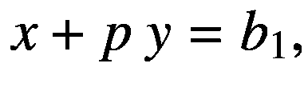

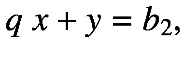

我们希望求解未知变量`x`和`y`。这里`p`、`q`、`b_1`和`b_2`是未指定的参数。用矩阵形式，我们可以将这两个方程写为：

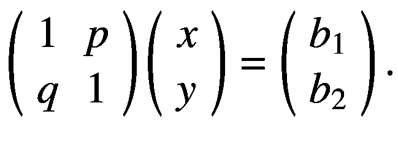

采用纯数值方法，我们必须先为参数`p`和`q`选择具体值，然后才能开始求解这个问题，例如使用等式左侧矩阵的 LU 分解（或计算其逆矩阵）。而采用符号计算方法，我们可以直接着手计算解，如同我们手动进行解析计算一样。使用`SymPy`，我们可以简单地为未知变量和参数定义符号，并设置所需的矩阵对象：

```
In [195]: p, q = sympy.symbols("p, q")
In [196]: M = sympy.Matrix([[1, p], [q, 1]])
In [203]: M
Out[203]:

In [197]: b = sympy.Matrix(sympy.symbols("b_1, b_2"))
In [198]: b
Out[198]:
```

然后使用例如`LUsolve`方法求解线性方程组：

```
In [199]: x = M.LUsolve(b)
In [200]: x
Out[200]:
```

或者，我们也可以直接计算矩阵`M`的逆矩阵，并将其与向量`b`相乘。

### 表 3-4：用于操作 `SymPy` 矩阵的精选函数与方法

| 函数/方法 | 描述 |
| --- | --- |
| `transpose`/`T` | 计算矩阵的转置。 |
| `adjoint`/`H` | 计算矩阵的伴随矩阵。 |
| `trace` | 计算矩阵的迹（对角线元素之和）。 |
| `det` | 计算矩阵的行列式。 |
| `inv` | 计算矩阵的逆矩阵。 |
| `LUdecomposition` | 计算矩阵的 LU 分解。 |
| `LUsolve` | 使用 LU 分解求解形如 `Mx = b` 的线性方程组（未知向量为 `x`）。 |
| `QRdecomposition` | 计算矩阵的 QR 分解。 |
| `QRsolve` | 使用 QR 分解求解形如 `Mx = b` 的线性方程组（未知向量为 `x`）。 |
| `diagonalize` | 对角化矩阵 `M`，使其可写为 `D = P^(−1)MP` 的形式，其中 `D` 是对角矩阵。 |
| `norm` | 计算矩阵的范数。 |
| `nullspace` | 计算一组张成矩阵零空间的向量。 |
| `rank` | 计算矩阵的秩。 |
| `singular_values` | 计算矩阵的奇异值。 |
| `solve` | 求解形如 `Mx = b` 的线性方程组。 |

```
In [201]: x = M.inv() * b
In [202]: x
Out[202]:
```