# 4. 绘图与可视化

可视化是调查和沟通计算研究成果的通用工具，毫不夸张地说，几乎所有计算的最终产物——无论是数值的还是符号的——都是某种形式的图表或图形。只有以图形形式可视化时，知识和洞察力才能最容易地从计算结果中获得。因此，可视化在计算研究的所有领域的工作流程中都占有极其重要的地位。

在 Python 的科学计算环境中，有许多高质量的可视化库。最流行的通用可视化库是 Matplotlib，它主要专注于生成适用于出版的静态 2D 和 3D 图形。许多其他库则专注于可视化的特定领域。几个突出的例子包括：Bokeh ([`http://bokeh.pydata.org`](http://bokeh.pydata.org)) 和 Plotly ([`http://plot.ly`](http://plot.ly))，两者主要专注于交互性和网络连接；Seaborn ([`http://stanford.edu/~mwaskom/software/seaborn`](http://stanford.edu/%257Emwaskom/software/seaborn))，这是一个基于 Matplotlib 库、面向统计数据分析的高级绘图库；以及用于高质量 3D 可视化的 Mayavi 库 ([`http://docs.enthought.com/mayavi/mayavi`](http://docs.enthought.com/mayavi/mayavi))，它使用久经考验的 VTK 软件 ([`http://www.vtk.org`](http://www.vtk.org)) 进行重度科学可视化。同样值得注意的是，其他基于 VTK 的可视化软件，如 ParaView ([`www.paraview.org`](http://www.paraview.org))，可以使用 Python 编写脚本，并可从 Python 应用程序控制。在 3D 可视化领域，还有一些较新的参与者，例如 VisPy ([`http://vispy.org`](http://vispy.org))，这是一个基于 OpenGL 的 2D 和 3D 可视化库，具有出色的交互性和与基于浏览器的环境（如 Jupyter Notebook）的连接能力。

Python 科学计算环境中的可视化领域充满活力且多样化，为各种可视化需求提供了充足的选择。本章中，我们专注于使用 Matplotlib 库探索 Python 中的传统科学可视化。所谓传统可视化，我指的是在科学和技术学科中通常用于可视化结果和数据的图表和图形，例如线图、条形图、等高线图、色彩映射图和 3D 曲面图。

### Matplotlib

Matplotlib 是一个用于生成适用于出版质量的 2D 和 3D 图形的 Python 库，支持多种不同的输出格式。在撰写本文时，最新版本是 2.2.2。有关 Matplotlib 的更多信息，请访问项目网站 [`www.matplotlib.org`](http://www.matplotlib.org)。该网站包含详细的文档和广泛的示例图集，展示了可以使用 Matplotlib 库生成的各种图形，以及每个示例的代码。这个示例图集是可视化创意的绝佳来源，我强烈推荐通过浏览该图集来探索 Matplotlib。

创建科学可视化通常有两种方法：使用图形用户界面手动构建图形，以及使用程序化方法通过代码创建图形。两种方法各有优缺点。在本章中，我们将采用程序化方法，并探索如何使用 Matplotlib API 创建图形并控制其外观的每个方面。程序化方法尤其适合为科学和技术应用创建图形，特别是生成适用于出版的图形。这种方法的一个重要动机在于，程序化创建的图形可以保证多个图形之间的一致性、可重现，并且可以轻松进行修订和调整，而无需在图形用户界面中重复可能冗长且繁琐的操作。


## 导入模块

与大多数 Python 库不同，Matplotlib 实际上提供了多个进入该库的入口点，这些入口点具有不同的应用程序编程接口（API）。具体来说，它提供了一个有状态的 API 和一个面向对象的 API，两者都由 `matplotlib.pyplot` 模块提供。我强烈建议只使用面向对象的方法，本章的其余部分将只关注 Matplotlib 的这一部分。^((27))

要使用面向对象的 Matplotlib API，我们首先需要导入其 Python 模块。下面我们将假设使用以下标准约定导入 Matplotlib：

```
In [1]: %matplotlib inline
In [2]: import matplotlib as mpl
In [3]: import matplotlib.pyplot as plt
In [4]: from mpl_toolkits.mplot3d.axes3d import Axes3D
```

第一行假设我们在 IPython 环境中工作，更具体地说是在 Jupyter Notebook 或 IPython QtConsole 中。IPython 魔法命令 `%matplotlib inline` 将 Matplotlib 配置为使用“inline”后端，这会导致创建的图形直接显示在（例如）Jupyter Notebook 中，而不是显示在新窗口中。语句 `import matplotlib as mpl` 导入 Matplotlib 主模块，而导入语句 `import matplotlib.pyplot as plt` 是为了方便访问提供函数的子模块 `matplotlib.pyplot`，我们将使用这些函数来创建新的 `Figure` 实例。

在本章中，我们还频繁使用 NumPy 库，并且与第 2 章一样，我们假设 NumPy 按如下方式导入：

```
In [5]: import numpy as np
```

我们还会使用 SymPy 库，按如下方式导入：

```
In [6]: import sympy
```

## 入门

在我们深入探讨如何使用 Matplotlib 创建图形的细节之前，我们首先从一个快速示例开始，说明如何创建一个简单但典型的图表。我们还将介绍 Matplotlib 库的一些基本原理，以建立对如何使用该库生成图形的理解。

Matplotlib 中的图形是按一个 `Figure` 实例和该图形内的一个或多个 `Axes` 实例来组织的。`Figure` 实例提供了一个用于绘图的画布区域，而 `Axes` 实例提供了坐标系，这些坐标系被分配给整个图形画布的固定区域；见图 4-1。

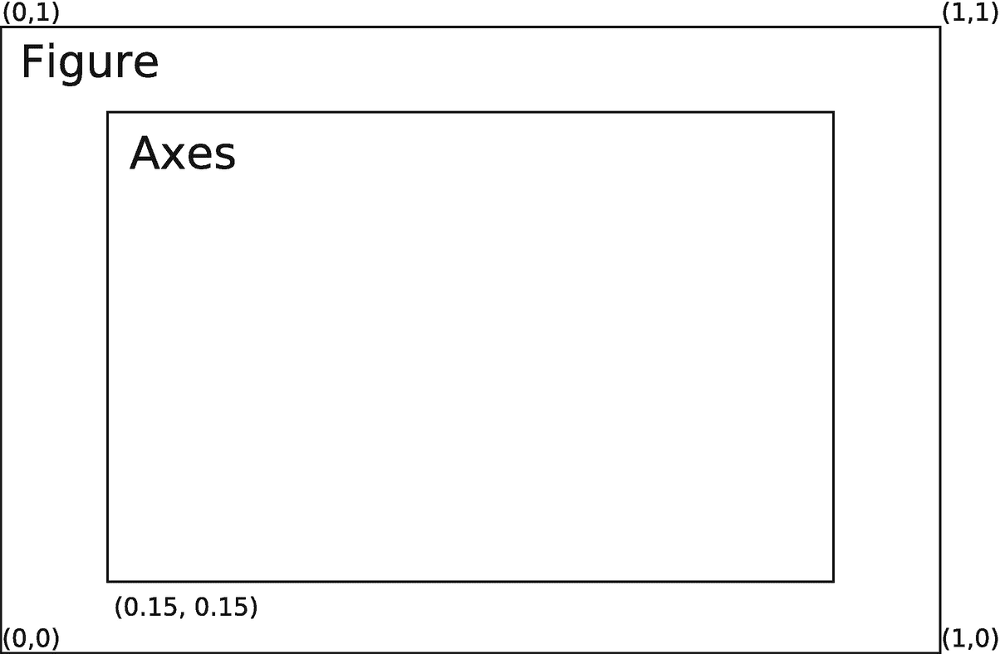

图 4-1

Matplotlib *Figure* 实例和 *Axes* 实例的排列示意图。*Axes* 实例为绘图提供了坐标系，而 *Axes* 实例本身被分配给图形画布内的一个区域。图形画布有一个简单的坐标系，其中 (0, 0) 是左下角，(1, 1) 是右上角。只有在将诸如 *Axes* 之类的元素直接放置在图形画布上时，才会使用此坐标系。

一个 `Figure` 可以包含多个 `Axes` 实例，例如，在图形中显示多个面板，或在另一个 `Axes` 实例中显示插图。可以将 `Axes` 实例手动分配给图形画布的任意区域，或者，也可以使用 Matplotlib 提供的几种布局管理器之一，将 `Axes` 实例自动添加到图形画布。`Axes` 实例提供了一个坐标系，可用于以多种绘图样式绘制数据，包括折线图、散点图、条形图和许多其他样式。此外，`Axes` 实例还决定了坐标轴的显示方式，例如，关于轴标签、刻度线和刻度标签等等。实际上，在使用 Matplotlib 的面向对象 API 时，大多数调整图形外观所需的函数都是 `Axes` 类的方法。

作为一个简单的 Matplotlib 入门示例，假设我们想绘制函数 *y*(*x*) = *x*³ + 5*x*² + 10 及其一阶和二阶导数在区间 *x* ∈ [−5, 2] 上的图形。为此，我们首先为 *x* 范围创建 NumPy 数组，然后计算我们要绘制的三个函数。当图形的数据准备好后，我们需要创建 Matplotlib 的 `Figure` 和 `Axes` 实例，然后使用 `Axes` 实例的 `plot` 方法绘制数据，并使用 `set_xlabel` 和 `set_ylabel` 方法设置基本的图形属性，如 x 轴和 y 轴标签，以及使用 `legend` 方法生成图例。这些步骤在以下代码中执行，生成的图形如图 4-2 所示。

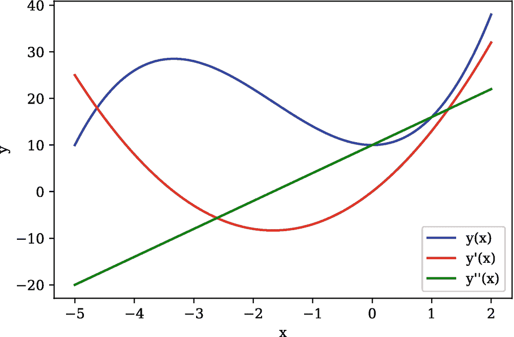

图 4-2

使用 Matplotlib 创建的简单图形示例

```
In [7]: x = np.linspace(-5, 2, 100)
...: y1 = x**3 + 5*x**2 + 10
...: y2 = 3*x**2 + 10*x
...: y3 = 6*x + 10
...:
...: fig, ax = plt.subplots()
...: ax.plot(x, y1, color="blue", label="y(x)")
...: ax.plot(x, y2, color="red", label="y'(x)")
...: ax.plot(x, y3, color="green", label="y”(x)")
...: ax.set_xlabel("x")
...: ax.set_ylabel("y")
...: ax.legend()
```

这里，我们使用了 `plt.subplots` 函数来生成 `Figure` 和 `Axes` 实例。此函数可用于在新创建的 `Figure` 实例中创建 `Axes` 实例网格，但在此处，它仅用作一种便捷方式，只需一次函数调用即可创建 `Figure` 和 `Axes` 实例。一旦 `Axes` 实例可用，请注意所有剩余步骤都涉及调用此 `Axes` 实例的方法。要创建实际的图形，我们使用 `ax.plot`，它接受 NumPy 数组作为第一和第二个参数，这些数组包含图形的 *x* 和 *y* 值的数值数据，并绘制一条连接这些数据点的线。我们还使用了可选的 `color` 和 `label` 关键字参数来指定每条线的颜色，并为每条线分配一个用于图例的文本标签。这几行代码足以生成我们打算制作的图形，但作为最低要求，我们还应该在 *x* 和 *y* 轴上设置标签，并在合适的情况下为我们绘制的曲线添加图例。轴标签通过 `ax.set_xlabel` 和 `ax.set_ylabel` 方法设置，这些方法接受一个包含相应标签的文本字符串作为参数。图例使用 `ax.legend` 方法添加，在这种情况下它不需要任何参数，因为我们在绘制曲线时已经使用了 `label` 关键字参数。

这些是使用 Matplotlib 创建图形所需的典型步骤。尽管该图形（图 4-2）是完整且功能齐全的，但其外观的许多方面肯定还有改进的空间。例如，为了达到出版标准，我们可能需要更改轴标签、刻度标签和图例的字体和字体大小，并且我们可能应该将图例移动到图形中不干扰我们正在绘制的曲线的位置。我们甚至可能还想更改轴刻度和标签的数量，添加注释和额外的辅助线来强调图形的某些方面等等。经过这样一些修改后，该图形可能会如图 4-3 所示，这看起来要好得多。在本章的剩余部分，我们将探讨如何完全控制使用 Matplotlib 生成的图形外观。

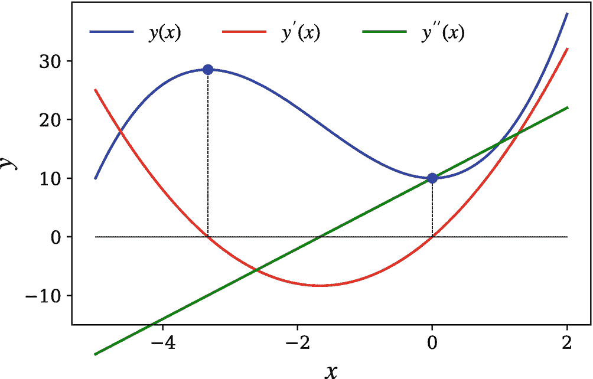

图 4-3

图 4-2 的修订版


### 交互式与非交互式模式

Matplotlib 库旨在与多种不同环境和平台良好协作。因此，该库不仅包含生成图表的程序，还包含在不同图形环境中显示图表的支持。为此，Matplotlib 提供了*后端*来生成不同格式的图形（例如，PNG、PDF、PostScript 和 SVG），并使用适用于不同平台的各种小部件工具包（例如，Qt、GTK、wxWidgets 和 Mac OS X 的 Cocoa）在图形用户界面中显示图形。

可以在 Matplotlib 资源文件^(²⁸)中，或在导入 `matplotlib` 之后、导入 `matplotlib.pyplot` 模块之前立即调用的 `mpl.use` 函数中，选择使用哪个后端。例如，要选择 Qt4Agg 后端，我们可以使用

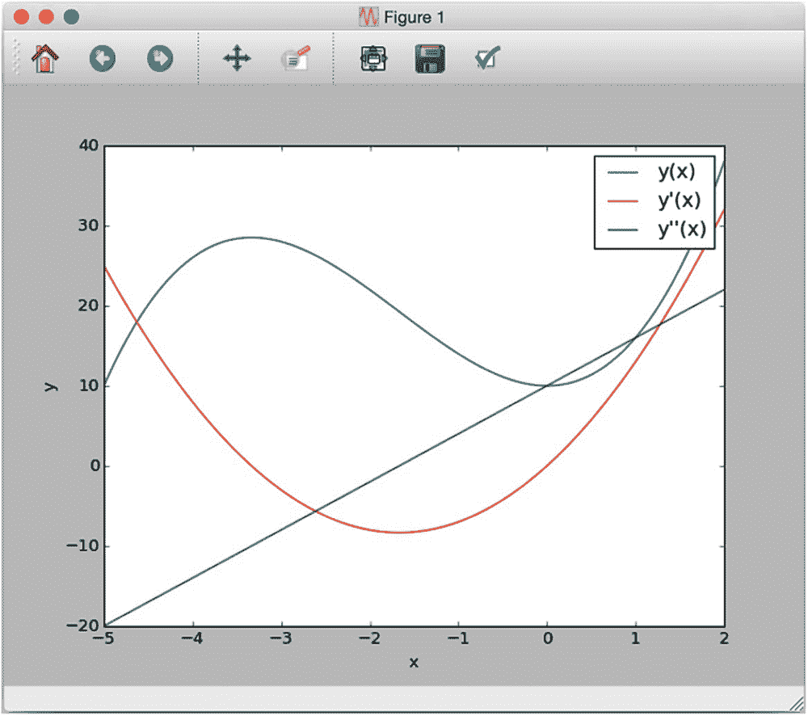

**图 4-4**。Mac OS X 上使用 Qt4 后端显示图形的 Matplotlib 图形用户界面截图。详细外观因平台和后端而异，但基本功能相同。

```
import matplotlib as mpl
mpl.use('qt4agg')
import matplotlib.pyplot as plt
```

如图 4-4 所示，用于显示 Matplotlib 图形的图形用户界面，对于与 Python 脚本文件或 IPython 控制台进行交互式使用非常有用，它允许交互式探索图形，例如通过缩放和平移。当使用在图形用户界面中显示图形的交互式后端时，需要调用 `plt.show` 函数才能使窗口出现在屏幕上。默认情况下，`plt.show` 调用会挂起，直到窗口关闭。为了获得更交互的体验，我们可以通过调用 `plt.ion` 函数来激活*交互式模式*。这会指示 Matplotlib 接管 GUI 事件循环，并在图形创建后立即显示窗口，将控制流返回给 Python 或 IPython 解释器。要使对图形的更改生效，我们需要使用 `plt.draw` 函数发出重绘命令。我们可以使用 `plt.ioff` 函数停用交互式模式，并使用 `mpl.is_interactive` 函数检查 Matplotlib 当前处于交互式还是非交互式模式。

虽然交互式图形用户界面具有独特的优势，但在使用 Jupyter Notebook 或 Qtconsole 时，将 Matplotlib 生成的图形直接嵌入到 notebook 中通常更加方便。此行为通过 IPython 命令 `%matplotlib inline` 激活，该命令会启用 IPython 提供的“内联后端”。这会将 Matplotlib 配置为使用非交互式后端生成图形图像，然后这些图像会作为静态图像显示在例如 Jupyter Notebook 中。可以使用 IPython 的 `%config` 命令对 Matplotlib 的 IPython“内联后端”进行微调。例如，我们可以使用 `InlineBackend.figure_format` 选项^(²⁹)选择生成图形的输出格式，例如，我们可以将其设置为 `'svg'` 以生成 SVG 图形而非 PNG 文件：

```
In [8]: %matplotlib inline
In [9]: %config InlineBackend.figure_format='svg'
```

采用这种方法，图形用户界面的交互性（例如缩放和平移）会丢失，但将图形直接嵌入 notebook 具有许多其他优点。例如，将用于生成图形的代码与生成的图形保存在同一文档中，消除了重新运行代码以显示图形的需要，而 Jupyter Notebook 本身的交互性也替代了 Matplotlib 图形用户界面的部分交互功能。

使用 IPython 内联后端时，无需使用 `plt.show` 和 `plt.draw`，因为 IPython 的富文本显示系统负责触发图形的渲染和显示。在本书中，我假设代码示例在 Jupyter Notebooks 中执行，因此代码示例中不包含对 `plt.show` 函数的调用。当使用交互式后端时，则需要在每个示例的末尾添加此函数调用。

## 图形对象 Figure

如前一节所述，`Figure` 对象在 Matplotlib 中用于表示一个图形。`Figure` 对象除了提供画布（例如，可以在其上放置 `Axes` 实例）之外，还提供了对图形执行操作的方法，并具有多个可用于配置图形属性的属性。

可以使用 `plt.figure` 函数创建 `Figure` 对象，该函数接受多个可选的键参数来设置图形属性。具体来说，它接受 `figsize` 键参数，该参数应被赋值为一个 `(width, height)` 形式的元组，以英寸为单位指定图形画布的宽度和高度。通过设置 `facecolor` 键参数来指定图形画布的颜色也很有用。

一旦创建了 `Figure`，我们就可以使用 `add_axes` 方法创建新的 `Axes` 实例，并将其分配给图形画布上的一个区域。`add_axes` 接受一个必需参数：一个列表，其中包含 `Axes` 在图形画布坐标系中的左下角坐标、宽度和高度，格式为 `(left, bottom, width, height)`。^(³⁰) `Axes` 对象的坐标、宽度和高度表示为总画布宽度和高度的分数；见图 4-1。例如，完全填充画布的 `Axes` 对象对应于 `(0, 0, 1, 1)`，但这会为轴标签和刻度线留下空间。更实用的尺寸可能是 `(0.1, 0.1, 0.8, 0.8)`，这对应于一个居中的 `Axes` 实例，覆盖画布宽度和高度的 80%。`add_axes` 方法接受大量键参数来设置新 `Axes` 实例的属性。这些将在本章后面深入讨论 `Axes` 对象时进行更详细的描述。然而，这里值得强调的一个键参数是 `facecolor`，我们可以用它来为 `Axes` 对象分配背景颜色。与 `plt.figure` 的 `facecolor` 参数相结合，这允许同时选择画布和 `Axes` 实例所覆盖区域的颜色。


通过`plt.figure`和`fig.add_axes`获得`Figure`和`Axes`对象后，我们便具备了利用`Axes`对象方法绘制数据的基本条件。更详细的内容请参见本章下一节。然而，一旦创建了所需的图表，`Figure`对象中还有许多在图表创建流程中至关重要的方法。例如，要设置整个图形的标题，可以使用`suptitle`方法，该方法接受一个包含标题的字符串作为参数。要将图形保存到文件，可以使用`savefig`方法。该方法将输出文件名作为第一个参数（字符串类型），同时还支持多个可选关键字参数。默认情况下，输出文件格式由文件名的扩展名决定，但我们也可以使用`format`参数显式指定格式。可用的输出格式取决于所使用的 Matplotlib 后端，但常见的选项包括 PNG、PDF、EPS 和 SVG 格式。生成图像的分辨率可以通过`dpi`参数设置。DPI 代表“每英寸点数”（dots per inch），由于图形尺寸是通过`figsize`参数以英寸为单位指定的，因此将这些数值相乘即可得到输出图像的像素尺寸。例如，当`figsize=(8， 6)`且`dpi=100`时，生成的图像尺寸为 800x600 像素。`savefig`方法还接受一些与`plt.figure`函数类似的参数，例如`facecolor`参数。请注意，尽管`facecolor`参数与`plt.figure`一同使用，但为了使其应用于生成的图像文件，也需要在`savefig`中指定该参数。最后，还可以使用`savefig`的`transparent=True`参数使图形画布透明。以下代码清单展示了这些技术，结果如图 4-5 所示。

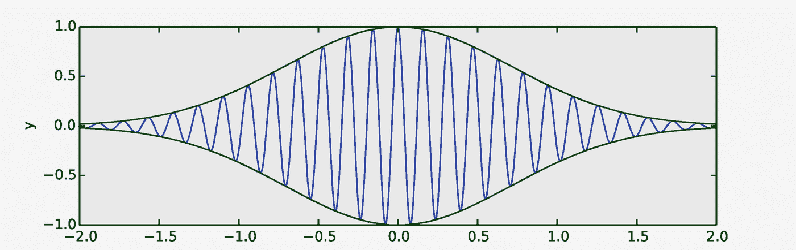

**图 4-5**

本图展示了以下操作的结果：使用`figsize`设置图形尺寸、使用`add_axes`添加新的`Axes`实例、使用`facecolor`设置`Figure`和`Axes`对象的背景颜色，最后使用`savefig`将图形保存到文件。

```
In [10]: fig = plt.figure(figsize=(8, 2.5), facecolor="#f1f1f1")
...:
...: # 坐标作为画布宽度和高度的比例
...: left, bottom, width, height = 0.1, 0.1, 0.8, 0.8
...: ax = fig.add_axes((left, bottom, width, height), facecolor="#e1e1e1")
...:
...: x = np.linspace(-2, 2, 1000)
...: y1 = np.cos(40 * x)
...: y2 = np.exp(-x**2)
...:
...: ax.plot(x, y1 * y2)
...: ax.plot(x, y2, 'g')
...: ax.plot(x, -y2, 'g')
...: ax.set_xlabel("x")
...: ax.set_ylabel("y")
...:
...: fig.savefig("graph.png", dpi=100, facecolor="#f1f1f1")
```

## Axes

上一节介绍的`Figure`对象构成了 Matplotlib 图形的基础框架，但所有有趣的内容都在`Axes`实例内部或周围组织。在本章前面部分，我们已经多次遇到`Axes`对象。`Axes`对象是使用 Matplotlib 库进行大多数绘图活动的核心。它提供了绘制数据和数学函数的坐标系，此外还包含确定轴标签和轴刻度放置位置的坐标轴对象。用于绘制不同类型图形的函数也是`Axes`类的方法。在本节中，我们首先探讨可以使用`Axes`方法绘制的不同类型图形，以及如何自定义*x*轴和*y*轴的外观以及`Axes`对象使用的坐标系。

我们已经看到如何显式地使用`add_axes`方法将新的`Axes`实例添加到图形中。这是一种灵活且强大的方法，可以将`Axes`对象放置在任意位置，这有几个重要的应用，我们将在本章后面看到。然而，对于大多数常见用例，在图形画布内显式指定`Axes`实例的坐标显得繁琐。特别是当在图形中使用多个`Axes`实例面板（例如网格布局）时。Matplotlib 提供了几种不同的`Axes`布局管理器，它们按照不同的策略在图形画布内创建和放置`Axes`实例。在本章后面，我们将更详细地研究如何使用此类布局管理器。但是，为了方便接下来的示例，我们在此简要介绍其中一个布局管理器：`plt.subplots`函数。在本章前面，我们已经使用过这个函数，以便在一次函数调用中方便地生成新的`Figure`和`Axes`对象。然而，`plt.subplots`函数还能够用`Axes`实例网格填充图形，这可以通过其第一个和第二个参数指定，或者使用`nrows`和`ncols`参数（顾名思义，这两个参数用于创建一个具有指定行数和列数的`Axes`对象网格）。例如，要在新创建的`Figure`对象中生成一个三行两列的`Axes`实例网格，我们可以使用：

```
fig, axes = plt.subplots(nrows=3, ncols=2)
```

这里，函数`plt.subplots`返回一个元组`(fig, axes)`，其中`fig`是一个`Figure`实例，`axes`是一个大小为`(nrows, ncols)`的 NumPy 数组，数组中的每个元素都是一个已恰当放置在相应图形画布中的`Axes`实例。此时，我们还可以使用`sharex`和`sharey`参数指定列和/或行是否共享 x 轴和 y 轴，这些参数可以设置为`True`或`False`。

`plt.subplots`函数还接受两个特殊的关键字参数`fig_kw`和`subplot_kw`，它们分别是用于创建`Figure`和`Axes`实例时的关键字参数字典。这使我们能够在使用`plt.subplots`时，以类似于直接使用`plt.figure`和`make_axes`方法的方式，设置并完全控制`Figure`和`Axes`对象的属性。

### 图形类型

有效的数据科学和技术可视化需要多种绘图技术。Matplotlib 将许多类型的绘图技术实现为`Axes`对象的方法。例如，在前面的示例中，我们已经使用了`plot`方法，它在`Axes`对象提供的坐标系中绘制曲线。在接下来的几节中，我们将通过在一些示例图形中使用这些函数，更深入地探索 Matplotlib 的部分绘图函数。常用二维绘图函数的总结如图 4-6 所示。其他类型的图形，如颜色图和三维图形，将在本章后面讨论。Matplotlib 中的所有绘图函数都期望输入 NumPy 数组作为数据，通常将包含*x*和*y*坐标的数组作为第一个和第二个参数。有关详细信息，请参见图 4-6 中每个方法的文档字符串，例如，使用`help(plt.Axes.bar)`。

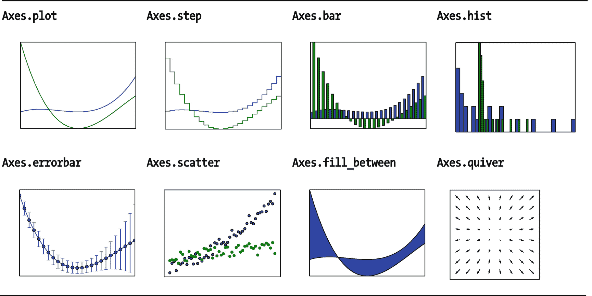

**图 4-6**

选定二维图形类型概览。图中显示了用于生成每种图形的`Axes`方法名称及对应的图形。


### 线条属性

最基本的一种图形是简单线图。例如，它可用于描绘单变量函数的图像，或将数据绘制为控制变量的函数。在线图中，我们经常需要配置图形中线条的属性，例如线宽、线条颜色和线条样式（实线、虚线、点线等）。在 Matplotlib 中，我们通过向绘图方法（如 `plot`、`step` 和 `bar`）提供关键字参数来设置这些属性。其中一些图形类型显示在图 4-6 中。许多绘图方法都有自己特定的参数，但诸如颜色和线宽等基本属性在大多数绘图方法中是共享的。这些基本属性及其对应的关键字参数总结在表 4-1 中。

**表 4-1** Matplotlib 绘图方法使用的基本线条属性及其对应的参数名称

| 参数 | 示例值 | 描述 |
| --- | --- | --- |
| `color` | 颜色规范可以是一个包含颜色名称的字符串，例如“red”、“blue”等，或者是一个形如“#aabbcc”的 RGB 颜色代码。 | 颜色规范。 |
| `alpha` | 介于 0.0（完全透明）和 1.0（完全不透明）之间的浮点数。 | 透明度。 |
| `linewidth`, `lw` | 浮点数。 | 线条的宽度。 |
| `linestyle`, `ls` | “-” – 实线, “--” – 虚线, “:” – 点线, “.-” – 点划线 | 线条的样式，即线条是绘制成实线，还是例如点线或虚线。 |
| `marker` | `+`, `o`, `*` = 叉号, 圆圈, 星号; `s` = 方块; `.` = 小点; `1`, `2`, `3`, `4`, ... = 不同角度的三角形符号。 | 每个数据点，无论其是否与相邻数据点相连，都可以用此参数指定的标记符号来表示。 |
| `markersize` | 浮点数。 | 标记的大小。 |
| `markerfacecolor` | 颜色规范（见上文）。 | 标记的填充颜色。 |
| `markeredgewidth` | 浮点数。 | 标记边缘的线宽。 |
| `markeredgecolor` | 颜色规范（见上文）。 | 标记边缘的颜色。 |

为了说明这些属性和参数的使用，请考虑以下代码，该代码使用不同的线宽、线条样式、标记符号、颜色和大小绘制了水平线。生成的图形显示在图 4-7 中。

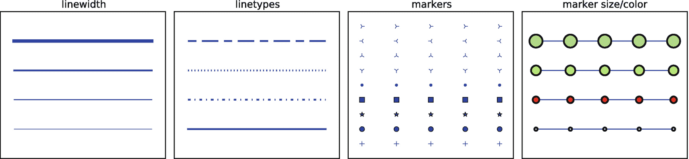

**图 4-7** 展示设置线条属性线宽、线条样式、标记类型和标记大小以及颜色结果的图形

```
In [11]: x = np.linspace(-5, 5, 5)
...: y = np.ones_like(x)
...:
...: def axes_settings(fig, ax, title, ymax):
...:    ax.set_xticks([])
...:    ax.set_yticks([])
...:    ax.set_ylim(0, ymax+1)
...:    ax.set_title(title)
...:
...: fig, axes = plt.subplots(1, 4, figsize=(16,3))
...:
...: # Line width
...: linewidths = [0.5, 1.0, 2.0, 4.0]
...: for n, linewidth in enumerate(linewidths):
...:    axes[0].plot(x, y + n, color="blue", linewidth=linewidth)
...: axes_settings(fig, axes[0], "linewidth", len(linewidths))
...:
...: # Line style
...: linestyles = ['-', '-.', ':']
...: for n, linestyle in enumerate(linestyles):
...:    axes[1].plot(x, y + n, color="blue", lw=2, linestyle=linestyle)
...: # custom dash style
...: line, = axes[1].plot(x, y + 3, color="blue", lw=2)
...: length1, gap1, length2, gap2 = 10, 7, 20, 7
...: line.set_dashes([length1, gap1, length2, gap2])
...: axes_settings(fig, axes[1], "linetypes", len(linestyles) + 1)
...: # marker types
...: markers = ['+', 'o', '*', 's', '.', '1', '2', '3', '4']
...: for n, marker in enumerate(markers):
...:    # lw = shorthand for linewidth, ls = shorthand for linestyle
...:    axes[2].plot(x, y + n, color="blue", lw=2, ls='*', marker=marker)
...: axes_settings(fig, axes[2], "markers", len(markers))
...:
...: # marker size and color
...: markersizecolors = [(4, "white"), (8, "red"), (12, "yellow"), (16, "lightgreen")]
...: for n, (markersize, markerfacecolor) in enumerate(markersizecolors):
...:    axes[3].plot(x, y + n, color="blue", lw=1, ls='-',
...:                 marker='o', markersize=markersize,
...:                 markerfacecolor=markerfacecolor, markeredgewidth=2)
...: axes_settings(fig, axes[3], "marker size/color", len(markersizecolors))
```

实际应用中，使用不同的颜色、线宽和线条样式是使图形易于阅读的重要工具。在包含大量线条的图形中，我们可以结合使用颜色和线条样式，使每条线都能被唯一识别，例如，通过图例。线宽属性最适合用于强调重要的线条。考虑以下示例，其中函数 `sin(x)` 与其在 `x = 0` 附近的几个低阶级数展开一起绘制，如图 4-8 所示。

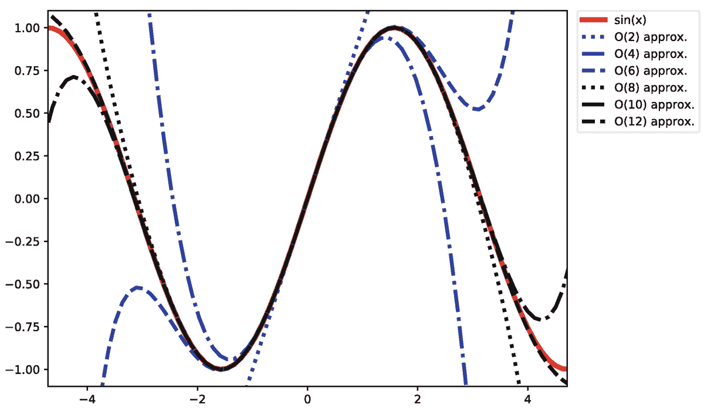

**图 4-8** `sin(x)` 及其几个最低阶泰勒级数逼近的图形

```
In [12]: # a symbolic variable for x, and a numerical array with specific values of x
...: sym_x = sympy.Symbol("x")
...: x = np.linspace(-2 * np.pi, 2 * np.pi, 100)
...:
...: def sin_expansion(x, n):
...:     """
...:     Evaluate the nth order Taylor. series expansion
...:     of sin(x) for the numerical values in the array x.
...:     """
...:     return sympy.lambdify(sym_x, sympy.sin(sym_x).series(n=n+1).removeO(), 'numpy')(x)
...:
...: fig, ax = plt.subplots()
...:
...: ax.plot(x, np.sin(x), linewidth=4, color="red", label="exact")
...:
...: colors = ["blue", "black"]
...: linestyles = [':', '-.', '--']
...: for idx, n in enumerate(range(1, 12, 2)):
...:     ax.plot(x, sin_expansion(x, n), color=colors[idx // 3],
...:             linestyle=linestyles[idx % 3], linewidth=3,
...:             label="order %d approx." % (n+1))
...:
...:  ax.set_ylim(-1.1, 1.1)
...: ax.set_xlim(-1.5*np.pi, 1.5*np.pi)
...:
...: # place a legend outsize of the Axes
...: ax.legend(bbox_to_anchor=(1.02, 1), loc=2, borderaxespad=0.0)
...: # make room for the legend to the right of the Axes
...: fig.subplots_adjust(right=.75)
```


### 图例

包含多条线的图通常得益于图例的辅助，图例会在图形中的某个位置为每种线型显示一个标签。正如我们在前面的示例中看到的，可以使用 `legend` 方法为 Matplotlib 图形中的 `Axes` 实例添加图例。只有带有指定标签的线条才会包含在图例中（要为线条指定标签，请使用，例如，`Axes.plot` 的 `label` 参数）。`legend` 方法接受大量可选参数。详情请参阅 `help(plt.legend)`。这里我们重点介绍几个更有用的参数。在前一节的示例中，我们使用了 `loc` 参数，它允许指定图例添加到 `Axes` 区域中的位置：`loc=1` 表示右上角，`loc=2` 表示左上角，`loc=3` 表示左下角，而 `loc=4` 表示右下角，如图 4-9 所示。

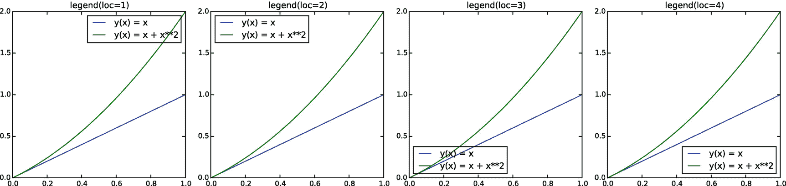

图 4-9
图例在 `Axes` 实例内的不同位置，通过 `legend` 方法的 `loc` 参数指定。

在前一节的示例中，我们还使用了 `bbox_to_anchor`，借助它可以将图例放置在图形画布中的任意位置。`bbox_to_anchor` 参数接受一个形式为 `(x, y)` 的元组值，其中 `x` 和 `y` 是 `Axes` 对象内的*画布坐标*。也就是说，点 `(0, 0)` 对应于左下角，点 `(1, 1)` 对应于右上角。注意，在这种情况下，`x` 和 `y` 可以小于 0 或大于 1，这表示图例将被放置在 `Axes` 区域之外，正如前一节中所使用的那样。

默认情况下，图例中的所有线条都会垂直排列显示。使用 `ncols` 参数，可以将图例标签分割成多列，如图 4-10 所示。

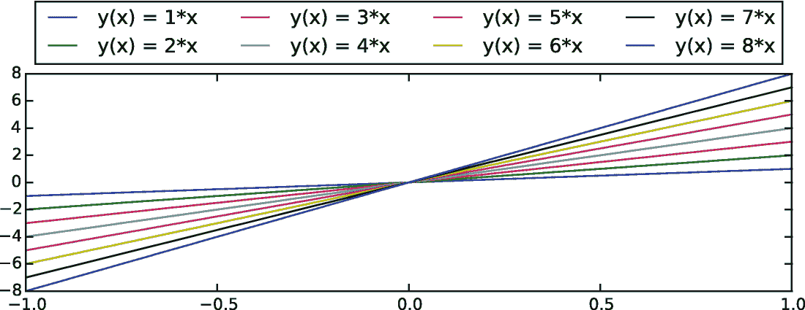

图 4-10
图例显示在 `Axes` 对象外部，并以四列而非单列显示，这里使用了 `ax.legend(ncol=4, loc=3, bbox_to_anchor=(0, 1))`。

### 文本格式与注释

文本标签、标题和注释是大多数图形中的重要组成部分，而对用于渲染此类文本的字体类型和字体大小等拥有完全控制，是生成出版级质量图形的基本要求。Matplotlib 提供了几种配置字体属性的方法。默认值可以在 Matplotlib 资源文件中设置，而会话范围的配置可以在 `mpl.rcParams` 字典中设置。该字典是 Matplotlib 资源文件的缓存，对此字典内参数的更改在 Python 解释器重新启动并再次导入 Matplotlib 之前一直有效。与文本显示方式相关的参数包括，例如，`'font.family'` 和 `'font.size'`。

### 提示

尝试 `print(mpl.rcParams)` 以获取可能的配置参数列表及其当前值。更新参数就像为字典 `mpl.rcParams` 中的对应项赋新值一样简单，例如，`mpl.rcParams['savefig.dpi'] = 100.`。另请参阅可用于更新 `mpl.rcParams` 字典的 `mpl.rc` 函数，以及用于恢复默认值的 `mpl.rcdefaults`。

也可以通过向图形中创建文本标签的函数传递一组标准关键字参数，来逐个设置文本属性。大多数以某种方式处理文本标签的 Matplotlib 函数都接受表 4-2 中总结的关键字参数（此列表是常用参数的不完整选择；完整参考请参阅 `help(mpl.text.Text)`）。例如，这些参数可以与 `Axes.text` 方法一起使用，该方法会在给定坐标处创建一个新的文本标签。它们也可以与 `set_title`、`set_xlabel`、`set_ylabel` 等方法一起使用。有关这些方法的更多信息，请参阅下一节。

在科学和技术可视化中，能够在文本标签中渲染数学符号和表达式显然非常重要。Matplotlib 通过其文本标签中的 LaTeX 标记提供了对此的出色支持：Matplotlib 中的任何文本标签都可以通过将 LaTeX 数学表达式括在 `$` 符号中来包含它，例如 `"Regular text: $f(x)=1-x²$"`。默认情况下，Matplotlib 使用内部 LaTeX 渲染引擎，该引擎支持 LaTeX 语言的一个子集。然而，通过设置配置参数 `mpl.rcParams["text.usetex"]=True`，也可以使用外部功能完备的 LaTeX 引擎（如果您的系统上可用的话）。

在 Python 字符串中嵌入 LaTeX 代码时，有一个常见的陷阱：Python 使用 `\` 作为转义字符，而在 LaTeX 中它用于表示命令的开始。为了防止 Python 解释器对包含 LaTeX 表达式的字符串中的字符进行转义，使用原始字符串会很方便，原始字符串是前面带有 `r` 的文字字符串表达式，例如，`r"$\int f(x) dx$"` 和 `r'$x_{\rm A}$'`。

以下示例演示了如何使用 `ax.text` 和 `ax.annotate` 向 Matplotlib 图形添加文本标签和注释，以及如何渲染包含用 LaTeX 排版的方程的文本标签。生成的图形如图 4-11 所示。

表 4-2
选定字体属性及对应关键字参数总结

| 参数 | 描述 |
| --- | --- |
| `fontsize` | 字体大小，以磅为单位。 |
| `family 或 fontname` | 字体类型。 |
| `backgroundcolor` | 文本标签背景颜色的颜色规范。 |
| `color` | 字体颜色的颜色规范。 |
| `alpha` | 字体颜色的透明度。 |
| `rotation` | 文本标签的旋转角度。 |

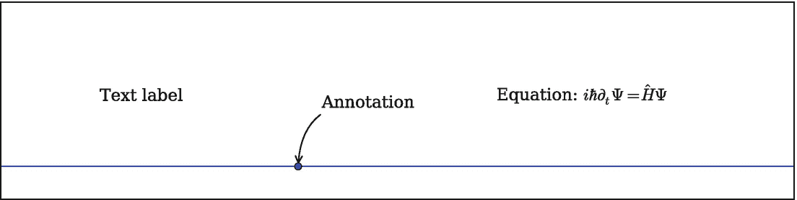

图 4-11
示例展示了使用 `ax.text` 和 `ax.annotation` 添加文本标签和注释，以及在 Matplotlib 文本标签中包含 LaTeX 格式化方程的效果。

```
In [13]: fig, ax = plt.subplots(figsize=(12, 3))
...:
...: ax.set_yticks([])
...: ax.set_xticks([])
...: ax.set_xlim(-0.5, 3.5)
...: ax.set_ylim(-0.05, 0.25)
...: ax.axhline(0)
...:
...: # 文本标签
...: ax.text(0, 0.1, "文本标签", fontsize=14, family="serif")
...:
...: # 注释
...: ax.plot(1, 0, "o")
...: ax.annotate("注释",
...:             fontsize=14, family="serif",
...:             xy=(1, 0), xycoords="data",
...:           xytext=(+20, +50), textcoords="offset points",
...:           arrowprops=dict(arrowstyle="->", connectionstyle="arc3, rad=.5"))
...:
...: # 方程
...: ax.text(2, 0.1, r"方程: $i\hbar\partial_t \Psi = \hat{H}\Psi$", fontsize=14, family="serif")
...:
```

### 坐标轴属性

在创建了 `Figure` 和 `Axes` 对象之后，使用 Matplotlib 提供的众多绘图函数之一绘制数据或函数，并自定义线条和标记的外观——图形中最后一个需要配置和微调的主要方面是 `Axis` 实例。二维图形有两个坐标轴对象：用于水平 *x* 轴和垂直 *y* 轴。每个坐标轴都可以独立配置其属性，例如坐标轴标签、刻度线和刻度标签的放置位置，以及坐标轴本身的位置和外观。在本节中，我们将详细探讨如何控制图形的这些方面。


### 坐标轴标签和标题

可以说，坐标轴最重要的属性是其标签，在几乎所有情况下都需要进行设置。我们可以使用 `set_xlabel` 和 `set_ylabel` 方法来设置坐标轴标签：这两个方法都将包含标签的字符串作为第一个参数。此外，可选的 `labelpad` 参数用于指定坐标轴到标签之间的间距，单位是点（points）。这种内边距有时是必要的，可以避免坐标轴标签与坐标轴刻度标签重叠。`set_xlabel` 和 `set_ylabel` 方法还接受其他用于设置文本属性的参数，例如 `color`、`fontsize` 和 `fontname`，这些在前一节中已有详细讨论。以下代码生成了图 4-12，演示了如何使用 `set_xlabel` 和 `set_ylabel` 方法以及这里讨论的关键字参数。

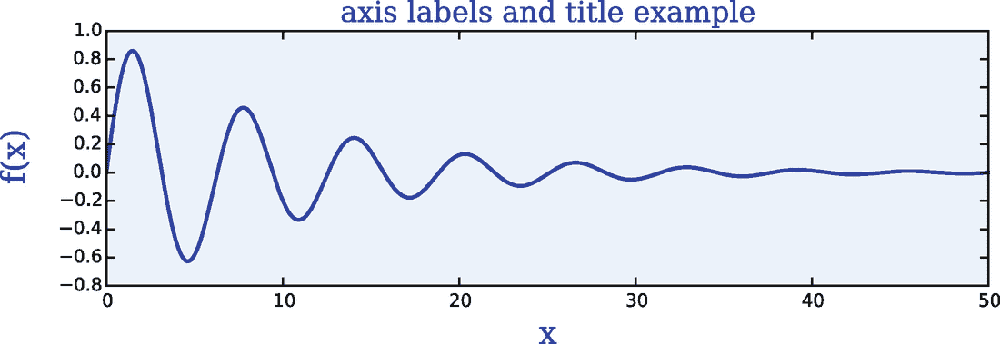

图 4-12：展示使用 `set_xlabel` 和 `set_ylabel` 设置 x 轴和 y 轴标签的结果的图表。

```
In [14]: x = np.linspace(0, 50, 500)
...: y = np.sin(x) * np.exp(-x/10)
...:
...: fig, ax = plt.subplots(figsize=(8, 2), subplot_kw={'facecolor': "#ebf5ff"})
...:
...: ax.plot(x, y, lw=2)
...:
...: ax.set_xlabel("x", labelpad=5, fontsize=18, fontname="serif", color="blue")
...: ax.set_ylabel("f(x)", labelpad=15, fontsize=18, fontname="serif", color="blue")
...: ax.set_title("axis labels and title example", fontsize=16,
...:              fontname='serif', color="blue")
```

除了在 x 轴和 y 轴上设置标签，我们还可以使用 `set_title` 方法为 `Axes` 对象设置标题。此方法接受的参数与 `set_xlabel` 和 `set_ylabel` 基本相同，但多了 `loc` 参数，它可以被设置为 `'left'`、`'centered'` 或 `'right'`，用于指定标题是左对齐、居中对齐还是右对齐。

### 坐标轴范围

默认情况下，Matplotlib 的 *x* 轴和 *y* 轴的范围会根据 `Axes` 对象中绘制的数据自动调整。在许多情况下，这些默认范围已经足够，但在某些情况下，可能需要显式设置坐标轴范围。在这种情况下，我们可以使用 `Axes` 对象的 `set_xlim` 和 `set_ylim` 方法。这两个方法都接受两个参数，分别指定要在坐标轴上显示的下限和上限。`set_xlim` 和 `set_ylim` 的替代方法是 `axis` 方法，例如，它接受字符串参数 `'tight'`，用于生成紧密贴合所包含线条的坐标范围；还接受 `'equal'`，用于生成每个坐标轴上的一个单位长度对应相同像素数的坐标范围（即保持比例不变的坐标系）。

还可以使用 `autoscale` 方法通过传递 `True` 和 `False` 作为第一个参数来选择性地开启和关闭自动缩放，并通过将其 `axis` 参数设置为 `'x'`、`'y'` 或 `'both'` 来针对 *x* 轴和/或 *y* 轴进行控制。下面的例子展示了如何使用这些方法来控制坐标轴范围。生成的图表如图 4-13 所示。

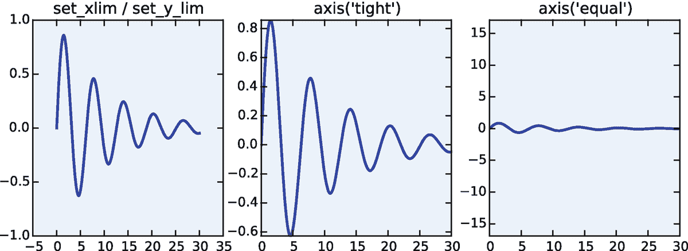

图 4-13：展示使用 `set_xlim`、`set_ylim` 和 `axis` 方法设置图表中显示的坐标轴范围的结果的图表。

```
In [15]: x = np.linspace(0, 30, 500)
...: y = np.sin(x) * np.exp(-x/10)
...:
...:
...: fig, axes = plt.subplots(1, 3, figsize=(9, 3), subplot_kw={'facecolor': "#ebf5ff"})
...:
...: axes[0].plot(x, y, lw=2)
...: axes[0].set_xlim(-5, 35)
...: axes[0].set_ylim(-1, 1)
...: axes[0].set_title("set_xlim / set_y_lim")
...:
...: axes[1].plot(x, y, lw=2)
...: axes[1].axis('tight')
...: axes[1].set_title("axis('tight')")
...:
...: axes[2].plot(x, y, lw=2)
...: axes[2].axis('equal')
...: axes[2].set_title("axis('equal')")
```

### 坐标轴刻度、刻度标签和网格

需要配置的最后几个基本坐标轴属性是坐标轴刻度的位置，以及相应刻度标签的位置和格式。坐标轴刻度是图表整体外观的重要组成部分，在准备用于出版和生产质量的图表时，通常需要对坐标轴刻度进行精细控制。Matplotlib 的 `mpl.ticker` 模块提供了一个通用且可扩展的刻度管理系统，能完全控制刻度位置。Matplotlib 区分主刻度和次刻度。默认情况下，每个主刻度都有一个对应的标签，主刻度之间的距离可以用没有标签的次刻度进一步标记，尽管此功能必须显式开启。有关主刻度和次刻度的图示，请参见图 4-14。

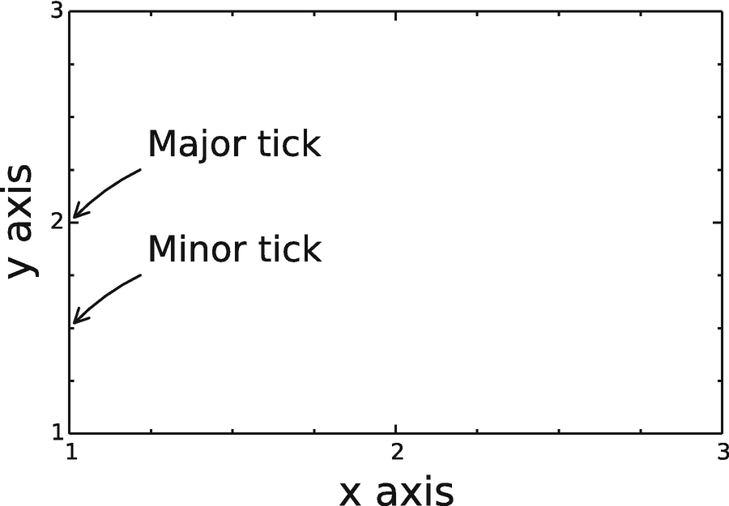

图 4-14：主刻度和次刻度之间的区别。

在处理刻度配置时，最常见的设计目标是确定带有标签的主刻度应沿坐标轴放置在何处。`mpl.ticker` 模块为不同的刻度放置策略提供了类。例如，`mpl.ticker.MaxNLocator` 可用于设置最大刻度数量（位置未指定），`mpl.ticker.MultipleLocator` 可用于在给定基数的整数倍位置设置刻度，`mpl.ticker.FixedLocator` 可用于在显式指定的坐标位置放置刻度。要更改刻度策略，我们可以使用 `Axes.xaxis` 和 `Axes.yaxis` 中的 `set_major_locator` 和 `set_minor_locator` 方法。这些方法接受一个在 `mpl.ticker` 中定义的刻度类实例，或从这些类派生的自定义类实例。

当显式指定刻度位置时，我们还可以使用 `set_xticks` 和 `set_yticks` 方法，它们接受一个用于放置主刻度的坐标列表。在这种情况下，还可以使用 `set_xticklabels` 和 `set_yticklabels` 为每个刻度设置自定义标签，这些方法期望使用字符串列表作为相应刻度的标签。如果可能，最好使用通用的刻度放置策略，例如 `mpl.ticker.MaxNLocator`，因为它们会在坐标范围改变时动态调整；而使用 `set_xticks` 和 `set_yticks` 进行显式刻度放置则需要手动修改代码。但是，当必须精确控制刻度位置时，`set_xticks` 和 `set_yticks` 是很方便的方法。

以下代码演示了如何使用前面段落讨论的方法的组合来更改默认刻度放置，生成的图表如图 4-15 所示。

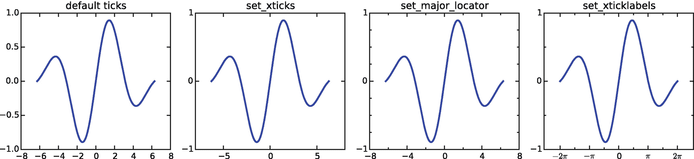

图 4-15：演示沿 *x* 轴和 *y* 轴控制和放置主刻度与次刻度及其外观的不同方式的图表。


```python
In [16]: x = np.linspace(-2 * np.pi, 2 * np.pi, 500)
...: y = np.sin(x) * np.exp(-x**2/20)
...:
...: fig, axes = plt.subplots(1, 4, figsize=(12, 3))
...:
...: axes[0].plot(x, y, lw=2)
...: axes[0].set_title("default ticks")
...: axes[1].plot(x, y, lw=2)
...: axes[1].set_title("set_xticks")
...: axes[1].set_yticks([-1, 0, 1])
...: axes[1].set_xticks([-5, 0, 5])
...:
...: axes[2].plot(x, y, lw=2)
...: axes[2].set_title("set_major_locator")
...: axes[2].xaxis.set_major_locator(mpl.ticker.MaxNLocator(4))
...: axes[2].yaxis.set_major_locator(mpl.ticker.FixedLocator([-1, 0, 1]))
...: axes[2].xaxis.set_minor_locator(mpl.ticker.MaxNLocator(8))
...: axes[2].yaxis.set_minor_locator(mpl.ticker.MaxNLocator(8))
...:
...: axes[3].plot(x, y, lw=2)
...: axes[3].set_title("set_xticklabels")
...: axes[3].set_yticks([-1, 0, 1])
...: axes[3].set_xticks([-2 * np.pi, -np.pi, 0, np.pi, 2 * np.pi])
...: axes[3].set_xticklabels([r'$-2\pi$', r'$-\pi$', 0, r'$\pi$', r'$2\pi$'])
...: x_minor_ticker = mpl.ticker.FixedLocator([-3 * np.pi / 2, -np.pi / 2, 0,
...:                                           np.pi / 2, 3 * np.pi / 2])
...: axes[3].xaxis.set_minor_locator(x_minor_ticker)
...: axes[3].yaxis.set_minor_locator(mpl.ticker.MaxNLocator(4))
```

图中一个常用的设计元素是网格线，它作为从图表中读取数值时的视觉参考。网格和网格线与坐标轴刻度密切相关，因为它们绘制在相同的坐标值上，因此本质上是跨越整个图形的刻度延伸。在 Matplotlib 中，我们可以使用坐标轴对象的`grid`方法打开坐标轴网格。`grid`方法接受可选的关键字参数，用于控制网格的外观。例如，与 Matplotlib 中的许多绘图函数一样，`grid`方法接受参数`color`、`linestyle`和`linewidth`，用于指定网格线的属性。此外，它还接受参数`which`和`axis`，可以分别赋值为`'major'`、`'minor'`或`'both'`，以及`'x'`、`'y'`或`'both'`。这些参数用于指示要将给定的样式应用于哪个坐标轴的哪些刻度。如果网格线需要多种不同的样式，可以对`grid`进行多次调用，每次使用不同的`which`和`axis`值。关于如何添加网格线以及如何以不同方式设置其样式的示例，请参见以下示例，该示例生成了图 4-16 所示的图形。

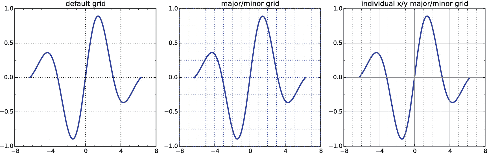

图 4-16

演示使用网格线效果的图形

```python
In [17]: fig, axes = plt.subplots(1, 3, figsize=(12, 4))
...: x_major_ticker = mpl.ticker.MultipleLocator(4)
...: x_minor_ticker = mpl.ticker.MultipleLocator(1)
...: y_major_ticker = mpl.ticker.MultipleLocator(0.5)
...: y_minor_ticker = mpl.ticker.MultipleLocator(0.25)
...:
...: for ax in axes:
...:     ax.plot(x, y, lw=2)
...:     ax.xaxis.set_major_locator(x_major_ticker)
...:     ax.yaxis.set_major_locator(y_major_ticker)
...:     ax.xaxis.set_minor_locator(x_minor_ticker)
...:     ax.yaxis.set_minor_locator(y_minor_ticker)
...:
...: axes[0].set_title("默认网格")
...: axes[0].grid()
...:
...: axes[1].set_title("主/副网格")
...: axes[1].grid(color="blue", which="both", linestyle=':', linewidth=0.5)
...:
...: axes[2].set_title("单独的 x/y 主/副网格")
...: axes[2].grid(color="grey", which="major", axis="x", linestyle='-', linewidth=0.5)
...: axes[2].grid(color="grey", which="minor", axis="x", linestyle=':', linewidth=0.25)
...: axes[2].grid(color="grey", which="major", axis="y", linestyle='-', linewidth=0.5)
```

除了控制刻度位置，Matplotlib 的`mpl.ticker`模块还提供了用于自定义刻度标签的类。例如，`mpl.ticker`模块中的`ScalarFormatter`可用于设置几个与使用科学记数法显示刻度标签相关的有用属性，用于显示大数值的坐标轴标签。如果使用`set_scientific`方法激活了科学记数法，我们可以使用`set_powerlimits`方法控制何时使用科学记数法的阈值（默认情况下，小数的刻度标签不使用科学记数法显示），并且在创建`ScalarFormatter`实例时，我们可以使用`useMathText=True`参数，以便以数学样式而不是代码样式（例如`1e10`）显示指数。以下代码是刻度标签中使用科学记数法的示例。生成的图形如图 4-17 所示。

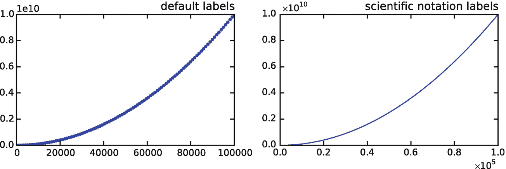

图 4-17

带有科学记数法刻度标签的图形。左侧面板使用默认标签格式，而右侧面板使用以数学文本形式渲染的科学记数法刻度标签。

```python
In [19]: fig, axes = plt.subplots(1, 2, figsize=(8, 3))
...:
...: x = np.linspace(0, 1e5, 100)
...: y = x ** 2
...:
...: axes[0].plot(x, y, 'b.')
...: axes[0].set_title("默认标签", loc="right")
...:
...: axes[1].plot(x, y, 'b')
...: axes[1].set_title("科学记数法标签", loc="right")
...:
...: formatter = mpl.ticker.ScalarFormatter(useMathText=True)
...: formatter.set_scientific(True)
...: formatter.set_powerlimits((-1,1))
...: axes[1].xaxis.set_major_formatter(formatter)
...: axes[1].yaxis.set_major_formatter(formatter)
```

### 对数绘图

在可视化跨越多个数量级的数据时，使用对数坐标系非常有用。在 Matplotlib 中，有几个用于在此类坐标系中绘制函数的绘图函数，例如`loglog`、`semilogx`和`semilogy`，它们分别用于*x*和*y*轴都使用对数刻度、仅*x*轴使用对数刻度和仅*y*轴使用对数刻度。除了对数轴刻度外，这些函数的行为与标准的`plot`方法类似。另一种方法是使用标准的`plot`方法，然后分别使用`set_xscale`和/或`set_yscale`方法，并以`'log'`作为第一个参数，将轴刻度配置为对数刻度。以下部分示例了这些生成对数刻度图的方法，生成的图形如图 4-18 所示。

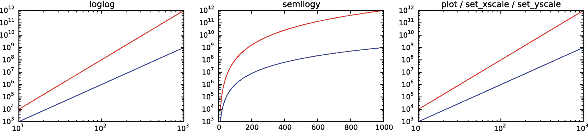

图 4-18

对数刻度图的示例

```python
In [20]: fig, axes = plt.subplots(1, 3, figsize=(12, 3))
...:
...: x = np.linspace(0, 1e3, 100)
...: y1, y2 = x**3, x**4
...:
...: axes[0].set_title('loglog')
...: axes[0].loglog(x, y1, 'b', x, y2, 'r')
...:
...: axes[1].set_title('semilogy')
...: axes[1].semilogy(x, y1, 'b', x, y2, 'r')
...:
...: axes[2].set_title('plot / set_xscale / set_yscale')
...: axes[2].plot(x, y1, 'b', x, y2, 'r')
...: axes[2].set_xscale('log')
...: axes[2].set_yscale('log')
```


#### 双轴

Matplotlib 提供的一个有趣的坐标轴技巧是双轴功能，它允许将两个独立的坐标轴叠加在彼此之上。当在同一张图中绘制两个不同的量时（例如，具有不同单位），这非常有用。一个展示此功能的简单示例如下，生成的图形如图 4-19 所示。这里我们使用 `twinx` 方法（还有一个 `twiny` 方法）来创建第二个`Axes`实例，它共享 *x* 轴，并带有一个新的独立 *y* 轴，该轴显示在图表的右侧。

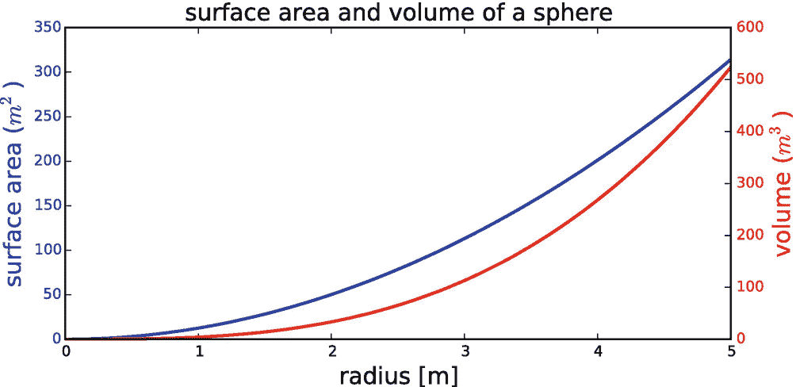

图 4-19

具有双轴的图表示例

```
In [21]: fig, ax1 = plt.subplots(figsize=(8, 4))
...:
...: r = np.linspace(0, 5, 100)
...: a = 4 * np.pi * r ** 2  # area
...: v = (4 * np.pi / 3) * r ** 3  # volume
...:
...: ax1.set_title("surface area and volume of a sphere", fontsize=16)
...: ax1.set_xlabel("radius [m]", fontsize=16)
...:
...: ax1.plot(r, a, lw=2, color="blue")
...: ax1.set_ylabel(r"surface area ($m²$)", fontsize=16, color="blue")
...: for label in ax1.get_yticklabels():
...:     label.set_color("blue")
...:
...: ax2 = ax1.twinx()
...: ax2.plot(r, v, lw=2, color="red")
...: ax2.set_ylabel(r"volume ($m³$)", fontsize=16, color="red")
...: for label in ax2.get_yticklabels():
...:    label.set_color("red")
```

#### 脊柱（Spines）

在迄今为止生成的所有图表中，我们总是有一个包围着`Axes`区域的方框。这确实是科技图表的一种常见样式，但在某些情况下，例如，绘制示意图时，可能需要移动这些坐标线。在 Matplotlib 中，构成包围框的线被称为坐标轴脊柱，我们可以使用 `Axes.spines` 属性来更改它们的属性。例如，我们可能想要移除顶部和右侧的脊柱，并将脊柱移动到与坐标系原点重合的位置。

`Axes` 对象的 `spines` 属性是一个字典，其键为 `right`、`left`、`top` 和 `bottom`，可用于单独访问每条脊柱。我们可以使用 `set_color` 方法将颜色设置为 `'None'` 以表明不应显示特定脊柱，在这种情况下，我们还需要使用 `Axes.xaxis` 和 `Axes.yaxis` 的 `set_ticks_position` 方法（分别接受参数 `'both'`、`'top'` 或 `'bottom'` 以及 `'both'`、`'left'` 或 `'right'`）移除与该脊柱关联的刻度。使用这些方法，我们可以将包围框转换为 *x* 和 *y* 坐标轴，如下例所示。生成的图形如图 4-20 所示。

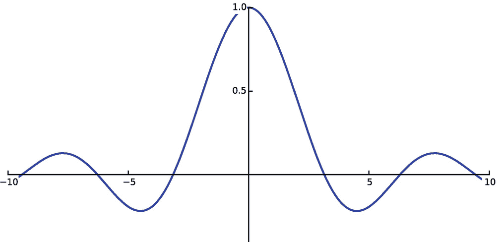

图 4-20

具有坐标轴脊柱的图表示例

```
In [22]: x = np.linspace(-10, 10, 500)
...: y = np.sin(x) / x
...:
...: fig, ax = plt.subplots(figsize=(8, 4))
...:
...: ax.plot(x, y, linewidth=2)
...:
...: # remove top and right spines
...: ax.spines['right'].set_color('none')
...: ax.spines['top'].set_color('none')
...:
...: # remove top and right spine ticks
...: ax.xaxis.set_ticks_position('bottom')
...: ax.yaxis.set_ticks_position('left')
...:
...: # move bottom and left spine to x = 0 and y = 0
...: ax.spines['bottom'].set_position(('data', 0))
...: ax.spines['left'].set_position(('data', 0))
...:
...: ax.set_xticks([-10, -5, 5, 10])
...: ax.set_yticks([0.5, 1])
...:
...: # give each label a solid background of white, to not overlap with the plot line
...: for label in ax.get_xticklabels() + ax.get_yticklabels():
...:    label.set_bbox({'facecolor': 'white',
...:                    'edgecolor': 'white'})
```

## 高级坐标轴布局

到目前为止，我们反复使用 `plt.figure`、`Figure.make_axes` 和 `plt.subplots` 来创建新的 `Figure` 和 `Axes` 实例，然后使用它们生成图表。在科学和技术可视化中，通常将多个图形打包到不同的面板中，例如，采用网格布局。Matplotlib 中提供了函数，可以使用多种不同的布局策略自动创建 `Axes` 对象并将它们放置在图形画布上。我们已经使用了 `plt.subplots` 函数，它能够生成 `Axes` 对象的均匀网格。在本节中，我们将探讨 `plt.subplots` 函数的其他特性，并介绍 `subplot2grid` 和 `GridSpec` 布局管理器，它们在 `Axes` 对象于图形画布内的分布方式上更加灵活。

### 嵌入图（Insets）

在深入探讨如何使用更高级的 `Axes` 布局管理器之前，有必要退一步思考一下我们最初用以向图形画布添加 `Axes` 实例的一种重要用法：`Figure.add_axes` 方法。这种方法非常适合创建所谓的嵌入图，即显示在另一个图表区域内的较小图表。例如，嵌入图经常用于在主图中显示某个特别关注区域的放大视图，或者显示一些次要的相关图表。

在 Matplotlib 中，我们可以将额外的 `Axes` 对象放置在图形画布内的任意位置，即使它们与现有的 `Axes` 对象重叠也没关系。因此，要创建一个嵌入图，我们只需使用 `Figure.make_axes` 添加一个新的 `Axes` 对象，并指定该嵌入图应该放置的位置（图形画布坐标）。一个带有嵌入图的典型图表示例如下代码所示，此代码生成的图形如图 4-21 所示。在创建嵌入图的 `Axes` 对象时，使用参数 `facecolor='none'` 可能会很有用，这表示不应有背景颜色，即嵌入图的 `Axes` 背景应该是透明的。

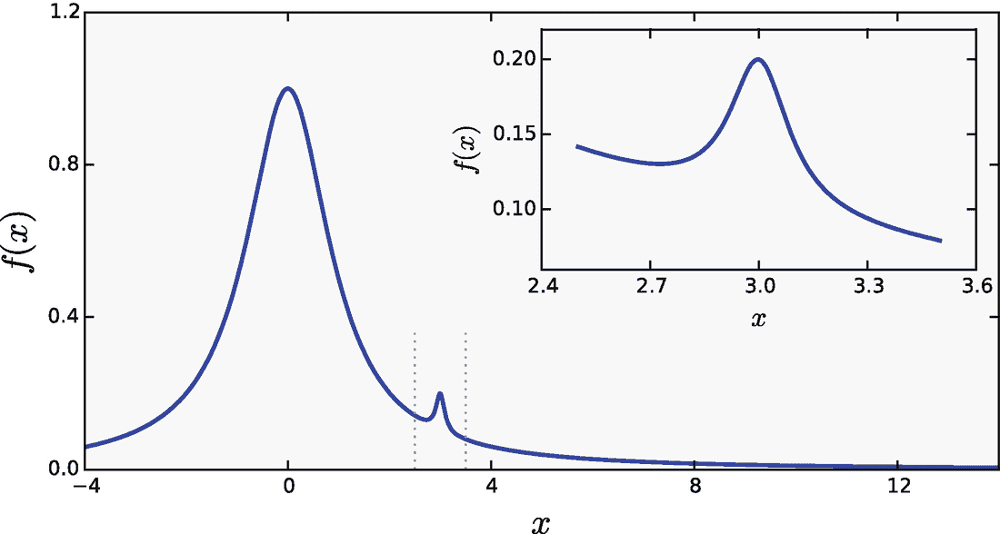

图 4-21

带有嵌入图的图表示例

```
In [23]: fig = plt.figure(figsize=(8, 4))
...:
...: def f(x):
...:     return 1/(1 + x**2) + 0.1/(1 + ((3 - x)/0.1)**2)
...:
...: def plot_and_format_axes(ax, x, f, fontsize):
...:     ax.plot(x, f(x), linewidth=2)
...:     ax.xaxis.set_major_locator(mpl.ticker.MaxNLocator(5))
...:     ax.yaxis.set_major_locator(mpl.ticker.MaxNLocator(4))
...:     ax.set_xlabel(r"$x$", fontsize=fontsize)
...:     ax.set_ylabel(r"$f(x)$", fontsize=fontsize)
...:
...: # main graph
...: ax = fig.add_axes([0.1, 0.15, 0.8, 0.8], facecolor="#f5f5f5")
...: x = np.linspace(-4, 14, 1000)
...: plot_and_format_axes(ax, x, f, 18)
...:
...: # inset
...: x0, x1 = 2.5, 3.5
...: ax.axvline(x0, ymax=0.3, color="grey", linestyle=":")
...: ax.axvline(x1, ymax=0.3, color="grey", linestyle=":")
...:
...: ax_insert = fig.add_axes([0.5, 0.5, 0.38, 0.42], facecolor="none")
...: x = np.linspace(x0, x1, 1000)
...: plot_and_format_axes(ax_insert, x, f, 14)
```


### Subplots

我们已经广泛使用了`plt.subplots`，并且注意到它返回一个元组，其中包含一个`Figure`实例和一个 NumPy 数组，该数组包含函数调用中请求的每一行和每一列的`Axes`对象。在绘制子图网格时，通常子图之间共享*x*轴或*y*轴，或两者都共享。在这种情况下，使用`plt.subplots`的`sharex`和`sharey`参数非常有用，因为它可以防止相同的轴标签在多个`Axes`上重复出现。

同样值得注意的是，`plt.subplots`返回的包含`Axes`实例的 NumPy 数组的维度默认是“压缩”的：即，长度为 1 的维度会从数组中移除。如果请求的列数和行数都大于 1，则返回一个二维数组；但如果列数或行数（或两者）为 1，则返回一个一维数组（或标量，即唯一的`Axes`对象本身）。我们可以通过向`plt.subplots`函数传递参数`squeeze=False`来关闭 NumPy 数组维度的压缩。在这种情况下，`fig, axes = plt.subplots(nrows, ncols)`中的`axes`变量始终是一个二维数组。

最后，可以使用`plt.subplots_adjust`函数来实现可配置性，该函数允许显式设置整个`Axes`网格的左侧、右侧、底部和顶部坐标，以及网格中`Axes`实例之间的宽度（`wspace`）和高度间距（`hspace`）。请参阅以下代码以及对应的图 4-22，了解如何逐步设置具有共享*x*轴和*y*轴以及调整了`Axes`间距的`Axes`网格。

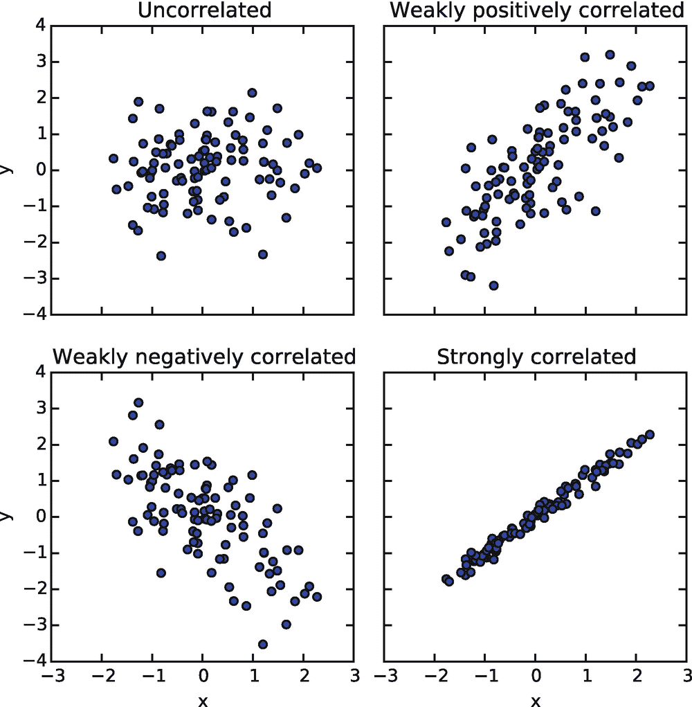

图 4-22  
使用`plt.subplot`和`plt.subplot_adjust`的示例图

```
In [24]: fig, axes = plt.subplots(2, 2, figsize=(6, 6), sharex=True, sharey=True, squeeze=False)
...:
...: x1 = np.random.randn(100)
...: x2 = np.random.randn(100)
...:
...: axes[0, 0].set_title("Uncorrelated")
...: axes[0, 0].scatter(x1, x2)
...:
...: axes[0, 1].set_title("Weakly positively correlated")
...: axes[0, 1].scatter(x1, x1 + x2)
...:
...: axes[1, 0].set_title("Weakly negatively correlated")
...: axes[1, 0].scatter(x1, -x1 + x2)
...:
...: axes[1, 1].set_title("Strongly correlated")
...: axes[1, 1].scatter(x1, x1 + 0.15 * x2)
...:
...: axes[1, 1].set_xlabel("x")
...: axes[1, 0].set_xlabel("x")
...: axes[0, 0].set_ylabel("y")
...: axes[1, 0].set_ylabel("y")
...:
...: plt.subplots_adjust(left=0.1, right=0.95, bottom=0.1, top=0.95, wspace=0.1, hspace=0.2)
```

### Subplot2grid

`plt.subplot2grid`函数是`plt.subplots`和`GridSpec`（参见下一节）之间的中间工具，它提供了比`plt.subplots`更灵活的`Axes`布局管理，同时比`GridSpec`更易于使用。特别是，`plt.subplot2grid`能够创建包含跨越多个行和/或列的`Axes`实例的网格。`plt.subplot2grid`接受两个必需参数：第一个参数是`Axes`网格的形状，形式为元组`(nrows, ncols)`；第二个参数是一个元组`(row, col)`，指定网格内的起始位置。两个可选的关键字参数`colspan`和`rowspan`可用于指示新的`Axes`实例应跨越多少行和列。表 4-3 给出了一个如何使用`plt.subplot2grid`函数的示例。请注意，每次调用`plt.subplot2grid`函数都会产生一个新的`Axes`实例，这与`plt.subplots`不同，后者一次函数调用创建所有`Axes`实例并以 NumPy 数组形式返回它们。

表 4-3  
使用`plt.subplot2grid`创建的网格布局示例及对应代码

| Axes 网格布局 | 代码 |
| --- | --- |
| 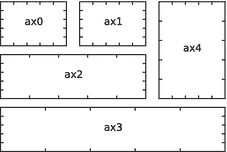 | `ax0 = plt.subplot2grid((3, 3), (0, 0))`<br>`ax1 = plt.subplot2grid((3, 3), (0, 1))`<br>`ax2 = plt.subplot2grid((3, 3), (1, 0), colspan=2)`<br>`ax3 = plt.subplot2grid((3, 3), (2, 0), colspan=3)`<br>`ax4 = plt.subplot2grid((3, 3), (0, 2), rowspan=2)` |

### GridSpec

我们在此介绍的最后一个网格布局管理器是`mpl.gridspec`模块中的`GridSpec`。这是 Matplotlib 中最通用的网格布局管理器，特别是它允许创建并非所有行和列都具有相同宽度和高度的网格，而这在使用本章前面介绍的网格布局管理器时是不易实现的。

一个`GridSpec`对象仅用于指定网格布局，它本身不会创建任何`Axes`对象。在创建`GridSpec`类的新实例时，我们必须指定网格中的行数和列数。与其他网格布局管理器一样，我们也可以使用关键字参数`left`、`bottom`、`right`和`top`来设置网格的位置，并使用`wspace`和`hspace`来设置子图之间的宽度和高度间距。此外，`GridSpec`允许使用`width_ratios`和`height_ratios`参数来指定列和行的相对宽度和高度。这两个参数都应是包含网格中每列和每行大小相对权重的列表。例如，要生成一个两行两列的网格，其中第一行和第一列的大小是第二行和第二列的两倍，我们可以使用`mpl.gridspec.GridSpec(2, 2, width_ratios=[2, 1], height_ratios=[2, 1])`。

一旦创建了`GridSpec`实例，我们就可以使用`Figure.add_subplot`方法来创建`Axes`对象并将它们放置在图像画布上。作为`add_subplot`的参数，我们需要传递一个`mpl.gridspec.SubplotSpec`实例，我们可以使用类似数组的索引从`GridSpec`对象生成该实例：例如，给定一个`GridSpec`实例`gs`，我们可以使用`gs[0, 0]`获取左上角网格元素的`SubplotSpec`实例，使用`gs[:, 0]`获取覆盖第一行的`SubplotSpec`实例，依此类推。有关如何使用`GridSpec`和`add_subplot`创建`Axes`实例的具体示例，请参见表 4-4。

表 4-4  
如何使用子图网格管理器`mpl.gridspec.GridSpec`的示例

| Axes 网格布局 | 代码 |
| --- | --- |
| 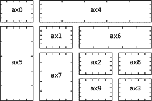 | `fig = plt.figure(figsize=(6, 4))`<br>`gs = mpl.gridspec.GridSpec(4, 4)`<br>`ax0 = fig.add_subplot(gs[0, 0])`<br>`ax1 = fig.add_subplot(gs[1, 1])`<br>`ax2 = fig.add_subplot(gs[2, 2])`<br>`ax3 = fig.add_subplot(gs[3, 3])`<br>`ax4 = fig.add_subplot(gs[0, 1:])`<br>`ax5 = fig.add_subplot(gs[1:, 0])`<br>`ax6 = fig.add_subplot(gs[1, 2:])`<br>`ax7 = fig.add_subplot(gs[2:, 1])`<br>`ax8 = fig.add_subplot(gs[2, 3])`<br>`ax9 = fig.add_subplot(gs[3, 2])` |
| 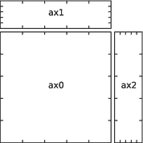 | `fig = plt.figure(figsize=(4, 4))`<br>`gs = mpl.gridspec.GridSpec(2, 2, width_ratios=[4, 1], height_ratios=[1, 4], wspace=0.05, hspace=0.05)`<br>`ax0 = fig.add_subplot(gs[1, 0])`<br>`ax1 = fig.add_subplot(gs[0, 0])`<br>`ax2 = fig.add_subplot(gs[1, 1])` |


## 颜色映射图

到目前为止，我们只考虑了单变量函数的图形，或者等价地，*x*-*y*格式的二维数据。我们为此目的使用的二维`Axes`对象也可以用于可视化双变量函数，或者*x*-*y*-z 格式的三维数据，方法是使用所谓的颜色映射（或热力图），其中`Axes`区域内的每个像素根据坐标系中该点对应的*z*值进行着色。Matplotlib 提供了`pcolor`和`imshow`函数用于这类绘图，而`contour`和`contourf`函数则通过绘制等高线而非颜色映射来以相同格式绘制数据。图 4-23 展示了使用这些函数生成的示例图形。

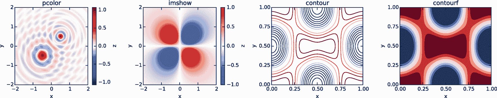

图 4-23

使用`pcolor`、`imshow`、`contour`和`contourf`生成的示例图形

为了生成一个颜色映射图，例如使用`pcolor`，我们首先需要以适当的格式准备数据。虽然标准的二维图形期望包含*x*和*y*值的一维坐标数组，但在当前情况下，我们需要使用二维坐标数组，例如，通过 NumPy 的`meshgrid`函数生成的数组。要绘制双变量函数或具有两个自变量的数据，我们首先定义一维坐标数组`x`和`y`，它们覆盖所需的坐标范围或对应于可用的数据值。然后，`x`和`y`数组可以传递给`np.meshgrid`函数，该函数生成所需的二维坐标数组`X`和`Y`。如果需要，我们可以使用 NumPy 数组计算，利用`X`和`Y`来计算双变量函数，从而获得数据数组`Z`，如`In [25]`中第 1 到 3 行所示（参见下文）。

一旦准备好二维坐标和数据数组，就可以通过将`X`、`Y`和`Z`数组作为前三个参数传递给例如`pcolor`、`contour`或`contourf`来轻松地可视化它们。`imshow`方法的工作方式类似，但只期望将数据数组`Z`作为参数，而相关的坐标范围必须通过`extent`参数设置，该参数应设置为格式为`[xmin, xmax, ymin, ymax]`的列表。对控制颜色映射图外观很重要的其他关键字参数包括`vmin`、`vmax`、`norm`和`cmap`：可以使用`vmin`和`vmax`来设置映射到颜色轴的值范围。这也可以通过设置`norm=mpl.colors.Normalize(vmin, vmax)`来实现。`cmap`参数指定用于将数据值映射到图中颜色的颜色映射。该参数可以是一个包含预定义颜色映射名称的字符串，也可以是一个颜色映射实例。Matplotlib 中预定义的颜色映射可在`mpl.cm`中获得。尝试`help(mpl.cm)`或在 IPython 中自动补全`mpl.cm`模块以获取可用颜色映射的完整列表。^(³¹)

一个完整的颜色映射图所需的最后一个元素是颜色条元素，它使看图者能够读取不同颜色对应的数值。在 Matplotlib 中，我们可以使用`plt.colorbar`函数为已绘制的颜色映射图附加一个颜色条。它首先接受绘图对象句柄作为第一个参数，并接受两个可选参数`ax`和`cax`，这些参数可用于控制颜色条在图形中出现的位置。如果给出了`ax`，新颜色条的空间将从该`Axes`对象中占用。另一方面，如果给出了`cax`，则颜色条将绘制在该`Axes`对象上。颜色条实例`cb`有自己的坐标轴对象，并且设置坐标轴属性的标准方法可以用于`cb.ax`对象，我们可以像对*x*和*y*轴一样使用例如`set_label`、`set_ticks`和`set_ticklabels`方法。

前几段中概述的步骤在以下代码中展示，生成的图形如图 4-24 所示。`imshow`、`contour`和`contourf`函数的使用方式几乎类似，尽管这些函数需要额外的参数来控制它们特有的属性。例如，`contour`和`contourf`函数还接受一个参数`N`，该参数指定要绘制的等高线数量。

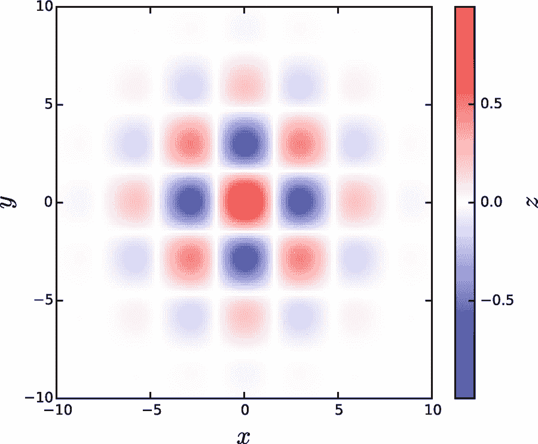

图 4-24

使用`pcolor`生成颜色映射图的示例

```python
In [25]: x = y = np.linspace(-10, 10, 150)
...: X, Y = np.meshgrid(x, y)
...: Z = np.cos(X) * np.cos(Y) * np.exp(-(X/5)**2-(Y/5)**2)
...:
...: fig, ax = plt.subplots(figsize=(6, 5))
...:
...: norm = mpl.colors.Normalize(-abs(Z).max(), abs(Z).max())
...: p = ax.pcolor(X, Y, Z, norm=norm, cmap=mpl.cm.bwr)
...:
...: ax.axis('tight')
...: ax.set_xlabel(r"$x$", fontsize=18)
...: ax.set_ylabel(r"$y$", fontsize=18)
...: ax.xaxis.set_major_locator(mpl.ticker.MaxNLocator(4))
...: ax.yaxis.set_major_locator(mpl.ticker.MaxNLocator(4))
...:
...: cb = fig.colorbar(p, ax=ax)
...: cb.set_label(r"$z$", fontsize=18)
...: cb.set_ticks([-1, -.5, 0, .5, 1])
```


## 3D 图形

上一节讨论的色图通过将数据在二维图表中进行颜色编码，用于可视化具有两个因变量的数据。可视化同一类型数据的另一种方法是使用三维图形，其中引入第三个轴 `z`，并在屏幕上以透视方式显示图形。在 Matplotlib 中，绘制三维图形需要使用不同的坐标轴对象，即来自 `mpl_toolkits.mplot3d` 模块的 `Axes3D` 对象。我们可以通过将 `Figure` 实例作为参数传递给 `Axes3D` 类的构造函数来显式创建支持三维的 Axes 实例：`ax = Axes3D(fig)`。或者，我们可以使用带有 `projection='3d'` 参数的 `add_subplot` 函数：

```
ax = ax = fig.add_subplot(1, 1, 1, projection="3d")
```

或者使用带有 `subplot_kw={'projection': '3d'}` 参数的 `plt.subplots` 函数：

```
fig, ax = plt.subplots(1, 1, figsize=(8, 6), subplot_kw={'projection': '3d'})
```

通过这种方式，只要我们以适当的方式指定 `projection` 参数，就可以使用之前用于二维图形的所有坐标轴布局方法。请注意，使用 `add_subplot` 时，可以在同一张图中混合使用具有二维和三维投影的坐标轴对象，但使用 `plt.subplots` 时，`subplot_kw` 参数适用于添加到图形中的所有子图。

创建支持三维的 Axes 实例并将其添加到图形后（例如，使用上一段描述的方法之一），`Axes3D` 类的方法——例如 `plot_surface`、`plot_wireframe` 和 `contour`——就可以用于在三维透视图中将数据绘制为曲面。这些函数的使用方式与上一节中色图的使用方式几乎相同：这些三维绘图函数都以二维坐标和数据数组 `X`、`Y` 和 `Z` 作为第一个参数。每个函数还带有用于调整特定属性的额外参数。例如，`plot_surface` 函数接收参数 `rstride` 和 `cstride`（行步长和列步长），用于从输入数组中选择数据（以避免数据点过于密集）。`contour` 和 `contourf` 函数接收可选参数 `zdir` 和 `offset`，用于选择投影方向（允许的值是 `x`、`y` 和 `z`）以及显示投影的平面。

除了用于三维曲面绘制的方法之外，还有 `plot`、`scatter`、`bar` 和 `bar3d` 等二维坐标轴可用的折线和散点图函数的直接推广版本，这些函数在 `Axes3D` 类中可用的版本会为 `z` 坐标额外增加一个参数。类似于它们的二维关系，这些函数期望的是一维数据数组，而不是曲面图中使用的二维坐标数组。

至于坐标轴标题、标签、刻度线和刻度标签，本章前面详细描述的所有用于二维图形的方法都可以直接推广到三维图形。例如，有新的方法 `set_zlabel`、`set_zticks` 和 `set_zticklabels` 用于操作新的 `z` 轴的属性。`Axes3D` 对象还提供了针对三维特定操作和属性的新类方法。特别是，`view_init` 方法可用于更改查看图形的角度，它分别将仰角和方位角（以度为单位）作为第一和第二个参数。

如何使用这些三维绘图函数的示例将在下一节中给出，生成的图形如图 4-25 所示。

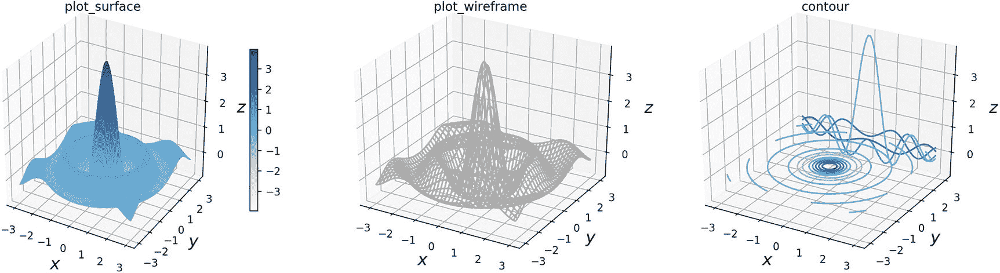

图 4-25

通过使用 `plot_surface`、`plot_wireframe` 和 `contour` 生成的三维曲面和等高线图

```
In [26]: fig, axes = plt.subplots(1, 3, figsize=(14, 4), subplot_kw={'projection': '3d'})
...:
...: def title_and_labels(ax, title):
...:     ax.set_title(title)
...:     ax.set_xlabel("$x$", fontsize=16)
...:     ax.set_ylabel("$y$", fontsize=16)
...:     ax.set_zlabel("$z$", fontsize=16)
...:
...: x = y = np.linspace(-3, 3, 74)
...: X, Y = np.meshgrid(x, y)
...:
...: R = np.sqrt(X**2 + Y**2)
...: Z = np.sin(4 * R) / R
...:
...: norm = mpl.colors.Normalize(-abs(Z).max(), abs(Z).max())
...:
...: p = axes[0].plot_surface(X, Y, Z, rstride=1, cstride=1, linewidth=0, antialiased=False, norm=norm, cmap=mpl.cm.Blues)
...:
...: cb = fig.colorbar(p, ax=axes[0], shrink=0.6)
...: title_and_labels(axes[0], "plot_surface")
...:
...: p = axes[1].plot_wireframe(X, Y, Z, rstride=2, cstride=2, color="darkgrey")
...: title_and_labels(axes[1], "plot_wireframe")
...:
...: cset = axes[2].contour(X, Y, Z, zdir="z", offset=0, norm=norm, cmap=mpl.cm.Blues)
...: cset = axes[2].contour(X, Y, Z, zdir="y", offset=3, norm=norm, cmap=mpl.cm.Blues)
...: title_and_labels(axes[2], "contour")
```

## 总结

在本章中，我们涵盖了如何使用 Matplotlib 生成二维和三维图形的基础知识。可视化是计算科学家和工程师最重要的工具之一，它既是处理计算问题时的分析工具，也是展示和传达计算结果的手段。因此，可视化是计算工作流程中不可或缺的一部分，能够快速可视化和探索数据，以及能够对每个图形元素进行详细控制从而生成完美、高质量的出版级图形，两者同样重要。Matplotlib 是一款出色的通用工具，既可用于探索性可视化，也可用于生成出版级图形。然而，Matplotlib 能实现的功能有其局限性，特别是在交互性和高质量三维图形方面。因此，对于更专业的用例，我建议也探索一下科学 Python 生态系统中可用的其他图形库，其中一些在本章开头已简要提及。

## 延伸阅读

Matplotlib 在该库相关的专著中有详细阐述，例如 Tosi (2009) 和 Devert (2014)，在几本更广领域范围的书中也有涉及，例如 Milovanovi (2013) 和 McKinney (2013)。关于数据可视化、样式指南以及可视化最佳实践的趣味讨论，可参见例如 Yau (2011) 和 J. Steele (2010)。


