# 5. 方程求解

在前几章中，我们讨论了通用方法论与技术，即基于数组的数值计算、符号计算和可视化。这些方法是科学计算的基石，组成了我们在处理计算问题时可以调用的基础工具集。

从本章开始，我们将探索如何使用前几章介绍的基础技术来解决应用数学和计算科学不同领域的问题。本章的主题是代数方程求解。这是一个广泛的课题，需要应用多个数学领域的理论和方法。特别地，在讨论方程求解时，我们必须区分单变量方程和多变量方程（即包含一个未知变量或多个未知变量的方程）。此外，我们还需要区分线性方程和非线性方程。这种分类很有用，因为求解这些不同类型的方程需要应用不同的数学方法和技巧。

我们从线性方程组开始，它们非常有用，并且在科学的各个领域都有重要应用。这种普遍性的原因在于，线性代数理论使我们能够直接求解线性方程，而非线性方程通常难以求解，并且需要更复杂、计算量更大的方法。由于线性系统易于求解，它们也是非线性系统局部近似的重要工具。例如，通过考虑展开点附近的小幅度变化，非线性系统通常可以在展开点的局部邻域内用线性系统近似。然而，线性化只能描述局部性质，对于非线性问题的全局分析，则需要其他技术。这些方法通常采用迭代方法，逐步构建越来越精确的解的估计值。

在本章中，我们将尽可能使用 SymPy 进行符号方程求解，并使用 SciPy 库中的线性代数模块对线性方程组进行数值求解。对于处理非线性问题，我们将使用 SciPy 的`optimize`模块中的求根函数。

## SciPy

SciPy 是一个 Python 库，是 Python 科学计算环境的统称，也是许多 Python 科学计算核心库的伞式组织。实际上，`scipy`库更像是一个用于高级科学计算的库的集合，这些库彼此相对独立。SciPy 库构建在 NumPy 之上，NumPy 提供了基本的数组数据结构以及对这些数组的基本操作。SciPy 中的模块提供了特定领域的高级计算方法，例如线性代数、优化、插值、积分等例程。在撰写本文时，SciPy 的最新版本是 1.1.0。更多信息请参见[`www.scipy.org`](http://www.scipy.org)。

## 导入模块

SciPy 模块`scipy`应被视为一个模块集合，可按需选择性导入。本章中，我们将使用`scipy.linalg`模块来求解线性方程组，以及`scipy.optimize`模块来求解非线性方程。在本章中，我们假定这些模块按如下方式导入：

```
In [1]: from scipy import linalg as la
In [2]: from scipy import optimize
```

本章中，我们还会使用前几章介绍的 NumPy、SymPy 和 Matplotlib 库，并假定这些库已按照之前介绍的约定导入：

```
In [3]: import sympy
In [4]: sympy.init_printing()
In [5]: import numpy as np
In [6]: import matplotlib.pyplot as plt
```

为了在 Python 2 和 Python 3 中实现相同的整数除法行为，我们还需包含以下语句（仅在 Python 2 中需要）：

```
In [7]: from __future__ import division
```

## 线性方程组

线性代数的一个重要应用是求解线性方程组。我们在第 3 章中已经接触过 SymPy 库中的线性代数功能。NumPy 和 SciPy 库中也包含线性代数模块，即`numpy.linalg`和`scipy.linalg`，它们共同为数值问题提供线性代数例程，即那些完全由数值因子和参数定义的问题。

一般而言，线性方程组可以写成如下形式：

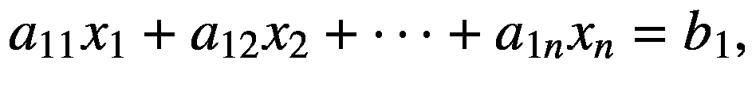

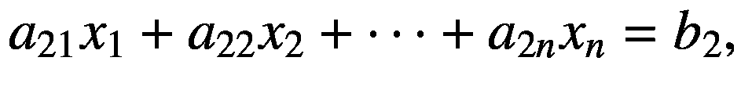


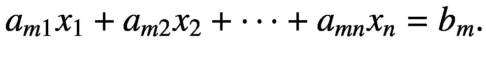

这是一个包含*m*个方程、*n*个未知变量{*x*[1], *x*[2], …, *x*[*n*]}的线性方程组，其中*a*[*mn*]和*b*[*m*]是已知参数或常数值。在处理线性方程组时，将方程写成矩阵形式会很方便：


或者简单地写作 *Ax* = *b*，其中 *A* 是一个 *m* × *n* 矩阵，*b* 是一个 *m* × 1 矩阵（或 *m* 维向量），*x* 是未知的 *n* × 1 解矩阵（或 *n* 维向量）。取决于矩阵 *A* 的性质，解向量 *x* 可能存在也可能不存在，并且即使存在解，也不一定是唯一的。然而，如果解存在，那么它可以被解释为向量 *b* 以矩阵 *A* 各列的线性组合形式表达，其中系数由解向量 *x* 中的元素给出。

当 *n* < *m* 时，方程组被称为欠定，因为方程数量少于未知数，因此无法完全确定唯一解。另一方面，如果 *m* > *n*，则方程组被称为超定。这通常会导致约束条件冲突，从而使得解不存在。


### 方阵系统

*m* = *n* 的方阵系统是一个重要的特例。它对应于方程数量等于未知变量数量的情况，因此可能存在唯一解。为了存在唯一解，矩阵 *A* 必须是非奇异的（*nonsingular*），在这种情况下，*A* 的逆矩阵存在，并且解可以写为 *x* = *A*^(−1)*b*。如果矩阵 *A* 是奇异的，即矩阵的秩小于 *n*，`rank(A) < n`，或者等价地，如果其行列式为零，`det A = 0`，那么根据右侧向量 *b* 的不同，方程 `Ax = b` 可能无解或有无穷多解。对于秩亏缺的矩阵，`rank(A) < n`，存在一些列或行可以表示为其他列或向量的线性组合，因此它们对应的方程不包含任何新约束，该系统实际上是欠定的。因此，计算定义线性方程组的矩阵 *A* 的秩是一种有用的方法，它可以告诉我们矩阵是否奇异，从而判断解是否存在。

当 *A* 满秩时，解必然存在。然而，能否精确计算出解则不一定。矩阵的条件数（*condition number*），`cond(A)`，给出了线性方程组病态或良态程度的度量。如果条件数接近 1，则称系统是良态的（*well conditioned*）（条件数为 1 是理想情况）；如果条件数很大，则称系统是病态的（*ill-conditioned*）。病态方程组的解可能存在较大误差。

条件数可以通过一个简单的误差分析来直观理解。假设我们有一个形如 `Ax = b` 的线性方程组，其中 *x* 是解向量。现在考虑 *b* 的一个小扰动，比如 *δb*，这会导致解产生相应的变化 *δx*，由 `A(x + δx) = b + δb` 给出。由于方程的线性特性，我们有 `Aδx = δb`。现在要考虑的一个重要问题是：与 *b* 的相对变化相比，*x* 的相对变化有多大？从数学上，我们可以用这些向量范数的比值来表述这个问题。具体来说，我们比较 `‖δx‖/‖x‖` 和 `‖δb‖/‖b‖`，其中 `‖x‖` 表示 *x* 的范数。利用矩阵范数关系 `‖Ax‖ ≤ ‖A‖ ∙ ‖x‖`，我们可以写出：


因此，给定 *b* 向量中的相对误差，解 *x* 的相对误差的一个界限由 `cond(A) ≡ ‖A^(−1)‖ ∙ ‖A‖` 给出，根据定义，这正是矩阵 *A* 的条件数。这意味着，对于由病态矩阵 *A* 表征的线性方程组，即使 *b* 向量存在微小扰动，也可能导致解向量 *x* 中出现巨大误差。这一点在使用浮点数（它们仅是实数的近似值）进行数值求解时尤其重要。因此，在求解线性方程组时，查看条件数以估计解的精度非常重要。

在 SymPy 中，可以使用 `Matrix` 的方法 `rank()`、`condition_number()` 和 `norm()` 来计算符号矩阵的秩、条件数和范数；对于数值问题，我们可以使用 NumPy 函数 `np.linalg.matrix_rank()`、`np.linalg.cond()` 和 `np.linalg.norm()`。例如，考虑以下由两个线性方程组成的方程组：

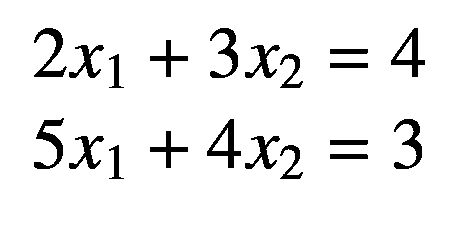

这两个方程对应于 (`x[1]`, `x[2]`) 平面上的两条直线，它们的交点就是方程组的解。如图 5-1 所示，该图绘制了这两个方程对应的直线，两条直线相交于 (−1, 2)。

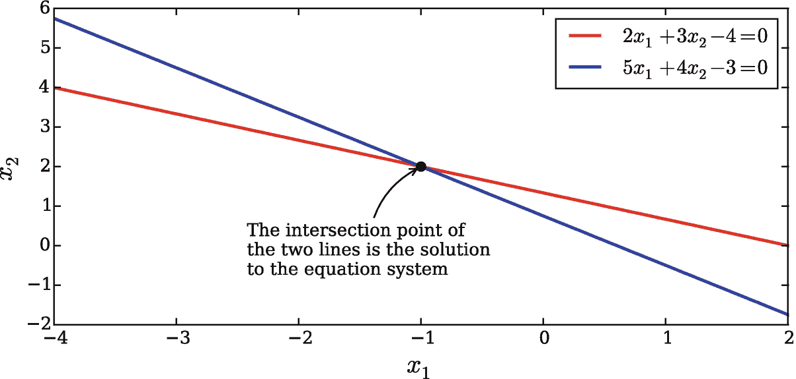

**图 5-1**

两个线性方程组的图形表示

我们可以通过在 SymPy 中为 *A* 和 *b* 创建矩阵对象，并使用以下命令计算矩阵 *A* 的秩、条件数和范数来定义这个问题：

```
In [8]: A = sympy.Matrix([[2, 3], [5, 4]])
In [9]: b = sympy.Matrix([4, 3])
In [10]: A.rank()
Out[10]: 2
In [11]: A.condition_number()
Out[11]:
```

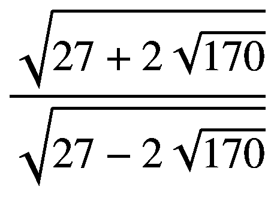

```
In [12]: sympy.N(_)
Out[12]: 7.58240137440151
In [13]: A.norm()
Out[13]:
```

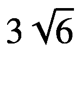

我们可以在 NumPy/SciPy 中使用 NumPy 数组表示 *A* 和 *b*，并使用 `np.linalg` 和 `scipy.linalg` 模块中的函数完成相同操作：

```
In [14]: A = np.array([[2, 3], [5, 4]])
In [15]: b = np.array([4, 3])
In [16]: np.linalg.matrix_rank(A)
Out[16]: 2
In [17]: np.linalg.cond(A)
Out[17]: 7.5824013744
In [18]: np.linalg.norm(A)
Out[18]: 7.34846922835
```

解决线性问题的一个直接方法是计算矩阵 *A* 的逆矩阵，然后将其与向量 *b* 相乘，就像之前分析讨论中所使用的那样。然而，这并不是求解向量 *x* 最高效的计算方法。一个更好的方法是对矩阵 *A* 进行 LU 分解，使得 `A = LU`，其中 *L* 是下三角矩阵，*U* 是上三角矩阵。给定 *L* 和 *U*，可以高效地构造解向量 *x*：首先通过前向代入求解 `Ly = b`，然后通过后向代入求解 `Ux = y`。由于 *L* 和 *U* 是三角矩阵，这两个过程计算效率很高。

在 SymPy 中，我们可以使用 `sympy.Matrix` 类的 `LUdecomposition()` 方法执行符号 LU 分解。此方法为 *L* 和 *U* 矩阵返回新的 `Matrix` 对象，以及一个行交换矩阵。当我们对求解方程组 `Ax = b` 感兴趣时，我们不需要显式计算 *L* 和 *U* 矩阵，而是可以使用 `LUsolve()` 方法，该方法在内部执行 LU 分解，并使用这些因子求解方程组。回到前面的例子，我们可以使用以下方法计算 *L* 和 *U* 因子并求解方程组：

```
In [19]: A = sympy.Matrix([[2, 3], [5, 4]])
In [20]: b = sympy.Matrix([4, 3])
In [21]: L, U, _ = A.LUdecomposition()
In [22]: L
Out[22]:
```

![$$ \left[\begin{array}{cc}1&amp; 0\\ {}5/2&amp; 1\end{array}\right] $$](images/332789_2_En_5_Chapter/332789_2_En_5_Chapter_TeX_Equj.png)

```
In [23]: U
Out[23]:
```

![$$ \left[\begin{array}{cc}2&amp; 3\\ {}0&amp; -7/2\end{array}\right] $$](images/332789_2_En_5_Chapter/332789_2_En_5_Chapter_TeX_Equk.png)

```
In [24]: L * U
Out[24]:
```

![$$ \left[\begin{array}{cc}2&amp; 3\\ {}5&amp; 4\end{array}\right] $$](images/332789_2_En_5_Chapter/332789_2_En_5_Chapter_TeX_Equl.png)

```
In [25]: x = A.solve(b); x  # 等同于 A.LUsolve(b)
Out[25]:
```

![$$ \left[\begin{array}{c}-1\\ {}2\end{array}\right] $$](images/332789_2_En_5_Chapter/332789_2_En_5_Chapter_TeX_Equm.png)


对于数值问题，我们可以使用 SciPy 线性代数模块中的 `la.lu` 函数。该函数返回一个置换矩阵 `P` 以及 `L` 和 `U` 矩阵，满足 `A = PLU`。与 SymPy 类似，我们可以使用 `la.solve` 函数求解线性系统 `Ax = b`，而无需显式计算 `L` 和 `U` 矩阵，该函数将 `A` 矩阵和 `b` 向量作为参数。这通常是使用 SciPy 求解数值线性方程组时的首选方法。

```
In [26]: A = np.array([[2, 3], [5, 4]])
In [27]: b = np.array([4, 3])
In [28]: P, L, U = la.lu(A)
In [29]: L
Out[29]: array([[ 1\. ,  0\. ],
[ 0.4,  1\. ]])
In [30]: U
Out[30]: array([[ 5\. ,  4\. ],
[ 0\. ,  1.4]])
In [31]: P.dot(L.dot(U))
Out[31]: array([[ 2., 3.],
[ 5., 4.]])
In [32]: la.solve(A, b)
Out[32]: array([-1.,  2.])
```

使用 SymPy 的优势在于我们可以获得精确结果，并且还可以在矩阵中包含符号变量。然而，并非所有问题都能以符号方式求解，或者可能会得到极其冗长的结果。另一方面，使用 NumPy/SciPy 进行数值计算的优势在于，我们保证能获得一个结果，尽管由于浮点误差，它将是一个近似解。请参见以下代码 (`In [38]`) 中说明符号方法与数值方法差异的示例，以及展示数值方法可能对具有大条件数的方程组敏感的示例。在此示例中，我们求解方程组

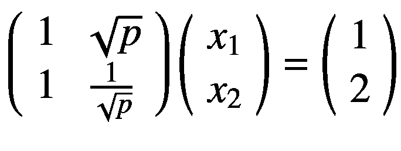

当 `p = 1` 时，该方程组是奇异的；当 `p` 在 1 附近时，它是病态的。使用 SymPy 可以轻松找到解为

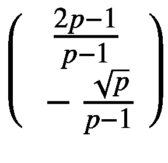

```
In [33]: p = sympy.symbols("p", positive=True)
In [34]: A = sympy.Matrix([[1, sympy.sqrt(p)], [1, 1/sympy.sqrt(p)]])
In [35]: b = sympy.Matrix([1, 2])
In [36]: x = A.solve(b)
In [37]: x
Out[37]:
```

符号解与数值解的比较如图 5-2 所示。这里数值解中的误差源于数值浮点误差，并且在 `p = 1` 附近（此时系统具有大条件数），数值误差会显著增大。此外，如果 `A` 或 `b` 中存在其他误差来源，那么 `x` 中相应的误差可能会更加严重。

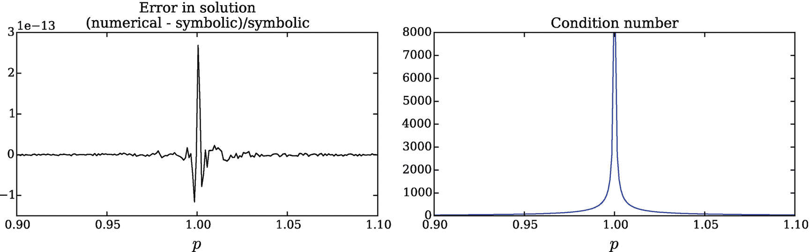

图 5-2

相对数值误差（左图）和条件数（右图）随参数 `p` 变化的曲线

```
In [38]: # 符号问题定义
...: p = sympy.symbols("p", positive=True)
...: A = sympy.Matrix([[1, sympy.sqrt(p)], [1, 1/sympy.sqrt(p)]])
...: b = sympy.Matrix([1, 2])
...:
...: # 符号求解
...: x_sym_sol = A.solve(b)
...: Acond = A.condition_number().simplify()
...:
...: # 数值问题定义
...: AA = lambda p: np.array([[1, np.sqrt(p)], [1, 1/np.sqrt(p)]])
...: bb = np.array([1, 2])
...: x_num_sol = lambda p: np.linalg.solve(AA(p), bb)
...:
...: # 绘制符号（精确）结果与数值结果之间的差异
...: fig, axes = plt.subplots(1, 2, figsize=(12, 4))
...:
...: p_vec = np.linspace(0.9, 1.1, 200)
...: for n in range(2):
...:     x_sym = np.array([x_sym_sol[n].subs(p, pp).evalf() for pp in p_vec])
...:     x_num = np.array([x_num_sol(pp)[n] for pp in p_vec])
...:     axes[0].plot(p_vec, (x_num - x_sym)/x_sym, 'k')
...: axes[0].set_title("解中的误差\n(数值 - 符号)/符号")
...: axes[0].set_xlabel(r'$p$', fontsize=18)
...:
...: axes[1].plot(p_vec, [Acond.subs(p, pp).evalf() for pp in p_vec])
...: axes[1].set_title("条件数")
...: axes[1].set_xlabel(r'$p$', fontsize=18)
```

## 矩形方程组

矩形方程组，即 `m ≠ n` 的情况，可以是欠定或超定的。欠定方程组中变量的数量多于方程数量，因此解无法完全确定。因此，对于此类方程组，解必须以剩余自由变量的形式给出。这使得用数值方法处理这类问题变得困难，但通常可以使用符号方法。

例如，考虑欠定线性方程组

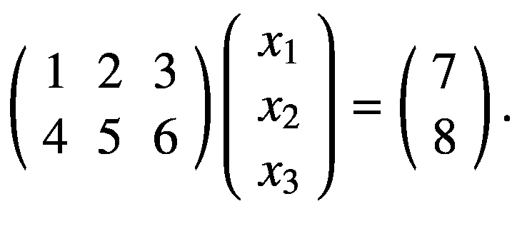

这里我们有三个未知变量，但只有两个方程对这些变量之间的关系施加了约束。通过将该方程写作 `Ax - b = 0`，我们可以使用 SymPy 的 `sympy.solve` 函数来获得由剩余自由变量 `x[3]` 参数化的 `x[1]` 和 `x[2]` 的解：

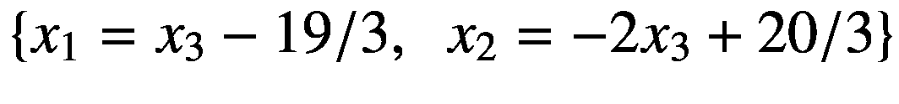

```
In [39]: x_vars = sympy.symbols("x_1, x_2, x_3")
In [40]: A = sympy.Matrix([[1, 2, 3], [4, 5, 6]])
In [41]: x = sympy.Matrix(x_vars)
In [42]: b = sympy.Matrix([7, 8])
In [43]: sympy.solve(A*x - b, x_vars)
Out[43]:
```

这里我们得到了符号解 `x[1] = x[3] − 19/3` 和 `x[2] = −2*x[3] + 20/3`，该解在由 `{x[1], x[2], x[3]}` 张成的三维空间中定义了一条直线。因此，该直线上的任何点都满足这个欠定方程组。

另一方面，如果方程组是超定的，即方程数量多于未知变量数量，`m > n`，那么我们拥有的约束就多于自由度，通常此类系统不存在精确解。然而，为超定系统寻找一个近似解通常很有意义。出现这种情况的一个例子是数据拟合：假设我们有一个模型，其中变量 `y` 是变量 `x` 的二次多项式，即 `y = A + Bx + Cx²`，我们希望将此模型拟合到实验数据。这里 `y` 相对于 `x` 是非线性的，但 `y` 相对于三个未知系数 `A`、`B` 和 `C` 是线性的，这一事实可用于将模型写作一个线性方程组。如果我们收集变量 `x` 和 `y` 的 `m` 对数据点 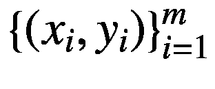，我们可以将该模型写作一个 `m × 3` 的方程组：


如果 `m = 3`，在假设系统矩阵非奇异的情况下，我们可以解出未知的模型参数 `A`、`B` 和 `C`。然而，凭直觉可以清楚地知道，如果数据有噪声并且我们使用超过三个数据点，那么我们应该能够获得更精确的模型参数估计。


然而，对于 *m* > 3 的情况，通常不存在精确解，因此我们需要引入一个近似解，以给出超定系统 *Ax* ≈ *b* 的**最佳拟合**。该最佳拟合的自然定义是最小化平方误差之和，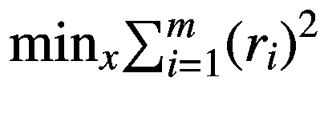，其中 *r* = *b* − *Ax* 是残差向量。这引出了问题 *Ax* ≈ *b* 的*最小二乘*解，它最小化了数据点与线性解之间的距离。在 SymPy 中，我们可以使用 `solve_least_squares` 方法来求解超定系统的最小二乘解；对于数值问题，则可以使用 SciPy 函数 `la.lstsq`。

以下代码演示了如何使用 SciPy 的 `la.lstsq` 方法来拟合上一节中考虑的示例模型，结果如图 5-3 所示。我们首先定义模型的真实参数，然后通过向真实模型关系添加随机噪声来模拟测量数据。接着使用 `la.lstsq` 函数求解最小二乘问题，该函数除了返回解向量 *x*，还返回总平方误差和（残差 `r`）、矩阵 *A* 的秩 `rank` 以及奇异值 `sv`。不过，在下面的示例中，我们只使用解向量 `x`。

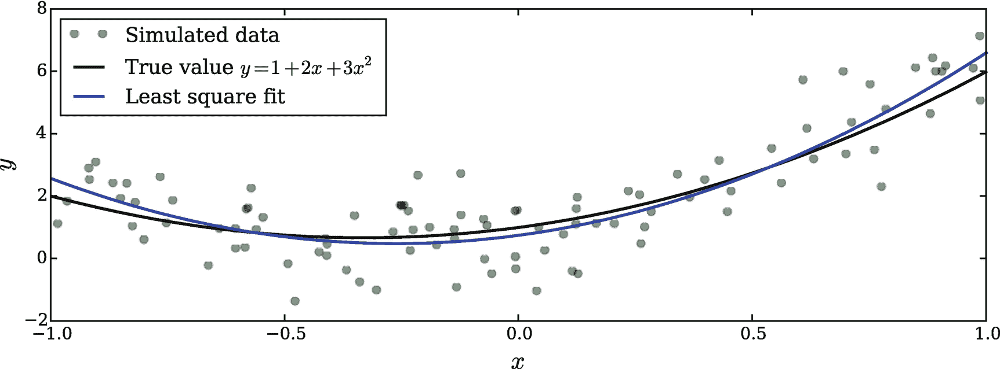

**图 5-3** 线性最小二乘拟合

```
In [44]: # 定义真实模型参数
...: x = np.linspace(-1, 1, 100)
...: a, b, c = 1, 2, 3
...: y_exact = a + b * x + c * x**2
...:
...: # 模拟带噪声的数据
...: m = 100
...: X = 1 - 2 * np.random.rand(m)
...: Y = a + b * X + c * X**2 + np.random.randn(m)
...:
...: # 使用线性最小二乘拟合数据到模型
...: A = np.vstack([X**0, X**1, X**2])  # 另见 np.vander 的替代方法
...: sol, r, rank, sv = la.lstsq(A.T, Y)
...:
...: y_fit = sol[0] + sol[1] * x + sol[2] * x**2
...: fig, ax = plt.subplots(figsize=(12, 4))
...:
...: ax.plot(X, Y, 'go', alpha=0.5, label='模拟数据')
...: ax.plot(x, y_exact, 'k', lw=2, label='真实值 $y = 1 + 2x + 3x²$')
...: ax.plot(x, y_fit, 'b', lw=2, label='最小二乘拟合')
...: ax.set_xlabel(r"$x$", fontsize=18)
...: ax.set_ylabel(r"$y$", fontsize=18)
...: ax.legend(loc=2)
```

数据与模型的良好拟合显然要求用于描述数据的模型与生成数据的底层过程高度一致。在下面的示例（`In [45]`）以及图 5-4 中，我们将前一示例中使用的相同数据分别拟合到线性模型和高阶多项式模型（最高 15 阶）。前者对应欠拟合，即我们为数据使用了过于简单的模型；后者对应过拟合，即我们为数据使用了过于复杂的模型，从而不仅拟合了底层趋势，还拟合了测量噪声。使用合适的模型是数据拟合中一个关键且微妙的问题。

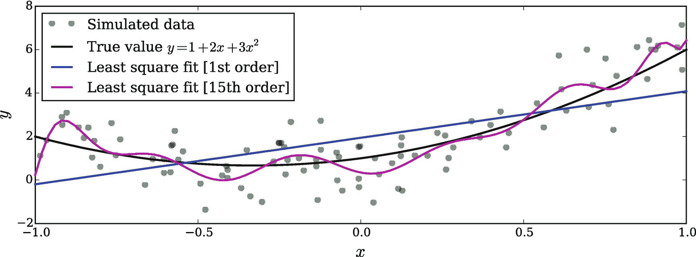

**图 5-4** 使用线性最小二乘法演示数据欠拟合和过拟合的图表

```
In [45]: # 使用线性最小二乘拟合数据到模型：
...: # 1 阶多项式
...: A = np.vstack([X**n for n in range(2)])
...: sol, r, rank, sv = la.lstsq(A.T, Y)
...: y_fit1 = sum([s * x**n for n, s in enumerate(sol)])
...:
...: # 15 阶多项式
...: A = np.vstack([X**n for n in range(16)])
...: sol, r, rank, sv = la.lstsq(A.T, Y)
...: y_fit15 = sum([s * x**n for n, s in enumerate(sol)])
...:
...: fig, ax = plt.subplots(figsize=(12, 4))
...: ax.plot(X, Y, 'go', alpha=0.5, label='模拟数据')
...: ax.plot(x, y_exact, 'k', lw=2, label='真实值 $y = 1 + 2x + 3x²$')
...: ax.plot(x, y_fit1, 'b', lw=2, label='最小二乘拟合 [1 阶]')
...: ax.plot(x, y_fit15, 'm', lw=2, label='最小二乘拟合 [15 阶]')
...: ax.set_xlabel(r"$x$", fontsize=18)
...: ax.set_ylabel(r"$y$", fontsize=18)
...: ax.legend(loc=2)
```

## 特征值问题

一个具有重要理论和实践意义的特殊方程组是特征值方程 *Ax* = *λx*，其中 A 是一个 *N* × *N* 的方阵，*x* 是未知向量，*λ* 是未知标量。这里 *x* 是矩阵 *A* 的特征向量，*λ* 是特征值。特征值方程 *Ax* = *λx* 与线性方程组 *Ax* = *b* 非常相似，但请注意这里 *x* 和 *λ* 都是未知的，因此我们不能直接应用相同的技术来求解这个方程。求解这个特征值问题的一种标准方法是将方程重写为 (*A* − *Iλ*)*x* = 0，并注意到为了存在非平凡解 *x* ≠ 0，矩阵 *A* − *Iλ* 必须是奇异的，且其行列式必须为零，即 det(*A* − *Iλ*) = 0。这给出了一个 *N* 阶的多项式方程（特征多项式），它的 *N* 个根给出了 *N* 个特征值 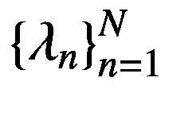。一旦特征值已知，就可以使用标准的前向代入法求解方程 (*A* − *Iλ*[*n*])*x*[*n*] = 0，以获得第 *n* 个特征向量 *x*[*n*]。

SymPy 和 SciPy 中的线性代数包都包含用于特征值问题的求解器。在 SymPy 中，我们可以使用 `Matrix` 类的 `eigenvals` 和 `eigenvects` 方法，它们能够计算某些元素为符号表达式的矩阵的特征值和特征向量。例如，要计算具有符号元素的对称 2 × 2 矩阵的特征值和特征向量，我们可以使用

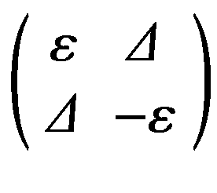

```
In [46]: eps, delta = sympy.symbols("epsilon, Delta")
In [47]: H = sympy.Matrix([[eps, delta], [delta, -eps]])
In [48]: H
Out[48]:
```

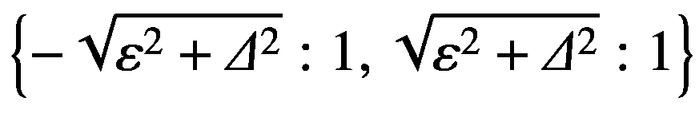

```
In [49]: H.eigenvals()
Out[49]:
```

![$$ \left[\left(-\sqrt{\varepsilon²+{\varDelta}²},1,\left[\left[\begin{array}{c}-\frac{\varDelta }{\varepsilon +\sqrt{\varepsilon²+{\varDelta}²}}\\ {}1\end{array}\right]\right]\right),\kern0.5em \left(\sqrt{\varepsilon²+{\varDelta}²},1,\left[\left[\begin{array}{c}-\frac{\varDelta }{\varepsilon -\sqrt{\varepsilon²+{\varDelta}²}}\\ {}1\end{array}\right]\right]\right)\right] $$](images/332789_2_En_5_Chapter/332789_2_En_5_Chapter_TeX_Equu.png)

```
In [50]: H.eigenvects()
Out[50]:
```

`eigenvals` 方法的返回值是一个字典，其中每个特征值是一个键，对应的值是该特征值的重数。这里特征值是 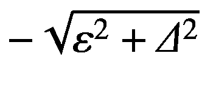 和 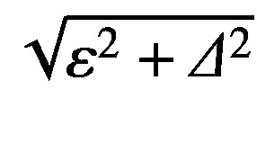，每个重数均为 1。`eigenvects` 的返回值稍微复杂一些：它返回一个列表，其中每个元素是一个元组，包含特征值、该特征值的重数以及一个特征向量列表。每个特征值对应的特征向量数量等于其重数。对于当前示例，我们可以解包 `eigenvects` 返回的值，并使用如下方法验证这两个特征向量是正交的：

```
In [51]: (eval1, _, evec1), (eval2, _, evec2) = H.eigenvects()
In [52]: sympy.simplify(evec1[0].T * evec2[0])
Out[52]: [0]
```


好的，作为高级文档工程师和翻译员，我将严格遵循您给出的注意事项和示例格式，对提供的英文文本进行翻译。


使用这些方法获得特征值和特征向量的解析表达式通常非常理想，但遗憾的是，它仅适用于小型矩阵。对于大于`3 × 3`的矩阵，即使使用像`SymPy`这样的计算机代数系统，解析表达式通常也会变得极其冗长且难以处理。因此，对于更大的系统，我们必须求助于全数值方法。为此，我们可以使用`SciPy`线性代数包中的`la.eigvals`和`la.eig`函数。厄米矩阵或实对称矩阵具有实数值的特征值，对于此类矩阵，建议改用`la.eigvalsh`和`la.eigh`函数，这能保证函数返回的特征值存储在一个元素为实数的`NumPy`数组中。例如，要使用`la.eig`求解数值特征值问题，我们可以这样操作：

```
In [53]: A = np.array([[1, 3, 5], [3, 5, 3], [5, 3, 9]])
In [54]: evals, evecs = la.eig(A)
In [55]: evals
Out[55]: array([ 13.35310908+0.j,  -1.75902942+0.j,   3.40592034+0.j])
In [56]: evecs
Out[56]: array([[ 0.42663918,  0.90353276, -0.04009445],
[ 0.43751227, -0.24498225, -0.8651975 ],
[ 0.79155671, -0.35158534,  0.49982569]])
In [57]: la.eigvalsh(A)
Out[57]: array([ -1.75902942,   3.40592034,  13.35310908])
```

由于此示例中的矩阵是对称的，我们可以使用`la.eigh`和`la.eigvalsh`，从而得到实数值的特征值数组，如前述代码清单中`Out[57]`单元格所示。

## 非线性方程

在本节中，我们考虑*非线性*方程。如本章前几节所述，线性方程组在科学计算中至关重要，因为它们易于求解，并且可以作为许多计算方法和技术的重要构建块。然而，在自然科学和工程学科中，许多（即便不是大多数）系统本质上是非线性的。

线性函数`f(x)`根据定义满足可加性`f(x+y) = f(x) + f(y)`和齐次性`f(αx) = αf(x)`，这两者可以合并写作叠加原理`f(αx + βy) = αf(x) + βf(y)`。这给出了线性度的精确定义。相比之下，*非线性*函数是不满足这些条件的函数。因此，非线性是一个更广泛的概念，一个函数可以通过多种不同的方式成为非线性。但通常，包含变量的幂次大于 1 的表达式就是非线性的。例如，`x² + x + 1`由于其中的`x²`项而是非线性的。

非线性方程总可以写成`f(x) = 0`的形式，其中`f(x)`是一个非线性函数，我们寻求`x`（可以是标量或向量）的值使得`f(x)`为零。这个`x`被称为函数`f(x)`的根，因此方程求解通常被称为*求根*。与本章前一节相比，在本节中，我们需要区分单变量方程求解和多变量方程，此外还要区分单个方程和方程组。

### 单变量方程

单变量函数是仅依赖于单个变量`f(x)`的函数，其中`x`是标量，相应的单变量方程形式为`f(x) = 0`。这类方程的典型例子包括多项式，例如`x² − x + 1 = 0`，以及包含初等函数的表达式，例如`x³ − 3 sin(x) = 0`和`exp(x) − 2 = 0`。与线性系统不同，没有通用方法可以确定非线性方程是否有解，是否有多个解，或者给定的解是否唯一。这可以从以下事实直观理解：非线性函数的图形对应于曲线，这些曲线可以与`x = 0`以任意多种方式相交。

由于可能的情况数量庞大，开发一种完全自动化的方法来求解非线性方程是很困难的。从解析角度看，只有特殊形式的方程才能精确求解。例如，最高四阶的多项式（以及某些特殊情况下的更高阶）可以解析求解，一些包含三角函数和其他初等函数的方程可能可以解析求解。在`SymPy`中，我们可以使用`sympy.solve`函数求解许多可解析求解的单变量和非线性方程。例如，要解标准二次方程`a + bx + cx² = 0`，我们为方程定义一个表达式并将其传递给`sympy.solve`函数：

```
In [58]: x, a, b, c = sympy.symbols("x, a, b, c")
In [59]: sympy.solve(a + b*x + c*x**2, x)
Out[59]: [(-b + sqrt(-4*a*c + b**2))/(2*c), -(b + sqrt(-4*a*c + b**2))/(2*c)]
```

这确实是该方程解众所周知的公式。同样的方法可用于求解一些三角方程：

```
In [60]: sympy.solve(a * sympy.cos(x) - b * sympy.sin(x), x)
Out[60]: [-2*atan((b - sqrt(a**2 + b**2))/a), -2*atan((b + sqrt(a**2 + b**2))/a)]
```

然而，通常来说，非线性方程通常是无法解析求解的。例如，同时包含多项式表达式和初等函数的方程，例如`sin(x) = x`，通常是超越方程，没有代数解。如果我们尝试使用`SymPy`求解此类方程，会以异常形式得到错误：

```
In [61]: sympy.solve(sympy.sin(x)-x, x)
...
NotImplementedError: multiple generators [x, sin(x)]
No algorithms are implemented to solve equation -x + sin(x)
```

在这种情况下，我们需要求助于各种数值技术。作为第一步，绘制函数图形通常非常有用。这可以提供关于方程解的数量及其大致位置的重要线索。在应用数值技术来获得方程根的良好近似值时，这些信息通常是必需的。例如，考虑以下示例（`In [62]`），它绘制了四个非线性函数的图形，如图 5-5 所示。从这些图形中，我们可以立即得出结论：从左到右绘制的函数分别有 2、3、1 和大量根（至少在所绘制的区间内）。

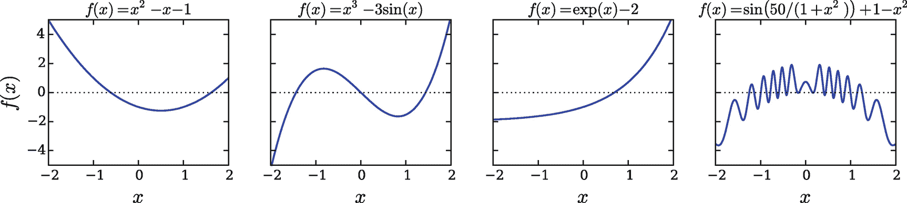

图 5-5 四个非线性函数示例的图形


```python
x = np.linspace(-2, 2, 1000)
# 四个非线性函数的示例
f1 = x**2 - x - 1
f2 = x**3 - 3 * np.sin(x)
f3 = np.exp(x) - 2
f4 = 1 - x**2 + np.sin(50 / (1 + x**2))

# 绘制每个函数
fig, axes = plt.subplots(1, 4, figsize=(12, 3), sharey=True)

for n, f in enumerate([f1, f2, f3, f4]):
    axes[n].plot(x, f, lw=1.5)
    axes[n].axhline(0, ls=':', color="k")
    axes[n].set_ylim(-5, 5)
    axes[n].set_xticks([-2, -1, 0, 1, 2])
    axes[n].set_xlabel(r'$x$', fontsize=18)

axes[0].set_ylabel(r'$f(x)$', fontsize=18)

titles = [r'$f(x)=x²-x-1$', r'$f(x)=x³-3\sin(x)$',
          r'$f(x)=\exp(x)-2$', r'$f(x)=\sin\left(50/(1+x²)\right)+1-x²$']
for n, title in enumerate(titles):
    axes[n].set_title(title)
```

要找到方程根的大致位置，我们可以应用多种数值求根技术中的一种。这些技术通常采用迭代方案，即在连续的点上评估函数，直到算法将解的范围缩小到所需精度。**二分法**和**牛顿法**是说明许多数值求根方法基本思想的两种标准方法。

二分法需要一个起始区间 `[*a*, *b*]`，且满足 `*f*(*a*)` 和 `*f*(*b*)` 符号相反。这保证了该区间内至少存在一个根。在每次迭代中，函数在 `*a*` 和 `*b*` 之间的中点 `*m*` 处求值。如果函数在 `*a*` 和 `*m*` 点的符号不同，则选择新区间 `[*a*, *b* = *m*]` 进行下一次迭代；否则，选择区间 `[*a* = *m*, *b*]` 进行下一次迭代。这保证了在每次迭代中，函数在区间两端点符号不同，并且每次迭代区间长度减半，从而收敛到方程的一个根。下面的代码示例演示了二分法的简单实现，并对每一步进行了图形可视化，如图 5-6 所示。

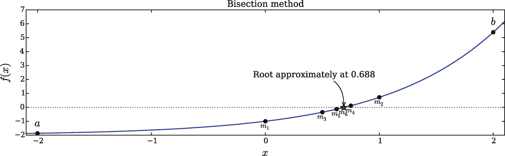

**图 5-6** 二分法工作过程的图形可视化

```python
# 定义一个函数、所需容差和起始区间 [a, b]
f = lambda x: np.exp(x) - 2
tol = 0.1
a, b = -2, 2
x = np.linspace(-2.1, 2.1, 1000)

# 绘制函数 f 的图形
fig, ax = plt.subplots(1, 1, figsize=(12, 4))

ax.plot(x, f(x), lw=1.5)
ax.axhline(0, ls=':', color="k")
ax.set_xticks([-2, -1, 0, 1, 2])
ax.set_xlabel(r'$x$', fontsize=18)
ax.set_ylabel(r'$f(x)$', fontsize=18)

# 使用二分法求根，并在图中可视化该方法的具体步骤
fa, fb = f(a), f(b)

ax.plot(a, fa, 'ko')
ax.plot(b, fb, 'ko')
ax.text(a, fa + 0.5, r"$a$", ha="center", fontsize=18)
ax.text(b, fb + 0.5, r"$b$", ha="center", fontsize=18)

n = 1
while b - a > tol:
    m = a + (b - a)/2
    fm = f(m)

    ax.plot(m, fm, 'ko')
    ax.text(m, fm - 0.5, r"$m_%d$" % n, ha="center")
    n += 1

    if np.sign(fa) == np.sign(fm):
        a, fa = m, fm
    else:
        b, fb = m, fm

ax.plot(m, fm, 'r*', markersize=10)
ax.annotate("根大约在 %.3f" % m,
            fontsize=14, family="serif",
            xy=(a, fm), xycoords="data",
            xytext=(-150, +50), textcoords='offset points',
            arrowprops=dict(arrowstyle="->", connectionstyle="arc3, rad=-.5"))

ax.set_title("二分法")
```

另一种标准的求根方法是牛顿法，其收敛速度比上一段讨论的二分法更快。二分法仅使用函数在各点的符号，而牛顿法则利用函数的实际值来获得非线性函数的更精确逼近。具体来说，它使用函数 `*f*(*x*)` 的一阶泰勒展开式 `*f*(*x*+*dx*) = *f*(*x*)+*dx f*'(*x*)` 来逼近该函数，这是一个线性函数，其根很容易求出为 `*x* – *f*(*x*)/*f*'(*x*)`。当然，这不一定就是函数 `f(x)` 的根，但在许多情况下，它是向 `*f*(*x*)` 的一个根靠近的良好逼近。通过迭代该方案 `*x*[*k*+1] = *x*[*k*] − *f*(*x*[*k*])/*f*'(*x*[*k*])`，我们可以逐渐逼近函数的根。该方法的一个潜在问题是，如果 `*f*'(*x*[*k*])` 在某个点 `*x*[*k*]` 处为零，则该方法会失效。在实际实现该方法时，需要处理这种特殊情况。下面的示例（`In [64]`）演示了如何使用该方法求解方程 `exp(*x*) − 2 = 0` 的根，其中使用 `SymPy` 计算函数 `*f*(*x*)` 的导数，图 5-7 则可视化了该求根过程中的各个步骤。

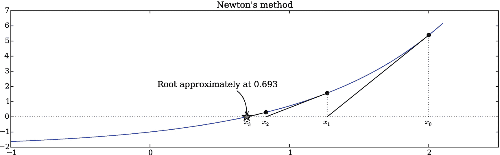

**图 5-7** 牛顿法求解方程 `*exp*(*x*) − 2 = 0` 时求根步骤的可视化

```python
# 定义一个函数、所需容差和起始点 xk
tol = 0.01
xk = 2

s_x = sympy.symbols("x")
s_f = sympy.exp(s_x) - 2

f = lambda x: sympy.lambdify(s_x, s_f, 'numpy')(x)
fp = lambda x: sympy.lambdify(s_x, sympy.diff(s_f, s_x), 'numpy')(x)

x = np.linspace(-1, 2.1, 1000)

# 建立一个图形用于可视化求根步骤
fig, ax = plt.subplots(1, 1, figsize=(12, 4))
ax.plot(x, f(x))
ax.axhline(0, ls=':', color="k")

# 迭代牛顿法直到收敛到所需容差
n = 0
while f(xk) > tol:
    xk_new = xk - f(xk) / fp(xk)

    ax.plot([xk, xk], [0, f(xk)], color="k", ls=':')
    ax.plot(xk, f(xk), 'ko')
    ax.text(xk, -.5, r'$x_%d$' % n, ha="center")
    ax.plot([xk, xk_new], [f(xk), 0], 'k-')

    xk = xk_new
    n += 1

ax.plot(xk, f(xk), 'r*', markersize=15)
ax.annotate("根大约在 %.3f" % xk,
            fontsize=14, family="serif",
            xy=(xk, f(xk)), xycoords="data",
            xytext=(-150, +50), textcoords='offset points',
            arrowprops=dict(arrowstyle="->", connectionstyle="arc3, rad=-.5"))

ax.set_title("牛顿法")
ax.set_xticks([-1, 0, 1, 2])
```


牛顿法的一个潜在问题是，每次迭代都需要函数值及其导数值。在前面的示例中，我们使用`SymPy`符号计算导数。在纯数值实现中，这当然是不可能的，因此需要对导数进行数值近似，而这又会需要额外的函数求值。一种避免计算函数导数的牛顿法变体是割线法，它利用前两次函数求值结果获得函数的线性近似，从而计算根的新估计值。割线法的迭代公式为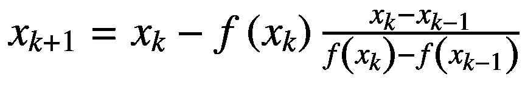。这仅是牛顿法众多变体和改进策略中的一个例子。当前最先进的数值求根函数实现通常采用二分法、牛顿法或两者结合的基本思想，同时还使用各种优化策略（例如高阶函数插值）以实现更快的收敛速度。

`SciPy`的`optimize`模块提供了多个用于数值求根的函数。`optimize.bisect`和`optimize.newton`函数分别实现了二分法和牛顿法的变体。`optimize.bisect`接受三个参数：第一个参数是一个 Python 函数（例如`lambda`函数），表示待求根方程中的数学函数；第二个和第三个参数是执行二分法的区间下限和上限。注意，如前所述，二分法要求函数在点`a`和`b`处的符号必须不同。使用`optimize.bisect`函数，我们可以计算前面示例中方程`exp(x) - 2 = 0`的根，如下所示：

```
In [65]: optimize.bisect(lambda x: np.exp(x) - 2, -2, 2)
Out[65]: 0.6931471805592082
```

只要`f(a)`和`f(b)`确实符号相反，该方法保证在区间`[a, b]`内找到一个根。相比之下，用于牛顿法的`optimize.newton`函数将函数作为第一个参数，将根的初始猜测值作为第二个参数。此外，它还可以通过`fprime`关键字参数指定函数的导数。如果提供了`fprime`，则使用牛顿法；否则使用割线法。为了求解方程`exp(x) - 2 = 0`，分别使用指定导数和不指定导数的方式，我们可以这样操作：

```
In [66]: x_root_guess = 2
In [67]: f = lambda x: np.exp(x) – 2
In [68]: fprime = lambda x: np.exp(x)
In [69]: optimize.newton(f, x_root_guess)
Out[69]: 0.69314718056
In [70]: optimize.newton(f, x_root_guess, fprime=fprime)
Out[70]: 0.69314718056
```

注意，如果函数有多个根，使用这种方法时，我们对计算哪个根的控制能力较弱。例如，无法保证函数返回的根是距离初始猜测值最近的根；我们也无法预先知道根是大于还是小于初始猜测值。

`SciPy`的`optimize`模块还提供了其他求根函数。特别是`optimize.brentq`和`optimize.brenth`函数，它们是二分法的变体，同样适用于函数改变符号的区间。其中`optimize.brentq`函数通常被认为是`SciPy`中首选的通用求根函数。为了使用`optimize.brentq`和`optimize.brenth`函数查找之前同一方程的根，我们可以这样操作：

```
In [71]: optimize.brentq(lambda x: np.exp(x) - 2, -2, 2)
Out[71]: 0.6931471805599453
In [72]: optimize.brenth(lambda x: np.exp(x) - 2, -2, 2)
Out[72]: 0.6931471805599381
```

注意，这两个函数将方程的 Python 函数作为第一个参数，将符号变化区间的下限和上限分别作为第二个和第三个参数。


