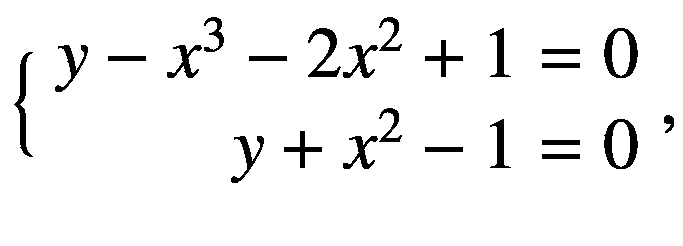
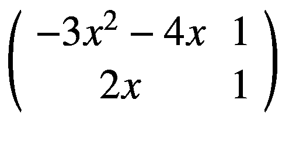
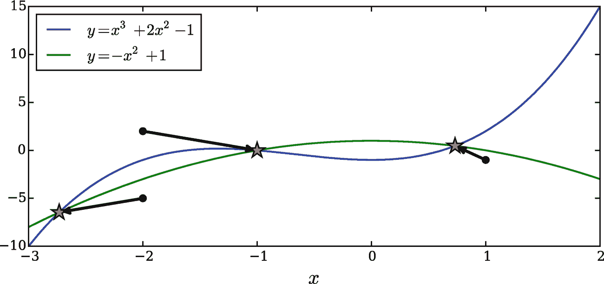
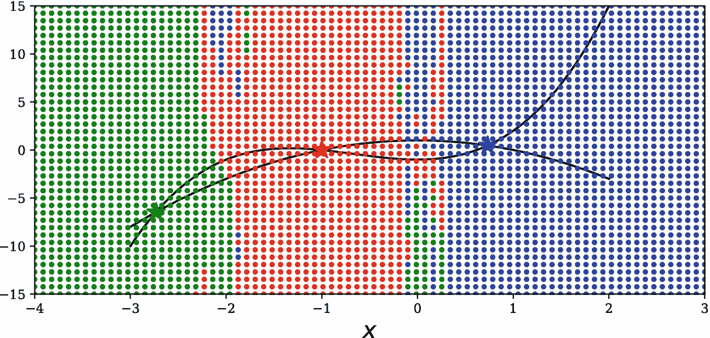

# 非线性方程组

与线性方程组不同，我们通常无法将非线性方程组写成矩阵-向量乘法的形式。相反，我们将多元非线性方程组表示为一个向量值函数，例如 `f` : ℝ^(*N*) → ℝ^(*N*)，该函数接收一个 N 维向量并将其映射为另一个 N 维向量。求解多元方程组比求解单变量方程复杂得多，部分原因在于其可能的行为模式更加多样。因此，没有任何方法能严格保证收敛到某个解（例如用于单变量非线性方程的二分法），而现有的方法在计算上比单变量情况要求更高，尤其是当变量数量增加时。

并非所有之前讨论的单变量方程求解方法都能推广到多元情况。例如，二分法无法直接推广到多元方程组。另一方面，牛顿法可以用于多元问题，此时其迭代公式为 `x[k+1] = x[k] - Jf^(-1) f(x[k])`，其中 `Jf` 是函数 `f(x)` 的雅可比矩阵，其元素为 `J[f][ij] = ∂fi/∂x[j]`。无需直接求雅可比矩阵的逆，只需解线性方程组 `Jf δx[k] = - f(x[k])`，然后使用 `x[k+1] = x[k] + δx[k]` 更新 `x[k]`。与单变量方程组的牛顿法割线变体类似，也存在避免计算雅可比矩阵的多元方法变体，这些方法通过先前函数求值结果来估计雅可比矩阵。`布罗伊登法`就是这类用于多元方程组的割线更新方法中一个流行的例子。在 SciPy 的 `optimize` 模块中，`broyden1` 和 `broyden2` 提供了 `布罗伊登法` 的两种实现，使用了不同的雅可比矩阵近似方式；而 `optimize.fsolve` 函数则提供了一种类牛顿法的实现，如果有雅可比矩阵，可以选择性地指定。这些函数的签名都类似：第一个参数是一个 Python 函数，代表待求解的方程，它应接受一个 `NumPy` 数组作为第一个参数，并返回一个形状相同的数组。第二个参数是解的初始猜测值，以 `NumPy` 数组形式给出。`optimize.fsolve` 函数还接受一个可选的关键字参数 `fprime`，可用于提供一个返回函数 `f(x)` 雅可比矩阵的函数。此外，所有这些函数都接受大量可选的关键字参数来调整其行为（详见文档字符串）。

例如，考虑以下包含两个多元非线性方程的方程组



这可以用向量值函数 `f([x[1], x[2]]) = [x[2] - x[1]³ - 2*x[1]² + 1, x[2] + x[1]² - 1]` 表示。要使用 `SciPy` 求解此方程组，我们需要为 `f([x[1], x[2]])` 定义一个 `Python` 函数，然后调用（例如）`optimize.fsolve`，并传入该函数和求解向量的初始猜测值：

```
In [73]: def f(x):
   ...:     return [x[1] - x[0]**3 - 2 * x[0]**2 + 1, x[1] + x[0]**2 - 1]
In [74]: optimize.fsolve(f, [1, 1])
Out[74]: array([ 0.73205081,  0.46410162])
```

`optimize.broyden1` 和 `optimize.broyden2` 的使用方法类似。要为 `optimize.fsolve` 指定雅可比矩阵，我们需要定义一个函数，用于计算给定输入向量的雅可比矩阵。这要求我们先手动推导雅可比矩阵，或者使用 `SymPy` 等工具：



```
In [75]: x, y = sympy.symbols("x, y")
In [76]: f_mat = sympy.Matrix([y - x**3 -2*x**2 + 1, y + x**2 - 1])
In [77]: f_mat.jacobian(sympy.Matrix([x, y]))
Out[77]:
```

然后，我们可以轻松地将其实现为一个 `Python` 函数，并将其传递给 `optimize.fsolve` 函数：

```
In [78]: def f_jacobian(x):
   ...:     return [[-3*x[0]**2-4*x[0], 1], [2*x[0], 1]]
In [79]: optimize.fsolve(f, [1, 1], fprime=f_jacobian)
Out[79]: array([ 0.73205081,  0.46410162])
```

与单变量非线性方程组的牛顿法一样，解的初始猜测值非常重要，不同的初始猜测值可能导致方程找到不同的解。虽然初始猜测值越接近真实解通常越有可能收敛到该特定解，但无法保证一定能找到某个特定解。在可能的情况下，绘制待求解方程的图形通常是一个好方法，可以直观地显示解的数量及其位置。例如，以下代码展示了如何通过为 `optimize.fsolve` 函数使用不同的初始猜测值，找到我们所考虑的方程组的三个不同解。结果如图 5-8 所示。



**图 5-8** 一个包含两个非线性方程的方程组图形。解用红色星号表示，初始猜测值用黑色圆点表示，箭头指向该初始猜测值最终收敛到的解。

```
In [80]: def f(x):
   ...:     return [x[1] - x[0]**3 - 2 * x[0]**2 + 1,
   ...:             x[1] + x[0]**2 - 1]
   ...:
   ...: x = np.linspace(-3, 2, 5000)
   ...: y1 = x**3 + 2 * x**2 -1
   ...: y2 = -x**2 + 1
   ...:
   ...: fig, ax = plt.subplots(figsize=(8, 4))
   ...:
   ...: ax.plot(x, y1, 'b', lw=1.5, label=r'$y = x³ + 2x² - 1$')
   ...: ax.plot(x, y2, 'g', lw=1.5, label=r'$y = -x² + 1$')
   ...:
   ...: x_guesses = [[-2, 2], [1, -1], [-2, -5]]
   ...: for x_guess in x_guesses:
   ...:     sol = optimize.fsolve(f, x_guess)
   ...:     ax.plot(sol[0], sol[1], 'r*', markersize=15)
   ...:
   ...:     ax.plot(x_guess[0], x_guess[1], 'ko')
   ...:     ax.annotate("", xy=(sol[0], sol[1]), xytext=(x_guess[0], x_guess[1]),
   ...:                 arrowprops=dict(arrowstyle="->", linewidth=2.5))
   ...:
   ...: ax.legend(loc=0)
   ...: ax.set_xlabel(r'$x$', fontsize=18)
```

通过使用不同的初始猜测值系统地求解方程组，我们可以构建一个可视化结果，展示不同初始猜测值如何收敛到不同的解。下面的代码示例演示了这一点，结果如图 5-9 所示。这个例子表明，即使对于这个相对简单的示例，收敛到不同解的初始猜测值区域也非常复杂，并且还存在一些缺失的点，这些点对应于算法未能收敛到任何解的初始猜测值。求解非线性方程是一项复杂的任务，不同类型的可视化在帮助理解特定问题的特征时，往往是一种有价值的工具。



**图 5-9** 不同初始猜测值收敛到不同解的可视化。每个点代表一个初始猜测值，其颜色编码指示它最终收敛到哪个解。解用相应颜色编码的星号标记。

```ipython
In [81]: fig, ax = plt.subplots(figsize=(8, 4))
...:
...: ax.plot(x, y1, 'k', lw=1.5)
...: ax.plot(x, y2, 'k', lw=1.5)
...:
...: sol1 = optimize.fsolve(f, [-2,  2])
...: sol2 = optimize.fsolve(f, [ 1, -1])
...: sol3 = optimize.fsolve(f, [-2, -5])
...: sols = [sol1, sol2, sol3]
...: for idx, s in enumerate(sols):
...:     ax.plot(s[0], s[1], colors[idx]+'*', markersize=15)
...:
...: colors = ['r', 'b', 'g']
...: for m in np.linspace(-4, 3, 80):
...:     for n in np.linspace(-15, 15, 40):
...:         x_guess = [m, n]
...:         sol = optimize.fsolve(f, x_guess)
...:         idx = (abs(sols - sol)**2).sum(axis=1).argmin()
...:         ax.plot(x_guess[0], x_guess[1], colors[idx]+'.')
...:
...: ax.set_xlabel(r'$x$', fontsize=18)
```

## 总结
本章我们探讨了使用 SymPy 和 SciPy 库求解代数方程的方法。方程求解是计算科学中最基础的数学工具之一，它既是许多算法和方法的重要组成部分，也在众多问题求解场景中有直接应用。在某些情况下，存在解析代数解，尤其是对于多项式或包含特定初等函数组合的方程，这类方程通常可以用 SymPy 进行符号处理。对于没有代数解的方程以及更大规模的方程组，数值方法通常是唯一可行的途径。线性方程组总是可以系统性地求解，因此线性方程组具有大量重要应用，无论是针对原本线性的系统，还是作为对原本非线性系统的近似。非线性方程求解需要一套不同的方法，与线性方程组相比，它通常复杂得多且计算量更大。事实上，求解线性方程组是许多现有非线性方程组求解方法中迭代法的重要步骤。对于数值方程求解，我们可以使用 SciPy 中的线性代数和优化模块，这些模块为线性与非线性系统的数值求根和方程求解提供了高效且经过充分测试的方法。

## 延伸阅读
方程求解是一种基础数值技术，其方法在大多数入门级数值分析教材中都有涵盖。Heath（2001）的著作是覆盖这些主题的典范，而 W.H. Press（2007）则提供了带有实现细节的实用介绍。