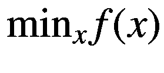
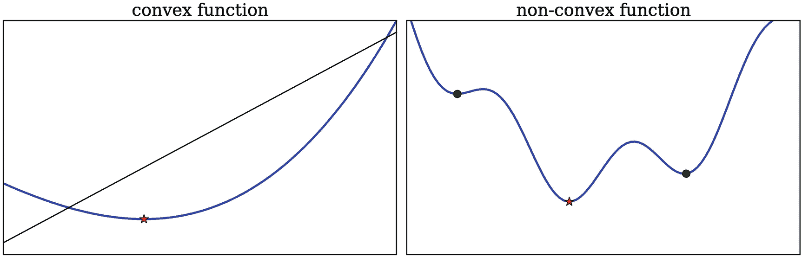
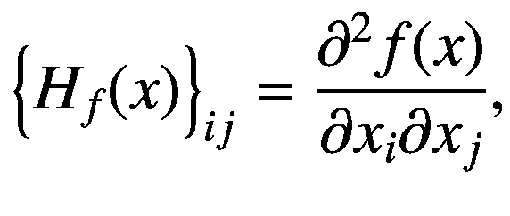
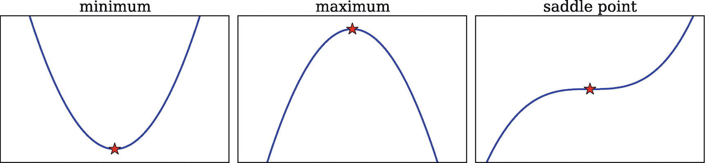
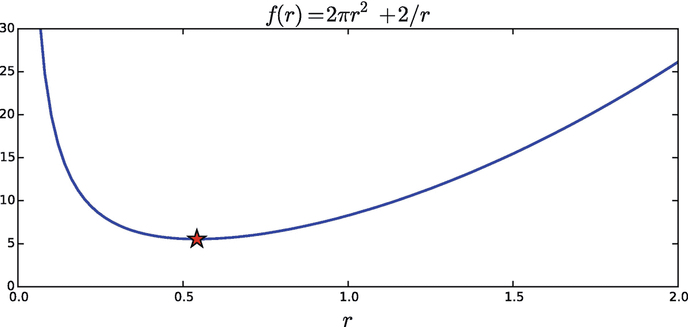

# 6. 优化

本章将基于第[5]章关于方程求解的内容，进一步探讨优化问题的求解。一般而言，优化是从一组可行候选方案中寻找并选择最优元素的过程。在数学优化中，该问题通常被表述为确定函数在给定定义域上的极值。极值或最优值可以指函数的最小值或最大值，具体取决于应用场景和特定问题。本章关注的是单变量或多变量实值函数的优化，这些函数可以选择性地受限于一组约束条件，从而限制其定义域。

数学优化的应用广泛多样，解决优化问题所需的方法和算法也同样丰富。由于优化是一种普遍重要的数学工具，它已在许多科学与工程领域得到发展和应用，描述优化问题的术语也因领域而异。例如，被优化的数学函数可能被称为成本函数、损失函数、能量函数或目标函数等。此处我们使用通用术语“目标函数”。

优化与方程求解密切相关，因为在函数的最优值处，其导数（对于多变量情况称为梯度）为零。反之则不一定成立，但求解优化问题的一种方法是求解导数（或梯度）的零点，然后检验所得候选点是否为最优。然而，这种方法并非总是可行，通常需要采用其他数值方法，其中许多方法与第[5]章讨论的数值求根方法密切相关。

本章将讨论如何使用 SciPy 的优化模块 `optimize` 处理非线性优化问题，并简要探讨如何使用凸优化库 `cvxopt` 处理带有线性约束的线性优化问题。该库还提供了强大的二次规划问题求解器。

## cvxopt

凸优化库 `cvxopt` 提供了线性和二次优化问题的求解器。在撰写本文时，其最新版本为 1.1.9。更多信息请参阅项目网站 [`cvxopt.org`](http://cvxopt.org)。此处我们使用该库进行带约束的线性优化。

## 导入模块

与上一章类似，此处我们使用 SciPy 库的 `optimize` 模块。假设该模块按以下方式导入：

```ipython
In [1]: from scipy import optimize
```

在本章后半部分，我们还将使用 `cvxopt` 库进行线性规划，假设该库整体导入且不带任何别名：

```ipython
In [2]: import cvxopt
```

为了进行基本的数值计算、符号计算和绘图，此处我们还使用了 NumPy、SymPy 和 Matplotlib 库，并按照前几章引入的惯例进行导入和初始化：

```ipython
In [3]: import matplotlib.pyplot as plt
In [4]: import numpy as np
In [5]: import sympy
In [6]: sympy.init_printing()
```

## 优化问题分类

此处我们将重点放在实值函数的数学优化上，这类函数包含一个或多个自变量。许多数学优化问题都可以用这种方式表述，但一个显著的例外是离散变量（例如整数）上的函数优化，这超出了本书的讨论范围。

这里考虑的一般优化问题可以表述为一个最小化问题：，需满足一组 `m` 个等式约束 `g(x) = 0` 和 `p` 个不等式约束 `h(x) ≤ 0`。此处 `f(x)` 是 `x` 的实值函数，`x` 可以是标量或向量 `x = (x[0], x[1], …, x[n])^T`，而 `g(x)` 和 `h(x)` 可以是向量值函数：`f : ℝ^n ⟶ ℝ`，`g : ℝ^n ⟶ ℝ^m`，`h : ℝ^n ⟶ ℝ^p`。注意，最大化 `f(x)` 等价于最小化 `-f(x)`，因此不失一般性，只需考虑最小化问题即可。

根据目标函数 `f(x)` 以及等式和不等式约束 `g(x)` 与 `h(x)` 的性质，这种表述涵盖了极其丰富的问题类型。这种形式的通用数学优化问题很难求解，并且没有能够解决完全通用的优化问题的有效方法。然而，对于许多重要的特例，存在高效的方法，因此在优化中，尽可能多地了解目标函数和约束条件对于能否解决问题至关重要。

优化问题根据函数 `f(x)`、`g(x)` 和 `h(x)` 的性质进行分类。首先，如果 `x` 是标量，`x ∈ ℝ`，则问题是*单变量*或*一维*的；如果 `x` 是向量，`x ∈ ℝ^n`，则问题是*多变量*或*多维*的。对于高维目标函数，随着 `n` 增大，优化问题更难求解，计算需求也更高。如果目标函数和所有约束都是线性的，则该问题是一个线性优化问题，或*线性规划*问题。如果目标函数或约束中任何一个是非线性的，则属于非线性优化问题，或*非线性规划*问题。就约束而言，优化的重要子类包括无约束问题，以及具有线性约束和非线性约束的问题。最后，处理等式约束和不等式约束需要不同的方法。

通常，非线性问题比线性问题难解得多，因为其可能的行为模式更加多样化。一般的非线性问题可能同时存在局部极小值和全局极小值，这使得寻找全局极小值非常困难：如果同时存在局部和全局极小值，迭代求解器可能会收敛到局部极小值而非全局极小值，甚至可能完全无法收敛。然而，有一类可以高效求解的非线性问题的重要子类是*凸问题*，这直接与不存在严格局部极小值以及存在唯一全局极小值相关。根据定义，如果函数在区间 `[a, b]` 上的值都位于端点 `(a, f(a))` 和 `(b, f(b))` 连线之下，则该函数在区间 `[a, b]` 上是凸的。这个条件可以很容易地推广到多变量情形，它隐含了许多重要性质，例如在该区间上存在唯一极小值。正因为具有这类强大性质，凸问题即使是非线性的，也能被高效求解。局部极小值和全局极小值，以及凸函数与非凸函数的概念，如图 6-1 所示。


*图 6-1. 凸函数（左图）与非凸函数（右图）的示意图，其中包含一个全局极小值和两个局部极小值*

目标函数 `f(x)` 以及约束 `g(x)` 和 `h(x)` 是否连续且光滑，这一性质对解决优化问题所能采用的方法和技术有着非常重要的影响。这些函数或其导数或梯度中存在的不连续性会给许多现有的优化问题求解方法带来困难，在后续内容中，我们假设这些函数确实是连续且光滑的。与此相关的是，如果函数本身不能精确获知，而是因测量或其他原因包含噪声，那么后面讨论的许多方法可能并不适用。

连续且光滑函数的优化与非线性方程求解密切相关，因为函数 `f(x)` 的极值对应于其导数（或梯度）为零的点。因此，寻找 `f(x)` 最优值的候选点等价于求解（通常是非线性的）方程组 `∇f(x) = 0`。然而，`∇f(x) = 0` 的解（称为驻点）并不一定对应 `f(x)` 的极小值；它也可能是极大值或鞍点，见图 6-2。因此，通过求解 `∇f(x) = 0` 得到的候选点需要进行最优性检验。对于无约束目标函数，可以使用高阶导数或 Hessian 矩阵



（对于多变量情形）来确定一个驻点是否为局部极小值。特别是，如果在驻点 `x^*` 处二阶导数为正，或 Hessian 矩阵正定，则 `x^*` 是一个局部极小值。二阶导数为负，或 Hessian 矩阵负定，对应局部极大值；而二阶导数为零，或 Hessian 矩阵不定，则对应鞍点。


*图 6-2. 一维函数不同驻点的示意图*

因此，通过代数方法求解方程组 `∇f(x) = 0` 并对候选解进行最优性检验，是解决优化问题的一种可能策略。然而，这并非总是可行的方法。特别是，我们可能没有 `f(x)` 的解析表达式来求导，并且由此产生的非线性方程组可能不易求解，尤其是要找到其所有根。对于这种情况，存在其他的数值优化方法，其中一些方法与第 5 章讨论的求根方法有相似之处。在本章的剩余部分，我们将探讨各种类型的优化问题，以及如何利用可用的 Python 优化库在实际中解决这些问题。

## 单变量优化

仅依赖于单个变量的函数优化相对容易。除了求函数导数根的解析方法外，我们还可以采用类似于单变量函数求根的技术，即括号法和牛顿法。

与单变量求根的二分法类似，我们可以使用括号法，并仅通过函数评估来迭代地细化区间。要细化包含最小值的区间 `[a, b]`，可以通过在两个内部点 `x[1]` 和 `x[2]`（其中 `x[1] < x[2]`）处评估函数来实现：如果 `f(x[1]) > f(x[2])`，则选择 `[x[1], b]` 作为新区间；否则选择 `[a, x[2]]`。这一思想被用于黄金分割搜索方法，该方法还巧妙地选择了 `x[1]` 和 `x[2]`，使得它们在 `[a, b]` 区间内的相对位置满足黄金比例。这种方法的优点是可以重用上一次迭代中的一次函数评估，因此每次迭代只需要进行一次新的函数评估，同时每次迭代都能以恒定因子缩小区间。对于在给定区间上具有唯一最小值的函数，这种方法保证收敛到最优解，但对于更复杂的函数，则无法保证。因此，仔细选择初始区间非常重要，理想情况下应尽可能接近最优点。在 SciPy 的 `optimize` 模块中，`golden` 函数实现了黄金搜索法。

与求根的二分法类似，黄金搜索法是一种（相对）安全但收敛速度较慢的方法。如果利用函数评估的值，而不仅仅是将这些值相互比较（类似于仅使用函数的符号，如二分法），则可以构造出收敛性更好的方法。函数值可用于拟合多项式，例如二次多项式，然后通过插值找到新的最小值近似点，从而获得一个新的函数评估候选点，之后可以重复该过程。这种方法收敛速度更快，但比括号法风险更大，可能根本不收敛，或者收敛到给定括号区间之外的局部最小值。

牛顿求根法是一种二次近似方法，可以通过将方法应用于函数的导数而不是函数本身来寻找函数的最小值。由此得出迭代公式 `x[k+1] = x[k] - f'(x[k]) / f''(x[k])`。如果初始点接近最优点，该公式可以快速收敛，但如果初始点离最优值太远，则可能根本不收敛。该公式还要求在每次迭代中同时计算一阶导数和二阶导数。如果这些导数有解析表达式可用，则这是一个很好的方法。如果只能进行函数评估，则可以使用类似于求根的割线法来近似导数。

在实际的单变量优化程序实现中，通常结合前两种方法，以获得稳定性和快速收敛性。在 SciPy 的 `optimize` 模块中，`brent` 函数就是这种混合方法，通常是用 SciPy 优化单变量函数的首选方法。该方法是黄金分割搜索法的一种变体，它使用逆抛物线插值来获得更快的收敛速度。

除了直接调用 `optimize.golden` 和 `optimize.brent` 函数外，更方便的是使用统一接口函数 `optimize.minimize_scalar`，该函数根据 `method` 关键字参数的值分派给 `optimize.golden` 和 `optimize.brent` 函数。当前允许的选项有 `'Golden'`、`'Brent'` 或 `'Bounded'`。最后一个选项分派给 `optimize.fminbound`，它在一个有界区间上执行优化，这对应于一个带有不等式约束的优化问题，该约束限制了目标函数 `f(x)` 的定义域。请注意，`optimize.golden` 和 `optimize.brent` 函数可能收敛到初始括号区间之外的局部最小值，但 `optimize.fminbound` 在这种情况下会返回允许范围边界处的值。

作为说明这些技术的一个示例，考虑以下经典优化问题：在单位体积下最小化圆柱体的表面积。在此，合适的变量是圆柱体的半径 `r` 和高度 `h`，目标函数为 `f(r, h) = 2πr² + 2πrh`，受等式约束 `g(r, h) = πr²h - 1 = 0`。正如这里所表述的，这是一个带有等式约束的二维优化问题。但是，我们可以代数求解其中一个依赖变量的约束方程，例如 `h = 1/(πr²)`，然后将其代入目标函数，从而得到一个无约束的一维优化问题：`f(r) = 2πr² + 2/r`。首先，我们可以使用 SymPy 符号化地解决这个问题，即令 `f(r)` 的导数等于零：

![$$ \frac{2^{2/3}}{2\sqrt[3]{\pi }} $$](images/332789_2_En_6_Chapter/332789_2_En_6_Chapter_TeX_Equb.png)

```python
In [7]: r, h = sympy.symbols("r, h")
In [8]: Area = 2 * sympy.pi * r**2 + 2 * sympy.pi * r * h
In [9]: Volume = sympy.pi * r**2 * h
In [10]: h_r = sympy.solve(Volume - 1)[0]
In [11]: Area_r = Area.subs(h_r)
In [12]: rsol = sympy.solve(Area_r.diff(r))[0]
In [13]: rsol
Out[13]:
```

```python
In [14]: _.evalf()
Out[14]: 0.541926070139289
```

现在验证二阶导数为正，并且 `rsol` 对应于一个最小值点：

![$$ 3\sqrt[3]{2\pi } $$](images/332789_2_En_6_Chapter/332789_2_En_6_Chapter_TeX_Equc.png)

```python
In [15]: Area_r.diff(r, 2).subs(r, rsol)
Out[15]: 12π
In [16]: Area_r.subs(r, rsol)
Out[16]:
```

```python
In [17]: _.evalf()
Out[17]: 5.53581044593209
```

对于简单问题，这种方法通常是可行的，但对于更实际的问题，我们通常需要借助数值技术。为了使用 SciPy 的数值优化函数解决这个问题，我们首先定义一个 Python 函数 `f` 来实现目标函数。然后，为了求解优化问题，我们将这个函数传递给例如 `optimize.brent`。我们还可以选择使用 `brack` 关键字参数来指定算法的起始区间：

```python
In [18]: def f(r):
...:     return 2 * np.pi * r**2 + 2 / r
In [19]: r_min = optimize.brent(f, brack=(0.1, 4))
In [20]: r_min
Out[20]: 0.541926077256
In [21]: f(r_min)
Out[21]: 5.53581044593
```

除了直接调用 `optimize.brent` 之外，我们还可以使用标量最小化问题的通用接口 `optimize.minimize_scalar`。请注意，在这种情况下要指定起始区间，我们必须使用 `bracket` 关键字参数：

```python
In [22]: optimize.minimize_scalar(f, bracket=(0.1, 4))
Out[22]:  nit: 13
fun: 5.5358104459320856
x: 0.54192606489766715
nfev: 14
```

所有这些方法得出的最小化圆柱体表面积的半径约为 0.54（符号计算的确切结果为 `2^{2/3} / (2 * π^{1/3})`），最小表面积约为 5.54（确切结果为 `3 * (2π)^{1/3}`）。本示例中我们最小化的目标函数绘制在图 6-3 中，其中最小值用红色星号标记。在可能的情况下，最好在进行数值优化之前先可视化目标函数，因为这有助于为数值优化程序确定合适的初始区间或起始点。



**图 6-3**

单位体积圆柱体的表面积随半径 `r` 变化的函数

## 无约束多变量优化

## 多变量优化基本方法

多变量优化比上一节讨论的单变量优化困难得多。特别是，在多元情况下，通过求解梯度根的非线性方程组的分析方法几乎不可行，而黄金搜索法中使用的区间划分法也无法直接应用。相反，我们必须采用从坐标空间中的某个点开始，并运用不同策略向最小值的更优近似点移动的技术。这类方法中最基本的是考虑目标函数`f(x)`在给定点`x`处的梯度`∇f(x)`。通常，梯度的负值`-∇f(x)`总是指向函数`f(x)`下降最快的方向。因此，作为最小化策略，合理的做法是沿着该方向移动一定距离`α[k]`，然后在新点处迭代这一方案。这种方法称为最速下降法，其迭代公式为`x[k+1] = x[k] - α[k] ∇f(x[k])`，其中`α[k]`是一个自由参数，称为线搜索参数，它描述了每次迭代中沿给定方向移动的距离。例如，可以通过求解一维优化问题`min_{α_k} f(x_k - α_k ∇f(x_k))`来选择合适的`α[k]`。该方法确保能够取得进展并最终收敛到函数的最小值，但收敛速度可能相当慢，因为这种方法往往沿梯度方向过度调整，导致在接近最小值时呈锯齿形路径。尽管如此，最速下降法仍是许多多变量优化算法的概念基础，通过适当的修改可以加快收敛速度。

## 牛顿法改进

用于多变量优化的牛顿法是对最速下降法的一种改进，可以提升收敛性。与单变量情况类似，牛顿法可视为函数的局部二次近似，在其最小化时得到一个迭代方案。在多变量情况下，迭代公式为`x_{k+1} = x_k - H_f^(-1)(x_k) ∇f(x_k)`，与最速下降法相比，梯度被替换为梯度左乘海森矩阵的逆。^((33)) 这通常同时改变了步长的方向和长度，因此该方法并非严格意义上的最速下降法，如果起始点离最小值太远，可能无法收敛。然而，当接近最小值时，它收敛很快。与往常一样，收敛速度和稳定性之间存在权衡。按照这里给出的公式，牛顿法需要同时知道函数的梯度和海森矩阵。