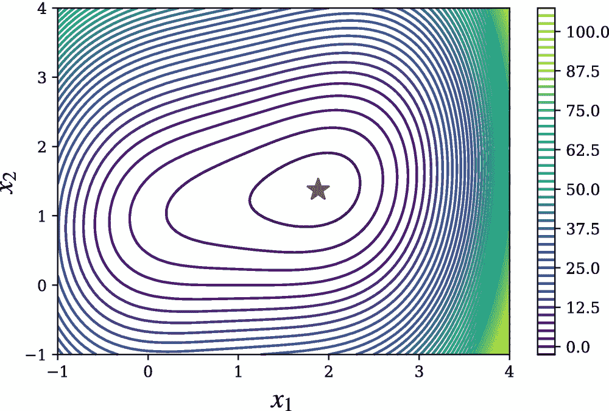
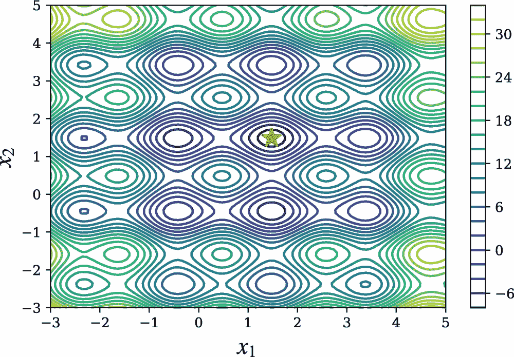
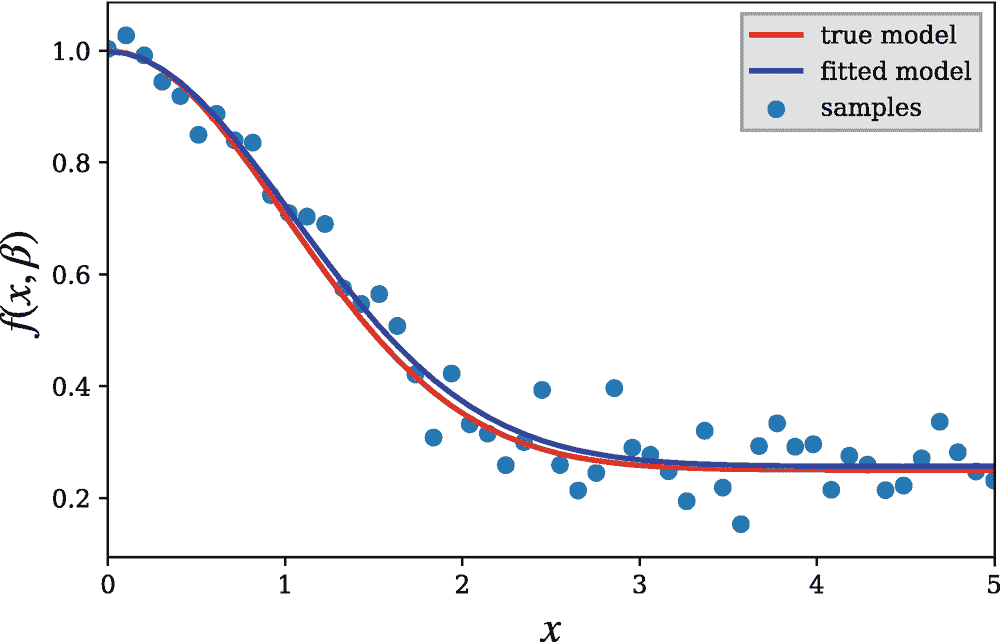
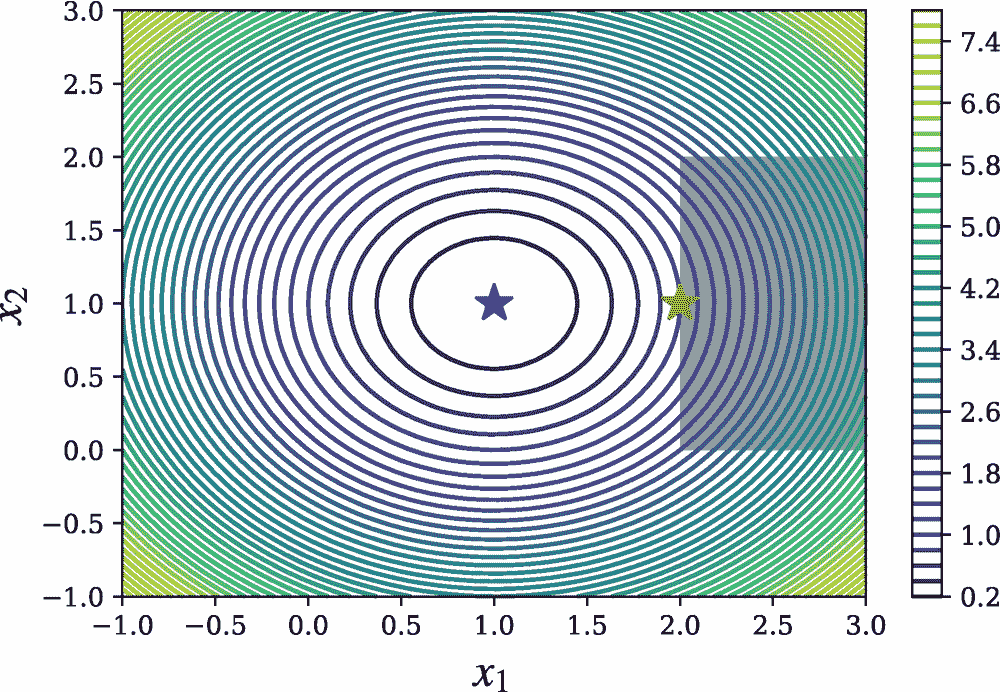
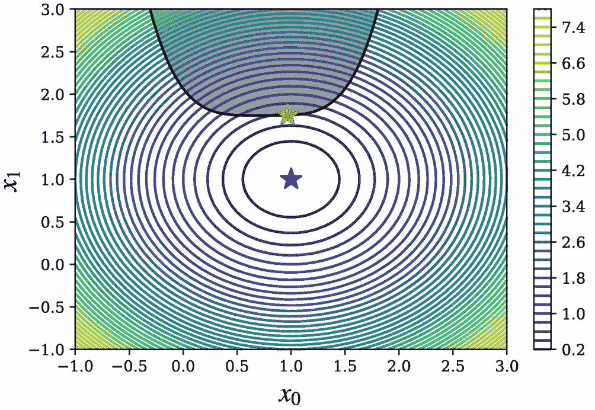
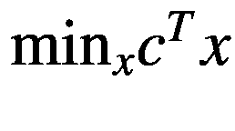
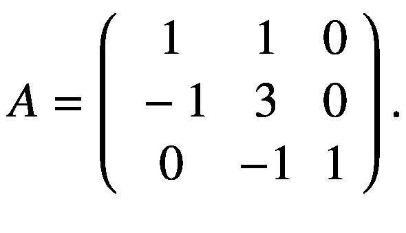

# 优化算法实现

## 牛顿法

在 SciPy 中，牛顿法由函数`optimize.fmin_ncg`实现。该函数接受以下参数：目标函数的 Python 函数、起始点、用于计算梯度的 Python 函数，以及（可选）用于计算海森矩阵的 Python 函数。

为了了解如何使用此方法求解优化问题，我们考虑以下问题：
$$ {\min}_xf(x) $$
其中目标函数为 $f(x) = (x_1 - 1)^4 + 5(x_2 - 1)^2 - 2x_1x_2$。

要应用牛顿法，我们需要计算梯度和海森矩阵。针对这个特定案例，可以轻松手动完成。然而，出于通用性考虑，下面我们使用 SymPy 来计算梯度和海森矩阵的符号表达式。为此，我们首先为目标函数定义符号和符号表达式，然后使用`sympy.diff`函数对每个变量求导，以获得符号形式的梯度和海森矩阵：

$$ \left[\begin{array}{c}-2{x}_2+4{\left({x}_1-1\right)}^3\\ -2{x}_1+10{x}_2-10\end{array}\right] $$

```python
In [23]: x1, x2 = sympy.symbols("x_1, x_2")
In [24]: f_sym = (x1-1)**4 + 5 * (x2-1)**2 - 2*x1*x2
In [25]: fprime_sym = [f_sym.diff(x_) for x_ in (x1, x2)]
In [26]: # Gradient
        sympy.Matrix(fprime_sym)
Out[26]:
```

$$ \left[\begin{array}{cc}12{\left({x}_1-1\right)}^2 & -2\\ -2 & 10\end{array}\right] $$

```python
In [27]: fhess_sym = [[f_sym.diff(x1_, x2_) for x1_ in (x1, x2)] for x2_ in (x1, x2)]
In [28]: # Hessian
        sympy.Matrix(fhess_sym)
Out[28]:
```

现在我们有了梯度和海森矩阵的符号表达式，可以使用`sympy.lambdify`为这些表达式创建向量化函数。

```python
In [29]: f_lmbda = sympy.lambdify((x1, x2), f_sym, 'numpy')
In [30]: fprime_lmbda = sympy.lambdify((x1, x2), fprime_sym, 'numpy')
In [31]: fhess_lmbda = sympy.lambdify((x1, x2), fhess_sym, 'numpy')
```

然而，`sympy.lambdify`生成的函数为相应表达式中的每个变量接受一个参数，而 SciPy 优化函数期望一个向量化函数，其中所有坐标都打包在一个数组中。为了获得与 SciPy 优化例程兼容的函数，我们将`sympy.lambdify`生成的每个函数包装到一个重新排列参数的 Python 函数中：

```python
In [32]: def func_XY_to_X_Y(f):
        ...:     """
        ...:     Wrapper for f(X) -> f(X[0], X[1])
        ...:     """
        ...:     return lambda X: np.array(f(X[0], X[1]))
In [33]: f = func_XY_to_X_Y(f_lmbda)
In [34]: fprime = func_XY_to_X_Y(fprime_lmbda)
In [35]: fhess = func_XY_to_X_Y(fhess_lmbda)
```

现在，函数`f`、`fprime`和`fhess`是向量化的 Python 函数，其形式符合例如`optimize.fmin_ncg`的期望，我们可以通过调用此函数对当前问题进行数值优化。除了我们从 SymPy 表达式准备的函数外，我们还需要为牛顿法提供一个起始点。这里我们使用 `(0, 0)` 作为起始点。

```python
In [36]: x_opt = optimize.fmin_ncg(f, (0, 0), fprime=fprime, fhess=fhess)
Optimization terminated successfully.
Current function value: -3.867223
Iterations: 8
Function evaluations: 10
Gradient evaluations: 17
Hessian evaluations: 8
In [37]: x_opt
Out[37]: array([ 1.88292613,  1.37658523])
```

该例程找到了一个极小点 $(x_1, x_2) = (1.88292613, 1.37658523)$，并且还将关于解的诊断信息打印到标准输出，包括迭代次数以及到达解所需的函数、梯度和海森矩阵计算次数。

通常情况下，可视化目标函数和解是说明性的（见图 6-4）：



**图 6-4** *目标函数 $f(x) = (x_1 - 1)^4 + 5(x_2 - 1)^2 - 2x_1x_2$ 的等高线图。极小点用红色星号标记。*

```python
In [38]: fig, ax = plt.subplots(figsize=(6, 4))
        x_ = y_ = np.linspace(-1, 4, 100)
        X, Y = np.meshgrid(x_, y_)
        c = ax.contour(X, Y, f_lmbda(X, Y), 50)
        ax.plot(x_opt[0], x_opt[1], 'r*', markersize=15)
        ax.set_xlabel(r"$x_1$", fontsize=18)
        ax.set_ylabel(r"$x_2$", fontsize=18)
        plt.colorbar(c, ax=ax)
```

## 其他优化方法

在实际应用中，并不总是能够提供同时计算目标函数梯度和海森矩阵的函数，通常使用仅需要函数求值的求解器会更方便。对于这种情况，存在几种方法来数值估计梯度或海森矩阵，或两者都估计。近似海森矩阵的方法被称为拟牛顿法，也存在完全避免使用海森矩阵的其他迭代方法。两种流行的方法是 Broyden-Fletcher-Goldfarb-Shanno (BFGS) 方法和共轭梯度法，它们在 SciPy 中分别由函数`optimize.fmin_bfgs`和`optimize.fmin_cg`实现。

BFGS 方法是一种拟牛顿法，可以逐步建立海森矩阵的数值估计，如果需要，也可以建立梯度的数值估计。共轭梯度法是梯度下降法的一种变体，不使用海森矩阵，它可以与仅通过函数求值获得的梯度数值估计一起使用。使用这些方法解决问题所需的函数求值次数远多于牛顿法，而牛顿法则还需要计算梯度和海森矩阵。`optimize.fmin_bfgs`和`optimize.fmin_cg`都可以选择性地接受一个用于计算梯度的函数，但如果不提供，梯度将从函数求值中估计出来。

前面给出的用牛顿法求解的问题，也可以使用`optimize.fmin_bfgs`和`optimize.fmin_cg`求解，而无需提供海森矩阵的函数。

以下是排版后的内容：


```python
In [39]: x_opt = optimize.fmin_bfgs(f, (0, 0), fprime=fprime)
Optimization terminated successfully.
Current function value: -3.867223
Iterations: 10
Function evaluations: 14
Gradient evaluations: 14
In [40]: x_opt
Out[40]: array([ 1.88292605,  1.37658523])
In [41]: x_opt = optimize.fmin_cg(f, (0, 0), fprime=fprime)
Optimization terminated successfully.
Current function value: -3.867223
Iterations: 7
Function evaluations: 17
Gradient evaluations: 17
In [42]: x_top
Out[42]: array([ 1.88292613,  1.37658522])
```

请注意，如前面优化求解器的诊断输出所示，这里的函数和梯度求值次数比牛顿法多。如前所述，这两种方法也可以在不提供梯度函数的情况下使用，如下面的使用 `optimize.fmin_bfgs` 求解器的示例所示：

```python
In [43]: x_opt = optimize.fmin_bfgs(f, (0, 0))
Optimization terminated successfully.
Current function value: -3.867223
Iterations: 10
Function evaluations: 56
Gradient evaluations: 14
In [44]: x_opt
Out[44]: array([ 1.88292604,  1.37658522])
```

在这种情况下，函数求值次数甚至更多，但显然，不必实现计算梯度和海森矩阵的函数是很方便的。

一般来说，`BFGS`方法是首选的尝试方法，尤其是在既不知道梯度也不知道海森矩阵的情况下。如果只知道梯度，`BFGS`方法仍然是通常推荐的方法，尽管共轭梯度法通常是`BFGS`方法的有力替代方案。如果梯度和海森矩阵都已知，那么牛顿法通常是收敛最快的方法。然而，需要注意的是，虽然`BFGS`方法和共轭梯度法在理论上收敛速度慢于牛顿法，但它们有时能提供更好的稳定性，因此可能是更优的选择。与拟牛顿法和共轭梯度法相比，牛顿法的每次迭代计算量也可能更大，特别是对于大型问题，这些方法尽管需要更多迭代次数，但可能更快。

到目前为止，我们讨论的多变量优化方法通常都收敛于局部最小值。对于具有许多局部最小值的问题，这很容易导致求解器陷入局部最小值，即使存在全局最小值也是如此。虽然没有针对此问题的完整通用解决方案，但一种可以部分缓解该问题的实用方法是在坐标网格上进行暴力搜索，以便为迭代求解器找到合适的起始点。这至少提供了一种系统的方法来在给定的坐标范围内找到全局最小值。在`SciPy`中，函数`optimize.brute`可以执行这样的系统搜索。为了说明这种方法，考虑最小化函数`4 sin(x*π) + 6 sin(y*π) + (x - 1)² + (y - 1)²`的问题，该函数有大量的局部最小值。这可能会使得为迭代求解器选择合适的初始点变得棘手。为了用`SciPy`解决这个优化问题，我们首先为目标函数定义一个`Python`函数：

```python
In [45]: def f(X):
...:      x, y = X
...:      return (4 * np.sin(np.pi * x) + 6 * np.sin(np.pi * y)) + (x - 1)**2 + (y - 1)**2
```

为了在坐标网格上系统地搜索最小值，我们调用`optimize.brute`，将目标函数`f`作为第一个参数，将一个`slice`对象元组作为第二个参数（每个坐标一个）。`slice`对象指定了搜索最小值的坐标网格。这里我们还设置了关键字参数`finish=None`，这可以防止`optimize.brute`自动优化最佳候选点。

```python
In [46]: x_start = optimize.brute(f, (slice(-3, 5, 0.5), slice(-3, 5, 0.5)), finish=None)
In [47]: x_start
Out[47]: array([ 1.5,  1.5])
In [48]: f(x_start)
Out[48]: −9.5
```

在由给定`slice`对象元组指定的坐标网格上，最优点为`(x[1], x[2]) = (1.5, 1.5)`，对应的目标函数最小值为`-9.5`。现在，这是一个适用于更复杂的迭代求解器（如`optimize.fmin_bfgs`）的良好起点：

```python
In [49]: x_opt = optimize.fmin_bfgs(f, x_start)
Optimization terminated successfully.
Current function value: -9.520229
Iterations: 4
Function evaluations: 28
Gradient evaluations: 7
In [50]: x_opt
Out[50]: array([ 1.47586906,  1.48365788])
In [51]: f(x_opt)
Out[51]: −9.52022927306
```

这里，`BFGS`方法给出了最终的最小值点`(x[1], x[2]) = (1.47586906, 1.48365788)`，目标函数的最小值为`-9.52022927306`。对于这种类型的问题，猜测初始起点很容易导致迭代求解器收敛到局部最小值，而`optimize.brute`提供的系统方法通常很有用。

与往常一样，尽可能对目标函数和解进行可视化是很重要的。以下两个代码单元格绘制了当前目标函数的等高线图，并用红色星号标记了得到的解（见图 6-5）。与前面的例子一样，我们需要一个用于重新排列目标函数参数的包装函数，因为坐标向量传递给函数的方式不同（分别是单独的数组和打包成一个数组）。



**图 6-5**

*目标函数`f(x) = 4 sin(x*π) + 6 sin(y*π) + (x - 1)² + (y - 1)²`的等高线图。最小值用红色星号标记。*

```python
In [52]: def func_X_Y_to_XY(f, X, Y):
...:     """
...:     Wrapper for f(X, Y) -> f([X, Y])
...:     """
...:     s = np.shape(X)
...:     return f(np.vstack([X.ravel(), Y.ravel()])).reshape(*s)
In [53]: fig, ax = plt.subplots(figsize=(6, 4))
...: x_ = y_ = np.linspace(-3, 5, 100)
...: X, Y = np.meshgrid(x_, y_)
...: c = ax.contour(X, Y, func_X_Y_to_XY(f, X, Y), 25)
...: ax.plot(x_opt[0], x_opt[1], 'r*', markersize=15)
...: ax.set_xlabel(r"$x_1$", fontsize=18)
...: ax.set_ylabel(r"$x_2$", fontsize=18)
...: plt.colorbar(c, ax=ax)
```

在本节中，我们显式地调用了特定求解器的函数，例如`optimize.fmin_bfgs`。但是，与标量优化一样，`SciPy`也通过函数`optimize.minimize`为所有多变量优化求解器提供了统一接口，该函数根据`method`关键字参数的值分发到特定于求解器的函数（请记住，提供统一接口的单变量最小化函数是`optimize.scalar_minimize`）。为了清晰起见，我们在这里倾向于显式调用特定求解器的函数，但通常建议使用`optimize.minimize`，因为这使得在不同求解器之间切换更加容易。例如，在前面的例子中，我们使用了`optimize.fmin_bfgs`，如下所示：

```python
In [54]: x_opt = optimize.fmin_bfgs(f, x_start)
```

我们同样可以使用：

```python
In [55]: result = optimize.minimize(f, x_start, method= 'BFGS')
In [56]: x_opt = result.x
```


函数`optimize.minimize`返回一个代表优化结果的`optimize.OptimizeResult`实例。特别是，解可以通过该类的`x`属性获得。

## 非线性最小二乘问题

在第 5 章中，我们遇到了线性最小二乘问题，并探讨了如何用线性代数方法求解。通常，最小二乘问题可视为一个目标函数为 `$$ g\left(\beta \right)={\sum}_{i=0}^m{r}_i{\left(\beta \right)²={\left|\left|r\left(\beta \right)\right|\right|}² $$` 的优化问题，其中 `r(β)` 是一个向量，其分量为 `ri = y[i] - f(x[i], β)`，对应一组 `m` 个观测值 `(x[i], y[i])`。这里的 `β` 是一个包含未知参数的向量，用于指定函数 `f(x, β)`。如果该问题关于参数 `β` 是非线性的，则称为非线性最小二乘问题。由于非线性，它无法使用第 5 章讨论的线性代数技术求解。相反，我们可以使用上一节描述的多元优化技术，例如牛顿法或拟牛顿法。然而，这种非线性最小二乘优化问题具有特定的结构，因此已经开发了几种专门用于解决此特定优化问题的方法。其中一个例子是莱文贝格-马夸尔特方法，其思想是在每次迭代中对问题逐步线性化。

在 SciPy 中，`optimize.leastsq` 函数提供了一个使用莱文贝格-马夸尔特方法的非线性最小二乘求解器。为了说明如何使用该函数，考虑一个形式为 `f(x, β) = β[0] + β[1] exp(-β[2] x²)` 的非线性模型和一组观测值 `(x[i], y[i])`。在以下示例中，我们通过在真实值上添加随机噪声来模拟观测值，并求解最小化问题，以得到参数 `β` 的最佳最小二乘估计。首先，我们定义一个包含参数向量 `β` 真实值的元组，以及一个模型函数的 Python 函数。该函数应返回给定 `x` 值对应的 `y` 值，其第一个参数为变量 `x`，后续参数为未知函数参数：

```
In [57]: beta = (0.25, 0.75, 0.5)
In [58]: def f(x, b0, b1, b2):
...:    return b0 + b1 * np.exp(-b2 * x**2)
```

定义好模型函数后，我们生成模拟观测值的随机数据点。

```
In [59]: xdata = np.linspace(0, 5, 50)
In [60]: y = f(xdata, *beta)
In [61]: ydata = y + 0.05 * np.random.randn(len(xdata))
```

准备好模型函数和观测数据后，我们开始求解非线性最小二乘问题。第一步是定义一个函数，用于计算给定数据和模型函数（由待确定的模型参数 `β` 指定）的残差。

```
In [62]: def g(beta):
...:     return ydata - f(xdata, *beta)
```

接下来，我们定义参数向量的初始猜测，并让 `optimize.leastsq` 函数求解参数向量的最佳最小二乘拟合：

```
In [63]: beta_start = (1, 1, 1)
In [64]: beta_opt, beta_cov = optimize.leastsq(g, beta_start)
In [65]: beta_opt
Out[65]: array([ 0.25733353,  0.76867338,  0.54478761])
```

此处的最佳拟合非常接近先前定义的真实参数值 (0.25, 0.75, 0.5)。通过绘制观测数据以及使用真实参数值和拟合参数值得到的模型函数，我们可以直观地确认拟合模型似乎很好地描述了数据（参见图 6-6）。



图 6-6

*对函数 `f(x, β) = β[0] + β[1] exp(-β[2] x²)`（其中 `β = (0.25, 0.75, 0.5)`）的非线性最小二乘拟合*

```
In [66]: fig, ax = plt.subplots()
...: ax.scatter(xdata, ydata, label="样本数据")
...: ax.plot(xdata, y, 'r', lw=2, label='真实模型')
...: ax.plot(xdata, f(xdata, *beta_opt), 'b', lw=2, label='拟合模型')
...: ax.set_xlim(0, 5)
...: ax.set_xlabel(r"$x$", fontsize=18)
...: ax.set_ylabel(r"$f(x, \beta)$", fontsize=18)
...: ax.legend()
```

SciPy 的 `optimize` 模块还通过 `optimize.curve_fit` 函数提供了另一种非线性最小二乘拟合接口。这是对 `optimize.leastsq` 的一个便捷封装，省去了为最小二乘问题显式定义残差函数的需要。因此，之前的问题可以使用以下代码更简洁地求解：

```
In [67]: beta_opt, beta_cov = optimize.curve_fit(f, xdata, ydata)
In [68]: beta_opt
Out[68]: array([ 0.25733353,  0.76867338,  0.54478761])
```

## 约束优化

约束条件为优化问题增加了另一层复杂性，需要对它们进行单独分类。一种简单的约束优化形式是坐标变量受限于某些边界的优化。例如： `$$ {\min}_xf(x) $$` 满足 `0 ≤ x ≤ 1`。约束 `0 ≤ x ≤ 1` 很简单，因为它只限制坐标的范围，而不依赖于其他变量。这类问题可以使用 SciPy 中的 L-BFGS-B 方法求解，它是我们之前使用的 BFGS 方法的一个变种。该求解器可通过 `optimize.fmin_l_bgfs_b` 函数或 `optimize.minimize` 函数（将 `method` 参数设置为 `'L-BFGS-B'`）调用。要定义坐标边界，必须使用 `bound` 关键字参数，其值应为一个元组列表，每个元组包含每个受约束变量的最小值和最大值。如果最小值或最大值设置为 `None`，则视为无界。

作为使用 L-BFGS-B 求解器求解有界优化问题的示例，考虑最小化目标函数 `f(x) = (x[1] - 1)² - (x[2] - 1)²`，并满足约束 `2 ≤ x[1] ≤ 3` 和 `0 ≤ x[2] ≤ 2`。为了解决这个问题，我们首先为这两个变量分别定义一个 Python 目标函数和包含边界的元组，该边界根据给定的约束条件确定。为了进行比较，在以下代码中，我们还使用相同目标函数求解了无约束优化问题，并绘制了目标函数的等高线图，其中无约束最小值和约束最小值分别用蓝色和红色星号标记（参见图 6-7）。



图 6-7

目标函数 `f(x)` 的等高线，无约束最小值（蓝色星号）和约束最小值（红色星号）。约束问题的可行域以灰色阴影显示。

# 优化方法与约束处理

```python
In [69]: def f(X):
...:     x, y = X
...:     return (x - 1)**2 + (y - 1)**2
In [70]: x_opt = optimize.minimize(f, [1, 1], method="BFGS").x
In [71]: bnd_x1, bnd_x2 = (2, 3), (0, 2)
In [72]: x_cons_opt = optimize.minimize(f, [1, 1], method='L-BFGS-B',
...:                                 bounds=[bnd_x1, bnd_x2]).x
In [73]: fig, ax = plt.subplots(figsize=(6, 4))
...: x_ = y_ = np.linspace(-1, 3, 100)
...: X, Y = np.meshgrid(x_, y_)
...: c = ax.contour(X, Y, func_X_Y_to_XY(f, X, Y), 50)
...: ax.plot(x_opt[0], x_opt[1], 'b*', markersize=15)
...: ax.plot(x_cons_opt[0], x_cons_opt[1], 'r*', markersize=15)
...: bound_rect = plt.Rectangle((bnd_x1[0], bnd_x2[0]),
...:                            bnd_x1[1] - bnd_x1[0], bnd_x2[1] - bnd_x2[0], facecolor="grey")
...: ax.add_patch(bound_rect)
...: ax.set_xlabel(r"$x_1$", fontsize=18)
...: ax.set_ylabel(r"$x_2$", fontsize=18)
...: plt.colorbar(c, ax=ax)
```

由等式或不等式定义的包含多个变量的约束处理起来相对复杂。不过，针对这类问题也存在通用的处理方法。例如，通过引入拉格朗日乘子，可以将带约束的优化问题转化为无约束问题。

## 拉格朗日乘子法

具体来说，考虑满足等式约束 `g(x) = 0` 的优化问题 `min_x f(x)`。在无约束优化问题中，`f(x)` 的梯度在最优解处为零，即 `∇f(x) = 0`。可以证明，有约束问题的对应条件是负梯度位于约束法向支撑的空间内，即 `-∇f(x) = λ J_g^T(x)`。此处 `J_g(x)` 是约束函数 `g(x)` 的雅可比矩阵，`λ` 是拉格朗日乘子向量（新变量）。该条件源于令函数 `Λ(x, λ) = f(x) + λ^T g(x)` 的梯度为零，该函数被称为拉格朗日函数。因此，如果 `f(x)` 和 `g(x)` 都是连续且光滑的，那么函数 `Λ(x, λ)` 的驻点 (`x0`, `λ0`) 对应的 `x0` 即是原约束优化问题的最优解。注意，如果 `g(x)` 是标量函数（即只有一个约束），那么雅可比矩阵 `J_g(x)` 就退化为梯度 `∇g(x)`。

## 实例：长方体体积最大化

为了说明这一方法，考虑一个长宽高分别为 `x1`、`x2` 和 `x3` 的长方体，在总表面积为单位面积的约束下 `g(x) = 2*x1*x2 + 2*x0*x2 + 2*x1*x0 - 1 = 0`，求其体积最大化问题。使用拉格朗日乘子法求解此优化问题时，我们构造拉格朗日函数 `Λ(x) = f(x) + λ*g(x)`，并寻找满足 `∇Λ(x) = 0` 的驻点。借助 `SymPy`，我们可以先定义问题中的变量符号，然后构建 `f(x)`、`g(x)` 和 `Λ(x)` 的表达式：

```python
In [74]: x = x0, x1, x2, l = sympy.symbols("x_0, x_1, x_2, lambda")
In [75]: f = x0 * x1 * x2
In [76]: g = 2 * (x0 * x1 + x1 * x2 + x2 * x0) - 1
In [77]: L = f + l * g
```

最后，使用 `sympy.diff` 计算 `∇Λ(x)`，并通过 `sympy.solve` 求解方程 `∇Λ(x) = 0`：

`[{λ: -√6/24, x0: √6/6, x1: √6/6, x2: √6/6}, {λ: √6/24, x0: -√6/6, x1: -√6/6, x2: -√6/6}]`

```python
In [78]: grad_L = [sympy.diff(L, x_) for x_ in x]
In [79]: sols = sympy.solve(grad_L)
In [80]: sols
Out[80]:
```

该过程得到两个驻点。我们可以通过计算每种情况下的目标函数值来确定哪个对应最优解。然而，这里只有一个驻点对应物理上可接受的解：因为在本问题中 `x_i` 是长方体的边长，必须为正数。因此我们可以立即识别出有意义的解，它对应直观的结果 `x0 = x1 = x2 = √6/6`（一个立方体）。最后，我们使用得到的解验证约束函数和目标函数：

`√6/36`

```python
In [81]: g.subs(sols[0])
Out[81]: 0
In [82]: f.subs(sols[0])
Out[82]:
```

## 使用 SciPy 的 SLSQP 求解器

该方法也可扩展到处理不等式约束，并且存在多种应用此方法的数值解法。一个例子是称为序列最小二乘规划的方法，缩写为 SLSQP，在 SciPy 中可通过 `optimize.slsqp` 函数和 `optimize.minimize` 并设置 `method='SLSQP'` 来使用。`optimize.minimize` 函数接受关键字参数 `constraints`，它应该是一个字典列表，每个字典指定一个约束。该字典中允许的键（值）包括 `type`（`'eq'` 或 `'ineq'`）、`fun`（约束函数）、`jac`（约束函数的雅可比矩阵）以及 `args`（传递给约束函数及其雅可比计算函数的额外参数）。例如，描述上一个问题中约束的约束字典应为 `dict(type='eq', fun=g)`。

要使用 SciPy 的 SLSQP 求解器数值求解完整问题，我们需要为目标函数和约束函数定义 Python 函数：

```python
In [83]: def f(X):
...:     return -X[0] * X[1] * X[2]
In [84]: def g(X):
...:     return 2 * (X[0]*X[1] + X[1] * X[2] + X[2] * X[0]) - 1
```

注意，由于 SciPy 的优化函数求解的是最小化问题，而我们这里关注的是最大化，因此函数 `f` 是原目标函数的负值。接下来，我们为 `g(x) = 0` 定义约束字典，最后调用 `optimize.minimize` 函数：

```python
In [85]: constraint = dict(type='eq', fun=g)
In [86]: result = optimize.minimize(f, [0.5, 1, 1.5], method="SLSQP", constraints=[constraint])
In [87]: result
Out[87]:  status: 0
success: True
njev: 18
nfev: 95
fun: -0.068041368623352985
x: array([ 0.40824187,  0.40825127,  0.40825165])
message: 'Optimization terminated successfully.'
jac: array([-0.16666925, -0.16666542, -0.16666527,  0.])
nit: 18
In [88]: result.x
Out[88]: array([ 0.40824187,  0.40825127,  0.40825165])
```

正如预期，数值解与使用拉格朗日乘子法符号计算得到的解析解吻合良好。

## 处理不等式约束

要处理带有不等式约束的问题，我们只需在约束字典中设置 `type='ineq'` 并提供对应的不等式函数。为了演示带有非线性不等式约束的非线性目标函数的最小化，我们回到之前考虑的二次问题，但这次添加不等式约束 `g(x) = x1 - 1.75 - (x0 - 0.75)⁴ ≥ 0`。像往常一样，我们首先定义目标函数和约束函数，以及约束字典：

```python
In [89]: def f(X):
...:     return (X[0] - 1)**2 + (X[1] - 1)**2
In [90]: def g(X):
...:     return X[1] - 1.75 - (X[0] - 0.75)**4
In [91]: constraints = [dict(type='ineq', fun=g)]
```

接下来，我们准备通过调用 `optimize.minimize` 函数来求解优化问题。为了对比，这里我们也求解对应的无约束问题。

# 非线性优化与线性规划

在[92]行中执行 `x_opt = optimize.minimize(f, (0, 0), method="BFGS").x`，在[93]行中执行 `x_cons_opt = optimize.minimize(f, (0, 0), method="SLSQP", constraints=constraints).x`。

为了验证所得解的合理性，我们绘制目标函数的等高线图，并用阴影区域表示可行域（即满足不等式约束的区域）。有约束和无约束的解分别用红色和蓝色星号标记（见图 6-8）。



**图 6-8** 目标函数的等高线图，灰色阴影区域为有约束问题的可行域。红色和蓝色星号分别表示有约束和无约束问题中的最优点。

以下是生成该图的代码：

```python
In [94]: fig, ax = plt.subplots(figsize=(6, 4))
In [95]: x_ = y_ = np.linspace(-1, 3, 100)
...: X, Y = np.meshgrid(x_, y_)
...: c = ax.contour(X, Y, func_X_Y_to_XY(f, X, Y), 50)
...: ax.plot(x_opt[0], x_opt[1], 'b*', markersize=15)
...: ax.plot(x_, 1.75 + (x_-0.75)**4, 'k-', markersize=15)
...: ax.fill_between(x_, 1.75 + (x_-0.75)**4, 3, color="grey")
...: ax.plot(x_cons_opt[0], x_cons_opt[1], 'r*', markersize=15)
...:
...: ax.set_ylim(-1, 3)
...: ax.set_xlabel(r"$x_0$", fontsize=18)
...: ax.set_ylabel(r"$x_1$", fontsize=18)
...: plt.colorbar(c, ax=ax)
```

对于仅有不等式约束的优化问题，`SciPy` 提供了一种使用线性逼近约束优化（COBYLA）方法的替代求解器。该求解器可以通过 `optimize.fmin_cobyla` 或指定 `method='COBYLA'` 的 `optimize.minimize` 来访问。前面的例子只需将 `method='SLSQP'` 替换为 `method='COBYLA'`，即可使用此求解器求解。

## 线性规划

在上一节中，我们讨论了处理非常通用的优化问题的方法，其中目标函数和约束函数都可以是非线性的。然而，此时有必要退后一步，考虑一种更为受限的优化问题，即*线性规划*，其中目标函数是线性的，所有约束都是线性等式或不等式约束。这类问题的通用性显然要低得多，但事实证明，线性规划有许多重要的应用，并且它们的求解效率远高于通用的非线性问题。原因在于，线性问题具有的特性使得我们可以使用完全不同的方法。特别是，线性优化问题的解必然位于约束边界上，因此仅搜索线性约束函数交点的顶点就足够了。这在实践中可以高效地完成。针对这类问题，一种流行的算法称为*单纯形法*，它系统地从一个顶点移动到另一个顶点，直到找到最优顶点。还有更新的内点法可以高效地求解线性规划问题。使用这些方法，可以轻松求解具有数千个变量和约束的线性规划问题。

线性规划问题通常写成所谓的标准形式：

其中 `Ax` ≤ `b` 且 `x` ≥ 0。此处 `c` 和 `x` 是长度为 `n` 的向量，`A` 是一个 `m` × `n` 矩阵，`b` 是一个 `m` 维向量。例如，考虑在满足三个不等式约束 `x[0] + x[1] ≤ 1`、`-x[0] + 3*x[1] ≤ 2` 和 `-x[1] + x[2] ≤ 3` 的条件下，最小化函数 `f(x) = -x[0] + 2*x[1] - 3*x[2]` 的问题。在标准形式中，我们有 `c = (-1, 2, -3)`，`b = (1, 2, 3)`，以及



为了解决这个问题，我们在此使用 `cvxopt` 库，它通过 `cvxopt.solvers.lp` 函数提供了线性规划求解器。该求解器期望的参数顺序是前文介绍的标准形式中使用的 `c`、`A` 和 `b` 向量及矩阵。`cvxopt` 库使用自己的类来表示矩阵和向量，但幸运的是，它们可以通过数组接口 ^(³⁴) 与 NumPy 数组互操作，因此可以使用 `cvxopt.matrix` 和 `np.array` 函数进行形式转换。由于 NumPy 数组是科学 Python 环境中事实上的标准数组格式，合理的做法是尽可能使用 NumPy 数组，仅在必要时（即在调用 `cvxopt.solvers` 中的求解器之前）才转换为 `cvxopt` 矩阵。

因此，为了使用 `cvxopt` 库求解上述示例问题，我们首先为 `A` 矩阵以及 `c` 和 `b` 向量创建 NumPy 数组，然后使用 `cvxopt.matrix` 函数将其转换为 `cvxopt` 矩阵：

```python
In [96]: c = np.array([-1.0, 2.0, -3.0])
In [97]: A = np.array([[ 1.0, 1.0, 0.0],
[-1.0, 3.0, 0.0],
[ 0.0, -1.0, 1.0]])
In [98]: b = np.array([1.0, 2.0, 3.0])
In [99]: A_ = cvxopt.matrix(A)
In [100]: b_ = cvxopt.matrix(b)
In [101]: c_ = cvxopt.matrix(c)
```

现在，可以将与 `cvxopt` 兼容的矩阵和向量 `c_`、`A_` 和 `b_` 传递给线性规划求解器 `cvxopt.solvers.lp`：

```python
In [102]: sol = cvxopt.solvers.lp(c_, A_, b_)
Optimal solution found.
In [103]: sol
Out[103]: {'dual infeasibility': 1.4835979218054372e-16,
'dual objective': -10.0,
'dual slack': 0.0,
'gap': 0.0,
'iterations': 0,
'primal infeasibility': 0.0,
'primal objective': -10.0,
'primal slack': -0.0,
'relative gap': 0.0,
'residual as dual infeasibility certificate': None,
'residual as primal infeasibility certificate': None,
's': ,
'status': 'optimal',
'x': ,
'y': ,
'z': }
In [104]: x = np.array(sol['x'])
In [105]: x
Out[105]: array([[ 0.25],
[ 0.75],
[ 3.75]])
In [106]: sol['primal objective']
Out[106]: -10.0
```

该优化问题的解由向量 `x` 给出，在此特定示例中为 `x = (0.25, 0.75, 3.75)`，对应的 `f(x)` 值为 -10。使用此方法和 `cvxopt.solvers.lp` 求解器，可以轻松求解具有数百或数千个变量的线性规划问题。所需要做的只是将优化问题写成标准形式，并创建 `c`、`A` 和 `b` 数组。

## 总结

优化——从一组备选方案中选出最佳方案——是科学和工程中许多应用的基础。如果优化问题可以表述为一个数学问题，那么数学优化就为系统地处理这些问题提供了一个严谨的框架。计算的优化方法是在实践中求解此类优化问题的工具。因此，在科学计算环境中，优化扮演着非常重要的角色。对于使用 Python 进行科学计算，`SciPy` 库提供了求解许多标准优化问题的高效例程，可用于解决各种各样的计算优化问题。

然而，优化是数学领域的一个庞大分支，需要不同的方法来求解不同类型的问题，并且有多个 Python 优化库为特定类型的优化问题提供专门的求解器。总的来说，`SciPy` 的 `optimize` 模块为各种各样的优化问题提供了良好且灵活的通用求解器，但对于特定类型的优化问题，也有许多专门库提供了更好的性能或更多的功能。`cvxopt` 库就是这样一个例子，它通过用于线性和二次问题的高效求解器，补充了 `SciPy` 中的通用优化例程。

## 延伸阅读

关于优化的入门介绍，并对本章介绍的几种方法的数值性质进行更详细讨论，可参见，例如，Heath (2002)。对于更严谨和深入的优化介绍，可参见，例如，E.K.P. Chong (2013)。`cvxopt` 库的创建者在优秀著作 (S. Boyd, 2004) 中对凸优化进行了全面阐述，该书也可在线查阅，网址为 `http://stanford.edu/~boyd/cvxbook`。