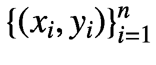
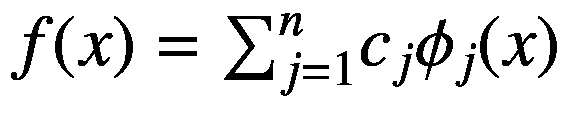
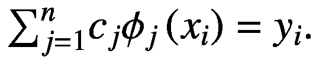
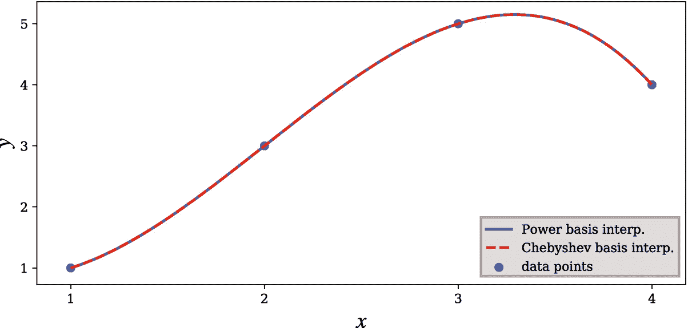
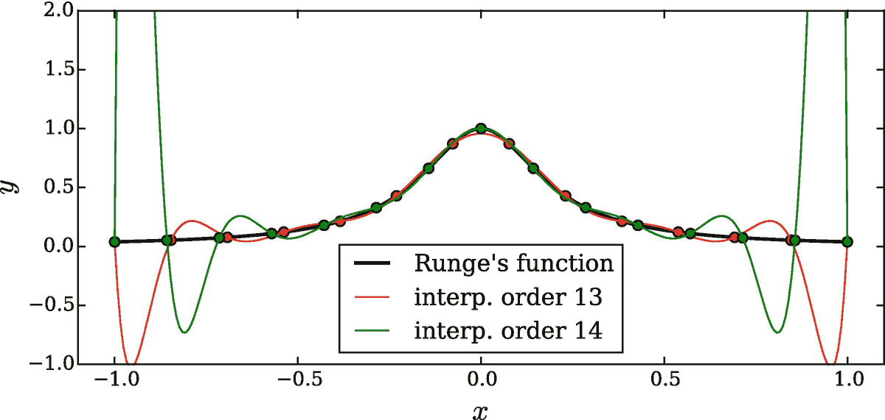
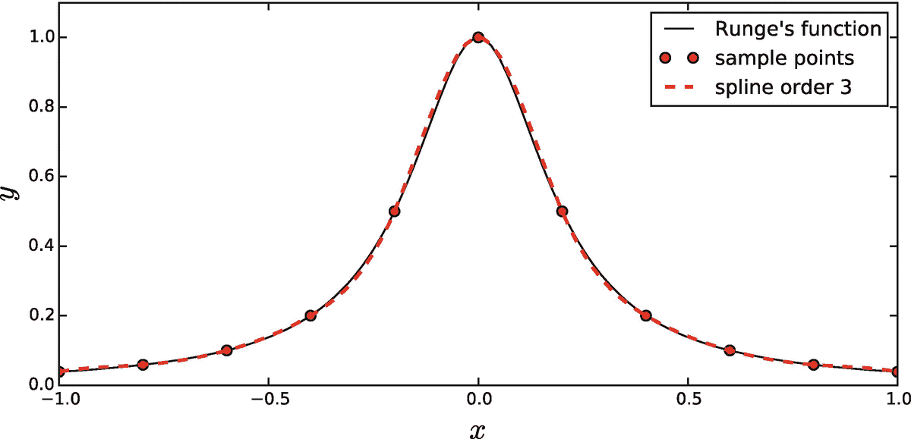
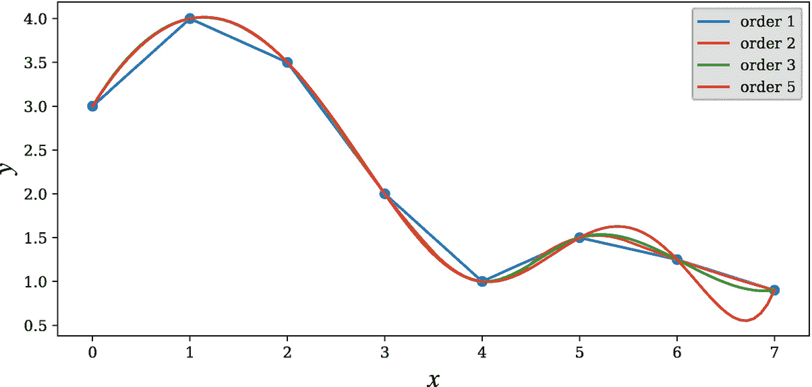
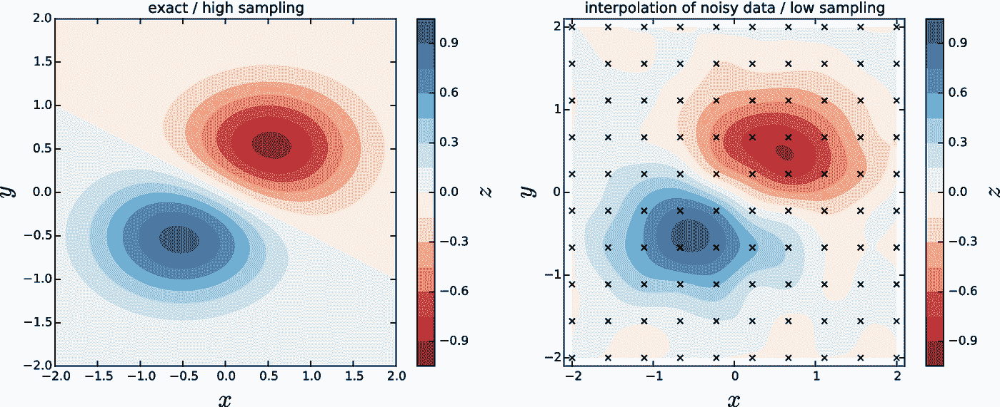
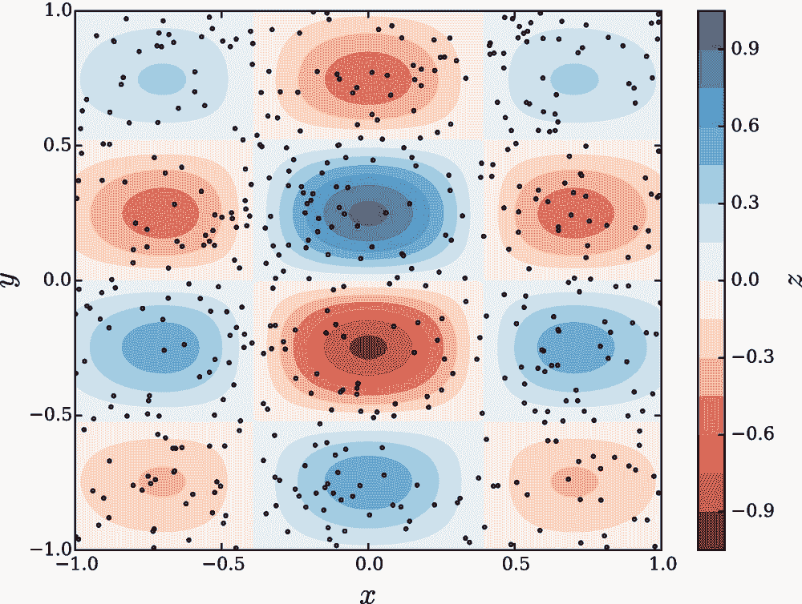
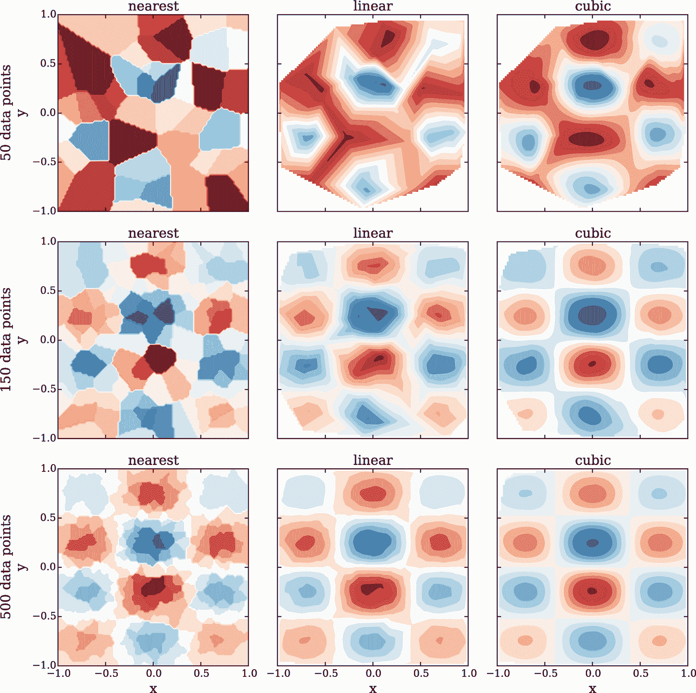

# 7. 插值

插值是一种数学方法，用于根据一组离散数据点构建函数。插值函数（或称插值器）必须与给定的数据点完全吻合，并且还能在采样范围内的其他中间输入值处进行计算。插值有许多应用：一个能提供直观理解的典型用例是通过一组给定的数据点绘制平滑曲线。另一个用途是近似复杂的函数，例如，这些函数的求值可能在计算上非常耗时。在这种情况下，可以仅在有限数量的点上计算原始函数，然后在中间点的求值过程中使用插值来近似该函数。

插值乍一看可能很像我们已经在第五章（线性最小二乘）和第六章（非线性最小二乘）中看到的最小二乘拟合。确实，插值与使用最小二乘方法进行曲线拟合之间有许多相似之处，但区分这两种方法也存在重要的概念性差异：在最小二乘拟合中，我们关注的是以最小化平方误差和的方式，利用大量数据点和一个超定方程组来近似拟合一个函数。另一方面，在插值中，我们要求一个函数与给定的数据点完全吻合，并且使用的数据点数量恰好等于插值函数中的自由参数数量。因此，最小二乘拟合更适合将大量数据点拟合到一个模型函数，而插值是一种数学工具，用于为给定的最少数据点创建一个函数表示。事实上，插值是许多数学方法中的重要组成部分，包括我们在第五、六章中使用的一些方程求解和优化方法。

外推是与插值相关的概念。它指的是在采样范围之外评估估计函数，而插值仅指在给定数据点所涵盖的范围内评估函数。外推通常比插值风险更大，因为它涉及在未被采样的区域内估计函数。这里我们只关注插值。要在 Python 中执行插值，我们使用 NumPy 的 `polynomial` 模块和 SciPy 的 `interpolate` 模块。

## 导入模块

这里我们继续采用显式导入 SciPy 库子模块的惯例。在本章中，我们需要 SciPy 的 `interpolate` 模块，以及 NumPy 的 `polynomial` 模块，后者提供了多项式的函数和类。我们按如下方式导入这些模块：

```
In [1]: from scipy import interpolate
In [2]: from numpy import polynomial as P
```

此外，我们还需要 NumPy 库的其他部分、SciPy 的线性代数模块 `linalg`，以及用于绘图的 Matplotlib 库：

```
In [3]: import numpy as np
In [4]: from scipy import linalg
In [5]: import matplotlib.pyplot as plt
```

## 插值

在我们深入探讨如何使用 NumPy 和 SciPy 执行插值的细节之前，我们首先用数学形式阐述插值问题。为简洁起见，这里我们只考虑一维插值，它可以表述如下：对于给定的一组 *n* 个数据点 ，找到一个函数 *f* (*x*)，使得对于 *i* ∈ [1, *n*]，有 *f* (*x*[*i*]) = *y*[*i*]。函数 *f*(x) 被称为插值器，并且它并非唯一。事实上，满足插值条件的函数有无限多个。通常，我们可以将插值器写成一些基函数 *ϕ**j* 的线性组合，即 ，其中 *c*[*j*] 是未知系数。将给定的数据点代入此线性组合，会得到一个关于未知系数的线性方程组： 这个方程组可以写成显式的矩阵形式：

![$$ \left[\begin{array}{cccc}{\phi}_1\left({x}_1\right)&amp; {\phi}_2\left({x}_1\right)&amp; \cdots &amp; {\phi}_n\left({x}_1\right)\\ {}{\phi}_1\left({x}_2\right)&amp; {\phi}_2\left({x}_2\right)&amp; \cdots &amp; {\phi}_n\left({x}_2\right)\\ {}\vdots &amp; \vdots &amp; \ddots &amp; \vdots \\ {}{\phi}_1\left({x}_n\right)&amp; {\phi}_2\left({x}_n\right)&amp; \cdots &amp; {\phi}_n\left({x}_n\right)\end{array}\right]\left[\begin{array}{c}{c}_1\\ {}{c}_2\\ {}\vdots \\ {}{c}_n\end{array}\right]=\left[\begin{array}{c}{y}_1\\ {}{y}_2\\ {}\vdots \\ {}{y}_n\end{array}\right], $$](images/332789_2_En_7_Chapter/332789_2_En_7_Chapter_TeX_Equa.png)

或者用更紧凑的隐式矩阵形式表示为 Φ(*x*)*c* = *y*，其中矩阵 Φ(*x*) 的元素为 {Φ(*x*)}[*ij*] = *ϕ**j*。请注意，这里基函数的数量等于数据点的数量，因此 Φ(*x*) 是一个方阵。假设该矩阵满秩，我们可以使用第五章讨论的标准方法求解唯一的 *c* 向量。如果数据点的数量大于基函数的数量，那么系统是超定的，并且通常不存在满足插值条件的解。相反，在这种情况下，考虑最小二乘拟合比精确插值更合适；参见第五章。

基函数的选择会影响所得方程组的性质，合适的基函数选择取决于被拟合数据的属性。插值常用的基函数包括各类多项式，例如，幂基 *ϕ**i* = *x*^(*i* − 1)，或正交多项式，如勒让德多项式 *ϕ**i* = *P**i* − 1，切比雪夫多项式 *ϕ**i* = *T**i* − 1，或分段多项式。请注意，一般来说，*f* (*x*) 并非唯一，但对于 *n* 个数据点，无论使用哪种多项式基，都存在一个唯一的 *n* − 1 阶插值多项式。对于幂基 *ϕ**i* = *x*^(*i* − 1)，矩阵 Φ(*x*) 是范德蒙德矩阵，我们在第五章的最小二乘拟合中已经看到过它的应用。对于其他多项式基，Φ(*x*) 是广义范德蒙德矩阵，每个基定义了插值问题中需要求解的线性方程组的矩阵。Φ(*x*) 矩阵的结构因不同的多项式基而异，其条件数和求解插值问题的计算代价也相应变化。因此，多项式在插值中扮演着重要角色，在开始解决插值问题之前，我们需要一种在 Python 中处理多项式的便捷方法。这是下一节的主题。

## 多项式

NumPy 库包含子模块 `polynomial`（此处导入为 `P`），它提供了用于处理多项式的函数和类。特别地，它提供了许多标准正交多项式的实现。这些函数和类在处理插值时非常有用，因此我们在研究多项式插值之前，先回顾如何使用这个模块。


### 注意

在 NumPy 中，用于处理多项式的模块有两个：`numpy.poly1d` 和 `numpy.polynomial`。这两个模块在功能上有大量重叠，但它们彼此之间并不兼容（具体来说，坐标数组在这两种表示中的顺序是相反的）。`numpy.poly1d` 模块比较旧，已被 `numpy.polynomial` 取代，现在推荐在新代码中使用后者。这里我们仅关注 `numpy.polynomial`，但了解一下 `numpy.poly1d` 也是值得的。

`np.polynomial` 模块包含多个类，用于在不同的多项式基下表示多项式。标准的、以通常的幂基 {*x*^(*i*)} 书写的多项式，使用 `Polynomial` 类来表示。要创建该类的实例，我们可以将一个系数数组传递给其构造函数。在系数数组中，第 *i* 个元素是 *x*^(*i*) 的系数。例如，我们可以通过将列表 `[1, 2, 3]` 传递给 `Polynomial` 类来创建多项式 1+2*x*+3*x*² 的表示：

```
In [6]: p1 = P.Polynomial([1, 2, 3])
In [7]: p1
Out[7]: Polynomial([ 1.,  2.,  3.], domain=[-1,  1], window=[-1,  1])
```

或者，我们也可以使用类方法 `P.Polynomial.fromroots` 通过指定其根来初始化一个多项式。例如，根在 *x* = −1 和 *x* = 1 的多项式可以这样创建：

```
In [8]: p2 = P.Polynomial.fromroots([-1, 1])
In [9]: p2
Out[9]: Polynomial([-1.,  0.,  1.], domain=[-1.,  1.], window=[-1.,  1.])
```

这里，结果是系数数组为 `[-1, 0, 1]` 的多项式，对应于 −1+*x*²。可以使用 `roots` 方法计算多项式的根。例如，前面创建的两个多项式的根为：

```
In [10]: p1.roots()
Out[10]: array([-0.33333333-0.47140452j, -0.33333333+0.47140452j])
In [11]: p2.roots()
Out[11]: array([-1.,  1.])
```

正如预期的那样，多项式 `p2` 的根是 *x* = −1 和 *x* = 1，这与使用 `fromroots` 类方法创建它时指定的根一致。

在前面的例子中，多项式的表示形式为 `Polynomial([-1., 0., 1.], domain=[-1., 1.], window=[-1., 1.])`。该表示中的第一个列表是系数数组。第二个和第三个列表是 `domain` 和 `window` 属性，它们可用于将多项式的输入域映射到另一个区间。具体来说，输入域区间 `[domain[0], domain[1]]` 将通过一个线性变换（缩放和平移）映射到区间 `[window[0], window[1]]`。默认值是 `domain=[-1, 1]` 和 `window=[-1, 1]`，这对应于恒等变换（无变化）。当处理相对于定义在特定区间上的标量积正交的多项式时，`domain` 和 `window` 参数特别有用。此时，将输入数据的域映射到这个区间是很有必要的。在使用正交多项式（如切比雪夫多项式或埃尔米特多项式）进行插值时，这一点很重要，因为执行此变换可以极大地改善插值问题中范德蒙德矩阵的条件数。

可以使用 `coef`、`domain` 和 `window` 属性直接访问 `Polynomial` 实例的属性。例如，对于前面例子中定义的 `p1` 多项式，我们有：

```
In [12]: p1.coef
Out[12]: array([ 1.,  2.,  3.])
In [13]: p1.domain
Out[13]: array([-1,  1])
In [14]: p1.window
Out[14]: array([-1,  1])
```

表示成 `Polynomial` 实例的多项式可以轻松地在任意的 *x* 值处求值，只需像调用函数一样调用该类实例即可。*x* 变量可以指定为标量、列表或任意 NumPy 数组。例如，要在点 *x* = {1.5, 2.5, 3.5} 处计算多项式 `p1` 的值，我们只需用一个包含 *x* 值的数组作为参数来调用 `p1` 类实例：

```
In [15]: p1(np.array([1.5, 2.5, 3.5]))
Out[15]: array([ 10.75,  24.75,  44.75])
```

可以使用标准算术运算符 `+`、`-`、`*`、`/` 等对 `Polynomial` 的实例进行运算。`//` 运算符用于多项式除法。要了解其工作原理，考虑多项式 *p*1 = (*x* − 3)(*x* − 2)(*x* − 1) 除以多项式 *p*2 = (*x* − 2)。这个结果，当以因式分解形式写出时是显而易见的，即 (*x* − 3)(*x* − 1)。我们可以通过以下方式使用 NumPy 计算并验证它：首先为 `p1` 和 `p2` 创建 `Polynomial` 实例，然后使用 `//` 运算符计算多项式除法。

```
In [16]: p1 = P.Polynomial.fromroots([1, 2, 3])
In [17]: p1
Out[17]: Polynomial([ -6.,  11.,  -6.,   1.], domain=[-1.,  1.], window=[-1.,  1.])
In [18]: p2 = P.Polynomial.fromroots([2])
In [19]: p2
Out[19]: Polynomial([-2.,  1.], domain=[-1.,  1.], window=[-1.,  1.])
In [20]: p3 = p1 // p2
In [21]: p3
Out[21]: Polynomial([ 3., -4.,  1.], domain=[-1.,  1.], window=[-1.,  1.])
```

结果是一个系数数组为 `[3, -4, 1]` 的新多项式，如果我们计算它的根，会发现它们是 1 和 3，所以这个多项式确实是 (*x* − 3)(*x* − 1)：

```
In [22]: p3.roots()
Out[22]: array([ 1.,  3.])
```

除了用于标准幂基多项式的 `Polynomial` 类之外，`polynomial` 模块还包含用于表示切比雪夫、勒让德、拉盖尔和埃尔米特基下多项式的类，它们的名称分别是 `Chebyshev`、`Legendre`、`Laguerre`、`Hermite`（物理学家版本）和 `HermiteE`（概率学家版本）。例如，系数列表为 `[1, 2, 3]` 的切比雪夫多项式，即多项式 1*T*0+2*T*1+3*T*2，其中 *T**i* 是 *i* 阶切比雪夫多项式，可以这样创建：

```
In [23]: c1 = P.Chebyshev([1, 2, 3])
In [24]: c1
Out[24]: Chebyshev([ 1.,  2.,  3.], domain=[-1,  1], window=[-1,  1])
```

并且可以使用 `roots` 属性计算其根：

```
In [25]: c1.roots()
Out[25]: array([-0.76759188,  0.43425855])
```

所有多项式类都具有与上面讨论的 `Polynomial` 类相同的方法、属性和运算符，并且使用方法相同。例如，要创建根在 *x* = −1 和 *x* = 1 的多项式的切比雪夫和勒让德表示，我们可以使用 `fromroots` 属性，方式与我们之前使用 `Polynomial` 类时相同：

```
In [26]: c1 = P.Chebyshev.fromroots([-1, 1])
In [27]: c1
Out[27]: Chebyshev([-0.5,  0. ,  0.5], domain=[-1.,  1.], window=[-1.,  1.])
In [28]: l1 = P.Legendre.fromroots([-1, 1])
In [29]: l1
Out[29]: Legendre([-0.66666667,  0.   ,  0.66666667], domain=[-1.,  1.], window=[-1.,  1.])
```

注意，同一个多项式（此处根在 *x* = −1 和 *x* = 1，这是唯一的多项式）在不同的基下表示时具有不同的系数数组，但在特定的 *x* 值处求值时，两者给出相同的结果（正如预期）：

```
In [30]: c1(np.array([0.5, 1.5, 2.5]))
Out[30]: array([-0.75,  1.25,  5.25])
In [31]: l1(np.array([0.5, 1.5, 2.5]))
Out[31]: array([-0.75,  1.25,  5.25])
```


## 多项式插值

上一节讨论的多项式类都提供了用于多项式插值的有用函数。例如，回顾多项式插值问题的线性方程：`Φ(x)c = y`，其中 `x` 和 `y` 是包含数据点 `x[i]` 和 `y[i]` 的向量，`c` 是未知的系数向量。要解决插值问题，我们需要先针对给定基函数计算矩阵 `Φ(x)`，然后求解所得线性方程组。

`polynomial` 中的每个多项式类都提供了相应的函数，用于计算对应基函数的（广义）范德蒙德矩阵。例如，对于幂基多项式，我们可以使用 `np.polynomial.polynomial.polyvander`；对于切比雪夫基多项式，我们可以使用对应的 `np.polynomial.chebyshev.chebvander` 函数；以此类推。有关不同多项式基函数的广义范德蒙德矩阵函数的完整列表，请参阅 `np.polynomial` 及其子模块的文档字符串。

利用上述生成范德蒙德矩阵的函数，我们可以轻松地在不同基函数下执行多项式插值。例如，考虑数据点 (1, 1)、(2, 3)、(3, 5) 和 (4, 4)。我们首先为数据点的 `x` 和 `y` 坐标创建 NumPy 数组。

```
In [32]: x = np.array([1, 2, 3, 4])
In [33]: y = np.array([1, 3, 5, 4])
```

要插值一个通过这些点的多项式，我们需要使用一个三次多项式（数据点数减一）。对于幂基插值，我们寻找系数 `c[i]`，使得 `f(x) = Σᵢ₌₁⁴ cᵢ xⁱ⁻¹ = c₁x⁰ + c₂x¹ + c₃x² + c₄x³`。为了找到这个系数，我们计算范德蒙德矩阵并求解插值方程组：

```
In [34]: deg = len(x) - 1
In [35]: A = P.polynomial.polyvander(x, deg)
In [36]: c = linalg.solve(A, y)
In [37]: c
Out[37]: array([ 2\. , -3.5,  3\. , -0.5])
```

所求的系数向量是 [2, -3.5, 3, -0.5]，因此插值多项式为 `f(x) = 2 − 3.5x + 3x² − 0.5x³`。有了系数数组 `c`，我们现在可以创建一个可用于插值的多项式表示对象：

```
In [38]: f1 = P.Polynomial(c)
In [39]: f1(2.5)
Out[39]: 4.1875
```

要在另一个多项式基函数下执行此多项式插值，我们只需要更改上一个例子中用于生成范德蒙德矩阵 `A` 的函数名称。例如，要使用切比雪夫基多项式进行插值，可以这样做：

```
In [40]: A = P.chebyshev.chebvander(x, deg)
In [41]: c = linalg.solve(A, y)
In [42]: c
Out[42]: array([ 3.5  , -3.875,  1.5  , -0.125])
```

正如预期，在此基函数下系数数组的值不同，切比雪夫基下的插值多项式为 `f(x) = 3.5T₀(x) − 3.875T₁(x) + 1.5T₂(x) − 0.125T₃(x)`。然而，无论使用哪种多项式基函数，插值多项式都是唯一的，计算插值结果总会得到相同的值：

```
In [43]: f2 = P.Chebyshev(c)
In [44]: f2(2.5)
Out[44]: 4.1875
```

我们可以将 `f1` 和 `f2` 与数据点一起绘制出来，证明这两种基函数的插值确实得到了相同的插值函数（见图 7-1）：



*图 7-1* - 使用幂基和切比雪夫基对四个数据点进行多项式插值

```
In [45]: xx = np.linspace(x.min(), x.max(), 100)  # 对 [x[0], x[-1]] 区间进行超采样
In [45]: fig, ax = plt.subplots(1, 1, figsize=(12, 4))
...: ax.plot(xx, f1(xx), 'b', lw=2, label='幂基插值')
...: ax.plot(xx, f2(xx), 'r--', lw=2, label='切比雪夫基插值')
...: ax.scatter(x, y, label='数据点')
...: ax.legend(loc=4)
...: ax.set_xticks(x)
...: ax.set_ylabel(r"$y$", fontsize=18)
...: ax.set_xlabel(r"$x$", fontsize=18)
```

虽然利用广义范德蒙德矩阵的函数在不同多项式基函数下进行插值很方便，但还有一种更简单、更好的方法。每个多项式类都提供了一个类方法 `fit`，可用于计算插值多项式。前一个例子中手动计算的两个插值函数，因此也可以通过以下方式计算：使用幂基及其 `Polynomial` 类，我们得到：

```
In [46]: f1b = P.Polynomial.fit(x, y, deg)
In [47]: f1b
Out[47]: Polynomial([ 4.1875,  3.1875, -1.6875, -1.6875], domain=[ 1.,  4.], window=[-1.,  1.])
```

而改用 `Chebyshev` 类的类方法 `fit`，我们得到：

```
In [48]: f2b = P.Chebyshev.fit(x, y, deg)
In [49]: f2b
Out[49]: Chebyshev([ 3.34375 ,  1.921875, -0.84375 , -0.421875], domain=[ 1.,  4.], window=[-1.,  1.])
```

请注意，使用这种方法，结果实例的 `domain` 属性会自动设置为数据点适当的 `x` 值（在本例中，输入范围是 [1, 4]），并且系数会相应调整。如前所述，将插值数据映射到特定基函数最合适的范围，可以显著提高插值的数值稳定性。例如，使用切比雪夫基时，将 `x` 值缩放至 `x ∈ [−1, 1]`，而不是前一个例子中原始的 `x` 值，可以将条件数从近 4660 降低到约 1.85：

```
In [50]: np.linalg.cond(P.chebyshev.chebvander(x, deg))
Out[50]: 4659.7384241399586
In [51]: np.linalg.cond(P.chebyshev.chebvander((2*x-5)/3.0, deg))
Out[51]: 1.8542033440472896
```

对少量数据点进行多项式插值是一种强大且有用的数学工具，是许多数学方法的重要组成部分。当数据点数量增加时，我们需要使用越来越高阶的多项式来进行精确插值，这会在多个方面带来问题。首先，随着多项式阶数的增加，确定和计算插值函数的要求越来越高。然而，更严重的问题是，高阶多项式插值可能在插值点之间表现出不良行为。尽管在给定的数据点上插值是精确的，但高阶多项式在指定点之间可能会剧烈波动。对龙格函数 `f(x) = 1/(1 + 25x²)` 使用区间 [−1, 1] 内均匀分布的采样点进行多项式插值，就著名地说明了这一点。其结果是在区间端点附近，插值函数在数据点之间几乎发散。

为了说明这种行为，我们创建一个 Python 函数 `runge` 来实现龙格函数，以及一个函数 `runge_interpolate`，在均匀分布的采样点上，使用幂基对龙格函数进行 `n` 阶多项式插值：

```
In [52]: def runge(x):
...:     return 1/(1 + 25 * x**2)
In [53]: def runge_interpolate(n):
...:     x = np.linspace(-1, 1, n + 1)
...:     p = P.Polynomial.fit(x, runge(x), deg=n)
...:     return x, p
```

接下来，我们在 [−1, 1] 区间内超采样的 `x` 值上，绘制龙格函数以及 13 阶和 14 阶多项式插值的图形。生成的图如图 7-2 所示。



*图 7-2*


龙格函数及其两个高阶多项式插值

```
In [54]: xx = np.linspace(-1, 1, 250)
In [55]: fig, ax = plt.subplots(1, 1, figsize=(8, 4))
...: ax.plot(xx, runge(xx), 'k', lw=2, label="Runge's function")
...: # 龙格函数的 13 阶插值
...: n = 13
...: x, p = runge_interpolate(n)
...: ax.plot(x, runge(x), 'ro')
...: ax.plot(xx, p(xx), 'r', label='interp. order %d' % n)
...: # 龙格函数的 14 阶插值
...: n = 14
...: x, p = runge_interpolate(n)
...: ax.plot(x, runge(x), 'go')
...: ax.plot(xx, p(xx), 'g', label='interp. order %d' % n)
...:
...: ax.legend(loc=8)
...: ax.set_xlim(-1.1, 1.1)
...: ax.set_ylim(-1, 2)
...: ax.set_xticks([-1, -0.5, 0, 0.5, 1])
...: ax.set_ylabel(r"$y$", fontsize=18)
...: ax.set_xlabel(r"$x$", fontsize=18)
```

我们注意到，在图 7-2 中，插值函数在采样点处与龙格函数完全吻合，但在这些点之间，它们在区间端点附近会出现剧烈振荡。这是插值函数的一个不良特性，违背了插值的目的。解决此问题的方法是，当插值涉及大量数据点时，使用分段低次多项式。换句话说，不是将所有数据点拟合成一个单一的高次多项式，而是对每两个相邻数据点之间的子区间，分别使用不同的低次多项式进行描述。这正是下一节的主题。

## 样条插值

对于一组 *n* 个数据点 {*x*[*i*], *y*[*i*]}，在数据的整个区间 [*x*[0], *x*[*n* − 1]] 内，共有 *n* − 1 个子区间 [*x*[*i*], *x*[*i*+1]]。在分段多项式插值的术语中，连接两个此类子区间的内部数据点被称为*节点*。为了在每一个子区间上使用 *k* 次分段多项式来插值这 *n* 个数据点，我们必须确定 (*k*+1)(*n* − 1) 个未知参数。节点处的函数值提供了 2(*n* − 1) 个方程。这些方程本身仅足以确定一个一次分段多项式，即分段线性函数。然而，通过要求节点处的导数以及高阶导数也是连续的，可以获取额外的方程。这个条件确保了最终得到的分段多项式具有平滑的外观。

样条是一种特殊类型的分段多项式插值函数：如果一个 *k* 次分段多项式具有直到 *k* − 1 阶的连续可导性，那么它就是一个样条。最受欢迎的选择是三次样条，即 *k* = 3，这需要 4(*n* − 1) 个参数。在这种情况下，在 *n* − 2 个节点处保证两个导数的连续性提供了 2(*n* − 2) 个额外的方程，使得总方程数达到 2(*n* − 1)+2(*n* − 2) = 4(*n* − 1) − 2。因此，存在两个待定的参数，需要通过其他方式确定。一种常见的方法是额外要求端点处的二阶导数为零（从而得到*自然*样条）。这又提供了两个方程，从而封闭了整个方程组。

SciPy 的 `interpolate` 模块提供了几个用于执行样条插值的函数和类。例如，我们可以使用 `interpolate.interp1d` 函数，该函数将数据点的 *x* 和 *y* 数组作为第一和第二个参数。可选的 `kind` 关键字参数可用于指定插值的类型和阶数。特别地，我们可以设置 `kind=3`（或者等同于 `kind='cubic'`）来计算三次样条。该函数返回一个类实例，这个实例可以像函数一样被调用，并且可以通过函数调用对不同 *x* 值进行求值。另一个替代的样条函数是 `interpolate.InterpolatedUnivariateSpline`，它同样将 *x* 和 *y* 数组作为第一和第二个参数，但它使用关键字参数 `k`（而不是 `kind`）来指定样条插值的阶数。

为了了解如何使用 `interpolate.interp1d` 函数，让我们再次考虑龙格函数，现在我们想用三次样条多项式来插值这个函数。为此，我们首先为采样点的 *x* 和 *y* 坐标创建 NumPy 数组。接着，我们使用 `kind=3` 调用 `interpolate.interp1d` 函数，以获得给定数据的三次样条：

```
In [56]: x = np.linspace(-1, 1, 11)
In [57]: y = runge(x)
In [58]: f_i = interpolate.interp1d(x, y, kind=3)
```

为了评估这次样条插值（这里由类实例 `f_i` 表示）的效果，我们将插值函数与原始的龙格函数和采样点绘制在一起。结果如图 7-3 所示。



图 7-3

使用 11 个数据点进行三次样条插值的龙格函数

```
In [59]: xx = np.linspace(-1, 1, 100)
In [60]: fig, ax = plt.subplots(figsize=(8, 4))
...: ax.plot(xx, runge(xx), 'k', lw=1, label="Runge's function")
...: ax.plot(x, y, 'ro', label='sample points')
...: ax.plot(xx, f_i(xx), 'r--', lw=2, label='spline order 3')
...: ax.legend()
...: ax.set_xticks([-1, -0.5, 0, 0.5, 1])
...: ax.set_ylabel(r"$y$", fontsize=18)
...: ax.set_xlabel(r"$x$", fontsize=18)
```

这里我们使用了 11 个数据点和一个三次样条。我们注意到，在图 7-3 中，插值函数与原始函数吻合得非常好。通常，三次或更低阶的样条插值不会遭受我们在高次多项式插值中观察到的同类振荡问题，并且只要我们拥有足够数量的数据点，使用三次样条通常就足够了。

为了说明样条插值阶次的影响，考虑使用递增阶次的样条对数据点 (0, 3), (1, 4), (2, 3.5), (3, 2), (4, 1), (5, 1.5), (6, 1.25) 和 (7, 0.9) 进行插值的问题。我们首先定义 `x` 和 `y` 数组，然后遍历所需的样条阶数，为每个阶数计算插值并绘制出来：



图 7-4

不同阶次的样条插值

```
In [61]: x = np.array([0, 1, 2, 3, 4, 5, 6, 7])
In [62]: y = np.array([3, 4, 3.5, 2, 1, 1.5, 1.25, 0.9])
In [63]: xx = np.linspace(x.min(), x.max(), 100)
In [64]: fig, ax = plt.subplots(figsize=(8, 4))
...: ax.scatter(x, y)
...:
...: for n in [1, 2, 3, 5]:
...:     f = interpolate.interp1d(x, y, kind=n)
...:     ax.plot(xx, f(xx), label='order %d' % n)
...:
...: ax.legend()
...: ax.set_ylabel(r"$y$", fontsize=18)
...: ax.set_xlabel(r"$x$", fontsize=18)
```

从图 7-4 所示的样条插值可以清楚地看到，二阶或三阶样条已经提供了相当好的插值效果，原始函数与插值函数之间的误差相对较小。对于高阶样条，我们曾在高次多项式插值中遇到的问题会再次出现。因此，在实践中，使用三次样条插值通常是合适的。


## 多元插值

多项式插值和样条插值可以直接推广到多元情形。与一元情况类似，我们需要寻找一个函数，它在一组指定点上的值是已知的，并且可以在采样范围内的中间点上求值。`SciPy`提供了几个用于多元插值的函数和类。在接下来的两个示例中，我们将分别探讨二元插值中两个最实用的函数：`interpolate.interp2d` 和 `interpolate.griddata`。关于其他插值选项的更多信息，请参阅`interpolate`模块的文档字符串及其参考手册。

我们首先来了解 `interpolate.interp2d`，它是我们之前使用的 `interp1d` 函数的直接推广。该函数将可用数据点的 *x* 和 *y* 坐标分别作为一维数组，紧接着是一个二维数组，该数组对应 *x* 和 *y* 坐标每种组合下的函数值。这要求数据点位于一个由 *x* 和 *y* 坐标构成的规则且均匀的网格上。

为了说明如何使用`interp2d`函数，我们通过向一个已知函数添加随机噪声来模拟有噪声的测量值。在下面的示例中，该已知函数为 *f*(*x*, *y*) = exp(−(*x*+1/2)² − 2(*y*+1/2)²) − exp(−(*x* − 1/2)² − 2(*y* − 1/2)²)。为了构成一个插值问题，我们在 *x* 和 *y* 坐标的[−2, 2]区间内，以 10 个点对该函数进行采样，然后向精确值添加一个微小的正态分布噪声。我们首先为样本点的 *x* 和 *y* 坐标创建 NumPy 数组，并定义一个 Python 函数来表示 *f*(*x*, *y*)：

```
In [65]: x = y = np.linspace(-2, 2, 10)
In [66]: def f(x, y):
...:     return np.exp(-(x + .5)**2 - 2*(y + .5)**2) - np.exp(-(x - .5)**2 - 2*(y - .5)**2)
```

接下来，我们在样本点处计算函数值，并添加随机噪声以模拟不确定的测量值：

```
In [67]: X, Y = np.meshgrid(x, y)
In [68]: # 模拟固定网格点 X, Y 处的噪声数据
...: Z = f(X, Y) + 0.05 * np.random.randn(*X.shape)
```

至此，我们得到了一个包含噪声数据的矩阵`Z`，它与精确已知且规则间隔的坐标 *x* 和 *y* 相关联。为了得到一个可以在采样范围内对中间 *x* 和 *y* 值求值的插值函数，我们现在可以使用`interp2d`函数：

```
In [69]: f_i = interpolate.interp2d(x, y, Z, kind="cubic")
```

注意，这里的`x`和`y`是一维数组（长度为 10），而`Z`是一个形状为(10, 10)的二维数组。`interp2d`函数返回一个类实例，此处为`f_i`，其行为类似于一个函数，我们可以在任意 *x* 和 *y* 坐标（在采样范围内）处对其进行求值。因此，可以通过以下方式，利用插值函数对原始数据进行超采样：

```
In [70]: xx = yy = np.linspace(x.min(), x.max(), 100)
In [71]: ZZi = f_i(xx, yy)
In [72]: XX, YY = np.meshgrid(xx, yy)
```

这里，`XX`和`YY`是超采样点的坐标矩阵，相应的插值结果为`ZZi`。例如，这些结果可用于绘制描述稀疏且有噪声数据的平滑函数。以下代码绘制了原始函数和插值数据的等高线图。生成的等高线图见图 7-5。



图 7-5

精确函数（左图）与来自规则网格上噪声样本的二元三次样条插值（右图，十字标记处为样本点）的等高线图。

```
In [73]: fig, axes = plt.subplots(1, 2, figsize=(12, 5))
...: # 用于参考，首先绘制精确函数的等高线
...: c = axes[0].contourf(XX, YY, f(XX, YY), 15, cmap=plt.cm.RdBu)
...: axes[0].set_xlabel(r"$x$", fontsize=20)
...: axes[0].set_ylabel(r"$y$", fontsize=20)
...: axes[0].set_title("精确 / 高采样")
...: cb = fig.colorbar(c, ax=axes[0])
...: cb.set_label(r"$z$", fontsize=20)
...: # 接着，绘制噪声数据超采样插值的等高线
...: c = axes[1].contourf(XX, YY, ZZi, 15, cmap=plt.cm.RdBu)
...: axes[1].set_ylim(-2.1, 2.1)
...: axes[1].set_xlim(-2.1, 2.1)
...: axes[1].set_xlabel(r"$x$", fontsize=20)
...: axes[1].set_ylabel(r"$y$", fontsize=20)
...: axes[1].scatter(X, Y, marker="x", color="k")
...: axes[1].set_title("噪声数据的插值 / 低采样")
...: cb = fig.colorbar(c, ax=axes[1])
...: cb.set_label(r"$z$", fontsize=20)
```

对于相对稀疏的数据点，我们可以通过使用 `interpolate.interp2d` 计算二元三次样条插值，来构建潜在函数的一个近似。这给出了潜在函数的一个平滑近似，当处理来自测量或计算（这些计算在时间或其他资源上成本高昂）的数据时，这一方法通常非常有用。对于更高维的问题，存在一个函数 `interpolate.interpnd`，它是面向 N 维问题的推广版本。

另一种需要多元插值的常见情况是，当采样数据位于不规则坐标网格上时。这种情况经常出现（例如，在实验或其他数据收集过程中），此时观测值收集到的精确坐标往往无法直接控制。为了能够利用现有工具轻松地对这类数据进行绘图和分析，我们可能希望将其插值到一个规则的坐标网格上。在 SciPy 中，我们可以使用 `interpolate.griddata` 来精确完成此任务。该函数的第一个参数是包含数据值 `zdata` 的一维坐标向量 `(xdata, ydata)` 元组，这些数据值以矩阵形式作为第三个参数传递给函数。第四个参数是坐标向量或坐标矩阵的元组 `(X, Y)`，用于指定需要计算插值结果的新点。我们还可以选择性地使用 `method` 关键字参数（`'nearest'`、`'linear'` 或 `'cubic'`）来设置插值方法：

```
In [74]: Zi = interpolate.griddata((xdata, ydata), zdata, (X, Y), method="cubic")
```

为了演示如何使用 `interpolate.griddata` 函数对非结构化坐标点上的数据进行插值，我们选取函数 *f*(*x*, *y*) = exp(−*x*² − *y*²) cos 4*x* sin 6*y*，并在 *x* 和 *y* 坐标的 [−1, 1] 区间内随机选择采样点。然后将得到的 {*x*[*i*], *y*[*i*], *z*[*i*]} 数据进行插值，并在覆盖 *x*, *y* ∈ [−1, 1] 区域的超采样规则网格上进行评估。为此，我们首先定义一个 Python 函数来表示 *f*(*x*, *y*)，然后生成随机采样数据：

```
In [75]: def f(x, y):
...:     return np.exp(-x**2 - y**2) * np.cos(4*x) * np.sin(6*y)
In [76]: N = 500
In [77]: xdata = np.random.uniform(-1, 1, N)
In [78]: ydata = np.random.uniform(-1, 1, N)
In [79]: zdata = f(xdata, ydata)
```

为了可视化函数和采样点的密度，我们绘制采样位置的散点图，并叠加 *f*(*x*, *y*) 的等高线图。结果如图 7-6 所示。



图 7-6

一个随机采样函数的精确等高线图。500 个采样点用黑点标记。


```python
In [80]: x = y = np.linspace(-1, 1, 100)
In [81]: X, Y = np.meshgrid(x, y)
In [82]: Z = f(X, Y)
In [83]: fig, ax = plt.subplots(figsize=(8, 6))
...: c = ax.contourf(X, Y, Z, 15, cmap=plt.cm.RdBu);
...: ax.scatter(xdata, ydata, marker='.')
...: ax.set_ylim(-1,1)
...: ax.set_xlim(-1,1)
...: ax.set_xlabel(r"$x$", fontsize=20)
...: ax.set_ylabel(r"$y$", fontsize=20)
...: cb = fig.colorbar(c, ax=ax)
...: cb.set_label(r"$z$", fontsize=20)
```

从图 7-6 的等高线图和散点图可以看出，随机选取的样本点很好地覆盖了感兴趣的坐标区域，因此通过插值数据来相对精确地重构函数 *f*(*x*, *y*) 似乎是可行的。这里，我们希望在以细粒度（超采样）规则网格（由 `X` 和 `Y` 坐标数组描述）上对数据进行插值。为了比较不同的插值方法以及增加样本点数量的效果，我们定义了函数 `z_interpolate`，该函数分别使用最近邻点、线性插值和三次样条插值对给定的数据点进行插值：

```python
In [84]: def z_interpolate(xdata, ydata, zdata):
...:     Zi_0 = interpolate.griddata((xdata, ydata), zdata, (X, Y), method="nearest")
...:     Zi_1 = interpolate.griddata((xdata, ydata), zdata, (X, Y), method="linear")
...:     Zi_3 = interpolate.griddata((xdata, ydata), zdata, (X, Y), method="cubic")
...:     return Zi_0, Zi_1, Zi_3
```

最后，我们针对三种不同的插值方法（分别应用于总样本点中的 50、150 和全部 500 个点这三个子集），绘制了插值数据的等高线图。结果如图 7-7 所示。



图 7-7

随机采样值的双变量插值，从左到右插值阶数递增，从上到下样本点数量递增

```python
In [85]: fig, axes = plt.subplots(3, 3, figsize=(12, 12), sharex=True, sharey=True)
...:
...: n_vec = [50, 150, 500]
...: for idx, n in enumerate(n_vec):
...:     Zi_0, Zi_1, Zi_3 = z_interpolate(xdata[:n], ydata[:n], zdata[:n])
...:     axes[idx, 0].contourf(X, Y, Zi_0, 15, cmap=plt.cm.RdBu)
...:     axes[idx, 0].set_ylabel("%d 个数据点\ny" % n, fontsize=16)
...:     axes[idx, 0].set_title("最近邻", fontsize=16)
...:     axes[idx, 1].contourf(X, Y, Zi_1, 15, cmap=plt.cm.RdBu)
...:     axes[idx, 1].set_title("线性", fontsize=16)
...:     axes[idx, 2].contourf(X, Y, Zi_3, 15, cmap=plt.cm.RdBu)
...:     axes[idx, 2].set_title("三次", fontsize=16)
...: for m in range(len(n_vec)):
...:     axes[idx, m].set_xlabel("x", fontsize=16)
```

图 7-7 显示，只要感兴趣区域被充分覆盖，就可以通过非结构化样本的插值来较好地重构函数。在本例中，并且在其他大多数情况下也同样明显，三次样条插值远优于最近邻和线性插值。尽管计算样条插值的计算量更大，但这通常是值得的。

## 总结

插值是一种基本的数学工具，在科学和技术计算中有着重要应用。特别是，插值是许多数学方法和算法的关键组成部分。它本身也是一种实用工具，在绘图或分析来自实验、观测或高计算量任务的数据时非常有用。`NumPy` 和 `SciPy` 库的结合为单变量或多变量数值插值方法提供了良好的支持。对于大多数涉及大量数据点的实际插值问题，三次样条插值是最有用的技术，尽管低阶多项式插值最常作为其他数值方法（如求根、优化、数值积分）中的工具使用。在本章中，我们探讨了如何使用 `NumPy` 的 `polynomial` 模块和 `SciPy` 的 `interpolate` 模块对给定数据集（包含一个或两个自变量）进行插值。掌握这些技术是计算科学家的重要技能，我鼓励大家通过研究该模块的文档字符串及其众多函数和类，进一步探索本章未涉及的 `scipy.interpolate` 中的内容。

## 延伸阅读

大多数数值方法教材中都涵盖了插值内容。如需更深入的理论介绍，可参考例如 J. Stoer (1992) 或 Hamming (1987) 的著作。

