# 8. 积分

本章我们将讨论积分的不同方面，主要关注数值积分。由于历史原因，数值积分也被称为求积。积分比其逆运算——微分要困难得多，虽然有许多积分可以解析计算，但通常我们不得不求助于数值方法。根据被积函数（被积分的函数）和积分限的性质，数值计算积分可能容易也可能困难。对于连续函数且积分限有限的情况，大多数情况下可以在一维中高效计算，但具有奇点的可积函数或无限积分限的积分则是难以数值处理的例子，即使是在一维情况下也是如此。二维积分（二重积分）和高阶积分可以通过重复的一维积分，或使用多维推广的一维积分求解技术进行计算。然而，计算复杂度会随着积分维数的增加而迅速增长，实际上，这些方法仅适用于低维积分，例如二重积分或三重积分。更高维度的积分通常需要完全不同的技术，例如蒙特卡洛采样算法。

除了计算定积分数值（结果为单个数值）之外，积分还有其它重要应用。例如，被积函数为未知量的方程称为积分方程，这类方程经常出现在科学和工程应用中。积分方程通常难以求解，但通过将积分离散化，通常可以将其转化为线性方程组。不过，我们在此不讨论这个主题，但在第 10 章中会看到此类问题的示例。积分的另一个重要应用是积分变换，这是一种在不同域之间转换函数和方程的技术。在本章末尾，我们简要讨论了如何使用 `SymPy` 计算一些积分变换，例如拉普拉斯变换和傅里叶变换。

要进行符号积分，我们可以使用 `SymPy`（如第 3 章所述）；而计算数值积分时，我们主要使用 `SciPy` 中的 `integrate` 模块。不过，`SymPy`（通过多精度库 `mpmath`）也提供了数值积分的例程，作为对 `SciPy` 的补充，例如提供任意精度的积分。在本章中，我们将探讨这两种选择，并讨论其优缺点。此外，我们还会简要介绍使用 `scikit-monaco` 库进行蒙特卡洛积分。


### Scikit-monaco

`Scikit-monaco` 是一个小巧且较新的库，它让蒙特卡洛积分变得便捷且易于使用。在撰写本文时，`scikit-monaco` 的最新版本是 0.2.1。更多信息请参见 [`http://scikit-monaco.readthedocs.org`](http://scikit-monaco.readthedocs.org)。

## 导入模块

在本章中，我们像往常一样需要 NumPy 和 Matplotlib 库提供基本的数值计算和绘图支持，除此之外，我们还将使用 SciPy 的 `integrate` 模块、SymPy 库以及任意精度数学库 `mpmath`。这里我们假定这些模块按如下方式导入：

```
In [1]: import numpy as np
In [2]: import matplotlib.pyplot as plt
...: import maplotlib as mpl
In [3]: from scipy import integrate
In [4]: import sympy
In [5]: import mpmath
```

此外，为了在 SymPy 中获得格式良好的输出，我们还需要设置其打印系统：

```
In [6]: sympy.init_printing()
```

## 数值积分方法

在此，我们关注如何计算形如 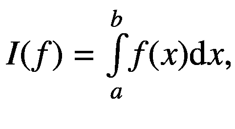 的定积分，其中积分限为 *a* 和 *b*。区间 [*a*, *b*] 可以是有限区间、半无限区间（此时 *a* = −∞ 或 *b* = ∞），或无限区间（此时 *a* = −∞ 且 *b* = ∞）。积分 *I*(*f*) 可以解释为被积函数 *f*(*x*) 曲线与 *x* 轴之间的面积，如图 8-1 所示。

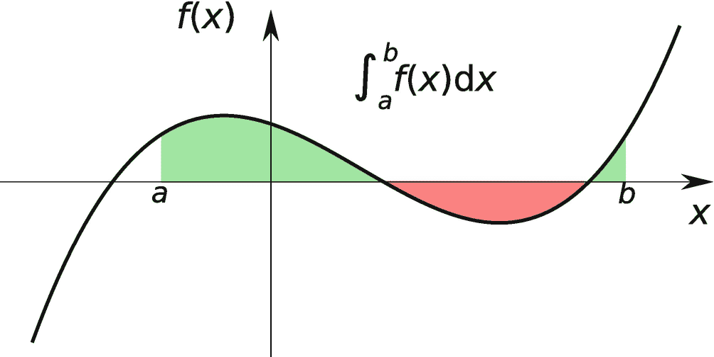

**图 8-1.** 积分可解释为被积函数曲线与 x 轴之间的面积，其中 *f*(*x*) > 0 的部分面积计为正（绿色/浅色），其余部分计为负（红色/深色）。

对于上述形式的积分 *I*(*f*)，进行数值求解的通用策略是将其写成一个离散求和的形式来近似积分值：

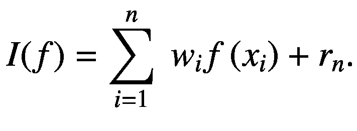

这里，*w*[*i*] 是在点 *x*[*i*] ∈ [*a*, *b*] 处对 *f* (*x*) 进行 *n* 次求值的权重，而 *r*[*n*] 是由近似产生的残差。在实践中，我们假设 *r*[*n*] 很小且可以忽略，但了解 *r*[*n*] 的估计值以判断积分近似的精度非常重要。*I*(*f*) 的这个求和公式被称为 *n* 点*求积法则*，而选择点的数量 *n*、这些点在区间 [*a*, *b*] 中的位置以及权重因子 *w*[*i*] 都会影响求积精度和计算复杂度。求积法则可以从 *f* (*x*) 在区间 [*a*, *b*] 上的插值推导得出。如果点 *x*[*i*] 在区间 [*a*, *b*] 上均匀分布，并且使用了多项式插值，那么所得求积法则称为*牛顿-柯特斯求积法则*。例如，使用中点的值 *x*[0] = (*a*+*b*)/2，用零阶多项式（常数值）近似 *f*(*x*)，我们得到

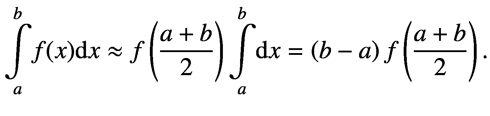

这就是所谓的*中点法则*，它能精确积分最高一阶的多项式（线性函数），因此被认为具有一阶多项式精度。用一阶多项式（端点处的函数值）近似 *f*(*x*)，则得出

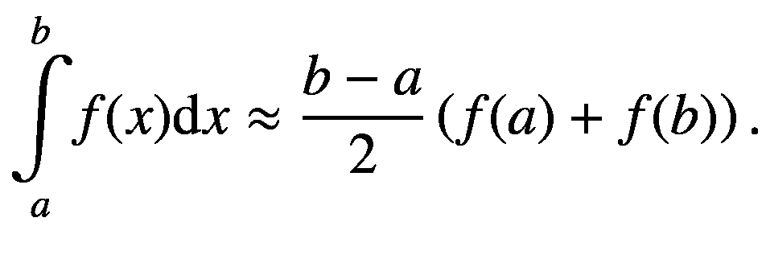

这就是所谓的*梯形法则*，它同样具有一阶多项式精度。使用二阶插值多项式则会产生*辛普森法则*，

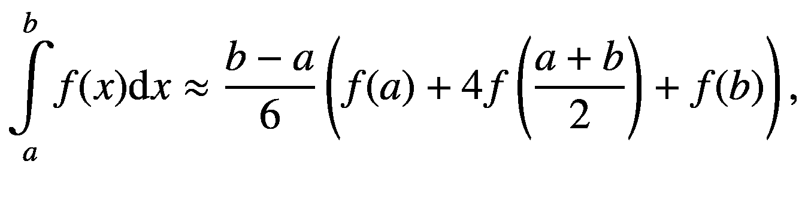

该法则使用了端点和中点的函数值。此方法具有三阶多项式精度，意味着它能精确积分最高三阶的多项式。使用 SymPy 可以轻松演示推导此公式的方法：首先，我们为变量 *a*、*b* 和 *x* 以及函数 *f* 定义符号。

```
In [7]: a, b, X = sympy.symbols("a, b, x")
In [8]: f = sympy.Function("f")
```

接下来，我们定义一个元组 `x`，它包含采样点（区间 [*a*, *b*] 的端点和中点），以及一个列表 `w`，其中包含对应于每个采样点的、将在求积法则中使用的权重因子。


```python
In [9]: x = a, (a+b)/2, b  # for Simpson's rule
In [10]: w = [sympy.symbols("w_%d" % i) for i in range(len(x))]
```

给定`x`和`w`，我们现在可以为该求积法则构造一个符号表达式：

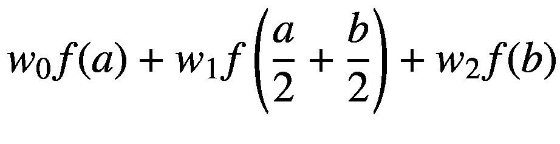

```python
In [11]: q_rule = sum([w[i] * f(x[i]) for i in range(len(x))])
In [12]: q_rule
Out[12]:
```

为了计算权重因子`w[i]`的适当值，我们选择多项式基函数`{phi_n(x) = x^n}_{n=0}²`来对`f(x)`进行插值，这里我们使用`sympy.Lambda`函数来为每个基函数创建符号表示：

![$$ \left[\left(x\mapsto 1\right),\left(x\mapsto x\right),\left(x\mapsto {x}²\right)\right] $$](images/332789_2_En_8_Chapter/332789_2_En_8_Chapter_TeX_Equf.png)

```python
In [13]: phi = [sympy.Lambda(X, X**n) for n in range(len(x))]
In [14]: phi
Out[14]:
```

在求积表达式（`Out[12]`）中寻找权重因子的关键点是，对于每个基函数`phin`，积分`∫_a^b phi_n(x) dx`都可以解析计算得出。通过将求积法则中的函数`f(x)`替换为每个基函数`phin`，我们得到了一个关于未知权重因子的方程组：

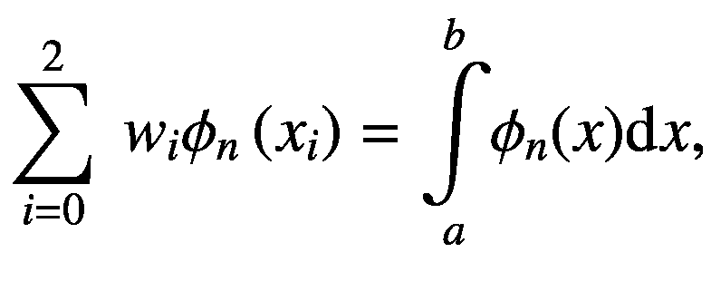

这些方程等价于要求求积法则精确积分所有基函数，因此也（至少）精确积分所有由这些基函数张成的函数。这个方程组可以使用 SymPy 构建如下：

![$$ {\displaystyle \begin{array}{l}\Big[a-b+{w}_0+{w}_1+{w}_2,\kern0.5em \frac{a²}{2}+a{w}_0-\frac{b²}{2}+b{w}_2+{w}_1\left(\frac{a}{2}+\frac{b}{2}\right),\kern0.5em \frac{a³}{3}+{a}²{w}_0\hbox{--} \frac{b³}{3}+\\ {}{b}²{w}_2+{w}_1{\left(\frac{a}{2}+\frac{b}{2}\right)}²\Big]\end{array}} $$](images/332789_2_En_8_Chapter/332789_2_En_8_Chapter_TeX_Equh.png)

```python
In [15]: eqs = [q_rule.subs(f, phi[n]) - sympy.integrate(phin, (X, a, b))
...:        for n in range(len(phi))]
In [16]: eqs
Out[16]:
```

求解这个线性方程组给出了权重因子的解析表达式：

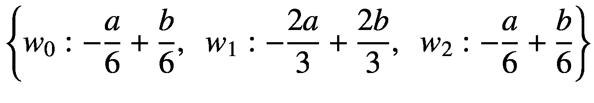

```python
In [17]: w_sol = sympy.solve(eqs, w)
In [18]: w_sol
Out[18]:
```

并且将该解代入求积法则的符号表达式中，我们得到：

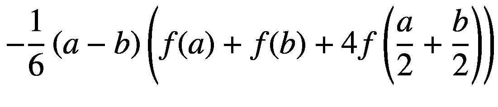

```python
In [19]: q_rule.subs(w_sol).simplify()
Out[19]:
```

我们认出这个结果正是前一节中给出的辛普森求积法则。选择不同的样本点（此代码中的`x`元组）会产生不同的求积法则。

高阶求积法则可以类似地通过使用高阶多项式插值（在区间`[a, b]`中使用更多样本点）推导出来。然而，高阶多项式插值在样本点之间可能会有不良行为，如第 7 章所述。因此，与其使用高阶求积法则，不如将积分区间`[a, b]`划分为若干子区间`[a = x[0], x[1]]`、`[x[1], x[2]]`、……、`[x[N-1], x[N] = b]`，并在每个子区间中使用一个低阶求积法则。这种方法被称为*复合求积法则*。图 8-2 显示了函数`f(x) = 3 + x + x² + x³ + x⁴`在区间`[-1, 1]`上的三个最低阶牛顿-柯特斯求积法则，以及将原区间划分为四个子区间后对应的复合求积法则。

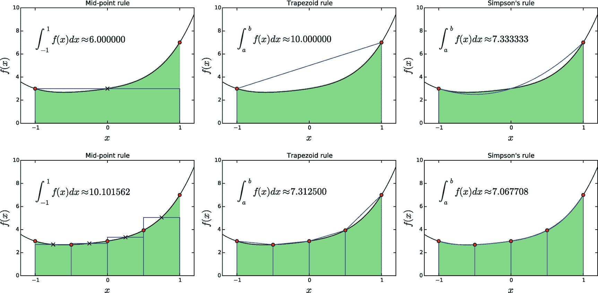

**图 8-2** 求积法则（上面板）和复合求积法则（下面板）的可视化，包括零阶（中点法则）、一阶（梯形法则）和二阶（辛普森法则）

描述复合求积法则的一个重要参数是子区间长度`h = (b - a) / N`。近似求积法则的误差估计，以及误差随`h`变化的缩放关系，可以通过对被积函数进行泰勒级数展开并对所得级数中的项进行解析积分来获得。另一种技术是同时考虑不同阶数或不同子区间长度`h`的求积法则。两个这样的结果之间的差异通常可以给出误差的估计，这正是许多求积程序在积分估计值之外还产生误差估计值的基础，我们将在下一节的示例中看到。

我们已经看到，牛顿-柯特斯求积法则使用被积函数`f(x)`的等距样本点。这通常很方便，特别是当被积函数来自指定点上的测量或观测，并且不能在区间`[a, b]`中的任意点上求值时。然而，这不一定是最有效的求积节点选择，如果被积函数是一个可以在`x ∈ [a, b]`任意值上轻松求值的函数，那么使用非等距样本点的求积法则可能更有利。这类方法的一个例子是*高斯求积*，它同样使用多项式插值来确定求积法则中权重因子的值，但求积节点`x[i]`的选择是为了在固定求积点数量下最大化可被精确积分的多项式阶数（多项式次数）。事实证明，满足这些标准的`x[i]`选择是不同正交多项式的根，并且样本点`x[i]`通常位于积分区间`[a, b]`内的无理数位置。这对于数值实现通常不是问题，但实际上它要求函数`f(x)`可以在由积分例程决定的任意点上求值，而不是以表格形式或预先计算好的规则间隔`x`值数据给出。如果`f(x)`可以在任意值上求值，高斯求积法则通常更优，但出于上述原因，当被积函数以表格数据形式给出时，牛顿-柯特斯求积法则也有重要的应用场景。


## 使用 SciPy 进行数值积分

SciPy `integrate` 模块中的数值求积程序可分为两类：一类以 Python 函数形式接受被积函数，另一类则接受在给定点处包含被积函数采样值的数组。第一类函数使用高斯求积法（`quad`、`quadrature`、`fixed_quad`），而第二类函数使用牛顿-柯特斯方法（`trapz`、`simps` 和 `romb`）。

`quadrature` 函数是一个用 Python 实现的自适应高斯求积程序。它会反复调用用于固定阶数高斯求积的 `fixed_quad` 函数，并逐步增加阶数，直到达到所需的精度。`quad` 函数是对 *FORTRAN* 库 QUADPACK 中程序的封装，后者在速度方面性能更优，且具有更多特性（例如支持无限积分限）。因此，通常更推荐使用 `quad`，在接下来的内容中，我们将使用此求积函数。不过，所有这些函数都接受类似的参数，并且通常可以相互替代。它们将实现被积函数的函数作为第一个参数，第二和第三个参数分别是积分的下限和上限。作为一个具体示例，考虑数值计算积分 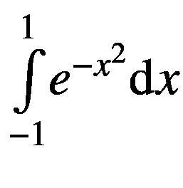。要使用 SciPy 的 `quad` 函数计算此积分，我们首先为被积函数定义一个函数，然后调用 `quad` 函数：

```
In [20]: def f(x):
...:     return np.exp(-x**2)
In [21]: val, err = integrate.quad(f, -1, 1)
In [22]: val
Out[22]: 1.493648265624854
In [23]: err
Out[23]: 1.6582826951881447e−14
```

`quad` 函数返回一个元组，其中包含积分的数值估计值 `val` 和绝对误差的估计值 `err`。绝对误差和相对误差的容限可分别通过可选的 `epsabs` 和 `epsrel` 关键字参数进行设置。如果函数 `f` 有多个变量，`quad` 程序会对其第一个参数进行积分。我们可以通过向 `quad` 函数的 `args` 关键字参数传递这些值，从而可选地将额外参数的值传递给被积函数。例如，如果我们要针对参数 *a* = 1、*b* = 2 和 *c* = 3 的特定值计算 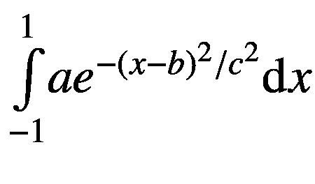，我们可以为接受所有这些额外参数的被积函数定义一个函数，然后通过向 `quad` 函数传递 `args=(1, 2, 3)` 来指定 *a*、*b* 和 *c* 的值：

```
In [24]: def f(x, a, b, c):
...:     return a * np.exp(-((x - b)/c)**2)
In [25]: val, err = integrate.quad(f, -1, 1, args=(1, 2, 3))
In [26]: val
Out[26]: 1.2763068351022229
In [27]: err
Out[27]: 1.4169852348169507e−14
```

当处理我们想要积分的变量不是第一个参数的函数时，我们可以通过使用 `lambda` 函数来重新调整参数的顺序。例如，如果我们想计算积分 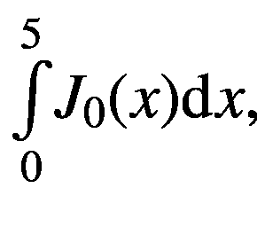，其中被积函数 *J*0 是第一类零阶贝塞尔函数，那么使用 `scipy.special` 模块中的 `jv` 函数作为被积函数会很方便。函数 `jv` 接受参数 `v` 和 `x`，它是实数阶 `v` 且在 `x` 处求值的第一类贝塞尔函数。为了能够将 `jv` 函数作为 `quad` 的被积函数，我们需要重新调整 `jv` 的参数顺序。通过 lambda 函数，我们可以按以下方式实现：

```
In [28]: from scipy.special import jv
In [29]: f = lambda x: jv(0, x)
In [30]: val, err = integrate.quad(f, 0, 5)
In [31]: val
Out[31]: 0.7153119177847678
In [32]: err
Out[32]: 2.47260738289741e−14
```

运用此技术，我们可以任意重新调整任何函数的参数顺序，并始终得到一个积分变量作为第一个参数的函数，从而使该函数能够作为 `quad` 的被积函数。

`quad` 程序支持无限积分限。为了表示无限的积分限，我们使用无穷大的浮点数表示 `float('inf')`，这在 NumPy 中可以方便地通过 `np.inf` 获取。例如，考虑积分 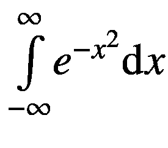。要使用 `quad` 对其进行计算，我们可以这样做：

```
In [33]: f = lambda x: np.exp(-x**2)
In [34]: val, err = integrate.quad(f, -np.inf, np.inf)
In [35]: val
Out[35]: 1.7724538509055159
In [36]: err
Out[36]: 1.4202636780944923e−08
```

然而，请注意 `quadrature` 和 `fixed_quad` 函数仅支持有限积分限。

稍加额外指导，`quad` 函数也能够处理许多含有可积奇点的积分。例如，考虑积分 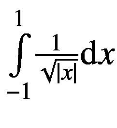。被积函数在 *x* = 0 处发散，但积分的值并不发散，其值为 4。由于被积函数发散，天真地尝试使用 `quad` 计算此积分可能会失败：

```
In [37]: f = lambda x: 1/np.sqrt(abs(x))
In [38]: a, b = -1, 1
In [39]: integrate.quad(f, a, b)
Out[39]: (inf, inf)
```

在这种情况下，绘制被积函数的图像有助于了解其行为，如图 8-3 所示。

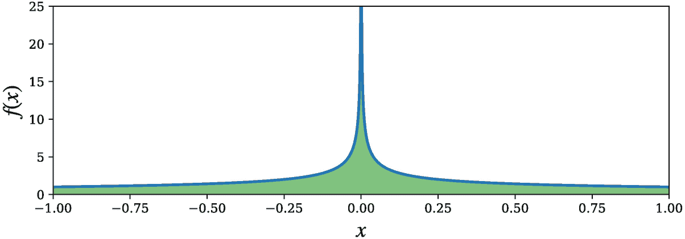

图 8-3

*一个具有可计算有限积分值（绿色/阴影区域）的发散被积函数的示例，该积分可使用* `quad` *函数进行计算*

```
In [40]: fig, ax = plt.subplots(figsize=(8, 3))
...: x = np.linspace(a, b, 10000)
...: ax.plot(x, f(x), lw=2)
...: ax.fill_between(x, f(x), color="green", alpha=0.5)
...: ax.set_xlabel("$x$", fontsize=18)
...: ax.set_ylabel("$f(x)$", fontsize=18)
...: ax.set_ylim(0, 25)
...: ax.set_xlim(-1, 1)
```

在这种情况下，积分计算失败是因为被积函数恰好在高斯求积法则中的某个采样点（中点）处发散。我们可以通过 `points` 关键字参数指定一个应避免的点列表来指导 `quad` 程序，在当前示例中使用 `points=[0]` 可以让 `quad` 正确地计算积分：

```
In [41]: integrate.quad(f, a, b, points=[0])
Out[41]: (4.0,5.684341886080802e−14)
```


### 表格化被积函数

之前我们已经看到，当被积函数由一个可以在任意点（由特定求积规则决定）求值的 Python 函数指定时，`quad` 例程适合用于计算积分。然而，在许多情况下，我们可能只有预先确定点上的被积函数值，例如在积分区间 [*a*, *b*] 内等间距分布的点。这种情形可能出现在，例如，当被积函数来自无法由特定积分例程控制的实验或观测时。在这种情况下，我们可以使用牛顿-柯特斯（Newton-Cotes）求积法，例如本章前面介绍的中点法则、梯形法则或辛普森法则。

在 SciPy 的 `integrate` 模块中，复合梯形法则和辛普森法则分别在 `trapz` 和 `simps` 函数中实现。这些函数将数组 `y`（包含积分区间内一组点上的被积函数值）作为第一个参数，并可选地将数组 `x`（指定这些采样点的 *x* 值）或每个采样点之间的间距 `dx`（如果是均匀采样）作为第二个参数。注意，采样点不一定是等间距的，但必须事先已知。

为了了解如何计算由采样值给出的函数的积分，让我们通过取积分区间 [0, 2] 内被积函数的 25 个采样点，来计算积分 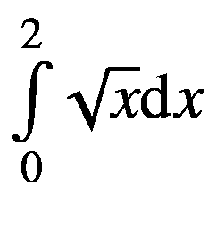，如图 8-4 所示：

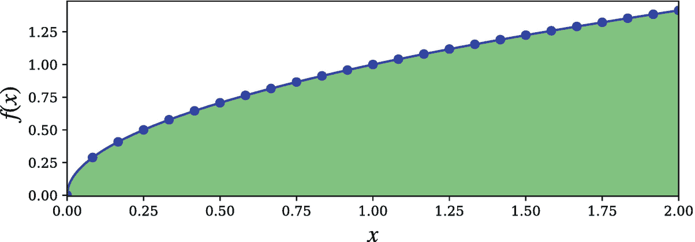

图 8-4

以点标记的表格值形式给出的被积函数。积分对应于阴影区域。

```
In [42]: f = lambda x: np.sqrt(x)
In [43]: a, b = 0, 2
In [44]: x = np.linspace(a, b, 25)
In [45]: y = f(x)
In [46]: fig, ax = plt.subplots(figsize=(8, 3))
...: ax.plot(x, y, 'bo')
...: xx = np.linspace(a, b, 500)
...: ax.plot(xx, f(xx), 'b-')
...: ax.fill_between(xx, f(xx), color="green", alpha=0.5)
...: ax.set_xlabel(r"$x$", fontsize=18)
...: ax.set_ylabel(r"$f(x)$", fontsize=18)
```

为了计算积分，我们可以将 `x` 和 `y` 数组传递给 `trapz` 或 `simps` 方法。注意，`y` 数组必须作为第一个参数传递：

```
In [47]: val_trapz = integrate.trapz(y, x)
In [48]: val_trapz
Out[48]: 1.88082171605
In [49]: val_simps = integrate.simps(y, x)
In [50]: val_simps
Out[50]: 1.88366510245
```

`trapz` 和 `simps` 函数不提供任何误差估计，但是对于这个特定例子，我们可以通过解析方法计算积分，并与两种方法计算的数值结果进行比较：

```
In [51]: val_exact = 2.0/3.0 * (b-a)**(3.0/2.0)
In [52]: val_exact
Out[52]: 1.8856180831641267
In [53]: val_exact - val_trapz
Out[53]: 0.00479636711328
In [54]: val_exact - val_simps
Out[54]: 0.00195298071541
```

由于我们掌握的关于被积函数的所有信息就是给定的采样点，我们也无法要求 `trapz` 或 `simps` 计算更精确的解。提高精度的唯一选择是增加采样点的数量（如果底层函数未知，这可能很困难），或者可能使用更高阶的方法。

`integrate` 模块还通过 `romb` 函数提供了龙贝格（Romberg）方法的实现。龙贝格方法是一种牛顿-柯特斯方法，但它使用理查德森（Richardson）外推法来加速梯形方法的收敛；然而，此方法要求采样点等间距，并且采样点的数量必须为 2^(*n*)+1 个，其中 *n* 是整数。与 `trapz` 和 `simps` 方法类似，`romb` 将包含被积函数采样值的数组作为第一个参数，但第二个参数（如果给出）必须是采样点间距 `dx`：

```
In [55]: x = np.linspace(a, b, 1 + 2**6)
In [56]: len(x)
Out[56]: 65
In [57]: y = f(x)
In [58]: dx = x[1] - x[0]
In [59]: val_exact - integrate.romb(y, dx=dx)
Out[59]: 0.000378798422913
```

在我们讨论过的 SciPy 积分函数中，`simps` 可能是总体上最有用的一个，因为它在易用性（对采样点没有限制）和相对较好的精度之间提供了良好的平衡。


## 多重积分

多重积分，例如二重积分`$$\underset{a}{\overset{b}{\int }}\underset{c}{\overset{d}{\int }}f\left(x,y\right)\mathrm{d}x\mathrm{d}y$$`和三重积分`$$\underset{a}{\overset{b}{\int }}\underset{c}{\overset{d}{\int }}\underset{e}{\overset{f}{\int }}f\left(x,y,z\right)\mathrm{d}x\mathrm{d}y\mathrm{d}z$$`，可以使用 SciPy `integrate` 模块中的 `dblquad` 和 `tplquad` 函数来计算。此外，在某个域 *D* 上的 *n* 个变量 `∫…∫[*D*]*f*(**x**)d**x**` 的积分，可以使用 `nquad` 函数进行计算。这些函数是对单变量求积函数 `quad` 的封装，`quad` 会沿着积分的每个维度重复调用。

具体来说，二重积分例程 `dblquad` 可以计算如下形式的积分：

`$$\underset{a}{\overset{b}{\int }}\underset{g(x)}{\overset{h(x)}{\int }}f\left(x,y\right)\mathrm{d}x\mathrm{d}y,$$`

其函数签名为 `dblquad(f, a, b, g, h)`，其中 `f` 是被积函数的 Python 函数，`a` 和 `b` 是 *x* 维度的常数积分限，`g` 和 `h` 是用于指定 *y* 维度积分限的 Python 函数（以 `x` 为参数）。例如，考虑积分 `$$\underset{0}{\overset{1}{\int }}\underset{0}{\overset{1}{\int }}{e}^{-{x}²-{y}²}\mathrm{d}x\mathrm{d}y$$`。要计算该积分，首先定义被积函数 `f`，并绘制函数图形及积分区域，如图 8-5 所示：

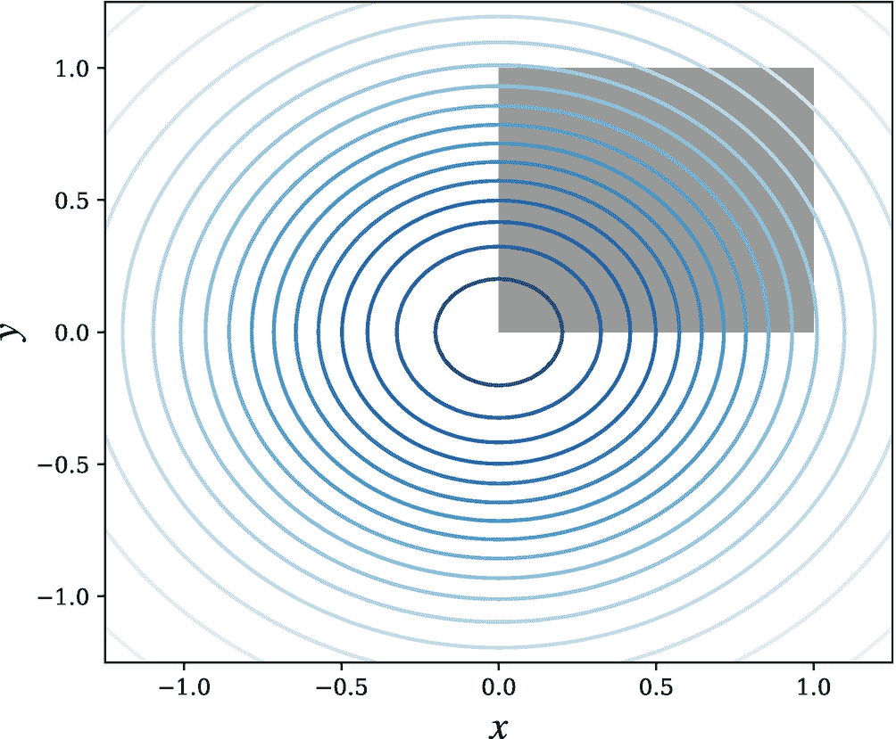

**图 8-5** 二维被积函数的等高线图，其中积分区域以阴影区域表示

```
In [60]: def f(x, y):
...:     return np.exp(-x**2 - y**2)
In [61]: fig, ax = plt.subplots(figsize=(6, 5))
...: x = y = np.linspace(-1.25, 1.25, 75)
...: X, Y = np.meshgrid(x, y)
...: c = ax.contour(X, Y, f(X, Y), 15, cmap=mpl.cm.RdBu, vmin=-1, vmax=1)
...: bound_rect = plt.Rectangle((0, 0), 1, 1, facecolor="grey")
...: ax.add_patch(bound_rect)
...: ax.axis('tight')
...: ax.set_xlabel('$x$', fontsize=18)
...: ax.set_ylabel('$y$', fontsize=18)
```

在此例中，*x* 和 *y* 变量的积分限都是常数，但由于 `dblquad` 期望 *y* 变量的积分限是函数，因此我们必须定义函数 `h` 和 `g`，即使本例中无论 `x` 取何值，它们都只计算为常数。

```
In [62]: a, b = 0, 1
In [63]: g = lambda x: 0
In [64]: h = lambda x: 1
```

现在，所有参数准备就绪，我们可以调用 `dblquad` 来计算积分：

```
In [65]: integrate.dblquad(f, a, b, g, h)
Out[65]: (0.5577462853510337, 6.1922276789587025e−15)
```

请注意，我们也可以使用内联 `lambda` 函数定义更简洁地完成相同操作，尽管可读性稍差：

```
In [66]: integrate.dblquad(lambda x, y: np.exp(-x**2-y**2), 0, 1, lambda x: 0, lambda x: 1)
Out[66]: (0.5577462853510337, 6.1922276789587025e−15)
```

由于 `g` 和 `h` 是函数，我们可以计算沿 *y* 维度具有依赖于 *x* 的积分限的积分。例如，对于 `g(x) = x - 1` 和 `h(x) = 1 - x`，我们得到：

```
In [67]: integrate.dblquad(f, 0, 1, lambda x: -1 + x, lambda x: 1 - x)
Out[67]: (0.7320931000008094, 8.127866157901059e−15)
```

`tplquad` 函数可以计算如下形式的积分：

`$$\underset{a}{\overset{b}{\int }}\underset{g(x)}{\overset{h(x)}{\int }}\underset{q\left(x,y\right)}{\overset{r\left(x,y\right)}{\int }}f\left(x,y,z\right)\mathrm{d}x\mathrm{d}y\mathrm{d}z,$$`

这是 `dblquad` 计算的双积分表达式的推广。它额外接收两个 Python 函数作为参数，用于指定 *z* 维度的积分限。这些函数接收两个参数 `x` 和 `y`，但请注意 `g` 和 `h` 仍然只接收一个参数（`x`）。要了解如何使用 `tplquad`，请考虑前一个积分到三个变量的推广：`$$\underset{0}{\overset{1}{\int }}\underset{0}{\overset{1}{\int }}\underset{0}{\overset{1}{\int }}{e}^{-{x}²-{y}²-{z}²}\mathrm{d}x\mathrm{d}y\mathrm{d}z$$`。我们使用与 `dblquad` 示例类似的方法计算此积分。也就是说，首先定义被积函数和积分限的函数，然后调用 `tplquad` 函数：

```
In [68]: def f(x, y, z):
...:    return np.exp(-x**2-y**2-z**2)
In [69]: a, b = 0, 1
In [70]: g, h = lambda x: 0, lambda x: 1
In [71]: q, r = lambda x, y: 0, lambda x, y: 1
In [72]: integrate.tplquad(f, 0, 1, g, h, q, r)
Out[72]: (0.4165383858866382, 4.624505066515441e−15)
```

对于任意数量的积分，我们可以使用 `nquad` 函数。它同样将被积函数的 Python 函数作为第一个参数。被积函数应具有 `f(x1, x2, ..., xn)` 的函数签名。与 `dblquad` 和 `tplquad` 不同，`nquad` 函数期望第二个参数是一个积分限规格列表。该列表应包含每个积分变量的积分限元组，或返回此类限制的可调用函数。例如，要计算之前使用 `tplquad` 计算的积分，我们可以使用：

```
In [73]: integrate.nquad(f, [(0, 1), (0, 1), (0, 1)])
Out[73]: (0.4165383858866382, 8.291335287314424e−15)
```

随着积分变量数量的增加，多重积分的计算复杂度会迅速增长，例如在使用 `nquad` 时。要观察此缩放趋势，请考虑以下使用 `dblquad` 和 `tplquad` 研究的被积函数的推广版本。

```
In [74]: def f(*args):
...:    """
...:    f(x1, x2, ... , xn) = exp(-x1² - x2² - ... - xn²)
...:    """
...:    return np.exp(-np.sum(np.array(args)**2))
```

接下来，我们评估不同维度（从 1 到 5）下的积分。在以下示例中，积分限列表的长度决定了积分的数量。为了粗略估算计算时间，我们使用 IPython 命令 `%time`：

```
In [75]: %time integrate.nquad(f, [(0,1)] * 1)
CPU times: user 398 μs, sys: 63 μs, total: 461 μs
Wall time: 466 μs
Out[75]: (0.7468241328124271,8.291413475940725e−15)

In [76]: %time integrate.nquad(f, [(0,1)] * 2)
CPU times: user 6.31 ms, sys: 298 μs, total: 6.61 ms
Wall time: 6.57 ms
Out[76]: (0.5577462853510337,8.291374381535408e−15)

In [77]: %time integrate.nquad(f, [(0,1)] * 3)
CPU times: user 123 ms, sys: 2.46 ms, total: 126 ms
Wall time: 125 ms
Out[77]: (0.4165383858866382,8.291335287314424e−15)

In [78]: %time integrate.nquad(f, [(0,1)] * 4)
CPU times: user 2.41 s, sys: 11.1 ms, total: 2.42 s
Wall time: 2.42 s
Out[78]: (0.31108091882287664,8.291296193277774e−15)

In [79]: %time integrate.nquad(f, [(0,1)] * 5)
CPU times: user 49.5 s, sys: 169 ms, total: 49.7 s
Wall time: 49.7 s
Out[79]: (0.23232273743438786,8.29125709942545e−15)
```


这里我们可以看到，将积分数量从一维增加到五维，会使计算时间从几百微秒增加到将近一分钟。对于更大数量的积分，使用直接求积例程可能变得不切实际，而其他方法（例如蒙特卡洛采样技术）通常会更优越，尤其是在所需精度不高的情况下。蒙特卡洛积分是一种简单但强大的技术，它基于在积分域内随机选取的点对被积函数进行采样，并逐步形成积分的估计值。由于该算法的随机性，其收敛速度通常相对较慢，且难以达到非常高的精度。然而，蒙特卡洛积分在维度扩展方面表现良好，并且通常是处理高维积分的一种有竞争力的方法。

要使用蒙特卡洛采样计算积分，我们可以使用 `skmonaco` 库（也称为 scikit-monaco）中的 `mcquad` 函数。它的第一个参数接受一个表示被积函数的 Python 函数，第二个参数接受一个包含积分下限的列表，第三个参数接受一个包含积分上限的列表。请注意，积分限的指定方式与 SciPy 的 `integrate` 模块中的 `quad` 函数不完全相同。我们首先导入 `skmonaco`（scikit-monaco）模块：

```
In [80]: import skmonaco
```

导入模块后，我们可以使用 `skmonaco.mcquad` 函数执行蒙特卡洛积分。在下面的示例中，我们使用 `nquad` 计算与先前示例中相同的积分：

```
In [81]: %time val, err = skmonaco.mcquad(f, xl=np.zeros(5), xu=np.ones(5), npoints=100000)
CPU times: user 1.43 s, sys: 100 ms, total: 1.53 s
Wall time: 1.5 s
In [82]: val, err
Out[82]: (0.231322502809, 0.000475071311272)
```

虽然其误差无法与 `nquad` 给出的结果相比，但计算时间要短得多。通过增加采样点的数量（我们可以使用 `npoints` 参数指定），我们可以提高结果的精度。然而，蒙特卡洛积分的收敛速度非常慢，因此它最适用于不需要高精度的情况。但蒙特卡洛积分的美妙之处在于，其计算复杂度与积分维数无关。下面的示例说明了这一点，它同时计算了一个十维积分，其误差水平与先前计算五维积分的示例相当：

```
In [83]: %time val, err = skmonaco.mcquad(f, xl=np.zeros(10), xu=np.ones(10), npoints=100000)
CPU times: user 1.41 s, sys: 64.9 ms, total: 1.47 s
Wall time: 1.46 s
In [84]: val, err
Out[84]: (0.0540635928549, 0.000171155166006)
```

## 符号积分与任意精度积分

在第 3 章中，我们已经看到了如何使用 `sympy.integrate` 函数计算符号函数的定积分和不定积分的例子。例如，要计算积分 ，我们首先为 *x* 创建一个符号，并定义被积函数和积分限 *a* = −1 与 *b* = 1 的表达式：

```
In [85]: x = sympy.symbols("x")
In [86]: f = 2 * sympy.sqrt(1-x**2)
In [87]: a, b = -1, 1
```

之后，我们可以使用以下命令计算积分的闭式表达式：

```
In [88]: val_sym = sympy.integrate(f, (x, a, b))
In [89]: val_sym
Out[89]: π
```

对于这个例子，SymPy 能够找到积分的解析表达式：*π*。如前所述，这种情况是例外，通常我们无法找到解析的闭式表达式。这样我们就需要求助于数值求积，例如使用本章前面讨论过的 SciPy 的 `integrate.quad` 函数。然而，与 SymPy 紧密集成的 `mpmath` 库^(³⁶)提供了另一种使用任意精度计算来实现数值求积的方法。使用这个库，我们可以计算任意精度的积分，而不受浮点数限制的约束。当然，缺点是任意精度计算比浮点数计算要慢得多。但是，当我们需要超出 SciPy 求积函数所能提供的精度时，这种多精度求积方法就提供了一种解决方案。

例如，要计算积分 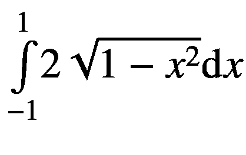 到指定的精度^(³⁷)，我们可以使用 `mpmath.quad` 函数。该函数的第一个参数接受一个表示被积函数的 Python 函数，第二个参数接受一个包含积分限的元组 `(a, b)`。要指定精度，我们将变量 `mpmath.mp.dps` 设置为所需的有效小数位数。例如，如果我们需要 75 位有效小数位数，我们设置：

```
In [90]: mpmath.mp.dps = 75
```

被积函数必须作为一个 Python 函数给出，该函数使用 `mpmath` 库中的数学函数进行计算。我们可以使用 `sympy.lambdify` 并传入 `'mpmath'` 作为第三个参数，从 SymPy 表达式创建这样一个函数，这表明我们需要一个与 `mpmath` 兼容的函数。或者，我们可以直接使用 SymPy 中 `mpmath` 模块的数学函数实现一个 Python 函数，在本例中即为 `f_mpmath = lambda x: 2 * mpmath.sqrt(1 - x**2)`。不过，这里我们使用 `sympy.lambdify` 来自动完成这一步：

```
In [91]: f_mpmath = sympy.lambdify(x, f, 'mpmath')
```

接下来，我们可以使用 `mpmath.quad` 计算积分并显示结果值：

```
In [92]: val = mpmath.quad(f_mpmath, (a, b))
In [93]: sympy.sympify(val)
Out[93]: 3.14159265358979323846264338327950288419716939937510582097494459230781640629
```

为了验证数值计算的值是否达到了所需的小数位数精度（75 位），我们将结果与已知的解析值（*π*）进行比较。误差确实非常小：

```
In [94]: sympy.N(val_sym, mpmath.mp.dps+1) - val
Out[94]: 6.90893484407555570030908149024031965689280029154902510801896277613487344253e−77
```

这种精度水平是 SciPy 的 `integrate` 模块中的 `quad` 函数无法达到的，因为它受限于浮点数的精度。


`mpmath`库的`quad`函数也可用于计算二重积分和三重积分。为此，我们只需向其传递一个接受多个变量作为参数的被积函数，并为每个积分变量传递包含积分限的元组。例如，要计算二重积分：

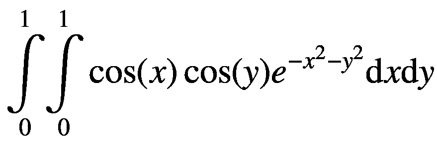

和三重积分：

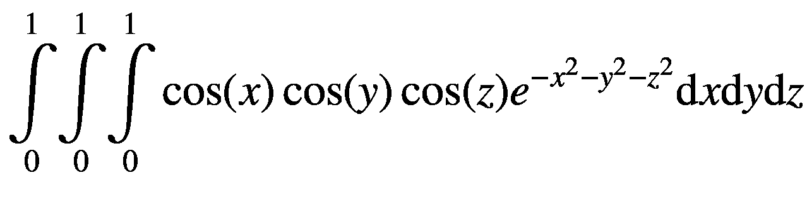

精确到 30 位有效小数（该示例无法用`SymPy`符号求解），我们可以先为被积函数创建`SymPy`表达式，然后使用`sympy.lambdify`创建相应的`mpmath`表达式：

```python
In [95]: x, y, z = sympy.symbols("x, y, z")
In [96]: f2 = sympy.cos(x) * sympy.cos(y) * sympy.exp(-x**2 - y**2)
In [97]: f3 = sympy.cos(x) * sympy.cos(y) * sympy.cos(z) * sympy.exp(-x**2 - y**2 - z**2)
In [98]: f2_mpmath = sympy.lambdify((x, y), f2, 'mpmath')
In [99]: f3_mpmath = sympy.lambdify((x, y, z), f3, 'mpmath')
```

然后，通过设置`mpmath.mp.dps`并调用`mpmath.quad`，即可将积分评估到所需精度：

```python
In [100]: mpmath.mp.dps = 30
In [101]: mpmath.quad(f2_mpmath, (0, 1), (0, 1))
Out[101]: mpf('0.430564794306099099242308990195783')
In [102]: res = mpmath.quad(f3_mpmath, (0, 1), (0, 1), (0, 1))
In [103]: sympy.sympify(res)
Out[103]: 0.282525579518426896867622772405
```

同样，这提供了超出`scipy.integrate.quad`所能达到的精度的能力，但这种额外的精度是以计算成本的大幅增加为代价的。请注意，`mpmath.quad`返回的对象类型是多精度浮点数（`mpf`）。可以使用`sympy.sympify`将其转换为`SymPy`类型。

### 线积分

`SymPy`还可用于计算形式为∫_*C* *f*(*x*, *y*)d*s* 的线积分，其中*C*是*x*–*y*平面上的一条曲线。这需要使用`line_integral`函数。该函数接受一个`SymPy`表达式作为第一个参数（被积函数），一个`sympy.Curve`实例作为第二个参数，以及一个积分变量列表作为第三个参数。线积分的路径由`Curve`实例指定，该实例描述了一条参数化曲线，其中*x*和*y*坐标是独立参数（例如*t*）的函数。要创建一个描述沿单位圆路径的`Curve`实例，我们可以使用：

```python
In [104]: t, x, y = sympy.symbols("t, x, y")
In [105]: C = sympy.Curve([sympy.cos(t), sympy.sin(t)], (t, 0, 2 * sympy.pi))
```

一旦指定了积分路径，我们就可以使用`line_integral`轻松计算给定被积函数的相应线积分。例如，对于被积函数*f*(*x*, *y*) = 1，结果是单位圆的周长：

```python
In [106]: sympy.line_integrate(1, C, [x, y])
Out[106]: 2π
```

对于非平凡的被积函数，结果则不太显而易见，例如以下示例中计算被积函数*f*(*x*, *y*) = *x*²*y*²的线积分：

```python
In [107]: sympy.line_integrate(x**2 * y**2, C, [x, y])
Out[107]: π/4
```

## 积分变换

我们在本章中讨论的最后一个积分应用是积分变换。积分变换是一种将一个函数作为输入并输出另一个函数的过程。积分变换在能够符号化计算时最为有用，这里我们将探讨两种可使用`SymPy`执行的积分变换示例：拉普拉斯变换和傅里叶变换。这两种变换有众多应用，但其基本动机是将问题转化为更易处理的形式。例如，使用拉普拉斯变换将微分方程转化为代数方程，或使用傅里叶变换将问题从时域变换到频域。

通常，函数*f*(*t*)的积分变换可以写作：

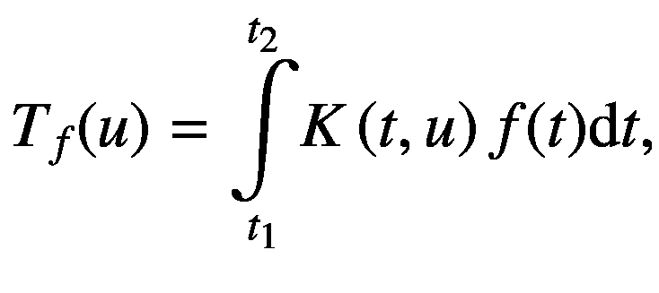

其中*T**f*是变换后的函数。核函数*K*(*t*, *u*)和积分限的选择决定了积分变换的类型。积分变换的逆变换由下式给出：

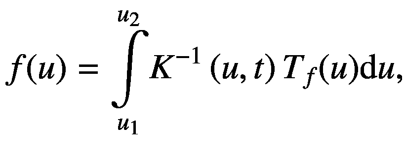

其中*K*^(−1)(*u*, *t*)是逆变换的核函数。`SymPy`提供了多种积分变换的函数，但这里我们重点关注拉普拉斯变换：

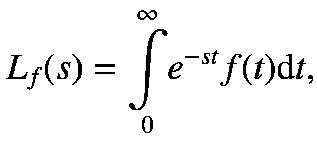

及其逆变换：

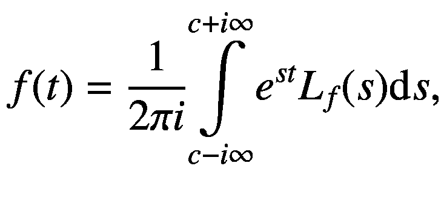

以及傅里叶变换：

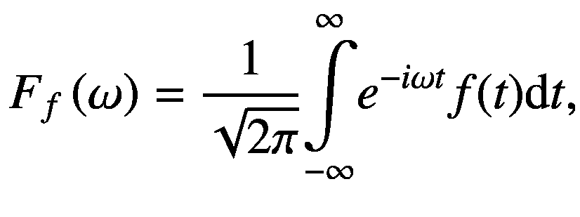

及其逆变换：

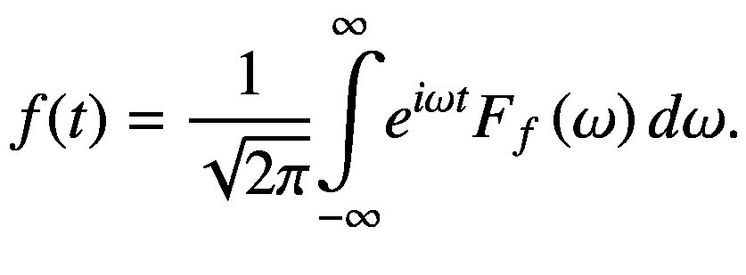

使用`SymPy`，我们可以分别通过`sympy.laplace_transform`和`sympy.fourier_transform`执行这些变换，相应的逆变换可以通过`sympy.inverse_laplace_transform`和`sympy.inverse_fourier_transform`计算。这些函数接受一个`SymPy`表达式作为第一个参数（要变换的函数），一个表示待变换表达式自变量的符号作为第二个参数（例如，*t*），以及一个表示变换变量的符号作为第三个参数（例如，*s*）。例如，要计算函数*f*(*t*) = *sin*(*at*)的拉普拉斯变换，我们首先为变量*a*、*t*和*s*定义`SymPy`符号，并为函数*f*(*t*)定义一个`SymPy`表达式：

```python
In [108]: s = sympy.symbols("s")
In [109]: a, t = sympy.symbols("a, t", positive=True)
In [110]: f = sympy.sin(a*t)
```

一旦我们有了变量和函数的`SymPy`对象，就可以调用`laplace_transform`函数来计算拉普拉斯变换：

```python
In [111]: sympy.laplace_transform(f, t, s)
Out[111]:
```

(``,`−∞`,``)


默认情况下，`laplace_transform`函数返回一个元组，其中包含：变换结果；变换收敛条件中的值*A*，其形式为 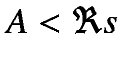；最后，还包括保证变换良定义所需的附加条件。这些条件通常取决于创建符号时指定的约束。例如，这里我们在创建符号`a`和`t`时使用了`positive=True`，以表明它们代表正实数。我们通常只对变换本身感兴趣，此时可以使用`noconds=True`关键字参数来抑制返回值中的条件：

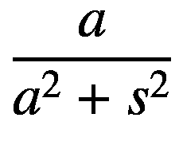

```
In [112]: F = sympy.laplace_transform(f, t, s, noconds=True)
In [113]: F
Out[113]:
```

逆变换的使用方式类似，只是需要交换符号`s`和`t`的角色。拉普拉斯变换是一个唯一的一一映射，因此如果我们计算先前得到的拉普拉斯变换的逆拉普拉斯变换，预期能够恢复原始函数：

```
In [114]: sympy.inverse_laplace_transform(F, s, t, noconds=True)
Out[114]: sin(at)
```

SymPy 可以计算许多基本数学函数以及各类函数组合的变换。手工使用拉普拉斯变换解决问题时，通常需要在已知拉普拉斯变换的参考表中搜索匹配的函数。使用 SymPy，这个过程在很多（但非全部）情况下可以方便地自动化。以下示例展示了一些在拉普拉斯变换表中常见的知名函数的额外例子。多项式具有简单的拉普拉斯变换：

```
In [115]: [sympy.laplace_transform(f, t, s, noconds=True) for f in [t, t**2, t**3, t**4]]
Out[115]:
```

`` ![$$ \frac{1}{s²} $$ `,` 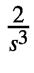 `,` 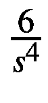 `,` 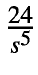 `]`

我们也可以计算任意整数指数的一般结果：

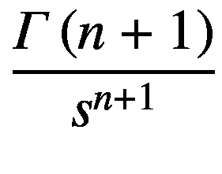

```
In [116]: n = sympy.symbols("n", integer=True, positive=True)
In [117]: sympy.laplace_transform(t**n, t, s, noconds=True)
Out[117]:
```

复合表达式的拉普拉斯变换也可以计算，如下例所示，它计算函数 *f*(*t*) = (1 − *at*)*e*^(−*at*) 的变换：

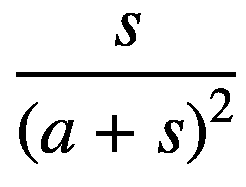

```
In [118]: sympy.laplace_transform((1 - a*t) * sympy.exp(-a*t), t, s, noconds=True)
Out[118]:
```

拉普拉斯变换的主要应用是求解微分方程，通过变换将微分方程转化为纯代数形式，然后求解该方程，再应用逆拉普拉斯变换将其变换回原始域。在第 9 章我们将看到这种方法的具体示例。傅立叶变换也可用于同一目的。

傅立叶变换函数`fourier_tranform`及其逆函数`inverse_fourier_transform`的使用方式与拉普拉斯变换函数非常相似。例如，要计算 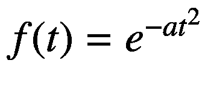 的傅立叶变换，我们首先为变量`a`、`t`和`ω`以及函数 *f*(*t*) 定义 SymPy 符号，然后通过调用`sympy.fourier_transform`函数来计算傅立叶变换：

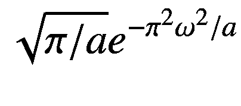

```
In [119]: a, t, w = sympy.symbols("a, t, omega")
In [120]: f = sympy.exp(-a*t**2)
In [121]: F = sympy.fourier_transform(f, t, w)
In [122]: F
Out[122]:
```

正如预期，对`F`计算逆变换恢复了原始函数：

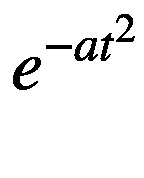

```
In [123]: sympy.inverse_fourier_transform(F, w, t)
Out[123]:
```

SymPy 可用于符号计算多种傅立叶变换，但遗憾的是，它不能很好地处理涉及狄拉克δ函数（无论是在原始函数还是变换结果中）的变换。这目前限制了它的可用性，尽管如此，对于不涉及狄拉克δ函数的问题，它仍然是一个有价值的工具。

## 总结

积分是数学分析的基本工具之一。数值求积，或积分的数值计算，在科学的许多领域都有重要应用，因为实践中遇到的积分通常无法解析计算并表示为闭式表达式，因此需要数值技术。本章我们回顾了数值求积的基本技术和方法，并介绍了 SciPy `integrate`模块中可用于实际积分计算的相应函数。当被积函数以可在任意点求值的函数形式给出时，我们通常倾向于使用高斯求积规则。另一方面，当被积函数以表格数据定义时，可以使用更简单的牛顿-柯特斯求积规则。我们还研究了符号积分和高精度求积，对于可以符号计算或需要额外精度的特定积分，它们可以补充浮点求积。通常，一个好的起点是开始对问题进行符号分析，如果某个特定积分可以通过寻找其原函数来符号求解，那通常是最理想的情况。当符号积分失败时，我们需要诉诸数值求积，这应首先使用基于浮点的实现（如 SciPy `integrate`模块提供的那些）进行探索。如果需要更高的精度，我们可以退而求其次，使用高精度求积。符号积分的另一个应用是积分变换，它可用于在不同域之间变换问题，例如微分方程。这里我们简要了解了如何使用 SymPy 符号执行拉普拉斯变换和傅立叶变换，在下一章中，我们将继续探索如何用此方法求解某些类型的微分方程。

## 延伸阅读

数值求积在许多数值计算入门教科书中都有讨论，例如 Heath (2002) 和 J. Stoer (1992)。关于许多求积方法及其示例实现的详细讨论，可在 W. H. Press (2002) 中找到。积分变换理论，如傅立叶变换和拉普拉斯变换，有相应的介绍；参见，例如，Folland (1992)。


