# 9. 常微分方程

未知量是函数而非变量，且涉及未知函数导数的方程，称为微分方程。**常**微分方程是一种特殊情况，其中未知函数只有一个独立变量，方程中出现的导数均针对该变量。反之，如果方程中出现多个变量的导数，则称为**偏**微分方程，这将是第[11](https://example.org/332789_2_En_11_Chapter.xhtml)章的主题。本章我们专注于常微分方程（以下简称 ODE），并探索求解这类方程的符号方法和数值方法。ODE 通常不存在解析形式的闭合解，但对于许多特殊类型的 ODE，存在解析解，此时我们有可能通过符号方法找到解。若此路不通，则需像往常一样借助数值技术。

常微分方程在科学、工程以及许多其他领域无处不在，例如在动态系统研究中就经常出现。ODE 的一个典型例子是描述过程随时间演化的方程，其中变化率（导数）可以与过程的其他属性相关联。为了了解给定初始状态下过程如何随时间演化，我们必须求解（或积分）描述该过程的 ODE。ODE 应用的具体实例包括物理学中的机械运动定律、化学和生物学中的分子反应、生态学中的种群建模等，此处仅举几例。

本章将探讨求解 ODE 问题的符号方法与数值方法。符号方法使用 SymPy 模块，而数值积分则使用 SciPy 的`integrate`模块中的函数。

## 导入模块

此处需要 NumPy 和 Matplotlib 库用于基本的数值计算和绘图，求解 ODE 则需要 SymPy 库和 SciPy 的`integrate`模块。照例，我们假设按以下方式导入这些模块：

```
In [1]: import numpy as np
In [2]: import matplotlib.pyplot as plt
In [3]: from scipy import integrate
In [4]: import sympy
```

为了从 SymPy 获得格式良好的输出，需要初始化其打印系统：

```
In [5]: sympy.init_printing()
```

## 常微分方程

常微分方程的最简单形式是 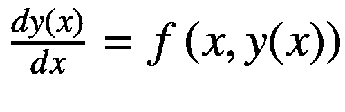，其中 `y(x)` 是未知函数，`f(x, y(x))` 是已知函数。之所以称为微分方程，是因为方程中出现了未知函数 `y(x)` 的导数。该方程中只出现一阶导数，因此它是一阶 ODE 的例子。更一般地，我们可以将 n 阶 ODE 写成**显式**形式 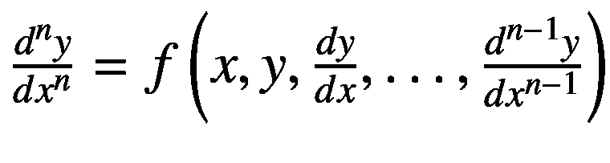，或**隐式**形式 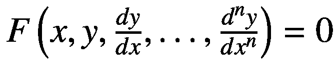，其中 `f` 和 `F` 是已知函数。

一阶 ODE 的一个例子是牛顿冷却定律 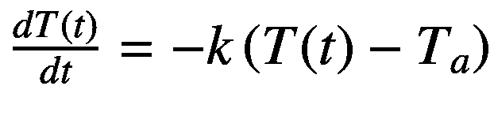，它描述了温度为 `Ta` 的环境中物体的温度 `T(t)`。该 ODE 的解是 `T(t) = T0 + (T0 - Ta) * e^(-kt)`，其中 `T0` 是物体的初始温度。二阶 ODE 的一个例子是牛顿第二运动定律 `F = ma`，或更明确地表示为 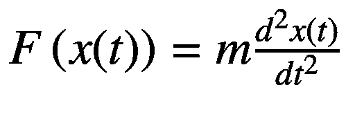。该方程描述了质量为 `m` 的物体在位置相关力 `F(x(t))` 作用下的位置 `x(t)`。为了完全确定该 ODE 的解，除了求出其通解外，还需给出物体的初始位置和速度。类似地，n 阶 ODE 的通解包含 n 个自由参数，我们需要指定这些参数，例如，以未知函数及其`n - 1`个导数的初始条件形式给出。

任何 ODE 总可以改写成一阶 ODE 方程组。具体地，显式形式 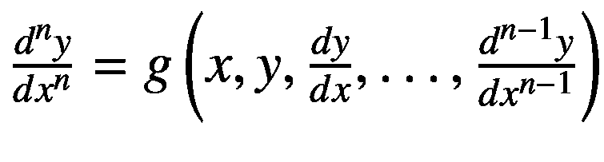 的 n 阶 ODE 可以通过引入 n 个新函数 `y1 = y`，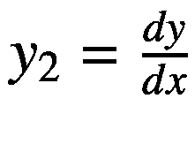，…，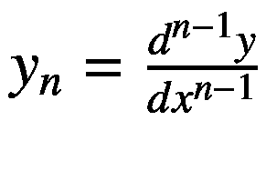 写成标准形式。由此得到以下一阶 ODE 方程组：

![$$ \frac{d}{dx}\left[\begin{array}{l}\kern0.5em {y}_1\\ {}\kern0.5em {y}_2\\ {}\kern1em \vdots \\ {}{y}_{n-1}\\ {}\kern0.5em {y}_n\end{array}\right]=\left[\begin{array}{l}\kern4em {y}_2\\ {}\kern4em {y}_3\\ {}\kern4.5em \vdots \\ {}\kern4em {y}_n\\ {}g\left(x,{y}_1,\dots, {y}_n\right)\end{array}\right] $$](images/332789_2_En_9_Chapter/332789_2_En_9_Chapter_TeX_Equa.png)


好的，作为高级文档工程师和翻译员，我将严格遵循您提供的注意事项和示例格式，将给定的英文文本翻译成中文。

---


该式也可以写成更紧凑的向量形式：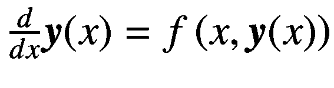。这种规范形式对 ODE 的数值求解特别有用，并且求解 ODE 的数值方法通常将函数 *f* = (*f*[1], *f*[2], …, *f*[*n*])（在当前情况下为 *f* = (*y*[2], *y*[3], …, *g*) ）作为指定 ODE 的输入。例如，牛顿第二运动定律的二阶 ODE，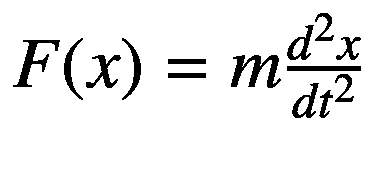，可以使用 ![$$ \boldsymbol{y}={\left[{y}_1=x,{y}_2=\frac{dx}{dt}\right]}^T $$](images/332789_2_En_9_Chapter/332789_2_En_9_Chapter_TeX_IEq11.png) 写成标准形式，得到 ![$$ \frac{d}{dt}\left[\begin{array}{c}{y}_1\\ {}{y}_2\end{array}\right]=\left[\begin{array}{c}{y}_2\\ {}F\left({y}_1\right)/m\end{array}\right]. $$](images/332789_2_En_9_Chapter/332789_2_En_9_Chapter_TeX_IEq12.png)

如果函数 *f*[1], *f*[2],…, *f*[*n*] 都是线性的，那么相应的 ODE 系统可以写成简单形式：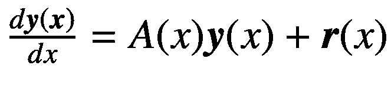，其中 *A*(*x*) 是一个 *n* × *n* 矩阵，***r***(*x*) 是一个仅依赖于 *x* 的 *n* 维向量。在这种形式下，***r***(*x*) 被称为*源项*，并且如果 ***r***(*x*) = 0，则该线性系统称为*齐次的*，否则称为*非齐次的*。线性 ODE 是一类重要的特例，例如，可以通过对 *A*(*x*) 进行特征值分解来求解。同样，对于函数 *f* (*x*, ***y***(*x*)) 的某些特定性质和形式，可能存在已知的求解方法来解决相应的 ODE 问题，但对于任意的 *f* (*x*, ***y***(*x*))，除了近似的数值方法外，没有通用的方法。

除了函数 *f* (*x*, ***y***(*x*)) 的性质外，ODE 的边界条件也会影响 ODE 问题的可解性以及可用的数值方法。边界条件用于确定解中出现的积分常数的值。ODE 问题的边界条件主要有两种类型：*初值条件*和*边值条件*。对于初值问题，函数及其导数在起点处的值是已知的，问题是从这个起点开始，将函数沿自变量（例如，代表时间或位置）向前推进。对于边值问题，未知函数或其导数在固定点处的值是已知的。这些固定点通常是所关注区域的端点。本章主要关注初值问题，适用于边值问题的方法将在关于偏微分方程的第 10 章中讨论。

## ODE 的符号解

SymPy 提供了一个通用的 ODE 求解器 `sympy.dsolve`，它能够找到许多初等 ODE 的解析解。`sympy.dsolve` 函数会尝试自动对给定的 ODE 进行分类，并可能尝试多种技术来找到其解。也可以向 `dsolve` 函数提供提示，这可以引导它使用最合适的求解方法。虽然 `dsolve` 可用于符号求解许多简单 ODE（如下所述），但值得记住的是，大多数 ODE 无法解析求解。可以期望找到符号解的典型 ODE 示例包括一阶或二阶 ODE，或者仅包含少数几个未知函数的一阶 ODE 线性系统。如果 ODE 具有特殊的对称性或性质，例如可分离、具有常系数或具有已知解析解的特殊形式，也会极大地帮助求解。虽然这些类型的 ODE 属于例外和特殊情况，但它们有许多重要的应用，对于这些情况，SymPy 的 `dsolve` 可以成为传统解析方法非常有用的补充。在本节中，我们将探讨如何使用 SymPy 及其 `dsolve` 函数来求解简单但常见的 ODE。

为了说明使用 SymPy 求解 ODE 的方法，我们从一个简单问题开始，然后逐步研究更复杂的情况。第一个例子是牛顿冷却定律的简单一阶 ODE，，其初值为 *T*(0) = *T*[0]。为了使用 SymPy 处理这个问题，我们首先需要为变量 `t`、`k`、`T0` 和 `Ta` 定义符号，并且为了表示未知函数 `T(t)`，我们可以使用 `sympy.Function` 对象：

```python
In [6]: t, k, T0, Ta = sympy.symbols("t, k, T_0, T_a")
In [7]: T = sympy.Function("T")
```

接下来，我们可以通过简单地创建一个 SymPy 表达式来非常自然地定义 ODE，该表达式是 ODE 写成 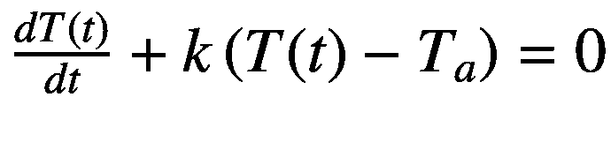 形式时的左侧。在此，为了表示函数 `T(t)`，我们现在可以使用 SymPy 的 `Function` 对象 `T`。使用函数调用语法 `T(t)` 将符号 `t` 应用于它，会得到一个已应用的函数对象，我们可以使用 `sympy.diff` 或 `T(t)` 表达式上的 `diff` 方法对其求导：

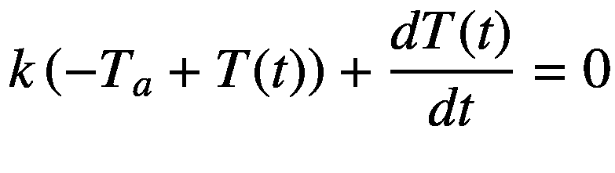

```python
In [8]: ode = T(t).diff(t) + k*(T(t) - Ta)
In [9]: sympy.Eq(ode)
Out[9]:
```

这里我们使用了 `sympy.Eq` 来显示包含等号和右侧为零的方程。给定 ODE 的这种表示形式，我们可以直接将其传递给 `sympy.dsolve`，它将尝试自动找到 ODE 的通解。

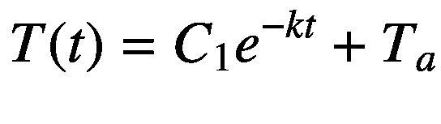

```python
In [10]: ode_sol = sympy.dsolve(ode)
In [11]: ode_sol
Out[11]:
```

对于这个 ODE 问题，`sympy.dsolve` 函数确实找到了通解，该解包含一个未知的积分常数 `C1`，我们必须根据问题的初始条件来确定它。`sympy.dsolve` 的返回值是 `sympy.Eq` 的一个实例，它是对等式的符号表示。它具有属性 `lhs` 和 `rhs`，用于访问等式对象的左侧和右侧：

```python
In [12]: ode_sol.lhs
Out[12]: T(t)
In [13]: ode_sol.rhs
Out[13]: C1e–kt + Ta
```


一旦找到通解，我们需要利用初始条件来确定待定积分常数的值。此处的初始条件是 `T(0) = T[0]`。为此，我们首先创建一个描述初始条件的字典 `ics = {T(0): T0}`，然后使用 SymPy 的 `subs` 方法将初始条件应用于 ODE 的解。这将得到一个关于未知积分常数 `C[1]` 的方程：

```
In [14]: ics = {T(0): T0}
In [15]: ics
Out[15]: {T(0): T0}
In [16]: C_eq = ode_sol.subs(t, 0).subs(ics)
In [17]: C_eq
Out[17]: T0=C1 + Ta
```

在当前示例中，求 `C[1]` 的方程很简单，但为了通用性，我们使用 `sympy.solve` 来求解。结果是一个解的列表（本例中仅包含一个解）。我们可以将 `C[1]` 的解代入 ODE 问题的通解中，从而得到满足给定初始条件的特解：

```
In [18]: C_sol = sympy.solve(C_eq)
In [19]: C_sol
Out[19]: [{C1:T0 – Ta}]
In [20]: ode_sol.subs(C_sol[0])
Out[20]: T(t) = Ta + (T0 – Ta)e–kt
```

通过执行这些步骤，我们已完全符号化地求解了 ODE 问题，并得到了解 `T(t) = T[a] + (T[0] − T[a]) e^(−kt)`。此过程涉及的步骤虽然直接，但应用初始条件并求解未定积分常数可能略显繁琐，因此将这一系列步骤封装成一个可复用的函数是有价值的。下面的 `apply_ics` 函数是一个基本实现，它将这些步骤推广到任意阶的微分方程。

```
In [21]: def apply_ics(sol, ics, x, known_params):
....:     """
....:     将初始条件（ics）应用于 ODE 的解。ics 以字典形式给出，
....:     形如 ics = {y(0): y0, y(x).diff(x).subs(x, 0): yp0, ...}，
....:     自变量为 x。
....:     未定的积分常数 C1, C2, ... 从 ODE 解的自由符号中提取，
....:     并排除 known_params 列表中的符号。
....:     """
....:     free_params = sol.free_symbols - set(known_params)
....:     eqs = [(sol.lhs.diff(x, n) - sol.rhs.diff(x, n)).subs(x, 0).subs(ics) for n in range(len(ics))]
....:     sol_params = sympy.solve(eqs, free_params)
....:     return sol.subs(sol_params)
```

借助此函数，在给定同一 ODE 的通解后，我们可以更方便地选出满足一组初始条件的特解。对于之前的示例，我们有：

```
In [22]: ode_sol
Out[22]: T(t) = C1e–kt + Ta
In [23]: apply_ics(ode_sol, ics, t, [k, Ta])
Out[23]: T(t) = Ta + (T0 – Ta)e–kt
```

到目前为止，我们所看的示例几乎微不足道，但同样的方法可用于处理任何 ODE 问题，尽管不能保证总能找到解。作为略微复杂问题的示例，考虑阻尼谐振子的 ODE，这是一个二阶 ODE，形式为 `d² x(t)/dt² + 2γ ω0 dx(t)/dt + ω0² x(t) = 0`，其中 `x(t)` 是振子在时间 `t` 的位置，`ω[0]` 是无阻尼情况下的频率，`γ` 是阻尼比。我们首先定义所需的符号并构造 ODE，然后通过调用 `sympy.dsolve` 让 SymPy 寻找通解：

```
In [24]: t, omega0, gamma= sympy.symbols("t, omega_0, gamma", positive=True)
In [25]: x = sympy.Function("x")
In [26]: ode = x(t).diff(t, 2) + 2 * gamma * omega0 * x(t).diff(t) + omega0**2 * x(t)
In [27]: sympy.Eq(ode)
Out[27]:
```

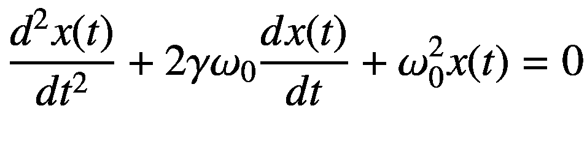

```
In [28]: ode_sol = sympy.dsolve(ode)
In [29]: ode_sol
Out[29]:
```

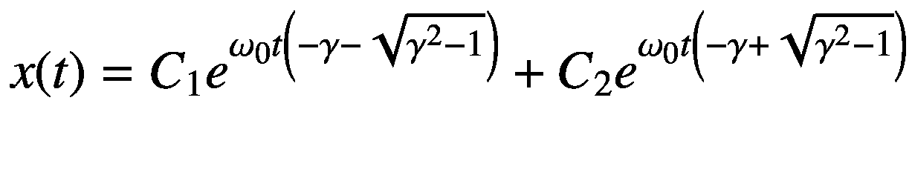

由于这是一个二阶 ODE，通解中包含两个未定的积分常数。为了选出 ODE 的特解，我们需要同时指定位置 `x(0)` 和速度 `dx(t)/dt` 在 `t=0` 时的初始条件。为此，我们创建一个包含这些初始条件的字典，并使用 `apply_ics` 将其应用于 ODE 通解：

```
In [30]: ics = {x(0): 1, x(t).diff(t).subs(t, 0): 0}
In [31]: ics
Out[31]:
```

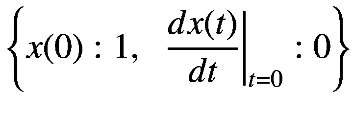

```
In [32]: x_t_sol = apply_ics(ode_sol, ics, t, [omega0, gamma])
In [33]: x_t_sol
Out[33]:
```

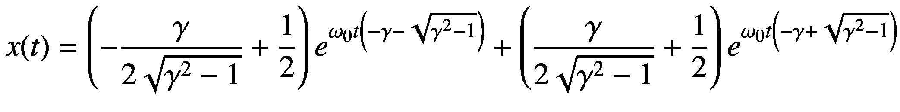

这是振子动力学对于任意 `t`、`ω[0]` 和 `γ` 的解，我们使用了初始条件 `x(0) = 1` 和 `dx(t)/dt` 在 `t=0 = 0`。然而，直接将 `γ = 1`（对应临界阻尼）代入此表达式会导致除零错误，因此对于 `γ` 的这个特定取值，我们需要小心地计算 `γ → 1` 的极限。

```
In [34]: x_t_critical = sympy.limit(x_t_sol.rhs, gamma, 1)
In [35]: x_t_critical
Out[35]:
```

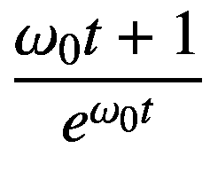

最后，我们绘制了 `ω[0] = 2π` 以及一系列不同阻尼比 `γ` 的解：

```
In [36]: fig, ax = plt.subplots(figsize=(8, 4))
...: tt = np.linspace(0, 3, 250)
...: w0 = 2 * sympy.pi
...: for g in [0.1, 0.5, 1, 2.0, 5.0]:
...:     if g == 1:
...:         x_t = sympy.lambdify(t, x_t_critical.subs({omega0: w0}), 'numpy')
...:     else:
...:         x_t = sympy.lambdify(t, x_t_sol.rhs.subs({omega0: w0, gamma: g}), 'numpy')
...:     ax.plot(tt, x_t(tt).real, label=r"$\gamma = %.1f$" % g)
...: ax.set_xlabel(r"$t$", fontsize=18)
...: ax.set_ylabel(r"$x(t)$", fontsize=18)
...: ax.legend()
```

阻尼谐振子 ODE 的解绘制在图 9-1 中。对于 `γ < 1`，振子是欠阻尼的，我们看到振荡解。对于 `γ > 1`，振子是过阻尼的，并单调衰减。这两种行为之间的交叉发生在临界阻尼比 `γ = 1` 处。

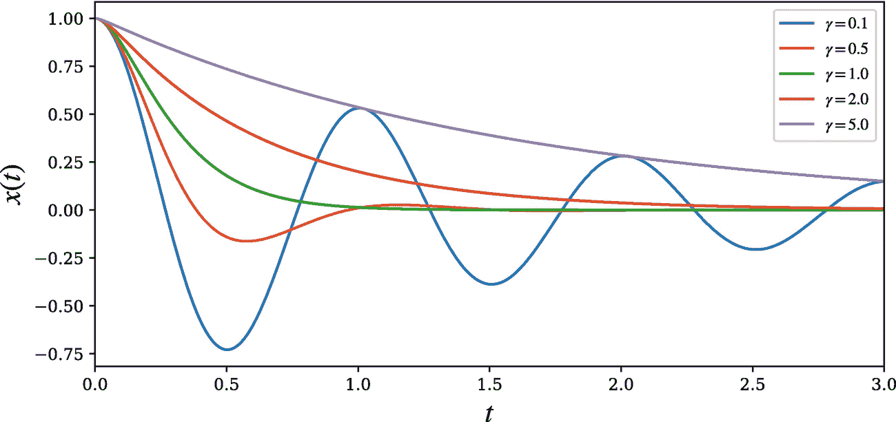

**图 9-1** – 一系列阻尼比下，阻尼谐振子 ODE 的解。

到目前为止，我们研究的两个 ODE 例子都可以通过解析方法精确求解，但情况并非总是如此。即使是许多一阶 ODE，也无法用初等函数精确求解。例如，考虑 `dy(x)/dx = x + y(x)²`，这是一个没有闭式解的 ODE 例子。如果我们尝试使用 `sympy.dsolve` 求解此方程，将得到一个近似解，形式为幂级数：

```
dy(x)/dx = x + y(x)²
```

(图片引用: 332789_2_En_9_Chapter/332789_2_En_9_Chapter_TeX_Equi.png)


```python
In [37]: x = sympy.symbols("x")
In [38]: y = sympy.Function("y")
In [39]: f = y(x)**2 + x
In [40]: sympy.Eq(y(x).diff(x), f)
Out[40]:
```

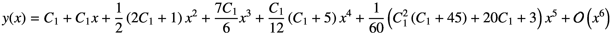

```python
In [41]: sympy.dsolve(y(x).diff(x) - f)
Out[41]:
```

对于许多其他类型的方程，SymPy 完全无法产生任何解。例如，如果我们尝试求解二阶 ODE 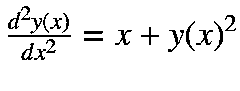，我们会得到以下错误信息：

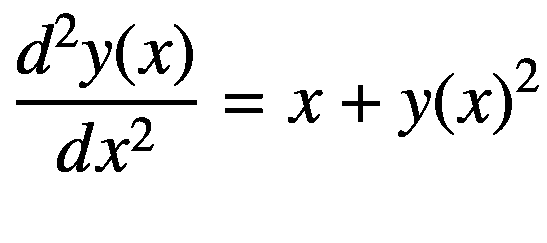

```python
In [42]: sympy.Eq(y(x).diff(x, x), f)
Out[42]:
```

```python
In [43]: sympy.dsolve(y(x).diff(x, x) - f)

...
NotImplementedError: solve: Cannot solve -x - y(x)**2 + Derivative(y(x), x, x)
```

这类结果可能意味着 ODE 确实没有解析解，或者同样可能的是，SymPy 无法处理它。

`dsolve` 函数接受许多可选参数，并且如果通过给出关于应使用哪些方法来解决当前 ODE 问题的提示来引导求解器，通常会产生不同的结果。有关可用选项的更多信息，请参阅 `sympy.dsolve` 的文档字符串。

## 方向场

*方向场图*是一种简单但有用的技术，用于可视化任意一阶 ODE 的可能解。它由短线段组成，这些线段在 *x*-*y* 平面上的网格上显示未知函数的斜率。可以轻松生成此图，因为在 *x*-*y* 平面上任意点处 `y(x)` 的斜率由 ODE 的定义给出： 也就是说，我们只需要遍历感兴趣坐标网格上的 `x` 和 `y` 值，并计算 `f(x, y(x))` 即可知道该点处 `y(x)` 的斜率。方向场图之所以有用，是因为在方向场图中，与斜率线（在每个点）相切的光滑连续曲线可能是 ODE 的解。

以下函数 `plot_direction_field` 为一阶 ODE 生成方向场图，给定自变量 `x`、未知函数 `y(x)` 以及右侧函数 `f(x, y(x))`。它还接受 `x` 和 `y` 轴的可选范围（分别为 `x_lim` 和 `y_lim`）以及一个可选的 Matplotlib 轴实例，用于在其上绘制图形。

```python
In [44]: def plot_direction_field(x, y_x, f_xy, x_lim=(-5, 5), y_lim=(-5, 5), ax=None):
...:     f_np = sympy.lambdify((x, y_x), f_xy, 'numpy')
...:     x_vec = np.linspace(x_lim[0], x_lim[1], 20)
...:     y_vec = np.linspace(y_lim[0], y_lim[1], 20)
...:
...:     if ax is None:
...:         _, ax = plt.subplots(figsize=(4, 4))
...:
...:     dx = x_vec[1] - x_vec[0]
...:     dy = y_vec[1] - y_vec[0]
...:
...:     for m, xx in enumerate(x_vec):
...:         for n, yy in enumerate(y_vec):
...:             Dy = f_np(xx, yy) * dx
...:             Dx = 0.8 * dx**2 / np.sqrt(dx**2 + Dy**2)
...:             Dy = 0.8 * Dy*dy / np.sqrt(dx**2 + Dy**2)
...:             ax.plot([xx - Dx/2, xx + Dx/2],
...:                     [yy - Dy/2, yy + Dy/2], 'b', lw=0.5)
...:     ax.axis('tight')
...:     ax.set_title(r"$%s$" %
...:                  (sympy.latex(sympy.Eq(y(x).diff(x), f_xy))),
...:                  fontsize=18)
...:     return ax
```

借助此函数，我们可以为形式为  的 ODE 生成方向场图。例如，以下代码为 `f(x, y(x)) = y(x)² + x`、`f(x, y(x)) = -x / y(x)` 和 `f(x, y(x)) = y(x)² / x` 生成方向场图。结果显示在图 9-2 中。

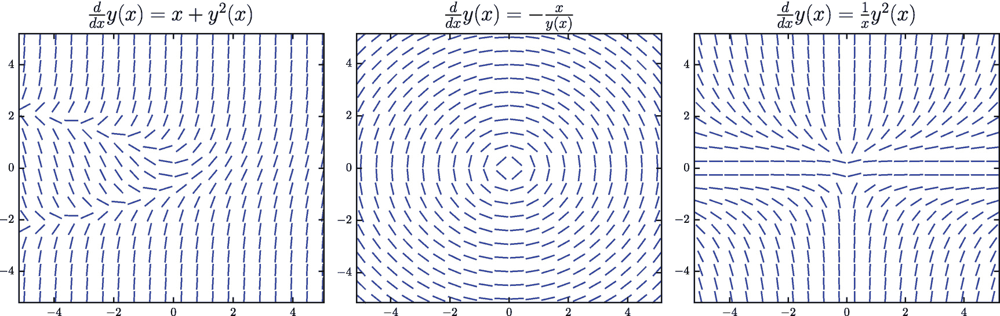

**图 9-2** 三个一阶微分方程的方向场

```python
In [45]: x = sympy.symbols("x")
In [46]: y = sympy.Function("y")
In [47]: fig, axes = plt.subplots(1, 3, figsize=(12, 4))
...: plot_direction_field(x, y(x), y(x)**2 + x, ax=axes[0])
...: plot_direction_field(x, y(x), -x / y(x), ax=axes[1])
...: plot_direction_field(x, y(x), y(x)**2 / x, ax=axes[2])
```

图 9-2 中图形的方向线揭示了对应于相应 ODE 的曲线如何表现，因此方向场图是可视化无法解析求解的 ODE 解的有用工具。为了说明这一点，再次考虑具有初始条件 `y(0) = 0` 的 ODE 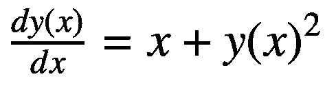，我们之前看到它可以近似求解为幂级数。像之前一样，我们通过定义符号 `x` 和函数 `y(x)` 再次求解此问题，然后使用它们构造并显示该 ODE：

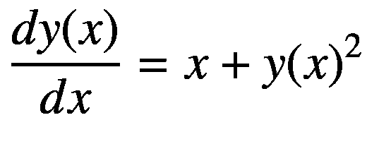


```python
In [48]: x = sympy.symbols("x")
In [49]: y = sympy.Function("y")
In [50]: f = y(x)**2 + x
In [51]: sympy.Eq(y(x).diff(x), f)
Out[51]:
```

现在，我们希望找到满足初始条件的特定幂级数解。针对这个问题，我们可以直接使用 `dsolve` 函数的 `ics` 关键字参数来指定初始条件^(³⁸)：

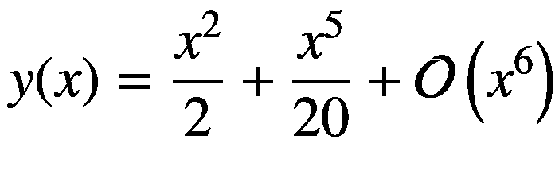

```python
In [52]: ics = {y(0): 0}
In [53]: ode_sol = sympy.dsolve(y(x).diff(x) - f, ics=ics)
In [54]: ode_sol
Out[54]:
```

将解与常微分方程的方向场绘制在一起，是一种快速而简单的方法，可以直观了解幂级数近似的有效范围。以下代码绘制了近似解和方向场（图 9-3 左侧面板）。通过以递增的 `x` 值为初始条件反复求解常微分方程（初始条件取自先前的幂级数解），还可以得到有效范围更广的解（图 9-3 右侧面板）。

```python
In [55]: fig, axes = plt.subplots(1, 2, figsize=(8, 4))
...: # 左侧面板
...: plot_direction_field(x, y(x), f, ax=axes[0])
...: x_vec = np.linspace(-3, 3, 100)
...: axes[0].plot(x_vec, sympy.lambdify(x, ode_sol.rhs.removeO())(x_vec), 'b', lw=2)
...: axes[0].set_ylim(-5, 5)
...:
...: # 右侧面板
...: plot_direction_field(x, y(x), f, ax=axes[1])
...: x_vec = np.linspace(-1, 1, 100)
...: axes[1].plot(x_vec, sympy.lambdify(x, ode_sol.rhs.removeO())(x_vec), 'b', lw=2)
...: # 使用更新后的初始条件迭代求解常微分方程
...: ode_sol_m = ode_sol_p = ode_sol
...: dx = 0.125
...: # 正 x 方向
...: for x0 in np.arange(1, 2., dx):
...:     x_vec = np.linspace(x0, x0 + dx, 100)
...:     ics = {y(x0): ode_sol_p.rhs.removeO().subs(x, x0)}
...:     ode_sol_p = sympy.dsolve(y(x).diff(x) - f, ics=ics, n=6)
...:     axes[1].plot(x_vec, sympy.lambdify (x, ode_sol_p.rhs.removeO())(x_vec), 'r', lw=2)
...: # 负 x 方向
...: for x0 in np.arange(-1, -5, -dx):
...:     x_vec = np.linspace(x0, x0 - dx, 100)
...:     ics = {y(x0): ode_sol_m.rhs.removeO().subs(x, x0)}
...:     ode_sol_m = sympy.dsolve(y(x).diff(x) - f, ics=ics, n=6)
...:     axes[1].plot(x_vec, sympy.lambdify(x, ode_sol_m.rhs.removeO())(x_vec), 'r', lw=2)
```

在图 9-3 的左侧面板中，我们看到近似解曲线在 `x = 0` 附近与方向场线吻合良好，但在 `|x| ≳ 1` 处开始偏离，表明近似解不再有效。右侧面板中显示的解曲线在整个绘制范围内与方向场吻合得更好。蓝色（深灰色）曲线段是原始近似解，红色（浅灰色）曲线是初始条件从蓝色（深灰色）曲线末端开始、通过重新求解常微分方程得到的延续曲线。

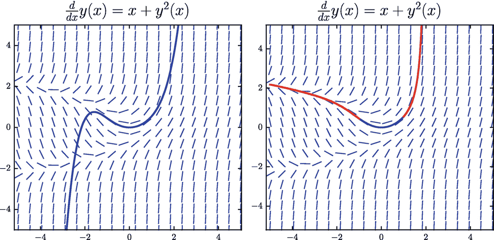

**图 9-3**

常微分方程 `dy(x)/dx = y(x)² + x` 的*方向场图*，展示了在 `x = 0` 附近的五阶幂级数解（左图），以及在 `x` 介于 -5 和 2 之间、间距为 0.125 的连续幂级数展开（右图）。

### 使用拉普拉斯变换求解常微分方程

除了使用 SymPy 的“黑箱”求解器^(³⁹) `dsolve` 进行符号求解外，另一种方法是利用 SymPy 的符号计算能力，以更手动的方式来求解常微分方程。一种可用于求解某些常微分方程问题的技术是对方程进行拉普拉斯变换，这通常能得到一个更容易求解的代数方程。然后，通过对该代数方程的解进行拉普拉斯逆变换，将其转换回原域，从而得到原问题的解。该方法的关键在于，函数导数的拉普拉斯变换是该函数本身拉普拉斯变换的代数表达式`L[y'(t)] = s * L[y(t)] - y(0)`。然而，虽然 SymPy 擅长对许多类型的基本函数进行拉普拉斯变换，但它无法识别如何对未知函数的导数进行变换。不过，定义一个执行此任务的函数可以轻松弥补这一缺陷。

例如，考虑以下受驱谐振子的微分方程：

`d²y(t)/dt² + 2 * dy(t)/dt + 10 * y(t) = 2 * sin(3t)`。

为了处理这个常微分方程，我们首先为自变量 `t` 和函数 `y(t)` 创建 SymPy 符号，然后用它们构建常微分方程的符号表达式：

`10 * y(t) - 2 * sin(3t) + 2 * dy(t)/dt + d²y(t)/dt² = 0`

```python
In [56]: t = sympy.symbols("t", positive=True)
In [57]: y = sympy.Function("y")
In [58]: ode = y(t).diff(t, 2) + 2 * y(t).diff(t) + 10 * y(t) - 2 * sympy.sin(3*t)
In [59]: sympy.Eq(ode)
Out[59]:
```

对这个常微分方程进行拉普拉斯变换应该会得到一个代数方程。为了使用 SymPy 及其函数 `sympy.laplace_transform` 来实现这一方法，我们首先需要创建一个符号 `s`，用于拉普拉斯变换。此时，我们也创建一个符号 `Y`，以备后续使用。

```python
In [60]: s, Y = sympy.symbols("s, Y", real=True)
```

接下来，我们对未知函数 `y(t)` 以及整个常微分方程进行拉普拉斯变换：

`L_ty(t)`

```python
In [61]: L_y = sympy.laplace_transform(y(t), t, s)
In [62]: L_y
Out[62]:
```

`10 * L_ty(t) + 2 * L_tdy(t)/dt + L_td²y(t)/dt² - 6/(s² + 9) = 0`

```python
In [63]: L_ode = sympy.laplace_transform(ode, t, s, noconds=True)
In [64]: sympy.Eq(L_ode)
Out[64]:
```

在对未知函数 `y(t)` 进行拉普拉斯变换时，我们得到了未确定的结果 `L_ty(t)`，这是预料之中的。然而，对 `y(t)` 的导数（如 `dy(t)/dt`）应用 `sympy.laplace_transform`，则会导致未求值的表达式 `L_tdy(t)/dt`。这不是我们想要的结果，我们需要解决这个问题，以获得所寻求的代数方程。未知函数导数的拉普拉斯变换有一个众所周知的形式，该形式涉及函数本身的拉普拉斯变换，而不是其导数：对于函数 `y(t)` 的 `n` 阶导数，公式为


