# 通过 SymPy 进行拉普拉斯变换求解常微分方程

Laplace 变换的核心公式如下：

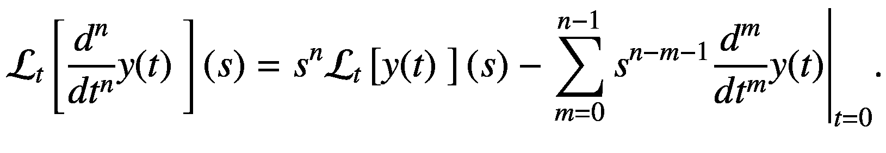

通过遍历 `L_ode` 的 SymPy 表达式树，并将出现的 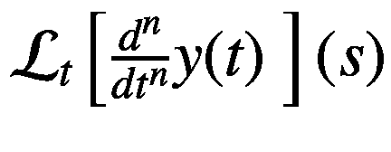 替换为由上述公式给出的表达式形式，我们可以得到所需的 ODE 代数形式。以下函数接受一个经过拉普拉斯变换的 ODE，并对其中未求值的 *y*(*t*) 导数项的拉普拉斯变换执行替换：

```
In [65]: def laplace_transform_derivatives(e):
...:     """
...:     Evaluate laplace transforms of derivatives of functions
...:     """
...:     if isinstance(e, sympy.LaplaceTransform):
...:         if isinstance(e.args[0], sympy.Derivative):
...:             d, t, s = e.args
...:             n = len(d.args) - 1
...:             return ((s**n) * sympy.LaplaceTransform(d.args[0], t, s) -
...:                     sum([s**(n-i) * sympy.diff(d.args[0], t, i-1).subs(t, 0) for i in range(1, n+1)]))
...:
...:     if isinstance(e, (sympy.Add, sympy.Mul)):
...:         t = type(e)
...:         return t(*[laplace_transform_derivatives(arg) for arg in e.args])
...:
...:     return e
```

将此函数应用于拉普拉斯变换后的 ODE 方程 `L_ode`，得到：

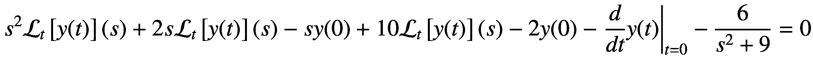

```
In [66]: L_ode_2 = laplace_transform_derivatives(L_ode)
In [67]: sympy.Eq(L_ode_2)
Out[67]:
```

为简化符号，我们现将表达式 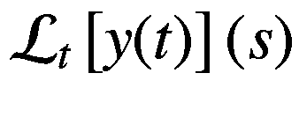 替换为符号 `Y` ：

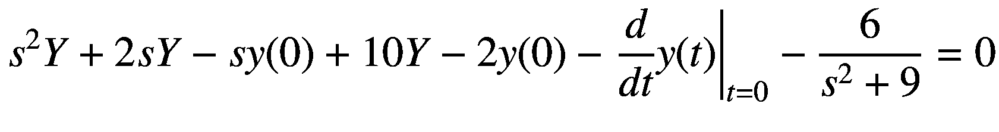

```
In [68]: L_ode_3 = L_ode_2.subs(L_y, Y)
In [69]: sympy.Eq(L_ode_3)
Out[69]:
```

现在我们需要指定 ODE 问题的边界条件。此处我们使用 `y(0) = 1` 和 `y'(t) = 0`。创建一个包含这些边界条件的字典后，我们将其值代入拉普拉斯变换后的 ODE 方程中：

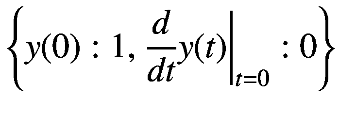

```
In [70]: ics = {y(0): 1, y(t).diff(t).subs(t, 0): 0}
In [71]: ics
Out[71]:
```

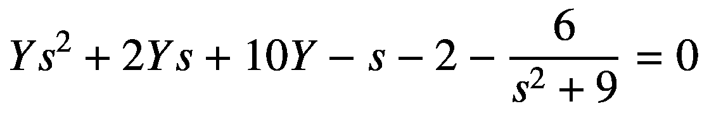

```
In [72]: L_ode_4 = L_ode_3.subs(ics)
In [73]: sympy.Eq(L_ode_4)
Out[74]:
```

这是一个代数方程，可以求解 `Y` ：

![$$ \left[\frac{s³+2{s}²+9s+24}{s⁴+2{s}³+19{s}²+18s+90}\right] $$](images/332789_2_En_9_Chapter/332789_2_En_9_Chapter_TeX_Equw.png)

```
In [75]: Y_sol = sympy.solve(L_ode_4, Y)
In [76]: Y_sol
Out[76]:
```

结果是一个包含解的列表，在本例中，该列表只包含一个元素。对此表达式执行逆拉普拉斯变换，即可得到原始问题在时域中的解：

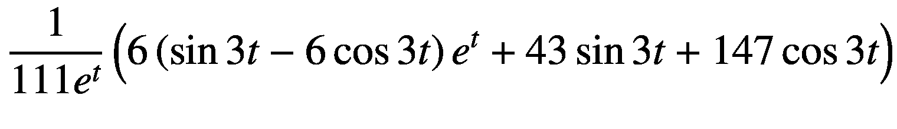

```
In [77]: y_sol = sympy.inverse_laplace_transform(Y_sol[0], s, t)
In [78]: sympy.simplify(y_sol)
Out[78]:
```

这种对 ODE 进行拉普拉斯变换、求解相应的代数方程、再对结果进行逆拉普拉斯变换，以得到原始问题解的技术，可用于求解许多重要的 ODE 问题，例如在电气工程和过程控制应用中遇到的问题。虽然这些问题可以借助拉普拉斯变换表手动求解，但使用 SymPy 有望极大地简化这个过程。


## 求解常微分方程的数值方法

虽然某些常微分方程问题可以通过解析方法求解（正如我们在前几节的例子中所见），但无法解析求解的常微分方程问题更为常见。因此，在实践中，常微分方程问题主要使用数值方法求解。有许多方法可以对常微分方程进行数值求解，其中大部分方法针对的是以标准形式^(⁴⁰)表述的一阶常微分方程组问题：`dy(x)/dx = f(x, y(x))`，其中 `y(x)` 是 `x` 的未知函数向量。SciPy 提供了求解此类问题的函数，但在探索如何使用这些函数之前，我们先简要回顾一下基本概念，并介绍用于常微分方程问题数值积分的术语。

许多常微分方程数值方法的基本思想都体现在欧拉法中。例如，该方法可以通过 `y(x)` 在点 `x` 附近的泰勒级数展开式推导得出：

`y(x + h) = y(x) + dy(x)/dx * h + (1/2) * d²y(x)/dx² * h² + ...`

为了简化符号，我们在此考虑 `y(x)` 为标量函数的情况。通过忽略二阶及更高阶项，我们得到近似方程 `y(x + h) ≈ y(x) + f(x, y(x)) * h`，该方程在步长 `h` 上具有一阶精度。通过对`x`变量进行离散化处理，即设置 `x[0], x[1], …, x[k]`，选择步长 `h[k] = x[k+1] - x[k]`，并记 `y[k] = y(x[k])`，可将该方程转化为迭代公式。由此得到的迭代公式 `y[k+1] ≈ y[k] + f(x[k], y[k]) * h[k]` 被称为*前向欧拉法*，它被认为是一种*显式*形式，因为给定 `y[k]` 的值，我们可以直接使用该公式计算出 `y[k+1]`。求解初值问题的数值目标是在给定初始条件 `y(x[0]) = y[0]` 的情况下，计算出 `y(x)` 在一些点 `x[n]` 上的值。因此，像前向欧拉法这样的迭代公式可以用来从 `y[0]` 开始，依次计算 `y[k]` 的后续值。这种方法涉及两种误差：首先，泰勒级数的截断会产生一个误差，这限制了方法的*精度*。其次，在计算 `y[k+1]` 时使用了前一次迭代给出的 `y[k]` 的近似值，这会产生额外的误差，并且该误差可能在后续迭代中累积，从而影响方法的*稳定性*。

另一种可以用类似方式推导的形式是*后向欧拉法*，其迭代公式为 `y[k+1] ≈ y[k] + f(x[k+1], y[k+1]) * h[k]`。这是一个*后向微分公式 (BDF)* 的例子，它是*隐式*的，因为 `y[k+1]` 出现在等式的两边。因此，为了计算 `y[k+1]`，我们需要求解一个代数方程（例如，使用牛顿法，见第 5 章）。隐式方法的实现比显式方法更复杂，并且每次迭代需要更多的计算量。然而，其优点在于隐式方法通常具有更大的稳定区域和更好的精度，这意味着可以使用更大的步长 `h[k]`，同时仍能获得精确且稳定的解。显式方法和隐式方法哪个更有效取决于所求解的具体问题。隐式方法通常对于*刚性*问题特别有用，粗略地说，刚性常微分方程问题描述的是具有多个不同时间尺度的动力学过程（例如，同时包含快慢振荡的动力学过程）。

有几种方法可以改进一阶的欧拉前向和后向方法。一种策略是在 `y(x + h)` 的泰勒级数展开式中保留更高阶的项，从而得到具有更好精度的更高阶迭代公式，例如二阶方法 `y[k+1] ≈ y(x[k]) + f(x[k+1], y[k+1]) * h[k] + (1/2) * y''(x) * h[k]²`。但是，这类方法需要计算 `y(x)` 的高阶导数，如果 `f(x, y(x))` 事先未知（且未以符号形式给出），这可能会成为一个问题。解决这个问题的方法包括使用导数的有限差分近似来逼近高阶导数，或者在区间 `[x[k], x[k+1]]` 内的中间点处对函数 `f(x, y(x))` 进行采样。这类方法的一个著名例子是龙格-库塔法，它是一种通过额外评估 `f(x, y(x))` 来实现的单步法。最著名的龙格-库塔法是四阶格式：

```
y[k+1] = y[k] + (1/6) * (k1 + 2*k2 + 2*k3 + k4)
```

其中

```
k1 = f(t[k], y[k]) * h[k]
k2 = f(t[k] + h[k]/2, y[k] + k1/2) * h[k]
k3 = f(t[k] + h[k]/2, y[k] + k2/2) * h[k]
k4 = f(t[k] + h[k], y[k] + k3) * h[k]
```

这里，`k[1]` 到 `k[4]` 是对常微分方程函数 `f(x, y(x))` 的四次不同评估，它们被用于上文给出的 `y[k+1]` 的显式公式中。由此得到的 `y[k+1]` 估计值具有四阶精度，误差为五阶。也可以构造使用更多函数评估的高阶格式。通过组合两种不同阶数的方法，还可以估计近似过程中的误差。一种流行的组合是龙格-库塔四阶和五阶格式，它产生了一种带有误差估计的四阶精确方法。这被称为 `RK45` 或龙格-库塔-费尔伯格法。多曼德-普林斯法是另一种高阶方法的例子，它额外使用了自适应步长控制。例如，8-5-3 方法结合了三阶和五阶格式来产生一个八阶方法。SciPy 提供了这种方法的实现，我们将在下一节中看到。

另一种方法是使用多于一个的 `y[k]` 先前值来计算 `y[k+1]`。这类方法被称为多步法，通常可以写成以下形式：

```
y[k+s] = sum_{n=0}^{s-1} a[n] * y[k+n] + h * sum_{n=0}^s b[n] * f(x[k+n], y[k+n])
```

使用此公式，为了计算 `y[k+s]`，会用到 `y[k]` 和 `f(x[k], y[k])` 的前 `s` 个值（这被称为 *s 步法*）。系数 `a[n]` 和 `b[n]` 的不同选择会产生不同的多步法。注意，如果 `b[s] = 0`，则该方法是显式的；如果 `b[s] ≠ 0`，则它是隐式的。


例如，`b[0]` = `b[1]` = … = `b[s−1]` = 0 给出了 **s** 步 BDF 公式的通式，其中选择 `a[n]` 和 `b[n]` 的方法是通过要求该方法对于尽可能高次的多项式精确成立，从而最大化精度阶数。这会得到一个方程组，通过求解可得到未知系数 `a[n]` 和 `b[n]`。例如，当 `b[1]` = `a[0]` = 1 时，单步 BDF 方法退化为后向欧拉法：`y[k+1] = y[k] + hf(x[k+1], y[k+1])`；而两步 BDF 方法 `y[k+2] = a[0]y[k] + a[1]y[k+1] + hb[2]f(x[k+2], y[k+2])`，在求解其系数（`a[0]`、`a[1]` 和 `b[2]`）后，变为 `y_{k+2} = -(1/3)y_k + (4/3)y_{k+1} + (2/3)hf(x_{k+2}, y_{k+2})`。还可以构造更高阶的 BDF 方法。SciPy 提供了一个 BDF 求解器，由于具有良好的稳定性，推荐用于刚性问题。

另一类多步法是亚当斯方法，其源于选择 `a[0]` = `a[1]` = … = `a[s−2]` = 0 且 `a[s−1]` = 1，同样地，剩下的未知系数被选择以最大化该方法的阶数。具体来说，满足 `b[s]` = 0 的显式方法称为亚当斯-巴什福思方法，而满足 `b[s]` ≠ 0 的隐式方法称为亚当斯-莫尔顿方法。例如，单步亚当斯-巴什福思和亚当斯-莫尔顿方法分别退化为前向和后向欧拉法；两步方法则分别为 `y_{k+2} = y_{k+1} + h(-(1/2)f(x_k, y_k) + (3/2)f(x_{k+1}, y_{k+1}))` 和 `y_{k+1} = y_k + (1/2)h(f(x_k, y_k) + f(x_{k+1}, y_{k+1}))`。也可以通过这种方式构造更高阶的显式和隐式方法。使用这些亚当斯方法的求解器在 SciPy 中也可用。

通常，显式方法比隐式方法更易于实现且迭代计算量更少，后者原则上需要在每次迭代中求解一个（可能是非线性的）方程，并为未知的 `y[k+1]` 提供一个初始猜测。然而，如前所述，隐式方法通常更精确，且具有更优的稳定性。一种能保留两者部分优点的折衷方案是按以下方式结合显式和隐式方法：首先使用显式方法计算 `y[k+1]`，然后将此 `y[k+1]` 作为初始猜测，用于求解由隐式方法给出的关于 `y[k+1]` 的方程。这个方程不需要精确求解，既然显式方法给出的初始猜测应该相当不错，那么使用例如牛顿法进行少量迭代可能就足够了。像这样，用显式方法的结果来预测 `y[k+1]`，并用隐式方法来*校正*该预测的方法，称为*预测-校正*法。

最后，许多高级 ODE 求解器采用的一项重要技术是*自适应步长*或*步长控制*：ODE 的精度和稳定性与 ODE 方法迭代公式中使用的步长 `h[k]` 密切相关，求解的计算成本也是如此。如果在计算 `y[k+1]` 的同时能够估计 `y[k+1]` 的误差，那么就有可能自动调整步长 `h[k]`，使得求解器在可能时使用经济的大步长，在需要时使用较小的步长。另一种相关技术（某些方法可实现）是自动调整方法的阶数，以便在可能时使用低阶方法，在必要时使用高阶方法。亚当斯方法就是可以轻松改变阶数的方法的例子。

存在大量高质量的 ODE 求解器实现，通常没有必要重新实现这里讨论的任何方法。实际上，除非是出于教育目的，或者一个人的主要兴趣是数值 ODE 求解方法的研究，否则这样做可能是一个错误。出于实用目的，建议使用众多已经存在且经过高度调优和充分测试的 ODE 套件之一，其中大多数是免费且开源的，并被封装到诸如 SciPy 等库中。然而，有大量求解器可供选择，为了能够针对特定问题做出明智的决策，并理解它们的许多选项，熟悉这些基本思想、方法以及用于讨论它们的术语是非常重要的。


## 使用 SciPy 进行 ODE 的数值积分

在上一节回顾了求解常微分方程（ODE）的数值方法之后，我们现在准备探索 SciPy 中可用的 ODE 求解器以及如何使用它们。SciPy 的 `integrate` 模块提供了两个 ODE 求解器接口：`integrate.odeint` 和 `integrate.ode`。`odeint` 函数是 ODEPACK 包中 LSODA 求解器的一个接口，^((41)) 该求解器会在非刚性问题中自动切换至 Adams 预测-校正法，在刚性问题中则切换至 BDF 方法。相比之下，`integrate.ode` 类为多种不同的求解器提供了面向对象的接口：VODE 和 ZVODE 求解器^((42))（ZVODE 是 VODE 针对复值函数的变体）、LSODA 求解器，以及 `dopri5` 和 `dop853`，它们是四阶和八阶的 Dormand-Prince 方法（即一种龙格-库塔方法），并具有自适应步长。尽管 `integrate.ode` 提供的面向对象接口更加灵活，但在许多情况下，`odeint` 函数使用起来更简单、更方便。接下来，我们将从 `odeint` 函数开始，探讨这两个接口。

`odeint` 函数需要三个强制参数：一个用于计算标准形式 ODE 右侧的函数、一个指定未知函数初始条件的数组（或标量），以及一个包含自变量值的数组，用于计算未知函数。用于计算 ODE 右侧的函数需要两个强制参数以及任意数量的可选参数。所需的参数是向量 *y*(*x*) 对应的数组（或标量）作为第一个参数，*x* 的值作为第二个参数。例如，再次考虑标量 ODE *y*′(*x*) = *f* (*x*, *y*(*x*)) = *x*+*y*(*x*)²。为了能够再次绘制该 ODE 的方向场，这次同时绘制一个通过 `odeint` 数值积分得到的特解，我们首先定义构建 *f* (*x*, *y*(*x*)) 符号表达式所需的 SymPy 符号：

```
In [79]: x = sympy.symbols("x")
In [80]: y = sympy.Function("y")
In [81]: f = y(x)**2 + x
```

为了能够用 SciPy 的 `odeint` 求解该 ODE，我们首先必须要定义一个用于 *f* (*x*, *y*(*x*)) 的 Python 函数，该函数接受 Python 标量或 NumPy 数组作为输入。从 SymPy 表达式 `f` 出发，我们可以使用 `sympy.lambdify` 并传入 `'numpy'` 参数^((43)) 来生成这样一个函数：

```
In [82]: f_np = sympy.lambdify((y(x), x), f)
```

接下来，我们需要定义初始值 `y0` 和一个 NumPy 数组，该数组包含用于计算函数 *y*(*x*) 的离散 *x* 值。这里，我们从 *x* = 0 开始，分别向正方向和负方向求解该 ODE，分别使用 NumPy 数组 `xp` 和 `xm`。请注意，要在负方向上求解 ODE，我们只需要创建一个包含负增量的 NumPy 数组即可。现在我们已经设置了 ODE 函数 `f_np`、初始值 `y0` 和 *x* 坐标数组（例如 `xp`），我们可以通过调用 `integrate.odeint(f_np, y0, xp)` 来对 ODE 问题进行积分：

```
In [83]: y0 = 0
In [84]: xp = np.linspace(0, 1.9, 100)
In [85]: yp = integrate.odeint(f_np, y0, xp)
In [86]: xm = np.linspace(0, -5, 100)
In [87]: ym = integrate.odeint(f_np, y0, xm)
```

结果是两个一维 NumPy 数组 `ym` 和 `yp`，其长度与相应的坐标数组 `xm` 和 `xp` 相同（即 100 个元素），它们包含了 ODE 问题在指定点处的解。为了可视化该解，接下来我们将 `ym` 和 `yp` 数组与 ODE 的方向场绘制在一起。结果如图 9-4 所示。很明显，该解在图形中的每一点都与方向场中的线条（切线）对齐，正如所预期的那样。

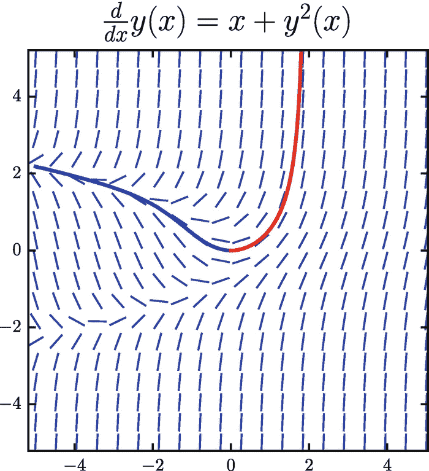

**图 9-4** – ODE *y*′(*x*) = *x*+*y*(*x*)² 的方向场及满足 *y*(0) = 0 的特解

```
In [88]: fig, ax = plt.subplots(1, 1, figsize=(4, 4))
...: plot_direction_field(x, y(x), f, ax=ax)
...: ax.plot(xm, ym, 'b', lw=2)
...: ax.plot(xp, yp, 'r', lw=2)
```

在上一个例子中，我们求解了一个标量 ODE 问题。更多时候，我们感兴趣的是向量值 ODE 问题（ODE 方程组）。为了了解如何使用 `odeint` 求解这类问题，考虑用于描述捕食者和猎物动物种群动态的 Lotka-Volterra 方程（耦合 ODE 的经典例子）。方程为 *x*′(*t*) = *ax* − *bxy* 和 *y*′(*t*) = *cxy* − *dy*，其中 *x*(*t*) 是猎物的数量，*y*(*t*) 是捕食者的数量，系数 *a*、*b*、*c* 和 *d* 描述了模型中各过程的速率。例如，*a* 是猎物的出生率，*d* 是捕食者的死亡率。*b* 和 *c* 系数分别是捕食者消耗猎物的速率以及捕食者种群以消耗猎物种群为代价而增长的速率。请注意，由于存在 *xy* 项，这是一个非线性 ODE 系统。

为了用 `odeint` 解决此问题，我们首先需要编写一个用于向量形式 ODE 右侧的函数。对于本例，我们有 *f*(*t*, [*x*, *y*]^(*T*)) = [*ax* − *bxy*, *cxy* − *dy*]^(*T*)，我们可以通过以下方式将其实现为一个 Python 函数：

```
In [89]: a, b, c, d = 0.4, 0.002, 0.001, 0.7
In [90]: def f(xy, t):
...:     x, y = xy
...:     return [a * x - b * x * y, c * x * y - d * y]
```

在这里，我们还定义了系数 *a*、*b*、*c* 和 *d* 的变量及其值。请注意，这里 ODE 函数 `f` 的第一个参数是一个包含 *x*(*t*) 和 *y*(*t*) 当前值的数组。为方便起见，我们首先将这些变量解包成单独的变量 `x` 和 `y`，这使得函数的其余部分更易阅读。函数的返回值应是一个数组或列表，其中包含 *x*(*t*) 和 *y*(*t*) 的导数值。函数 `f` 还必须接受参数 `t`，即自变量的当前值。但是，在本例中并未使用 `t`。一旦定义了 `f` 函数，我们还需要定义一个包含初始值 *x*(0) 和 *y*(0) 的数组 `xy0`，以及一个用于计算 ODE 解的点的数组 `t`。这里我们使用初始条件 *x*(0) = 600 和 *y*(0) = 400，这对应于模拟开始时 600 只猎物和 400 个捕食者。

```
In [91]: xy0 = [600, 400]
In [92]: t = np.linspace(0, 50, 250)
In [93]: xy_t = integrate.odeint(f, xy0, t)
In [94]: xy_t.shape
Out[94]: (250,2)
```

调用 `integrate.odeint(f, xy0, t)` 对 ODE 问题进行积分，并返回一个形状为 (250, 2) 的数组，其中包含对应于 `t` 中 250 个值的每个 *x*(*t*) 和 *y*(*t*)。以下代码绘制了该解随时间变化以及在相空间中的情况。结果如图 9-5 所示。

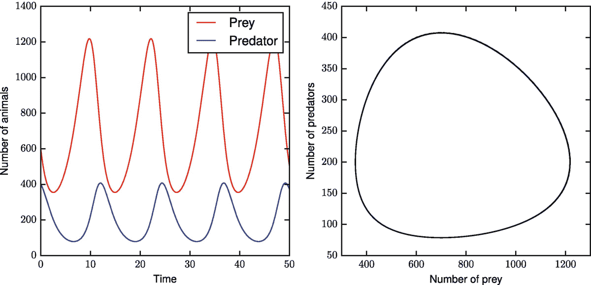

**图 9-5** – 捕食者-猎物种群的 Lotka-Volterra ODE 的解，左图为随时间变化，右图为在相空间中的情况

```
In [95]: fig, axes = plt.subplots(1, 2, figsize=(8, 4))
...: axes[0].plot(t, xy_t[:,0], 'r', label="猎物")
...: axes[0].plot(t, xy_t[:,1], 'b', label="捕食者")
...: axes[0].set_xlabel("时间")
...: axes[0].set_ylabel("动物数量")
...: axes[0].legend()
...: axes[1].plot(xy_t[:,0], xy_t[:,1], 'k')
...: axes[1].set_xlabel("猎物数量")
...: axes[1].set_ylabel("捕食者数量")
```


在前两个示例中，ODE 右侧的函数实现没有使用额外参数。在 Lotka-Volterra 方程的示例中，函数`f`使用了全局定义的系数变量。相比于使用全局变量，通常更便捷且优雅的做法是，将`f`函数实现为接受所有系数或参数作为参数。为了说明这一点，我们考虑另一个著名的 ODE 问题：Lorenz 方程，它是以下三个耦合非线性 ODE 的系统：*x*′(*t*) = *σ*(*y* − *x*)、*y*′(*t*) = *x*(*ρ* − *z*) − *y*和*z*′(*t*) = *xy* − *βz*。这些方程以其混沌解而闻名，其解敏感地依赖于参数*σ*、*ρ*和*β*的值。如果我们希望针对这些参数的不同值求解这些方程，那么编写 ODE 函数使其额外将这些变量的值作为参数是很有用的。在下面的`f`实现中，在必需的*y*(*t*)和*t*参数之后，添加了三个参数`sigma`、`rho`和`beta`，用于对应命名的参数：

```
In [96]: def f(xyz, t, sigma, rho, beta):
...:     x, y, z = xyz
...:     return [sigma * (y - x),
...:             x * (rho - z) - y,
...:             x * y - beta * z]
```

接下来，我们定义具有特定参数值的变量、用于计算解的*t*值数组，以及函数*x*(*t*)、*y*(*t*)和*z*(*t*)的初始条件。

```
In [97]: sigma, rho, beta = 8, 28, 8/3.0
In [98]: t = np.linspace(0, 25, 10000)
In [99]: xyz0 = [1.0, 1.0, 1.0]
```

这次当我们调用`integrate.odeint`时，还需要指定`args`参数，该参数必须是一个列表、元组或数组，其元素数量与我们在前面部分定义的`f`函数中的额外参数数量相同。在本例中，有三个参数，我们在调用`integrate.odeint`时通过`args`参数传递一个包含这些参数值的元组。下面，我们针对三组不同的参数（但初始条件相同）求解 ODE。

```
In [100]: xyz1 = integrate.odeint(f, xyz0, t, args=(sigma, rho, beta))
In [101]: xyz2 = integrate.odeint(f, xyz0, t, args=(sigma, rho, 0.6*beta))
In [102]: xyz3 = integrate.odeint(f, xyz0, t, args=(2*sigma, rho, 0.6*beta))
```

解存储在 NumPy 数组`xyz1`、`xyz2`和`xyz3`中。在本例中，这些数组的形状为`(10000, 3)`，因为`t`数组有 10000 个元素，并且 ODE 问题中有三个未知函数。以下代码在 3D 图中绘制了这三个解，结果如图 9-6 所示。系统参数稍有变化，所得解就可能大不相同。

```
In [103]: from mpl_toolkits.mplot3d.axes3d import Axes3D
In [104]: fig, (ax1, ax2, ax3) = plt.subplots(1, 3, figsize=(12, 4),
...:                                     subplot_kw={'projection':'3d'})
...: for ax, xyz, c in [(ax1, xyz1, 'r'), (ax2, xyz2, 'b'), (ax3, xyz3, 'g')]:
...:     ax.plot(xyz[:,0], xyz[:,1], xyz[:,2], c, alpha=0.5)
...:     ax.set_xlabel('$x$', fontsize=16)
...:     ax.set_ylabel('$y$', fontsize=16)
...:     ax.set_zlabel('$z$', fontsize=16)
...:     ax.set_xticks([-15, 0, 15])
...:     ax.set_yticks([-20, 0, 20])
...:     ax.set_zticks([0, 20, 40])
```

到目前为止，我们看到的三个示例都使用了`odeint`求解器。该函数接受大量可选参数，可用于微调求解器，包括允许的最大步数（`hmax`）以及 Adams（`mxordn`）和 BDF（`mxords`）方法的最大阶数等。有关更多信息，请参阅`odeint`的文档字符串。

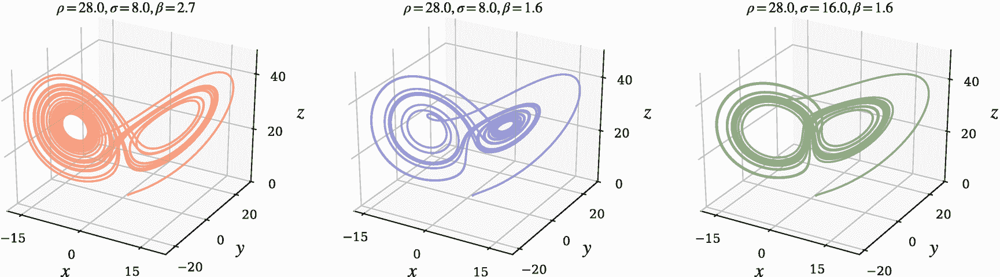

**图 9-6** Lorenz ODE 在三个不同参数集下的动力学行为

SciPy 中`odeint`的替代方案是`integrate.ode`类提供的面向对象接口。与使用`odeint`函数一样，使用`integrate.ode`类时，我们首先需要定义 ODE 的右侧函数，并定义初始状态数组以及我们想要计算解的独立变量值的数组。然而，一个微小但重要的区别是：用于`odeint`的函数*f*(*x*, *y*(*x*))必须具有函数签名`f(y, x, ...)`，而用于`integrate.ode`的相应函数必须具有函数签名`f(x, y, ...)`（即`x`和`y`的顺序相反）。

`integrate.ode`类可以与一系列不同的求解器配合使用，并且每个求解器都有特定的选项。`integrate.ode`的文档字符串描述了可用的求解器及其选项。为了说明如何使用`integrate.ode`接口，我们首先看下面这组耦合的二阶 ODE：

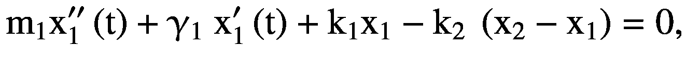

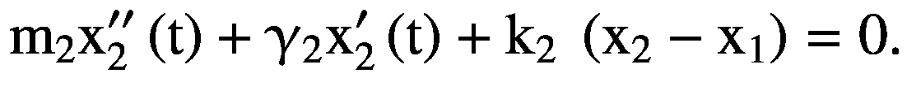

这些方程描述了两个耦合弹簧的动力学，其中`x1`和`x2`是两个物体（质量分别为`m[1]`和`m[2]`）相对于其平衡位置的位移。`x[1]`处的物体通过一个弹簧常数为`k[1]`的弹簧连接到固定墙上，并通过一个弹簧常数为`k[2]`的弹簧连接到`x[2]`处的物体。两个物体分别受到由`γ[1]`和`γ[2]`表征的阻尼力作用。要使用 SciPy 解决这类问题，我们首先需要将其写成标准形式，为此我们可以引入`y0 = x1`、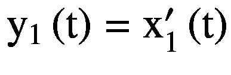、`y2 = x2`和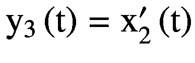，从而得到四个耦合的一阶方程：

![$$ \frac{\mathrm{d}}{\mathrm{d}\mathrm{t}}\left[\begin{array}{c}{\mathrm{y}}_0\left(\mathrm{t}\right)\\ {}{\mathrm{y}}_1\left(\mathrm{t}\right)\\ {}{\mathrm{y}}_2\left(\mathrm{t}\right)\\ {}{\mathrm{y}}_3\left(\mathrm{t}\right)\end{array}\right]=\mathrm{f}\left(\mathrm{t},\mathbf{y}\left(\mathrm{t}\right)\right)=\left[\begin{array}{c}{\mathrm{y}}_1\left(\mathrm{t}\right)\\ {}\left(-{\upgamma}_1{\mathrm{y}}_1\left(\mathrm{t}\right)-{\mathrm{k}}_1{\mathrm{y}}_0\left(\mathrm{t}\right)-{\mathrm{k}}_2{\mathrm{y}}_0\left(\mathrm{t}\right)+{\mathrm{k}}_2{\mathrm{y}}_2\left(\mathrm{t}\right)\right)/{\mathrm{m}}_1\\ {}{\mathrm{y}}_3\left(\mathrm{t}\right)\\ {}\left(-{\upgamma}_2{\mathrm{y}}_3\left(\mathrm{t}\right)-{\mathrm{k}}_2{\mathrm{y}}_2\left(\mathrm{t}\right)+{\mathrm{k}}_2{\mathrm{y}}_0\left(\mathrm{t}\right)\right)/{\mathrm{m}}_2\end{array}\right] $$](images/332789_2_En_9_Chapter/332789_2_En_9_Chapter_TeX_Equah.png)

第一项任务是编写一个 Python 函数，实现函数`f(t, y(t))`，该函数还将问题参数作为额外参数。在下面的实现中，我们将所有参数打包成一个元组，作为单个参数传递给函数，并在函数体的第一行解包：


```python
In [105]: def f(t, y, args):
...:     m1, k1, g1, m2, k2, g2 = args
...:     return [y[1], - k1/m1 * y[0] + k2/m1 * (y[2] - y[0]) - g1/m1 * y[1],
...:             y[3], - k2/m2 * (y[2] - y[0]) - g2/m2 * y[3]]
```

函数 `f` 的返回值是一个长度为 4 的列表，其元素是常微分方程函数 *y*0 到 *y*3 的导数。接下来，我们为参数创建带有特定值的变量，并将它们打包成一个元组 `args`，以便传递给函数 `f`。和之前一样，我们还需要为初始条件 `y0` 以及我们希望计算常微分方程解的 *t* 值数组 `t` 创建数组。

```python
In [106]: m1, k1, g1 = 1.0, 10.0, 0.5
In [107]: m2, k2, g2 = 2.0, 40.0, 0.25
In [108]: args = (m1, k1, g1, m2, k2, g2)
In [109]: y0 = [1.0, 0, 0.5, 0]
In [110]: t = np.linspace(0, 20, 1000)
```

使用 `integrate.odeint` 和 `integrate.ode` 的主要区别从这里开始。我们现在不再调用 `odeint` 函数，而是需要创建 `integrate.ode` 类的一个实例，并将常微分方程函数 `f` 作为参数传递：

```python
In [111]: r = integrate.ode(f)
```

这里我们将生成的求解器实例存储在变量 `r` 中。在开始使用它之前，我们需要配置它的一些属性。至少，我们需要使用 `set_initial_value` 方法设置初始状态，如果函数 `f` 需要额外的参数，我们需要使用 `set_f_params` 方法配置这些参数。我们还可以使用 `set_integrator` 方法选择求解器，该方法接受以下求解器名称作为第一个参数：`vode`、`zvode`、`lsoda`、`dopri5` 和 `dop853`。每个求解器都接受额外的可选参数。有关详细信息，请参阅 `integrate.ode` 的文档字符串。这里我们使用 LSODA 求解器，并设置初始状态和函数 `f` 的参数：

```python
In [112]: r.set_integrator('lsoda');
In [113]: r.set_initial_value(y0, t[0]);
In [114]: r.set_f_params(args);
```

一旦创建并配置好求解器，我们就可以通过调用 `r.integrate` 方法逐步求解常微分方程，并且可以使用 `r.successful` 方法查询积分状态（只要积分顺利进行，该方法返回 `True`）。我们需要跟踪要积分到的点，并且需要自己存储结果：

```python
In [115]: dt = t[1] - t[0]
...: y = np.zeros((len(t), len(y0)))
...: idx = 0
...: while r.successful() and r.t < t[-1]:
...:     y[idx, :] = r.y
...:     r.integrate(r.t + dt)
...:     idx += 1
```

这可以说不如直接调用 `odeint` 方便，但它提供了额外的灵活性，有时这正是所需要的。在这个例子中，我们将解存储在数组 `y` 中，对应于 `t` 中的每个元素，这与 `odeint` 可能返回的结果类似。以下代码绘制了解，结果如图 9-7 所示。

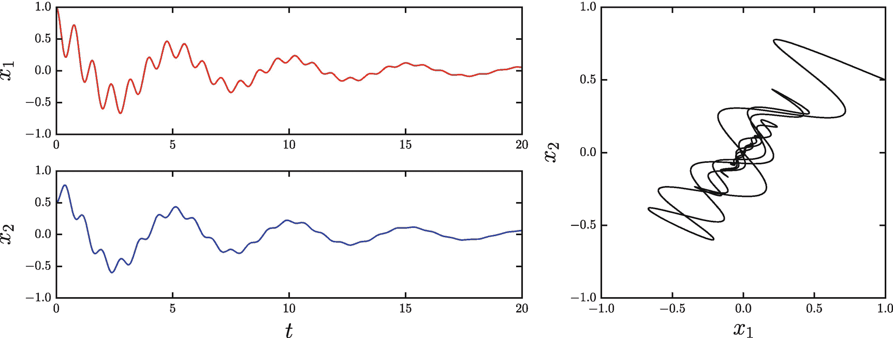

**图 9-7** 两个耦合阻尼振荡器的常微分方程解

```python
In [116]: fig = plt.figure(figsize=(10, 4))
...: ax1 = plt.subplot2grid((2, 5), (0, 0), colspan=3)
...: ax2 = plt.subplot2grid((2, 5), (1, 0), colspan=3)
...: ax3 = plt.subplot2grid((2, 5), (0, 3), colspan=2, rowspan=2)
...: # x_1 随时间变化图
...: ax1.plot(t, y[:, 0], 'r')
...: ax1.set_ylabel('$x_1$', fontsize=18)
...: ax1.set_yticks([-1, -.5, 0, .5, 1])
...: # x2 随时间变化图
...: ax2.plot(t, y[:, 2], 'b')
...: ax2.set_xlabel('$t$', fontsize=18)
...: ax2.set_ylabel('$x_2$', fontsize=18)
...: ax2.set_yticks([-1, -.5, 0, .5, 1])
...: # x1 和 x2 相空间图
...: ax3.plot(y[:, 0], y[:, 2], 'k')
...: ax3.set_xlabel('$x_1$', fontsize=18)
...: ax3.set_ylabel('$x_2$', fontsize=18)
...: ax3.set_xticks([-1, -.5, 0, .5, 1])
...: ax3.set_yticks([-1, -.5, 0, .5, 1])
...: fig.tight_layout()
```

除了为常微分方程函数 *f*(*t*, *y*(*t*)) 提供一个 Python 函数外，我们还可以提供一个 Python 函数来计算给定 *t* 和 *y*(*t*) 的雅可比矩阵。例如，求解器可以利用雅可比矩阵更高效地求解隐式方法中出现的方程组。要使用雅可比函数 `jac`，比如下面为当前问题定义的函数，我们需要在创建 `integrate.ode` 类时将其与 `f` 函数一起传递。如果雅可比函数 `jac` 需要额外的参数，这些参数也必须使用结果 `integrate.ode` 实例中的 `set_jac_params` 方法进行配置：

```python
In [117]: def jac(t, y, args):
...:     m1, k1, g1, m2, k2, g2 = args
...:     return [[0, 1, 0, 0],
...:             [- k1/m2 - k2/m1, - g1/m1 * y[1], k2/m1, 0],
...:             [0, 0, 1, 0],
...:             [k2/m2, 0, - k2/m2, - g2/m2]]
In [118]: r = integrate.ode(f, jac)
In [119]: r.set_jac_params(args);
```

只要能够先将常微分方程问题定义为 SymPy 表达式，就可以方便地使用 SymPy 的 `lambdify` 生成 *f*(*t*, *y*(*t*)) 及其雅可比矩阵的 Python 函数。这种符号-数值混合方法是一种解决常微分方程问题的强大方法。为了说明这种方法，考虑一个双摆的两个耦合的二阶非线性常微分方程组。第一个和第二个摆的角偏移 *θ*1 和 *θ*2 的运动方程分别为⁴⁴


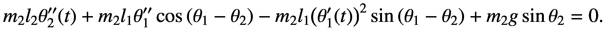

第一个摆连接在一个固定支撑上，第二个摆连接在第一个摆上。这里 *m*[1] 和 *m*[2] 分别是第一个和第二个摆的质量，*l*[1] 和 *l*[2] 分别是它们的长度。我们首先为问题中的变量和函数定义 SymPy 符号，然后构建常微分方程表达式：


```python
In [120]: t, g, m1, l1, m2, l2 = sympy.symbols("t, g, m_1, l_1, m_2, l_2")
In [121]: theta1, theta2 = sympy.symbols("theta_1, theta_2", cls=sympy.Function)
In [122]: ode1 = sympy.Eq((m1+m2)*l1 * theta1(t).diff(t,t) +
...:                 m2*l2 * theta2(t).diff(t,t) * sympy.cos(theta1(t)-theta2(t)) +
...:                 m2*l2 * theta2(t).diff(t)**2 * sympy.sin(theta1(t)-theta2(t)) +
...:                 g*(m1+m2) * sympy.sin(theta1(t)))
...: ode1
Out[122]:
```

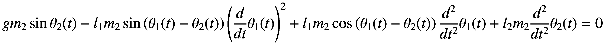


```
In [123]: ode2 = sympy.Eq(m2*l2 * theta2(t).diff(t,t) +
...:                 m2*l1 * theta1(t).diff(t,t) * sympy.cos(theta1(t)-theta2(t)) -
...:                 m2*l1 * theta1(t).diff(t)**2 * sympy.sin(theta1(t) - theta2(t)) +
...:                 m2*g * sympy.sin(theta2(t)))
...: ode2
Out[123]:
```

现在 `ode1` 和 `ode2` 是用于两个二阶常微分方程（ODE）的 SymPy 表达式。尝试用 `sympy.dsolve` 求解这些方程是徒劳的，我们需要使用数值方法来继续。然而，这里的方程形式并不适合使用 SciPy 中可用的 ODE 求解器进行数值求解。我们首先必须将两个二阶 ODE 的系统写成标准形式的四个一阶 ODE 的系统。将方程重写为标准形式并不困难，但手动操作可能很繁琐。幸运的是，我们可以利用 SymPy 的符号计算能力来自动完成这项任务。为此，我们需要引入新的函数 `y1(t) = theta1(t)` 和 `y2(t) = theta1'(t)`，以及 `y3(t) = theta2(t)` 和 `y4(t) = theta2'(t)`，并用这些函数重写 ODE。通过创建一个用于变量替换的字典，并使用 SymPy 函数 `subs` 通过该字典执行替换，我们可以轻松获得 `y2'(t)` 和 `y4'(t)` 的方程：

```
In [124]: y1, y2, y3, y4 = sympy.symbols("y_1, y_2, y_3, y_4", cls=sympy.Function)
In [125]: varchange = {theta1(t).diff(t, t): y2(t).diff(t),
...:              theta1(t): y1(t),
...:              theta2(t).diff(t, t): y4(t).diff(t),
...:              theta2(t): y3(t)}
In [126]: ode1_vc = ode1.subs(varchange)
In [127]: ode2_vc = ode2.subs(varchange)
```

我们还需要为 `y1'(t)` 和 `y3'(t)` 引入另外两个 ODE：

```
In [128]: ode3 = y1(t).diff(t) - y2(t)
In [129]: ode4 = y3(t).diff(t) - y4(t)
```

此时，我们有关于函数 `y1` 到 `y4` 的四个耦合的一阶 ODE。剩下的工作就是求解这些函数的导数，以获得标准形式的 ODE。我们可以使用 `sympy.solve` 来做到这一点：

```
In [130]: y = sympy.Matrix([y1(t), y2(t), y3(t), y4(t)])
In [131]: vcsol = sympy.solve((ode1_vc, ode2_vc, ode3, ode4), y.diff(t), dict=True)
In [132]: f = y.diff(t).subs(vcsol[0])
```

现在，`f` 是 ODE 函数 `f(t, y(t))` 的 SymPy 表达式。我们可以使用 `sympy.Eq(y.diff(t), f)` 来显示 ODE，但结果相当冗长，为了节省篇幅，我们不在此处展示输出。构造 `f` 的主要目的是将其转换为一个可用于 `integrate.odeint` 或 `integrate.ode` 的 NumPy 感知函数。现在 ODE 的形式已经可以让我们使用 `sympy.lambdify` 来创建这样的函数。此外，由于到目前为止我们拥有问题的符号表示，因此也很容易计算雅可比矩阵并为其创建一个 NumPy 感知函数。当使用 `sympy.lambdify` 为 `odeint` 和 `ode` 创建函数时，我们必须注意在传递给 `sympy.lambdify` 的元组中将 `t` 和 `y` 放在正确的顺序。这里我们将使用 `integrate.ode`，因此我们需要一个签名为 `f(t, y, *args)` 的函数，因此我们将元组 `(t, y)` 作为第一个参数传递给 `sympy.lambdify`，然后我们使用一个 `lambda` 函数包装结果函数，以便能够接收额外的参数 `args`，该参数在 SymPy 表达式中未使用。

```
In [133]: params = {m1: 5.0, l1: 2.0, m2: 1.0, l2: 1.0, g: 10.0}
In [134]: _f_np = sympy.lambdify((t, y), f.subs(params), 'numpy')
In [135]: f_np = lambda _t, _y, *args: _f_np(_t, _y)
In [136]: jac = sympy.Matrix([[fj.diff(yi) for yi in y] for fj in f])
In [137]: _jac_np = sympy.lambdify((t, y), jac.subs(params), 'numpy')
In [138]: jac_np = lambda _t, _y, *args: _jac_np(_t, _y)
```

在这里，我们在调用 `sympy.lambdify` 之前，还替换了系统参数的特定值。第一个摆的长度是第二个摆的两倍，质量是五倍。有了函数 `f_np` 和 `jac_np`，我们现在准备像前面的例子一样，使用 `integrate.ode` 来求解 ODE。这里我们取初始状态为 `theta1(0) = 2` 和 `theta2(0) = 0`，并且导数均为零，然后在时间区间 `[0, 20]` 上以 1000 步进行求解：

```
In [139]: y0 = [2.0, 0, 0, 0]
In [140]: tt = np.linspace(0, 20, 1000)
In [141]: r = integrate.ode(f_np, jac_np).set_initial_value(y0, tt[0])
In [142]: dt = tt[1] - tt[0]
...: yy = np.zeros((len(tt), len(y0)))
...: idx = 0
...: while r.successful() and r.t < tt[-1]:
...:     yy[idx, :] = r.y
...:     r.integrate(r.t + dt)
...:     idx += 1
```

ODE 的解现在存储在数组 `yy` 中，其形状为 `(1000, 4)`。在可视化这个解时，更直观的做法是在 `x-y` 平面上绘制摆的位置，而不是它们的角度偏转。角度变量 `theta1` 和 `theta2` 与 `x` 和 `y` 坐标之间的变换是：`x1 = l1 * sin(theta1)`，`y1 = -l1 * cos(theta1)`，`x2 = x1 + l2 * sin(theta2)`，`y2 = y1 - l2 * cos(theta2)`：

```
In [143]: theta1_np, theta2_np = yy[:, 0], yy[:, 2]
In [144]: x1 = params[l1] * np.sin(theta1_np)
...: y1 = -params[l1] * np.cos(theta1_np)
...: x2 = x1 + params[l2] * np.sin(theta2_np)
...: y2 = y1 - params[l2] * np.cos(theta2_np)
```

最后，我们绘制双摆随时间以及在 `x-y` 平面上的动态。结果如图 9-8 所示。正如预期的那样，摆 1 被限制在一个圆上运动（因为其固定锚点），而摆 2 则具有更复杂的轨迹。

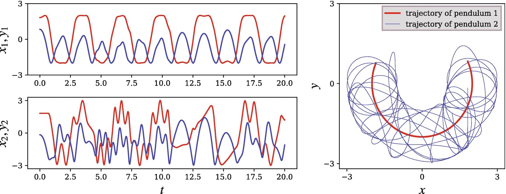

**图 9-8** 双摆的动态

```
In [145]: fig = plt.figure(figsize=(10, 4))
...: ax1 = plt.subplot2grid((2, 5), (0, 0), colspan=3)
...: ax2 = plt.subplot2grid((2, 5), (1, 0), colspan=3)
...: ax3 = plt.subplot2grid((2, 5), (0, 3), colspan=2, rowspan=2)
...:
...: ax1.plot(tt, x1, 'r')
...: ax1.plot(tt, y1, 'b')
...: ax1.set_ylabel('$x_1, y_1$', fontsize=18)
...: ax1.set_yticks([-3, 0, 3])
...:
...: ax2.plot(tt, x2, 'r')
...: ax2.plot(tt, y2, 'b')
...: ax2.set_xlabel('$t$', fontsize=18)
...: ax2.set_ylabel('$x_2, y_2$', fontsize=18)
...: ax2.set_yticks([-3, 0, 3])
...:
...: ax3.plot(x1, y1, 'r')
...: ax3.plot(x2, y2, 'b', lw=0.5)
...: ax3.set_xlabel('$x$', fontsize=18)
...: ax3.set_ylabel('$y$', fontsize=18)
...: ax3.set_xticks([-3, 0, 3])
...: ax3.set_yticks([-3, 0, 3])
```


## 总结

在本章中，我们探索了使用 Python 科学计算包求解常微分方程的各种方法与工具。常微分方程出现在科学与工程的众多领域——特别是在动力系统的建模与描述中——因此掌握求解常微分方程问题的技术是计算科学家必备技能的关键组成部分。在本章中，我们首先研究了使用 SymPy 符号求解常微分方程的方法，包括使用 `sympy.dsolve` 函数或拉普拉斯变换法。符号方法往往是良好的起点，借助 SymPy 的符号计算能力，许多基础常微分方程问题都可以求得解析解。然而，对于大多数实际问题，解析解并不存在，此时符号方法必然失效。我们剩下的选择只能退而求其次，采用数值技术。常微分方程的数值积分是数学中一个广阔的领域，存在众多可靠的求解方法。本章简要回顾了常微分方程的数值积分方法，旨在介绍 SciPy 提供的求解器所用到的 Adams 和 BDF 多步法背后的概念与思想。最后，我们通过几个示例问题的求解，展示了如何使用 SciPy 的 `integrate` 模块提供的 `odeint` 和 `ode` 求解器。尽管大多数常微分方程问题最终都需要数值积分，但采用结合了 SymPy 和 SciPy 特性的符号-数值混合方法，往往能带来巨大的优势。本章的最后一个示例专门演示了这一方法。

## 扩展阅读

Heath（2002）的著作提供了对许多常微分方程数值求解方法的易懂介绍。如需通过代码示例回顾常微分方程，可参阅《Numerical Recipes》（W.H. Press 2007）的第 11 章。关于常微分方程数值方法的更详细综述，可参考例如 (Kendall Atkinson 2009)。SciPy 中使用的主要常微分方程求解器实现是 VODE 和 LSODA 求解器。这些方法的原始源代码可分别从 netlib 的 [`www.netlib.org/ode/vode.f`](http://www.netlib.org/ode/vode.f) 和 [`www.netlib.org/odepack`](http://www.netlib.org/odepack) 获取。除了这些求解器，还有一个著名的求解器套件 sundials，由劳伦斯利弗莫尔国家实验室提供，可从 [`http://computation.llnl.gov/casc/sundials/main.html`](http://computation.llnl.gov/casc/sundials/main.html) 获取。该套件还包含微分代数方程（DAE）的求解器。`scikit.odes` 库提供了 sundials 求解器的 Python 接口，可从 [`http://github.com/bmcage/odes`](http://github.com/bmcage/odes) 获取。`odespy` 库也为众多不同的常微分方程求解器提供了统一接口。有关 `odespy` 的更多信息，请访问项目网站 [`http://hplgit.github.io/odespy/doc/web/index.html`](http://hplgit.github.io/odespy/doc/web/index.html) 。

