# 16. 贝叶斯统计

本章我们将探讨统计学的一种替代解释——贝叶斯统计——及其相关方法。与我们在第 13 章和第 14 章中使用的频率学派统计不同，贝叶斯统计学将概率视为信念程度，而非观测结果比例的度量。这种不同的视角衍生出独特的统计方法，可用于解决实际问题。虽然从原则上讲，统计问题通常既可以用频率学派统计也可以用贝叶斯统计解决，但两者在实际操作中存在差异，这使它们分别适用于不同类型的问题。

贝叶斯统计基于贝叶斯定理，该定理关联了条件概率与非条件概率。贝叶斯定理是概率论的基本结果，同时适用于频率学派和贝叶斯学派的统计解释。在贝叶斯推断语境下，非条件概率用于描述系统的先验知识，而贝叶斯定理提供了在获得新观测后更新该知识的规则。更新后的知识由条件概率描述，该概率以观测数据为条件。系统的初始知识由`先验概率分布`描述，而基于观测数据更新后的知识则是`后验概率分布`。在使用贝叶斯统计解决问题时，后验概率分布是我们寻求的未知量，从中可计算感兴趣随机变量的期望值及其他统计量。尽管贝叶斯定理描述了如何从先验分布计算后验分布，但对于大多数实际问题，计算涉及评估高维积分，这在解析和数值计算上都极其困难。这直到近期仍阻碍着贝叶斯统计的广泛应用。然而，随着计算统计学的发展和高效模拟方法的出现——这些方法允许我们直接从后验分布中采样（而非直接计算）——贝叶斯方法正日益普及。使我们能够从后验分布采样的方法首先是所谓的马尔可夫链蒙特卡洛（MCMC）方法。MCMC 方法有多种实现方式，例如传统的吉布斯采样和 `Metropolis-Hastings` 算法，以及较新的哈密顿算法和 `No-U-Turn` 算法。本章我们将探讨如何使用其中几种方法。

使用贝叶斯推断方法解决统计问题有时被称为`概率编程`。概率编程的关键步骤如下：(1) 创建统计模型。(2) 使用 MCMC 方法从感兴趣量的后验分布中采样。(3) 利用获得的后验分布计算当前问题所需性质，并根据结果做出推断决策。本章我们将探讨如何在 Python 环境中借助 `PyMC` 库完成这些步骤。

### `PyMC`

`PyMC` 库，目前称为 `PyMC3`，提供了一个进行概率编程的框架——即使用贝叶斯方法通过模拟解决统计问题。撰写本文时，最新正式版本为 3.4.1。更多项目信息请访问 [`docs.pymc.io`](http://docs.pymc.io)。

## 导入模块

本章主要使用 `pymc3` 库，按以下方式导入：

```python
In [1]: import pymc3 as mc
```

此外，我们还需要 NumPy、Pandas 和 Matplotlib 分别用于基础数值计算、数据分析和绘图。这些库按常规方式导入：

```python
In [2]: import numpy as np
In [3]: import pandas as pd
In [4]: import matplotlib.pyplot as plt
```

为与非贝叶斯统计进行比较，我们还会用到 SciPy 的 `stats` 模块、`statsmodels` 库以及 Seaborn 可视化库：

```python
In [5]: from scipy import stats
In [6]: import statsmodels.api as sm
In [7]: import statsmodels.formula.api as smf
In [8]: import seaborn as sns
```

## 贝叶斯统计导论

贝叶斯统计的基础是贝叶斯定理，该定理给出了两个事件 `A` 和 `B` 的无条件概率与条件概率之间的关系：

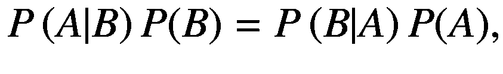

其中 `P(A)` 和 `P(B)` 是事件 `A` 和 `B` 的无条件概率，而 `P(A|B)` 是在事件 `B` 为真的条件下事件 `A` 的条件概率，`P(B|A)` 则是在事件 `A` 为真的条件下事件 `B` 的条件概率。上述等式两边都等于事件 `A` 和 `B` 同时为真的概率：`P(A ∩ B)`。换句话说，贝叶斯法则表明，`A` 和 `B` 同时为真的概率等于 `A` 的概率乘以在 `A` 为真的条件下 `B` 的概率，即 `P(A)P(B|A)`，或者等价地，等于 `B` 的概率乘以在 `B` 为真的条件下 `A` 的概率：`P(B)P(A|B)`。

在贝叶斯推断的语境中，贝叶斯法则通常用于以下情况：我们对事件 `A` 的概率有一个先验信念，由无条件概率 `P(A)` 表示，并希望在观察到事件 `B` 后更新这一信念。在这种表述中，更新后的信念由给定观测 `B` 的条件下 `A` 的条件概率表示：`P(A|B)`，我们可以使用贝叶斯法则进行计算：

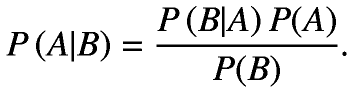

该表达式中的每个因子都有不同的解释和名称：`P(A)` 是事件 `A` 的`先验`概率，而 `P(A|B)` 是给定观测 `B` 后 `A` 的`后验`概率。`P(B|A)` 是在 `A` 为真的条件下观测到 `B` 的`似然`，而无论 `A` 为何值观测到 `B` 的概率 `P(B)` 被称为`模型证据`，可以视为（相对于 `A` 的）归一化常数。

在统计建模中，我们通常关注一组由具有特定参数 `θ` 的概率分布所表征的随机变量 `X`。在收集了我们感兴趣建模过程的数据后，我们希望从数据中推断出模型参数的值。在频率论统计方法中，我们可以最大化给定观测数据的似然函数，并获得模型参数的估计量。贝叶斯方法则将未知的模型参数 `θ` 本身视为随机变量，并使用贝叶斯法则推导出模型参数 `θ` 的概率分布。如果我们用 `x` 表示观测到的数据，则可以利用贝叶斯法则将给定观测数据 `x` 时 `θ` 的概率分布表示为


该等式中的第二个等式源于全概率公式 `p(x) = ∫ p(x|θ)p(θ)dθ`。一旦我们计算出了模型参数的后验概率分布 `p(θ|x)`，我们就可以，例如，计算模型参数的期望值，并得到类似于在频率论方法中可计算出的估计量的结果。此外，当我们拥有 `p(θ|x)` 完整概率分布的估计时，我们还可以计算其他量，例如可信区间，以及在 `θ` 为多元情况下某些特定模型参数的边缘分布。例如，如果我们有两个模型参数 `θ = (θ[1], θ[2])`，但只对 `θ[1]` 感兴趣，我们可以通过积分联合概率分布 `p(θ[1], θ[2]|x)` 来获得边缘后验概率分布 `p(θ[1]|x)`，使用的表达式来自贝叶斯定理：


这里请注意，最终表达式包含对已知似然函数 `p(x|θ[1], θ[2])` 和先验分布 `p(θ[1], θ[2])` 的积分，因此我们无需知道联合概率分布 `p(θ[1], θ[2]|x)` 即可计算边缘概率分布 `p(θ[1]|x)`。这种方法为计算模型参数的概率分布以及在新数据可用时连续更新这些分布提供了一种强大且通用的方法论。然而，直接计算 `p(θ|x)` 或其边缘分布，要求我们能够写出似然函数 `p(x|θ)` 和先验分布 `p(θ)`，并能评估由此产生的积分。对于许多简单但重要的问题，可以解析地计算这些积分，并找到后验分布的精确闭式表达式。像 Gelman (2013) 这样的教科书提供了许多可以这样精确求解的问题的例子。然而，对于更复杂的模型，其先验分布和似然函数导致的积分不易评估，或者对于多元统计模型，其产生的积分可能是高维的，那么精确和数值评估都可能变得不可行。

正是在那些无法用精确方法求解的模型中，我们可以受益于使用模拟方法，例如马尔可夫链蒙特卡罗方法，该方法允许我们对模型参数的后验概率分布进行采样，从而构建联合或边缘后验分布的近似，或者直接评估诸如期望值之类的积分。基于模拟的方法的另一个重要优势是建模过程可以自动化。在这里，我们将专门专注于使用蒙特卡罗模拟方法进行贝叶斯统计建模。关于理论的详尽回顾以及许多可解析求解问题的例子，请参阅本章末尾给出的参考文献。在本章的其余部分，我们将探讨统计模型的定义以及使用`PyMC`库作为概率编程框架对其后验分布进行采样。

在继续讨论计算贝叶斯统计之前，有必要花一点时间来总结贝叶斯方法与我们在前几章中使用的经典频率论方法之间的关键区别：在这两种统计建模方法中，我们都用随机变量来表述模型。定义统计模型的一个关键步骤是对模型中定义的随机变量的概率分布做出假设。在参数化方法中，每个概率分布都由少量参数来表征。在频率论方法中，这些模型参数具有某些特定的真实值，而观测到的数据被解释为来自真实分布的随机样本。换句话说，模型参数被认为是固定的，而数据被认为是随机的。贝叶斯方法则持相反观点：数据被解释为固定的，而模型参数被描述为随机变量。从模型参数的先验分布出发，我们可以更新该分布以考虑观测到的数据，并最终获得以观测数据为条件的相关模型参数的概率分布。

## 模型定义

统计模型是通过一组随机变量来定义的。给定模型中的随机变量可以是相互独立的，或者更有趣的是，彼此之间存在依赖关系。`PyMC`库提供了用于表示大量概率分布中随机变量的类：例如，`mc.Normal`的实例可用于表示正态分布的随机变量。其他例子还有用于表示离散伯努利分布随机变量的`mc.Bernoulli`、用于均匀分布随机变量的`mc.Uniform`、用于伽马分布随机变量的`mc.Gamma`等等。有关可用分布的完整列表，请参阅`dir(mc.distributions)`以及每个可用分布的文档字符串，以了解如何使用它们。也可以使用`mc.DensityDist`类来定义自定义分布，该类接受一个指定随机变量概率密度函数对数的函数。

在第13章中，我们看到`SciPy`的`stats`模块也包含用于表示随机变量的类。与SciPy `stats`中的随机变量类类似，我们可以使用PyMC分布来表示具有固定参数的随机变量。然而，PyMC随机变量的基本特征在于，其分布参数（例如，对于服从正态分布 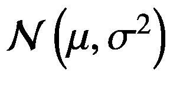 的随机变量，其均值*μ*和方差*σ*²）本身也可以是随机变量。这使我们能够在模型中链式连接随机变量，并构建具有层次结构的模型，该层次结构体现在模型中出现的随机变量之间的依赖关系上。

让我们从最简单的例子开始。在PyMC中，模型由`mc.Model`类的实例表示，并且使用Python上下文语法将随机变量添加到模型中：在模型上下文主体内创建的随机变量实例会自动添加到模型中。假设我们感兴趣的是一个由单个随机变量组成的模型，该随机变量服从参数固定的正态分布，即*μ* = 4 和*σ* = 2。我们首先定义固定的模型参数，然后创建一个`mc.Model`实例来表示我们的模型。

```
In [9]: mu = 4.0
In [10]: sigma = 2.0
In [11]: model = mc.Model()
```

接下来，我们通过在模型上下文中创建随机变量来将它们附加到模型上。这里，我们在模型上下文中创建了一个随机变量`X`，该上下文通过`with model`语句激活：

```
In [12]: with model:
...:     mc.Normal('X', mu, tau=1/sigma**2)
```

`PyMC`中所有随机变量类的第一个参数都是变量的名称。对于`mc.Normal`，第二个参数是正态分布的均值，第三个参数`tau`是精度*τ* = 1/*σ*²，其中*σ*²是方差。或者，我们可以使用`sd`关键字参数来指定标准差，而不是精度：`mc.Normal('X', mu, sd=sigma)`。

我们可以使用`vars`属性来检查模型中存在哪些随机变量。这里，模型中只有一个随机变量：

```
In [13]: model.vars
Out[13]: [X]
```

为了从模型中的随机变量进行采样，我们使用实现了MCMC算法的`mc.sample`函数。`mc.sample`函数接受许多参数，但至少我们需要提供采样数量作为第一个参数，以及一个步长类实例作为第二个参数，该实例实现了MCMC步进。可选地，我们还可以使用`start`关键字参数提供一个起始点，该起始点是一个字典，包含采样开始的参数值。对于步进方法，这里我们使用`mc.Metropolis`类的一个实例，该类为MCMC采样器实现了Metropolis-Hastings步进方法^(⁶⁵)。请注意，我们在模型上下文中执行所有与模型相关的代码：

```
In [14]: start = dict(X=2)
In [15]: with model:
...:     step = mc.Metropolis()
...:     trace = mc.sample(10000, start=start, step=step)
[-----------------100%-----------------] 10000 of 10000 complete in 1.6 sec
```

通过这些步骤，我们从模型内定义的随机变量中采样了10000个值，在这个简单案例中，该随机变量只是一个正态分布的随机变量。要访问这些样本，我们可以使用`mc.sample`函数返回的追踪对象的`get_values`方法：

```
In [16]: X = trace.get_values("X")
```

当然，正态分布的概率密度函数（PDF）是已知解析形式的。使用SciPy `stats`模块，我们可以通过`norm`类实例的`pdf`方法来访问PDF，以便与采样的随机变量进行比较。采样值以及当前模型的真实PDF如图16-1所示。

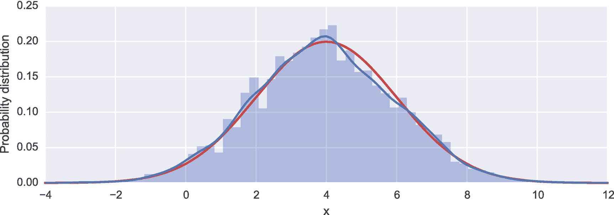

图 16-1

正态分布随机变量的概率密度函数（红色/粗线）以及来自10000个MCMC样本的直方图

```
In [17]: x = np.linspace(-4, 12, 1000)
In [18]: y = stats.norm(mu, sigma).pdf(x)
In [19]: fig, ax = plt.subplots(figsize=(8, 3))
...: ax.plot(x, y, 'r', lw=2)
...: sns.distplot(X, ax=ax)
...: ax.set_xlim(-4, 12)
...: ax.set_xlabel("x")
...: ax.set_ylabel("概率分布")
```

使用`mc.traceplot`函数，我们还可以可视化生成这些样本的MCMC随机游走，如图16-2所示。`mc.traceplot`函数会自动为模型中每个随机变量绘制核密度估计值和采样轨迹。


图 16-2

左图：采样轨迹的密度核估计（蓝色/粗线）和正态概率分布（红色/细线）。右图：MCMC采样轨迹

```
In [20]: fig, axes = plt.subplots(1, 2, figsize=(8, 2.5), squeeze=False)
...: mc.traceplot(trace, ax=axes)
...: axes[0, 0].plot(x, y, 'r', lw=0.5)
```

作为构建更复杂统计模型的下一步，再次考虑一个具有正态分布随机变量  的模型，但是其中的参数*μ*和*σ*本身是随机变量。在`PyMC`中，我们可以通过在创建其他随机变量时将它们作为参数传递来轻松创建依赖变量。例如，对于 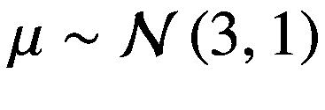 和  我们可以使用以下模型规范来创建依赖的随机变量*X*：

```markdown
In [21]: model = mc.Model()
In [22]: with model:
...:     mean = mc.Normal('mean', 3.0)
...:     sigma = mc.HalfNormal('sigma', sd=1.0)
...:     X = mc.Normal('X', mean, sd=sigma)
```

这里我们使用 `mc.HalfNormal` 来表示随机变量 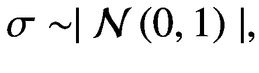，并且 `mc.Normal` 类中用于 *X* 的均值和标准差参数是随机变量实例，而非固定的模型参数。和之前一样，我们可以使用 `vars` 属性来检查一个模型包含哪些随机变量。

```
In [23]: model.vars
Out[23]: [mean, sigma_log__, X]
```

请注意，这里的 `pymc3` 库用一个经对数变换的变量 `sigma_log__` 来表示 `sigma` 变量，以此处理半正态分布。不过，我们仍然可以直接从模型中访问 `sigma` 变量，后续内容将展示这一点。

当模型复杂度增加时，显式地为采样过程选择合适的起始点可能不再那么简单直接。`mc.find_MAP` 函数可用于在参数空间中找出与后验分布最大值相对应的点，该点可作为采样过程的一个良好起始点。

```
In [24]: with model:
...:     start = mc.find_MAP()
In [25]: start
Out[25]: {'X': array(3.0), 'mean': array(3.0),
'sigma': array(0.70710674), 'sigma_log__': array(-0.34657365)}
```

和之前一样，一旦模型被定义，并且计算出了起始点，我们就可以使用 `mc.sample` 函数从模型中的随机变量进行采样，例如，使用 `mc.Metropolis` 作为 MCMC 采样步进方法：

```
In [26]: with model:
...:     step = mc.Metropolis()
...:     trace = mc.sample(100000, start=start, step=step)
[-----------------100%-----------------] 100000 of 100000 complete in 53.4 sec
```

例如，要获取 `sigma` 变量的样本轨迹，我们可以使用 `get_values('sigma')`。结果是一个包含样本值的 NumPy 数组，我们可以从中计算进一步的统计量，如其样本均值和标准差：

```
In [27]: trace.get_values('sigma').mean()
Out[27]: 0.80054476153369014
```

同样的方法可用于获取 `X` 的样本并计算其统计量：

```
In [28]: X = trace.get_values('X')
In [29]: X.mean()
Out[29]: 2.9993248663922092
In [30]: trace.get_values('X').std()
Out[30]: 1.4065656512676457
```

使用 `mc.traceplot` 创建的当前模型的轨迹图如图 16-3 所示，我们在 `mc.traceplot` 中使用了 `varnames` 参数来明确选择要绘制的随机变量。

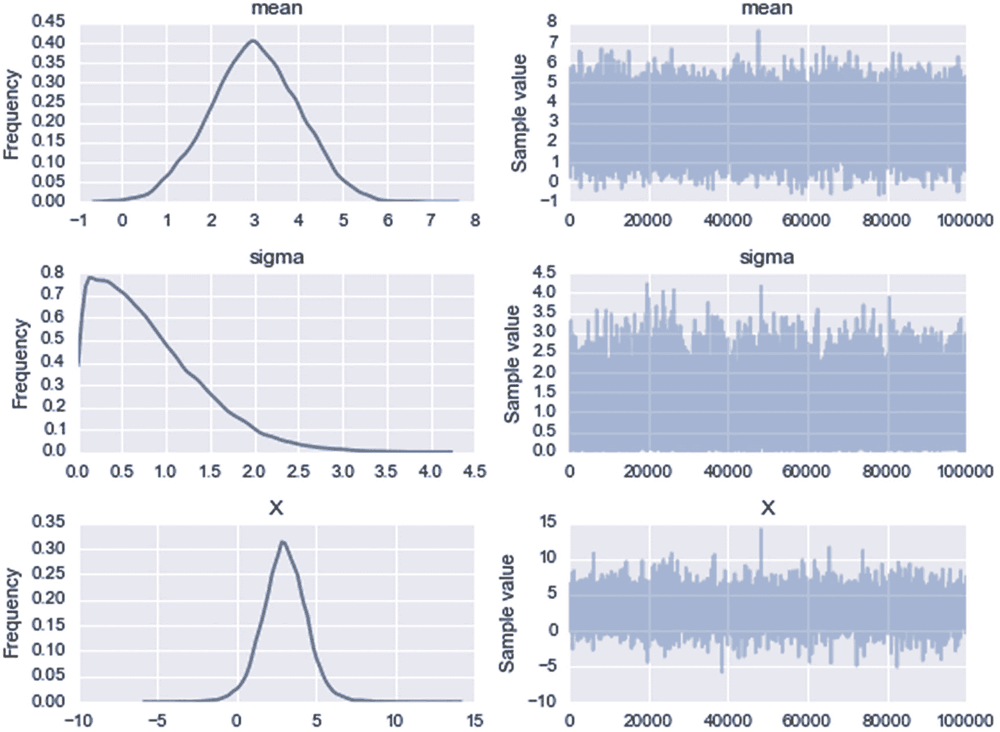

**图 16-3**

三个随机变量：*均值*、*sigma* 和 *X* 的核密度估计（左）和 MCMC 随机采样轨迹（右）。

```
In [31]: fig, axes = plt.subplots(3, 2, figsize=(8, 6), squeeze=False)
...: mc.traceplot(trace, varnames=['mean', 'sigma', 'X'], ax=axes)
```

## 采样后验分布

到目前为止，我们已定义并采样了仅包含随机变量且未引用任何观测数据的模型。在贝叶斯模型的语境中，这类随机变量代表了未知模型参数的先验分布。因此，在前面的示例中，我们使用 MCMC 方法从模型的先验分布中采样。然而，MCMC 算法的真正应用是从后验分布中采样，该后验分布代表了在更新先验分布以考虑观测数据影响后，模型变量的概率分布。

要使模型以观测数据为条件，我们只需在模型中创建相应随机变量时，使用 `observed` 关键字参数添加数据即可：例如，`mc.Normal('X', mean, 1/sigma**2, observed=data)` 表示随机变量 `X` 的观测值取自数组 `data`。向模型添加观测随机变量会自动导致后续使用 `mc.sample` 进行的采样，是对模型后验分布的采样，该后验分布根据贝叶斯规则和所选用于观测数据的分布所隐含的似然函数，正确地以观测数据为条件。例如，考虑我们在前文中使用的模型，该模型带有一个正态分布随机变量 *X*，其均值和标准差也是随机变量。这里我们通过使用 SciPy `stats` 模块中的 `norm` 类，从一个均值为 *μ* = 2.5 且标准差为 *σ* = 1.5 的正态分布随机变量中抽取样本来模拟 *X* 的观测值：

```
In [32]: mu = 2.5
In [33]: s = 1.5
In [34]: data = stats.norm(mu, s).rvs(100)
```

数据通过设置关键字参数 `observed=data` 馈入模型，该参数在创建观测变量并将其添加到模型时使用：

```
In [35]: with mc.Model() as model:
...:     mean = mc.Normal('mean', 4.0, 1.0) # 真实值 2.5
...:     sigma = mc.HalfNormal('sigma', 3.0 * np.sqrt(np.pi/2)) # 真实值 1.5
...:     X = mc.Normal('X', mean, 1/sigma**2, observed=data)
```

为 *X* 提供观测数据的一个结果是，它不再被视为模型中的随机变量。这可以通过使用 `vars` 属性检查模型来看到，其中 `X` 不再出现：

```
In [36]: model.vars
Out[36]: [mean, sigma_log_]
```

相反，在这种情况下，`X` 是一个确定性变量，用于构建将先验分布（由 `mean` 和 `sigma` 表示）与这些随机变量的后验分布联系起来的似然函数。和之前一样，我们可以使用 `mc.find_MAP` 函数为采样过程找到合适的起始点。在创建 MCMC 步进实例后，我们可以使用 `mc.sample` 对模型的后验分布进行采样：

```
In [37]: with model:
...:     start = mc.find_MAP()
...:     step = mc.Metropolis()
...:     trace = mc.sample(100000, start=start, step=step)
[-----------------100%-----------------] 100000 of 100000 complete in 36.1 sec
```

使用 `mc.find_MAP` 计算出的起始点使给定观测数据下的后验似然最大化，并提供了先验分布未知参数的估计值：

```
In [38]: start
Out[38]: {'mean': array(2.5064940359768246), 'sigma_log': array(0.394681633456101)}
```

然而，为了获得这些参数（它们本身就是随机变量）分布的估计值，我们需要按照前文所述，使用 `mc.sample` 函数执行 MCMC 采样。后验分布采样的结果如图 16-4 所示。请注意，由于数据及相应似然函数的影响，`mean` 和 `sigma` 变量的分布更接近真实参数值 *μ* = 2.5 和 *σ* = 1.5，而非先验猜测值 4.0 和 3.0。


**图 16-4**

*均值*和*西格玛*后验分布的 MCMC 采样轨迹
```

```markdown
# 线性回归

回归是统计建模中最基本的工具之一，我们已经在经典统计形式中看到过线性回归的例子，例如在第 14 章和第 15 章中。线性回归也可以通过贝叶斯方法处理，并将其视为一个建模问题：我们为未知模型参数（斜率和截距）分配先验概率分布，并根据现有观测数据计算后验分布。为了能够比较贝叶斯线性回归与频率学派方法（例如，使用第 14 章的方法）在处理相同问题时的异同，我们首先使用 `statsmodels` 库对线性回归问题进行简要分析。接着，我们使用 `PyMC` 对同一问题进行分析。

作为执行线性回归分析的示例数据，我们使用了一个包含 200 名男性和女性身高与体重的数据集。我们可以使用 `statsmodels` 库中 `datasets` 模块的 `get_rdataset` 函数加载该数据集：

```python
dataset = sm.datasets.get_rdataset("Davis", "carData")
```

为简单起见，我们首先只使用数据集中对应男性受试者的子集，并且为了避免处理异常值，我们过滤掉所有体重超过 110 千克的受试者。使用 `Pandas` 通过布尔掩码过滤 `DataFrame` 的方法可以轻松完成这些操作：

```python
data = dataset.data[dataset.data.sex == 'M']
data = data[data.weight < 110]
```

生成的 `Pandas` `DataFrame` 对象 `data` 包含多个列：

|   | `sex` | `weight` | `height` | `repwt` | `repht` |
|---|---|---|---|---|---|
| `0` | `M` | `77` | `182` | `77` | `180` |
| `3` | `M` | `68` | `177` | `70` | `175` |
| `5` | `M` | `76` | `170` | `76` | `165` |

```python
data.head(3)
```

这里我们专注于一个线性回归模型，用于分析该数据集中 `weight` 列和 `height` 列之间的关系。使用 `statsmodels` 库及其普通最小二乘回归模型以及 `Patsy` 公式语言，我们可以用一行代码为这种关系创建一个统计模型：

```python
model = smf.ols("height ~ weight", data=data)
```

为了实际将指定模型拟合到观测数据，我们使用模型实例的 `fit` 方法：

```python
result = model.fit()
```

一旦模型拟合完成并创建了模型结果对象，我们就可以使用 `predict` 方法来计算对新观测值的预测，并绘制身高与体重之间的线性关系图，如图 16-6 所示。


**图 16-6**

身高与体重的关系图，以及使用普通最小二乘法拟合的线性模型

```python
x = np.linspace(50, 110, 25)
y = result.predict({"weight": x})
fig, ax = plt.subplots(1, 1, figsize=(8, 3))
ax.plot(data.weight, data.height, 'o')
ax.plot(x, y, color="blue")
ax.set_xlabel("weight")
ax.set_ylabel("height")
```

图 16-6 中所示的线性关系总结了在该数据集上执行线性回归的主要结果。它给出了最佳拟合线，该线由模型参数（截距和斜率）的特定值描述。在频率学派的统计方法中，我们还可以计算众多统计量，例如，针对各种假设的 *p* 值，比如模型参数为零（无影响）的假设。

贝叶斯回归分析的结果是每个模型参数的边缘分布的后验分布。根据这些边缘分布，我们可以计算模型参数的均值估计，这大致对应于频率学派分析得到的模型参数。我们还可以计算其他量，例如置信区间，它表征了估计的不确定性。要使用贝叶斯模型对身高与体重的关系进行建模，我们可以使用如下关系式：`height ~ N(intercept + β * weight, σ²)`，其中 `intercept`、`β` 和 `σ` 是分布和参数未知的随机变量。我们还需要为模型中的所有随机变量赋予先验分布。根据应用场景的不同，先验的具体选择可能是一个敏感问题，但当有大量数据需要拟合时，使用合理的初始猜测通常就足够了。这里，我们仅从代表所有模型参数宽泛分布的先验开始。

要在 `PyMC` 中对模型进行编程，我们使用与本章前面部分相同的方法：首先，为模型中的随机分量创建随机变量，并将它们分配给具有特定参数（代表先验分布）的分布。接下来，我们创建一个确定性变量，该变量是随机变量的函数，但使用 `observed` 关键字参数以及身高分布期望值（`height_mu`）的表达式将观测数据附加到它上面。

## 使用 PyMC 进行贝叶斯线性回归

现在，我们使用 `PyMC` 对相同的线性回归问题进行分析。首先，我们导入 `pymc`（在代码中通常缩写为 `mc`）：

```python
import pymc as mc
```

接下来，我们为模型参数定义先验分布。对于这个简单的线性模型，我们为截距和斜率选择正态先验，为噪声的标准差选择半正态先验：

```python
with mc.Model() as model:
    # 先验分布
    intercept = mc.Normal('intercept', mu=0, sd=100)
    beta = mc.Normal('beta', mu=0, sd=100)
    sigma = mc.HalfNormal('sigma', sd=10)
```

然后，我们定义预期身高（`height_mu`）的确定性变量，并将其与观测数据联系起来：

```python
    # 预期身高的确定性变量
    height_mu = intercept + beta * data.weight
    # 似然函数：将观测到的身高数据与模型关联
    height = mc.Normal('height', mu=height_mu, sd=sigma, observed=data.height)
```

定义好模型后，我们进行采样以获得后验分布：

```python
    # 使用 MCMC 采样
    trace = mc.sample(2000, tune=1000, cores=2)
```

我们可以使用 `mc.traceplot` 和 `mc.summary` 来可视化和总结后验分布：

```python
mc.traceplot(trace, varnames=['intercept', 'beta', 'sigma'])
```

```python
mc.summary(trace, varnames=['intercept', 'beta', 'sigma'])
```

从后验分布中，我们可以提取参数的均值估计，这些估计可以与之前使用 `statsmodels` 得到的结果进行比较。我们还可以绘制贝叶斯模型的预测线及其不确定性区间（后验预测区间）：

```python
# 计算预测值（使用后验均值）
x = np.linspace(50, 110, 25)
pred_height = trace['intercept'].mean() + trace['beta'].mean() * x

fig, ax = plt.subplots(1, 1, figsize=(8, 3))
ax.plot(data.weight, data.height, 'o', label='Data')
ax.plot(x, pred_height, color="blue", label='Mean Posterior Fit')
ax.set_xlabel("weight")
ax.set_ylabel("height")
ax.legend()
```

通过这种方式，贝叶斯方法不仅给出了参数的点估计，还提供了完整的后验分布，使我们能够量化估计的不确定性，并基于概率进行更丰富的推断。
```

```python
In [51]: with mc.Model() as model:
...:     sigma = mc.Uniform('sigma', 0, 10)
...:     intercept = mc.Normal('intercept', 125, sd=30)
...:     beta = mc.Normal('beta', 0, sd=5)
...:     height_mu = intercept + beta * data.weight
...:     mc.Normal('height', mu=height_mu, sd=sigma, observed=data.height)
...:     predict_height = mc.Normal('predict_height', mu=intercept + beta * x, sd=sigma, shape=len(x))
```

如果我们想使用该模型预测特定体重值对应的身高，还可以向模型中添加一个额外的随机变量。在上述模型规范中，`predict_height`变量就是一个例子。这里的`x`是之前创建的、数值范围在 50 到 110 之间的`NumPy`数组。因为它是一个数组，所以我们需要将`mc.Normal`类的`shape`属性设置为该数组相应的长度。如果我们检查模型的`vars`属性，现在会看到它包含了两个模型参数（`intercept`和`beta`）、模型误差的分布（`sigma`），以及用于根据`x`数组预测特定体重值对应身高的`predict_height`变量：

```python
In [52]: model.vars
Out[52]: [sigma_interval, intercept, beta, predict_height]
```

一旦模型完全指定，我们就可以转向`MCMC`算法，根据观测数据对模型的后验边缘分布进行采样。和之前一样，我们可以使用`mc.find_MAP`来找到一个合适的起始点。这里我们使用另一个采样器`mc.NUTS`（No-U-Turn Sampler），这是一个新增到`PyMC`第三版的、功能强大的新采样器。

```python
In [53]: with model:
...:     start = mc.find_MAP()
...:     step = mc.NUTS()
...:     trace = mc.sample(10000, step, start=start)
[-----------------100%-----------------] 10000 of 10000 complete in 43.1 sec
```

采样的结果存储在由`mc.sample`返回的`trace`对象中。我们可以使用`mc.traceplot`函数可视化概率分布的核密度估计以及生成样本的`MCMC`随机游走轨迹。这里我们再次使用`varnames`参数来明确选择要在轨迹图中显示的模型中的随机变量。结果如图[16-7]所示。

**图 16-7**

线性模型截距和`beta`系数的分布与采样轨迹

```python
In [54]: fig, axes = plt.subplots(2, 2, figsize=(8, 4), squeeze=False)
...: mc.traceplot(trace, varnames=['intercept', 'beta'], ax=axes)
```

线性模型中与上述`statsmodels`分析结果最接近的截距和系数值，是通过计算贝叶斯模型中随机变量轨迹的均值得到的：

```python
In [55]: intercept = trace.get_values("intercept").mean()
In [56]: intercept
Out[56]: 149.97546241676989
In [57]: beta = trace.get_values("beta").mean()
In [58]: beta
Out[58]: 0.37077795098761318
```

`statsmodels`分析的相应结果是通过访问`fit`方法返回的结果类中的`params`属性得到的（见上文）：

```python
In [59]: result.params
Out[59]: Intercept    152.617348
weight         0.336477
dtype: float64
```

通过比较这些截距和系数的值，我们看到两种方法对未知模型参数的最大似然估计给出了相似的结果。在`statsmodels`方法中，要预测给定体重（例如 90 公斤）的期望身高，我们可以使用`predict`方法来获得具体身高：

```python
In [60]: result.predict({"weight": 90}).values
Out[60]: array([ 182.90030002])
```

贝叶斯模型中的相应结果是通过计算给定体重下随机变量`predict_height`分布的均值得到的：

```python
In [61]: weight_index = np.where(x == 90)[0][0]
In [62]: trace.get_values("predict_height")[:, weight_index].mean()
Out[62]: 183.33943635274935
```

同样，两种方法得到的结果是可比的。然而，在贝叶斯模型中，我们可以获得每个建模体重下身高完整概率分布的估计。例如，我们可以使用`Seaborn`库的`distplot`函数绘制体重为 90 公斤时概率分布的直方图和核密度估计，结果如图[16-8]所示。

**图 16-8**

体重为 90 公斤时身高预测的概率分布

```python
In [63]: fig, ax = plt.subplots(figsize=(8, 3))
...: sns.distplot(trace.get_values("predict_height")[:, weight_index], ax=ax)
...: ax.set_xlim(150, 210)
...: ax.set_xlabel("height")
...: ax.set_ylabel("Probability distribution")
```

MCMC 轨迹中的每个样本都代表了我们希望用其拟合观测数据的线性模型中截距和系数的一个可能值。为了可视化我们可以作为最终线性模型参数估计值的均值截距和系数的不确定性，将每个样本点对应的直线与数据散点图以及均值截距和斜率对应的直线一起绘制出来是很有启发性的。这将得到一个类似于图[16-9]所示的图形。这些直线的离散程度代表了给定体重下身高估计的不确定性。在数据点较少的边缘区域，离散程度通常较大，而在数据点密集的云团中间区域，离散程度较小。

**图 16-9**

身高与体重的关系，以及使用 OLS 和贝叶斯模型进行线性拟合的结果

```python
In [64]: fig, ax = plt.subplots(1, 1, figsize=(8, 3))
...: for n in range(500, 2000, 1):
...:     intercept = trace.get_values("intercept")[n]
...:     beta = trace.get_values("beta")[n]
...:     ax.plot(x, intercept + beta * x, color="red", lw=0.25, alpha=0.05)
...: intercept = trace.get_values("intercept").mean()
...: beta = trace.get_values("beta").mean()
...: ax.plot(x, intercept + beta * x, color="k", label="Mean Bayesian prediction")
...: ax.plot(data.weight, data.height, 'o')
...: ax.plot(x, y, '--', color="blue", label="OLS prediction")
...: ax.set_xlabel("weight")
...: ax.set_ylabel("height")
...: ax.legend(loc=0)
```

在我们此处看到的线性回归问题中，我们显式定义了统计模型以及模型中包含的随机变量。这展示了使用贝叶斯方法和 `PyMC` 库进行统计模型分析所需的一般步骤。不过，对于广义线性模型，`PyMC` 库提供了一个简化的 API，它可以为我们创建模型和所需的随机变量。通过 `mc.glm.GLM.from_formula` 函数，我们可以使用 Patsy 公式（参见第 14 章）定义广义线性模型，并使用 Pandas 数据框提供数据。这会自动处理模型的设置工作。使用 `mc.glm.glm` 完成模型设置后，我们可以继续使用与之前相同的方法，从模型的后验分布中进行采样。

# 贝叶斯广义线性模型

## GLM模型的采样与可视化

```
In [65]: with mc.Model() as model:
...:     mc.glm.GLM.from_formula('height ~ weight', data)
...:     step = mc.NUTS()
...:     trace = mc.sample(2000, step)
[-----------------100%-----------------] 2000 of 2000 complete in 99.1 sec
```

通过 `mc.traceplot` 函数可视化的 GLM 模型采样结果如图 16-10 所示。在这些轨迹图中，`sd` 对应前文显式模型定义中的 `sigma` 变量，它代表了模型与观测数据之间残差的标准误差。在轨迹中，注意采样需要经过几百次采样才能达到稳定水平。初始瞬态阶段所采集的样本不具备正确的分布，因此，在使用这些样本进行计算估计时，我们应该排除初始阶段的样本。


**图 16-10**

使用 `mc.glm` 模块定义的贝叶斯 GLM 模型的样本轨迹图

```
In [66]: fig, axes = plt.subplots(3, 2, figsize=(8, 6), squeeze=False)
...: mc.traceplot(trace, varnames=['Intercept', 'weight', 'sd'], ax=axes)
```

## 与频率学派方法的比较

通过 `mc.glm.glm`，我们几乎可以用与使用 `statsmodels` 进行频率学派方法定义和分析模型相同的方式，来创建和分析贝叶斯统计下的线性模型。对于本文研究的这个简单例子，两种统计方法下的回归分析得出了相似的结果，没有哪种方法比另一种更适用。然而，在某些情况下，实际存在的差异可能会使其中一种方法更占优势。例如，使用贝叶斯方法，我们可以获得完整边际后验分布的估计值，这对于计算均值之外的统计量非常有用。然而，对像这里考虑的简单模型执行 `MCMC`，其计算量远大于执行普通最小二乘拟合。贝叶斯方法真正的优势体现在分析高维度（包含许多未知模型参数）的复杂模型时。在这种情况下，定义合适的频率学派模型可能很困难，并且求解由此产生的模型也颇具挑战性。`MCMC` 算法具有非常好的可扩展性，能够很好地处理高维问题，因此对于复杂的统计模型具有很强的竞争力。尽管我们这里考虑的模型都很简单，并且可以轻松地使用频率学派方法求解，但这里使用的一般方法论保持不变，创建更复杂的模型仅仅是向模型中添加更多随机变量的问题。

## 多层次贝叶斯模型

作为最后一个示例，我们说明当贝叶斯模型的复杂性增加时，同样的一般过程依然适用。我们回到身高和体重数据集，但这里我们不仅选择男性受试者，还在模型中考虑一个额外的层级，即受试者的性别，这样男性和女性就可以用可能不同的斜率和截距来建模。在 `PyMC` 中，我们可以通过使用 `shape` 参数来指定添加到模型中的每个随机变量的维度，从而创建多层级模型，如下例所示。

我们首先准备数据集。在这里，我们再次将分析限制在体重小于 110 公斤的受试者上，以消除异常值，并将 `sex` 列转换为一个二值变量，其中 0 代表男性，1 代表女性。

```
In [67]: data = dataset.data.copy()
In [68]: data = data[data.weight < 110]
In [69]: data["sex"] = data["sex"].apply(lambda x: 1 if x == "F" else 0)
```

接下来，我们定义统计模型，这里我们将其设为 `height ~ N(intercept[i] + β[i] * weight, σ²)`，其中 `i` 是一个索引，对于男性受试者取值为 0，对于女性受试者取值为 1。在创建 `intercept[i]` 和 `β[i]` 的随机变量时，我们通过指定 `shape=2` 来表示多层级结构（因为在这种情况下，我们有两个层级：男性和女性）。与之前模型定义相比，唯一的不同之处在于，在定义 `height_mu` 的表达式时，我们还需要使用一个索引掩码，以便 `data.weight` 中的每个值都能关联到正确的层级。

```
In [70]: with mc.Model() as model:
...:     intercept_mu, intercept_sigma = 125, 30
...:     beta_mu, beta_sigma = 0, 5
...:
...:     intercept = mc.Normal('intercept', intercept_mu, sd=intercept_sigma, shape=2)
...:     beta = mc.Normal('beta', beta_mu, sd=beta_sigma, shape=2)
...:     error = mc.Uniform('error', 0, 10)
...:
...:     sex_idx = data.sex.values
...:     height_mu = intercept[sex_idx] + beta[sex_idx] * data.weight
...:
...:     mc.Normal('height', mu=height_mu, sd=error, observed=data.height)
```

使用 `vars` 属性对象检查模型变量，显示模型中再次包含了三个随机变量：`intercept`、`beta` 和 `error`。然而，与之前的模型不同，这里的 `intercept` 和 `beta` 都有两个层级。

```
In [71]: model.vars
Out[71]: [intercept, beta, error_interval]
```

我们调用`MCMC`采样算法的方式与本章前面的示例相同。这里我们使用`NUTS`采样器并收集 5000 个样本：

```
In [72]: with model:
    ...:     start = mc.find_MAP()
    ...:     step = mc.NUTS()
    ...:     trace = mc.sample(5000, step, start=start)
[-----------------100%-----------------] 5000 of 5000 complete in 64.2 sec
```

和之前一样，我们也可以使用`mc.traceplot`函数来可视化采样结果。这使我们能够快速了解模型参数的分布，并验证`MCMC`采样是否产生了合理的结果。当前模型的迹线图如图 16-11 所示，与之前的示例不同，这里`intercept`和`beta`变量的面板中有多条曲线，反映了它们的多层次性质：蓝色（深色）线条表示男性受试者的结果，绿色（浅色）线条表示女性受试者的结果。


**图 16-11** 身高与体重多层次模型中的模型参数概率分布的内核密度估计以及每个变量的`MCMC`采样迹线

```
In [73]: mc.traceplot(trace, figsize=(8, 6))
```

使用`trace`对象的`get_values`方法，我们可以提取模型变量的采样数据。这里，`intercept`和`beta`的采样数据是形状为`(5000, 2)`的二维数组：第一维代表每个样本，第二维代表变量的层次。这里我们关心的是每个性别对应的截距和斜率，所以我们沿着第一轴（所有样本）取平均值：

```
In [74]: intercept_m, intercept_f = trace.get_values('intercept').mean(axis=0)
In [75]: beta_m, beta_f = trace.get_values('beta').mean(axis=0)
```

通过对两个维度求平均，我们还可以得到代表整个数据集（将男性和女性受试者归为一组）的截距和斜率：

```
In [76]: intercept = trace.get_values('intercept').mean()
In [77]: beta = trace.get_values('beta').mean()
```

最后，我们通过将数据绘制成散点图，并绘制对应于我们获得的男性和女性受试者的截距和斜率的线，以及将所有受试者分组在一起的结果，来可视化结果。结果如图 16-12 所示。

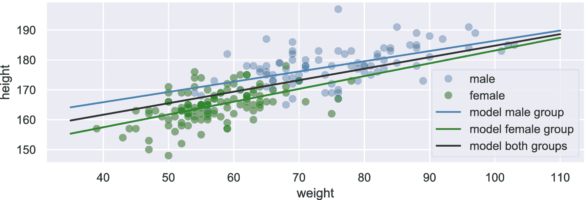

**图 16-12** 男性（深色/蓝色）和女性（浅色/绿色）受试者的身高与体重关系

# 代码与分析

```
In [78]: fig, ax = plt.subplots(1, 1, figsize=(8, 3))
    ...: mask_m = data.sex == 0
    ...: mask_f = data.sex == 1
    ...: ax.plot(data.weight[mask_m], data.height[mask_m], 'o', color="steelblue",
    ...:         label="male", alpha=0.5)
    ...: ax.plot(data.weight[mask_f], data.height[mask_f], 'o', color="green",
    ...:         label="female", alpha=0.5)
    ...: x = np.linspace(35, 110, 50)
    ...: ax.plot(x, intercept_m + x * beta_m, color="steelblue", label="model male group")
    ...: ax.plot(x, intercept_f + x * beta_f, color="green", label="model female group")
    ...: ax.plot(x, intercept + x * beta, color="black", label="model both groups")
    ...: ax.set_xlabel("weight")
    ...: ax.set_ylabel("height")
    ...: ax.legend(loc=0)
```

回归线如图 16-12 所示，图 16-11 所示的分布图表明，通过考虑男性和女性受试者的不同截距和斜率，模型得到了改进。在使用 `PyMC` 的贝叶斯模型中，改变分析中使用的底层模型只需向模型中添加随机变量，定义它们之间的关系，并为每个随机变量分配一个先验分布即可。实际求解模型所需的 `MCMC` 采样与模型细节无关。这是贝叶斯统计建模最吸引人的方面之一。例如，在前面考虑的多层次模型中，我们可以将截距和斜率变量的先验分布参数与另一个随机变量相关联，而不是将它们指定为独立的概率分布，从而获得一个分层贝叶斯模型，其中描述每个层次截距和斜率分布的模型参数是从一个共同分布中抽取的。分层模型有很多用途，是贝叶斯统计擅长的众多应用之一。

## 总结

在本章中，我们使用 `PyMC` 库提供的计算方法探索了贝叶斯统计。贝叶斯统计方法在几个基本观点上与经典的频率学派统计不同。从实际计算的角度来看，贝叶斯方法通常很难精确求解。事实上，精确计算贝叶斯模型的后验分布通常代价高昂，以至于无法实现。然而，我们通常可以应用强大而高效的采样方法，通过模拟找到近似的后验分布。贝叶斯统计框架的关键作用是允许我们定义统计模型，然后应用采样方法为模型找到近似的后验分布。在这里，我们将 `PyMC` 库用作 `Python` 中的贝叶斯建模框架。我们简要探讨了根据具有给定分布的随机变量定义统计模型，并使用 `PyMC` 库中实现的 `MCMC` 方法对这些模型的后验分布进行模拟和采样。

## 进一步阅读

关于贝叶斯统计理论的入门介绍，请参阅 Kruschke (2014) 和 Downey (2013)。更技术性的讨论见 Gelman (2013)。有关使用 `Python` 的贝叶斯方法的计算导向介绍，请参阅《概率编程与贝叶斯方法黑客教程》，可在线免费获取：[`http://camdavidsonpilon.github.io/Probabilistic-Programming-and-Bayesian-Methods-for-Hackers`](http://camdavidsonpilon.github.io/Probabilistic-Programming-and-Bayesian-Methods-for-Hackers)。关于贝叶斯和频率学派统计方法差异的有趣讨论，以及使用 `Python` 编写的示例，见 VanderPlas (2014)，也可在 [`http://arxiv.org/pdf/1411.5018.pdf`](http://arxiv.org/pdf/1411.5018.pdf) 获取。


# 17. 信号处理

本章我们将探讨信号处理，这是一个在科学和工程的多个分支中都有应用的学科。此处的信号可以是随时间变化的量（时间信号），也可以是随空间坐标变化的函数（空间信号）。例如，音频信号是典型的时间信号，而图像则是典型的二维空间信号。现实中，信号通常是连续函数，但在计算应用中，我们通常处理离散化信号，即原始的连续信号在等距的离散点上被采样。采样定理为连续信号何时能被离散样本序列精确表示提供了严谨且量化的条件。

信号处理的计算方法在科学计算中占据核心地位，不仅因为其应用广泛，还因为对于重要的信号处理问题存在非常高效的计算方法。特别是，`快速傅里叶变换（FFT）`是许多信号处理问题的重要算法，而且它可能是整个计算领域最重要的数值算法之一。本章将探讨如何将`FFT`用于谱分析，但除了这一基本应用外，`FFT`也作为其他算法的组成部分被直接或间接地广泛使用。其他信号处理方法，如卷积、相关分析以及线性滤波器，也具有广泛的应用，尤其是在控制理论等工程领域。

在本章中，我们将使用 SciPy 库中的 `fftpack` 和 `signal` 模块来讨论谱分析和线性滤波器的基本应用。

## 导入模块

在本章中，我们主要使用 SciPy 库的 `fftpack` 和 `signal` 模块。与 SciPy 库的其他模块一样，我们使用以下模式导入模块：

```
In [1]: from scipy import fftpack
In [2]: from scipy import signal
```

我们还将在一个示例中使用 SciPy 的 `io.wavefile` 模块来读写 WAV 音频文件。我们按如下方式导入此模块：

```
In [3]: import scipy.io.wavfile
In [4]: from scipy import io
```

对于基本的数值计算和绘图，我们还需要 NumPy、Pandas 和 Matplotlib 库：

```
In [5]: import numpy as np
In [6]: import pandas as pd
In [7]: import matplotlib.pyplot as plt
In [8]: import matplotlib as mpl
```

## 谱分析

我们首先通过讨论谱分析来开启对信号处理的探索。谱分析是傅里叶变换的一个基本应用。傅里叶变换是一种数学积分变换，它允许我们将信号从时域（描述为时间的函数）转换到频域（描述为频率的函数）。信号的频域表示有多种用途，例如提取信号的主频率分量等特征、对信号应用滤波器以及求解微分方程（参见第 9 章），等等。

### 傅里叶变换

连续信号 `f(t)` 的傅里叶变换 `F(v)` 的数学表达式为⁶⁶

```
$$ F\left(\nu \right)=\underset{-\infty }{\overset{\infty }{\int }}f(t){e}^{-2\pi i\nu t} dt, $$
```

逆傅里叶变换由下式给出

```
$$ f(t)=\underset{-\infty }{\overset{\infty }{\int }}F\left(\nu \right){e}^{2\pi i\nu t} d\nu . $$
```

这里 `F(v)` 是信号 `f(t)` 的复值幅度谱，`v` 是频率。从 `F(v)` 我们可以计算其他类型的谱，例如功率谱 |`F(v)`|²。在这个公式中，`f(t)` 是持续时间无限的连续信号。在实际应用中，我们通常更关心如何使用有限持续时间内采集的有限数量样本来近似 `f(t)`。例如，我们可以在时间区间 `t ∈ [0, T]` 内的 `N` 个均匀间隔点上对函数 `f(t)` 进行采样，得到一个样本序列，记作 `(x[0], x[1], …, x[N])`。前面提到的连续傅里叶变换可以适应离散情况：均匀间隔样本序列的离散傅里叶变换 (DFT) 为

```
$$ {X}_k=\sum \limits_{n=0}^{N-1}{x}_n{e}^{-2\pi ink/N}, $$
```

类似地，我们有逆 DFT

```
$$ {x}_n=\frac{1}{N}\sum \limits_{k=0}^{N-1}{X}_k{e}^{2\pi ink/N}, $$
```

其中 `X[k]` 是样本 `x[n]` 的离散傅里叶变换，`k` 是一个频率仓编号，可以关联到实际频率。样本序列的 DFT 可以使用称为快速傅里叶变换 (FFT) 的算法非常高效地计算。SciPy 的 `fftpack` 模块 ⁶⁷ 提供了 FFT 算法的实现。`fftpack` 模块包含了针对多种情况的 FFT 函数：总结见表 17-1。这里我们重点演示 `fft` 和 `ifft` 函数以及 `fftpack` 模块中几个辅助函数的用法。然而，表 17-1 中所有 FFT 函数的通用用法是相似的。

**表 17-1**

**SciPy 中 `fftpack` 模块部分函数总结。** 有关每个函数的详细用法，包括其参数和返回值，请参阅其文档字符串，例如，使用 `help(fftpack.fft)` 可查看。

| 函数 | 描述 |
| --- | --- |
| `fft`, `ifft` | 实值或复值信号的通用 FFT 和逆 FFT。得到的频谱是复值的。 |
| `rfft`, `irfft` | 实值信号的 FFT 和逆 FFT。 |
| `dct`, `idct` | 离散余弦变换 (DCT) 及其逆变换。 |
| `dst`, `idst` | 离散正弦变换 (DST) 及其逆变换。 |
| `fft2`, `ifft2`, `fftn`, `ifftn` | 复值信号的二维和 N 维 FFT 及其逆变换。 |
| `fftshift`, `ifftshift`, `rfftshift`, `irfftshift` | 分别对 `fft` 和 `rfft` 产生的结果向量中的频率仓进行移位，使得频谱排列为`零频率分量位于数组中间`。 |
| `fftfreq` | 计算与 `fft` 返回结果中的 FFT 仓相对应的频率。 |

# 请注意

DFT 以离散样本作为输入，并输出离散频谱。为了将 DFT 应用于原本连续的信号，我们必须首先通过采样将信号缩减为离散值。根据采样定理，带宽为 `B` 的连续信号（即信号不包含高于 `B` 的频率），可以从采样频率为 `f[s]` ≥ 2`B` 的离散样本中完全重构。这是信号处理中一个非常重要的结论，因为它告诉我们，在何种情况下可以使用离散信号代替连续信号。它允许我们在测量连续过程时确定合适的采样率，因为通常可以通过物理因素等来了解或大致估计一个过程的带宽。虽然采样率决定了我们可以用离散傅里叶变换描述的最大频率，但频率空间中的样本间隔由总采样时间 `T` 决定，或者等效地，在采样频率确定后，由样本点数决定，即 `T` = `N`/`f[s]`。

作为一个入门示例，考虑一个模拟信号，它在 1 Hz 和 22 Hz 处具有纯正弦分量，并叠加了正态分布的噪声基底。我们首先定义一个函数 `signal_samples`，用于生成该信号的含噪样本：
```
In [9]: def signal_samples(t):
...:     return (2 * np.sin(2 * np.pi * t) + 3 * np.sin(22 * 2 * np.pi * t) + 2 * np.random.randn(*np.shape(t)))
```
我们可以通过调用此函数并以一个包含采样时间的数组作为参数来获得一个样本向量。假设我们想要计算该信号最高到 30 Hz 的频率谱。那么我们需要选择采样频率 `f[s]` = 60 Hz，并且如果我们想要获得分辨率为 ∆`f` = 0.01 Hz 的频谱，我们需要至少采集 `N` = `f[s]`/∆`f` = 6000 个样本，对应的采样周期为 `T` = `N`/`f[s]` = 100 秒：
```
In [10]: B = 30.0
In [11]: f_s = 2 * B
In [12]: delta_f = 0.01
In [13]: N = int(f_s / delta_f); N
Out[13]: 6000
In [14]: T = N / f_s; T
Out[14]: 100.0
```
接下来，我们在时间上均匀分布的 `N` 个点处对信号函数进行采样：首先创建一个包含各采样时间的数组 `t`，然后用它来计算 `signal_samples` 函数：
```
In [15]: t = np.linspace(0, T, N)
In [16]: f_t = signal_samples(t)
```
得到的信号绘制在图 17-1 中。无论从整个采样时间还是从较短的时间段观察，该信号都相当嘈杂，并且在时域中，添加的随机噪声在很大程度上掩盖了纯净的正弦信号。

图 17-1：带有随机噪声的模拟信号。左侧为完整信号，右侧为早期时间的放大图
```
In [17]: fig, axes = plt.subplots(1, 2, figsize=(8, 3), sharey=True)
...: axes[0].plot(t, f_t)
...: axes[0].set_xlabel("时间 (秒)")
...: axes[0].set_ylabel("信号")
...: axes[1].plot(t, f_t)
...: axes[1].set_xlim(0, 5)
...: axes[1].set_xlabel("时间 (秒)")
```
为了揭示信号中的正弦分量，我们可以使用 FFT 来计算信号的频谱（或者说，信号的频域表示）。我们通过对离散样本数组 `f_t` 应用 `fft` 函数来获得信号的离散傅里叶变换：
```
In [18]: F = fftpack.fft(f_t)
```
结果是一个数组 `F`，它包含了频谱的频率分量，这些分量对应的频率由采样率和样本数决定。在计算这些频率时，使用辅助函数 `fftfreq` 会很方便，该函数将样本数和连续样本之间的时间间隔作为参数，并返回一个与 `F` 大小相同的数组，该数组包含每个频率仓对应的频率。
```
In [19]: f = fftpack.fftfreq(N, 1.0/f_s)
```
由 `fft` 函数返回的幅值对应的频率仓同时包含正频率和负频率，最高到采样率的一半，即 `f[s]`/2。对于实值信号，频谱在正负频率处是对称的，因此我们通常只对正频率分量感兴趣。利用频率数组 `f`，我们可以方便地创建一个掩码，用于提取频谱中与我们感兴趣频率对应的部分。这里我们创建一个用于选择正频率分量的掩码：
```
In [20]: mask = np.where(f >= 0)
```
正频率分量的频谱如图 17-2 所示。顶部面板包含了整个正频率频谱，并采用对数坐标绘制，以增加信号与噪声之间的对比度。我们可以看到，在接近 1 Hz 和 22 Hz 处有尖锐的峰值，分别对应信号中的正弦分量。这些峰值在频谱中清晰地突出于噪声基底。尽管噪声在时域信号中掩盖了正弦分量，但我们可以在频域表示中清晰地检测到它们的存在。图 17-2 中的下面两个面板分别显示了 1 Hz 和 22 Hz 处两个峰值的放大图。

图 17-2：模拟信号的频谱，频率分量位于 1 Hz 和 22 Hz 处
```
In [21]: fig, axes = plt.subplots(3, 1, figsize=(8, 6))
...: axes[0].plot(f[mask], np.log(abs(F[mask])), label="实部")
...: axes[0].plot(B, 0, 'r*', markersize=10)
...: axes[0].set_ylabel("$\log(|F|)$", fontsize=14)
...: axes[1].plot(f[mask], abs(F[mask])/N, label="实部")
...: axes[1].set_xlim(0, 2)
...: axes[1].set_ylabel("$|F|/N$", fontsize=14)
...: axes[2].plot(f[mask], abs(F[mask])/N, label="实部")
...: axes[2].set_xlim(21, 23)
...: axes[2].set_xlabel("频率 (Hz)", fontsize=14)
...: axes[2].set_ylabel("$|F|/N$", fontsize=14)
```

## 频域滤波

正如我们可以使用 FFT 函数 `fft` 从时域信号计算频域表示，我们也可以使用逆 FFT 函数 `ifft` 从频域表示计算出时域信号。例如，对 `F` 数组应用 `ifft` 函数将重构出 `f_t` 数组。通过在应用逆变换之前修改频谱，我们可以实现频域滤波器。例如，在频谱中仅选择 2 Hz 以下的频率，相当于应用一个 2 Hz 的低通滤波器，它抑制了信号中的高频分量（在本例中高于 2 Hz 的频率）：
```
In [22]: F_filtered = F * (abs(f) < 2)
In [23]: f_t_filtered = fftpack.ifft(F_filtered)
```
对滤波后的信号计算逆 FFT，将得到一个不存在高频振荡的时域信号，如图 17-3 所示。这个简单的例子概括了许多频域滤波器的精髓。在本章的后面部分，我们将更详细地探讨信号处理分析中常用的多种滤波器类型。

图 17-3：原始时域信号以及对信号的频域表示应用低通滤波器后重构的信号
```
In [24]: fig, ax = plt.subplots(figsize=(8, 3))
...: ax.plot(t, f_t, label="原始信号")
...: ax.plot(t, f_t_filtered.real, color="red", lw=3, label="滤波后")
...: ax.set_xlim(0, 10)
...: ax.set_xlabel("时间 (秒)")
...: ax.set_ylabel("信号")
...: ax.legend()
```

## 加窗

在上一节中，我们直接对信号应用了 FFT。这可以得到可接受的结果，但通常可以在应用 FFT 之前，对信号应用所谓的窗函数，从而进一步提高频谱的质量和对比度。窗函数是一种函数，当它与信号相乘时，会调制信号的幅度，使其在采样时段的开始和结束处趋近于零。有许多函数可以用作窗函数，SciPy 的 `signal` 模块提供了多种常见窗函数的实现，包括布莱克曼函数、汉恩函数、汉明函数、高斯窗函数（具有可变标准差）以及凯泽窗函数 ^(⁶⁸)。所有这些函数都绘制在图 17-4 中。该图显示，尽管所有这些窗函数略有不同，但整体形状非常相似。


图 17-4 常用窗函数示例

```python
In [25]: fig, ax = plt.subplots(1, 1, figsize=(8, 3))
...: N = 100
...: ax.plot(signal.blackman(N), label="布莱克曼")
...: ax.plot(signal.hann(N), label="汉恩")
...: ax.plot(signal.hamming(N), label="汉明")
...: ax.plot(signal.gaussian(N, N/5), label="高斯 (标准差=N/5)")
...: ax.plot(signal.kaiser(N, 7), label="凯泽 (beta=7)")
...: ax.set_xlabel("n")
...: ax.legend(loc=0)
```

这些备选的窗函数在特性和目标上略有不同，但在大多数情况下，它们可以互换使用。窗函数的主要目的是减少相邻频率区间之间的频谱泄漏，当信号包含周期不能被采样周期整除的分量时，这种泄漏会出现在离散傅里叶变换计算中。因此，具有此类频率的信号分量无法在采样周期内容纳完整的整数个周期，并且由于离散傅里叶变换假设信号是周期的，周期边界处由此产生的不连续性可能导致频谱泄漏。将信号与窗函数相乘可以缓解这个问题。或者，我们也可以增加采样点数（增加采样周期）以获得更高的频率分辨率，但这并不总是可行的。

为了了解在对时间序列信号应用 FFT 之前如何使用窗函数，让我们回顾一下我们在第 12 章中看过的室外温度测量数据。首先，我们使用 `Pandas` 库加载数据集，并使用 `fillna` 方法聚合元素，将其重采样为均匀间隔的每小时采样数据。

```python
In [26]: df = pd.read_csv('temperature_outdoor_2014.tsv', delimiter="\t",
...:                  names=["time", "temperature"])
In [27]: df.time = (pd.to_datetime(df.time.values, unit="s").
...:               tz_localize('UTC').tz_convert('Europe/Stockholm'))
In [28]: df = df.set_index("time")
In [29]: df = df.resample("H").ffill()
In [30]: df = df[(df.index >= "2014-04-01")*(df.index < "2014-06-01")].dropna()
```

创建并处理完 `Pandas` 数据帧后，我们提取底层的 `NumPy` 数组，以便能够使用 `fftpack` 模块处理时间序列数据。

```python
In [31]: time = df.index.astype('int64')/1.0e9
In [32]: temperature = df.temperature.values
```

现在，我们希望在计算 FFT 之前，对 `temperature` 数组中的数据应用一个窗函数。这里我们使用布莱克曼窗函数，它适合用于减少频谱泄漏。该函数在 SciPy 的 `signal` 模块中作为 `blackman` 函数提供。我们需要将样本数组的长度作为参数传递给窗函数，它将返回一个相同长度的数组。

```python
In [33]: window = signal.blackman(len(temperature))
```

要应用窗函数，我们只需将其与时域信号数组相乘，并将结果用于后续的 FFT 计算。然而，在对加窗后的温度信号进行 FFT 之前，我们先绘制原始温度时间序列和加窗后的版本。结果如图 17-5 所示。将时间序列与窗函数相乘，所得信号在采样周期边界处趋于零，可以看作是一个在周期边界上具有平滑过渡的周期函数，因此加窗信号的 FFT 具有更良好的特性。


图 17-5 加窗与原始温度时间序列信号

```python
In [34]: temperature_windowed = temperature * window
In [35]: fig, ax = plt.subplots(figsize=(8, 3))
...: ax.plot(df.index, temperature, label="original")
...: ax.plot(df.index, temperature_windowed, label="windowed")
...: ax.set_ylabel("temperature", fontsize=14)
...: ax.legend(loc=0)
```

准备好加窗信号后，频谱分析的其余步骤与之前相同：我们可以使用 `fft` 函数计算频谱，并使用 `fftfreq` 函数计算每个频率仓对应的频率。

```python
In [36]: data_fft_windowed = fftpack.fft(temperature_windowed)
In [37]: f = fftpack.fftfreq(len(temperature), time[1]-time[0])
```

在这里，我们还通过从数组 `f` 中创建一个掩码数组来选取正频率，并绘制所得的正频率频谱，如图 17-6 所示。图 17-6 中的频谱清晰地显示了对应于 1 天（`1/86400 Hz`）频率及其高次谐波（`2/86400 Hz`, `3/86400 Hz` 等）的峰值。


图 17-6 加窗温度时间序列的频谱。主峰出现在对应于 1 天周期及其高次谐波的频率上。

```python
In [38]: mask = f > 0
In [39]: fig, ax = plt.subplots(figsize=(8, 3))
...: ax.set_xlim(0.000005, 0.00004)
...: ax.axvline(1./86400, color="r", lw=0.5)
...: ax.axvline(2./86400, color="r", lw=0.5)
...: ax.axvline(3./86400, color="r", lw=0.5)
...: ax.plot(f[mask], np.log(abs(data_fft_windowed[mask])), lw=2)
...: ax.set_ylabel("$\log|F|$", fontsize=14)
...: ax.set_xlabel("frequency (Hz)", fontsize=14)
```

为了从给定的样本集中获得最准确的频谱，通常建议在应用 FFT 之前对时间序列信号施加窗函数。SciPy 中可用的大多数窗函数可以互换使用，窗函数的选择通常并不关键。一个流行的选择是 `Blackman` 窗函数，它被设计用来最小化频谱泄漏。关于不同窗函数特性的更多细节，请参见例如第 9 章 (Smith, 1999)。

### 语谱图

作为本节频谱分析的最后一个示例，这里我们分析从吉他采样的音频信号的频谱。^(⁶⁹) 首先，我们使用 SciPy 库中的 `io.wavefile.read` 函数从 `guitar.wav` 文件中加载采样数据：

```python
In [40]: sample_rate, data = io.wavfile.read("guitar.wav")
```

`io.wavefile.read` 函数返回一个元组，包含采样率 `sample_rate` 和一个包含音频强度的 `NumPy` 数组。对于这个特定文件，我们得到 `44.1 kHz` 的采样率，音频信号以立体声录制，由一个包含两个通道的数据数组表示。每个通道包含 `1181625` 个样本：

```python
In [41]: sample_rate
Out[41]: 44100
In [42]: data.shape
Out[42]: (1181625, 2)
```

### 频谱与语谱图

在这里，我们只关心分析单个音频通道，因此我们对两个通道取平均值以获得单声道信号：

```python
In [43]: data = data.mean(axis=1)
```

通过将样本数除以采样率，我们可以计算音频录音的总时长。结果表明录音大约为 26.8 秒。

```python
In [44]: data.shape[0] / sample_rate
Out[44]: 26.79421768707483
```

通常情况下，我们喜欢分段计算信号的频谱，而不是一次性计算整个信号的频谱。例如，当信号的性质在长时间尺度上随时间变化，但在短时间尺度上包含近乎周期的成分时。这对于音乐来说尤其如此，从人类感知的角度来看，音乐在短时间尺度（亚秒级）上可以被认为是近乎周期的，但在更长时间尺度上则会变化。因此，对于吉他样本，我们希望将 FFT 应用于时域信号上的滑动窗口。结果是一个依赖于时间的频谱，在音乐设备和应用中通常可视化为均衡器图。另一种方法是使用二维热力图来可视化依赖于时间的频谱，在此上下文中，这被称为语谱图。接下来，我们将计算吉他样本的语谱图。

在继续语谱图可视化之前，我们首先计算样本一小部分的频谱。我们首先确定从完整样本数组中使用的样本数。如果我们想要分析 0.5 秒的时间，我们可以使用采样率来计算要使用的样本数：

```python
In [45]: N = int(sample_rate/2.0) # 半秒 -> 22050 个样本
```

接下来，给定样本数和采样率，我们可以计算即将进行的 FFT 计算结果中频率仓的频率`f`，以及时域信号中每个样本的采样时间`t`。我们还创建一个频率掩码，用于选择小于 1000 Hz 的正频率，稍后将用它来选择计算所得频谱的一个子集。

```python
In [46]: f = fftpack.fftfreq(N, 1.0/sample_rate)
In [47]: t = np.linspace(0, 0.5, N)
In [48]: mask = (f > 0) * (f < 1000)
```

接下来，我们从完整样本数组`data`中提取前`N`个样本，并对其应用`fft`函数：

```python
In [49]: subdata = data[:N]
In [50]: F = fftpack.fft(subdata)
```

时域和频域信号如图 17-7 所示。左图中的时域信号在初始阶段（第一个吉他弦拨动前）为零。频域频谱显示了几个主频，对应于吉他产生的不同音调。

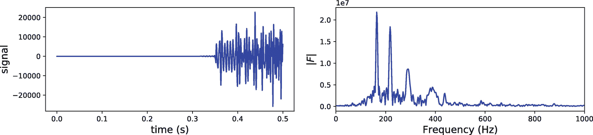

图 17-7

吉他声音半秒时长样本的信号与频谱

```python
In [51]: fig, axes = plt.subplots(1, 2, figsize=(12, 3))
...: axes[0].plot(t, subdata)
...: axes[0].set_ylabel("signal", fontsize=14)
...: axes[0].set_xlabel("time (s)", fontsize=14)
...: axes[1].plot(f[mask], abs(F[mask]))
...: axes[1].set_xlim(0, 1000)
...: axes[1].set_ylabel("$|F|$", fontsize=14)
...: axes[1].set_xlabel("Frequency (Hz)", fontsize=14)
```

下一步是对完整样本数组中的连续片段重复上述分析。频谱的时间演化可以可视化为声谱图，其 *x* 轴表示频率，*y* 轴表示时间。为了能够使用 Matplotlib 的 `imshow` 函数绘制声谱图，我们创建一个二维 NumPy 数组 `spectrogram_data`，用于存储连续样本片段的频谱。`spectrogram_data` 数组的形状为 (`n_max`, `f_values`)，其中 `n_max` 是样本数组 `data` 中长度为 `N` 的片段数量，`f_values` 是满足计算 `mask` 所用条件（频率为正且小于 1000 Hz）的频率区间的数量：

```python
In [52]: n_max = int(data.shape[0] / N)
In [53]: f_values = np.sum(mask)
In [54]: spectogram_data = np.zeros((n_max, f_values))
```

为了提高最终声谱图的对比度，我们在计算 FFT 之前，还对样本数据的每个子集应用了布莱克曼窗函数。这里我们选择布莱克曼窗函数，是因为它具有降低频谱泄漏的特性，但其他许多窗函数也能得到类似的结果。窗数组的长度必须与 `subdata` 数组的长度相同，因此我们将其长度参数传递给 `Blackman` 函数：

```python
In [55]: window = signal.blackman(len(subdata))
```

最后，通过循环遍历大小为 `N` 的数组切片，应用窗函数，计算 FFT，并将结果中我们感兴趣频率的子集存储到 `spectrogram_data` 数组中，从而计算出样本中每个片段的频谱：

```python
In [56]: for n in range(0, n_max):
...:     subdata = data[(N * n):(N * (n + 1))]
...:     F = fftpack.fft(subdata * window)
...:     spectogram_data[n, :] = np.log(abs(F[mask]))
```

当 `spectrogram_data` 计算完成后，我们可以使用 Matplotlib 的 `imshow` 函数来可视化声谱图。结果如图 17-8 所示。

```python
In [57]: fig, ax = plt.subplots(1, 1, figsize=(8, 6))
...: p = ax.imshow(spectogram_data, origin="lower",
...:               extent=(0, 1000, 0, data.shape[0] / sample_rate),
...:               aspect='auto',
...:               cmap=mpl.cm.RdBu_r)
...: cb = fig.colorbar(p, ax=ax)
...: cb.set_label("$\log|F|$", fontsize=14)
...: ax.set_ylabel("time (s)", fontsize=14)
...: ax.set_xlabel("Frequency (Hz)", fontsize=14)
```

图 17-8 中的声谱图包含了关于采样信号及其随时间演化的丰富信息。图中狭窄的垂直条纹对应吉他发出的音调，这些信号随时间推移而缓慢衰减。较宽的横向条带大致对应于吉他琴弦被拨动的时段，这会在短时间内产生非常宽的频率响应。不过请注意，颜色轴表示的是对数尺度，因此颜色的微小变化代表了实际强度的巨大变化。


图 17-8

吉他声音频采样的声谱图

## 信号滤波器

信号处理的主要目标之一是操作和变换时间或空间信号，以改变其特性。典型的应用包括降噪、音频信号中的音效，以及图像数据中的模糊、锐化、对比度增强和色彩平衡调整等效果。许多常见的变换都可以实现为滤波器，作用于信号的频域表示，例如，通过抑制某些频率分量来实现。在上一节中，我们看到了一个低通滤波器的示例，我们通过对信号进行傅里叶变换、去除高频分量，最后进行逆傅里叶变换来获得新的时域信号。通过这种方法，我们可以实现任意频率滤波器，但未必能实时应用于流式信号，因为它们需要缓冲足够的样本才能执行离散傅里叶变换。在许多应用中，我们需要以连续方式应用滤波器并变换信号，例如在传输信号或处理实时音频信号时。

### 卷积滤波器

某些类型的频率滤波器可以直接在时域中实现，方法是将信号与一个表征滤波器的函数进行卷积。傅里叶变换的一个重要性质是，两个函数（例如，信号的频谱和滤波器形状函数）乘积的（逆）傅里叶变换是这两个函数（逆）傅里叶变换的卷积。因此，如果我们想将一个滤波器 `H[k]` 应用于信号 `x[n]` 的频谱 `X[k]`，我们可以改为计算 `x[n]` 与 `h[m]`（滤波器函数 `H[k]` 的逆傅里叶变换）的卷积。通常，我们可以将卷积形式的滤波器写为

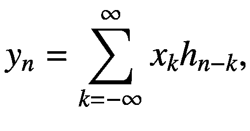

其中，`x[k]` 是输入，`y[n]` 是输出，`h[n - k]` 是表征滤波器的卷积核。请注意，在这种一般形式中，时间步 `n` 处的信号 `y[n]` 依赖于输入 `x[k]` 的较早和较晚的值。为了说明这一点，让我们回到本章的第一个示例，在该示例中，我们对一个包含 1 Hz 和 22 Hz 分量的模拟信号应用了低通滤波器。在该示例中，我们对信号进行了傅里叶变换，并将其频谱与一个抑制所有高频分量的阶跃函数相乘，最后将信号逆傅里叶变换回时域。结果是原始含噪信号的平滑版本（图 17-3）。另一种使用卷积的方法是，对滤波器 `H` 的频率响应函数进行逆傅里叶变换，并将结果 `h` 作为一个核，用于与原始时域信号 `f_t` 进行卷积：

```python
In [58]: t = np.linspace(0, T, N)
In [59]: f_t = signal_samples(t)
In [60]: H = abs(f) < 2
In [61]: h = fftpack.fftshift(fftpack.ifft(H))
In [62]: f_t_filtered_conv = signal.convolve(f_t, h, mode="same")
```

为了执行卷积，这里我们使用了 SciPy 中 `signal` 模块的 `convolve` 函数。它接受两个包含要计算卷积的信号的 NumPy 数组作为参数。使用可选的关键字参数 `mode`，我们可以将输出数组的大小设置为与第一个输入相同 (`mode='same'`)，或者设置为在数组进行零填充以处理瞬态后的完整卷积输出 (`mode='full'`)，或者设置为仅包含不依赖于零填充的元素 (`mode='valid'`)。这里我们使用 `mode='same'`，这样我们可以方便地将结果与原始信号 `f_t` 进行比较和绘图。应用此卷积滤波器的结果 `f_t_filtered_conv` 如图 17-9 所示，同时显示的还有使用 `fft` 和 `ifft` 以及修改后的频谱 (`f_t_filtered`) 计算出的相应结果。正如预期的那样，这两种方法给出了相同的结果。


图 17-9

左上：频率滤波器。右上：对应于频率滤波器的卷积核（其离散傅里叶逆变换）。下方：通过卷积应用的简单低通滤波器

```python
In [63]: fig = plt.figure(figsize=(8, 6))
...: ax = plt.subplot2grid((2,2), (0,0))
...: ax.plot(f, H)
...: ax.set_xlabel("频率 (Hz)")
...: ax.set_ylabel("频率滤波器")
...: ax.set_ylim(0, 1.5)
...: ax = plt.subplot2grid((2,2), (0,1))
...: ax.plot(t - t[-1]/2.0, h.real)
...: ax.set_xlabel("时间 (s)")
...: ax.set_ylabel("卷积核")
...: ax = plt.subplot2grid((2,2), (1,0), colspan=2)
...: ax.plot(t, f_t, label="原始", alpha=0.25)
...: ax.plot(t, f_t_filtered.real, 'r', lw=2, label='在频域中滤波')
...: ax.plot(t, f_t_filtered_conv.real, 'b--', lw=2, label='通过卷积滤波')
...: ax.set_xlim(0, 10)
...: ax.set_xlabel("时间 (s)")
...: ax.set_ylabel("信号")
...: ax.legend(loc=2)
```

### FIR 和 IIR 滤波器

在上一节卷积滤波器的示例中，使用卷积来实现滤波器与调用 `fft`、修改频谱、然后调用 `ifft` 这一系列操作相比，并没有计算上的优势。实际上，这里的卷积通常比额外的 FFT 变换要求更高，而 SciPy 的 `signal` 模块实际上提供了一个函数调用 `fftconvolve`，它使用 FFT 及其逆变换来实现卷积。此外，滤波器的卷积核具有许多不希望的属性，例如非因果性，即输出信号依赖于输入的将来值（见图 17-9 的右上角面板）。然而，存在一些重要的类卷积滤波器特例，它们可以在专用的数字信号处理器 (DSP) 和通用处理器上高效实现。这类滤波器的一个重要家族是*有限冲激响应* (FIR) 滤波器，其形式为 。这种时域滤波器是因果的，因为输出 `y[n]` 只依赖于较早时间步的输入值。

另一种类似的滤波器是*无限冲激响应* (IIR) 滤波器，它可以写成如下形式：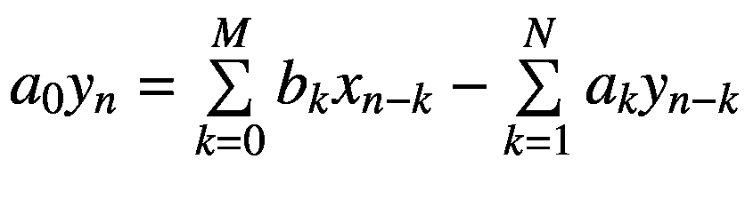。这严格来说不是卷积，因为它在计算新的输出值时额外包含了*输出*的过去值（一个反馈项），但它仍然以类似的形式存在。给定信号和输出的近期历史，FIR 和 IIR 滤波器都可以用来评估新的输出值，因此，如果我们知道 `b[k]` 和 `a[k]` 的有限序列值，就可以在时域中顺序地进行评估。

根据一组滤波器特性的要求来计算 `b[k]` 和 `a[k]` 的值被称为滤波器设计。SciPy 的 `signal` 模块为此提供了许多函数。例如，使用 `firwin` 函数，我们可以根据频带边界频率计算出 FIR 滤波器的 `b[k]` 系数，例如，滤波器从通带过渡到阻带（对于低通滤波器）。`firwin` 函数的第一个参数是 `a[k]` 序列中的值的数量（在此上下文中也称为*抽头数*）。第二个参数 `cutoff` 定义了以奈奎斯特频率（采样率的一半）为单位的低通截止频率。奈奎斯特频率的比例可以使用 `nyq` 参数（默认为 1）进行设置。最后，我们可以使用 `window` 参数指定要使用的窗口函数类型。

```python
In [64]: n = 101
In [65]: f_s = 1 / 3600
In [66]: nyq = f_s/2
In [67]: b = signal.firwin(n, cutoff=nyq/12, nyq=nyq, window="hamming")
```

结果是一个定义 FIR 滤波器的系数序列 `b[k]`，它可以用于通过时域卷积来实现该滤波器。给定系数 `b[k]`，我们可以使用 `signal` 模块的 `freqz` 函数来评估滤波器的幅频和相频响应。它返回包含频率和相应的复数值频率响应的数组，这些数组适合绘图，如图 17-10 所示。

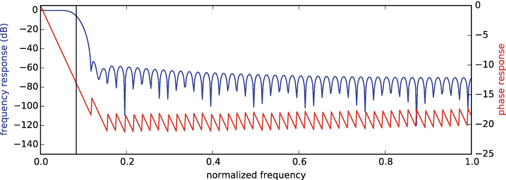

图 17-10

低通 FIR 滤波器的幅频和相频响应

```python
In [68]: f, h = signal.freqz(b)
In [69]: fig, ax = plt.subplots(1, 1, figsize=(12, 3))
...: h_ampl = 20 * np.log10(abs(h))
...: h_phase = np.unwrap(np.angle(h))
...: ax.plot(f/max(f), h_ampl, 'b')
...: ax.set_ylim(-150, 5)
...: ax.set_ylabel('frequency response (dB)', color="b")
...: ax.set_xlabel(r'normalized frequency')
...: ax = ax.twinx()
...: ax.plot(f/max(f), h_phase, 'r')
...: ax.set_ylabel('phase response', color="r")
...: ax.axvline(1.0/12, color="black")
```

图 17-10 所示的低通滤波器旨在让频率低于`f[s]/24`（用垂直线标示）的信号通过，并抑制更高频率的信号分量。通带与阻带之间有限的过渡区域，以及截止频率以上不完美的抑制效果，是我们为能够以 FIR 形式表示滤波器而必须付出的代价。FIR 滤波器的精度可以通过增加系数`b[k]`的数量来提高，但这会增加计算复杂度。

给定 FIR 滤波器的系数`b[k]`，以及 IIR 滤波器的系数`b[k]`和`a[k]`，可以使用`signal`模块中的`lfilter`函数来评估滤波效果。该函数的第一个参数是系数数组`b[k]`，第二个参数对于 IIR 滤波器是系数数组`a[k]`，对于 FIR 滤波器则是标量`1`。第三个参数是输入信号数组，返回值是滤波器的输出。例如，要将之前创建的 FIR 滤波器应用于包含每小时温度测量值的数组`temperature`，可以这样操作：
```
In [70]: temperature_filt = signal.lfilter(b, 1, temperature)
```
对信号应用低通 FIR 滤波器的效果是消除高频振荡，从而使函数变得平滑，如图 17-11 所示。另一种实现类似结果的方法是应用移动平均滤波器，其输出是附近几个输入值的加权平均值或中位数。`signal`模块中的`medfilt`函数可以对给定的输入信号应用中值滤波器，并使用该函数的第二个参数指定过去附近值的数量：

图 17-11
FIR 滤波器和`中值滤波器的输出`
```
In [71]: temperature_median_filt = signal.medfilt(temperature, 25)
```
将 FIR 低通滤波器和中值滤波器应用于每小时温度测量数据集的结果如图 17-11 所示。值得注意的是，FIR 滤波器的输出相对于原始信号存在一个对应 FIR 滤波器抽头数的时间延迟。而使用`medfilt`实现的中值滤波器不存在此问题，因为中位数是根据过去和未来的值共同计算得出的，这使得它成为一个非因果滤波器，无法对实时输入的流数据即时评估。
```
In [72]: fig, ax = plt.subplots(figsize=(8, 3))
...: ax.plot(df.index, temperature, label="original", alpha=0.5)
...: ax.plot(df.index, temperature_filt, color="red", lw=2, label="FIR")
...: ax.plot(df.index, temperature_median_filt, color="green", lw=2, label="median filer")
...: ax.set_ylabel("temperature", fontsize=14)
...: ax.legend(loc=0)
```
要设计 IIR 滤波器，可以使用`signal`模块中的`iirdesign`函数，或者使用多种预定义的 IIR 滤波器类型，包括巴特沃斯滤波器（`signal.butter`）、切比雪夫 I 型和 II 型滤波器（`signal.cheby1`和`signal.cheby2`）以及椭圆滤波器（`signal.ellip`）。例如，要创建一个允许频率高于临界频率 7/365 Hz 的信号通过、同时抑制较低频率的巴特沃斯高通滤波器，可以这样操作：
```
In [73]: b, a = signal.butter(2, 7/365.0, btype="high")
```
该函数的第一个参数是巴特沃斯滤波器的阶数，第二个参数是滤波器的临界频率（在该频率处，滤波器从阻带功能转变为通带功能）。可选参数`btype`可用于指定滤波器是低通滤波器（`low`）还是高通滤波器（`high`）。更多选项在函数的文档字符串中有描述：例如，可参考`help(signal.butter)`。输出值`a`和`b`分别是定义 IIR 滤波器的`a[k]`和`b[k]`系数。这里我们计算了一个二阶巴特沃斯滤波器，因此`a`和`b`各有三个元素：
```
In [74]: b
Out[74]: array([ 0.95829139, -1.91658277,  0.95829139])
In [75]: a
Out[75]: array([ 1.        , -1.91484241,  0.91832314])
```
和之前一样，我们可以将滤波器应用于输入信号（此处再次以每小时温度数据集为例）：
```
In [76]: temperature_iir = signal.lfilter(b, a, temperature)
```
或者，我们可以使用`filtfilt`函数来应用滤波器，该函数会正向和反向两次应用滤波器，从而产生一个非因果滤波器。
```
In [77]: temperature_filtfilt = signal.filtfilt(b, a, temperature)
```
两种滤波器的结果如图 17-12 所示。消除低频分量可以对时间序列进行去趋势处理，仅保留高频振荡和波动。因此，滤波后的信号可以被视为衡量原始信号波动性的指标。在这个例子中，我们可以看到，与冬季的一月、二月相比，春季的三月、四月和五月的日变化幅度更大。
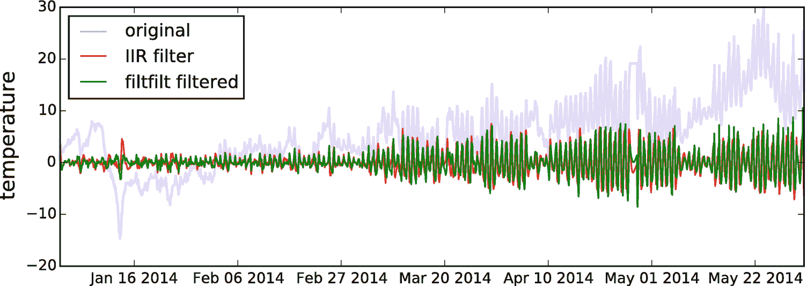
图 17-12
IIR 高通滤波器的输出以及相应的`filtfilt`滤波器（正向和反向应用）的输出
```
In [78]: fig, ax = plt.subplots(figsize=(8, 3))
...: ax.plot(df.index, temperature, label="original", alpha=0.5)
...: ax.plot(df.index, temperature_iir, color="red", label="IIR filter")
...: ax.plot(df.index, temperature_filtfilt, color="green", label="filtfilt filtered")
...: ax.set_ylabel("temperature", fontsize=14)
...: ax.legend(loc=0)
```
这些技术可以直接应用于音频和图像数据。例如，要将滤波器应用于吉他样本的音频信号，可以使用`lfilter`函数。FIR 滤波器的系数`b[k]`有时可以手动构建。例如，要应用简单的回声效果，可以创建一个 FIR 滤波器，以一定的时间延迟重复过去的信号：`y[n] = x[n] + x[n - N]`，其中`N`是以时间步长为单位的时间延迟。相应的系数`b[k]`很容易构建，并可以应用于音频信号`data`。
```
In [79]: b = np.zeros(10000)
...: b[0] = b[-1] = 1
...: b /= b.sum()
In [80]: data_filt = signal.lfilter(b, 1, data)
```
为了能够听到修改后的音频信号，我们可以使用 SciPy 中`io.wavefile`模块的`write`函数将其写入 WAV 文件：
```
In [81]: io.wavfile.write("guitar-echo.wav", sample_rate,
...:                  np.vstack([data_filt, data_filt]).T.astype(np.int16))
```
类似地，我们可以使用`signal`模块中的工具实现多种类型的图像处理滤波器。SciPy 还提供了一个`ndimage`模块，其中包含许多常见的图像处理函数和滤波器，这些函数专为应用于二维图像数据而设计。Scikit-Image 库^(⁷⁰)为在 Python 中进行图像处理提供了更高级的框架。
## 摘要
信号处理是一个极其广泛的领域，其应用遍及科学和工程的大多数分支。因此，在本章中我们仅能介绍信号处理的一些基本应用，并重点阐述如何使用 Python 生态系统中的科学计算库和工具，以计算方法来处理这类问题。具体而言，我们探讨了如何利用快速傅里叶变换对时变信号进行频谱分析，以及如何使用 SciPy 库中的 `signal` 模块设计和应用线性滤波器。
## 延伸阅读
如需全面了解信号处理理论，可参阅 Smith（1999），该书也可在线浏览，网址为 [`www.dspguide.com/pdfbook.htm`](http://www.dspguide.com/pdfbook.htm)。若想了解面向 Python 的信号处理讨论，可参阅 Unpingco（2014），其内容以 IPython 笔记本形式提供，网址为 [`http://nbviewer.ipython.org/github/unpingco/Python-for-Signal-Processing`](http://nbviewer.ipython.org/github/unpingco/Python-for-Signal-Processing)。


# 18. 数据输入与输出

在几乎所有科学计算和数据分析应用中，数据输入和输出都是必不可少的。这包括加载数据集，以及将结果持久化存储到磁盘文件或数据库中。因此，数据的导入与导出是计算工作流中的关键步骤。存储结构化与非结构化数据存在许多标准化格式。使用标准化格式的好处显而易见：你可以利用现有的库进行数据读写，从而节省时间和精力。在从事科学和技术计算的过程中，你很可能需要在与同事、同行合作时，或从设备、数据库等来源获取数据时，面对各种各样的数据格式。作为计算实践者，能够高效无缝地处理数据（无论其格式如何）至关重要。这正是本章专门探讨数据输入与输出主题的原因。

Python 对多种文件格式提供了良好的支持。事实上，针对最常见的格式，往往存在多种处理方案。本章将调查计算应用中常用的数据存储格式，并讨论每种格式适用的典型场景。我们还将介绍用于处理计算中常见数据格式的 Python 库和工具。

数据可以分为多个类别和类型。重要的类别包括结构化数据和非结构化数据；而数值则可以（例如）是类别型（有限值集）、序数型（具有有意义顺序的值）或数值型（连续或离散）。数值还具有类型，如字符串、整数、浮点数等。用于存储或传输数据的数据格式，理想情况下应能体现这些概念，以避免数据或元数据丢失，并且我们通常需要对数据的表示方式进行精细控制。

在计算应用中，我们大部分时间处理的是结构化数据，例如数组和表格数据。非结构化数据集的例子包括自由格式文本或包含非同类类型的嵌套列表。本章将重点介绍用于结构化数据的 CSV 系列格式和 HDF5 格式，并在本章末尾讨论 JSON 格式，它是一种轻量且灵活的格式，可用于存储简单和复杂的数据集，尤其适用于存储列表和字典。这种格式非常适合存储非结构化数据。我们还会简要探讨使用 `msgpack` 格式和 Python 内置的 `pickle` 格式将对象序列化为可存储数据的方法。

由于数据输入与输出在许多以数据为中心的计算应用中至关重要，因此涌现出了多个 Python 库，旨在简化并协助处理不同格式的数据以及数据的移动和转换。例如，Blaze 库（[`http://blaze.pydata.org/en/latest`](http://blaze.pydata.org/en/latest)）提供了一个高级接口，用于访问不同格式和不同来源的数据。本章我们主要关注用于读取特定类型文件格式的底层库，这些格式对于存储数值数据和非结构化数据集非常有用。不过，也鼓励感兴趣的读者探索诸如 Blaze 这样的高级库。

## 导入模块

在本章中，我们使用多个不同的库来处理不同类型的数据。具体来说，我们需要用到 NumPy 和 Pandas，按照惯例，分别将它们导入为 `np` 和 `pd`：

```
In [1]: import numpy as np
In [2]: import pandas as pd
```

我们还使用了 Python 标准库中的 `csv` 和 `json` 模块：

```
In [3]: import csv
In [4]: import json
```

为了处理用于数值数据的 HDF5 格式，我们使用了 `h5py` 和 `pytables` 库：

```
In [5]: import h5py
In [6]: import tables
```

最后，在将对象序列化为可存储数据的上下文中，我们将探讨 `pickle` 和 `msgpack` 库：

```
In [7]: import pickle
In [8]: import msgpack
```

## 逗号分隔值

逗号分隔值（CSV）是一种直观且定义松散^(⁷¹)的纯文本文件格式，它简单而高效，在存储表格数据方面非常普遍。在此格式中，每条记录存储为一行，记录的每个字段都用分隔符（例如逗号）隔开。可选地，每个字段可以用引号括起来，以允许包含分隔符的字符串值字段。此外，第一行有时用于存储列名，注释行也很常见。CSV 文件的示例如清单 18-1 所示。

```
# 2013-2014 / 常规赛 / 所有滑冰者 / 摘要 / 得分
排名,球员,球队,位置,出场数,进球,助攻,得分,正负值,受罚时间,强打进球,强打得分,短手进球,短手得分,制胜球,加时制胜球,射正数,射正率,场均上场时间,场均换人次数,争球成功率
1,西德尼·克罗斯比,匹兹堡企鹅,中锋,80,36,68,104,+18,46,11,38,0,0,5,1,259,13.9,21:58,24.0,52.5
2,瑞安·盖茨拉夫,安纳海姆小鸭,中锋,77,31,56,87,+28,31,5,23,0,0,7,1,204,15.2,21:17,25.2,49.0
3,克劳德·吉鲁,费城飞人,中锋,82,28,58,86,+7,46,7,37,0,0,7,1,223,12.6,20:26,25.1,52.9
4,泰勒·塞古因,达拉斯星,中锋,80,37,47,84,+16,18,11,25,0,0,8,0,294,12.6,19:20,23.4,41.5
5,科里·佩里,安纳海姆小鸭,右翼,81,43,39,82,+32,65,8,18,0,0,9,1,280,15.4,19:28,23.2,36.0
清单 18-1
带注释行、标题行以及混合数值和字符串值数据字段的 CSV 文件示例（数据来源：www.nhl.com）
```

CSV 有时也被认为是字符分隔值的缩写，这反映了 CSV 格式通常指代一系列使用不同分隔符分隔字段的格式。例如，Tab 字符常被用作逗号的替代，此时该格式有时被称为 TSV 而非 CSV。术语分隔符分隔值（DSV）有时也用来指代这类格式。

在 Python 中，有几种读写 CSV 格式数据的方法，每种方法都有不同的用例和优势。首先，Python 标准库包含一个名为 `csv` 的模块，用于读取 CSV 数据。要使用此模块，我们可以将文件句柄作为参数调用 `csv.reader` 函数。它会返回一个类实例，该实例可用作迭代器，将给定 CSV 文件中的行解析为 Python 字符串列表。例如，要将文件 `playerstats-2013-2014.csv`（如清单 18-1 所示）读入嵌套的字符串列表，我们可以使用：

```
In [9]: with open("playerstats-2013-2014.csv") as f:
...:     csvreader = csv.reader(f)
...:     rows = [fields for fields in csvreader]
In [10]: rows[1][1:6]
Out[10]: ['Player', 'Team', 'Pos', 'GP', 'G']
In [11]: rows[2][1:6]
Out[11]: ['Sidney Crosby', 'PIT', 'C', '80', '36']
```

请注意，默认情况下，解析后行中的每个字段都是字符串类型的，即使该字段表示数值，例如上例中的 80（比赛场次）或 36（进球数）。虽然 `csv` 模块提供了一种灵活的方式来定义自定义 CSV 读取器类，但此模块对于读取带字符串值字段的 CSV 文件最为方便。

在计算工作中，通常需要存储和加载包含数值的数组，例如向量和矩阵。NumPy 库为此提供了 `np.loadtxt` 和 `np.savetxt` 函数。这些函数接受多个参数来微调要读取或写入的 CSV 格式类型：例如，通过 `delimiter` 参数，我们可以选择用于分隔字段的字符；通过 `header` 和 `comments` 参数，可以分别指定标题行和附加在标题行之前的注释行。

例如，考虑使用 `np.savetxt` 将一个形状为 (100, 3) 的随机数数组保存到文件 `data.csv` 中。为了给数据提供一些上下文，我们还向文件添加了标题和注释行，并明确使用 `delimiter=","` 参数请求使用逗号字符作为字段分隔符（默认分隔符是空格字符）：

```
In [12]: data = np.random.randn(100, 3)
In [13]: np.savetxt("data.csv", data, delimiter=",", header="x,y,z",
...:            comments="# 随机 x, y, z 坐标\n")
In [14]: !head -n 5 data.csv
# 随机 x, y, z 坐标
x,y,z
1.652276634254504772e-01,9.522165919962696234e-01,4.659850998659530452e-01
8.699729536125471174e-01,1.187589118344758443e+00,1.788104702180680405e+00
-8.106725710122602013e-01,2.765616277935758482e-01,4.456864674903074919e-01
```

要将此格式的数据读回 NumPy 数组，我们可以使用 `np.loadtxt` 函数。它接受的参数与 `np.savetxt` 类似：具体而言，我们再次将 `delimiter` 参数设置为 `","`，以指示由逗号字符分隔的字段。我们还需要使用 `skiprows` 参数跳过文件中的前两行（注释行和标题行），因为它们不包含数值数据：

```
In [15]: data_load = np.loadtxt("data.csv", skiprows=2, delimiter=",")
```

结果是一个新的 NumPy 数组，与使用 `np.savetxt` 写入 `data.csv` 文件的原始数组相同：

```
In [16]: (data == data_load).all()
Out[16]: True
```

请注意，与 Python 标准库中 `csv` 模块的 CSV 读取器相比，NumPy 中的 `loadtxt` 函数默认将所有字段转换为数值，结果是一个具有数值 `dtype`（`float64`）的 NumPy 数组：

```
In [17]: data_load[1,:]
Out[17]: array([ 0.86997295,  1.18758912,  1.7881047 ])
In [18]: data_load.dtype
Out[18]: dtype('float64')
```

要使用 `np.loadtxt` 读取包含非数值数据的 CSV 文件——例如我们之前使用 Python 标准库读取的 `playerstats-2013-2014.csv` 文件——我们必须使用 `dtype` 参数显式设置结果数组的数据类型。如果我们尝试读取包含非数值值的 CSV 文件而不设置 `dtype`，则会出错：

```
In [19]: np.loadtxt("playerstats-2013-2014.csv", skiprows=2, delimiter=",")

ValueError: could not convert string to float: b'Sidney Crosby'
```

使用 `dtype=bytes`（或 `str` 或 `object`），我们得到一个包含未解析值的 NumPy 数组：

```
In [20]: data = np.loadtxt("playerstats-2013-2014.csv", skiprows=2, delimiter=",", dtype=bytes)
In [21]: data[0][1:6]
Out[21]: array([b'Sidney Crosby', b'PIT', b'C', b'80', b'36'], dtype='|S13')
```

或者，如果我们只想读取数值类型的列，我们可以使用 `usecols` 参数选择读取列的子集：

```
In [22]: np.loadtxt("playerstats-2013-2014.csv", skiprows=2, delimiter=",", usecols=[6,7,8])
Out[22]: array([[  68.,  104.,   18.],
               [  56.,   87.,   28.],
               [  58.,   86.,    7.],
               [  47.,   84.,   16.],
               [  39.,   82.,   32.]])
```

虽然 NumPy 的 `savetxt` 和 `loadtxt` 函数是可配置且灵活的 CSV 写入器和读取器，但它们最适用于纯数值数据。另一方面，Python 标准库模块 `csv` 最适用于包含字符串值数据的 CSV 文件。在 Python 中读取 CSV 文件的第三种方法是使用 Pandas 的 `read_csv` 函数。我们在第 12 章中已经看到过此函数的示例，当时我们使用它从 TSV 格式的数据文件创建 Pandas 数据帧。当读取同时包含数值和字符串值字段的 CSV 文件时，Pandas 中的 `read_csv` 函数非常方便，在大多数情况下，它会自动确定字段的类型并进行相应转换。例如，当使用 `read_csv` 读取 `playerstats-2013-2014.csv` 文件时，我们得到一个 Pandas 数据帧，其中所有字段都被解析为具有合适类型的列：

| `排名` | `球员` | `出场数` | `进球` | `助攻` | `得分` |
| --- | --- | --- | --- | --- | --- |
| `1` | `西德尼·克罗斯比` | `80` | `36` | `68` | `104` |
| `2` | `瑞安·盖茨拉夫` | `77` | `31` | `56` | `87` |
| `3` | `克劳德·吉鲁` | `82` | `28` | `58` | `86` |
| `4` | `泰勒·塞古因` | `80` | `37` | `47` | `84` |
| `5` | `科里·佩里` | `81` | `43` | `39` | `82` |

```python
In [23]: df = pd.read_csv("playerstats-2013-2014.csv", skiprows=1)
In [24]: df = df.set_index("Rank")
In [25]: df[["Player", "GP", "G", "A", "P"]]
Out[25]:
```

利用 `DataFrame` 实例 `df` 的 `info` 方法，我们可以清晰地看到每一列被转换成了哪种类型（为简洁起见，此处输出已截断）：

```python
In [26]: df.info()

Int64Index: 5 entries, 1 to 5
Data columns (total 20 columns):
Player      5 non-null object
Team        5 non-null object
Pos         5 non-null object
GP          5 non-null int64
G           5 non-null int64
...
S           5 non-null int64
S%          5 non-null float64
TOI/GP      5 non-null object
Shift/GP    5 non-null float64
FO%         5 non-null float64
dtypes: float64(3), int64(13), object(4)
memory usage: 840.0+ bytes
```

数据框也可以通过 `DataFrame` 对象的 `to_csv` 方法写入 CSV 文件：

```python
In [27]: df[["Player", "GP", "G", "A", "P"]].to_csv("playerstats-2013-2014-subset.csv")
In [28]: !head -n 5 playerstats-2013-2014-subset.csv
Rank,Player,GP,G,A,P
1,Sidney Crosby,80,36,68,104
2,Ryan Getzlaf,77,31,56,87
3,Claude Giroux,82,28,58,86
4,Tyler Seguin,80,37,47,84
```

Python 标准库、NumPy 和 Pandas 的结合，为读写各种类型的 CSV 文件提供了强大的工具箱。然而，尽管 CSV 文件在处理表格数据时方便有效，但其格式也存在明显的缺陷。首先，它只能用于存储一维或二维数组，并且不包含有助于解释数据的元数据。其次，无论是存储还是读写，其效率都不高；此外，它无法在每个文件中存储多个数组，即使多个数组密切相关，也需要多个文件。因此，CSV 应仅用于简单的数据集。在下一节中，我们将介绍 HDF5 文件格式，该格式旨在高效存储数值数据，并克服 CSV 及相关格式等简单数据格式的所有缺点。

## HDF5

分层数据格式 5（HDF5）是一种用于存储数值数据的格式。它由非营利组织 HDF 集团开发，并在 BSD 开源许可下提供。HDF5 格式于 1998 年发布，其设计和实现旨在高效处理大型数据集，包括支持高性能并行 I/O。因此，HDF5 格式适用于分布式高性能超级计算机和集群，可用于存储和操作 TB 级甚至更大的数据集。然而，HDF5 的美妙之处在于它同样适用于小型数据集。因此，它是一种真正通用的格式，是计算从业者的宝贵工具。

# HDF5 文件格式与 Python 库

该格式的分层特性允许使用类似于文件系统的层次结构在文件内组织数据集。HDF5 文件中用于实体的术语是`组`和`数据集`，对应于文件系统中的目录和文件。HDF5 文件中的组可以嵌套以形成树形结构，因此格式名称中带有`分层`一词。HDF5 文件中的数据集是一个同质数组，具有一定的维度和特定类型的元素。HDF5 类型系统支持所有标准的基本数据类型，并允许定义自定义的复合数据类型。HDF5 文件中的组和数据集还可以拥有`属性`，这些属性可用于存储关于组和数据集的元数据。属性本身可以有不同的类型，例如数字或字符串值。

除了文件格式本身，HDF 集团还提供了该格式的库和参考实现。主库用 C 语言编写，其 C API 的包装器可用于多种编程语言。用于从 HDF5 文件访问数据的 HDF5 库对部分读写操作有复杂支持，可用于访问整个数据集的一小部分。这是一个强大的功能，使得可以对大于计算机内存的数据集进行计算^(⁷³)。HDF5 格式是一种成熟的文件格式，在不同平台和计算环境中得到广泛支持。这也使得 HDF5 成为长期存储数据的合适选择。作为一个数据存储平台，HDF5 为许多问题提供了解决方案：跨平台存储、高效的 I/O、可扩展至非常大的数据文件的存储，以及可用于注释和描述文件中组和数据集以使数据自描述的元数据系统（属性）。总的来说，这些特性使 HDF5 成为计算工作的绝佳工具。

## Python 库

Python 有两个用于使用 HDF5 文件的库：`h5py` 和 `PyTables`。这两个库使用 HDF5 的方法不同，熟悉这两个库非常值得。`h5py` 库提供了一个相对接近基本 HDF5 概念的 API，重点关注组和数据集。它为访问数据集提供了受 NumPy 启发的 API，这使得熟悉 NumPy 的人使用起来非常直观。

### h5py

`h5py` 库为 HDF5 文件格式提供了 Python 风格的接口，并为其数据集提供了类似 NumPy 的接口。有关该项目的更多信息，包括其官方文档，请访问其网站 [`www.h5py.org`](http://www.h5py.org)。在撰写本文时，该库的最新版本是 2.7.1。

`PyTables` 库提供了基于 HDF5 格式的更高级数据抽象，提供了类似数据库的功能，例如具有易于自定义数据类型的表。它还允许像数据库一样查询数据集，并使用高级索引功能。

### PyTables

`PyTables` 库在 HDF5 之上提供了类似数据库的数据模型。有关该项目及其文档的更多信息，请访问网站 [`http://pytables.github.io`](http://pytables.github.io)。在撰写本文时，`PyTables` 的最新版本是 3.4.3。

在接下来的两节中，我们将更详细地探讨如何使用 `h5py` 和 `PyTables` 库通过 HDF5 文件读写数值数据。

## h5py 详解

我们首先来探索 `h5py` 库。`h5py` 的 API 出奇地简单且使用起来令人愉快，同时又功能齐全。这是通过巧妙使用 Python 惯用语法（如字典和 NumPy 数组语义）实现的。表 18-1 总结了 `h5py` 库中的基本对象和方法。接下来，我们将通过一系列示例探索如何使用这些方法。

**表 18-1 h5py API 中主要对象和方法的总结**

| 对象 | 方法/属性 | 描述 |
| --- | --- | --- |
| `h5py.File` | `__init__(name, mode, ...)` | 打开一个现有的 HDF5 文件，或创建一个新的文件，文件名为 `name`。根据 `mode` 参数的值，文件可以以只读或读写模式打开（参见正文）。 |
| | `flush()` | 将缓冲区写入文件。 |
| | `close()` | 关闭一个打开的 HDF5 文件。 |
| `h5py.File, h5py.Group` | `create_group(name)` | 在当前组内创建一个名为 `name`（可以是路径）的新组。 |
| | `create_dataset(name, data=..., shape=..., dtype=..., ...)` | 创建一个新的数据集。 |
| | `[]` 字典语法 | 访问组内的项目（组和数据集）。 |
| `h5py.Dataset` | `dtype` | 数据类型。 |
| | `shape` | 数据集的形状（维度）。 |
| | `value` | 数据集底层数据的完整数组。 |
| | `[]` 数组语法 | 访问数据集中数据的元素或子集。 |
| `h5py.File, h5py.Group, h5py.Dataset` | `name` | 对象在 HDF5 文件层次结构中的名称（路径）。 |
| | `attrs` | 类似字典的属性访问。 |

### 文件操作

我们首先了解如何使用 `h5py.File` 对象打开现有的 HDF5 文件以及创建新的 HDF5 文件。该对象的初始化器仅将文件名作为必需参数，但我们通常还需要指定 `mode` 参数，通过它我们可以选择以只读或读写模式打开文件，以及打开文件时是否应截断文件。`mode` 参数接受与 Python 内置函数 `open` 类似的字符串值：`"r"` 用于只读（文件必须存在），`"r+"` 用于读写（文件必须存在），`"w"` 用于创建新文件（如果文件存在则截断），`"w-"` 用于创建新文件（如果文件存在则报错），`"a"` 用于读写（如果文件存在则打开，否则创建）。例如，要以读写模式创建一个新文件，我们可以使用

```
In [29]: f = h5py.File("data.h5", mode="w")
```

结果是一个文件句柄，此处赋值给变量 `f`，我们可以用它来访问文件并向其中添加内容。给定一个文件句柄，我们可以使用 `mode` 属性查看它是以何种模式打开的：

```
In [30]: f.mode
Out[30]: 'r+'
```

请注意，即使我们以 `"w"` 模式打开了文件，一旦文件被打开，它要么是只读模式（`"r"`），要么是读写模式（`"r+"`）。其他可以使用 HDF5 文件对象执行的文件级操作包括：使用 `flush` 方法刷新包含尚未写入文件的数据的缓冲区，以及使用 `close` 方法关闭文件：

```
In [31]: f.flush()
In [32]: f.close()
```

### 组操作

`File` 对象在表示 HDF5 文件句柄的同时，也代表称为`根组`的 HDF5 组对象。组的名称可以通过组对象的 `name` 属性访问。该名称采用路径形式，类似于文件系统中的路径，指定了该组在文件层级结构中的存储位置。根组的名称是 `"/"`：

```
In [33]: f = h5py.File("data.h5", "w")
In [34]: f.name
Out[34]: '/'
```

组对象具有 `create_group` 方法，用于在现有组中创建新组。使用此方法创建的新组将成为调用 `create_group` 方法的组实例的子组：

```
In [35]: grp1 = f.create_group("experiment1")
In [36]: grp1.name
Out[36]: '/experiment1'
```

这里，组 `experiment1` 是根组的一个子组，因此它在层级结构中的名称和路径是 `/experiment1`。创建新组时，其直接父组不一定必须事先存在。例如，要创建一个新组 `/experiment2/measurement`，我们可以直接使用根组的 `create_group` 方法，*而不必*先显式创建 `experiment2` 组。中间组会自动创建。

```
In [37]: grp2_meas = f.create_group("experiment2/measurement")
In [38]: grp2_meas.name
Out[38]: '/experiment2/measurement'
In [39]: grp2_sim = f.create_group("experiment2/simulation")
In [40]: grp2_sim.name
Out[40]: '/experiment2/simulation'
```

可以使用字典风格的接口来探索 HDF5 文件的组层次结构。要检索具有给定路径名称的组，我们可以从其祖先组（通常是根节点）之一执行类似字典的查找：

```
In [41]: f["/experiment1"]
Out[41]: 
In [42]: f["/experiment2/simulation"]
Out[42]: 
```

同样的字典查找方式也适用于子组（不仅仅限于根节点）：

```
In [43]: grp_experiment2 = f["/experiment2"]
In [44]: grp_experiment2['simulation']
Out[44]: 
```

# HDF5 文件的组遍历与数据集操作

`keys` 方法返回一个迭代器，用于遍历组内的子组和数据集的名称；`items` 方法返回一个迭代器，用于遍历组内每个实体的 `(name, value)` 元组。这些方法可用于以编程方式遍历组的层次结构。

```
In [45]: list(f.keys())
Out[45]: ['experiment1', 'experiment2']
In [46]: list(f.items())
Out[46]: [('experiment1', ),
('experiment2', )]
```

## 使用 visit 和 visititems 方法

要遍历 HDF5 文件中的组层次结构，我们还可以使用 `visit` 方法，该方法接受一个函数作为参数，并对文件层次结构中的每个实体调用该函数，同时传入该实体的名称：

```
In [47]: f.visit(lambda x: print(x))
experiment1
experiment2
experiment2/measurement
experiment2/simulation
```

或者使用 `visititems` 方法，该方法执行相同的操作，不同之处在于它在调用函数时同时传入项目名称和项目本身作为参数：

```
In [48]: f.visititems(lambda name, item: print(name, item))
experiment1 
experiment2 
experiment2/experiment 
experiment2/simulation 
```

## 字典风格的操作与外部工具

与 Python 字典的语义一致，我们还可以使用 Python 关键字 `in` 对 `Group` 对象进行集合成员测试操作：

```
In [49]: "experiment1" in f
Out[49]: True
In [50]: "simulation" in f["experiment2"]
Out[50]: True
In [51]: "experiment3" in f
Out[51]: False
```

通过使用 `visit` 和 `visititems` 方法，以及字典风格的方法 `keys` 和 `items`，我们可以轻松探索 HDF5 文件的结构和内容，即使我们事先不知道它包含什么以及其中的数据如何组织。能够方便地探索 HDF5 是该格式可用性的一个重要方面。此外，还有一些用于探索 HDF5 文件内容的非 Python 外部工具，这些工具在处理此类文件时通常很有用。特别是，`h5ls` 命令行工具对于快速检查 HDF5 文件的内容非常方便：

```
In [52]: f.flush()
In [53]: !h5ls -r data.h5
/                        Group
/experiment1                 Group
/experiment2                 Group
/experiment2/measurement     Group
/experiment2/simulation      Group
```

这里我们使用了 `h5ls` 程序的 `-r` 标志，以递归方式显示文件中的所有项目。`h5ls` 程序是一个名为 `hdf5-tools` 的软件包提供的系列 HDF5 实用工具之一（另请参阅 `h5stat`、`h5copy`、`h5diff` 等）。尽管这些不是 Python 工具，但它们在处理 HDF5 文件（包括在 Python 环境中）时非常有用。

# HDF5 数据集

既然我们已经探讨了如何在 HDF5 文件中创建和访问组，现在是时候看看如何存储数据集了。毕竟，存储数值数据是 HDF5 格式的主要目的。使用 `h5py` 在 HDF5 文件中创建数据集主要有两种方法。创建数据集最简单的方法是使用字典索引语法，直接将一个 NumPy 数组分配给 HDF5 组中的一个条目。第二种方法是使用 `create_dataset` 方法创建一个空数据集，我们将在本节后面看到相关示例。

## 创建与验证数据集

例如，要将两个 NumPy 数组 `array1` 和 `meas1` 分别存储到根组和 `experiment2/measurement` 组中，我们可以使用：

```
In [54]: array1 = np.arange(10)
In [55]: meas1 = np.random.randn(100, 100)
In [56]: f["array1"] = array1
In [57]: f["/experiment2/measurement/meas1"] = meas1
```

为了验证分配给 NumPy 数组的数据集已添加到文件中，我们使用 `visititems` 方法遍历文件层次结构：

```
In [58]: f.visititems(lambda name, value: print(name, value))
array1 
experiment1 
experiment2 
experiment2/measurement 
experiment2/measurement/meas1 
experiment2/simulation 
```

我们看到，`array1` 和 `meas1` 数据集确实已添加到文件中。请注意，在分配中用作字典键的路径决定了数据集在文件中的位置。

## 访问与检索数据集

要检索数据集，我们可以使用与检索组相同的类字典语法。例如，要检索存储在根组中的 `array1` 数据集，我们可以使用 `f["array1"]`：

```
In [59]: ds = f["array1"]
In [60]: ds
Out[60]: 
```

结果是一个 `Dataset` 对象，而不是我们分配给 `array1` 条目的 NumPy 数组。`Dataset` 对象是 HDF5 中底层数据的代理。与 NumPy 数组一样，`Dataset` 对象具有多个描述数据集的属性，包括 `name`、`dtype` 和 `shape`。它还具有返回数据集长度的 `len` 方法：

```
In [61]: ds.name
Out[61]: '/array1'
In [62]: ds.dtype
Out[62]: dtype('int64')
In [63]: ds.shape
Out[63]: (10,)
In [64]: ds.len()
Out[64]: 10
```

数据集的实际数据可以通过例如 `value` 属性访问。这将整个数据集作为 NumPy 数组返回，这里等同于我们分配给 `array1` 数据集的数组。

```
In [65]: ds.value
Out[65]: array([0, 1, 2, 3, 4, 5, 6, 7, 8, 9])
```

要访问组层次结构中更深层的数据集，我们可以使用类似文件系统的路径名。例如，要检索 `experiment2/measurement` 组中的 `meas1` 数据集，我们可以使用：

```
In [66]: ds = f["experiment2/measurement/meas1"]
In [67]: ds
Out[67]: 
```

我们再次得到一个 `Dataset` 对象，可以使用我们之前介绍的对象属性来检查其基本属性：

```
In [68]: ds.dtype
Out[68]: dtype('float64')
In [69]: ds.shape
Out[69]: (100, 100)
```

请注意，此数据集的数据类型是 `float64`，而对于数据集 `array1`，数据类型是 `int64`。此类型信息源自分配给这两个数据集的 NumPy 数组。这里我们同样可以使用 `value` 属性将数组作为 NumPy 数组检索。相同操作的另一种语法是使用带有省略号表示法的方括号索引：`ds[...]`。

```
In [70]: data_full = ds[...]
In [71]: type(data_full)
Out[71]: numpy.ndarray
In [72]: data_full.shape
Out[72]: (100, 100)
```

## 数组索引与切片

这是类似 NumPy 数组索引的一个示例。`Dataset` 对象支持 NumPy 中使用的大多数索引和切片类型，这提供了一种强大且灵活的方法来从文件中部分读取数据。例如，要仅检索 `meas1` 数据集的第一列，我们可以使用：

```
In [73]: data_col = ds[:, 0]
In [74]: data_col.shape
Out[74]: (100,)
```

结果是一个包含 100 个元素的数组，对应于数据集中的第一列。请注意，此切片是在 HDF5 库中执行的，而不是在 NumPy 中，因此在此示例中，仅从文件中读取了 100 个元素并存储在生成的 NumPy 数组中，而无需将整个数据集加载到内存中。在处理无法放入内存的大型数据集时，这是一个重要特性。

例如，`Dataset` 对象还支持跨步索引：

## 索引和切片

```
In [75]: ds[10:20:3, 10:20:3] # 步长为 3
Out[75]: array([[-0.22321057, -0.61989199,  0.78215645,  0.73774187],
[-1.03331515,  2.54190817, -0.24812478, -2.49677693],
[ 0.17010011,  1.88589248,  1.91401249, -0.63430569],
[ 0.4600099 , -1.3242449 ,  0.41821078,  1.47514922]])
```

以及“花式索引”，其中为数组的某个维度给出索引列表（不适用于多个索引）：

```
In [76]: ds[[1,2,3], :].shape
Out[76]: (3, 100)
```

我们还可以使用布尔索引，其中使用一个布尔值的 NumPy 数组来索引一个 `Dataset`。例如，要筛选出第一列 (`ds[:, 0]`) 值大于 2 的每一行的前五列（在第二个轴上索引 `:5`），我们可以使用布尔掩码 `ds[:, 0] > 2` 来索引数据集：

```python
In [77]: mask = ds[:, 0] > 2
In [78]: mask.shape, mask.dtype
Out[78]: ((100,), dtype('bool'))
In [79]: ds[mask, :5]
Out[79]: array([[ 2.1224865 ,  0.70447132, -1.71659513,  1.43759445, -0.61080907],
[ 2.11780508, -0.2100993 ,  1.06262836, -0.46637199,  0.02769476],
[ 2.41192679, -0.30818179, -0.31518842, -1.78274309, -0.80931757],
[ 2.10030227,  0.14629889,  0.78511191, -0.19338282,  0.28372485]])
```

由于 `Dataset` 对象使用 NumPy 的索引和切片语法来选择底层数据的子集，因此对于熟悉 NumPy 的人来说，使用 `h5py` 在 Python 中处理大型 HDF5 数据集会非常自然。还要记住，对于大文件，在 `Dataset` 对象上进行索引切片与在可通过 `value` 属性访问的 NumPy 数组上进行索引切片有很大区别，因为前者避免将整个数据集加载到内存中。

## 创建数据集

到目前为止，我们已经了解了如何通过将数据显式分配给组对象中的条目来在 HDF5 文件中创建数据集。我们还可以使用 `create_dataset` 方法显式创建数据集。它将要创建的新数据集的名称作为第一个参数，我们可以使用 `data` 参数设置新数据集的数据，或者通过设置 `shape` 参数创建一个空数组。例如，除了赋值 `f["array2"] = np.random.randint(10, size=10)`，我们还可以使用 `create_dataset` 方法：

```python
In [80]: ds = f.create_dataset("array2", data=np.random.randint(10, size=10))
In [81]: ds
Out[81]:
In [82]: ds.value
Out[82]: array([2, 2, 3, 3, 6, 6, 4, 8, 0, 0])
```

当显式调用 `create_dataset` 方法时，我们可以更精细地控制结果数据集的属性。例如，我们可以使用 `dtype` 参数显式设置数据集的数据类型，使用 `compress` 参数选择压缩方法，使用 `chunks` 参数设置块大小，以及使用 `maxsize` 参数为可调整大小的数据集设置允许的最大数组大小。还有与 `Dataset` 对象相关的许多其他高级功能。有关详细信息，请参阅 `create_dataset` 的文档字符串。

当通过指定 `shape` 参数而不是提供一个数组来初始化数据集来创建空数组时，我们还可以使用 `fillvalue` 参数来设置数据集的默认值。例如，要创建一个形状为 `(5, 5)` 且默认值为 `-1` 的空数据集，我们可以使用：

```python
In [83]: ds = f.create_dataset("/experiment2/simulation/data1", shape=(5, 5), fillvalue=-1)
In [84]: ds
Out[84]:
In [85]: ds.value
Out[85]: array([[-1., -1., -1., -1., -1.],
       [-1., -1., -1., -1., -1.],
       [-1., -1., -1., -1., -1.],
       [-1., -1., -1., -1., -1.],
       [-1., -1., -1., -1., -1.]], dtype=float32)
```

## 高级操作与管理

HDF5 对于空数据集的磁盘使用非常智能，不会存储超出必要的数据，特别是当我们使用 `compression` 参数选择压缩方法时。有多种可用的压缩方法，例如 `'gzip'`。使用数据集压缩，我们可以创建一个非常大的数据集，并逐步用数据填充它们，例如，当测量结果或计算结果可用时，无需一开始就浪费大量存储空间。例如，让我们在组 `experiment1/simulation` 中创建一个形状为 `(5000, 5000, 5000)` 的 `data1` 大数据集：

```python
In [86]: ds = f.create_dataset("/experiment1/simulation/data1", shape=(5000, 5000, 5000), fillvalue=0, compression="gzip")
In [87]: ds
Out[87]:
```

最初，此数据集既不占用内存也不占用磁盘空间，直到我们开始用数据填充它。要为数据集赋值，我们可以再次使用类似 NumPy 的索引语法，并为数据集中的特定元素或通过切片语法选择的子集赋值：

```python
In [88]: ds[:, 0, 0] = np.random.rand(5000)
In [89]: ds[1, :, 0] += np.random.rand(5000)
In [90]: ds[:2, :5, 0]
Out[90]: array([[ 0.67240328, 0.        , 0.        , 0.        , 0.        ],
       [ 0.99613971, 0.48227152, 0.48904559, 0.78807044, 0.62100351]], dtype=float32)
```

请注意，未赋值的元素会设置为创建数组时指定的 `fillvalue` 值。如果我们不知道数据集的填充值是什么，可以通过查看 `Dataset` 对象的 `fillvalue` 属性来找出：

```python
In [91]: ds.fillvalue
Out[91]: 0.0
```

要查看新创建的数据集确实存储在我们打算分配的组中，我们可以再次使用 `visititems` 方法来列出 `experiment1` 组的内容：

```python
In [92]: f["experiment1"].visititems(lambda name, value: print(name, value))
simulation
simulation/data1
```

虽然数据集 `experiment1/simulation/data1` 非常大（4 × 5000³ 字节 ~ 465 Gb），但由于我们还没有用大量数据填充它，HDF5 文件仍然不会占用太多磁盘空间（仅约 357 Kb）：

```python
In [93]: f.flush()
In [94]: f.filename
Out[94]: 'data.h5'
In [95]: !ls -lh data.h5
-rw-r--r--@ 1 rob  staff   357K Apr  5 18:48 data.h5
```

到目前为止，我们已经了解了如何在 HDF5 文件中创建组和数据集。当然，有时也需要从文件中删除项目。使用 `h5py`，我们可以使用 Python 的 `del` 关键字从组中删除项目，这同样遵循 Python 字典的语义：

```python
In [96]: del f["/experiment1/simulation/data1"]
In [97]: f["experiment1"].visititems(lambda name, value: print(name, value))
simulation
```

### 属性

# HDF5 属性与 PyTables 库

属性是 HDF5 格式的一个组成部分，使其成为通过元数据注释数据和提供自描述数据的极佳格式。例如，在存储实验数据时，通常需要将外部参数和条件与观测数据一起记录。同样，在计算机模拟中，通常需要将额外的模型或模拟参数与生成的模拟结果一起存储。在所有这些情况下，最好的解决方案是确保所需的额外参数作为元数据与主要数据集一起存储。

HDF5 格式通过使用属性来支持这种类型的元数据。任意数量的属性可以附加到 HDF5 文件中的每个组和数据集。使用 `h5py` 库，可以通过类似字典的接口访问属性，就像访问组一样。`Group` 和 `Dataset` 对象的 Python 属性 `attrs` 用于访问 HDF5 属性：

```python
In [98]: f.attrs
Out[98]: 
```

要创建属性，我们只需为目标对象的 `attrs` 字典赋值即可。例如，为根组创建一个 `description` 属性，我们可以使用：

```python
In [99]: f.attrs["description"] = "实验与模拟的结果集"
```

类似地，为 `experiment1` 和 `experiment2` 组添加 `date` 属性：

```python
In [100]: f["experiment1"].attrs["date"] = "2015-1-1"
In [101]: f["experiment2"].attrs["date"] = "2015-1-2"
```

我们还可以直接向数据集（不仅仅是组）添加属性：

```python
In [102]: f["experiment2/simulation/data1"].attrs["k"] = 1.5
In [103]: f["experiment2/simulation/data1"].attrs["T"] = 1000
```

与组类似，我们可以使用 `Attribute` 对象的 `keys` 和 `items` 方法来获取对其包含的属性的迭代器：

```python
In [104]: list(f["experiment1"].attrs.keys())
Out[104]: ['date']
In [105]: list(f["experiment2/simulation/data1"].attrs.items())
Out[105]: [('k', 1.5), ('T', 1000)]
```

属性是否存在可以使用 Python 的 `in` 运算符来测试，这符合 Python 字典的语义：

```python
In [106]: "T" in f["experiment2/simulation/data1"].attrs
Out[106]: True
```

要删除现有属性，我们可以使用 `del` 关键字：

```python
In [107]: del f["experiment2/simulation/data1"].attrs["T"]
In [108]: "T" in f["experiment2/simulation"].attrs
Out[108]: False
```

HDF5 组和数据集的属性适合与实际数据集一起存储元数据。大量使用属性有助于为数据提供上下文，而数据通常需要具备上下文才能发挥作用。

## PyTables

`PyTables` 库为 Python 提供了另一种基于 HDF5 的接口。该库的核心是通过 HDF5 格式实现的高层级表格数据模型，当然它也可以像 `h5py` 库一样创建和读取通用的 HDF5 组与数据集。这里我们重点介绍表格数据模型，以补充上一节讨论的 `h5py` 库。我们将使用本章前面提到的 NHL 球员统计数据数据集来演示 `PyTables` 表格对象的使用，并基于该数据集从 Pandas 数据框构建一个 `PyTables` 表格。因此，我们首先使用 `read_csv` 函数将数据集读入 `DataFrame` 对象：

```python
In [109]: df = pd.read_csv("playerstats-2013-2014.csv", skiprows=1)
...: df = df.set_index("Rank")
```

接下来，我们使用 `tables.open_file` 函数^(⁷⁴)创建一个新的 PyTables HDF5 文件句柄。该函数的第一个参数是文件名，第二个可选参数是文件模式。返回结果是一个 PyTables HDF5 文件句柄（此处赋值给变量 `f`）：

```python
In [110]: f = tables.open_file("playerstats-2013-2014.h5", mode="w")
```

与 `h5py` 库类似，我们可以通过文件句柄对象的 `create_group` 方法创建 HDF5 组。该方法第一个参数是父组的路径，第二个参数是组名，还可选地接受 `title` 参数，用于为组设置描述性的 HDF5 属性。

```python
In [111]: grp = f.create_group("/", "season_2013_2014",
...:                      title="NHL player statistics for the 2013/2014 season")
In [112]: grp
Out[112]: /season_2013_2014 (Group) 'NHL player statistics for the 2013/2014 season'
children := []
```

与 `h5py` 库不同的是，`PyTables` 中的文件句柄对象并不代表 HDF5 文件中的根组。要访问根节点，我们必须使用文件句柄对象的 `root` 属性：

```python
In [113]: f.root
Out[113]: / (RootGroup) "
children := ['season_2013_2014' (Group)]
```

`PyTables` 库的一个出色特性是它能利用 HDF5 的类结构复合数据类型，轻松创建混合列类型的表格。在 `PyTables` 中定义此类表格数据结构的最简单方法是创建一个继承自 `tables.IsDescription` 类的子类，其中应包含由 `tables` 库中数据类型表示构成的字段。例如，要为球员统计数据数据集创建表格结构的规范，我们可以使用：

```python
In [114]: class PlayerStat(tables.IsDescription):
...:     player = tables.StringCol(20, dflt="")
...:     position = tables.StringCol(1, dflt="C")
...:     games_played = tables.UInt8Col(dflt=0)
...:     points = tables.UInt16Col(dflt=0)
...:     goals = tables.UInt16Col(dflt=0)
...:     assists = tables.UInt16Col(dflt=0)
...:     shooting_percentage = tables.Float64Col(dflt=0.0)
...:     shifts_per_game_played = tables.Float64Col(dflt=0.0)
```

这里，`PlayerStat` 类表示一个包含八个列的表格结构：前两列是固定长度字符串（`tables.StringCol`），接下来的四列是无符号整数（`tables.UInt8Col` 和 `tables.UInt16Col`，分别为 8 位和 16 位），最后两列是浮点类型（`tables.Float64Col`）。数据类型对象中的可选参数 `dflt` 用于指定字段的默认值。一旦通过此类形式定义了表格结构，我们就可以使用 `create_table` 方法在 HDF5 文件中创建实际的表格。该方法的第一个参数是组对象或父节点的路径，第二个参数是表格名称，第三个参数是表格规范类，第四个可选参数是表格标题（存储为对应数据集的 HDF5 属性）：

```python
In [115]: top30_table = f.create_table(grp, 'top30', PlayerStat, "Top 30 point leaders")
```

要向表格中插入数据，我们可以使用表格对象的 `row` 属性获取一个 `Row` 访问器类，该类可像字典一样用于填充行的值。当行对象完全初始化后，可以使用 `append` 方法将行实际插入表格：

## PyTables 表格操作与查询

以下代码展示了如何使用 PyTables 的表格接口填充数据。

```
In [116]: playerstat = top30_table.row
In [117]: for index, row_series in df.iterrows():
...:     playerstat["player"] = row_series["Player"]
...:     playerstat["position"] = row_series["Pos"]
...:     playerstat["games_played"] = row_series["GP"]
...:     playerstat["points"] = row_series["P"]
...:     playerstat["goals"] = row_series["G"]
...:     playerstat["assists"] = row_series["A"]
...:     playerstat["shooting_percentage"] = row_series["S%"]
...:     playerstat["shifts_per_game_played"] = row_series["Shift/GP"]
...:     playerstat.append()
```

`flush`方法强制将表格数据写入文件：

```
In [118]: top30_table.flush()
```

要访问表格中的数据，我们可以使用`cols`属性将列作为 `NumPy` 数组获取：

```
In [119]: top30_table.cols.player[:5]
Out[119]: array([b'Sidney Crosby', b'Ryan Getzlaf', b'Claude Giroux',
b'Tyler Seguin', b'Corey Perry'], dtype='|S20')
In [120]: top30_table.cols.points[:5]
Out[120]: array([104,  87,  86,  84,  82], dtype=uint16)
```

要按行方式访问数据，我们可以使用`iterrows`方法创建遍历表格所有行的迭代器。这里我们使用此方法循环所有行并打印到标准输出（为简洁起见，输出已截断）：

```
In [121]: def print_playerstat(row):
...:     print("%20s\t%s\t%s\t%s" %
...:           (row["player"].decode('UTF-8'), row["points"],
...:            row["goals"], row["assists"]))
In [122]: for row in top30_table.iterrows():
...:     print_playerstat(row)
Sidney Crosby    104    36    68
Ryan Getzlaf        87    31    56
Claude Giroux       86    28    58
Tyler Seguin        84    37    47
...
Jaromir Jagr        67    24    43
John Tavares        66    24    42
Jason Spezza        66    23    43
Jordan Eberle       65    28    37
```

`PyTables` 表格接口最强大的功能之一是通过查询从底层 HDF5 中有选择地提取行。例如，`where`方法允许我们传递一个以表格列为条件的表达式字符串，由 `PyTables` 用于过滤行：

```
In [123]: for row in top30_table.where("(points > 75) & (points <= 80)"):
...:     print_playerstat(row)
Phil Kessel        80    37    43
Taylor Hall        80    27    53
Alex Ovechkin      79    51    28
Joe Pavelski       79    41    38
Jamie Benn         79    34    45
Nicklas Backstrom  79    18    61
Patrick Sharp      78    34    44
Joe Thornton       76    11    65
```

使用`where`方法，我们还可以定义涉及多个列的条件：

```
In [124]: for row in top30_table.where("(goals > 40) & (points < 80)"):
...:     print_playerstat(row)
Alex Ovechkin     79    51    28
Joe Pavelski      79    41    38
```

此功能允许我们以类似数据库的方式查询表格。虽然对于像当前这样的小数据集，我们完全可以直接在内存中使用 `Pandas` 数据框执行此类操作，但请记住，HDF5 文件存储在磁盘上，而`PyTables`库对 I/O 的高效利用使我们能够处理无法装入内存的极大数据集，这对于整个数据集来说，是 `NumPy` 或 `Pandas` 无法实现的。

在结束本节之前，让我们检查一下包含我们刚刚创建的 `PyTables` 表格的 HDF5 文件的最终结构。

```
In [125]: f
Out[125]: File(filename=playerstats-2013-2014.h5, title=", mode="w", root_uep='/', filters=Filters(complevel=0, shuffle=False, fletcher32=False, least_significant_digit=None))
/ (RootGroup) " /season_2013_2014 (Group) '2013/2014 赛季 NHL 球员统计数据'
/season_2013_2014/top30 (Table(30,)) '得分前 30 的领跑者'
description := {
"assists": UInt16Col(shape=(), dflt=0, pos=0),
"games_played": UInt8Col(shape=(), dflt=0, pos=1),
"goals": UInt16Col(shape=(), dflt=0, pos=2),
"player": StringCol(itemsize=20, shape=(), dflt=b", pos=3),
"points": UInt16Col(shape=(), dflt=0, pos=4),
"position": StringCol(itemsize=1, shape=(), dflt=b'C', pos=5),
"shifts_per_game_played": Float64Col(shape=(), dflt=0.0, pos=6),
"shooting_percentage": Float64Col(shape=(), dflt=0.0, pos=7)}
byteorder := 'little'
chunkshape := (1489,)
```

从 `PyTables` 文件句柄及其包含的 HDF5 文件层次结构的字符串表示中，我们可以看到 `PyTables` 库创建了一个数据集`/season_2013_2014/top30`，它使用了一种复杂的复合数据类型，该类型是根据我们之前创建的`PlayerStat`对象中的规范生成的。最后，当我们在文件中完成对数据集的修改后，可以使用`flush`方法刷新其缓冲区并强制写入文件；当我们完成对文件的操作后，可以使用`close`方法关闭文件：

```
In [126]: f.flush()
In [127]: f.close()
```

虽然这里我们没有涵盖其他类型的数据集（例如常规的同构数组），但值得一提的是 `PyTables` 库也支持这些类型的数据结构。例如，我们可以使用`create_array`、`create_carray`和`create_earray`分别构建固定大小数组、分块数组和可扩展数组。有关如何使用这些数据结构的更多信息，请参阅相应的文档字符串。

## Pandas HDFStore

使用 Python 将数据存储在 HDF5 文件中的第三种方法是使用 `Pandas` 中的`HDFStore`对象。它可用于将数据框和其他 `Pandas` 对象持久化存储在 HDF5 文件中。要在 `Pandas` 中使用此功能，必须安装 `PyTables` 库。我们可以通过将文件名传递给其初始化器来创建一个`HDFStore`对象。结果是一个`HDFStore`对象，它可以作为一个字典使用，我们可以将 `Pandas` 的`DataFrame`实例分配给它，从而将其存储到 HDF5 文件中：

# HDFStore

`HDFStore`对象的行为类似于常规的Python字典，例如，我们可以通过调用`keys`方法来查看它包含哪些对象：

```
In [133]: store.keys()
Out[133]: ['/df1', '/df2']
```

并且我们可以使用Python的`in`关键字测试是否存在具有给定键的对象：

```
In [134]: 'df2' in store
Out[134]: True
```

要从存储中检索对象，我们再次使用类似字典的语义，通过对应的键来索引该对象：

```
In [135]: df = store["df1"]
```

通过`HDFStore`对象，我们还可以使用`root`属性访问底层的HDF5句柄。这实际上就是一个PyTables文件句柄：

```
In [136]: store.root
Out[136]: / (RootGroup) "   children := ['df1' (Group), 'df2' (Group)]
```

使用完`HDFStore`对象后，我们应该使用`close`方法关闭它，以确保与其关联的所有数据都已写入文件。

```
In [137]: store.close()
```

由于HDF5是一种标准文件格式，因此我们当然可以使用任何其他兼容HDF5的软件（例如`h5py`库）打开使用Pandas `HDFStore`或PyTables创建的HDF5文件。如果我们使用`h5py`打开由`HDFStore`生成的文件，可以轻松检查其内容，并了解`HDFStore`对象是如何组织我们分配给它的`DataFrame`对象的数据的：

```
In [138]: f = h5py.File("store.h5")
In [139]: f.visititems(lambda x, y: print(x, "\t" * int(3 - len(str(x))//8), y))
df1                 
df1/axis0           
df1/axis1           
df1/block0_items    
df1/block0_values   
df2                 
df2/axis0           
df2/axis1           
df2/block0_items    
df2/block0_values   
df2/block1_items    
df2/block1_values   
df2/block2_items    
df2/block2_values   
```

我们可以看到`HDFStore`对象将每个`DataFrame`对象存储在其自身的组中，并将每个数据框分割为几个异构的HDF5数据集（块），其中列按数据类型分组。此外，列名和值存储在单独的HDF5数据集中。

```
In [140]: f["/df2/block0_items"].value
Out[140]: array([b'S%', b'Shift/GP', b'FO%'], dtype='|S8')
In [141]: f["/df2/block0_values"][:3]
Out[141]: array([[ 13.9,  24\. ,  52.5],
[ 15.2,  25.2,  49\. ],
[ 12.6,  25.1,  52.9]])
In [142]: f["/df2/block1_values"][:3, :5]
Out[142]: array([[  1,  80,  36,  68, 104],
[  2,  77,  31,  56,  87],
[  3,  82,  28,  58,  86]])
```

# JSON

JSON（JavaScript Object Notation）是一种人类可读的轻量级纯文本格式，适合存储由列表和字典组成的数据集。此类列表和字典的值本身可以是列表或字典，或者必须是以下基本数据类型：字符串、整数、浮点数和布尔值，或`null`值（类似于Python中的`None`值）。这种数据模型允许存储复杂且多样的数据集，而无需像CSV等格式那样受表格形式的限制。例如，JSON文档可用作键值存储，其中不同键的值可以具有不同的结构和数据类型。

JSON格式最初设计用于在Web服务和JavaScript应用程序之间传递信息的数据交换格式。实际上，JSON是JavaScript语言的一个子集，因此也是有效的JavaScript代码。然而，JSON本身是一种与语言无关的数据格式，可以在包括Python在内的几乎所有语言和环境中轻松解析和生成。JSON语法也几乎是有效的Python代码，使得在Python中处理它也显得熟悉且直观。

我们在第10章中已经见过一个JSON数据集的示例，当时我们研究了东京地铁网络的图。在重新审视该数据集之前，我们先简要概述JSON基础以及如何在Python中读写JSON。Python标准库提供了`json`模块用于处理JSON格式的数据。具体来说，该模块包含从Python数据结构（列表或字典）生成JSON数据的函数：`json.dump`和`json.dumps`，以及将JSON数据解析为Python数据结构的函数：`json.load`和`json.loads`。函数`loads`和`dumps`以Python字符串作为输入和输出，而`load`和`dump`则操作文件句柄，将数据读写到文件中。

例如，我们可以通过调用`json.dumps`函数生成Python列表的JSON字符串。返回值是指定Python列表的JSON字符串表示形式，与用于创建该列表的Python代码非常相似。然而，一个显著的例外是Python值`None`，它在JSON中表示为`null`：

```
In [143]: data = ["string", 1.0, 2, None]
In [144]: data_json = json.dumps(data)
In [145]: data_json
Out[145]: '["string", 1.0, 2, null]'
```

要将JSON字符串转换回Python对象，我们可以使用`json.loads`：

```
In [146]: data = json.loads(data_json)
In [147]: data
Out[147]: ['string', 1.0, 2, None]
In [148]: data[0]
Out[148]: 'string'
```

我们可以使用完全相同的方法将Python字典存储为JSON字符串。同样，生成的JSON字符串与定义该字典的Python代码基本相同：

```
In [149]: data = {"one": 1, "two": 2.0, "three": "three"}
In [150]: data_json = json.dumps(data)
In [151]: data_json
Out[151]: '{"two": 2.0, "three": "three", "one": 1}'
```

要解析JSON字符串并将其转换回Python对象，我们再次使用`json.loads`：

```
In [152]: data = json.loads(data_json)
In [153]: data["two"]
Out[153]: 2.0
In [154]: data["three"]
Out[154]: 'three'
```

列表和字典的组合构成了一种多功能的数据结构。例如，我们可以存储包含可变数量元素的列表或字典的列表。这类数据很难直接存储为表格数组，而嵌套列表和字典的层级越多，处理起来就越不实用。使用`json.dump`和`json.dumps`函数生成JSON数据时，我们可以选择性地传入参数`indent=True`，以获得缩进后的JSON代码，使其更易于阅读：

```
In [155]: data = {"one": [1],
...:         "two": [1, 2],
...:         "three": [1, 2, 3]}
In [156]: data_json = json.dumps(data, indent=True)
In [157]: data_json
Out[157]: {
"two": [
1,

],
"three": [
1,
2,

],
"one": [

]
}
```

作为一个更复杂数据结构的例子，考虑一个包含列表、字典、元组列表和文本字符串的字典。我们可以使用与前面相同的方法，通过 `json.dumps` 生成该数据结构的 JSON 表示，但这里我们改用 `json.dump` 函数将内容写入文件。与 `json.dumps` 相比，它多接受一个文件句柄作为第二个参数，我们需要事先创建该句柄：

```
In [158]: data = {"one": [1],
...:         "two": {"one": 1, "two": 2},
...:         "three": [(1,), (1, 2), (1, 2, 3)],
...:         "four": "a text string"}
In [159]: with open("data.json", "w") as f:
...:     json.dump(data, f)
```

结果是 Python 数据结构的 JSON 表示被写入文件 `data.json`：

```
In [160]: !cat data.json
{"four": "a text string", "two": {"two": 2, "one": 1}, "three": [[1], [1, 2], [1, 2, 3]],
"one": [1]}
```

要读取 JSON 格式的文件并将其解析为 Python 数据结构，我们可以使用 `json.load`，需要向其传递一个打开文件的句柄：

```
In [161]: with open("data.json", "r") as f:
...:     data_from_file = json.load(f)
In [162]: data_from_file["two"]
Out[162]: [1, 2]
In [163]: data_from_file["three"]
Out[163]: [[1], [1, 2], [1, 2, 3]]
```

`json.load` 返回的数据结构并不总是与 `json.dump` 存储的完全相同。特别是，JSON 以 Unicode 格式存储，因此 `json.load` 返回的数据结构中的字符串始终是 Unicode 字符串。另外，从前面的例子可以看到，JSON 不区分元组和列表，`json.load` 总是生成列表而非元组，并且字典键的显示顺序也不保证，除非在 `dumps` 和 `dump` 函数中使用 `sorted_keys=True` 参数。

现在我们已经了解了如何使用 `json` 模块在 Python 列表/字典与 JSON 表示之间进行转换，值得重新审视第 10 章中的东京地铁数据集。这是一个更真实的数据集，也是混合了字典、可变长度列表和字符串值的数据结构示例。以下是该 JSON 文件的前 20 行：

```
In [164]: !head -n 20 tokyo-metro.json
{
"C": {
"color": "#149848",
"transfers": [
[
"C3",
"F15"
],
[
"C4",
"Z2"
],
[
"C4",
"G2"
],
[
"C7",
"M14"
],
```

要将 JSON 数据加载到 Python 数据结构中，我们像以前一样使用 `json.load`：

```
In [165]: with open("tokyo-metro.json", "r") as f:
...:     data = json.load(f)
```

结果是一个字典，每条地铁线路对应一个键：

```
In [166]: data.keys()
Out[166]: ['N', 'M', 'Z', 'T', 'H', 'C', 'G', 'F', 'Y']
```

每条地铁线路的字典值又是一个字典，包含线路颜色、换乘点列表以及线路车站之间的旅行时间：

```
In [167]: data["C"].keys()
Out[167]: ['color', 'transfers', 'travel_times']
In [168]: data["C"]["color"]
Out[168]: '#149848'
In [169]: data["C"]["transfers"]
Out[169]: [['C3', 'F15'],  ['C4', 'Z2'],  ['C4', 'G2'],  ['C7', 'M14'],  ['C7', 'N6'],
['C7', 'G6'],  ['C8', 'M15'],  ['C8', 'H6'],  ['C9', 'H7'],  ['C9', 'Y18'],
['C11', 'T9'],  ['C11', 'M18'],  ['C11', 'Z8'],  ['C12', 'M19'],  ['C18', 'H21']]
```

将数据集加载为嵌套的 Python 字典和列表结构后，我们可以轻松地遍历和过滤数据结构中的项，例如使用 Python 的列表推导式语法。以下示例演示了如何选择 C 线上旅行时间为 1 分钟的连通节点集。

```python
In [170]: [(s, e, tt) for s, e, tt in data["C"]["travel_times"] if tt == 1]
Out[170]: [('C3', 'C4', 1), ('C7', 'C8', 1), ('C9', 'C10', 1)]
```

字典的层级结构，连同其中存储的可变长度列表，使得这个数据集成为一个松散结构数据集的良好示例，因此也适用于 JSON 等灵活格式的存储。

字典层级和存储在其中的列表的可变长度特性，使得这个数据集成为一个松散结构数据集的良好示例，因此也适用于 JSON 等灵活格式的存储。

## 序列化

在上一节中，我们使用 JSON 格式生成了内存中 Python 对象（如列表和字典）的表示形式。这个过程称为序列化，在本例中，它生成了对象的 JSON 纯文本表示。JSON 格式的一个优点是它与语言无关，并且可以被其他软件轻松读取。其缺点是 JSON 文件空间效率不高，并且只能用于序列化有限类型的对象（列表、字典、基本类型，如上一节所述）。有许多替代的序列化技术可以解决这些问题。此处我们简要介绍两种替代方案，它们分别解决空间效率问题和可序列化的对象类型问题：`msgpack` 库和 Python 的 `pickle` 模块。

首先从 `msgpack` 开始，这是一种用于高效存储类 JSON 数据的二进制协议。`msgpack` 软件可用于多种语言和环境。有关该库及其 Python 绑定的更多信息，请参阅项目网站 [`http://msgpack.org`](http://msgpack.org)。与 `json` 模块类似，`msgpack` 库提供了两组函数，分别操作字节列表（`msgpack.packb` 和 `msgpack.unpackb`）和文件句柄（`msgpack.pack` 和 `msgpack.unpack`）。`pack` 和 `packb` 函数将 Python 数据结构转换为二进制表示形式，而 `unpack` 和 `unpackb` 函数则执行相反的操作。例如，东京地铁数据集的 JSON 文件相对较大，在磁盘上占用约 27 KB：

```
In [171]: !ls -lh tokyo-metro.json
-rw-r--r--@ 1 rob  staff    27K Apr  7 23:18 tokyo-metro.json
```

使用 `msgpack` 而非 JSON 打包数据结构会得到一个相当小的文件，大小约为 3 KB：

```
In [172]: data_pack = msgpack.packb(data)
In [173]: type(data_pack)
Out[173]: bytes
In [174]: len(data_pack)
Out[174]: 3021
In [175]: with open("tokyo-metro.msgpack", "wb") as f:
...:     f.write(data_pack)
In [176]: !ls -lh tokyo-metro.msgpack
-rw-r--r--@ 1 rob  staff   3.0K Apr  8 00:40 tokyo-metro.msgpack
```

更准确地说，数据集的字节列表表示仅使用了 3021 字节。在存储空间或带宽至关重要的应用中，这可能是一个显著的改进。然而，我们为这种更高的存储效率付出的代价是，我们必须使用 `msgpack` 库来解包数据，并且它使用二进制格式，因此不可读。这种权衡是否可以接受将取决于具体的应用。要解包二进制 `msgpack` 字节列表，我们可以使用 `msgpack.unpackb` 函数，它会恢复原始的数据结构：

```
In [177]: del data
In [178]: with open("tokyo-metro.msgpack", "rb") as f:
...:     data_msgpack = f.read()
...:     data = msgpack.unpackb(data_msgpack)
In [179]: list(data.keys())
Out[179]: ['T', 'M', 'Z', 'H', 'F', 'C', 'G', 'N', 'Y']
```

JSON 序列化的另一个问题是，只有特定类型的 Python 对象可以存储为 JSON。Python 的 `pickle` 模块可以创建几乎所有类型的 Python 对象的二进制表示，包括类实例和函数。使用 `pickle` 模块的方式与 `json` 模块完全相同：我们有用于将对象序列化为字节数组和文件句柄的 `dump` 和 `dumps` 函数，以及用于反序列化 pickle 对象的 `load` 和 `loads` 函数。

```
In [180]: with open("tokyo-metro.pickle", "wb") as f:
...:     pickle.dump(data, f)
In [181]: del data
In [182]: !ls -lh tokyo-metro.pickle
-rw-r--r--@ 1 rob  staff   8.5K Apr  8 00:40 tokyo-metro.pickle
```

Pickle 对象的大小远小于 JSON 序列化结果，但大于 `msgpack` 产生的序列化结果。我们可以使用 `pickle.load` 函数恢复 pickle 对象，该函数接受文件句柄作为参数：

```
In [183]: with open("tokyo-metro.pickle", "rb") as f:
...:     data = pickle.load(f)
In [184]: data.keys()
Out[184]: dict_keys(['T', 'M', 'Z', 'H', 'F', 'C', 'G', 'N', 'Y'])
```

Pickle 的主要优点是几乎任何类型的 Python 对象都可以被序列化。然而，Python pickle 文件无法被非 Python 编写的软件读取，也不推荐用于长期存储，因为无法始终保证 Python 版本之间以及定义被 pickle 对象的库的不同版本之间的兼容性。如果可能，使用 JSON 序列化基于列表和字典的数据结构通常是更好的方法，如果文件大小成为问题，`msgpack` 库提供了一个流行且易于访问的 JSON 替代方案。

## 总结

在本章中，我们回顾了用于将数值数据读写到磁盘文件的常见数据格式，并介绍了一系列可用于处理这些格式的 Python 库。我们首先研究了无处不在的 CSV 文件格式，这是一种简单透明的格式，适用于小型、简单的数据集。该格式的主要优势在于它是人类可读的纯文本，因此直观易懂。然而，它在处理数值数据时缺少许多理想特性，例如描述数据的元数据以及对多个数据集的支持。当数据的规模和复杂度超出 CSV 格式所能轻松处理的范围时，HDF5 格式自然成为数值数据的首选格式。HDF5 是一种二进制文件格式，因此不像 CSV 那样是人类可读的格式，但有许多好的工具可以探索 HDF5 文件中的内容，无论是通过编程方式还是使用命令行和基于 GUI 的用户界面。事实上，由于可以在属性中存储元数据，HDF5 是一种非常适合自描述数据的格式。它也是一种非常高效的数值数据文件格式，无论是在 I/O 还是存储方面，甚至可以作为计算无法装入计算机内存的超大数据集的数据模型。总而言之，HDF5 是数值计算的一个极佳工具，任何从事计算工作的人都应该熟悉它并从中获益匪浅。在本章末尾，我们还简要回顾了 JSON、`msgpack` 和 Python pickle，用于将数据序列化为文本和二进制格式。

## 拓展阅读

CSV 文件的非正式规范见 RFC 4180，[`http://tools.ietf.org/html/rfc4180`](http://tools.ietf.org/html/rfc4180)。该规范概述了 CSV 格式的许多常用特性，尽管并非所有 CSV 读写器都完全遵循此文档的每个方面。关于 HDF5 格式和 `h5py` 库，`h5py` 的创始人 Collette (2013) 提供了一篇易懂且信息丰富的介绍。此外，也值得了解 NetCDF（网络通用数据格式），[`www.unidata.ucar.edu/software/netcdf`](http://www.unidata.ucar.edu/software/netcdf)，这是另一种广泛使用的数值数据格式。`Pandas` 库还提供了我们在此讨论范围之外的 I/O 函数，例如读取 Excel 文件（`pandas.io.excel.read_excel`）和定宽格式（`read_fwf`）的功能。关于 JSON 格式，其简要但完整的规范可在网站 [`http://json.org`](http://json.org) 上找到。随着数据在计算中的作用日益重要，近年来格式和数据存储技术迅速多样化。作为计算从业者，从数据库（如 SQL 和 NoSQL 数据库）读取数据如今也是一项重要任务。Python 提供了一个通用数据库 API，用于标准化 Python 应用程序的数据库访问，如 PEP 249（[`www.python.org/dev/peps/pep-0249`](http://www.python.org/dev/peps/pep-0249)）所述。另一个值得关注的从 Python 读取数据库的项目是 SQLAlchemy（[`www.sqlalchemy.org`](http://www.sqlalchemy.org)）。

## 参考文献

Collette, A. (2013). *Python and HDF5.* Sebastopol: O’Reilly.

脚注 1 2 3 4 5 6


# 19. 代码优化

在本书中，我们探讨了使用 Python 及其库生态系统进行科学与技术计算的各个主题。正如本书第一章所提及的，用于科学计算的 Python 环境通常在高层次环境（适合探索性计算和快速原型开发，从而最大限度地减少开发工作量）与高性能数值计算（最大限度地缩短应用程序运行时间）之间取得了良好的平衡。高性能数值计算并非通过 Python 语言本身实现，而是通过利用包含或使用外部编译代码（通常用 C 或 Fortran 编写）的库来实现。因此，在严重依赖 `NumPy` 和 `SciPy` 等库的计算应用中，大部分数字运算由编译代码执行，其性能因此远超纯 Python 实现的相同计算。

因此，实现高性能 Python 程序的关键在于高效利用 `NumPy` 和 `SciPy` 等库进行基于数组的计算。绝大多数科学与技术计算都可以通过常见的数组运算和基础计算例程来表达。本书大部分篇幅都在介绍这种 Python 科学计算风格，即引入不同科学计算领域的主要 Python 库。然而，有时会遇到难以用数组表达式表述或不符合现有计算模式的计算需求。在这种情况下，可能需要从头开始实现计算，例如使用纯 Python 代码。但是，与用编译语言编写的等效代码相比，纯 Python 代码通常较慢，如果纯 Python 的性能开销过大，则有必要探索替代方案。传统的解决方案是用 C 或 Fortran 等语言编写外部库来执行耗时计算，并通过扩展模块将其与 Python 代码对接。

创建 Python 扩展模块有多种方法。最基本的方法是使用 Python 的 C API 构建一个扩展模块，其中包含用 C 实现且可从 Python 调用的函数。这种方法通常非常繁琐且需要大量精力。Python 标准库本身提供了 `ctypes` 模块来简化 Python 与 C 之间的对接。其他替代方案包括用于 Python 与 C 对接的 CFFI（C 外部函数接口）库^(⁷⁷)，以及用于生成 Python 与 Fortran 接口的 F2PY^(⁷⁸) 程序。这些都是将 Python 与编译代码对接的有效工具，它们在使 Python 适合科学计算方面发挥着重要作用。然而，使用这些工具需要具备 Python 以外的编程语言技能和精力，并且它们最适用于处理已用 C 或 Fortran 编写的代码库。

对于新的开发工作，在着手直接用编译语言完整实现某个问题之前，有一些更接近 Python 的替代方法值得考虑。在本章中，我们将探讨两种此类方法：`Numba` 和 `Cython`。它们在 Python 与底层语言之间提供了一个中间地带，既保留了高级语言的许多优势，又能实现与编译代码相当的性能。

`Numba` 是一个针对使用 `NumPy` 的 Python 代码的即时 (JIT) 编译器，它能生成执行效率高于原始 Python 代码的机器码。为此，`Numba` 利用了 LLVM 编译器套件（[`http://llvm.org`](http://llvm.org)），这是一个近年来因其模块化、可重用的设计与接口而变得非常流行的编译器工具链，从而支持了 `Numba` 等应用。`Numba` 是一个相对较新的项目，尚未在许多科学计算库中得到广泛应用，但它是一个有潜力的项目，得到了 Continuum Analytics Inc.^(⁷⁹) 的强力支持，并且在 Python 科学计算领域很可能前途光明。

## Numba

`Numba` 库为 Python 和 `NumPy` 代码提供了一个基于 LLVM 编译器的即时编译器。`Numba` 的主要优势在于，它可以在对原始 Python 代码进行极少甚至无需修改的情况下生成机器码。有关该项目的更多信息和文档，请访问项目网页 [`http://numba.pydata.org`](http://numba.pydata.org)。在撰写本文时，该库的最新版本是 0.39.0。`Numba` 是由 Continuum Analytics Inc. 创建的开源项目，该公司还提供名为 `NumbaPro` 的 `Numba` 商业扩展版本（更多信息见 [`http://docs.continuum.io/numbapro/index`](http://docs.continuum.io/numbapro/index)）。

`Cython` 是 Python 语言的一个超集，它可以自动翻译成 C 或 C++ 并编译成机器码，其运行速度远快于 Python 代码。`Cython` 广泛应用于面向计算的 Python 项目中，用于加速代码库中时间关键的部分，而代码库的其他部分则用 Python 编写。我们在本书前面使用过的多个库严重依赖于 `Cython`。这些库包括 `NumPy`、`SciPy`、`Pandas` 和 `scikit-learn` 等，仅举几例。

## Cython

`Cython`库提供了将 Python 代码（或经装饰后的 Python 代码）转换为 C 或 C++代码的功能，这些代码可被编译为二进制扩展模块。有关该项目及其文档的更多信息，请访问项目主页[`http://cython.org`](http://cython.org)。截至撰写本文时，`Cython`的最新版本为 0.28.4。

本章中，我们将探讨如何利用`Numba`和`Cython`加速原始 Python 编写的代码。当 Python 实现的运行速度慢到无法接受时，可以尝试这些方法。不过，在尝试优化任何 Python 代码之前，建议先对代码进行性能分析，例如使用`cProfile`模块或 IPython 的性能分析工具（参见第 1 章），以精确定位代码中的性能瓶颈。如果能够识别出明显的瓶颈，那么这些部分便是优化的理想候选。首要的优化尝试应该是尽可能高效地利用现有库（如`NumPy`和`SciPy`）解决手头问题，同时以最高效的方式使用 Python 语言本身^( ⁸⁰)。仅当现有库无法提供有效实现计算的函数和方法时，才应考虑使用`Numba`或`Cython`来优化代码。代码优化应作为最后手段，因为过早优化往往徒劳无功，且会导致代码可维护性降低：“过早优化是万恶之源”（唐纳德·克努特）。

## 导入模块

本章我们将使用`Numba`和`Cython`。`Numba`作为一个常规 Python 模块使用，这里我们假设使用以下方式完整导入该库：

```
In [1]: import numba
```

`Cython`可以通过多种方式使用，本章后续会详细介绍。通常，在 Python 中使用`Cython`代码时，我们无需显式导入`Cython`库，而是导入`Cython`提供的`pyximport`库，并通过`pyximport.install()`注册一个导入钩子：

```
In [2]: import pyximport
```

这将改变 Python 模块的导入方式，尤其允许我们直接导入以`*.pyx`为后缀的 Cython 文件，就像它们是纯 Python 模块一样。有时显式导入`Cython`库也很有用，这种情况下我们假定采用以下方式导入：

```
In [3]: import cython
```

对于基本的数值计算和绘图，我们还需要`NumPy`和`Matplotlib`库：

```
In [4]: import numpy as np
In [5]: import matplotlib.pyplot as plt
```

## Numba

`Numba`库最吸引人的特点之一是，它通常可以在不修改目标代码的情况下加速使用`NumPy`的 Python 代码。我们唯一需要做的就是使用`@numba.jit`装饰器修饰函数，这会使函数被即时编译为代码，其速度可能比纯 Python 代码快数百倍甚至更多。速度提升主要针对使用`NumPy`数组的函数，`Numba`可以自动对这些函数进行类型推断，并为所需的类型签名生成优化代码。

为了开始使用`Numba`，考虑以下简单问题：计算数组中所有元素的总和。使用 Python 的`for`循环实现此功能的函数非常简单：

```
In [6]: def py_sum(data):
...:     s = 0
...:     for d in data:
...:         s += d
...:     return s
```

尽管这个函数几乎微不足道，但它很好地展示了`Numba`的潜力和能力。由于 Python 的灵活性和动态类型，其`for`循环众所周知地慢。为了量化这一说法并对`py_sum()`函数进行基准测试，我们生成一个包含 50000 个随机数的数组，并使用`%timeit` IPython 命令测量典型计算时间：

```
In [7]: data = np.random.randn(50000)
In [8]: %timeit py_sum(data)
100 loops, best of 3: 8.43 ms per loop
```

结果表明，在该特定系统上，使用`py_sum()`函数对`data`数组中的 50000 个元素求和通常需要 8.43 毫秒。与我们下面要探讨的其他方法相比，这个性能并不理想。通常的解决方案是使用数组操作（例如`NumPy`提供的操作），而不是手动迭代数组。事实上，`NumPy`提供了`sum()`函数，这正是我们想要的功能。为了验证前面定义的`py_sum()`函数与`NumPy`的`sum()`函数产生相同的结果，我们首先发出一个`assert`语句来确认：

```
In [9]: assert abs(py_sum(data) - np.sum(data)) < 1e-10
```

由于`assert`没有引发错误，我们得出结论：这两个函数产生相同的结果。接下来，我们使用`%timeit`对`NumPy`的`sum()`函数进行基准测试，方法与前面示例相同：

```
In [10]: %timeit np.sum(data)
10000 loops, best of 3: 29.8 μs per loop
```

`NumPy`的`sum()`函数比`py_sum()`函数快几百倍，这表明使用例如`NumPy`的向量化表达式和操作是在 Python 中获得良好性能的关键。我们可以在其他使用`for`循环的函数中看到同样的现象。例如，考虑累加和函数`py_cumsum()`，它接收一个数组作为输入，并生成一个数组作为输出：

```
In [11]: def py_cumsum(data):
...:     out = np.zeros_like(data)
...:     s = 0
...:     for n in range(len(data)):
...:         s += data[n]
...:         out[n] = s
...:     return out
```

对该函数进行基准测试，结果显示其速度远慢于对应的基于数组的`NumPy`函数：

```
In [12]: %timeit py_cumsum(data)
100 loops, best of 3: 14.4 ms per loop
In [13]: %timeit np.cumsum(data)
10000 loops, best of 3: 147 μs per loop
```

现在，我们来看看如何使用`Numba`加速缓慢的`py_sum()`和`py_cumsum()`函数。要激活函数的即时编译，我们只需应用装饰器`@numba.jit`：

```
In [14]: @numba.jit
...: def jit_sum(data):
...:     s = 0
...:     for d in data:
...:         s += d
...:     return s
```

接下来，我们验证即时编译后的函数与`NumPy`的`sum()`函数产生相同的结果，并使用`%timeit`函数对其进行基准测试。

```
In [15]: assert abs(jit_sum(data) - np.sum(data)) < 1e-10
In [16]: %timeit jit_sum(data)
10000 loops, best of 3: 47.7 μs per loop
```

与纯 Python 函数相比，`jit_sum` 函数的速度提高了约 300 倍，性能可与 NumPy 的 `sum` 函数媲美，尽管它本身是用纯 Python 编写的。

除了在定义函数时通过应用 `numba.jit` 装饰器来 JIT 编译函数外，我们也可以事后应用该装饰器。例如，要对之前定义的 `py_cumsum` 函数进行 JIT 编译，我们可以使用：

```
In [17]: jit_cumsum = numba.jit()(py_cumsum)
```

我们验证生成的 `jit_cumsum` 函数确实产生了与相应 NumPy 函数相同的结果，并使用 `%timeit` 进行基准测试：

```
In [18]: assert np.allclose(np.cumsum(data), jit_cumsum(data))
In [19]: %timeit jit_cumsum(data)
10000 loops, best of 3: 66.6 μs per loop
```

在这个例子中，`jit_cumsum` 函数的性能比 NumPy 的 `cumsum` 函数快一倍。NumPy 的 `cumsum` 函数比 `jit_cumsum` 函数更通用，因此这种比较并不完全公平，但值得注意的是，通过仅使用一个函数装饰器对 Python 代码进行 JIT 编译，我们就能达到与编译代码相媲美的性能。这使得我们可以在 Python 中使用基于循环的计算而不会出现性能下降，这对于那些不易用向量化形式编写的算法尤其有用。

这类算法的一个例子是 Julia 分形的计算，它需要对复平面中坐标点矩阵的每个元素进行可变次数的迭代：复平面中的点`z`属于 Julia 集，如果迭代公式`z ← z² + c`在经过大量迭代后仍未发散。因此，为了生成 Julia 分形图，我们可以遍历一组坐标点并迭代`z ← z² + c`，并存储在发散超过某个预定界限（在以下实现中为绝对值大于 2.0）之前所需的迭代次数：

```
In [20]: def py_julia_fractal(z_re, z_im, j):
...:    for m in range(len(z_re)):
...:        for n in range(len(z_im)):
...:            z = z_re[m] + 1j * z_im[n]
...:            for t in range(256):
...:                z = z ** 2 - 0.05 + 0.68j
...:                if np.abs(z) > 2.0:
...:                    j[m, n] = t
...:                    break
```

当使用显式循环时，这种实现非常简单直接，但在纯 Python 中，这三个嵌套循环的速度慢得令人难以接受，我们将在后续内容中看到这一点。然而，通过使用 Numba 进行 JIT 编译，我们可以获得巨大的速度提升。

默认情况下，当 Numba 无法生成优化代码时，它会优雅地回退到标准 Python 解释器。一个例外情况是当 `numba.jit` 给出了 `nopython=True` 参数时，在这种情况下，如果 Numba 无法生成静态类型代码，JIT 编译将会失败。当自动类型推断失败时，Numba 生成的 JIT 编译代码通常不会带来任何加速，因此通常建议在 `jit` 装饰器中使用 `nopython=True` 参数，以便在生成的 JIT 编译代码不太可能带来加速时快速失败。为了帮助 Numba 进行代码生成，有时显式定义函数体中出现的变量类型会很有用，我们可以通过 `jit` 装饰器的 `locals` 关键字参数来实现，该参数可以赋值为一个将符号名称映射到显式类型的字典：例如，`locals=dict(z=numba.complex)` 指定变量 `z` 是一个复数。然而，对于当前的示例，我们不需要显式指定局部变量的类型，因为它们都可以从传递给函数的 NumPy 数组的数据类型中推断出来。我们可以通过在装饰 `py_julia_fractal` 函数时使用 `numba.jit` 的 `nopython=True` 参数来验证这一点：

```
In [21]: jit_julia_fractal = numba.jit(nopython=True)(py_julia_fractal)
```

接下来，我们调用生成的 `jit_julia_fractal` 函数来计算 Julia 集。请注意，这里我们编写函数的方式是使所有涉及的 NumPy 数组都在函数外部定义。这有助于 Numba 识别计算中涉及的类型，并允许它在 JIT 编译中生成高效的代码：

```
In [22]: N = 1024
In [23]: j = np.zeros((N, N), np.int64)
In [24]: z_real = np.linspace(-1.5, 1.5, N)
In [25]: z_imag = np.linspace(-1.5, 1.5, N)
In [26]: jit_julia_fractal(z_real, z_imag, j)
```

调用 `jit_julia_fractal` 函数后，计算结果存储在 `j` 数组中。为了可视化结果，我们可以使用 Matplotlib 的 `imshow` 函数绘制 `j` 数组。结果如图 19-1 所示：

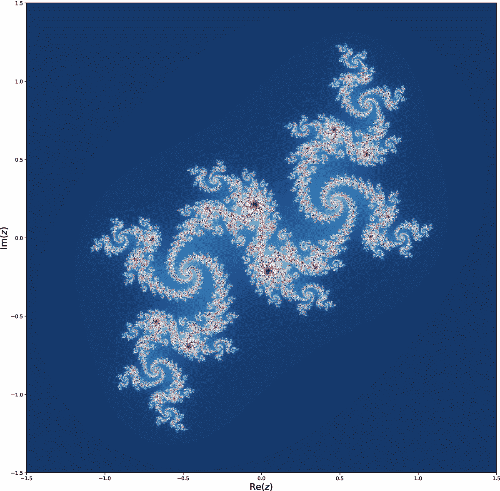

图 19-1 由使用 Numba 的 JIT 编译 Python 函数生成的 Julia 分形

```
使用以下代码绘制图形：

```python
In [27]: fig, ax = plt.subplots(figsize=(8, 8))
...: ax.imshow(j, cmap=plt.cm.RdBu_r, extent=[-1.5, 1.5, -1.5, 1.5])
...: ax.set_xlabel("$\mathrm{Re}(z)$", fontsize=18)
...: ax.set_ylabel("$\mathrm{Im}(z)$", fontsize=18)
```

我们可以使用 `%timeit` 命令来比较纯 Python 函数 `py_julia_fractal` 和相应的 JIT 编译函数 `jit_julia_fractal` 的速度：

```python
In [28]: %timeit py_julia_fractal(z_real, z_imag, j)
1 loops, best of 3: 60 s per loop
In [29]: %timeit jit_julia_fractal(z_real, z_imag, j)
10 loops, best of 3: 140 ms per loop
```

在这个特定案例中，加速效果惊人，达到了 430 倍，同样只需向 Python 函数添加一个装饰器即可实现。有了这种速度提升，在 Python 中其实不再需要刻意避免使用 for 循环。

Numba 库中另一个有用的装饰器是 `numba.vectorize`。它从为标量输入和输出编写的核函数生成并 JIT 编译一个向量化函数，非常类似于 NumPy 的 `vectorize` 函数。例如，考虑赫维赛德阶跃函数：


如果我们想为标量输入 `x` 实现这个函数，我们可以使用：

```python
In [30]: def py_Heaviside(x):
...:     if x == 0.0:
...:         return 0.5
...:     if x < 0.0:
...:         return 0.0
...:     else:
...:         return 1.0
```

这个函数只适用于标量输入，如果我们想将其应用于数组或列表，必须显式地遍历数组并对每个元素应用该函数：

```python
In [31]: x = np.linspace(-2, 2, 50001)
In [32]: %timeit [py_Heaviside(xx) for xx in x]
100 loops, best of 3: 16.7 ms per loop
```

这既不方便又速度慢。NumPy 的 `vectorize` 函数通过将标量核函数自动包装成一个能感知 NumPy 数组的函数，解决了不方便的问题：

```python
In [33]: np_vec_Heaviside = np.vectorize(py_Heaviside)
In [34]: np_vec_Heaviside(x)
Out[34]: array([ 0.,  0.,  0., ...,  1.,  1.,  1.])
```

然而，NumPy 的 `vectorize` 函数并没有解决性能问题。从使用 `%timeit` 对 `np_vec_Heaviside` 函数进行基准测试的结果来看，其性能与显式遍历数组并依次为每个元素调用 `py_Heaviside` 函数相当：

```python
In [35]: %timeit np_vec_Heaviside(x)
100 loops, best of 3: 13.6 ms per loop
```

使用 NumPy 数组表达式而不是对用 Python 编写的标量核使用 NumPy 的 `vectorize` 函数，可以获得更好的性能：

```python
In [36]: def np_Heaviside(x):
...:     return (x > 0.0) + (x == 0.0)/2.0
In [37]: %timeit np_Heaviside(x)
1000 loops, best of 3: 268 μs per loop
```

然而，通过使用 `Numba` 和 `vectorize` 装饰器（它接收一个函数签名列表，用于生成 JIT 编译的代码）可以实现更佳的性能。在此，我们为两种签名生成了向量化函数——一种签名输入和输出都是 32 位浮点数数组，定义为 `numba.float32(numba.float32)`；另一种签名输入和输出都是 64 位浮点数数组，定义为 `numba.float64(numba.float64)`：

```python
In [38]: @numba.vectorize([numba.float32(numba.float32),
...:                   numba.float64(numba.float64)])
...: def jit_Heaviside(x):
...:     if x == 0.0:
...:         return 0.5
...:     if x < 0:
...:         return 0.0
...:     else:
...:         return 1.0
```

对生成的 `jit_Heaviside` 函数进行基准测试，结果显示，在我们考察过的方法中，它的性能最佳：

```python
In [39]: %timeit jit_Heaviside(x)
10000 loops, best of 3: 58.5 μs per loop
```

`jit_Heaviside` 函数可以像任何 `NumPy` 通用函数一样使用，包括支持广播和其他 `NumPy` 特性。为了验证该函数确实实现了所需功能，我们可以用一组简单的输入值进行测试：

```python
In [40]: jit_Heaviside([-1, -0.5, 0.0, 0.5, 1.0])
Out[40]: array([ 0\. ,  0\. ,  0.5,  1\. ,  1\. ])
```

在本节中，我们探讨了如何使用 `Numba` 库通过 JIT 编译加速 Python 代码。我们研究了四个示例：两个用于演示 `Numba` 基本用法的简单示例——数组求总和与累加求和；一个更贴近实际、但不易用向量表达式表述的 `Numba` 用例——朱利亚集计算；最后，我们通过实现 Heaviside 阶跃函数探索了标量核的向量化。这些示例展示了 `Numba` 的常见使用模式，但 `Numba` 库还有更多值得探索的功能，例如为 GPU 生成代码。有关此主题及其他内容的更多信息，请参阅 `Numba` 官方文档，网址为 [`http://numba.pydata.org/doc.html`](http://numba.pydata.org/doc.html)。

## Cython

与 `Numba` 类似，`Cython` 也是一套加速 Python 代码的解决方案，不过 `Cython` 处理此问题的方式截然不同。`Numba` 是一个 Python 库，它将纯 Python 代码转换为 `LLVM` 代码，再 JIT 编译为机器码；而 `Cython` 是一种编程语言，它是 Python 编程语言的超集：`Cython` 通过引入类似 `C` 语言的特性来扩展 Python。最值得注意的是，`Cython` 允许我们使用显式且静态的类型声明。`Cython` 为 Python 引入这些扩展的目的，是为了使代码能够被转换为高效的 `C` 或 `C++` 代码，这些代码随后可编译成 Python 扩展模块，从而可以从常规的 Python 代码中导入并使用。

`Cython` 主要有两种用途：加速 Python 代码，以及为与编译库交互生成包装器。使用 `Cython` 时，我们需要修改目标 Python 代码，因此与使用 `Numba` 相比，需要多做一点工作，并且我们需要学习 `Cython` 的语法和行为，才能用它来加速 Python 代码。然而，正如我们将在本节中看到的，`Cython` 提供了对 Python 代码处理方式的更精细控制，并且 `Cython` 还具备一些 `Numba` 无法实现的功能，例如生成 Python 与外部库之间的接口，以及加速不使用 `NumPy` 数组的 Python 代码。

虽然 `Numba` 采用透明的即时编译，但 `Cython` 主要设计用于传统的预编译（提前编译）。有几种将 `Cython` 代码编译成 Python 扩展模块的方法，每种适用于不同的用例。我们首先回顾编译 `Cython` 代码的选项，然后介绍 `Cython` 对于加速用 Python 编写的计算有用的特性。在本节中，我们将主要使用上一节中与 `Numba` 示例基本相同的示例，以便我们能够轻松比较方法和结果。我们首先探讨如何加速上一节中定义的 `py_sum` 和 `py_cumsum` 函数。
```

要从 Python 中使用 `Cython` 代码，它必须经过 `Cython` 编译管道：首先，`Cython` 代码必须被翻译成 C 或 C++ 代码，然后，需要使用 C 或 C++ 编译器将其编译成机器码。从 `Cython` 代码到 C 或 C++ 的翻译可以使用 `cython` 命令行工具完成。该工具接收一个包含 `Cython` 代码的文件（我们通常使用 `.pyx` 文件扩展名存储这些文件），并生成一个 C 或 C++ 文件。例如，考虑文件 `cy_sum.pyx`，其内容如代码清单 [19-1] 所示。为了从这个 `Cython` 文件生成 C 文件，我们可以运行命令 `cython cy_sum.pyx`。结果是生成 `cy_sum.c` 文件，我们可以使用标准的 C 编译器将其编译成 Python 扩展模块。此编译步骤依赖于平台，需要使用正确的编译器标志和选项才能生成合适的 Python 扩展。

```
def cy_sum(data):
    s = 0.0
    for d in data:
        s += d
    return s
```
**代码清单 19-1** Cython 文件 `cy_sum.pyx` 的内容

为了避免与平台特定的 C 和 C++ 代码编译选项相关的复杂性，我们可以使用 `distutils` 和 `Cython` 库自动将 `Cython` 代码翻译成有用的 Python 扩展模块。这需要创建一个 `setup.py` 脚本，它调用 `distutils.core` 中的 `setup` 函数（该函数知道如何将 C 代码编译成 Python 扩展）以及 `Cython.Build` 中的 `cythonize` 函数（该函数知道如何将 `Cython` 代码翻译成 C 代码），如代码清单 [19-2] 所示。当 `setup.py` 文件准备好后，我们可以使用命令 `python setup.py build_ext --inplace` 编译 `Cython` 模块，该命令指示 `distutils` 构建扩展模块并将其放置在源代码所在的同一目录中。

```python
from distutils.core import setup
from Cython.Build import cythonize
import numpy as np

setup(ext_modules=cythonize('cy_sum.pyx'),
      include_dirs=[np.get_include()],
      requires=['Cython', 'numpy'])
```
**代码清单 19-2** 一个可用于自动将 Cython 文件编译为 Python 扩展模块的 `setup.py` 脚本

一旦 Cython 代码被编译为 Python 扩展模块（无论是手动编译还是使用 `distutils` 库），我们就可以将其导入并像常规 Python 模块一样使用：

```
In [41]: from cy_sum import cy_sum

In [42]: cy_sum(data)
Out[42]: -189.70046227549025

In [43]: %timeit cy_sum(data)
100 loops, best of 3: 5.56 ms per loop

In [44]: %timeit py_sum(data)
100 loops, best of 3: 8.08 ms per loop
```

此示例表明，直接使用 Cython 编译代码清单 19-1 中的纯 Python 代码，可获得约 30% 的加速。这虽是可观的加速，但或许不值得为通过 Cython 编译流程而费周折。后续我们将介绍如何利用 Cython 的更多特性来进一步提升加速效果。

```cython
cimport numpy
import numpy

def cy_cumsum(data):
    out = numpy.zeros_like(data)
    s = 0
    for n in range(len(data)):
        s += data[n]
        out[n] = s
    return out
```
**代码清单 19-3** Cython 文件 `cy_cumsum.pyx` 的内容

上述代码展示了将 Cython 代码显式编译为 Python 扩展模块的过程。这对于分发用 Cython 编写的预编译模块非常有用，因为最终生成的扩展模块在使用时无需安装 Cython。另一种隐式调用 Cython 编译流程的方法是在模块导入时自动触发，这可通过随 Cython 分发的 `pyximport` 库实现。要无缝地从 Python 直接导入 Cython 文件，我们首先需要调用 `pyximport` 库中的 `install` 函数：

```
In [45]: pyximport.install(setup_args=dict(include_dirs=np.get_include()))
```

这将修改 Python `import` 语句的行为，增加对 Cython `pyx` 文件的支持。当导入一个 Cython 模块时，它会先被编译为 C 或 C++ 代码，然后再编译为 Python 解释器可导入的 Python 扩展模块格式的机器码。这些隐式步骤有时需要额外配置，我们可以通过 `pyximport.install` 函数的参数进行传递。例如，为了导入使用了 NumPy 相关功能的 Cython 代码，生成的 C 代码需要针对 NumPy C 头文件进行编译。我们可以通过在 `install` 函数的 `setup_args` 参数中将 `include_dirs` 设置为 `np.get_include()` 的值来配置这一点，如上代码所示。此外，还有其他可用选项，我们也可以自定义编译和链接参数。详细信息请参阅 `pyximport.install` 的文档字符串。一旦调用了 `pyximport.install`，我们就可以使用标准的 Python `import` 语句从 Cython 模块中导入函数：

```
In [46]: from cy_cumsum import cy_cumsum

In [47]: %timeit cy_cumsum(data)
100 loops, best of 3: 5.91 ms per loop

In [48]: %timeit py_cumsum(data)
100 loops, best of 3: 13.8 ms per loop
```

在此示例中，我们看到经过 Cython 编译流程的 Python 代码获得了虽可喜但不算惊艳的两倍加速。

在深入探讨 Cython 的详细用法以进一步提升加速倍数之前，我们先快速介绍另一种编译和导入 Cython 代码的方式。在使用 IPython（尤其是 Jupyter Notebook）时，我们可以使用便捷的 `%%cython` 命令，该命令会自动将代码单元格中的 Cython 代码编译并加载为 Python 扩展，并在 IPython 会话中提供使用。要使用此命令，我们首先需要使用 `%load_ext cython` 命令激活它：

```
In [49]: %load_ext cython
```

激活 `%%cython` 命令后，我们可以在 IPython 会话中交互式地编写和加载 Cython 代码：

```
In [50]: %%cython
   ...: def cy_sum(data):
   ...:     s = 0.0
   ...:     for d in data:
   ...:         s += d
   ...:     return s

In [51]: %timeit cy_sum(data)
100 loops, best of 3: 5.21 ms per loop

In [52]: %timeit py_sum(data)
100 loops, best of 3: 8.6 ms per loop
```

如之前所见，只需在 IPython 代码单元格的第一行添加`%%cython`即可直接获得加速。这让人联想到给函数添加`@numba.jit`装饰器，但这两种方法背后的机制截然不同。在本节剩余部分，我们将使用此方法编译和加载 Cython 代码。在使用`%%cython` IPython 命令时，添加`-a`参数也很有用。这会使 Cython 的注释输出显示为代码单元格的输出，如图 19-2 所示。注释会以黄色深浅度显示每一行代码：亮黄色表示该行代码被翻译为对 Python C/API 有强依赖的 C 代码，而白色行代码则被直接翻译为纯 C 代码。在优化 Cython 代码时，我们通常需要尽力让 Cython 代码尽可能被翻译为纯 C 代码，因此检查注释输出并查找通常代表代码瓶颈的黄色行非常有用。额外的好处是，点击注释输出中的一行代码，可以在我们提供的 Cython 代码和它被翻译成的 C 代码之间切换显示。


`图 19-2` 使用带`-a`参数的`%%cython` IPython 命令生成的 Cython 注释

在本节剩余部分，我们将探索利用 Cython 引入的语言特性（尤其适用于计算问题）来加速 Cython 代码的方法。我们首先重新审视前面代码中`cy_sum`的实现。在首次尝试加速此函数时，我们仅使用了纯 Python 代码并通过 Cython 编译流程，结果获得了约 30%的加速。实现更大幅度加速的关键步骤是为函数的所有变量和参数添加类型声明。通过显式声明变量类型，Cython 编译器将能够生成更高效的 C 代码。要指定变量类型，我们需要使用 Cython 关键字`cdef`，它可与任何标准 C 类型一起使用。例如，要声明整数类型的变量`n`，可以使用`cdef int n`。我们也可以使用 NumPy 库的类型定义：例如，`cdef numpy.float64_t s`将变量`s`声明为 64 位浮点数。NumPy 数组可以使用格式为`numpy.ndarray[numpy.float64_t, ndim=1] data`的类型规范来声明，这表示`data`是一个元素类型为 64 位浮点数、一维（向量）、长度未指定的数组。为之前的`cy_sum`函数添加此类类型声明后，得到如下代码：

```
In [53]: %%cython

...: cimport numpy

...: cimport cython

...:

...: @cython.boundscheck(False)

...: @cython.wraparound(False)

...: def cy_sum(numpy.ndarray[numpy.float64_t, ndim=1] data):

...:     cdef numpy.float64_t s = 0.0

...:     cdef int n, N = len(data)

...:     for n in range(N):

...:         s += data[n]

...:     return s
```

在该实现中，我们对`cy_sum`函数应用了两个装饰器`@cython.boundscheck(False)`和`@cython.wraparound(False)`，这两个装饰器禁用了对 NumPy 数组索引进行耗时的边界检查。这会导致代码安全性降低，但如果我们确信该函数中的 NumPy 数组不会被索引到有效范围之外，可以通过禁用这些检查获得额外的加速。现在，我们已经显式声明了函数所有变量和参数的类型，Cython 能够生成高效的 C 代码，这些代码在编译成 Python 模块后，其性能与使用 Numba 的 JIT 编译代码相当，并且接近 NumPy 内置的`sum`函数（该函数同样用 C 实现）的性能：

```
In [54]: %timeit cy_sum(data)

10000 loops, best of 3: 49.2 μs per loop

In [55]: %timeit jit_sum(data)

10000 loops, best of 3: 47.6 μs per loop

In [56]: %timeit np.sum(data)

10000 loops, best of 3: 29.7 μs per loop
```

接下来，让我们将注意力转向`cy_cumsum`函数。与`cy_sum`函数一样，该函数也将受益于显式类型声明。为了简化 NumPy 数组类型的声明，我们在这里使用`ctypedef`关键字为`numpy.float64_t`创建了一个别名`FTYPE_t`。还需要注意，在 Cython 代码中，有两种不同的导入语句：`cimport`和`import`。`import`语句可用于导入任何 Python 模块，但这会生成回调 Python 解释器的 C 代码，因此可能速度较慢。`cimport`语句的工作方式类似于常规的`import`，但用于导入其他 Cython 模块。这里的`cimport numpy`导入了一个名为`numpy`的 Cython 模块，该模块提供了对 NumPy 的 Cython 扩展，主要是类型和函数声明。特别是，诸如`numpy.float64_t`之类的 C 风格类型就是在该 Cython 模块中声明的。但是，在下面代码定义的函数中调用`numpy.zeros`会导致对 NumPy 模块中`zeros`函数的调用，为此，我们需要使用`import numpy`引入 Python 模块`numpy`。

将上述类型声明添加到之前定义的`cy_cumsum`函数中，得到如下实现：

```
In [57]: %%cython

...: cimport numpy

...: import numpy

...: cimport cython

...:

...: ctypedef numpy.float64_t FTYPE_t

...:

...: @cython.boundscheck(False)

...: @cython.wraparound(False)

...: def cy_cumsum(numpy.ndarray[FTYPE_t, ndim=1] data):

...:     cdef int n, N = data.size

...:     cdef numpy.ndarray[FTYPE_t, ndim=1] out = numpy.zeros(N, dtype=data.dtype)

...:     cdef numpy.float64_t s = 0.0

...:     for n in range(N):

...:         s += data[n]

...:         out[n] = s

...:     return out
```

与`cy_sum`类似，在声明了函数中所有变量的类型后，我们看到了显著的加速，并且`cy_cumsum`的性能现在与 JIT 编译的 Numba 函数`jit_cumsum`相当，且比 NumPy 内置的`cumsum`函数（后者功能更为通用）更快：

```
In [58]: %timeit cy_cumsum(data)

10000 loops, best of 3: 69.7 μs per loop

In [59]: %timeit jit_cumsum(data)

10000 loops, best of 3: 70 μs per loop

In [60]: %timeit np.cumsum(data)

10000 loops, best of 3: 148 μs per loop
```

当添加显式类型声明时，我们通过 Cython 编译函数获得了性能提升，但同时也失去了通用性，因为该函数现在无法接受任何其他类型的参数。例如，原始的`py_sum`函数以及 NumPy 的`sum`函数，能够接受更广泛的输入类型。我们可以对 Python 列表以及包含浮点数和整数的 NumPy 数组进行求和：

```
In [61]: py_sum([1.0, 2.0, 3.0, 4.0, 5.0])

Out[61]: 15.0

In [62]: py_sum([1, 2, 3, 4, 5])

Out[62]: 15
```

另一方面，带有显式类型声明的 Cython 编译版本仅能处理我们声明的确切类型：

```
In [63]: cy_sum(np.array([1.0, 2.0, 3.0, 4.0, 5.0]))

Out[63]: 15.0

In [64]: cy_sum(np.array([1, 2, 3, 4, 5]))

ValueError: Buffer dtype mismatch, expected 'float64_t' but got 'long'
```

通常，我们希望支持多种输入类型，例如，能够使用同一函数对浮点数和整数数组进行求和。Cython 通过`ctypedef fused`关键字提供了解决此问题的方案，借助该关键字，我们可以定义一种新类型，这种类型是若干种给定类型中的一种。例如，考虑对`py_sum`函数进行如下修改，得到`py_fused_sum`函数：

```python
In [65]: %%cython

...: cimport numpy

...: cimport cython

...:

...: ctypedef fused I_OR_F_t:

...:     numpy.int64_t

...:     numpy.float64_t

...:

...: @cython.boundscheck(False)

...: @cython.wraparound(False)

...: def cy_fused_sum(numpy.ndarray[I_OR_F_t, ndim=1] data):

...:     cdef I_OR_F_t s = 0

...:     cdef int n, N = len(data)

...:     for n in range(N):

...:         s += data[n]

...:     return s
```

这里，函数是依据类型`I_OR_F_t`定义的，该类型使用`ctypedef fused`定义为可以是`numpy.int64_t`或`numpy.float64_t`。Cython 会自动为这两种类型的函数生成必要的代码，这样我们就可以在浮点数和整数数组上使用该函数（代价是性能略有下降）：

```python
In [66]: cy_fused_sum(np.array([1.0, 2.0, 3.0, 4.0, 5.0]))

Out[66]: 15.0

In [67]: cy_fused_sum(np.array([1, 2, 3, 4, 5]))

Out[67]: 15
```

作为使用 Cython 加速 Python 代码的最后一个示例，让我们再次考虑上一节中看到的用于生成 Julia 集的 Python 代码。要实现此函数的 Cython 版本，我们只需采用原始 Python 代码，并按照前面所述的过程，显式声明函数中使用的所有变量的类型。我们还添加了用于禁用索引边界检查和环绕检查的装饰器。这里我们既有 NumPy 整数数组又有浮点数数组作为输入，因此我们分别将参数类型定义为`numpy.ndarray[numpy.float64_t, ndim=1]`和`numpy.ndarray[numpy.int64_t, ndim=2]`。

下面代码中给出的`cy_julia_fractal`实现还包含一个复数模平方的 Cython 实现。该函数使用`inline`关键字声明为内联函数，这意味着编译器会将函数体放在每次调用它的地方，而不是创建一个从这些位置调用的函数。这会导致生成较大的代码，但避免了额外函数调用的开销。我们还使用`cdef`而非通常的`def`关键字定义此函数。在 Cython 中，`def`定义一个可以从 Python 调用的函数，而`cdef`定义一个可以从 C 调用的函数。使用`cpdef`关键字，我们可以同时定义一个既可以从 C 调用又可以从 Python 调用的函数。按照这里的写法，使用的是`cdef`，我们无法在执行此代码单元后从 IPython 会话中调用`abs2`函数，但如果将`cdef`改为`cpdef`，则可以调用。

```python
In [68]: %%cython

...: cimport numpy

...: cimport cython

...:

...: cdef inline double abs2(double complex z):

...:     return z.real * z.real + z.imag * z.imag

...:

...: @cython.boundscheck(False)

...: @cython.wraparound(False)

...: def cy_julia_fractal(numpy.ndarray[numpy.float64_t, ndim=1] z_re,

...:                      numpy.ndarray[numpy.float64_t, ndim=1] z_im,

...:                      numpy.ndarray[numpy.int64_t, ndim=2] j):

...:     cdef int m, n, t, M = z_re.size, N = z_im.size

...:     cdef double complex z

...:     for m in range(M):

...:         for n in range(N):

...:             z = z_re[m] + 1.0j * z_im[n]

...:             for t in range(256):

...:                 z = z ** 2 - 0.05 + 0.68j

...:                 if abs2(z) > 4.0:

...:                     j[m, n] = t

...:                     break
```

如果我们使用与之前调用使用 Numba 进行 JIT 编译的 Python 实现时相同的参数来调用`cy_julia_fractal`函数，会发现这两个实现的性能相当。

```python
In [69]: N = 1024

In [70]: j = np.zeros((N, N), dtype=np.int64)

In [71]: z_real = np.linspace(-1.5, 1.5, N)

In [72]: z_imag = np.linspace(-1.5, 1.5, N)

In [73]: %timeit cy_julia_fractal(z_real, z_imag, j)

10 loops, best of 3: 113 ms per loop

In [74]: %timeit jit_julia_fractal(z_real, z_imag, j)

10 loops, best of 3: 141 ms per loop
```

`cy_julia_fractal`实现略微占优，这主要归因于最内层循环中对`abs2`函数的内联调用，以及`abs2`函数避免了计算平方根这一事实。在`jit_julia_fractal`中做出类似的更改可以提高其性能，并且大致能够解释这里展示的性能差异。

到目前为止，我们已经探索了将 Cython 作为一种通过将 Python 代码编译成机器码（以 Python 扩展模块的形式提供）来加速其运行的方法。Cython 还有另一个重要的用例，这个用例至少与其在 Python 科学计算社区中的广泛使用同样重要：Cython 还可以用于轻松创建已编译的 C 和 C++ 库的封装器。我们不会在此深入探讨这个问题，但会给出一个简单的示例，说明如何使用 Cython 在短短几行代码中调用任意 C 库。以 C 标准库中的数学库为例。它提供了数学函数，类似于 Python 标准库中同名模块`math`定义的函数。要在 C 程序中使用这些函数，我们需要包含`math.h`头文件以获取它们的声明，然后将程序与`libm`库进行编译和链接。在 Cython 中，我们可以使用`cdef extern from`关键字获取函数声明，之后需要给出 C 头文件的名称，并在随后的代码块中列出我们想要使用的函数的声明。例如，要使`libm`中的`acos`函数在 Cython 中可用，我们可以使用以下代码：

```python
In [75]: %%cython

...: cdef extern from "math.h":

...:      double acos(double)

...:

...: def cy_acos1(double x):

...:     return acos(x)
```

这里我们还定义了 Python 函数`cy_acos1`，我们可以从 Python 中调用它：

```python
In [76]: %timeit cy_acos1(0.5)

10000000 loops, best of 3: 83.2 ns per loop
```

使用这种方法，我们可以将任意的 C 函数封装成可从常规 Python 代码调用的函数。这对于科学计算应用来说是一个非常实用的特性，因为它使得现有的用 C 和 C++ 编写的代码能够轻松地从 Python 中调用。对于标准库，Cython 已经通过`libc`模块提供了类型声明，因此我们不需要使用`cdef extern from`显式定义函数。对于`acos`这个例子，我们可以直接使用`cimport`语句从`libc.math`中导入该函数：


```
In [77]: %%cython

...: from libc.math cimport acos

...:

...: def cy_acos2(double x):

...:     return acos(x)

In [78]: %timeit cy_acos2(0.5)

10000000 loops, best of 3: 85.6 ns per loop
```

生成的函数 `cy_acos2` 与之前从 `math.h` 显式导入的 `cy_acos1` 是相同的。将这些 C 数学库函数的性能与 NumPy 和 Python 标准数学库中相应的函数进行比较是很有启发性的：

```
In [79]: from numpy import arccos

In [80]: %timeit arccos(0.5)

1000000 loops, best of 3: 1.07 μs per loop

In [81]: from math import acos

In [82]: %timeit acos(0.5)

10000000 loops, best of 3: 95.9 ns per loop
```


# 总结

在本章中，我们探索了使用 Numba 和 Cython 加速 Python 代码的方法。Numba 通过即时编译生成优化的机器码，而 Cython 生成 C 代码，该代码可以通过预编译编译成机器码。Numba 适用于纯 Python 代码，但严重依赖于利用 `NumPy` 数组进行类型推断，而 Cython 则使用 Python 语言的扩展，允许显式的类型声明。这些方法的优势在于，我们可以获得与编译后的机器码相媲美的性能，同时仍然停留在 Python 或类 Python 的编程环境中。加速 Python 代码的关键在于使用类型化变量，要么像 Numba 那样利用 `NumPy` 数组进行类型推断，要么像 Cython 那样显式声明变量的类型。显式类型化的代码可以转换成比纯 Python 中的动态类型化代码高效得多的代码，并且可以避免 Python 中类型查找所涉及的许多开销。Numba 和 Cython 都是获得显著的 Python 代码加速的便捷方式，并且它们生成的代码通常具有相似的性能。Cython 还提供了一种简便的方法来创建外部库的接口，以便可以从 Python 中调用它们。在 Numba 和 Cython 中，共同的主题是利用类型信息（来自 `NumPy` 数组或显式声明）来生成更高效的类型化机器码。在 Python 社区中，最近也有一个趋势，即向 Python 语言本身添加对可选类型提示（type hints）的支持。有关类型提示的更多详细信息，请参阅 PEP 484 ([`www.python.org/dev/peps/pep-0484`](http://www.python.org/dev/peps/pep-0484))，该规范已从 Python 3.5 版本开始纳入 Python。虽然 Python 中的类型提示在不久的将来不太可能被广泛使用，但它无疑是一个值得关注的有趣发展。

# 延伸阅读

关于使用 Cython 的详尽指南，请参考 Smith (2015) 和 Herron (2013)。有关 Numba 的更多信息，请参阅其官方文档 ([`http://numba.pydata.org/numba-doc`](http://numba.pydata.org/numba-doc))。关于使用 Python 进行高性能计算的详细讨论，另请参见 M. Gorelick (2014)。

## 索引

### A

Adams-Bashforth 方法
Adams-Moulton 方法
`add_axes` 方法
`add_subplot` 函数
解析解
应用程序编程接口 (API)
任意精度积分
数组创建
- 常量值
- 增量序列
- 列表
- 对数序列
- 矩阵
- 数组
- 未初始化数组
自回归 (AR) 模型
- ARIMA
- ARMA
- Durbin-Watson 统计检验
- 高阶
- `sm.tsa.AR` 类
- 温度观测值
差分整合移动平均自回归 (ARIMA) 模型
自回归移动平均 (ARMA) 模型
`autoscale` 方法
`AutoSubDomain` 实例
`ax.annotation`
坐标轴
- 图例方法
- 线条属性
- 绘图类型
- 属性 (*参见* 属性, 轴)
- 文本标注
坐标轴布局
- `GridSpec`
- 嵌入式图 (insets)
- `subplot2grid`
- 子图 (subplots)
`Axes.text` 方法
轴刻度
`ax.legend` 方法
`ax.set_xlabel` 方法
`ax.set_ylabel` 方法
`ax.text`

### B

贝叶斯定理
`bbox_to_anchor` 参数
BFGS 方法
二分法
二元插值
Blackman 函数
布尔值数组
区间分割法 (Bracketing methods)
`brent` 函数
Broyden 方法
`Bunch` 对象
巴特沃斯滤波器

### C

微积分，`SymPy`
级数展开
`sympy.diff` 函数
`sympy.integrate` 函数
`sympy.limit` 函数
`sympy.Product` 类
`sympy.Sum` 类
切比雪夫滤波器
切比雪夫多项式
经典优化问题
闭式表达式
代码优化
C/Fortran
`cProfile` 模块
`Cython` (*参见* `Cython`)
导入模块
`Numba` (*参见* `Numba`)
`NumPy` 和 `SciPy`
色图绘制
按列优先格式
逗号分隔值(CSV)
首字母缩略词
数组
列
注释行
数据
数据框
非数值数据
`np.loadtxt` 函数
`np.savetxt`
`NumPy` 数组
一维/二维数组
`pandas read_csv` 函数
纯文本文件格式
`Python` 字符串列表
`pandas read_csv` 函数
数据规格的大小和复杂度
制表符
向量和矩阵
复杂数据结构
复值数组
复合求积规则
计算机代数系统(CAS)
计算环境
`Conda create` 命令
环境，更新
包
重新创建
混淆矩阵
约束优化
等高线图
等值线图
坐标变量
不等式约束
线性规划
`SymPy`
约束条件
连续实值函数
Continuum Analytics 的 Anaconda
`contourf` 函数
凸问题
`cProfile` 模块
交叉验证
`ctypes`
`cvxopt` 库
`cvxopt.solvers.lp` 求解器
`cvxopt.matrix` 函数
`cy_cumsum` 函数
`Cython`
C 数学库函数
代码编译流水线
`cpdef` 关键字
`cy_cumsum` 函数
`cy_cumsum.pyx`
`cy_julia_fractal` 函数
`cy_sum` 函数
`cy_sum.pyx`
`%%cython` `IPython` 命令
`cython cy_sum.pyx` 设计
`distutils` 库
显式类型声明
浮点数和整数数组
生成，C 代码
`libc` 模块
`%load_ext cython` 命令
机器码
`math.h` 头文件
`py_sum` 函数
`Python` 项目
具有 C 类似特性的 `Python`
`pyximport` 库
`pyximport.install` 函数
`setup` 函数
加速
用法
`Cythonimport`

### D

数据输入与输出
数组与表格数据
类别与类型
`CSV` (*参见* 逗号分隔值(CSV))
`HDF5` (*参见* 分层数据格式 5(HDF5))
`JSON` (*参见* JavaScript 对象表示法(JSON))
库
选项
序列化
存储结构化和非结构化数据
`dblquad` 函数
默认刻度放置
稠密矩阵
稠密 `NumPy` 数组
`DesicisionTreeClassifier` 类
数字信号处理器(DSP)
降维
狄拉克δ函数
方向场图形技术
`DirichletBC` 类
狄利克雷边界条件
离散余弦变换(DCT)
离散傅里叶变换(DFT)
离散正弦变换(DST)
`doit` 方法
`dolfin.AutoSubDomain` 实例
`dolfin.FunctionSpace` 类
`dolfin` 库
`dolfin.MeshFunction` 实例
`dolfin.refine` 函数
`dolfin.solve` 函数
`dolfin.TrialFunction` 和 `dolfin.TestFunction` 类
多曼德-普林斯 方法
每英寸点数(DPI)
`dpi` 参数
3D 绘图
`dplquad` 函数
德宾-沃森 统计检验

### E

`eigenvals` 方法
特征值方程
特征值问题
`SciPy`
`SymPy`
`eigenvects` 方法
爱因斯坦求和约定
`ElasticNet` 类
弹性网络正则化回归
Enthought 的 Canopy
环境，管理
环境，切换
欧拉方法
`evalf` 方法
`expr_func` 函数
`extent` 参数
外推法

### F

`facecolor` 参数
花式索引
快速傅里叶变换(FFT)
特征提取
`FEniCS` 框架，偏微分方程
`AutoSubDomain` 实例
狄利克雷边界条件
`dolfin.assemble` 函数
`dolfin.AutoSubDomain` 实例
`dolfin.Constant` 对象
`dolfin.Expression` 对象
`dolfin.FunctionSpace` 类
`dolfin.MeshFunction`
`dolfin.parameters` 字典
`dolfin.plot`
`dolfin.RectangleMesh`
`dolfin.refine` 函数
`dolfin.solve`
`dolfin.TrialFunction` 和 `dolfin.TestFunction` 类
域和子域参数
`Expression` 类
外部可视化软件
函数对象
函数和类
`dolfin` 库
`mshr` 库
库与工具
`Matplotlib`
`Matplotlib` 的 `pcolor` 函数
网格和 `boundary_parts` 对象
网格函数
网格生成
网格对象
生成，`mshr` 库
`mshr.Circle`
诺依曼边界条件
`np.array` 函数
`on_boundary`
`Python` 接口
`RectangleMesh` 函数
`refined_mesh`
稳态热方程
温度分布
试探函数和检验函数
`triplot` 和 `tripcolor`
`ufl_element` 方法
均匀细结构化网格
`u_sol.vector()` 和 `mesh.coordinates()` 向量方法
`FEniCS` 库
`fftpack` 模块
`figsize` 参数
`Figure.add_subplot` 方法
`Figure` 对象
`Figure`，技巧
滤波器设计
有限差分公式
有限差分法(FDM)
代数方程
后向差分公式
边界条件
稠密 `NumPy` 数组
`eye` 和 `kron` 函数
`NumPy` 中的 `eye` 函数
有限差分公式
`SciPy` 中的线性方程求解器
偏微分方程 问题
`reshape` 方法
二阶 常微分方程 边值问题
求解 常微分方程 边值问题
稀疏矩阵
稀疏矩阵数据结构
二维热方程，狄利克雷边界条件
有限元法(FEM)
基函数
连续函数
`FiPy`，`SfePy` 和 `FEniCS` 库
无限维函数空间
网格生成
泊松方程
求解 偏微分方程 问题
标准线性代数方法
稳态热方程
强形式
检验函数
有限冲激响应(FIR)滤波器
有限体积法(FVM)
软件
`FiPy` 框架
`FiPy` 库
`fixed_quad` 函数
浮点值数组
`format` 参数
傅里叶变换
`F(v)`
`free_symbols` 属性
频域滤波器
`Function` 对象

### G

`Gaussian_kde` 函数
高斯求积
高斯窗 函数
广义最小二乘法(GLS)
广义线性模型
胶水语言
黄金分割搜索方法
使用 `Matplotlib` 创建图形
图形用户界面
图与网络
邻接矩阵
边数据
`EdgeView`
`NetworkX` 库
`NodeView` 对象与方法
东京地铁 站点
邻接矩阵
布尔 属性
`Cuthill-McKee` 排序
`degree` 方法
`graphviz_layout` 函数
`JSON` 文件
`nx.draw_network_edges`
`nx.draw_networkx_labels`
最优行驶路线
路径与行驶时间
最短路径与行驶时间
换乘边与车内边
`travel_times` 和 `transfers` 权重属性
`grid` 方法
网格线，结果
`GridSpec` 布局管理器

### H

`h5py` 库
`API`
数据集
布尔索引
`create_dataset` 方法
创建
空数组
`experiment1/simulation/data1` 组
`experiment2/measurement`
花式索引
`fillvalue`
`float64`
`meas1` 数据集
`NumPy` 数组
对象
检索值
`visititems` 方法
文件
组
`Hamming` 函数
`Hann` 函数
埃尔米特多项式
海森矩阵
分层数据格式 5(HDF5)
属性
`h5py` 库 (*参见* `h5py` 库)
高性能并行 `I/O`
实现
库
长期存储
`Pandas HDFStore`
`PyTables` 库
存储数值数据
结构
高阶方法
高阶求积规则

### I

`imshow` 方法
索引与切片
花式索引与布尔索引
多维数组
一维数组
`resize` 与 `reshape`
视图
视觉总结
无限维函数空间
无限冲激响应(IIR)滤波器
安装说明
积分方程
恒等式积分
积分变换
被积函数
被积函数表格化值
交互模式
插值函数
`interpolate.griddata` 函数
插值与曲线拟合
积分的解释
解释器
逆拉普拉斯变换
逆变换
`IPython` 命令
`IPython` 控制台
自动补全与对象内省
文档
输入与输出缓存
交互
`IPython` 环境
`IPython` 扩展
调试器
导航
重置
运行脚本
文本编辑器
代码计时与分析
`IPython`，安装
`IPython`，交互函数
鸢尾花数据集
`is_real` 属性

### J

`Jacobian` 矩阵
`JavaScript Object Notation (JSON)` 文件
`data.json` 格式
`json.dumps` 函数
`json.loads` 函数
列表与字典嵌套结构的多行数据
`Python` 代码
`Python` 数据结构序列化
东京地铁 网络
`JIT` 编译代码
`jit_cumsum` 函数
`jit_sum` 函数
联合概率分布
`Julia` 分形
`Jupyter` 单元格类型
编辑单元格框架
`HTML` 代码
`Lab` 环境
`LaTeX` 公式
Markdown 单元格
输出显示
`Jupyter Notebook`
`Jupyter QtConsole`

### K

`Kaiser` 窗函数
核密度估计 (KDE)
*k* 折交叉验证
*K* 均值方法
节点 (knot)

### L

`la.eig` 函数
`la.eigvals` 函数
拉格朗日 乘数法
拉格朗日 函数
`la.lstsq` 方法
`la.lu` 函数
`lambda` 函数
拉普拉斯 变换
`la.solve` 函数
`LASSO` 回归
`LASSO` 与 正则化回归
`LaTeX` 代码表达式标记
布局 管理器
`L-BFGS-B` 方法
最小二乘解
`legend` 方法
勒让德 多项式
`Levenberg-Marquardt` 方法
`libc` 模块
似然 函数
线性代数 函数/方法，`SymPy` 矩阵
矩阵乘法方法
`sympy.Matrix` 类
线性方程组 矩阵形式
矩形方程组（*参见* 矩形方程组）
正方形方程组（*参见* 正方形方程组）
线性函数
线性规划 问题
`LinearRegression` 类
线性回归，`statsmodels`
二进制变量
等高线图
数据集
解释变量
图形方法与统计检验
含噪声观测值
正态分布误差
零假设
`NumPy` 数组
普通最小二乘法 (`ols`)
`params` 属性
`QQ` 图
响应变量
稳健线性模型 (`rlm`)
`R` 平方值
标准误差
`SciPy` `stats` 模块
工作流程
线积分
线条属性，结果
线搜索 参数
代码行数
`loc` 参数
逻辑回归
`DataFrame` 实例
拟合模型参数
`get_margeff` 方法
自变量
`info` 方法
鸢尾花 数据集
最大似然优化
`Patsy` 公式
句点字符
`Petal_Width` 和 `Petal_Length`
`predict` 方法
`Species` 列
*versicolor* 和 *virginica*
`LUdecomposition` 方法
`LUsolve` 方法

### M

机器学习 算法应用
分类
聚类方法
回归
主刻度 与 次刻度
`make_axes` 方法
表达式操作，`SymPy`
黑箱简化
简化表达式
代入
`sympy.expand` 函数
边缘概率分布
马尔可夫链蒙特卡洛 (MCMC)
数学表达式
`args` 属性
算术运算符
表达式树
数学优化
数学符号
假设关键字参数与属性
`Float` 整数类
`lambda` 函数
有理数
正弦函数
`Symbol` 类
`SymPy` 符号
`Matplotlib`
定义函数库
三角剖分函数
`triplot` 和 `tripcolor` 函数
`matplotlib.pyplot` 模块
矩阵 方法
矩阵与向量运算
`mc.forestplot` 函数
`mc.glm` 模块
`mcquad` 函数
`mc.traceplot` 函数
网格 对象
网格函数
`meshgrid` 函数
网格 数组
`Metropolis-Hastings` 步进方法
中点法则
`Miniconda`
蒙特卡洛 积分
`mpl.gridspec` 模块
`mpl.is_interactive` 函数
`mpl.rcParams` 字典
`mpl.ticker` 模块
`mpl_toolkits.mplot3d` 模块
`mpmath` 表达式
`mpmath` 库
`mpmath.quad` 函数
多精度 库
多精度浮点数 (mpf)
多元插值
参数
`interp2d` 函数
`Python` 函数
多元优化
牛顿 方法
目标函数
`optimize.minimize` 函数
`SciPy`
切片对象

### N

`nbconvert` 应用程序
`HTML`
`PDF`
`Python`
`ncols` 参数
`ndarray` 类
诺伊曼 边界条件
牛顿-柯特斯 求积法则
牛顿 方法
非因果 滤波器
非交互 模式
非线性方程组 系统
多元
`optimize.fsolve` 函数
`SciPy`
`SymPy`
可视化
非线性函数
非线性最小二乘问题
模型函数
`optimize.leastsq` 函数
非参数 方法
分布函数
`KDE`
非平凡诺伊曼 边界条件
`np.fill` 函数
`np.polynomial` 模块
`nquad` 函数
`Numba`
算法
数组
断言
基准测试
计算
实现
导入
`JIT` 编译函数
`jit_cumsum` 函数
`jit_Heaviside` 函数
`jit_julia_fractal` 函数
`jit_sum` 函数
`Julia` 集合
`LLVM` 编译器套件
`nopython=True` 参数
`numba.vectorize`
`py_cumsum` 函数
`py_Heaviside` 函数
`py_julia_fractal` 函数
`py_sum` 函数
科学计算库
`NumPy` `sum` 函数
目标代码
`@numba.jit` 装饰器
数值积分 方法
`SciPy`
数值方法
`NumPy` 数组
数据类型
内存段
实部与虚部
导入模块
`NumPy` 函数
`NumPy` 库
`NumPy` 风格数组索引
`NumPy` `sum` 函数

### O

目标函数
`Odeint` 函数
一维插值
最优值
优化问题
凸函数
线性最小化
多元
非凸函数
非线性
单变量
`optimize` 模块
`optimize.bisect` 函数
`optimize.brenth` 函数
`optimize.brute` 函数
`optimize.fminbound`
`optimize.fmin_cobyla` 函数
`optimize.fmin_ncg` 函数
`optimize.fsolve` 函数
`optimize.leastsq` 函数
`optimize.minimize` 函数
`optimize.minimize_scalar` 函数
`optimize.newton` 函数
`optimize.slsqp` 函数
常微分方程 (ODEs)
方向场图
一阶
导入模块
数值方法
问题
`spicy` `integrate` 模块（*参见* Spicy）
`Sympy`
普通最小二乘法 (OLS)

### P

`Pandas` `数据框`
`Pandas HDFStore`
`Pandas 库`
`DataFrame 对象`
优势
`apply 方法`
升序/降序
布尔值
城市
计数与总人口
列
数据集
数据类型
`df.head(n)`
`drop 方法`
`groupby 方法`
`head`和`tail`方法
层级索引
高维数组
`index`和`columns`属性
`info 方法`
`loc 索引器` 方法（`mean`、`std`、`median`、`min`和`max`）
`NumericPopulation`
城市人口
`read_csv 函数`
`set_index 方法`
`sort_index 方法`
`sort_values 方法`
`State 列`
`sum 方法`
表格数据结构
`value_counts 方法`
数据结构
导入模块
`Matplotlib`
`NumPy`
`Seaborn`
`Series 对象`
构造
`describe 方法`
描述性统计
`index`和`values`
整数索引数组
`name 属性`
`plot 方法`
城市人口
`statmodels`、`patsy`和`scikit-learn`
时间序列（*参见* 时间序列）

偏导数
偏微分方程
边界条件
有限差分法（*参见* 有限差分法）
有限元法（*参见* 有限元法）
`FEniCS`（*参见* FEniCS 框架，求解偏微分方程）
导入模块
自变量
库与框架
多元函数
`NumPy`和`Matplotlib`库
二阶导数
`Patsy 库`
`+`和`-`运算符
任意 `Python` 函数
分类变量
计算框架
数据数组
`design_info` 属性
`DesignMatrix`
类字典对象
解释变量
高阶展开
输入数据数组
线性模型
对数线性
非线性模型
非数值
`np.linalg.lstsq` 函数
数值变量
`NumPy` 数组
`NumPy vstack` 函数
`patsy.dmatrices` 函数
语法
`PETSc`和`Trilinos`框架
分段线性函数
`Plot` 函数
`Plot` 方法
`plot_surface` 函数
`plt.colorbar` 函数
`plt.draw` 函数
`plt.figure` 函数
`plt.figure` 方法
`plt.ion` 函数
`plt.show` 函数
`plt.subplots_adjust` 函数
`plt.subplots` 函数
泊松方程
泊松模型
置信区间
`conf_int` 方法
`fit` 方法
广义线性模型
每年发现数
`params` 属性
概率质量函数与每年发现数
`sm.datasets.get_rdataset`
`smf.poisson` 类
`SciPy stats` 库
`summary` 方法
多项式基函数
多项式插值
功率谱
预测-校正法
主成分分析
先验分布
概率编程
概率密度函数
概率分布函数
概率论
属性、坐标轴
坐标轴范围
网格
标签与标题
对数刻度图
脊线
双坐标轴
`py_cumsum` 函数
`py_julia_fractal` 函数
`py_sum` 函数
`PyTables` 库
创建
特性
`flush` 方法
对象
`PlayerStat` 对象
玩家统计数据数据集
`read_csv` 函数
规则同质数组
根节点
行访问器
类结构
`Python`、组件与层次
`Python` 生态系统
`Python` 模块
`Python` 包索引
`Python` 脚本

### Q

`Qt4 后端`
`Qt 控制台`
`quadrature` 函数
求积规则
拟牛顿法

### R

`RandomForestClassifier`
随机数
布尔值
分布函数
高斯曲线
生成
多维数组
`np.random.rand`
`NumPy` 数组
`NumPy` 随机模块
`RandomState` 类
`rand`、`randn`和`randint`函数
单个随机数种子
随机变量与分布
特征
类
离散与连续
离散泊松分布
绘图方法
`fit` 方法
`interval` 方法
`mean`、`median`、`std`和`var`方法
`moment` 方法
原始与重构概率
概率密度函数
`plot_dist_samples`
属性
样本空间
`stats` 方法
`SciPy` 的 `stats` 模块
可视化
2000 个样本
`real=True`关键字
`RectangleMesh` 函数
矩形系统
数据拟合
超定系统
符号解
正则化回归
岭回归
岭正则化回归
`romb` 函数
行主序格式
`r` 方得分
龙格-库塔-费尔伯格法
龙格-库塔法
龙格函数

### S

`savefig` 方法
`scikit-learn` 库
`Scikit-monaco`
`SciPy`
导入模块
`integrate` 模块
`integrate.odeint`
积分函数
接口
雅可比矩阵
`lambdify`
洛特卡-沃尔泰拉方程
`Odeint` 函数
优化函数
`scipy.linalg` 模块
`scipy.optimize` 模块
`scipy.special` 模块
`Seaborn` 统计图形库
`Seaborn` 图形库
`boxplot`和`violinplot`函数
分类数据
`darkgrid`
热力图
直方图与核密度图
室内外温度时间序列
`kdeplot`和`distplot`
`kdeplot`和`jointplot`
`Matplotlib`
`sns.set` 函数
统计可视化工具
统计与数据分析
时间序列图
二维核密度估计等高线
小提琴图、室外温度
`Seaborn` 库
序列最小二乘规划
序列化
`set_minor_locator` 方法
`set_powerlimits` 方法
`set_scientific` 方法
`set_title` 方法
`set_xlabel` 方法
`set_ylabel` 方法
`SfePy` 库
`sharex` 参数
`sharey` 参数
信号滤波器
卷积
`FIR`和`IIR`
信号处理
计算方法
谱分析
单纯形算法
`simps`函数
辛普森求积规则
单变量求积函数
`sklearn.datasets` 模块
`sklearn.ensemble` 模块
`sklearn` 库
`sklearn.linear_model` 模块
`sklearn.model_selection` 模块
`sklearn.neighbors` 模块
`sklearn.tree` 模块
`skmonaco` 库
`skmonaco.mcquad` 函数
`solve_least_squares` 方法
稀疏矩阵、`SciPy`
应用
属性
列索引
方法比较
计算
构造、更新和算术运算
`COO` 格式
坐标列表格式
`CSR` 格式
数据结构
稠密矩阵
特征值
格式 函数
导入模块
索引语法
线性代数运算
线性方程组
数学函数
`NumPy ndarray` 数据结构
非零元素
非零值
`PyTrilinos`和`PETSc`包
`sp.coo_matrix`
零值元素
谱分析
频谱图
样条插值
`Spyder` 代码编辑器
控制台
布局
对象检查器 面板
方阵系统
条件数
`LU` 分解
矩阵范数
关系
数值解
`NumPy/SciPy`
秩亏损
符号解
`SymPy`
驻点
统计应用
计算机辅助假设检验
导入模块
线性回归
非参数方法（*参见* 非参数方法）
`NumPy`和`SciPy`库
随机数
随机变量（*参见* 随机变量与分布）
样本回顾
`SciPy` 的 `stats` 模块
`statsmodels` 库
类与函数
广义线性模型
`GLS`和`WLS`
导入模块
线性回归（*参见* 线性回归，statsmodels）
数学模型
多元线性回归
观测值
参数
`Patsy` 库（*参见* Patsy 库）
随机变量
响应变量
`SciPy`
简单线性回归
稳态热方程
最速下降法
子图网格管理器
`subplot_kw` 参数
误差平方和
监督学习
支持向量分类器
支持向量机
`SVG` 图形
符号计算
符号表达式
`SymPy`
方程求解
导入符号计算
符号（*参见* 数学符号）
`sympy.apart` 函数
`sympy.cancel` 函数
`sympy.collect` 函数
`sympy.Derivative` 类
`sympy.diff` 函数
`sympy.factor` 函数
`sympy.Float`
`sympy.fourier_transform`
`sympy.Function` 类
`sympy.init_printing` 函数
`sympy.Integer` 类
`sympy.integrate` 函数
`sympy.Lambda` 函数
`sympy.lambdify` 函数
`sympy.laplace_transform`
`SymPy` 库
`sympy.N` 函数
`sympy.powsimp` 函数
`sympy.Rational` 类
`sympy.series` 函数
`sympy.simplify` 函数
`sympy.solve` 函数
`sympy.sqrt` 函数
`sympy.symbols` 函数
`sympy.sympify` 函数
`sympy.together` 函数
`sympy.trigsimp` 函数

### T

- 泰勒级数
- 测试函数
- 文本格式与注释
- 刻度标签
- 时间序列
- `apply` 函数
- 月平均气温
- 平均温度
- 布尔索引
- `concat` 函数
- 日温度，室外与室内
- 数据文件、`read_csv`
- `DataFrame` 对象
- `DataFrame.plot` 方法
- 日期与时间字符串
- `date_range` 函数
- `datetime` 类
- `DatetimeIndex` 与 `PeriodIndex`
- `DatetimeIndex` 实例
- `Europe/Stockholm` 时区
- 室内与室外温度
- `info` 方法
- `join` 方法
- `mean` 函数
- `NaN` 值
- `PeriodIndex`
- `periods`
- `plot` 方法
- `resample` 方法
- 采样频率
- `statsmodels` AR 模型（*参见* 自回归（AR）模型）
- 自相关
- 德宾-沃森 统计检验
- 自变量
- 观测与预测温度
- 室外温度测量
- 常规回归
- 温度测量
- `Timestamp` 与 `datetime`
- `to_period` 与 `groupby` 方法
- `UNIX` 时间戳
- `tplquad` 函数
- 权衡，编程语言
- 梯形法则
- `trapz` 函数
- 试函数
- 三角剖分 对象
- `twinx` 方法
- 二维被积函数

### U

- 均匀狄利克雷型边界条件
- 单变量函数
- 非线性函数求根方法
- `SciPy optimize` 模块
- `SymPy`
- `sympy.solve` 函数
- 三角方程
- 单变量优化
- 牛顿法
- `SymPy`
- 无监督学习
- 用户界面（UI）

### V

- 范德蒙矩阵
- 向量化表达式
- 聚合函数
- 算术运算
- 数组运算
- 布尔数组与条件表达式
- 逐元素函数
- 集合运算
- 版本
- `view_init` 方法
- 可视化，方法

### W, X

- 波形文件
- 加权最小二乘法（WLS）
- 窗函数
- 包装函数

### Y

- `YAML` 格式

### Z

- 零阶贝塞尔函数

`脚注` 1   2   3   4   5   6   7   8   9   10   11

```

NumPy 版本的速度比 Python 的 `math` 函数和 C 标准库函数的 Cython 封装器慢了大约十倍，这是因为与 `NumPy` 数组数据结构相关的开销所致。