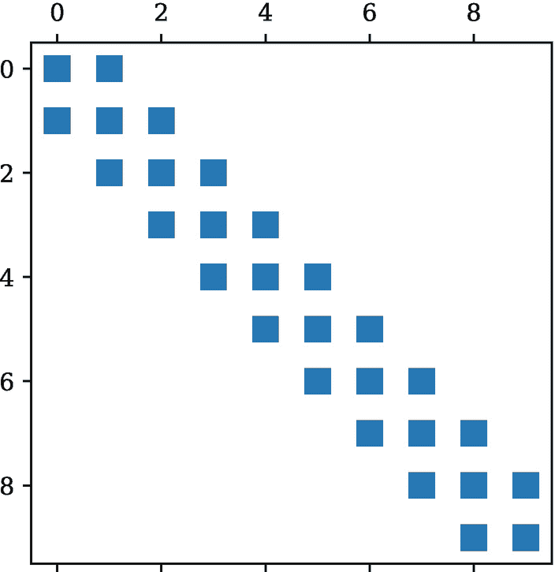
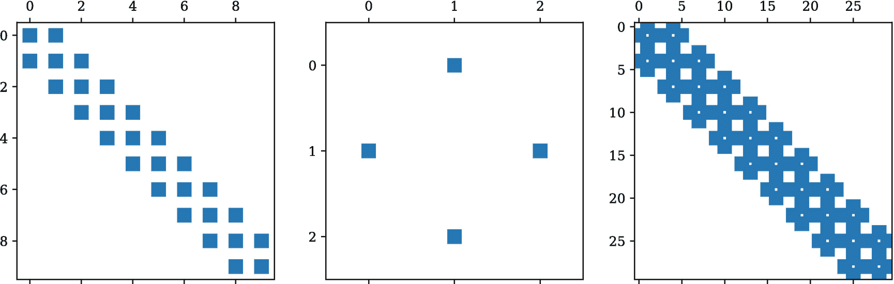
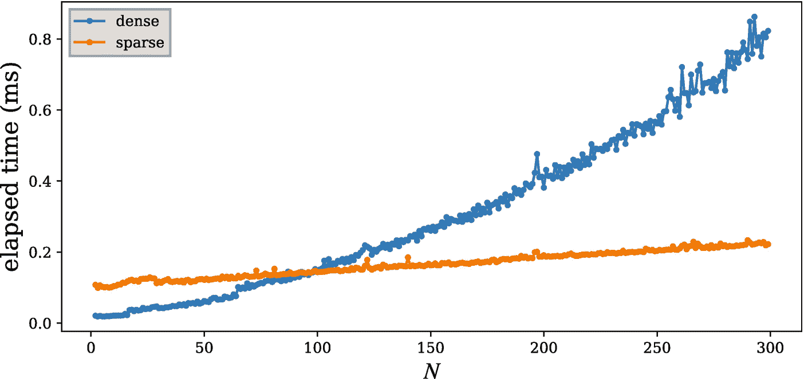
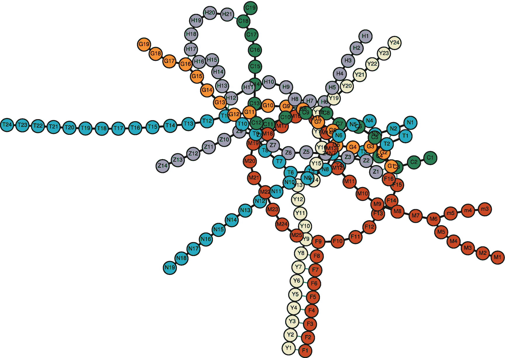
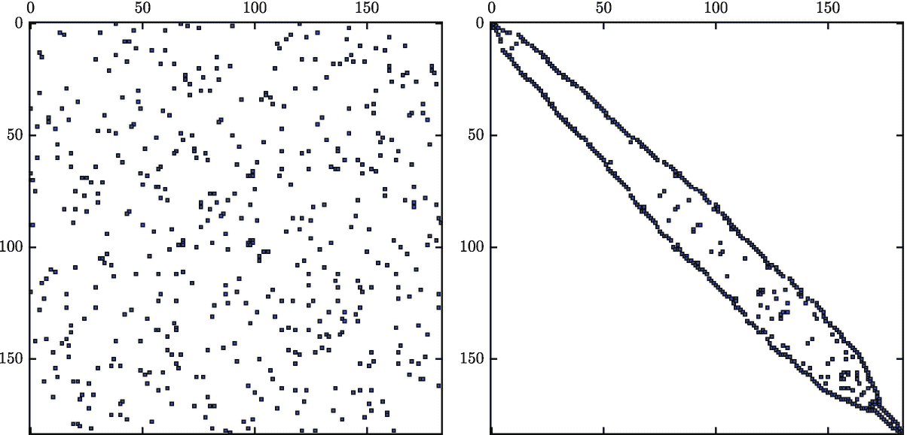

# 10. 稀疏矩阵与图

我们已经看到大量示例，表明数组和矩阵是数值计算诸多方面的核心实体。到目前为止，我们使用 NumPy 的 `ndarray` 数据结构来表示数组，它是一种同构表示，存储了其所代表数组的所有元素。在许多情况下，这是表示向量、矩阵或更高维数组等对象最有效的方式。然而，一个显著的例外是那些大部分元素为零的矩阵。这类矩阵被称为`稀疏矩阵`，出现在众多应用中，例如连接网络（如电路）以及求解偏微分方程时产生的大型代数方程组系统（参见第 11 章的示例）。

对于以零元素为主的矩阵，在计算机内存中存储所有零是低效的，更合适的方法是仅存储非零值及其位置信息。对于非稀疏矩阵，即所谓的`稠密矩阵`，这种表示方式不如将所有值连续存储在内存中高效，但对于大型稀疏矩阵，它可能具有巨大的优势。

在 Python 中处理稀疏矩阵有几种选择。这里我们主要关注 SciPy 中的稀疏矩阵模块 `scipy.sparse`，它为表示稀疏矩阵以及对此类对象执行线性代数运算提供了功能丰富且易于使用的接口。另一个选择是 PySparse^(⁴⁵)，它提供了类似的功能。对于超大规模问题，PyTrilinos^(⁴⁶) 和 PETSc^(⁴⁷) 包具有许多稀疏矩阵运算的强大并行实现。然而，使用这些包需要更多的编程工作，学习曲线更陡峭，且安装和配置更困难。对于大多数基本用例，SciPy 的 `sparse` 模块是最合适的选择，或者至少是一个合适的起点。

在本章末尾，我们还将简要探索如何使用 SciPy 的 `sparse.csgraph` 模块和 NetworkX 库来表示和处理图。图可以表示为邻接矩阵，在许多应用中，这些矩阵是非常稀疏的。因此，图和稀疏矩阵是紧密相关的主题。

## 导入模块

本章使用的主要模块是 SciPy 库中的 `sparse` 模块。我们假设该模块以名称 `sp` 导入，此外，我们还需要显式地导入其子模块 `linalg`，以便通过 `sp.linalg` 访问该子模块。

```python
In [1]: import scipy.sparse as sp
In [2]: import scipy.sparse.linalg
```

我们还需要 NumPy 库，照例以名称 `np` 导入，以及用于绘图的 Matplotlib 库：

```python
In [3]: import numpy as np
In [4]: import matplotlib.pyplot as plt
```

在本章的最后部分，我们将使用 `networkx` 模块，我们以名称 `nx` 导入它：

```python
In [5]: import networkx as nx
```

## SciPy 中的稀疏矩阵

稀疏矩阵表示法的基本思想是避免存储稀疏矩阵中过多的零元素。在稠密矩阵表示法中，数组的所有元素连续存储，由于每个元素的行列索引可通过数组中的位置隐式获知，因此只需存储值本身。然而，如果仅存储非零元素，则显然还需要存储每个元素的行列索引。组织非零元素及其对应行列索引的存储方式有多种，这些方法各有优劣，例如在矩阵创建的简易性方面，以及更重要的，在稀疏矩阵数学运算实现中的效率方面。表 10-1 对 SciPy `sparse` 模块中可用的稀疏矩阵格式进行了总结与比较。

### 表 10-1 稀疏矩阵表示方法的总结与比较

| 类型 | 描述 | 优点 | 缺点 |
| --- | --- | --- | --- |
| 坐标列表 (COO, `sp.coo_matrix`) | 非零值与其行列索引一起存储在列表中。 | 构造简单，添加新元素高效。 | 元素访问效率低。不适用于矩阵乘法等数学运算。 |
| 列表的列表 (LIL, `sp.lil_matrix`) | 为每一行存储非零元素的列索引列表和对应的值列表。 | 支持切片操作。 | 不适合数学运算。 |
| 键字典 (DOK, `sp.dok_matrix`) | 非零值存储在字典中，键为 `(行, 列)` 元组。 | 构造简单，添加、移除和访问元素快速。 | 不适合数学运算。 |
| 对角矩阵 (DIA, `sp.dia_matrix`) | 存储矩阵的对角线列表。 | 对对角矩阵高效。 | 不适用于非对角矩阵。 |
| 压缩稀疏列 (CSC, `sp.csc_matrix`) 与压缩稀疏行 (CSR, `sp.csr_matrix`) | 将值与列或行索引数组一起存储。 | 构造相对复杂。 | 高效的矩阵-向量乘法。 |
| 块稀疏矩阵 (BSR, `cp.bsr_matrix`) | 与 CSR 类似，但适用于包含稠密子矩阵的稀疏矩阵。 | 针对特定目的高效。 | 不适用于通用场景。 |

### 坐标列表格式

一种简单直观的稀疏矩阵存储方法是，将存储列索引和行索引的列表与非零值列表一同存储。这种格式称为`坐标列表格式`，在 SciPy 中缩写为 COO。`sp.coo_matrix` 类用于表示这种格式的稀疏矩阵。这种格式特别容易初始化。例如，对于矩阵

![$$ A=\left[\begin{array}{cccc}0&amp; 1&amp; 0&amp; 0\\ {}0&amp; 0&amp; 0&amp; 2\\ {}0&amp; 0&amp; 3&amp; 0\\ {}4&amp; 0&amp; 0&amp; 0\end{array}\right], $$](images/332789_2_En_10_Chapter/332789_2_En_10_Chapter_TeX_Equa.png)

我们可以轻松识别出非零值 `A[0][1] = 1`, `A[1][3] = 2`, `A[2][2] = 3`, `A[3][0] = 4` 及其对应的行 [0, 1, 2, 3] 和列 [1, 3, 2, 0]（注意，这里我们使用了 Python 的零基索引）。要创建一个 `sp.coo_matrix` 对象，我们可以为值、行索引和列索引创建列表（或数组），并将它们传递给 `sp.coo_matrix`。此外，我们还可以使用 `shape` 参数指定数组的形状，当非零元素未覆盖整个矩阵时（即存在只包含零的列或行，导致无法从行列数组正确推断形状），这个参数非常有用：

```python
In [6]: values = [1, 2, 3, 4]
In [7]: rows = [0, 1, 2, 3]
In [8]: cols = [1, 3, 2, 0]
In [9]: A = sp.coo_matrix((values, (rows, cols)), shape=[4, 4])
In [10]: A
Out[10]: '<4x4 sparse matrix of type \'<class \'numpy.int64\'>\'
with 4 stored elements in Coordinate format>'
```

结果是一个表示稀疏矩阵的数据结构。SciPy 的 `sparse` 模块中所有稀疏矩阵表示共享多个公共属性，其中许多派生自 NumPy 的 `ndarray` 对象。此类属性的示例包括 `size`、`shape`、`dtype` 和 `ndim`，而所有稀疏矩阵表示共有的属性是 `nnz`（非零元素数量）和 `data`（非零值）：

```python
In [11]: A.shape, A.size, A.dtype, A.ndim
Out[11]: ((4, 4), 4, dtype('int64'), 2)
In [12]: A.nnz, A.data
Out[12]: (4, array([1, 2, 3, 4]))
```

除共享属性外，每种稀疏矩阵表示类型还具有特定于其存储每个非零值位置方式的属性。对于 `sp.coo_matrix` 对象，有 `row` 和 `col` 属性用于访问底层的行和列数组：

```python
In [13]: A.row
Out[13]: array([0, 1, 2, 3], dtype=int32)
In [14]: A.col
Out[14]: array([1, 3, 2, 0], dtype=int32)
```

此外，还有大量方法可用于对稀疏矩阵对象进行操作。其中许多方法用于对矩阵应用数学函数，例如元素级数学方法如 `sin`、`cos`、`arcsin` 等；聚合方法如 `min`、`max`、`sum` 等；数学数组运算符如共轭 (`conj`) 和转置 (`transpose`) 等；以及用于计算稀疏矩阵之间或稀疏矩阵与稠密向量点积的 `dot` 方法（对于稀疏矩阵，`*` 运算符也表示矩阵乘法）。更多详情，请参阅稀疏矩阵类的文档字符串（总结于表 10-1）。另一类重要方法用于在不同格式之间转换稀疏矩阵：例如 `tocoo`、`tocsr`、`tolil` 等。还有方法可将稀疏矩阵转换为 NumPy `ndarray` 和 NumPy `matrix` 对象（即稠密矩阵表示）：分别对应 `toarray` 和 `todense`。

例如，要将稀疏矩阵 `A` 分别从 COO 格式转换为 CSR 格式以及转换为 NumPy 数组，可以使用以下命令：

```python
In [15]: A_csr = A.tocsr()
In [16]: A_csr
Out[16]: '<4x4 sparse matrix of type \'<class \'numpy.int64\'>\'
with 4 stored elements in Compressed Sparse Row format>'
In [17]: A_array = A.toarray()
In [18]: A_array
Out[18]: array([[0, 1, 0, 0],
       [0, 0, 0, 2],
       [0, 0, 3, 0],
       [4, 0, 0, 0]])
```

# 稀疏矩阵的格式与操作

## 索引与切片

访问矩阵元素最直观的方式（我们已在多种不同上下文中使用过）是索引语法，例如 `A[1,2]`，以及切片语法，例如 `A[1:3, 2]` 等。我们通常也可以对稀疏矩阵使用此语法，但并非所有表示都支持索引和切片，即使支持，也可能不是高效的操作。特别是，为零值元素赋值可能是一项代价高昂的操作，因为这可能需要根据所使用的格式重新排列底层数据结构。要逐步向稀疏矩阵添加新元素，LIL (`sp.lil_matrix`) 格式是合适的选择，但另一方面，这种格式不适用于算术运算。

## 格式转换与选择

在处理稀疏矩阵时，通常会遇到不同任务（如构造、更新和算术运算）在不同格式下效率最高的情况。在不同稀疏格式之间转换相对高效，因此在应用程序的不同部分切换格式是很有用的。高效使用稀疏矩阵需要理解不同格式的实现方式及其适用场景。表 10-1 简要总结了 SciPy 的 `sparse` 模块中可用的稀疏矩阵格式的优缺点，并且通过转换方法，可以轻松地在不同格式之间切换。关于各种格式优缺点的更深入讨论，请参见 SciPy 参考手册中的“稀疏矩阵”^(⁴⁸)章节。

对于计算来说，SciPy 的 `sparse` 模块中最重要的稀疏矩阵表示是 `CSR`（压缩稀疏行）和 `CSC`（压缩稀疏列）格式，因为它们非常适用于高效的矩阵算术和线性代数应用。其他格式（如 `COO`、`LIL` 和 `DOK`）主要用于构造和更新稀疏矩阵，一旦稀疏矩阵准备好用于计算，最好使用 `tocsr` 或 `tocsc` 方法将其转换为 `CSR` 或 `CSC` 格式。

## CSR格式详解

在 `CSR` 格式中，非零值 (`data`) 与存储每个值列索引的数组 (`indices`) 以及存储每行列索引数组偏移量的另一个数组 (`indptr`) 一起存储。例如，考虑矩阵：

```
A = [[1, 2, 0, 0],
     [0, 3, 4, 0],
     [0, 0, 5, 6],
     [7, 0, 8, 9]]
```

这里非零值为 `[1, 2, 3, 4, 5, 6, 7, 8, 9]` (`data`)，第一行非零值对应的列索引为 `[0, 1]`，第二行为 `[1, 2]`，第三行为 `[2, 3]`，第四行为 `[0, 2, 3]`。将所有列索引列表连接起来得到 `indices` 数组 `[0, 1, 1, 2, 2, 3, 0, 2, 3]`。为了追踪此列索引数组中每一行的条目对应关系，我们可以将每行的起始位置存储在另一个数组中。第一行列索引对应元素 0 到 1，第二行对应元素 2 到 3，第三行对应元素 4 到 5，第四行对应元素 6 到 9。将这些起始索引收集到一个数组中得到 `[0, 2, 4, 6]`。为了方便实现，我们还在该数组末尾添加非零元素的总数，得到 `indptr` 数组 `[0, 2, 4, 6, 9]`。在以下代码中，我们创建了一个与矩阵 `A` 对应的密集 NumPy 数组，使用 `sp.csr_matrix` 将其转换为 `CSR` 矩阵，然后显示 `data`、`indices` 和 `indptr` 属性：

```
In [17]: A = np.array([[1, 2, 0, 0], [0, 3, 4, 0], [0, 0, 5, 6], [7, 0, 8, 9]])
...: A
Out[17]: array([[1, 2, 0, 0],
[0, 3, 4, 0],
[0, 0, 5, 6],
[7, 0, 8, 9]])
In [18]: A = sp.csr_matrix(A)
In [19]: A.data
Out[19]: array([1, 2, 3, 4, 5, 6, 7, 8, 9], dtype=int64)
In [20]: A.indices
Out[20]: array([0, 1, 1, 2, 2, 3, 0, 2, 3], dtype=int32)
In [21]: A.indptr
Out[21]: array([0, 2, 4, 6, 9], dtype=int32)
```

通过这种存储方案，索引为 `i` 的行的非零元素存储在 `data` 数组中从索引 `indptr[i]` 到 `indptr[i+1]-1` 的位置，而这些元素的列索引存储在 `indices` 数组的相同位置。例如，第三行（索引 `i=2`）的元素从 `indptr[2]=4` 开始，到 `indptr[3]-1=5` 结束，得到元素值 `data[4]=5` 和 `data[5]=6`，以及列索引 `indices[4]=2` 和 `indices[5]=3`。因此，在基于零的索引表示法中，`A[2, 2] = 5` 且 `A[2, 3] = 6`：

```
In [22]: i = 2
In [23]: A.indptr[i], A.indptr[i+1]-1
Out[23]: (4, 5)
In [24]: A.indices[A.indptr[i]:A.indptr[i+1]]
Out[24]: array([2, 3], dtype=int32)
In [25]: A.data[A.indptr[i]:A.indptr[i+1]]
Out[25]: array([5, 6], dtype=int64)
In [26]: A[2, 2], A[2,3]  # check
Out[26]: (5, 6)
```

虽然 `CSR` 存储方法不如 `COO`、`LIL` 或 `DOK` 直观，但它非常适合用于矩阵算术和线性代数操作的实现。与 `CSC` 格式一起，它因此成为稀疏矩阵计算中的主要格式。`CSC` 格式与 `CSR` 基本相同，区别在于前者使用行索引和列指针，而不是列索引和行指针（即列和行的角色互换）。

### 创建稀疏矩阵的函数

正如在本章前面的示例中所见，构造稀疏矩阵的一种方法是准备特定稀疏矩阵格式的数据结构，并将其传递给相应稀疏矩阵类的构造函数。虽然这种方法有时是合适的，但更常见的做法是从预定义的模板矩阵组合成稀疏矩阵。`sp.sparse` 模块提供了多种生成此类矩阵的函数，例如，`sp.eye` 用于创建对角线元素为 1 的对角线稀疏矩阵（可选择从主对角线偏移），`sp.diags` 用于创建沿对角线具有指定模式的矩阵，`sp.kron` 用于计算两个稀疏矩阵的克罗内克（张量）积，以及 `bmat`、`vstack` 和 `hstack`，分别用于从稀疏分块矩阵构建稀疏矩阵，以及通过垂直和水平堆叠稀疏矩阵。

例如，在许多应用中，稀疏矩阵具有对角线形式。要创建一个大小为 10×10、包含主对角线以及上下次对角线的稀疏矩阵，我们可以三次调用 `sp.eye`，并使用 `k` 参数指定与主对角线的偏移量：

```
In [27]: N = 10
In [28]: A = sp.eye(N, k=1) - 2 * sp.eye(N) + sp.eye(N, k=-1)
In [29]: A
Out[29]: '<10x10 sparse matrix of type \'<class \'numpy.float64\'>\'
with 28 stored elements in Compressed Sparse Row format>'
```

默认情况下，结果对象是 `CSR` 格式的稀疏矩阵，但使用 `format` 参数，我们可以指定任何其他稀疏矩阵格式。`format` 参数的值应为字符串，例如 `'csr'`、`'csc'`、`'lil'` 等。`sp.sparse` 中所有用于创建稀疏矩阵的函数都接受此参数。例如，在前面的示例中，我们可以使用 `sp.diags` 生成相同的矩阵，方法是指定模式 `[1, –2, 1]`（前一个表达式中 `sp.eye` 函数的系数）以及对应的主对角线偏移量 `[1, 0, –1]`。如果我们还希望结果稀疏矩阵采用 `CSC` 格式，可以设置 `format='csc'`：

```
In [30]: A = sp.diags([1, -2, 1], [1, 0, -1], shape=[N, N], format="csc")
In [31]: A
Out[31]: '<10x10 sparse matrix of type \'<class \'numpy.float64\'>\'
with 28 stored elements in Compressed Sparse Column format>'
```

使用稀疏矩阵格式而非稠密矩阵的优势仅在对大型矩阵进行处理时才会显现。因此，稀疏矩阵本质上规模很大，这使得通过例如在终端打印其元素来可视化矩阵变得困难。Matplotlib 提供了 `spy` 函数，它是可视化稀疏矩阵结构的有用工具。该函数可作为 `pyplot` 模块中的函数使用，也可作为 `Axes` 实例的方法使用。将其应用于前面定义的 `A` 矩阵时，我们得到的结果如图 10-1 所示。



`图 10-1` 非零元素仅位于与主对角线最近的两条对角线以及主对角线本身的稀疏矩阵结构

```
In [32]: fig, ax = plt.subplots()
...: ax.spy(A)
```

稀疏矩阵也通常与张量积空间相关联。对于这种情况，我们可以使用 `sp.kron` 函数从其较小的分量组合成一个稀疏矩阵。例如，要创建 `A` 与矩阵

![$$ B=\left[\begin{array}{ccc}0&amp; 1&amp; 0\\ {}1&amp; 0&amp; 1\\ {}0&amp; 1&amp; 0\end{array}\right], $$](images/332789_2_En_10_Chapter/332789_2_En_10_Chapter_TeX_Equc.png)

的张量积对应的稀疏矩阵，我们可以使用 `sp.kron(A, B)`：

```
In [33]: B = sp.diags([1, 1], [-1, 1], shape=[3,3])
In [34]: C = sp.kron(A, B)
In [35]: fig, (ax_A, ax_B, ax_C) = plt.subplots(1, 3, figsize=(12, 4))
...: ax_A.spy(A)
...: ax_B.spy(B)
...: ax_C.spy(C)
```

为了进行比较，我们还绘制了 `A`、`B` 和 `C` 的稀疏矩阵结构，结果如图 10-2 所示。有关使用 `sp.sparse` 模块构建稀疏矩阵的更多详细信息，请参阅其文档字符串以及 SciPy 参考手册中的“稀疏矩阵”部分。



`图 10-2` 两个矩阵 `A`（左）和 `B`（中）及其张量积（右）的稀疏矩阵结构

### 稀疏线性代数函数

稀疏矩阵的主要应用是对那些使用稠密矩阵表示难以处理或效率低下的大型矩阵执行线性代数运算。SciPy 的 `sparse` 模块包含一个 `linalg` 子模块，该子模块实现了许多线性代数例程。并非所有线性代数运算都适用于稀疏矩阵，并且在某些情况下，稀疏矩阵版本的运算行为可能需要相对于稠密版本进行修改。因此，稀疏线性代数模块 `scipy.sparse.linalg` 与稠密线性代数模块 `scipy.linalg` 之间存在一些差异。例如，针对稠密问题的特征值求解器通常会计算并返回所有特征值和特征向量。对于稀疏矩阵来说，这是不可行的，因为存储大小为 N×N 的稀疏矩阵 `A` 的所有特征向量通常相当于存储一个大小为 N×N 的稠密矩阵。相反，稀疏特征值求解器通常只给出*少数几个*特征值和特征向量，例如，具有最小或最大特征值的那些。总的来说，为了确保效率，稀疏矩阵方法必须保持计算中所涉及矩阵的稀疏性。矩阵求逆就是通常*无法*保持稀疏性的运算示例，因此应尽可能避免使用。

### 线性方程组系统

稀疏矩阵最重要的应用，无疑是求解形如 `*Ax* = *b*` 的线性方程组系统，其中 `*A*` 是稀疏矩阵，`*x*` 和 `*b*` 是稠密向量。SciPy 的 `sparse.linalg` 模块为此类问题提供了直接求解器和迭代求解器（`sp.linalg.spsolve`），以及对矩阵 `*A*` 进行分解的方法，例如使用 `*LU*` 分解（`sp.linalg.splu`）和不完全 `*LU*` 分解（`sp.linalg.spilu`）。例如，考虑问题 `*Ax* = *b*`，其中 `*A*` 是前文所述的三对角矩阵，`*b*` 是一个全为负一的稠密向量（关于此方程的物理解释，参见第 11 章）。为了求解这个大小为 10×10 的系统，我们首先创建稀疏矩阵 `A` 和稠密向量 `b`：

```
In [36]: N = 10
In [37]: A = sp.diags([1, -2, 1], [1, 0, -1], shape=[N, N], format="csc")
In [38]: b = -np.ones(N)
```

现在，要使用 SciPy 提供的直接求解器求解该方程组，我们可以使用：

```
In [39]: x = sp.linalg.spsolve(A, b)
In [40]: x
Out[40]: array([  5.,   9.,  12.,  14.,  15.,  15.,  14.,  12.,   9.,   5.])
```

解向量是一个稠密的 NumPy 数组。作为对比，我们也可以使用 NumPy 中的稠密直接求解器 `np.linalg.solve`（或者类似地，使用 `scipy.linalg.solve`）来解决此问题。要使用稠密求解器，我们需要使用 `A.todense()` 将稀疏矩阵 `A` 转换为稠密数组：

```
In [41]: np.linalg.solve(A.todense(), b)
Out[41]: array([  5.,   9.,  12.,  14.,  15.,  15.,  14.,  12.,   9.,   5.])
```

正如预期，结果与我们使用稀疏求解器得到的结果一致。对于像这样的小型问题，使用稀疏矩阵的好处并不明显，但随着系统规模的增大，使用稀疏矩阵和稀疏求解器的优势就会变得显著。针对此特定问题，使用稀疏方法优于稠密方法的临界系统规模大约为 `*N* = 100`，如图 10-3 所示。尽管确切的临界值会因问题、硬件和软件版本的不同而异，但对于矩阵 `*A*` 足够稀疏的情况，这种行为是典型的^(⁴⁹)。



`图 10-3`

求解一维泊松问题的稀疏方法与稠密方法的性能比较，作为问题规模的函数

`spsolve` 接口的一个替代方案是使用 `sp.sparse.splu` 或 `sp.sparse.spilu`（不完全 LU 分解）显式计算 LU 分解。这些函数返回一个包含 `*L*` 和 `*U*` 因子的对象，该对象拥有一个方法，用于求解给定向量 `*b*` 的 `*LUx* = *b*`。这当然在需要针对多个向量 `*b*` 求解 `*Ax* = *b*` 时特别有用。例如，之前使用的矩阵 `*A*` 的 LU 分解计算如下：

```
In [42]: lu = sp.linalg.splu(A)
In [43]: lu.L
Out[43]: '
在压缩稀疏列格式中存储了 20 个元素>
In [44]: lu.U
Out[44]: '
在压缩稀疏列格式中存储了 20 个元素>
```

一旦 LU 分解就绪，我们就可以使用 `lu` 对象的 `solve` 方法高效地求解方程 `*LUx* = *b*`：

```
In [45]: x = lu.solve(b)
In [46]: x
Out[46]: array([  5.,   9.,  12.,  14.,  15.,  15.,  14.,  12.,   9.,   5.])
```

## 稀疏矩阵的LU分解与填充元

使用稀疏矩阵时需要考虑的一个重要问题是，`A` 的 LU 分解可能会在 `L` 和 `U` 中引入新的非零元素，从而使 `L` 和 `U` 的稀疏性降低。存在于 `L` 或 `U` 中但不在 `A` 中的元素被称为填充元。如果填充元的数量很大，使用稀疏矩阵的优势可能会丧失。虽然没有完全消除填充元的办法，但通常可以通过置换 `A` 的行和列来减少填充元，使得 LU 分解采取 `P[r]AP[c] = LU` 的形式，其中 `P[r]` 和 `P[c]` 分别是行置换矩阵和列置换矩阵。有几种这样的置换方法可用。`spsolve`、`splu` 和 `spilu` 函数都接受参数 `permc_spec`，它可以取 `NATURAL`、`MMD_ATA`、`MMD_AT_PLUS_A` 或 `COLAMD` 等值，这些值指示了这些方法内置的不同置换方法。`splu` 和 `spilu` 返回的对象会考虑此类置换，并且置换向量可以通过 `perm_c` 和 `perm_r` 属性获取。由于这些置换的存在，`lu.L` 和 `lu.U` 的乘积并不直接等于 `A`，要从 `lu.L` 和 `lu.U` 重构 `A`，我们还需要撤销行和列的置换：

```python
In [47]: def sp_permute(A, perm_r, perm_c):
    ...:     """ 对 A 的行和列进行置换 """
    ...:     M, N = A.shape
    ...:     # 行置换矩阵
    ...:     Pr = sp.coo_matrix((np.ones(M), (perm_r, np.arange(N)))).tocsr()
    ...:     # 列置换矩阵
    ...:     Pc = sp.coo_matrix((np.ones(M), (np.arange(M), perm_c))).tocsr()
    ...:     return Pr.T * A * Pc.T
In [48]: lu.L * lu.U - A # != 0
Out[48]: '
在压缩稀疏列格式中存储了 8 个元素>
In [49]: sp_permute(lu.L * lu.U, lu.perm_r, lu.perm_c) - A  # == 0
Out[49]: '
在压缩稀疏列格式中存储了 0 个元素>
```

## 直接求解器与迭代求解器

默认情况下，SciPy 中的直接稀疏线性求解器使用 SuperLU^(⁵⁰) 软件包。另一个可以在 SciPy 中使用的替代稀疏矩阵求解器是 UMFPACK^(⁵¹) 软件包，尽管该软件包不随 SciPy 捆绑，并且需要安装 `scikit-umfpack` Python 库。如果 `scikit-umfpack` 可用，并且 `sp.linalg.spsolve` 函数的 `use_umfpack` 参数为 `True`，则会使用 UMFPACK 替代 SuperLU。SuperLU 和 UMFPACK 哪个性能更好因问题而异，因此，对于任何给定的问题，同时安装两者并分别进行测试是值得的。

`sp.spsolve` 函数是直接求解器的接口，它内部执行矩阵分解。另一种方法是使用源自优化理论的迭代方法。SciPy 的 `sparse.linalg` 模块包含多个用于迭代求解稀疏线性问题的函数：例如，`bicg`（双共轭梯度法）、`bicgstab`（稳定双共轭梯度法）、`cg`（共轭梯度法）、`gmres`（广义最小残差法）和 `lgmres`（宽松广义最小残差法）。所有这些函数（以及其他一些函数）都可以通过以 `A` 和 `b` 为参数调用它们来求解问题 `Ax = b`，并且它们都返回一个元组 `(x, info)`，其中 `x` 是解，`info` 包含关于求解过程的附加信息（`info=0` 表示成功，正数表示收敛错误，负数表示输入错误）。例如：

```python
In [50]: x, info = sp.linalg.bicgstab(A, b)
In [51]: x
Out[51]: array([  5.,   9.,  12.,  14.,  15.,  15.,  14.,  12.,   9.,   5.])
In [52]: x, info = sp.linalg.lgmres(A, b)
In [53]: x
Out[53]: array([  5.,   9.,  12.,  14.,  15.,  15.,  14.,  12.,   9.,   5.])
```

此外，每个迭代求解器都接受其特定的求解器相关参数。详情请参见每个函数的文档字符串。对于非常大的问题，迭代求解器可能比直接求解器更有优势，因为直接求解器可能因过多的填充元而需要过高的内存使用量。相比之下，迭代求解器只要求计算稀疏矩阵-向量乘法，因此不会遇到填充元问题，但另一方面，它们对许多问题可能收敛速度较慢，尤其是在没有适当预处理的情况下。

## 特征值问题

稀疏矩阵的特征值和奇异值问题可分别使用 `sp.linalg.eigs` 和 `sp.linalg.svds` 函数求解。对于实对称或复共轭对称矩阵，特征值（此时为实数）和特征向量也可使用 `sp.linalg.eigsh` 计算。这些函数并不计算所有特征值或奇异值，而是计算指定数量的特征值和向量（默认值为六个）。通过使用这些函数的 `k` 关键字参数，我们可以定义需要计算的特征值和向量的数量。使用 `which` 关键字参数，我们可以指定要计算哪 `k` 个值。`eigs` 的选项包括：最大模值 `LM`、最小模值 `SM`、最大实部 `LR`、最小实部 `SR`、最大虚部 `LI` 和最小虚部 `SI`。对于 `svds`，仅支持 `LM` 和 `SM`。

例如，要计算一维泊松问题（系统规模 10x10）的稀疏矩阵的最低四个特征值，我们可以使用 `sp.linalg.eigs(A, k=4, which="LM")`：

```python
In [54]: N = 10
In [55]: A = sp.diags([1, -2, 1], [1, 0, -1], shape=[N, N], format="csc")
In [56]: evals, evecs = sp.linalg.eigs(A, k=4, which="LM")
In [57]: evals
Out[57]: array([-3.91898595+0.j, -3.68250707+0.j, -3.30972147+0.j, -2.83083003+0.j])
```

`sp.linalg.eigs`（以及 `sp.linalg.eigsh`）的返回值是一个元组 `(evals, evecs)`，其第一个元素是特征值数组（`evals`），第二个元素是形状为 *N* × *k* 的数组（`evecs`），其列是与 `evals` 中 *k* 个特征值对应的特征向量。因此，我们期望 `A` 与 `evecs` 中某一列的点积等于该列乘以 `evals` 中对应的特征值。我们可以直接验证这一结果确实成立：

```python
In [58]: np.allclose(A.dot(evecs[:,0]), evals[0] * evecs[:,0])
Out[58]: True
```

对于这个特定示例，稀疏矩阵 `A` 是对称矩阵，因此我们可以使用 `sp.linalg.eigsh` 代替 `sp.linalg.eigs`，这样会得到一个元素为实数的特征值数组：

```python
In [59]: evals, evecs = sp.linalg.eigsh(A, k=4, which="LM")
In [60]: evals
Out[60]: array([-3.91898595, -3.68250707, -3.30972147, -2.83083003])
```

将参数 `which='LM'`（最大模值）改为 `which='SM'`（最小模值），我们将得到一组不同的特征值和向量（即模值最小的那些）：

```python
In [61]: evals, evecs = sp.linalg.eigs(A, k=4, which="SM")
In [62]: evals
Out[62]: array([-0.08101405+0.j, -0.31749293+0.j, -0.69027853+0.j, -1.16916997+0.j])
In [63]: np.real(evals).argsort()
Out[63]: array([3, 2, 1, 0])
```

请注意，虽然在前一个示例中我们请求并获得了四个模值最小的特征值，但这些特征值和向量在内部不一定已排序（尽管在这个特定案例中是排序的）。获得已排序的特征值通常是理想的，并且通过一个利用 NumPy 的 `argsort` 方法对特征值进行排序的小巧便利的包装函数可以轻松实现。这里我们给出这样一个函数 `sp_eigs_sorted`，它返回按特征值实部排序的特征值和特征向量：

# 稀疏矩阵的应用

## 图与网络

将图表示为邻接矩阵是稀疏矩阵的另一个重要应用。在邻接矩阵中，一个元素描述了图中哪些节点相互连接。因此，如果每个节点只连接到少量其他节点，邻接矩阵就是稀疏的。SciPy `sparse` 模块中的 `csgraph` 模块提供了处理此类图的函数，包括使用不同方法（例如广度优先和深度优先遍历）遍历图的方法，以及计算图中节点间最短路径的方法等。有关此模块的更多信息，请参阅其文档字符串：`help(sp.csgraph)`。

对于更全面的图处理框架，可以使用 NetworkX Python 库。它提供了创建和操作无向图和有向图的实用工具，并且实现了许多图算法，例如查找图中节点间的最短路径。这里我们假设 NetworkX 库以 `nx` 为名导入。使用此库，我们可以例如通过初始化 `nx.Graph` 类的对象来创建一个无向图。任何可哈希的 Python 对象都可以作为节点存储在 `graph` 对象中，这使其成为一种非常灵活的数据结构。然而，在下面的示例中，我们仅使用以整数和字符串作为节点标签的图对象。有关创建图以及向图对象添加节点和边的函数汇总，请见表 10-2。

**表 10-2** 使用 NetworkX 进行基本图构建的对象和方法汇总

| 对象/方法 | 描述 |
| --- | --- |
| `nx.Graph` | 用于表示无向图的类。 |
| `nx.DiGraph` | 用于表示有向图的类。 |
| `nx.MultiGraph` | 用于表示支持多重边的无向图的类。 |
| `nx.MultiDiGraph` | 用于表示支持多重边的有向图的类。 |
| `add_node` | 向图添加一个节点。需要一个节点标签（例如，一个字符串，或通常是一个可哈希对象）作为参数。 |
| `add_nodes_from` | 添加多个节点。需要一个节点标签列表（或可迭代对象）作为参数。 |
| `add_edge` | 添加一条边。需要两个节点作为参数，并在这些节点之间创建一条边。 |
| `add_edges_from` | 添加多条边。需要一个包含节点标签元组的列表（或可迭代对象）作为参数。 |
| `add_weighted_edges_from` | 添加带权重因子的多条边。需要一个包含元组的列表（或可迭代对象），每个元组包含两个节点标签和权重因子。 |

例如，我们可以使用 `nx.Graph()` 以及 `add_node` 方法创建一个带有整数节点数据的简单图，或使用 `add_nodes_from` 一次性添加多个节点。`nodes` 方法返回一个用于节点的迭代器对象，称为 `NodeView`：

```python
In [73]: g = nx.Graph()
In [74]: g.add_node(1)
In [75]: g.nodes()
Out[75]: NodeView((1,))
In [76]: g.add_nodes_from([3, 4, 5])
In [77]: g.nodes()
Out[77]: NodeView((1, 3, 4, 5))
```

要连接节点，我们可以使用 `add_edge` 添加边。我们将要连接的两个节点的标签作为参数传递。要添加多条边，我们可以使用 `add_edges_from`，并向其传递一个包含要连接的节点元组的列表。`edges` 方法返回一个用于边的迭代器对象，称为 `EdgeView`：

```python
In [78]: g.add_edge(1, 2)
In [79]: g.edges()
Out[79]: EdgeView([(1, 2)])
In [80]: g.add_edges_from([(3, 4), (5, 6)])
In [81]: g.edges()
Out[81]: EdgeView([(1, 2), (3, 4), (5, 6)])
```

为了表示带有权重（例如距离）的节点之间的边，我们可以使用 `add_weighted_edges_from`，向其传递一个包含元组的列表，每个元组除了两个节点外还包含每条边的权重因子。在调用 `edges` 方法时，我们可以额外添加参数 `data=True`，以指示结果视图中也应包含边数据。

```python
In [82]: g.add_weighted_edges_from([(1, 3, 1.5), (3, 5, 2.5)])
In [83]: g.edges(data=True)
Out[83]: EdgeDataView([(1, 2, {}), (1, 3, {'weight': 1.5}), (3, 4, {}), (3, 5, {'weight': 2.5}), (5, 6, {})])
```

请注意，如果我们在图中尚不存在的节点之间添加边，它们会被无缝添加。例如，在以下代码中，我们在节点 6 和 7 之间添加了一条加权边。节点 7 之前不存在于图中，但在添加边时，它会自动创建并添加到图中：

```python
In [84]: g.add_weighted_edges_from([(6, 7, 1.5)])
In [85]: g.nodes()
Out[85]: NodeView((1, 3, 4, 5, 2, 6, 7))
In [86]: g.edges()
Out[86]: EdgeView([(1, 2), (1, 3), (3, 4), (3, 5), (5, 6), (6, 7)])
```

有了这些基础知识，我们已经准备好研究一个更复杂的图示例。接下来，我们将从一个名为 `tokyo-metro.json` 的 JSON 文件（与代码清单一同提供）中存储的数据集构建一个图，该文件使用 Python 标准库模块 `json`^(⁵²) 加载。

```
In [87]: import json
In [88]: with open("tokyo-metro.json") as f:
...:      data = json.load(f)
```

加载 JSON 文件的结果是一个字典 `data`，其中包含地铁线路描述。对于每条线路，包含站点间行程时间列表（`travel_times`）、可能换乘到其他线路的站点列表（`transfers`）以及线路颜色：

```
In [89]: data.keys()
Out[89]: dict_keys(['C', 'T', 'N', 'F', 'Z', 'M', 'G', 'Y', 'H'])
In [90]: data["C"]
Out[90]: {'color': '#149848',
'transfers': [['C3', 'F15'], ['C4', 'Z2'], ...],
'travel_times': [['C1', 'C2', 2], ['C2', 'C3', 2], ...]}
```

这里 `travel_times` 列表的格式是 `[['C1', 'C2', 2], ['C2', 'C3', 2], ...]`，表示在站点 C1 和 C2 之间旅行需要 2 分钟，在 C2 和 C3 之间旅行需要 2 分钟，等等。`transfers` 列表的格式是 `[['C3', 'F15'], ...]`，表示可以从 C 线在站点 C3 换乘到 F 线的站点 F15。`travel_times` 和 `transfers` 直接适合提供给 `add_weighted_edges_from` 和 `add_edges_from`，因此我们可以通过遍历每个地铁线路字典并调用这些方法，轻松创建一个表示地铁网络的图：

```
In [91]: g = nx.Graph()
...: for line in data.values():
...:     g.add_weighted_edges_from(line["travel_times"])
...:     g.add_edges_from(line["transfers"])
```

线路换乘边没有边权重，因此让我们首先通过为每条边添加一个新的布尔属性 `transfer` 来标记所有换乘边：

```
In [92]: for n1, n2 in g.edges():
...:     g[n1][n2]["transfer"] = "weight" not in g[n1][n2]
```

接下来，为了绘图目的，我们创建两个包含换乘边和车内边的列表，并且还创建一个与网络中每个节点对应的颜色列表：

```
In [93]: on_foot = [e for e in g.edges() if g.get_edge_data(*e)["transfer"]]
In [94]: on_train = [e for e in g.edges() if not g.get_edge_data(*e)["transfer"]]
In [95]: colors = [data[n[0].upper()]["color"] for n in g.nodes()]
```

为了可视化该图，我们可以使用 NetworkX 库中基于 Matplotlib 的绘图例程：我们使用 `nx.draw` 绘制每个节点，使用 `nx.draw_networkx_labels` 为节点绘制标签，并使用 `nx.draw_networkx_edges` 绘制边。我们调用 `nx.draw_networkx_edges` 两次，分别传入换乘连接（`on_foot`）和车内连接（`on_train`）的边列表，并使用 `edge_color` 参数将链接分别着色为蓝色和黑色。图的布局由传递给绘图函数的 `pos` 参数决定。这里我们使用了来自 `networkx.drawing.nx_agraph` 的 `graphviz_layout` 函数来布局节点。所有绘图函数也通过 `ax` 参数接受一个 Matplotlib 坐标轴实例。生成的图如图 10-5 所示。



图 10-5 东京地铁站点网络图

```
In [96]: fig, ax = plt.subplots(1, 1, figsize=(14, 10))
...: pos = nx.drawing.nx_agraph.graphviz_layout(g, prog="neato")
...: nx.draw(g, pos, ax=ax, node_size=200, node_color=colors)
...: nx.draw_networkx_labels(g, pos=pos, ax=ax, font_size=6)
...: nx.draw_networkx_edges(g, pos=pos, ax=ax, edgelist=on_train, width=2)
...: nx.draw_networkx_edges(g, pos=pos, ax=ax, edgelist=on_foot, edge_color="blue")
```

网络构建完成后，我们可以利用 NetworkX 库提供的众多图算法来分析该网络。例如，要计算每个节点的度（即连接到该节点的边的数量），我们可以使用 `degree` 方法（此处输出被截断至 `...` 以节省空间）：

```
In [97]: g.degree()
Out[97]: DegreeView({'Y8': 3,  'N18': 2,  'M24': 2,  'G15': 3,  'C18': 3,  'N13': 2, ... })
```

对于这个图，节点的度可以解释为连接到某个站点的线路数量：在一个站点交汇的地铁线路越多，对应节点的度就越高。我们可以使用 `degree` 方法和 `max` 函数轻松查找网络中连接最密集的站点，从而找到网络中的最大度。接下来，我们遍历 `degree` 方法的结果，选出具有最大度（在此网络中为 6）的节点：

```
In [98]: d_max = max(d for (n, d) in g.degree())
In [99]: [(n, d) for (n, d) in g.degree() if d == d_max]
Out[99]: [('N7', 6), ('G5', 6), ('Y16', 6), ('M13', 6), ('Z4', 6)]
```

结果显示，连接最密集的站点分别是 N 线的第 7 站、G 线的第 5 站等。所有这几条线路都在同一个站点（永田町站）交汇。我们还可以使用 `nx.shortest_path` 计算网络中两点之间的最短路径。例如，从 Y24 站到 C19 站的最佳出行路线（假设无等待时间且换乘即时完成）为：

```
In [100]: p = nx.shortest_path(g, "Y24", "C19")
In [101]: p
Out[101]: ['Y24', 'Y23', 'Y22', 'Y21', 'Y20', 'Y19', 'Y18', 'C9', 'C10', 'C11',
'C12', 'C13', 'C14', 'C15', 'C16', 'C17', 'C18', 'C19']
```

给定这样一个形式的路径，我们还可以通过累加路径中相邻节点的权重属性来直接评估行程时间：

```
In [102]: np.sum([g[p[n]][p[n+1]]["weight"]
...:         for n in range(len(p)-1) if "weight" in g[p[n]][p[n+1]]])
Out[102]: 35
```

结果表明，从 Y24 站到 C19 站需要 35 分钟。由于换乘节点没有关联的权重，因此实际上假定列车换乘是即时的。假设一次列车换乘大约需要 5 分钟可能是合理的，为了在最短路径和行程时间计算中考虑这一点，我们可以更新换乘节点，为每个节点添加权重 5。为此，我们使用 `copy` 方法创建图的一个副本，遍历所有边，并更新那些 `transfer` 属性设为 `True` 的边：

```
In [103]: h = g.copy()
In [104]: for n1, n2 in h.edges():
...:     if h[n1][n2]["transfer"]:
...:         h[n1][n2]["weight"] = 5
```

使用新图重新计算路径和行程时间，可以得到更符合实际的行程时间估计：
```

# 网络分析与稀疏矩阵表示

使用 NetworkX 计算最短路径和行程时间：

```python
In [105]: p = nx.shortest_path(h, "Y24", "C19")
In [106]: p
Out[106]: ['Y24', 'Y23', 'Y22', 'Y21', 'Y20', 'Y19', 'Y18', 'C9', 'C10', 'C11',
'C12', 'C13', 'C14', 'C15', 'C16', 'C17', 'C18', 'C19']
In [107]: np.sum([h[p[n]][p[n+1]]["weight"] for n in range(len(p)-1)])
Out[107]: 40
```

当然，利用这种方法，我们可以计算网络中任意两个节点之间的最优路径和行程时间。再举一个例子，我们计算了从 `Z1` 站到 `H16` 站的最短路径和行程时间（32 分钟）：

```python
In [108]: p = nx.shortest_path(h, "Z1", "H16")
In [109]: np.sum([h[p[n]][p[n+1]]["weight"] for n in range(len(p)-1)])
Out[109]: 32
```

`NetworkX` 表示的图可以使用 `nx.to_scipy_sparse_matrix` 转换为 `SciPy` 稀疏矩阵形式的邻接矩阵，之后我们还可以使用 `sp.csgraph` 模块中的例程来分析该图。作为示例，我们将东京地铁图转换为邻接矩阵，并计算其反向 Cuthill-McKee 排序（使用 `sp.csgraph.reverse_cuthill_mckee`，这是一种能减小矩阵元素到对角线最大距离的重排序），然后使用该排序对矩阵进行置换。我们使用 `Matplotlib` 的 `spy` 函数绘制两个矩阵的结果，结果如图 10-6 所示。



`图 10-6` 东京地铁图的邻接矩阵（左图）和经过 RCM 排序后的矩阵（右图）

```python
In [110]: A = nx.to_scipy_sparse_matrix(g)
In [111]: A
Out[111]: '<486x486 sparse matrix of type '<class 'numpy.int64'>'
with 486 stored elements in Compressed Sparse Row format>'
In [112]: perm = sp.csgraph.reverse_cuthill_mckee(A)
In [113]: fig, (ax1, ax2) = plt.subplots(1, 2, figsize=(8, 4))
...: ax1.spy(A, markersize=2)
...: ax2.spy(sp_permute(A, perm, perm), markersize=2)
```

## 总结

在本章中，我们简要介绍了存储稀疏矩阵的常见方法，并回顾了如何使用 `SciPy` `sparse` 模块中的稀疏矩阵类来表示这些矩阵。我们还回顾了 `SciPy` `sparse` 模块中可用的稀疏矩阵构建函数以及 `sparse.linalg` 中可用的稀疏线性代数例程。为了补全 `SciPy` 内置的线性代数例程，我们还简要讨论了 `scikit.umfpack` 扩展包，该包使 `SciPy` 能够使用 UMFPACK 求解器。`SciPy` 中的稀疏矩阵库功能多样且使用起来非常方便，并且由于它为线性代数例程使用了高效的底层库（SuperLU 或 UMFPACK），因此它也提供了良好的性能。对于需要并行化以将工作负载分布到多个核心甚至多台计算机的大规模问题，`PETSc` 和 `Trilinos` 框架（两者都有 Python 接口）提供了在 Python 高性能应用中使用稀疏矩阵和稀疏线性代数的途径。我们还简要介绍了使用 `SciPy` `sparse.csgraph` 和 `NetworkX` 库进行图表示和处理的方法。

## 延伸阅读

关于稀疏矩阵和稀疏线性方程组直接求解器的优秀且易于理解的入门介绍，请参见 Davis (2006)。W. H. Press (2007) 也对稀疏矩阵和方法进行了相当详细的讨论。如需全面了解网络和图论，请参见 Newman (2010)。