# 11. 偏微分方程

偏微分方程（PDE）是指方程中包含多个因变量导数的多元微分方程。也就是说，方程中的导数是偏导数。因此，它们是常微分方程的推广，常微分方程已在第 9 章中介绍。从概念上讲，常微分方程与偏微分方程的差异并不大，但处理常微分方程和偏微分方程所需的计算技术却截然不同，且求解偏微分方程通常需要更高的计算资源。多数数值求解偏微分方程的技术基于将问题中的每个独立变量离散化的思路，从而将问题转化为代数形式。这通常会产生大规模的线性代数问题。将偏微分方程转化为代数形式的两种常见技术是：有限差分法（FDM），即用有限差分公式来近似问题中的导数；以及有限元法（FEM），即将未知函数写成可轻松求导和积分的简单基函数的线性组合。在这种表示中，未知函数由一组基函数的系数描述，通过对偏微分方程进行适当改写，我们可以得到这些系数的代数方程。

无论是使用有限差分法还是有限元法，最终得到的代数方程组通常非常庞大，并且在矩阵形式下，这类方程组通常非常稀疏。因此，有限差分法和有限元法都严重依赖于代数线性方程的稀疏矩阵表示，这一点在第 10 章中已有讨论。大多数通用偏微分方程框架都基于有限元法或其某种变体，因为这种方法能够解决复杂问题域上的通用问题。

与我们目前介绍的其他计算问题类型（例如常微分方程）相比，求解偏微分方程问题所需的计算资源可能要多得多。这在一定程度上是因为对空间区域进行离散化所需的点数会随维度数量呈指数级增长。如果一维问题需要 100 个点来描述，那么具有类似分辨率的三维问题就需要 100² = 10⁴ 个点，而三维问题则需要 100³ = 10⁶ 个点。由于离散化空间中的每个点都对应一个未知变量，因此不难想象偏微分方程问题可能会产生非常庞大的方程组。以编程方式定义偏微分方程问题也可能很复杂。原因之一在于偏微分方程的可能形式远比常微分方程的有限形式多得多。另一个原因在于几何：虽然一维空间中的区间由两个点唯一确定，但二维问题中的区域和三维问题中的体积则可能具有任意复杂的几何形状，这些形状由曲线和曲面围成。因此，要定义偏微分方程的问题域及其在坐标点网格中的离散化，可能需要使用高级工具，并且在定义边界条件时也有很大的自由度。与常微分方程问题不同，偏微分方程问题并没有一个通用的标准形式。

由于这些原因，Python 的偏微分方程求解器只能通过专门致力于偏微分方程问题的库和框架来获得。对于 Python，至少有三种重要的库可用于使用有限元法求解偏微分方程：`FiPy`库、`SfePy`库和`FEniCS`库。所有这些库都非常庞大且功能丰富，深入介绍这些库的使用细节超出了本书的范围。在此，我们只能对偏微分方程问题进行简要介绍，概述一些可从 Python 使用的偏微分方程库的重要实例，并分享几个示例来展示其中一个库（`FEniCS`）的某些特性。希望这能为有兴趣使用 Python 求解偏微分方程的读者提供可用选项的鸟瞰式总览，并提供一些有用的指引，帮助其了解进一步的资料查阅方向。

## 导入模块

在本章中，对于基本的数值计算和绘图需求，我们同样需要`NumPy`和`Matplotlib`库。对于三维绘图，我们需要显式地从`Matplotlib`工具包库`mpl_toolkits`中导入`mplot3d`模块。像往常一样，我们假设这些库按以下方式导入：
```python
In [1]: import numpy as np
In [2]: import matplotlib.pyplot as plt
In [3]: import matplotlib as mpl
In [4]: import mpl_toolkits.mplot3d
```

此外，我们还会用到`SciPy`的`linalg`和`sparse`模块，为了使用`sparse`模块中的`linalg`子模块，我们也需要显式地导入它：
```python
In [5]: import scipy.sparse as sp
In [6]: import scipy.sparse.linalg
In [7]: import scipy.linalg as la
```
通过以上导入，我们可以通过`la`访问稠密线性代数模块，而稀疏线性代数模块则通过`sp.linalg`访问。此外，本章后续部分还将用到`FEniCS`有限元框架，我们需要按以下方式导入其`dolfin`和`mshr`库：
```python
In [8]: import dolfin
In [9]: import mshr
```

## 偏微分方程

偏微分方程中的未知量是一个多元函数，此处记为`u`。在 N 维问题中，函数`u`依赖于 n 个独立变量：`u(x[1], x[2], …, x[n])`。一个一般的偏微分方程可以形式化地写成
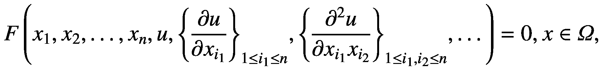
其中`{∂u/∂x[i1]}`表示关于独立变量`x[1],…,x[n]`的所有一阶偏导数，`{∂²u/∂x[n1]∂x[n2]}`表示所有二阶偏导数，以此类推。这里`F`是一个描述偏微分方程形式的已知函数，而`Ω`是偏微分方程问题的定义域。实际应用中出现的许多偏微分方程只包含二阶导数，我们通常处理的是二维或三维空间问题，有时还会涉及时间。在处理偏微分方程时，一种常见的简化记法是用下标来表示关于独立变量`x`的偏导数：`u[x] = ∂u/∂x`。高阶导数则使用多重下标表示：`u[xx] = ∂²u/∂x²`，`u[xy] = ∂²u/∂x∂y`，等等。一个典型的偏微分方程例子是热传导方程，在二维笛卡尔坐标系下其形式为`u[t] = α(u[xx]+u[yy])`。这里函数`u = u(t, x, y)`描述了空间点`(x, y)`在时间`t`的温度，而`α`是热扩散系数。

为了完全确定偏微分方程的一个特定解，我们需要定义其边界条件，即函数本身或其导数沿问题定义域`Ω`边界的已知值；如果问题与时间相关，还需要定义初始值。边界通常记为`Γ`或`∂Ω`，并且通常可以对边界的不同部分赋予不同的边界条件。两类重要的边界条件是：狄利克雷边界条件，指定了函数在边界上的值，即对于`x ∈ Γ[D]`有`u(x) = h(x)`；以及诺伊曼边界条件，指定了边界上的法向导数，即对于`x ∈ Γ[N]`有`∂u(x)/∂n = g(x)`，其中`n`是边界的向外法向量。这里的`h(x)`和`g(x)`是任意函数。

## 有限差分法

有限差分法的基本思想是，在离散化的空间上，用导数对应的有限差分公式来逼近偏微分方程中出现的导数。例如，在将连续变量`x`离散化为离散点`{x[n]}`后，常导数`du(x)/dx`的有限差分公式可以用前向差分公式`du(x[n])/dx ≈ (u(x[n+1]) - u(x[n])) / (x[n+1] - x[n])`、后向差分公式`du(x[n])/dx ≈ (u(x[n]) - u(x[n-1])) / (x[n] - x[n-1])`或中心差分公式`du(x[n])/dx ≈ (u(x[n+1]) - u(x[n-1])) / (x[n+1] - x[n-1])`来近似。类似地，我们也可以构造高阶导数的有限差分公式，例如二阶导数`d²u(x[n])/dx² ≈ (u(x[n+1]) - 2u(x[n]) + u(x[n-1])) / (x[n] - x[n-1])²`。假设连续变量`x`的离散化足够精细，这些有限差分公式就能给出导数的良好近似。用有限差分公式替换常微分方程或偏微分方程中的导数，就能将微分方程转化为代数方程。如果原始的常微分方程或偏微分方程是线性的，那么得到的代数方程也是线性的，并可以用标准的线性代数方法求解。

为了使这个方法更具体，考虑常微分方程问题`u[xx] = -5`，定义域为`x ∈ [0, 1]`，且边界条件为`u(x = 0) = 1`和`u(x = 1) = 2`。例如，这个问题源自一维稳态热传导方程。与第9章考虑的常微分方程初值问题不同，这是一个边值问题，因为`u`的值在`x = 0`和`x = 1`处均有指定。因此，初值问题的方法在此不适用。相反，我们可以通过将区间`[0, 1]`划分为离散点`x[n]`来处理此问题，然后问题就转化为求这些点上的函数值`u(x[n]) = u[n]`。

将常微分方程问题写成有限差分形式后，对于每个内部点`n`都有方程`(u[n-1] - 2u[n] + u[n+1]) / Δx² = -5`，以及边界条件`u[0] = 1`和`u[N+1] = 2`。这里区间`[0, 1]`被离散化为`N+2`个等距点，包括边界点，点间距为`Δx = 1/(N+1)`。由于函数在两个边界点上的值是已知的，因此有`N`个未知变量`u[n]`，对应于内部点的函数值。针对内部点的方程组可以写成矩阵形式`Au = b`，其中`u = [u[1], …, u[N]]^T`，`b = [-5 - u[0]/Δx², -5, …, -5, -5 - u[N+1]/Δx²]^T`，并且

![$$ A=\frac{1}{\varDelta {x}²}\left[\begin{array}{ccccc}-2&amp; 1&amp; 0&amp; 0&amp; \dots \\ {}1&amp; -2&amp; 1&amp; 0&amp; \dots \\ {}0&amp; 1&amp; -2&amp; 1&amp; 0\\ {}0&amp; 0&amp; 1&amp; -2&amp; \ddots \\ {}\vdots &amp; \vdots &amp; 0&amp; \ddots &amp; \ddots \end{array}\right]. $$](images/332789_2_En_11_Chapter/332789_2_En_11_Chapter_TeX_Equb.png)

这里的矩阵`A`通过用于近似ODE中二阶导数的有限差分公式，描述了`u[n]`方程与相邻点值的耦合关系。边界值包含在`b`向量中，该向量也包含原始ODE的常数右端项（源项）。至此，我们可以直接求解线性方程组`Au = b`，得到未知向量`u`，从而获得函数`u(x)`在离散点`{x[n]}`上的近似值。

在Python代码中，我们可以通过以下方式设置并求解该问题：首先，为内部点的数量`N`、边界处的函数值`u0`和`u1`，以及相邻点之间的间距`dx`定义变量。

```
In [10]: N = 5
In [11]: u0, u1 = 1, 2
In [12]: dx = 1.0 / (N + 1)
```

接下来，我们按照前一节所述构造矩阵`A`。为此，我们可以使用NumPy中的`eye`函数，该函数创建一个二维数组，对角线或由参数`k`指定的主对角线上方或下方的对角线上为1。

```
In [13]: A = (np.eye(N, k=-1) - 2 * np.eye(N) + np.eye(N, k=1)) / dx**2
In [14]: A
Out[14]: array([[-72.,  36.,   0.,   0.,   0.],
[ 36., -72.,  36.,   0.,   0.],
[  0.,  36., -72.,  36.,   0.],
[  0.,   0.,  36., -72.,  36.],
[  0.,   0.,   0.,  36., -72.]])
```

接下来，我们需要为向量`b`定义一个数组，该向量对应于微分方程中的源项 –5 以及边界条件。边界条件通过第一个和最后一个方程（对应于`u[1]`和`u[N]`）的导数的有限差分表达式引入方程，但这些项并未包含在矩阵`A`所表示的表达式中，因此必须将其添加到向量`b`中。

```
In [15]: b = -5 * np.ones(N)
...: b[0] -= u0 / dx**2
...: b[N-1] -= u1 / dx**2
```

一旦矩阵`A`和向量`b`定义完毕，我们就可以使用SciPy的线性方程求解器来求解方程组（我们也可以使用NumPy提供的求解器`np.linalg.solve`）。

```
In [16]: u = la.solve(A, b)
```

至此，该ODE问题的求解完成。为了可视化求解结果，我们首先创建一个数组`x`，其中包含我们求解该问题时所对应的离散坐标点（包括边界点），并创建一个数组`U`，将边界值和内部点组合到一个数组中。然后绘制结果，如图11-1所示。

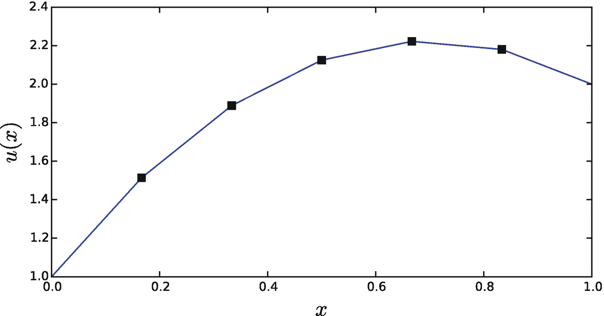

**图11-1**

正文中引入的二阶ODE边值问题的解

```
In [17]: x = np.linspace(0, 1, N+2)
In [18]: U = np.hstack([[u0], u, [u1]])
In [19]: fig, ax = plt.subplots(figsize=(8, 4))
...: ax.plot(x, U)
...: ax.plot(x[1:-1], u, 'ks')
...: ax.set_xlim(0, 1)
...: ax.set_xlabel(r"$x$", fontsize=18)
...: ax.set_ylabel(r"$u(x)$", fontsize=18)
```

有限差分法可以通过沿每个离散化坐标使用有限差分公式，轻松扩展到更高维度。对于二维问题，我们有一个二维数组`u`来表示未知的内部函数值，当使用有限差分公式时，我们会得到一系列关于`u`中元素的耦合方程。为了将这些方程写成标准的矩阵-向量形式，我们可以将`u`数组重排为一个向量，并根据有限差分方程组装相应的矩阵`A`。

例如，考虑先前提及的二维推广问题：`u[xx] + u[yy] = 0`，边界条件为`u(x = 0) = 3`，`u(x = 1) = -1`，`u(y = 0) = -5`，`u(y = 1) = 5`。这里没有源项，但二维问题中的边界条件比我们之前求解的一维问题更复杂。在有限差分形式下，我们可以将PDE写为`(u[m-1,n] - 2*u[m,n] + u[m+1,n]) / dx² + (u[m,n-1] - 2*u[m,n] + u[m,n+1]) / dy² = 0`。如果我们将`x`和`y`区间划分为`N`个内部点（包括边界点共`N+2`个点），那么`dx = dy = 1/(N+1)`，且`u`是一个`N x N`的矩阵。为了将方程写成标准形式`Av = b`，我们可以通过堆叠矩阵`u`的行或列，将其重排为一个大小为`N² x 1`的向量。此时矩阵`A`的大小为`N² x N²`，如果我们需要对`x`和`y`坐标进行精细离散化，该矩阵可能会非常大。例如，沿`x`和`y`各使用100个点，将得到一个包含10⁴个未知值`u[mn]`的方程组，而矩阵`A`则有100⁴ = 10⁸个元素。幸运的是，由于有限差分公式仅耦合相邻点，矩阵`A`非常稀疏，因此使用稀疏矩阵能极大地获益，如下文所述。

为了用Python和有限元法求解此PDE问题，我们首先为内部点的数量以及单位正方形四条边界上的值定义变量：

```
In [20]: N = 100
In [21]: u0_t, u0_b = 5, -5
In [22]: u0_l, u0_r = 3, -1
In [23]: dx = 1. / (N+1)
```

我们还计算了`x`和`y`离散化中均匀间隔坐标点之间的间距`dx`（假设相等）。由于有限差分公式同时耦合相邻行和列，构造本示例的矩阵`A`会稍显复杂。然而，一个相对直接的方法是先定义与沿某一坐标（例如`x`或`u[m,n]`中的索引`m`）的一维公式相对应的矩阵`A_1d`。为了将该公式分布到每一行，我们可以取大小为`N x N`的单位矩阵与`A_1d`矩阵的张量积。结果描述了针对所有索引`n`沿`m`索引的所有导数。为了涵盖将`u[m,n]`的方程与`u[m,n+1]`和`u[m,n-1]`耦合的项，即沿索引`n`的导数，我们需要添加与主对角线相距`N`个位置的对角线。下面，我们使用`scipy.sparse`模块中的`eye`和`kron`函数来执行这些步骤，构造`A`。结果是一个稀疏矩阵`A`，它描述了我们正在考虑的二维PDE的有限差分方程组：

### 有限元法

有限元法是一种将偏微分方程转化为代数方程的强大且通用的方法。该方法的基本思想是用一组有限的离散区域（即*单元*）来表示定义偏微分方程的区域，并将未知函数近似为在这些单元（或一小群相邻单元）上具有局部支持的基函数的线性组合。从数学上讲，这个近似解 `u[h]` 代表了精确解 `u` 在函数空间 *V*（例如，连续的实值函数）中到与问题区域离散化相关的有限子空间 `V[h] ⊂ V` 上的投影。如果 `V[h]` 是 *V* 的一个合适的子空间，那么可以预期 `u[h]` 会是 `u` 的一个良好近似。

为了能够在简化后的函数空间 `V[h]` 上求解近似问题，我们首先可以将偏微分方程从其原始公式（称为*强形式*）重写为其对应的变分形式（也称为*弱形式*）。为了得到弱形式，我们将偏微分方程乘以一个任意函数 `v`，并在整个问题区域上积分。函数 `v` 被称为*测试函数*，通常它可以在一个不同于 *V* 和 `V[h]` 的函数空间 `V̂` 上定义。

例如，考虑我们在本章前面使用 FDM 求解的稳态热方程（也称为泊松方程）：该方程的强形式为 `−Δu(x) = f(x)`，这里我们使用了向量算子符号。将此方程乘以一个测试函数 `v` 并在区域 `x ∈ Ω` 上积分，我们得到弱形式：

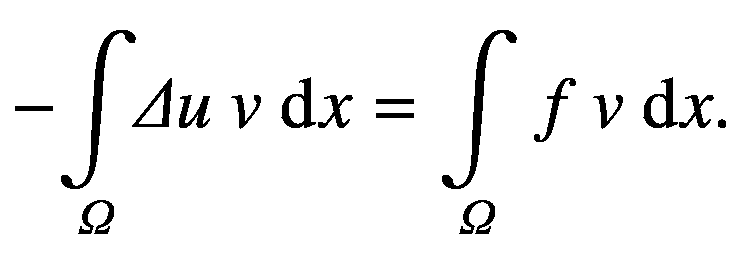

由于精确解 `u` 满足强形式，因此对于任何合理的 `v` 选择，它也满足偏微分方程的弱形式。反之则不一定成立，但若一个函数 `u[h]`（在此上下文中称为*试探函数*）能对一大类适当选择的测试函数 `v` 满足弱形式，那么它有理由被认为是精确解 `u` 的一个良好近似。

为了数值求解此问题，我们首先需要从无限维函数空间 *V* 和 `V̂` 过渡到近似的有限维函数空间 `V[h]` 和 `V̂_h`：

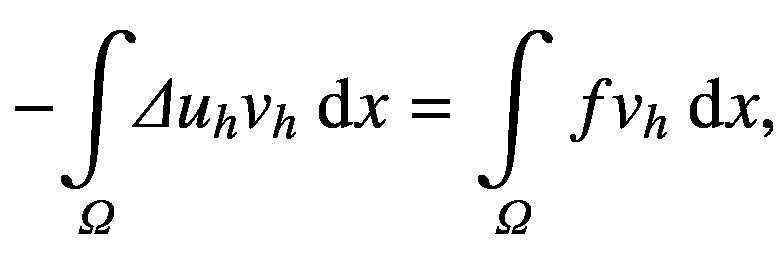

`u[h] ∈ V[h]` 且 `v_h ∈ V̂_h`。关键在于 `V[h]` 和 `V̂_h` 是有限维的，因此我们可以使用一组有限的基函数 `{ϕ[i]}` 和 `{ϕ̂_i}`（它们分别张成函数空间 `V[h]` 和 `V̂_h`）来描述函数 `u[h]` 和 `v[h]`。具体而言，我们可以将 `u[h]` 表示为张成其函数空间的基函数的线性组合：`u[h] = ∑ U[i]ϕ[i]`。将这个线性组合代入偏微分方程的弱形式，并对基函数（而非直接对偏微分方程中的项）执行积分和微分算子运算，即可得到一组代数方程。

为了得到一个形如 `AU = b` 的简单方程组，我们还需将偏微分方程的弱形式写成关于 `u[h]` 和 `v[h]` 函数的双线性形式 `a(u[h], v[h]) = L(v[h])`，其中 `a` 和 `L` 为某些函数。这并非总是可行，但对于当前的泊松方程例子，我们可以通过分部积分得到这种形式：

```
-∫_Ω Δu_h v_h dx = ∫_Ω ∇u_h · ∇v_h dx - ∫_Ω ∇·(∇u_h v_h) dx = ∫_Ω ∇u_h · ∇v_h dx - ∫_∂Ω (∇u_h · n) v_h dΓ,
```

其中第二个等式应用了高斯定理将第二项转化为区域 `Ω` 边界 `∂Ω` 上的积分。这里 `n` 是边界 `∂Ω` 的外法向向量。没有通用的方法可以将强形式下的偏微分方程改写为弱形式，每个问题都需要具体分析。然而，这里使用的分部积分并利用积分恒等式重写所得积分的方法，适用于许多常见的偏微分方程。

为了得到能用标准线性代数方法处理的双线性形式，我们还需要处理前一个弱形式方程中的边界项。为此，假设问题在 `∂Ω` 的一部分（记为 `Γ[D]`）上满足狄利克雷边界条件，在 `∂Ω` 的其余部分（记为 `Γ[N]`）上满足诺伊曼边界条件：`{u = h, x ∈ Γ[D]}` 和 `{∇u ∙ n = g, x ∈ Γ[N]}`。并非所有边界条件都是狄利克雷型或诺伊曼型，但两者共同涵盖了许多物理驱动的情形。

由于我们可以自由选择测试函数 `v[h]`，我们可以让 `v[h]` 在满足狄利克雷边界条件的边界部分上为零。在这种情况下，我们得到偏微分方程问题的以下弱形式：

```
∫_Ω ∇u_h · ∇v_h dx = ∫_Ω f v_h dx + ∫_{Γ_N} g v_h dΓ.
```

如果我们将函数 `u[h]` 替换为其作为基函数线性组合的表达式，并将测试函数替换为其某个基函数，我们得到一个代数方程：

```
∑ U_j ∫_Ω ∇ϕ_j · ∇ϕ̂_i dx = ∫_Ω f ϕ̂_i dx + ∫_{Γ_N} g ϕ̂_i dΓ.
```

如果 `V[h]` 中有 `N` 个基函数，则有 `N` 个未知系数 `U[i]`，我们需要 `N` 个独立的测试函数 `ϕ̂_i` 来得到封闭的方程组。该方程组呈 `AU = b` 形式，其中 `A_{ij} = ∫_Ω ∇ϕ_j · ∇ϕ̂_i dx` 且 `b_i = ∫_Ω f ϕ̂_i dx + ∫_{Γ_N} g ϕ̂_i dΓ`。遵循此过程，我们已将偏微分方程问题转化为一个线性方程组，可使用前几章讨论的技术轻松求解。

在实践中，为了获得对精确解的优良近似，可能需要大量的基函数，因此由有限元法生成的线性方程组通常非常庞大。然而，每个基函数仅在问题域离散化中的一个或少数几个相邻单元上有支撑，这一事实确保了矩阵 `A` 是稀疏的，这使得求解较大规模的有限元问题变得可行。我们还注意到，基函数 `ϕ[i]` 和 `ϕ̂_i` 的一个重要性质是，应能轻松计算问题最终弱形式中出现的表达式的导数和积分，以便高效组装矩阵 `A` 和向量 `b`。基函数的典型例子是仅在单个单元内非零的低阶多项式函数。有关这类基函数的一维示意图，请参见图 11-3，其中区间 [0, 6] 使用五个内点进行离散化，一个连续函数（黑色实曲线）通过适当加权的三角形基函数（蓝色/深灰色实线）近似为分段线性函数（红色/浅灰色虚线）。

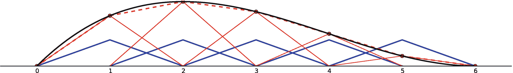

**图 11-3**  

具有局部支撑的基函数示例（蓝色/深灰色线），针对一维域 [0, 6]

使用有限元软件求解偏微分方程问题时，通常需要手动将偏微分方程转换为弱形式，并尽可能将其改写为双线性形式 `a(u, v) = L(v)`。同时，还需要提供问题域的合适离散化。这种离散化称为网格，通常由整个域上的三角形剖分（或其高维推广）构成。为复杂问题域划分网格本身可能是一个复杂的过程，可能需要使用专门用于网格生成的复杂软件。对于简单几何形状，存在程序化生成网格的工具，我们将在下一节中看到相关示例。

一旦生成了网格并将偏微分方程问题写成合适的弱形式，我们就可以将问题输入有限元框架，该框架随后会自动组装代数方程组，并应用合适的稀疏方程求解器来求解。在此过程中，我们通常可以选择使用何种类型的基函数以及何种类型的求解器。一旦代数方程求解完毕，我们就可以借助基函数构造偏微分方程的近似解，并可以例如可视化该解或对其进行其他形式的后处理。

总之，使用有限元法求解偏微分方程通常涉及以下步骤：

1. 为问题域生成网格。

2. 将偏微分方程写成弱形式。

3. 在有限元方法框架中对问题进行编程。

4. 求解生成的代数方程组。

5. 对解进行后处理和/或可视化。

在接下来的部分中，我们将回顾可配合 Python 使用的现有有限元框架，然后通过若干示例来展示使用有限元方法求解偏微分方程过程中的一些关键步骤。

## 有限元库概览

对于 Python 而言，至少有三个重要的有限元包：`FiPy`、`SfePy` 和 `FEniCS`。这些都是功能相当完善的框架，能够求解各种偏微分方程问题。严格来说，`FiPy` 库并非有限元软件，而是一种有限体积法软件，但其核心思想与有限元方法高度相似。`FiPy` 框架可从 [`http://www.ctcms.nist.gov/fipy`](http://www.ctcms.nist.gov/fipy) 获取。`SfePy` 库采用略有不同的方式来定义偏微分方程问题：它使用 Python 文件作为其有限元求解器的配置文件，而非通过编程方式设置问题（尽管在 `SfePy` 中也支持这种操作模式）。`SfePy` 库可从 [`http://sfepy.org`](http://sfepy.org) 获取。第三个主要的 Python 有限元框架是 `FEniCS`，它针对 C++ 和 Python 编写。在我个人看来，`FEniCS` 框架是 Python 有限元软件中的首选，因为它为强大的有限元引擎提供了优雅的 Python 接口。与有限差分法问题类似，有限元问题通常会产生超大规模的方程组，需要使用稀疏矩阵技术才能高效求解。因此，有限元框架的一个关键部分，就是利用稀疏矩阵表示法以及适用于稀疏系统的直接或迭代求解器（可能采用并行化），来高效求解大规模线性和非线性系统。前面提到的每个框架都支持多个后端来完成此类底层计算。例如，许多有限元框架都可以使用 `PETSc` 和 `Trilinos` 框架。

遗憾的是，我们无法在此深入探讨如何使用这些有限元框架，但在下一节中，我们将通过 `FEniCS` 求解示例问题，并借此介绍其一些基本功能和用法。希望这些示例能让读者初步了解如何在 Python 中处理有限元问题，并为有兴趣进一步学习 Python 有限元方法的读者提供一个起点。

### FEniCS

`FEniCS` 是一个功能强大的有限元框架，由一系列用于求解偏微分方程问题的库和工具组成。`FEniCS` 大部分是用 C++ 编写的，但同时也提供了官方的 Python 接口。由于 `FEniCS` 库的众多依赖项与底层数值计算库之间存在复杂的关联，`FEniCS` 通常被打包并安装为独立环境，不过在某些平台上也可以通过 `conda` 进行安装。有关 `FEniCS` 的更多信息，请访问项目网站 [`http://fenicsproject.org`](http://fenicsproject.org)。在撰写本文时，最新版本为 2018.1.0。

`FEniCS` 的 Python 接口由名为 `dolfin` 的库提供。对于网格生成，我们还将使用 `mshr` 库。在以下代码中，我们假定这些库已被完整导入，如本章开头所示。关于这些库中最重要的函数和类的总结，请参见表 11-1 和表 11-2。

表 11-2  

`mshr` 和 `dolfin` 库中选定函数和类的汇总

| 函数/类 | 描述 |

| --- | --- |

| `dolfin.Point` | 坐标点的表示。 |

| `mshr.Circle` | 圆形几何对象的表示，可用于组成二维区域。 |

| `mshr.Ellipse` | 椭圆形几何对象的表示。 |

| `mshr.Rectangle` | 二维矩形区域的表示。 |

| `mshr.Box` | 三维长方体区域的表示。 |

| `mshr.Sphere` | 三维球体区域的表示。 |

| `mshr.generate_mesh` | 由几何对象（例如上文列出的那些）组成的区域生成网格。 |

表 11-1  

`dolfin` 库中选定函数和类的汇总

| 函数/类 | 描述 | 示例 |

| --- | --- | --- |

| `parameters` | 存放 FEniCS 框架配置参数的字典。 | `dolfin.parameters["reorder_dofs_serial"]` |
| --- | --- | --- |
| `RectangleMesh` | 用于生成矩形二维网格的对象。 | `mesh = dolfin.RectangularMesh(dolfin.Point(0, 0),dolfin.Point(1, 1), 10, 10)` |
| `MeshFunction` | 在给定网格上定义的函数。 | `dolfin.MeshFunction("size_t", mesh, mesh.topology().dim()-1)` |
| `FunctionSpace` | 用于表示函数空间的对象。 | `V = dolfin.FunctionSpace(mesh, 'Lagrange', 1)` |
| `TrialFunction` | 用于表示在给定函数空间中定义的试探函数的对象。 | `u = dolfin.TrialFunction(V)` |
| `TestFunction` | 用于表示在给定函数空间中定义的检验函数的对象。 | `v = dolfin.TestFunction(V)` |
| `Function` | 用于表示偏微分方程弱形式中出现的未知函数的对象。 | `u_sol = dolfin.Function(V)` |
| `Constant` | 用于表示固定常数的对象。 | `c = dolfin.Constant(1.0)` |
| `Expression` | 用空间坐标表示的数学表达式。 | `dolfin.Expression("x[0]*x[0] + x[1]*x[1]")` |
| `DirichletBC` | 用于表示狄利克雷型边界条件的对象。 | `dolfin.DirichletBC(V, u0, u0_boundary)` |
| `Equation` | 用于表示方程的对象，例如通过使用 == 运算符与其他 FEniCS 对象生成。 | `a == L` |
| `inner` | 内积的符号表示。 | `dolfin.inner(u, v)` |
| `nabla_grad` | 梯度算子的符号表示。 | `dolfin.nabla_grad(u)` |
| `dx` | 用于积分的体积测度的符号表示。 | `f*v*dx` |
| `ds` | 用于积分的线测度的符号表示。 | `g_v * v * dolfin.ds(0, domain=mesh, subdomain_data=boundary_parts)` |
| `assemble` | 通过对基函数进行积分来组装代数方程。 | `A = dolfin.assemble(a)` |
| `solve` | 求解代数方程。 | `dolfin.solve(A, u_sol.vector(), b)` |
| `plot` | 绘制函数或表达式。 | `dolfin.plot(u_sol)` |
| `File` | 将函数写入文件，该文件可使用 ParaView 等可视化软件打开。 | `dolfin.File('u_sol.pvd') << u_sol` |
| `refine` | 通过将现有网格元素的一部分分割成更小的部分来细化网格。 | `mesh = dolfin.refine(mesh, cell_markers)` |
| `AutoSubDomain` | 域的子集的表示，由传递给它的指示函数从所有元素中选择。 | `dolfin.AutoSubDomain(v_boundary_func)` |

在开始使用 FEniCS 和 `dolfin` Python 库之前，我们需要通过 `dolfin.parameters` 字典设置两个配置参数，以获得在后续示例中所需的行为：

```
In [37]: dolfin.parameters["reorder_dofs_serial"] = False
In [38]: dolfin.parameters["allow_extrapolation"] = True
```

要开始使用 FEniCS，我们首先重新考虑本章前面使用 FDM 求解过的二维稳态热方程。这里我们考虑的问题是 `u[xx] + u[yy] = f`，其中 `f` 是源函数。首先，我们将假设边界条件为 `u(x = 0, y) = u(x = 1, y) = 0` 且 `u(x, y = 0) = u(x, y = 1) = 0`。在后面的示例中，我们将看到如何定义狄利克雷和诺伊曼边界条件。

使用有限元法求解偏微分方程的第一步是定义一个网格，该网格描述问题域的离散化。在当前示例中，问题域是单位正方形 `x`, `y` ∈ [0, 1]。对于此类简单几何形状，`dolfin` 库中有用于生成网格的函数。这里我们使用 `RectangleMesh` 函数，它的前两个参数是坐标点 (`x[0]`, `y[0]`) 和 (`x[1]`, `y[1]`)，表示为 `dolfin.Point` 实例，其中 (`x[0]`, `y[0]`) 是矩形左下角的坐标，(`x[1]`, `y[1]`) 是右上角的坐标。第五个和第六个参数分别是沿 `x` 和 `y` 方向的元素数量。生成的网格对象可通过其丰富的显示系统在 Jupyter Notebook 中查看（这里我们生成一个较粗糙的网格以便显示网格结构），如图 11-4 所示：

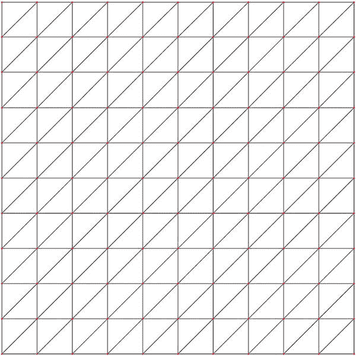

图 11-4 使用 `dolfin.RectangleMesh` 生成的矩形网格

```
In [39]: N1 = N2 = 75
In [40]: mesh = dolfin.RectangleMesh(dolfin.Point(0, 0), dolfin.Point(1, 1), N1, N2)
In [41]: dolfin.RectangleMesh(dolfin.Point(0, 0), dolfin.Point(1, 1), 10, 10)  # 用于显示
```

这个问题域的网格是将问题离散化为可用数值方法处理形式的关键。下一步是使用 `dolfin.FunctionSpace` 类定义试探函数和检验函数的函数空间表示。该类的构造函数至少需要三个参数：网格对象、基函数类型的名称以及基函数的阶数。我们将使用一阶拉格朗日型基函数（线性基函数）：

```
In [42]: V = dolfin.FunctionSpace(mesh, 'Lagrange', 1)
```

创建网格和函数空间对象后，我们需要为试探函数 `u[h]` 和检验函数 `v[h]` 创建对象，我们可以用它们来定义相关偏微分方程的弱形式。在 FEniCS 中，我们使用 `dolfin.TrialFunction` 和 `dolfin.TestFunction` 类来实现此目的。它们都需要一个函数空间对象作为构造函数的第一个参数：

```
In [43]: u = dolfin.TrialFunction(V)
In [44]: v = dolfin.TestFunction(V)
```

定义函数空间 `V` 以及试探函数和检验函数 `u` 和 `v` 的表示，目的是能够构建一般偏微分方程在弱形式下的表示。对于我们正在研究的稳态热方程，上一节已给出其弱形式（在没有诺伊曼边界条件的情况下）为

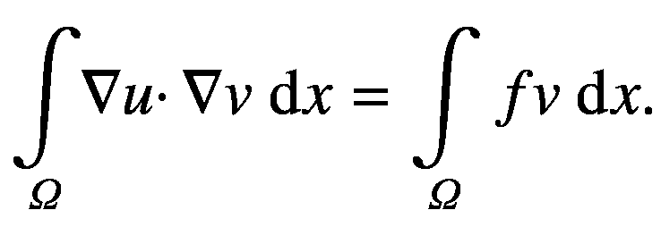

要得出这种形式，通常需要手动重写和变换偏微分方程的直接积分，典型方法是进行分部积分。在 FEniCS 中，偏微分方程本身是使用弱形式中出现的被积函数来定义的，包括积分测度（即 dx）。为此，`dolfin` 库提供了许多作用于试探函数和检验函数对象 `v` 和 `u` 的函数，用于表示偏微分方程弱形式中常见的对这些函数的操作。例如，在目前情况下，左侧积分的被积函数是 ∇u ∙ ∇v dx。要表示这个表达式，我们需要内积、`u` 和 `v` 的梯度以及积分测度 dx 的符号表示。`dolfin` 库中这些函数的名称分别是 `inner`、`nabla_grad` 和 `dx`，使用这些函数，我们可以创建 `a(u, v) = ∇u ∙ ∇v dx` 的表示，FEniCS 框架能够理解并处理这种表示。

```
In [45]: a = dolfin.inner(dolfin.nabla_grad(u), dolfin.nabla_grad(v)) * dolfin.dx
```

类似地，对于右侧项，我们需要一个表达式来表示 `b(v) = fv dx`。此时，我们需要指定 `f`（原始 PDF 中的源项）的显式形式，以便继续求解问题。这里我们考察两类函数：`f = 1`（常数）和 `f = x² + y²`（关于 `x` 和 `y` 的函数）。要表示 `f = 1`，我们可以使用 `dolfin.Constant` 对象。它仅接受一个参数，即它所表示的常数值：

```python
In [46]: f1 = dolfin.Constant(1.0)
In [47]: L1 = f1 * v * dolfin.dx
```

如果 `f` 是 `x` 和 `y` 的函数，我们需要改用 `dolfin.Expression` 对象来表示 `f`。该对象的构造函数接受一个字符串作为第一个参数，字符串中包含与函数对应的表达式。此表达式必须用 C++语法定义，因为 FEniCS 框架会自动生成并编译一个 C++函数，以实现表达式的高效求值。在表达式中，我们可以访问一个变量 `x`，它是特定点处坐标的数组，其中 `x` 通过 `x[0]` 访问，`y` 通过 `x[1]` 访问，依此类推。例如，要写出 `f(x, y) = x² + y²` 的表达式，我们可以使用 `"x[0]*x[0] + x[1]*x[1]"`。请注意，由于在此表达式中必须使用 C++语法，我们*不能*使用 Python 语法 `x[0]**2`。`Expression` 类还接受关键字参数 `degree`，用于指定基函数的次数；或者使用关键字参数 `element`，用于描述有限元，例如可以通过函数空间对象 `V` 的 `ufl_element` 方法获取。

```python
In [48]: f2 = dolfin.Expression("x[0]*x[0] + x[1]*x[1]", degree=1)
In [49]: L2 = f2 * v * dolfin.dx
```

至此，我们已经定义了 PDE 弱形式中各项的符号表示。下一步是定义边界条件。我们从简单的均匀狄利克雷型边界条件开始。`dolfin` 库中包含一个 `DirichletBC` 类，用于表示此类边界条件。我们可以使用该类来表示问题域边界上的任意函数，但在这个第一个示例中，考虑简单的边界条件 `u = 0` 在整个边界上。要表示边界上的常数值（此处为零），我们可以再次使用 `dolfin.Constant` 类。

```python
In [50]: u0 = dolfin.Constant(0)
```

除了边界条件的值，我们还需要定义一个函数（此处称为 `u0_boundary`），用于在创建 `DirichletBC` 类的实例时选择边界的不同部分。此函数接受两个参数：一个坐标数组 `x` 和一个标志 `on_boundary`，该标志指示点是否在网格的物理边界上；如果点 `x` 属于边界，则应返回 `True`，否则返回 `False`。由于此函数会对网格中的每个顶点进行求值，通过自定义该函数，我们可以将问题域任意部分上的函数值固定为特定值或表达式。然而，这里我们只需要选择所有位于物理边界上的点，因此我们可以简单地让 `u0_boundary` 函数返回 `on_boundary` 参数。

```python
In [51]: def u0_boundary(x, on_boundary):
...:      return on_boundary
```

一旦我们有了边界值的表达式 `u0` 以及从网格顶点中选择边界的函数 `u0_boundary`，就可以结合函数空间对象 `V`，最终创建 `DirichletBC` 对象：

```python
In [52]: bc = dolfin.DirichletBC(V, u0, u0_boundary)
```

这完成了 PDE 问题的说明，我们的下一步是通过从 PDE 的弱形式表示中组装矩阵和向量，将问题转化为代数形式。我们可以使用 `dolfin.assemble` 函数显式地执行此操作：

```python
In [53]: A = dolfin.assemble(a)
In [54]: b = dolfin.assemble(L1)
In [55]: bc.apply(A, b)
```

这将生成一个矩阵 `A` 和一个向量 `b`，它们定义了未知函数的代数方程组。这里我们还使用了 `DirichletBC` 类实例 `bc` 的 `apply` 方法，该方法会对 `A` 和 `b` 对象进行修改，从而在方程中考虑边界条件。

为了最终求解问题，我们需要创建一个用于存储未知解的函数对象，并调用 `dolfin.solve` 函数，提供 `A` 矩阵和 `b` 向量，以及 `Function` 对象的底层数据数组。我们可以通过调用对象的 `vector` 方法来获取 `Function` 实例的数据数组。

```python
In [56]: u_sol1 = dolfin.Function(V)
In [57]: dolfin.solve(A, u_sol1.vector(), b)
```

这里我们将解的 `Function` 对象命名为 `u_sol1`，调用 `dolfin.solve` 函数会求解方程组并将值填充到 `u_sol1` 对象的数据数组中。这里我们通过显式组装 `A` 和 `b` 矩阵并将结果传递给 `dolfin.solve` 函数来求解 PDE 问题。这些步骤也可以由 `dolfin.solve` 函数自动完成，方法是将 `dolfin.Equation` 对象作为第一个参数传递给该函数，将用于解的 `Function` 对象作为第二个参数，并将边界条件（或边界条件列表）作为第三个参数。我们可以使用例如 `a == L2` 来创建 `Equation` 对象：

```python
In [58]: u_sol2 = dolfin.Function(V)
In [59]: dolfin.solve(a == L2, u_sol2, bc)
```

这比我们使用等价关系 `a == L1` 来寻找 `u_sol1` 的方法略微简洁，但在某些需要针对多种情况求解问题的情况下，显式组装矩阵 `A` 和/或向量 `b` 可能更有用，因此熟悉这两种方法都是值得的。

当解以 FEniCS 的 `Function` 对象形式可用时，有多种方法可以进行后处理和可视化。一种直接绘制解的方法是使用内置的 `dolfin.plot` 函数，该函数可用于绘制网格对象、函数对象以及多种其他类型的对象（有关更多信息，请参阅 `dolfin.plot` 的文档字符串）。例如，要绘制解 `u_sol2`，我们只需调用 `dolfin.plot(u_sol2)`。生成的图形窗口如图 11-5 所示。


图 11-5 由 `dolfin` 库中的 `plot` 函数生成的网格函数 `u_sol2` 的图形

```python
In [60]: dolfin.plot(u_sol2)
```

使用 `dolfin.plot` 是快速可视化解或网格的好方法，但为了更好地控制可视化效果，通常需要导出数据并在专用可视化软件（如 ParaView）中进行绘制。要将解 `u_sol1` 和 `u_sol2` 保存为 ParaView 可以打开的格式，我们可以使用 `dolfin.File` 对象生成 PVD 文件（VTK 文件的集合），并使用 `<<` 运算符以类似 C++流的方式将对象追加到文件中：

```python
In [61]: dolfin.File('u_sol1.pvd') << u_sol1
```

我们还可以使用此方法将多个对象添加到 PVD 文件中：

```python
In [62]: f = dolfin.File('u_sol_and_mesh.pvd')
...: f << mesh
...: f << u_sol1
...: f << u_sol2
```

将 FEniCS 对象的数据导出到文件，以便用外部可视化软件加载和查看，是一种有益的方法，它利用了强大可视化软件的诸多优势，例如交互性、并行处理以及对可视化的高级控制等。然而，在许多情况下，例如在 Jupyter Notebook 中直接进行解决方案和网格的可视化可能更为可取。对于一维、二维以及某种程度上三维的简单问题，我们可以使用 Matplotlib 直接可视化网格和求解函数。

为了使用 Matplotlib，我们需要获取一个与 FEniCS 函数对象数据相对应的 NumPy 数组。有几种方法可以构造这样的数组。首先，FEniCS 函数对象可以像函数一样被调用，并传入一个坐标值数组（列表）：

```python
In [63]: u_sol1([0.21, 0.67])
Out[63]: 0.0466076997781351
```

这允许我们在问题域内的任意点评估解。我们也可以使用`vector`方法获取像`u_sol1`这样的函数对象在网格顶点上的值（作为 FEniCS 向量），然后使用`np.array`函数将其转换为 NumPy 数组。生成的 NumPy 数组是扁平（一维）的，对于二维矩形网格（如当前示例），将其重塑为二维数组就足以使用 Matplotlib 的`pcolor`、`contour`或`plot_surface`等函数进行绘图。接下来，我们将按照这些步骤将`u_sol1`和`u_sol2`函数对象的底层数据转换为 NumPy 数组，然后使用 Matplotlib 进行绘图。结果如图[11-6]所示。

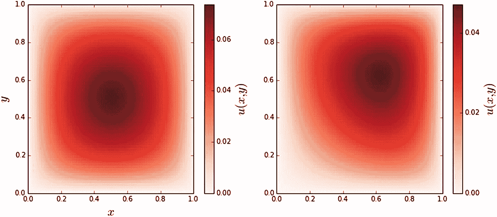

**图 11-6** 单位正方形上稳态热方程的解，源项`f=1`（左）和`f=x²+y²`（右），满足函数`u(x,y)`在边界上为零的条件。

```python
In [64]: u_mat1 = np.array(u_sol1.vector()).reshape(N1+1, N2+1)
In [65]: u_mat2 = np.array(u_sol2.vector()).reshape(N1+1, N2+1)
In [66]: X, Y = np.meshgrid(np.linspace(0, 1, N1+2), np.linspace(0, 1, N2+2))
In [67]: fig, (ax1, ax2) = plt.subplots(1, 2, figsize=(12, 5))
...:
...: c = ax1.pcolor(X, Y, u_mat1, cmap=mpl.cm.get_cmap('Reds'))
...: cb = plt.colorbar(c, ax=ax1)
...: ax1.set_xlabel(r"$x$", fontsize=18)
...: ax1.set_ylabel(r"$y$", fontsize=18)
...: cb.set_label(r"$u(x, y)$", fontsize=18)
...: cb.set_ticks([0.0, 0.02, 0.04, 0.06])
...:
...: c = ax2.pcolor(X, Y, u_mat2, cmap=mpl.cm.get_cmap('Reds'))
...: cb = plt.colorbar(c, ax=ax2)
...: ax1.set_xlabel(r"$x$", fontsize=18)
...: ax1.set_ylabel(r"$y$", fontsize=18)
...: cb.set_label(r"$u(x, x)$", fontsize=18)
...: cb.set_ticks([0.0, 0.02, 0.04])
```

用于生成图[11-6]的方法简单方便，但它仅适用于矩形网格。对于更复杂的网格，顶点坐标并非以结构化的方式组织，简单的扁平数组重塑是不够的。然而，表示问题域网格的`Mesh`对象包含每个顶点坐标的列表。这些坐标与`Function`对象的值相结合，可以组合成一种形式，用于 Matplotlib 的`triplot`和`tripcolor`函数进行绘图。要使用这些绘图函数，我们首先需要根据网格的顶点坐标创建一个`Triangulation`对象：

```python
In [68]: coordinates = mesh.coordinates()
...: triangles = mesh.cells()
...: triangulation = mpl.tri.Triangulation(coordinates[:, 0], coordinates[:, 1], triangles)
```

定义了三角剖分对象后，我们可以直接使用`triplot`和`tripcolor`绘制 FEniCS 函数的数组数据，如下列代码所示。生成的图形如图[11-7]所示。

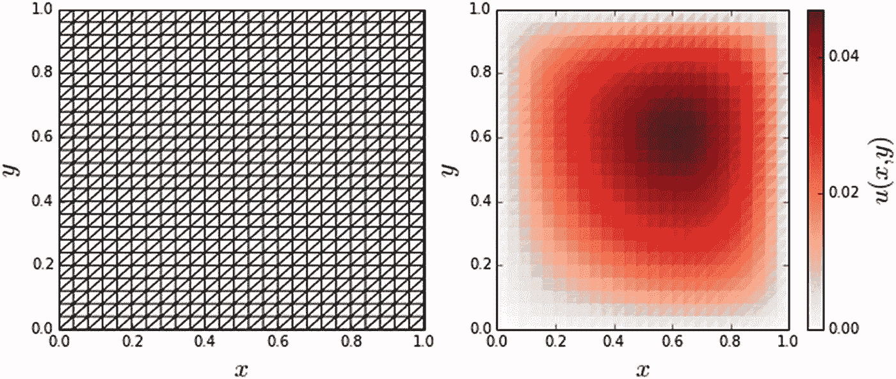

**图 11-7** 与图[11-6]相同，区别在于此图是使用 Matplotlib 的三角剖分函数生成的。左侧绘制了网格，右侧绘制了 PDE 的解。

```python
In [69]: fig, (ax1, ax2) = plt.subplots(1, 2, figsize=(10, 4))
...: ax1.triplot(triangulation)
...: ax1.set_xlabel(r"$x$", fontsize=18)
...: ax1.set_ylabel(r"$y$", fontsize=18)
...: cmap = mpl.cm.get_cmap('Reds')
...: c = ax2.tripcolor(triangulation, np.array(u_sol2.vector()), cmap=cmap)
...: cb = plt.colorbar(c, ax=ax2)
...: ax2.set_xlabel(r"$x$", fontsize=18)
...: ax2.set_ylabel(r"$y$", fontsize=18)
...: cb.set_label(r"$u(x, y)$", fontsize=18)
...: cb.set_ticks([0.0, 0.02, 0.04])
```

为了了解如何处理更复杂的边界条件，再次考虑热方程，这次没有源项（`u[xx]+u[yy] = 0`），但具有以下边界条件：`u(x=0) = 3`，`u(x=1) = -1`，`u(y=0) = -5`，以及 `u(y=1) = 5`。这与我们之前在本章中使用 FDM 方法求解的问题是同一个。在这里，我们使用 FEM 再次求解此问题。与前面的示例一样，我们首先为问题域定义网格、函数空间以及试验函数和测试函数对象：

```python
In [70]: V = dolfin.FunctionSpace(mesh, 'Lagrange', 1)
In [71]: u = dolfin.TrialFunction(V)
In [72]: v = dolfin.TestFunction(V)
```

接下来，我们定义 PDE 的弱形式。此处我们使用一个`dolfin.Constant`对象来表示`f`，并设置`f=0`：

```python
In [73]: a = dolfin.inner(dolfin.nabla_grad(u), dolfin.nabla_grad(v)) * dolfin.dx
In [74]: f = dolfin.Constant(0.0)
In [75]: L = f * v * dolfin.dx
```

现在剩下的是根据给定的规范来定义边界条件。在本例中，我们不希望对整个边界应用统一的边界条件，因此我们需要使用传递给`DirichletBC`类的边界选择函数的第一个参数，来区分边界的不同部分。为此，我们定义了四个函数，分别用于选择顶部、底部、左侧和右侧边界：

```python
In [76]: def u0_top_boundary(x, on_boundary):
...:     # on boundary and y == 1 -> top boundary
...:     return on_boundary and abs(x[1]-1) < 1e-5
...:
In [77]: def u0_bottom_boundary(x, on_boundary):
...:     # on boundary and y == 0 -> bottom boundary
...:     return on_boundary and abs(x[1]) < 1e-5
...:
In [78]: def u0_left_boundary(x, on_boundary):
...:     # on boundary and x == 0 -> left boundary
...:     return on_boundary and abs(x[0]) < 1e-5
...:
In [79]: def u0_right_boundary(x, on_boundary):
...:     # on boundary and x == 1 -> left boundary
...:     return on_boundary and abs(x[0]-1) < 1e-5
```

未知函数在每个边界上的值是简单的常数，我们可以用`dolfin.Constant`的实例来表示。因此，我们可以为每个边界创建`DirichletBC`的实例，并将得到的对象收集到一个列表`bcs`中。

```markdown
有了这样的边界条件规范，我们可以通过调用`dolfin.solve`继续求解 PDE 问题。将得到的向量转换为 NumPy 数组，用于使用 Matplotlib 的`pcolor`函数绘制解。结果如图[11-8]所示。通过与相应的 FDM 计算结果（如图[11-2]所示）进行比较，我们可以得出结论，这两种方法确实给出了相同的结果。

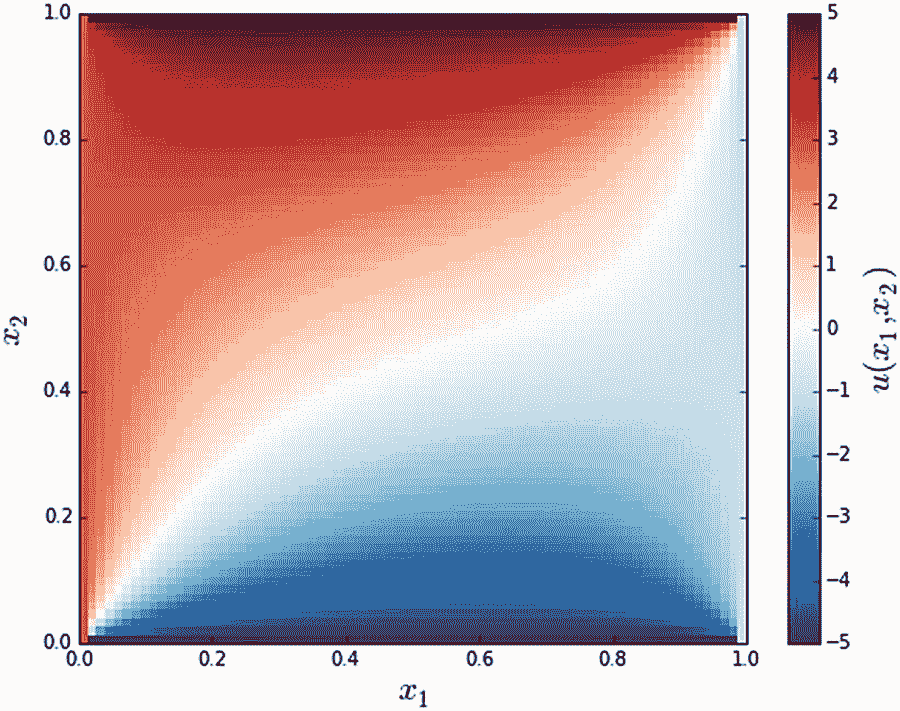

**图 11-8**  

单位正方形各边具有不同狄利克雷边界条件的热方程的稳态解

```python
In [80]: bc_t = dolfin.DirichletBC(V, dolfin.Constant(5), u0_top_boundary)
...: bc_b = dolfin.DirichletBC(V, dolfin.Constant(-5), u0_bottom_boundary)
...: bc_l = dolfin.DirichletBC(V, dolfin.Constant(3), u0_left_boundary)
...: bc_r = dolfin.DirichletBC(V, dolfin.Constant(-1), u0_right_boundary)
In [81]: bcs = [bc_t, bc_b, bc_r, bc_l]
In [82]: u_sol = dolfin.Function(V)
In [83]: dolfin.solve(a == L, u_sol, bcs)
In [84]: u_mat = np.array(u_sol.vector()).reshape(N1+1, N2+1)
In [85]: x = np.linspace(0, 1, N1+2)
...: y = np.linspace(0, 1, N1+2)
...: X, Y = np.meshgrid(x, y)
In [86]: fig, ax = plt.subplots(1, 1, figsize=(8, 6))
...: c = ax.pcolor(X, Y, u_mat, vmin=-5, vmax=5, cmap=mpl.cm.get_cmap('RdBu_r'))
...: cb = plt.colorbar(c, ax=ax)
...: ax.set_xlabel(r"$x_1$", fontsize=18)
...: ax.set_ylabel(r"$x_2$", fontsize=18)
...: cb.set_label(r"$u(x_1, x_2)$", fontsize=18)
```

到目前为止，我们使用有限元法求解了与使用有限差分法相同的类型问题，但有限元法的真正优势只有在处理具有更复杂几何形状的偏微分方程问题时才会显现。为了说明这一点，考虑一个单位圆盘上的热方程，该圆盘被五个小圆贯穿：一个位于原点，另外四个是更小的圆，如下图所示。要为此类几何形状生成网格，我们可以使用 FEniCS 附带的 `mshr` 库。它提供了几何基元（`Point`、`Circle`、`Rectangle` 等），这些基元可用于代数（集合）运算，以组合成问题域的网格。这里，我们首先使用 `mshr.Circle` 创建一个中心在 (0, 0) 的单位圆，然后从中减去对应于网格中需移除部分的其他 `Circle` 对象。最终的网格如图 11-9 所示。

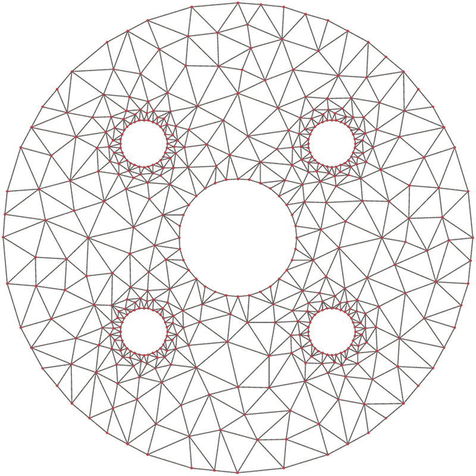

**图 11-9**  

由 `mshr` 库生成的网格对象

```python
In [87]: r_outer = 1
...: r_inner = 0.25
...: r_middle = 0.1
...: x0, y0 = 0.4, 0.4
In [88]: domain = mshr.Circle(dolfin.Point(.0, .0), r_outer) \
...:     - mshr.Circle(dolfin.Point(.0, .0), r_inner) \
...:     - mshr.Circle(dolfin.Point( x0,  y0), r_middle) \
...:     - mshr.Circle(dolfin.Point( x0, -y0), r_middle) \
...:     - mshr.Circle(dolfin.Point(-x0,  y0), r_middle) \
...:     - mshr.Circle(dolfin.Point(-x0, -y0), r_middle)
In [89]: mesh = mshr.generate_mesh(domain, 10)
```

该网格的物理解释是：该几何形状是一个材料块中五根管道的横截面，例如，内部的管道输送热流体，外部的管道输送冷流体以冷却该材料块（例如，一个被冷却管道包围的发动机缸体）。基于此解释，我们将内部管道的边界条件设置为高值，即 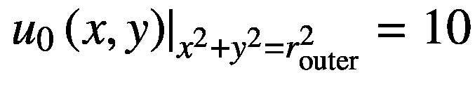，将周围较小的管道设置为低值，即 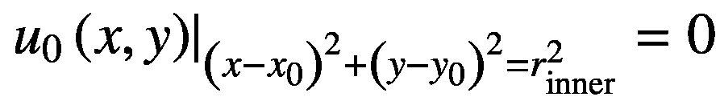，其中 (*x*[0], *y*[0]) 是每个较小管道的中心。我们不对外部边界做明确指定，这等价于诺伊曼边界条件的特例：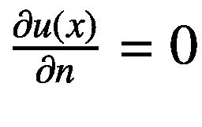。和之前一样，我们定义函数来挑选边界上的顶点。由于不同边界具有不同的边界条件，这里我们也需要使用坐标参数 `x` 来确定哪些顶点属于哪个边界。

```python
In [90]: def u0_inner_boundary(x, on_boundary):
...:     x, y = x[0], x[1]
...:     return on_boundary and abs(np.sqrt(x**2 + y**2) - r_inner) < 5e-2
In [91]: def u0_middle_boundary(x, on_boundary):
...:     x, y = x[0], x[1]
...:     if on_boundary:
...:         for _x0 in [-x0, x0]:
...:             for _y0 in [-y0, y0]:
...:                 if abs(np.sqrt((x-_x0)**2 + (y-_y0)**2) - r_middle) < 5e-2:
...:                     return True
...:     return False
In [92]: bc_inner = dolfin.DirichletBC(V, dolfin.Constant(10), u0_inner_boundary)
...: bc_middle = dolfin.DirichletBC(V, dolfin.Constant(0), u0_middle_boundary)
In [93]: bcs = [bc_inner, bc_middle]
```

一旦指定了网格和边界条件，我们就可以像往常一样继续：定义函数空间、试探函数和测试函数，并构建偏微分方程问题的弱形式表示：

```python
In [94]: V = dolfin.FunctionSpace(mesh, 'Lagrange', 1)
In [95]: u = dolfin.TrialFunction(V)
In [96]: v = dolfin.TestFunction(V)
In [97]: a = dolfin.inner(dolfin.nabla_grad(u), dolfin.nabla_grad(v)) * dolfin.dx
In [98]: f = dolfin.Constant(0.0)
In [99]: L = f * v * dolfin.dx
In [100]: u_sol = dolfin.Function(V)
```

求解和可视化问题也遵循与之前相同的模式。绘制解的结果如图 11-10 所示。

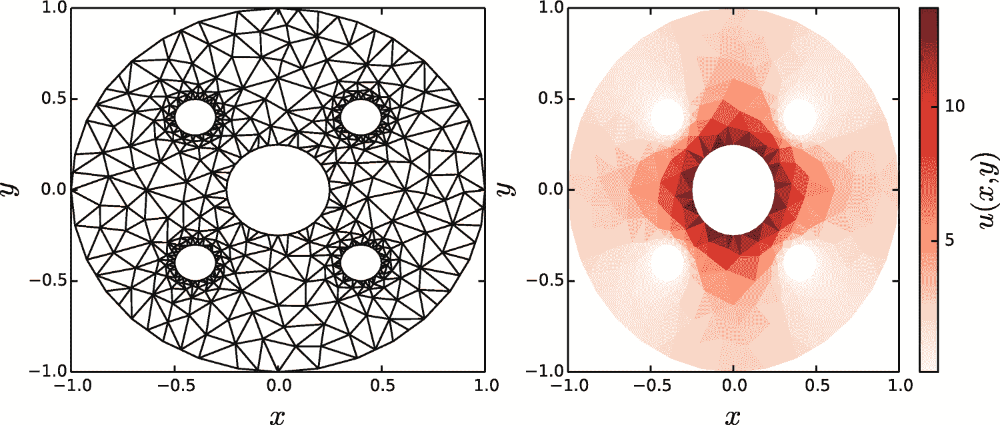
```

## 图 11-10

穿孔单位圆盘上热方程的解

```
In [101]: dolfin.solve(a == L, u_sol, bcs)
In [102]: coordinates = mesh.coordinates()
...: triangles = mesh.cells()
...: triangulation = mpl.tri.Triangulation(
...:     coordinates[:, 0], coordinates[:, 1], triangles)
In [103]: fig, (ax1, ax2) = plt.subplots(1, 2, figsize=(10, 4))
...: ax1.triplot(triangulation)
...: ax1.set_xlabel(r"$x$", fontsize=18)
...: ax1.set_ylabel(r"$y$", fontsize=18)
...: c = ax2.tripcolor(
...:     triangulation, np.array(u_sol.vector()), cmap=mpl.cm.get_cmap("Reds"))
...: cb = plt.colorbar(c, ax=ax2)
...: ax2.set_xlabel(r"$x$", fontsize=18)
...: ax2.set_ylabel(r"$y$", fontsize=18)
...: cb.set_label(r"$u(x, y)$", fontsize=18)
...: cb.set_ticks([0.0, 5, 10, 15])
```

这类几何形状的问题用有限差分法处理很困难，但用有限元法可以相对轻松地处理。一旦我们获得了一个有限元问题的解，即使对于复杂的边界问题，我们也可以相对轻松地以其他方式（而非仅仅绘图）对解函数进行后处理。例如，我们可能对函数沿某个边界上的值感兴趣。比如，在当前问题中，很自然地会查看问题域外半径上的温度，例如，观察由于四个冷却管道的影响，物体外部温度降低了多少。

为了进行这种分析，我们需要一种从`u_sol`对象中提取边界值的方法。我们可以通过定义一个描述边界的对象（此处使用`dolfin.AutoSubDomain`），并将其应用到一个新的`Function`对象上，该新对象用作掩码，从`u_sol`和`mesh.coordinates()`中选择所需的元素。在下文中，我们将这个掩码函数称为`mask_outer`。

```
In [104]: outer_boundary = dolfin.AutoSubDomain(
...:     lambda x, on_bnd: on_bnd and abs(np.sqrt(x[0]**2 + x[1]**2) - r_outer) < 5e-2)
In [105]: bc_outer = dolfin.DirichletBC(V, 1, outer_boundary)
In [106]: mask_outer = dolfin.Function(V)
In [107]: bc_outer.apply(mask_outer.vector())
In [108]: u_outer = u_sol.vector()[mask_outer.vector() == 1]
In [109]: x_outer = mesh.coordinates()[mask_outer.vector() == 1]
```

通过以上步骤，我们已为外边界条件创建了掩码，并将其应用于`u_sol.vector()`和`mesh.coordinates()`，从而获得了外边界点的函数值和坐标。接下来，我们将边界数据绘制为点`(x, y)`与`x`轴夹角的函数。结果如图 11-11 所示。

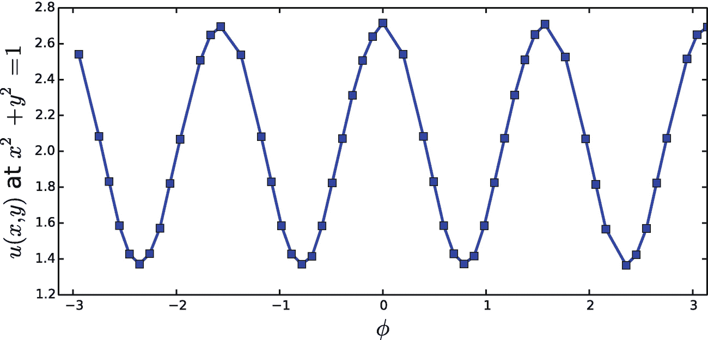

## 图 11-11

穿孔单位圆外边界上的温度分布

```
In [110]: phi = np.angle(x_outer[:, 0] + 1j * x_outer[:, 1])
In [111]: order = np.argsort(phi)
In [112]: fig, ax = plt.subplots(1, 1, figsize=(8, 4))
...: ax.plot(phi[order], u_outer[order], 's-', lw=2)
...: ax.set_ylabel(r"$u(x,y)$ at $x²+y²=1$", fontsize=18)
...: ax.set_xlabel(r"$\phi$", fontsize=18)
...: ax.set_xlim(-np.pi, np.pi)
```

使用有限元法（FEM）计算偏微分方程（PDE）的精度与表示问题域的网格单元尺寸密切相关：网格越细，解越精确。然而，增加网格单元数量也会使问题计算量更大。因此，必须在网格精度和可用计算资源之间权衡取舍。处理这种权衡的一个重要工具是非均匀分布单元的网格。使用这种网格，我们可以在未知函数预期值变化较快的区域使用较小的单元，而在不感兴趣的区域使用较少单元。

`dolfin`库提供了一种简单的方法来细化网格，即使用`dolfin.refine`函数。该函数以网格作为第一个参数，如果未提供其他参数，则均匀细化网格并返回新网格。但是，`dolfin.refine`函数也接受一个可选的第二个参数，用于描述应该细化网格的哪些部分。该参数应为布尔值`dolfin.MeshFunction`的实例，它作为一个掩码，标记哪些单元（胞）应被分割。

例如，考虑一个单位圆减去`x > 0`和`y < 0`象限部分的网格。我们可以使用`mshr.Circle`和`mshr.Rectangle`为此几何体构建网格：

```
In [113]: domain = mshr.Circle(dolfin.Point(.0, .0), 1.0) \
...:     - mshr.Rectangle(dolfin.Point(0.0, -1.0), dolfin.Point(1.0, 0.0))
In [114]: mesh = mshr.generate_mesh(domain, 10)
```

生成的网格如图 11-12 左侧所示。通常希望使用在几何体锐角附近具有更精细结构的网格。对于此示例，合理的做法是尝试细化原点附近边缘的网格。为此，我们需要创建一个`dolfin.MeshFunction`实例；使用`set_all`方法将其所有元素初始化为`False`；遍历元素并将其原点附近的元素标记为`True`；最后，使用网格和`MeshFunction`实例作为参数调用`dolfin.refine`函数。我们可以重复此过程，直到获得足够精细的网格。

下面，我们迭代调用`dolfin.refine`，并逐步减少标记为分割的单元数量：

```
In [115]: refined_mesh = mesh
...: for r in [0.5, 0.25]:
...:      cell_markers = dolfin.MeshFunction("bool", refined_mesh, dim=2)
...:      cell_markers.set_all(False)
...:      for cell in dolfin.cells(refined_mesh):
...:          if cell.distance(dolfin.Point(.0, .0)) < r:
...:              # 标记距离原点半径 r 内的单元进行分割
...:              cell_markers[cell] = True
...:      refined_mesh = dolfin.refine(refined_mesh, cell_markers)
```

生成的`refined_mesh`是原始网格的一个版本，其在原点附近具有更精细的单元划分。以下代码绘制了两个网格以进行比较，结果如图 11-12 所示。

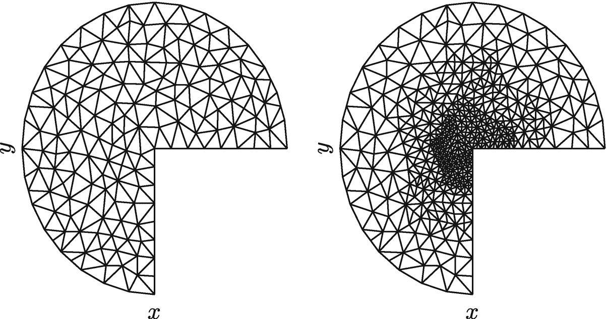

## 图 11-12

四分之三单位圆的原始网格和细化后网格

```
In [116]: def mesh_triangulation(mesh):
...:     coordinates = mesh.coordinates()
...:     triangles = mesh.cells()
...:     triangulation = mpl.tri.Triangulation(coordinates[:, 0], coordinates[:, 1],
...:     return triangulation
In [117]: fig, (ax1, ax2) = plt.subplots(1, 2, figsize=(8, 4))
...:
...: ax1.triplot(mesh_triangulation(mesh))
...: ax2.triplot(mesh_triangulation(refined_mesh))
...:
...: # 隐藏坐标轴和刻度
...: for ax in [ax1, ax2]:
...:     for side in ['bottom','right','top','left']:
...:         ax.spines[side].set_visible(False)
...:         ax.set_xticks([])
...:         ax.set_yticks([])
...:         ax.xaxis.set_ticks_position('none')
...:         ax.yaxis.set_ticks_position('none')
...:
...: ax.set_xlabel(r"$x$", fontsize=18)
...: ax.set_ylabel(r"$y$", fontsize=18)
```

使用`dolfin.refine`细化网格是一种实用的技术，用于改进使用几何图元表达式构建的简单网格（如本章所述）。作为使用 FEniCS 的最后一个示例，我们考虑稳态热方程的另一个例子，使用此细化的四分之三单位圆网格，并在缺失的四分之一圆的垂直和水平边界上施加诺伊曼边界条件：
*   对于垂直边，假设热量外流通量为`∇u · n = -2`，`x = 0`，`y < 0`；
*   对于水平边，假设热量内流通量为`∇u · n = 1`，`x > 0`，`y = 0`；
*   外部径向边界假设由狄利克雷边界条件描述：`u(x, y) = 0`，`x² + y² = 1`。

照例，我们首先为函数空间、测试函数和试探函数创建对象：

```
In [118]: mesh = refined_mesh
In [119]: V = dolfin.FunctionSpace(mesh, 'Lagrange', 1)
In [120]: u = dolfin.TrialFunction(V)
In [121]: v = dolfin.TestFunction(V)
```

对于包含诺伊曼边界条件的问题，我们需要在 PDE 的弱形式中包含该边界条件。回想一下泊松方程的弱形式为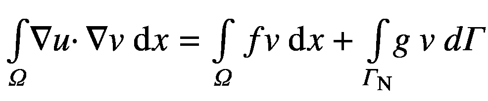，因此与之前的例子相比，我们需要考虑额外的项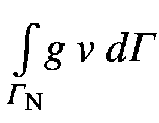，这是对具有诺伊曼边界条件的边界的积分。为了在弱形式表示中表示该积分的积分测度，我们可以使用`dolfin.ds`，但要区分边界的不同部分，我们首先需要标记这些边界部分。在 FEniCS 中实现此目的的一种方法是使用`dolfin.MeshFunction`对象，并为边界的每个不同部分分配一个唯一的整数值。为此，我们首先创建一个`dolfin.MeshFunction`实例：

```
In [122]: boundary_parts = dolfin.MeshFunction("size_t", mesh, mesh.topology().dim()-1)
```

接下来我们定义一个用于选取边界点的函数，以及一个根据该边界选取函数初始化的 `dolfin.AutoSubDomain` 实例。然后，可以使用这个 `AutoSubDomain` 实例，在 `MeshFunction`（此处名为 `boundary_parts`）中用区分整数值标记对应的单元。以下代码行对网格的垂直边执行这些步骤，其中 `x = 0` 且 `y < 0`：

```
In [121]: def v_boundary_func(x, on_boundary):
...:     """ 网格的垂直边，其中 x = 0 且 y < 0 """
...:     x, y = x[0], x[1]
...:     return on_boundary and abs(x) < 1e-4 and y < 0.0
In [122]: v_boundary = dolfin.AutoSubDomain(v_boundary_func)
In [123]: v_boundary.mark(boundary_parts, 0)
```

我们对网格的水平边重复相同的过程，其中 `y = 0` 且 `x > 0`：

```
In [124]: def h_boundary_func(x, on_boundary):
...:     """ 网格的水平边，其中 y = 0 且 x > 0 """
...:     x, y = x[0], x[1]
...:     return on_boundary and abs(y) < 1e-4 and x > 0.0
In [125]: h_boundary = dolfin.AutoSubDomain(h_boundary_func)
In [126]: h_boundary.mark(boundary_parts, 1)
```

我们也可以用同样的方法来定义狄利克雷边界条件。在这里，我们标记了由狄利克雷边界条件描述的边界部分，然后在创建 `dolfin.DirichletBC` 对象时使用它：

```
In [127]: def outer_boundary_func(x, on_boundary):
...:     x, y = x[0], x[1]
...:     return on_boundary and abs(x**2 + y**2-1) < 1e-2
In [128]: outer_boundary = dolfin.AutoSubDomain(outer_boundary_func)
In [129]: outer_boundary.mark(boundary_parts, 2)
In [130]: bc = dolfin.DirichletBC(V, dolfin.Constant(0.0), boundary_parts, 2)
```

标记好边界后，我们可以继续创建 PDE 的弱形式。由于此处使用了分区边界，我们需要为积分测度 `dolfin.dx` 和 `dolfin.ds` 指定 `domain` 和 `subdomain` 参数，并使用 `mesh` 和 `boundary_parts` 对象。

```
In [131]: dx = dolfin.dx(domain=mesh, subdomain_data=boundary_parts)
In [132]: a = dolfin.inner(dolfin.nabla_grad(u), dolfin.nabla_grad(v)) * dx
In [133]: f = dolfin.Constant(0.0)
In [134]: g_v = dolfin.Constant(-2.0)
In [135]: g_h = dolfin.Constant(1.0)
In [136]: L = f * v * dolfin.dx(domain=mesh, subdomain_data=boundary_parts)
In [137]: L += g_v * v * dolfin.ds(0, domain=mesh, subdomain_data=boundary_parts)
In [138]: L += g_h * v * dolfin.ds(1, domain=mesh, subdomain_data=boundary_parts)
```

在最后两个代码单元中，我们为网格中垂直边和水平边的诺伊曼边界条件添加了新项。边界的这些部分分别由整数 0 和 1 表示，如前节所定义，这些整数作为参数传递给 `dolfin.ds`，以选择对边界不同部分进行积分。

## 总结

本章简要概述了求解偏微分方程（PDE）的方法，以及如何在科学 Python 环境中使用这些方法。具体来说，我们介绍了用于求解 PDE 问题的有限差分法（FDM）和有限元法（FEM），并使用这些方法求解了几个示例问题。FDM 的优势在于其简单性，对于易于应用的问题（简单问题域、均匀离散化等），它是一种非常实用的方法。对于更复杂的 PDE 问题，例如问题域更复杂的情况，FEM 通常更适用。然而，FEM 的数学理论更复杂，实现也更具技术性。虽然有多种高级 FEM 框架可从 Python 调用，但在本章中我们重点介绍了一个突出的例子：FEniCS 框架。FEniCS 是一个功能齐全的 FEM 软件，可用于解决各种 PDE 问题。通过这里考虑的示例，我们只是触及了该软件所能实现功能的皮毛。然而，希望本章研究的示例能让读者对使用 FEM（特别是使用 FEniCS 软件）求解 PDE 问题的工作流程有一个总体了解。

## 扩展阅读

虽然我们在本章中讨论了 FDM 和 FEM，但还有其他成功且有用的数值求解 PDE 的方法。例如，有限体积法（FVM）是 FEM 方法的一个变体，常用于流体动力学计算以及其他领域。Python 库 `FiPy` 提供了一个使用此方法求解 PDE 问题的框架，该方法的理论介绍可参见例如 Wesseling (2009)。本章中给出的关于 FDM 和 FEM 的理论背景信息确实非常简短，主要目的是介绍此处使用的术语和符号。对于 FDM，尤其是 FEM 方法的认真工作，透彻理解这些方法的基本原理非常重要。FDM 和 FEM 的优秀入门教材可参见例如 Gockenbach (2011)、Gockenbach (2006)、Johnson (2009) 和 LeVeque (2007)。FEniCS 书籍（Logg, 2012），可从 FEniCS 项目网站（<http://fenicsproject.org>）免费在线获取，除了 FEniCS 软件本身的详细文档外，也包含了对 FEM 方法的精彩介绍。

定义好 PDE 弱形式的表示后，我们可以像之前的例子那样，继续使用 `dolfin.solve` 求解问题。最后，我们使用 `Matplotlib` 的三角剖分绘图函数绘制解。结果如图 11-13 所示。从图中可以看出，正如预期的那样，解在原点附近的边缘处具有更多结构。因此，在此区域使用单元较小的网格，是在不因使用均匀细网格结构而增加过多计算成本的情况下，获得足够分辨率的良好方法。

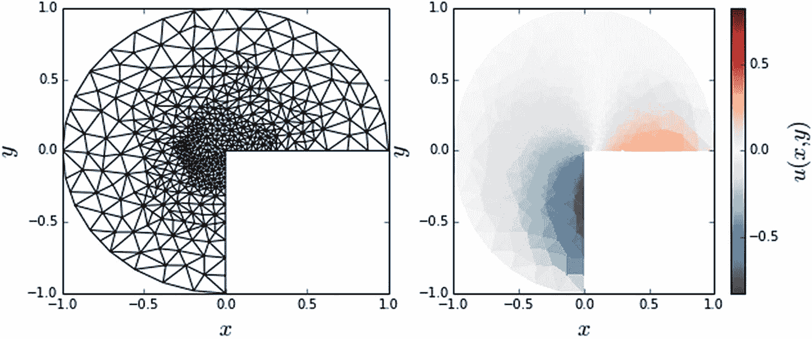

图 11-13

四分之一单位圆上具有诺伊曼和狄利克雷边界条件的热方程的解

```
In [139]: u_sol = dolfin.Function(V)
In [140]: dolfin.solve(a == L, u_sol, bc)
```

```
In [141]: fig, (ax1, ax2) = plt.subplots(1, 2, figsize=(10, 4))
...: triangulation = mesh_triangulation(mesh)
...: ax1.triplot(triangulation)
...: ax1.set_xlabel(r"$x$", fontsize=18)
...: ax1.set_ylabel(r"$y$", fontsize=18)
...:
...: data = np.array(u_sol.vector())
...: norm = mpl.colors.Normalize(-abs(data).max(), abs(data).max())
...: c = ax2.tripcolor(triangulation, data, norm=norm, cmap=mpl.cm.get_cmap("RdBu_r"))
...: cb = plt.colorbar(c, ax=ax2)
...: ax2.set_xlabel(r"$x$", fontsize=18)
...: ax2.set_ylabel(r"$y$", fontsize=18)
...: cb.set_label(r"$u(x, y)$", fontsize=18)
...: cb.set_ticks([-.5, 0, .5])
```

本节中探讨的示例仅仅是对 FEniCS 框架可解决问题的几种简单演示。FEniCS 中有大量我们甚至未能在此提及的功能。对于特别有兴趣解决 PDE 问题的读者，我建议研究 FEniCS 书籍（Anders Logg, 2012）及其中包含的许多示例应用。特别地，我们在此未能讨论的用有限元法求解 PDE 的重要方面包括：非平凡诺伊曼边界条件（需要包含在 PDE 弱形式的公式中）、向量值函数的 PDE、高维 PDE 问题（例如，三维热方程）以及时间相关的 PDE 问题。所有这些主题以及其他许多主题，在 FEniCS 框架中都得到了良好支持。