# 12. 数据处理与分析

在之前的几章中，我们涵盖了传统科学计算的主要主题。这些主题为大多数计算工作奠定了基础。从本章开始，我们将转而探讨数据处理与分析、统计学以及统计建模。作为这个方向的第一步，我们来了解数据分析库 `pandas`。这个库提供了便捷的数据结构来表示数据序列和数据表，并使得数据的转换、拆分、合并和转换变得容易。这些步骤在将原始数据清洗成适合分析的整洁形式的过程^(⁵⁴)中至关重要。Pandas 库构建在 NumPy 之上，并为其补充了在处理数据时特别有用的功能，例如标签索引、分层索引、数据集比较与合并时的数据对齐、缺失数据处理等等。因此，`pandas` 库已成为 Python 中高级数据处理的事实标准库，尤其是在统计应用方面。`pandas` 库本身对统计建模（即线性回归）的支持有限。对于更复杂的统计分析和建模，还有其他可用的包，例如 `statsmodels`、`patsy` 和 `scikit-learn`，我们将在后面的章节中介绍。不过，即使在使用这些包进行统计建模时，`pandas` 仍然可以用于数据表示和准备。因此，`pandas` 库是 Python 数据分析软件栈中的关键组成部分。

## Pandas

`pandas` 库是 Python 中用于数据处理和分析的框架。在撰写本文时，Pandas 的最新版本是 0.23.4。有关 `pandas` 库的更多信息及其官方文档，请参阅项目网站 [`http://pandas.pydata.org`](http://pandas.pydata.org)。

本章的主要焦点是介绍 `pandas` 库的基本特性和用法。在本章末尾，我们还将简要探讨统计可视化库 Seaborn，它构建在 Matplotlib 之上。该库为以 `pandas` 数据结构（或 NumPy 数组）表示的数据提供快速便捷的绘图功能。可视化是探索性数据分析中非常重要的一部分，Pandas 库本身也提供了基本数据可视化的函数（同样构建在 Matplotlib 之上）。Seaborn 库则更进一步，提供了额外的统计绘图功能和改进的样式：Seaborn 库以使用默认设置生成美观的图形而著称。

## Seaborn

Seaborn 库是一个用于统计图形的可视化库。它构建在 Matplotlib 之上，并为常见统计图形提供了易于使用的函数。在撰写本文时，Seaborn 的最新版本是 0.8.1。有关 Seaborn 的更多信息及其官方文档，请参阅项目网站：[`http://stanford.edu/~mwaskom/software/seaborn`](http://stanford.edu/%257Emwaskom/software/seaborn)。

## 导入模块

本章我们主要使用 `pandas` 库，假设我们将其导入并命名为 `pd`：

```
In [1]: import pandas as pd
```

我们还需要 NumPy 和 Matplotlib，按照通常的方式导入如下：

```
In [2]: import numpy as np
In [3]: import matplotlib.pyplot as plt
```

为了使 `pandas` 库生成的 Matplotlib 图形外观更美观，我们使用函数 `mpl.style.use` 选择一种适合统计图形的样式：

```
In [4]: import matplotlib as mpl
...: mpl.style.use('ggplot')
```

在本章后面，我们还需要导入 `seaborn` 模块，我们将其导入并命名为 `sns`：

```
In [5]: import seaborn as sns
```

## Pandas 简介

本章的主要焦点是用于数据分析的 `pandas` 库，我们首先从对该库的介绍开始。`pandas` 库主要提供了用于表示和操作数据的数据结构和方法。Pandas 中的两个主要数据结构是 `Series` 和 `DataFrame` 对象，它们分别用于表示数据序列和表格数据。这两个对象都有一个索引，用于访问对象所表示数据中的元素或行。默认情况下，索引是从零开始的整数，就像 NumPy 数组一样，但也可以使用任何标识符序列作为索引。


### 序列

能够使用标签而非整数来索引数据序列的优点，即使在最简单的示例中也显而易见：考虑以下构建 `Series` 对象的方法。我们向构造函数传入一个整数列表，以创建一个代表给定数据的 `Series` 对象。在 IPython 中显示该对象，会揭示 `Series` 对象的数据及其对应的索引：

```
In [6]: s = pd.Series([909976, 8615246, 2872086, 2273305])
In [7]: s
Out[7]: 0     909976
1     8615246
2     2872086
3     2273305
dtype: int64
```

生成的对象是一个数据类型 (`dtype`) 为 `int64` 的 `Series` 实例，其元素由整数 0、1、2 和 3 索引。使用 `index` 和 `values` 属性，我们可以提取序列中索引和值的底层数据：

```
In [8]: list(s.index)
Out[8]: RangeIndex(start=0, stop=4, step=1)
In [9]: s.values
Out[9]: array([ 909976, 8615246, 2872086, 2273305], dtype=int64)
```

虽然使用整数索引的数组或数据序列是一种功能完备的数据表示形式，但它缺乏描述性。例如，如果数据代表四个欧洲首都的人口，那么使用城市名称作为索引比使用整数更加方便且更具描述性。使用 `Series` 对象可以实现这一点，我们可以将 `Series` 对象的 `index` 属性赋值为一个包含新索引的列表来完成此操作。我们还可以设置 `Series` 对象的 `name` 属性，为其赋予一个描述性名称：

```
In [10]: s.index = ["Stockholm", "London", "Rome", "Paris"]
In [11]: s.name = "Population"
In [12]: s
Out[12]: Stockholm     909976
London       8615246
Rome         2872086
Paris        2273305
Name: Population, dtype: int64
```

现在，数据代表什么含义就一目了然了。或者，我们也可以在创建 `Series` 对象时，通过关键字参数设置 `index` 和 `name` 属性：

```
In [13]: s = pd.Series([909976, 8615246, 2872086, 2273305], name="Population",
...:               index=["Stockholm", "London", "Rome", "Paris"])
```

尽管将这些城市的人口数据直接存储在 NumPy 数组中是完全可以的，但即使在这个简单的例子中，当数据点使用有意义的标签进行索引时，数据所代表的含义也要清晰得多。当数据集复杂度增加时，将数据描述与数据紧密结合的好处会更加显著。

我们可以通过使用相应的索引（标签）进行索引，或者直接通过一个与索引同名的属性（如果索引标签是有效的 Python 符号名）来访问 `Series` 中的元素：

```
In [14]: s["London"]
Out[14]: 8615246
In [15]: s.Stockholm
Out[15]: 909976
```

使用索引列表对 `Series` 对象进行索引，会得到一个新的 `Series` 对象，其中包含原始数据的子集（对应于所提供的索引列表）：

```
In [16]: s[["Paris", "Rome"]]
Out[16]: Paris    2273305
Rome     2872086
Name: Population, dtype: int64
```

对于表示为 `Series` 对象的数据序列，我们可以使用 `Series` 的方法 `count`（数据点数量）、`median`（计算中位数）、`mean`（计算平均值）、`std`（计算标准差）、`min` 和 `max`（最小值和最大值）以及 `quantile`（用于计算分位数）轻松地计算其描述性统计量：

```
In [17]: s.median(), s.mean(), s.std()
Out[17]: (2572695.5, 3667653.25, 3399048.5005155364)
In [18]: s.min(), s.max()
Out[18]: (909976, 8615246)
In [19]: s.quantile(q=0.25), s.quantile(q=0.5), s.quantile(q=0.75)
Out[19]: (1932472.75, 2572695.5, 4307876.0)
```

以上所有数据都汇总在 `describe` 方法的输出中，该方法提供了 `Series` 对象所代表的数据的摘要：

```
In [20]: s.describe()
Out[20]: count          4.000000
mean     3667653.250000
std      3399048.500516
min       909976.000000
25%      1932472.750000
50%      2572695.500000
75%      4307876.000000
max      8615246.000000
Name: Population, dtype: float64
```

使用 `plot` 方法，我们可以快速轻松地生成图表，将 `Series` 对象中的数据可视化。`pandas` 库使用 Matplotlib 进行绘图，我们可以选择通过 `ax` 参数将 Matplotlib 的 `Axes` 实例传递给 `plot` 方法。图表的类型通过 `kind` 参数指定（有效选项包括 `line`、`hist`、`bar`、`barh`、`box`、`kde`、`density`、`area` 和 `pie`）。

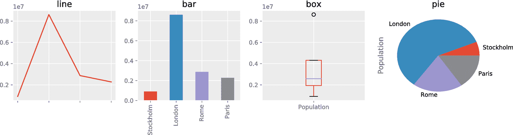

图 12-1

可以使用 Pandas 通过 `Series.plot` 方法生成的绘图样式示例

```
In [21]: fig, axes = plt.subplots(1, 4, figsize=(12, 3))
...: s.plot(ax=axes[0], kind="line", title="line")
...: s.plot(ax=axes[1], kind="bar", title="bar")
...: s.plot(ax=axes[2], kind="box", title="box")
...: s.plot(ax=axes[3], kind="pie", title="pie")
```


### `DataFrame`

如同前文示例所见，`pandas Series` 对象为一维数组提供了便捷的容器，它能为元素提供描述性标签，并能快速访问描述性统计数据和可视化。对于更高维度的数组（主要是二维数组或表格），对应的数据结构是 Pandas 的 `DataFrame` 对象。它可被视为一组共享相同索引的 `Series` 对象的集合。

初始化 `DataFrame` 的方式有很多种。对于简单的例子，最简便的方式是将嵌套的 Python 列表或字典传递给 `DataFrame` 对象的构造函数。例如，考虑对上一节数据集进行扩展，除了每个城市的人口数据，我们还添加一列来指明每个城市所属的国家。我们可以通过以下方式创建相应的 `DataFrame` 对象：

|   | `0` | `1` |
|---|-----|-----|
| `0` | `909976` | `Sweden` |
| `1` | `8615246` | `United Kingdom` |
| `2` | `2872086` | `Italy` |
| `3` | `2273305` | `France` |

```
In [22]: df = pd.DataFrame([[909976, "Sweden"],
...:                    [8615246, "United Kingdom"],
...:                    [2872086, "Italy"],
...:                    [2273305, "France"]])
In [23]: df
Out[23]:
```

结果是一个具有行和列的表格数据结构。与 `Series` 对象类似，我们可以通过将标签序列赋值给 `index` 属性来对行进行标签索引，此外，我们还可以将 `columns` 属性设置为列的标签序列：

|   | `Population` | `State` |
|---|--------------|---------|
| `Stockholm` | `909976` | `Sweden` |
| `London` | `8615246` | `United Kingdom` |
| `Rome` | `2872086` | `Italy` |
| `Paris` | `2273305` | `France` |

```
In [24]: df.index = ["Stockholm", "London", "Rome", "Paris"]
In [25]: df.columns = ["Population", "State"]
In [26]: df
Out[26]:
```

也可以在创建 `DataFrame` 对象时，通过相应的关键字参数来设置 `index` 和 `columns` 属性：

```
In [27]: df = pd.DataFrame([[909976, "Sweden"],
...:                    [8615246, "United Kingdom"],
...:                    [2872086, "Italy"],
...:                    [2273305, "France"]],
...:                   index=["Stockholm", "London", "Rome", "Paris"],
...:                   columns=["Population", "State"])
```

另一种创建相同数据框架的方法（有时会更方便）是传递一个字典，其中键为列标题，值为列数据：

```
In [28]: df = pd.DataFrame({"Population": [909976, 8615246, 2872086, 2273305],
...:                    "State": ["Sweden", "United Kingdom", "Italy", "France"]},
...:                   index=["Stockholm", "London", "Rome", "Paris"])
```

与之前一样，`DataFrame` 中的底层数据可以通过 `values` 属性获取为 NumPy 数组，索引和列数组则分别通过 `index` 和 `columns` 属性获取。数据框中的每一列可以使用列名作为属性来访问（或者，通过列标签进行索引，例如 `df["Population"]`）：

```
In [29]: df.Population
Out[29]: Stockholm     909976
London       8615246
Rome         2872086
Paris        2273305
Name: Population, dtype: int64
```

从 `DataFrame` 中提取列的结果是一个新的 `Series` 对象，我们可以使用上一节讨论的方法对其进行处理和操作。`DataFrame` 实例的行可以使用 `loc` 索引器属性来访问。对该属性进行索引也会产生一个 `Series` 对象，该对象对应于原始数据框中的一行：

```
In [30]: df.loc["Stockholm"]
Out[30]: Population    909976
State         Sweden
Name: Stockholm, dtype: object
```

向 `loc` 索引器传递一个行标签列表，会产生一个新的 `DataFrame`，它是原始 `DataFrame` 的子集，仅包含所选的行：

|   | `Population` | `State` |
|---|--------------|---------|
| `Paris` | `2273305` | `France` |
| `Rome` | `2872086` | `Italy` |

```
In [31]: df.loc[["Paris", "Rome"]]
Out[31]:
```

`loc` 索引器也可以用于同时选择行和列，方法是先传递一个行标签（或其列表），再传递一个列标签（或其列表）。结果是一个 `DataFrame`、`Series` 或元素值，具体取决于所选的行和列数量：

```
In [32]: df.loc[["Paris", "Rome"], "Population"]
Out[32]: Paris    2273305
Rome     2872086
Name: Population, dtype: int64
```

我们可以使用与 `Series` 对象相同的方法来计算描述性统计数据。当对 `DataFrame` 调用这些方法（`mean`、`std`、`median`、`min`、`max` 等）时，计算会针对每个具有数值数据类型的列进行：

```
In [33]: df.mean()
Out[33]: Population    3667653.25
dtype: float64
```

在这种情况下，两列中只有一列具有数值数据类型（名为 `Population` 的那一列）。使用 `DataFrame` 的 `info` 方法和 `dtypes` 属性，我们可以获得 `DataFrame` 中内容的摘要以及每列的数据类型：

```
In [34]: df.info()

Index: 4 entries, Stockholm to Paris
Data columns (total 2 columns):
Population    4 non-null int64
State         4 non-null object
dtypes: int64(1), object(1)
memory usage: 96.0+ bytes
In [35]: df.dtypes
Out[35]: Population     int64
State         object
dtype: object
```

使用 `pandas` 的真正优势在于处理比我们迄今所用示例更大、更复杂的数据集时才会显现。这样的数据很少能被定义为明确的列表或字典并传递给 `DataFrame` 的初始化器。更常见的情况是，必须从文件或其他外部源读取数据。`pandas` 库支持多种从不同格式的文件读取数据的方法。这里我们使用 `read_csv` 函数从 CSV 文件中读取数据并创建一个 `DataFrame` 对象。^(⁵⁵) 此函数接受大量可选参数来调整其行为。详细信息请参阅文档字符串 `help(pd.read_csv)`。一些最有用的参数包括 `header`（指定哪一行包含列名的标题行，如果有的话）、`skiprows`（开始读取数据前要跳过的行数，或要跳过的行号列表）、`delimiter`（用作列值之间分隔符的字符）、`encoding`（文件中使用的编码名称，例如 `utf-8`）和 `nrows`（要读取的行数）。`pd.read_csv` 函数的第一个也是唯一必需的参数是文件名或数据源的 URL。例如，要读取存储在名为 `european_cities.csv`^(⁵⁶) 文件中的数据集（其前五行显示在以下代码中），我们可以简单地调用 `pd.read_csv("european_cities.csv")`，因为默认分隔符是 `","`，并且标题行默认取自第一行。然而，我们也可以显式地写出所有这些选项：

```
In [36]: !head –n 5 european_cities.csv
Rank,City,State,Population,Date of census
1,London, United Kingdom,"8,615,246",1 June 2014
2,Berlin, Germany,"3,437,916",31 May 2014
3,Madrid, Spain,"3,165,235",1 January 2014
4,Rome, Italy,"2,872,086",30 September 2014
In [37]: df_pop = pd.read_csv("european_cities.csv",
...:                      delimiter=",", encoding="utf-8", header=0)
```

这个数据集与本章前面使用的示例数据类似，但这里为其他城市增加了更多列和更多行。将数据集读入 `DataFrame` 对象后，首先通过 `info` 方法检查摘要，有助于开始形成对数据集属性的认识。

```
In [38]: df_pop.info()
```


```
Int64Index: 105 entries, 0 to 104
Data columns (total 5 columns):
Rank              105 non-null int64
City              105 non-null object
State             105 non-null object
Population        105 non-null object
Date of census    105 non-null object
dtypes: int64(1), object(4) memory usage: 4.9+ KB
```

这里我们看到该数据集有 105 行，包含 5 列。只有 `Rank` 列是数值数据类型。特别地，`Population` 列还不是数值数据类型，因为其值的格式为 `"8,615,246"`，因此被 `read_csv` 函数解释为字符串值。以表格形式展示数据也很有帮助。然而，该数据集太大，无法完整显示，在这种情况下，`head` 和 `tail` 方法非常方便，可以分别创建仅包含前几行和后几行的截断数据集。这两个函数都接受一个可选参数，用于指定在截断的 `DataFrame` 中包含多少行。另请注意，`df.head(n)` 等同于 `df[:n]`，其中 `n` 是一个整数。

|   | `Rank` | `City` | `State` | `Population` | `Date of census` |
| `0` | `1` | `London` | `United Kingdom` | `8,615,246` | `1 June 2014` |
| `1` | `2` | `Berlin` | `Germany` | `3,437,916` | `31 May 2014` |
| `2` | `3` | `Madrid` | `Spain` | `3,165,235` | `1 January 2014` |
| `3` | `4` | `Rome` | `Italy` | `2,872,086` | `30 September 2014` |
| `4` | `5` | `Paris` | `France` | `2,273,305` | `1 January 2013` |

```
In [39]: df_pop.head()
Out[39]:
```

展示截断的 `DataFrame` 能让我们很好地了解数据的样子，以及在数据准备好进行分析之前还需要做哪些工作。通常需要以某种方式转换列，并通过按特定列排序或按索引排序来重新排列表格。下面我们将探索一些修改 `DataFrame` 对象的方法。首先，我们可以通过简单地将一个 `Series` 对象赋值给以列名索引的 `DataFrame` 来创建新列和更新列，并且可以使用 Python 的 `del` 关键字删除列。

`apply` 方法是转换列内容的一个强大工具。它会创建并返回一个新的 `Series` 对象，该对象对原始列中的每个元素应用了传递给 `apply` 的函数。例如，我们可以使用 `apply` 方法，通过传递一个 lambda 函数来将 `Population` 列中的元素从字符串转换为整数，该函数从字符串中删除 `","` 字符并将结果转换为整数。这里我们将转换后的列赋值给一个名为 `NumericPopulation` 的新列。使用相同的方法，我们还通过使用字符串方法 `strip` 删除 `State` 元素中的多余空白，来整理 `State` 值。

|   | `Rank` | `City` | `State` | `Population` | `Date of census` | `NumericPopulation` |
| `0` | `1` | `London` | `United Kingdom` | `8,615,246` | `1 June 2014` | `8615246` |
| `1` | `2` | `Berlin` | `Germany` | `3,437,916` | `31 May 2014` | `3437916` |
| `2` | `3` | `Madrid` | `Spain` | `3,165,235` | `1 January 2014` | `3165235` |
| `3` | `4` | `Rome` | `Italy` | `2,872,086` | `30 September 2014` | `2872086` |
| `4` | `5` | `Paris` | `France` | `2,273,305` | `1 January 2013` | `2273305` |

```
In [40]: df_pop["NumericPopulation"] = df_pop.Population.apply(
...:     lambda x: int(x.replace(",", "")))
In [41]: df_pop["State"].values[:3]  # 包含多余空白
Out[41]: array([' United Kingdom', ' Germany', ' Spain'], dtype=object)
In [42]: df_pop["State"] = df_pop["State"].apply(lambda x: x.strip())
In [43]: df_pop.head()
Out[43]:
```

检查更新后的 `DataFrame` 中各列的数据类型，确认新列 `NumericPopulation` 确实是整数类型（而 `Population` 列保持不变）：

```
In [44]: df_pop.dtypes
Out[44]: Rank                int64
City               object
State              object
Population         object
Date of census     object
NumericPopulation   int64
dtype: object
```

我们可能还需要将索引更改为 `DataFrame` 的某一列。在当前示例中，我们可能想使用 `City` 列作为索引。我们可以使用 `set_index` 方法来实现，该方法接受一个参数，即要用作索引的列名。结果是一个新的 `DataFrame` 对象，而原始的 `DataFrame` 保持不变。此外，使用 `sort_index` 方法，我们可以根据索引对数据框进行排序：

| `City` | `Rank` | `State` | `Population` | `Date of census` | `NumericPopulation` |
| `Aarhus` | `92` | `Denmark` | `326,676` | `1 October 2014` | `326676` |
| `Alicante` | `86` | `Spain` | `334,678` | `1 January 2012` | `334678` |
| `Amsterdam` | `23` | `Netherlands` | `813,562` | `31 May 2014` | `813562` |
| `Antwerp` | `59` | `Belgium` | `510,610` | `1 January 2014` | `510610` |
| `Athens` | `34` | `Greece` | `664,046` | `24 May 2011` | `664046` |

```
In [45]: df_pop2 = df_pop.set_index("City")
In [46]: df_pop2 = df_pop2.sort_index()
In [47]: df_pop2.head()
Out[47]:
```

`sort_index` 方法也接受一个列名列表，在这种情况下会创建一个层次化索引。层次化索引使用索引标签的元组来寻址数据框中的行。我们可以使用带有整数值参数 `level` 的 `sort_index` 方法，根据层次化索引的第 `n` 级（其中 `level=n`）对 `DataFrame` 中的行进行排序。在以下示例中，我们使用 `State` 和 `City` 作为索引创建一个层次化索引，并使用 `sort_index` 方法按第一个索引（`State`）排序：

| `State` | `City` | `Rank` | `Population` | `Date of census` |
| `Austria` | `Vienna` | `7` | `1794770` | `1 January 2015` |
| `Belgium` | `Antwerp` | `59` | `510610` | `1 January 2014` |
| `Brussels` | `16` | `1175831` | `1 January 2014` |
| `Bulgaria` | `Plovdiv` | `84` | `341041` | `31 December 2013` |
| `Sofia` | `14` | `1291895` | `14 December 2014` |
| `Varna` | `85` | `335819` | `31 December 2013` |
| `Croatia` | `Zagreb` | `24` | `790017` | `31 March 2011` |

```
In [48]: df_pop3 = df_pop.set_index(["State", "City"]).sort_index(level=0)
In [49]: df_pop3.head(7)
Out[49]:
```

具有层次化索引的 `DataFrame` 可以仅使用其第零级索引（`df3.loc["Sweden"]`）进行部分索引，或者使用所有层次化索引的元组（`df3.loc[("Sweden", "Gothenburg")]`）进行完全索引：

| `City` | `Rank` | `Population` | `Date of census` | `NumericPopulation` |
| `Gothenburg` | `53` | `528,014` | `31 March 2013` | `528014` |
| `Malmö` | `102` | `309,105` | `31 March 2013` | `309105` |
| `Stockholm` | `20` | `909,976` | `31 January 2014` | `909976` |

```
In [50]: df_pop3.loc["Sweden"]
Out[50]:
```

```
In [51]: df_pop3.loc[("Sweden", "Gothenburg")]
Out[51]: Rank                            53
Population                 528,014
Date of census       31 March 2013
NumericPopulation           528014
Name: (Sweden, Gothenburg), dtype: object
```

如果我们想按列而不是按索引排序，可以使用 `sort_values` 方法。它接受一个列名或列名列表，`DataFrame` 将根据这些列进行排序。它还接受关键字参数 `ascending`，该参数是一个布尔值或布尔值列表，用于指定相应的列是按升序还是降序排序。


| `City` | `Rank` | `State` | `Population` | `Date of census` | `NumericPopulation` |
| `Nottingham` | `103` | `United Kingdom` | `308,735` | `30 June 2012` | `308735` |
| `Wirral` | `97` | `United Kingdom` | `320,229` | `30 June 2012` | `320229` |
| `Coventry` | `94` | `United Kingdom` | `323,132` | `30 June 2012` | `323132` |
| `Wakefield` | `91` | `United Kingdom` | `327,627` | `30 June 2012` | `327627` |
| `Leicester` | `87` | `United Kingdom` | `331,606` | `30 June 2012` | `331606` |

```
In [52]: df_pop.set_index("City").sort_values(["State", "NumericPopulation"],
...:                                      ascending=[False, True]).head()
Out[52]:
```

对于像 `State` 列这样的分类数据，我们通常需要汇总该列中每个类别包含多少个值。此类计数可以使用 `value_counts` 方法（属于 `Series` 对象）来计算。例如，要统计在欧洲人口最多的 105 个城市列表中，每个国家拥有多少个城市，我们可以使用：

```
In [53]: city_counts = df_pop.State.value_counts()
In [54]: city_counts.head()
Out[54]: Germany           19
United Kingdom    16
Spain             13
Poland            10
Italy             10
dtype: int64
```

在这个示例中，我们从结果中看到，列表中城市数量最多的**州**是德国，有 19 个城市，其次是英国（16 个城市），以此类推。一个相关的问题是，一个州内所有城市的总人口是多少。为了回答这类问题，我们可以采用两种方法：首先，我们可以使用 `State` 和 `City` 创建一个分层索引，然后使用 `sum` 方法沿着其中一个索引缩减 `DataFrame`。在本例中，我们希望对索引层级 `State` 内的所有条目求和，因此我们可以使用 `sum(level="State")`，这将会消除 `City` 索引。为了便于展示，我们还会按列 `NumericPopulation` 对结果 `DataFrame` 进行降序排序：

| `State` | `NumericPopulation` |
| `United Kingdom` | `16011877` |
| `Germany` | `15119548` |
| `Spain` | `10041639` |
| `Italy` | `8764067` |
| `Poland` | `6267409` |

```
In [55]: df_pop3 = df_pop[["State", "City", "NumericPopulation"]].set_index(["State", "City"])
In [56]: df_pop4 = df_pop3.sum(level="State").sort_values("NumericPopulation", ascending=False)
In [57]: df_pop4.head()
Out[57]:
```

其次，我们可以使用 `groupby` 方法获得相同的结果，该方法允许我们根据给定列的值对 `DataFrame` 的行进行分组，并对结果对象应用一个归约函数（例如 `sum`、`mean`、`min`、`max` 等）。返回的结果是一个新的 `DataFrame`，其索引为分组依据的列。使用这种方法，我们可以按州分组，计算 105 个城市的总人口，方法如下：

```
In [58]: df_pop5 = (df_pop.drop("Rank", axis=1)
...:                  .groupby("State").sum()
...:                  .sort_values("NumericPopulation", ascending=False))
```

请注意，这里我们还使用了 `drop` 方法从 `DataFrame` 中移除 `Rank` 列（因此使用 `axis=1`，若要删除行则使用 `axis=0`）（因为对排名求和是没有意义的）。最后，我们使用 `Series` 对象的 `plot` 方法绘制城市数量和总人口的条形图。结果如图 12-2 所示。

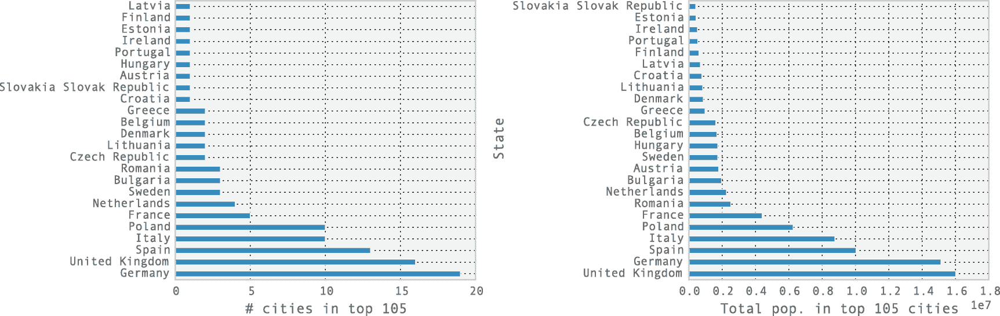

**图 12-2** 欧洲人口最多的 105 个城市名单中各州的城市数量（左）及这些城市的总人口（右），按州分组

```
In [59]: fig, (ax1, ax2) = plt.subplots(1, 2, figsize=(12, 4))
...: city_counts.plot(kind='barh', ax=ax1)
...: ax1.set_xlabel("# cities in top 105")
...: df_pop5.NumericPopulation.plot(kind='barh', ax=ax2)
...: ax2.set_xlabel("Total pop. in top 105 cities")
```

## 时间序列

时间序列是一种常见的数据形式，其中某个量在（例如）规则或不规则间隔的时间戳上，或者在固定或可变的时间跨度（周期）内给出。在 `pandas` 中，有专门的数据结构用于表示这些类型的数据。`Series` 和 `DataFrame` 可以拥有描述时间戳和时间跨度的数据类型的列和索引。在处理时间数据时，能够使用时间数据类型对数据进行索引尤其有用。利用 `pandas` 的时间序列索引器 `DatetimeIndex` 和 `PeriodIndex`，我们可以执行许多常见的日期、时间、周期和日历操作，例如选择时间范围、以及平移和重采样时间序列中的数据点。

要生成一个可用作 `pandas` `Series` 或 `DataFrame` 对象索引的日期序列，我们可以使用 `date_range` 函数。该函数将起始点（一个日期和时间字符串，或者替代地，一个来自 Python 标准库的 `datetime` 对象）作为第一个参数，并且可以使用 `periods` 关键字参数设置范围内的元素数量：

```
In [60]: pd.date_range("2015-1-1", periods=31)
Out[60]: 
[2015-01-01, ..., 2015-01-31]
Length: 31, Freq: D, Timezone: None
```

要指定时间戳的频率（默认为一天），我们可以使用 `freq` 关键字参数，并且我们可以不指定 `periods` 而使用起始点和结束点（作为日期和时间字符串或 `datetime` 对象）作为第一和第二个参数。例如，要生成 2015-01-01 00:00 到 12:00 之间的小时级时间戳，我们可以使用：

```
In [61]: pd.date_range("2015-1-1 00:00", "2015-1-1 12:00", freq="H")
Out[61]: 
[2015-01-01 00:00:00, ..., 2015-01-01 12:00:00]
Length: 13, Freq: H, Timezone: None
```

`date_range` 函数返回一个 `DatetimeIndex` 实例，它可以用作 `Series` 或 `DataFrame` 对象的索引，例如：

```
In [62]: ts1 = pd.Series(np.arange(31), index=pd.date_range("2015-1-1", periods=31))
In [63]: ts1.head()
Out[63]: 2015-01-01    0
2015-01-02    1
2015-01-03    2
2015-01-04    3
2015-01-05    4
Freq: D, dtype: int64
```

`DatetimeIndex` 对象的元素可以通过使用日期和时间字符串进行索引来访问。`DatetimeIndex` 中的一个元素是 `Timestamp` 类型，这是一个扩展了标准 Python `datetime` 对象的 `pandas` 对象（参见 Python 标准库中的 `datetime` 模块）。

```
In [64]: ts1["2015-1-3"]
Out[64]: 2
In [65]: ts1.index[2]
Out[65]: Timestamp('2015-01-03 00:00:00', offset="D")
```

在许多方面，`Timestamp` 和 `datetime` 对象是可以互换的，并且 `Timestamp` 类像 `datetime` 类一样，具有用于访问时间字段（如 `year`、`month`、`day`、`hour`、`minute` 等）的属性。然而，`Timestamp` 和 `datetime` 的一个显著区别是，`Timestamp` 以纳秒精度存储时间戳，而 `datetime` 对象仅使用微秒精度。

```
In [66]: ts1.index[2].year, ts1.index[2].month, ts1.index[2].day
Out[66]: (2015, 1, 3)
In [67]: ts1.index[2].nanosecond
Out[67]: 0
```

我们可以使用 `to_pydatetime` 方法将 `Timestamp` 对象转换为标准的 Python `datetime` 对象：

```
In [68]: ts1.index[2].to_pydatetime()
Out[68]: datetime.datetime(2015, 1, 3, 0, 0)
```

并且我们可以使用一个 `datetime` 对象列表来创建 `pandas` 时间序列：

```
In [69]: import datetime
In [70]: ts2 = pd.Series(np.random.rand(2),
...:                 index=[datetime.datetime(2015, 1, 1), datetime.datetime(2015, 2, 1)])
In [71]: ts2
Out[71]: 2015-01-01    0.683801
2015-02-01    0.916209
dtype: float64
```


为时间跨度序列定义的数据可以使用`Series`和`DataFrame`对象来表示，这些对象通过`PeriodIndex`类进行索引。我们可以通过传递一个`Period`对象列表来显式构造`PeriodIndex`类的实例，然后在创建`Series`或`DataFrame`对象时将其指定为索引：

```
In [72]: periods = pd.PeriodIndex([pd.Period('2015-01'),
...:                           pd.Period('2015-02'),
...:                           pd.Period('2015-03')])
In [73]: ts3 = pd.Series(np.random.rand(3), index=periods)
In [74]: ts3
Out[74]: 2015-01    0.969817
2015-02    0.086097
2015-03    0.016567
Freq: M, dtype: float64
In [75]: ts3.index
Out[75]: 
[2015-01, ..., 2015-03]
Length: 3, Freq: M
```

我们还可以使用`to_period`方法（该方法接受一个指定周期频率的参数，此处`'M'`代表月份），将以`DatetimeIndex`对象索引的`Series`或`DataFrame`对象转换为`PeriodIndex`：

```
In [76]: ts2.to_period('M')
Out[76]: 2015-01    0.683801
2015-02    0.916209
Freq: M, dtype: float64
```

在本节的剩余部分，我们将通过示例探讨`pandas`时间序列的选定特性。我们研究两个时间序列的处理，这两个序列包含在给定时间戳下的温度测量值序列。我们有一个室内温度传感器的数据集和一个室外温度传感器的数据集，两个数据集在 2014 年的大部分时间里大约每 10 分钟记录一次观测值。这两个数据文件`temperature_indoor_2014.tsv`和`temperature_outdoor_2014.tsv`是 TSV（制表符分隔值，CSV 格式的一种变体）文件，包含两列：第一列是 UNIX 时间戳（自 1970 年 1 月 1 日以来的秒数），第二列是以摄氏度为单位的测量温度。例如，室外数据集的前五行是：

```
In [77]: !head -n 5 temperature_outdoor_2014.tsv
1388530986    4.380000
1388531586    4.250000
1388532187    4.190000
1388532787    4.060000
1388533388    4.060000
```

我们可以使用`read_csv`读取数据文件，指定列之间的分隔符为 TAB 字符：`delimiter="\t"`。在读取这两个文件时，由于本例中的文件没有包含列名的标题行，我们也使用`names`关键字参数显式指定了列名。

```
In [78]: df1 = pd.read_csv('temperature_outdoor_2014.tsv', delimiter="\t",
...:                   names=["time", "outdoor"])
In [79]: df2 = pd.read_csv('temperature_indoor_2014.tsv', delimiter="\t",
...:                   names=["time", "indoor"])
```

一旦我们为时间序列数据创建了`DataFrame`对象，通过显示前几行来检查数据是很有帮助的：

|   | `time` | `outdoor` |
|---|---|---|
| `0` | `1388530986` | `4.38` |
| `1` | `1388531586` | `4.25` |
| `2` | `1388532187` | `4.19` |
| `3` | `1388532787` | `4.06` |
| `4` | `1388533388` | `4.06` |

```
In [80]: df1.head()
Out[80]:
```

迈向时间序列数据有意义的表示的下一步是使用`to_datetime`配合`unit="s"`参数将 UNIX 时间戳转换为日期和时间对象。此外，我们使用`tz_localize`对时间戳进行本地化（分配时区），并使用`tz_convert`将时区属性转换为`Europe/Stockholm`时区。我们还使用`set_index`将`time`列设置为索引：

| `time` | `outdoor` |
|---|---|
| `2014-01-01 00:03:06+01:00` | `4.38` |
| `2014-01-01 00:13:06+01:00` | `4.25` |
| `2014-01-01 00:23:07+01:00` | `4.19` |
| `2014-01-01 00:33:07+01:00` | `4.06` |
| `2014-01-01 00:43:08+01:00` | `4.06` |

```
In [81]: df1.time = (pd.to_datetime(df1.time.values, unit="s")
...:               .tz_localize('UTC').tz_convert('Europe/Stockholm'))
In [82]: df1 = df1.set_index("time")
In [83]: df2.time = (pd.to_datetime(df2.time.values, unit="s")
...:               .tz_localize('UTC').tz_convert('Europe/Stockholm'))
In [84]: df2 = df2.set_index("time")
In [85]: df1.head()
Out[85]:
```

显示室外温度数据集数据框的前几行，可以看出索引现在确实是一个日期和时间对象。正如我们接下来将看到的示例，将时间序列的索引表示为恰当的日期和时间对象（与使用表示 UNIX 时间戳的整数等相比）使我们能够轻松执行许多面向时间的操作。在更详细地探索数据之前，我们首先绘制这两个时间序列，以了解数据的大致情况。为此，我们可以使用`DataFrame.plot`方法，结果如图 12-3 所示。请注意，八月部分时段存在数据缺失。不完美的数据是一个常见问题，以适当方式处理缺失数据是`pandas`库使命宣言的重要组成部分。

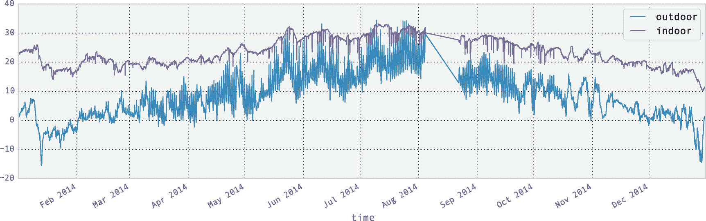

图 12-3

室内和室外温度的时间序列图

```
In [86]: fig, ax = plt.subplots(1, 1, figsize=(12, 4))
...: df1.plot(ax=ax)
...: df2.plot(ax=ax)
```

显示`DataFrame`对象的`info`方法的结果也很有启发性。这样做告诉我们，该数据集中有近 50000 个数据点，并且包含从 2014-01-01 00:03:06 开始到 2014-12-30 23:56:35 结束的数据点：

```
In [87]: df1.info()

DatetimeIndex: 49548 entries, 2014-01-01 00:03:06+01:00 to 2014-12-30 23:56:35+01:00
Data columns (total 1 columns):
outdoor    49548 non-null float64
dtypes: float64(1) memory usage: 774.2 KB
```

时间序列的一个常见操作是选择和提取部分数据。例如，从包含 2014 年全年数据的完整数据集中，我们可能感兴趣的是选择并仅分析一月份的数据。在`pandas`中，我们可以通过多种方式实现这一点。例如，我们可以使用`DataFrame`的布尔索引来为数据子集创建一个`DataFrame`。为了创建选择一月份数据的布尔索引掩码，我们可以利用`pandas`的时间序列特性，这些特性允许我们将时间序列索引与日期和时间的字符串表示进行比较。在下面的代码中，像`df1.index >= "2014-1-1"`这样的表达式（其中`df1.index`是一个`DateTimeIndex`实例）会产生一个布尔 NumPy 数组，该数组可用作掩码来选择所需的元素。

```
In [88]: mask_jan = (df1.index >= "2014-1-1") & (df1.index 
DatetimeIndex: 4452 entries, 2014-01-01 00:03:06+01:00 to 2014-01-31 23:56:58+01:00
Data columns (total 1 columns):
outdoor    4452 non-null float64
dtypes: float64(1) memory usage: 69.6 KB
```

或者，我们可以直接使用日期和时间字符串与切片语法：

```
In [91]: df2_jan = df2["2014-1-1":"2014-1-31"]
```

结果得到两个`DataFrame`对象`df1_jan`和`df2_jan`，它们仅包含一月份的数据。使用`plot`方法绘制原始数据的这个子集，会得到如图 12-4 所示的图表。

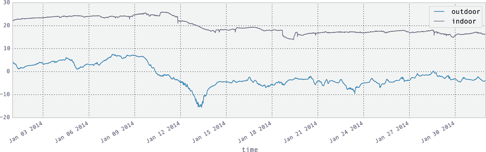

图 12-4

选定月份（一月）室内和室外温度的时间序列图

```
In [92]: fig, ax = plt.subplots(1, 1, figsize=(12, 4))
...: df1_jan.plot(ax=ax)
...: df2_jan.plot(ax=ax)
```


与 Python 标准库中的`datetime`类一样，`pandas`中用于表示时间值的`Timestamp`类拥有访问年、月、日、时、分等字段的属性。这些字段在处理时间序列时特别有用。例如，如果我们要计算一年中每个月的平均温度，可以先创建一个名为`month`的新列，并将其赋值为`DatetimeIndex`索引器中`Timestamp`值的`month`字段。为了从每个`Timestamp`值中提取月份字段，我们首先调用`reset_index`将索引转换为数据框中的一列（此时新的`DataFrame`对象会回退到使用整数索引），然后可以在新创建的`time`列上使用`apply`函数。^(⁵⁷)

| `time`                          | `outdoor` | `month` |
| ------------------------------- | --------- | ------- |
| `2014-01-01 00:03:06+01:00`     | `4.38`    | `1`     |
| `2014-01-01 00:13:06+01:00`     | `4.25`    | `1`     |
| `2014-01-01 00:23:07+01:00`     | `4.19`    | `1`     |
| `2014-01-01 00:33:07+01:00`     | `4.06`    | `1`     |
| `2014-01-01 00:43:08+01:00`     | `4.06`    | `1`     |

```
In [93]: df1_month = df1.reset_index()
In [94]: df1_month["month"] = df1_month.time.apply(lambda x: x.month)
In [95]: df1_month.head()
Out[95]:
```

接下来，我们可以按新的`month`字段对`DataFrame`进行分组，并使用`mean`函数对分组后的值进行聚合，以计算每组内的平均值。

```
In [96]: df1_month = df1_month.groupby("month").aggregate(np.mean)
In [97]: df2_month = df2.reset_index()
In [98]: df2_month["month"] = df2_month.time.apply(lambda x: x.month)
In [99]: df2_month = df2_month.groupby("month").aggregate(np.mean)
```

在对第二个`DataFrame`（室内温度）重复相同过程后，我们可以使用`join`方法将`df1_month`和`df2_month`合并成一个`DataFrame`：

| `time` | `outdoor`  | `indoor`   |
| ------ | ---------- | ---------- |
| `1`    | `-1.776646` | `19.862590` |
| `2`    | `2.231613` | `20.231507` |
| `3`    | `4.615437` | `19.597748` |

```
In [100]: df_month = df1_month.join(df2_month)
In [101]: df_month.head(3)
Out[101]:
```

仅用几行代码，我们就利用了`pandas`的众多数据处理能力来转换和计算数据。通常，有多种方式可以组合`pandas`提供的工具来完成相同或类似的分析。对于当前示例，我们可以使用`to_period`和`groupby`方法以及`concat`函数（与`join`类似，它将多个`DataFrame`合并成一个`DataFrame`），在一行代码中完成整个过程：

| `time`     | `outdoor`  | `indoor`   |
| ---------- | ---------- | ---------- |
| `2014-01`  | `-1.776646` | `19.862590` |
| `2014-02`  | `2.231613` | `20.231507` |
| `2014-03`  | `4.615437` | `19.597748` |

```
In [102]: df_month = pd.concat([df.to_period("M").groupby(level=0).mean() for df in [df1, df2]],
...:                      axis=1)
In [103]: df_month.head(3)
Out[103]:
```

为了可视化结果，我们使用`DataFrame`的`plot`方法绘制月平均温度的条形图和箱线图。结果如图 12-5 所示。

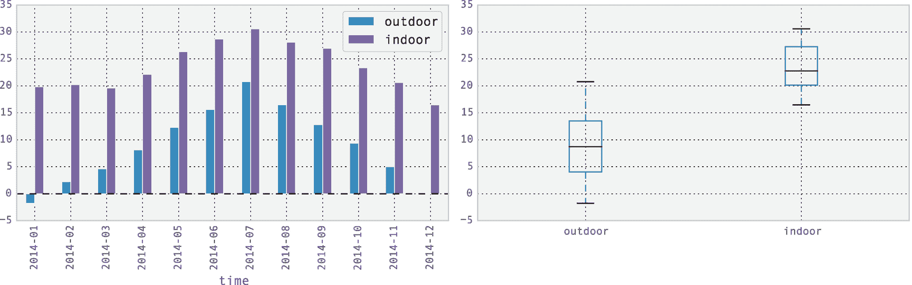

**图 12-5**

月平均室内外温度（左）以及月度室内外温度的箱线图（右）

```
In [104]: fig, axes = plt.subplots(1, 2, figsize=(12, 4))
...: df_month.plot(kind='bar', ax=axes[0])
...: df_month.plot(kind='box', ax=axes[1])
```

最后，`pandas`时间序列对象一个非常有用的特性是能够使用`resample`方法对时间序列进行向上和向下采样。重采样意味着改变时间序列中的数据点数量。它可以增加（向上采样）或减少（向下采样）。对于向上采样，我们需要选择一种填充缺失值的方法；而对于向下采样，则需要选择一种聚合每个新采样点之间多个样本点的方法。`resample`方法期望第一个参数是一个字符串，用于指定重采样后时间序列数据点的新周期。例如，字符串`H`代表一小时周期，字符串`D`代表一天，字符串`M`代表一个月，依此类推。^(⁵⁸) 我们还可以将这些简单表达式组合使用，例如`7D`表示七天的时间段。`resample`方法返回一个重采样器对象，我们可以对其调用`mean`和`sum`等聚合方法来获取重采样后的数据。

为了说明`resample`方法的用途，考虑之前的两个包含温度数据的时间序列。原始采样频率约为 10 分钟，这意味着一年的数据点非常多。出于绘图目的，或者如果我们想比较两个采样时间戳略有不同的时间序列，通常需要对原始数据进行向下采样。这可以生成不那么密集的图表和规则间隔的时间序列，便于相互比较。在以下代码中，我们将室外温度时间序列重采样为四种不同的采样频率并绘制结果。我们还将室外和室内时间序列都重采样为日平均值，然后相减得到全年室内外的日平均温差。这类操作在处理时间序列时非常方便，这也是`pandas`库真正闪耀的众多领域之一。

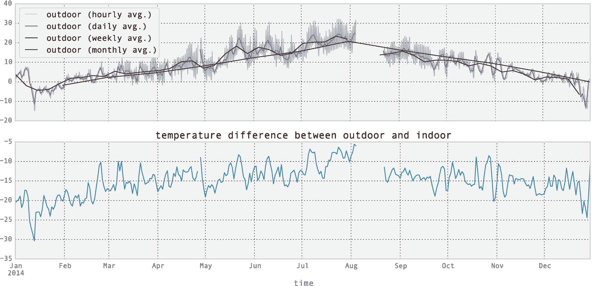

**图 12-6**

重采样为小时、日、周和月平均值的室外温度（上方）。室外和室内的日温差（下方）

```
In [105]: df1_hour = df1.resample("H").mean()
In [106]: df1_hour.columns = ["outdoor (hourly avg.)"]
In [107]: df1_day = df1.resample("D").mean()
In [108]: df1_day.columns = ["outdoor (daily avg.)"]
In [109]: df1_week = df1.resample("7D").mean()
In [110]: df1_week.columns = ["outdoor (weekly avg.)"]
In [111]: df1_month = df1.resample("M").mean()
In [112]: df1_month.columns = ["outdoor (monthly avg.)"]
In [113]: df_diff = (df1.resample("D").mean().outdoor - df2.resample("D").mean().indoor)
In [114]: fig, (ax1, ax2) = plt.subplots(2, 1, figsize=(12, 6))
...: df1_hour.plot(ax=ax1, alpha=0.25)
...: df1_day.plot(ax=ax1)
...: df1_week.plot(ax=ax1)
...: df1_month.plot(ax=ax1)
...: df_diff.plot(ax=ax2)
...: ax2.set_title("temperature difference between outdoor and indoor")
...: fig.tight_layout()
```

作为向上采样的示例，考虑以下例子：我们使用三种不同的聚合方法（`mean`、`ffill`用于前向填充，`bfill`用于后向填充）将数据框`df1`重采样为 5 分钟采样频率。原始采样频率约为 10 分钟，因此这次重采样确实是向上采样。结果得到了三个新的数据框，我们使用`concat`函数将它们合并成一个`DataFrame`对象。下例还展示了该数据框的前五行。请注意，每隔一个数据点就是一个新的样本点，并且根据聚合方法的值，这些值会按照指定的策略被填充（或不填充）。当未选择填充策略时，相应的值将被标记为缺失，使用`NaN`值表示。


| `time` | `None` | `ffill` | `bfill` |
| --- | --- | --- | --- |
| `2014-01-01 00:00:00+01:00` | `4.38` | `4.38` | `4.38` |
| `2014-01-01 00:05:00+01:00` | `NaN` | `4.38` | `4.25` |
| `2014-01-01 00:10:00+01:00` | `4.25` | `4.25` | `4.25` |
| `2014-01-01 00:15:00+01:00` | `NaN` | `4.25` | `4.19` |
| `2014-01-01 00:20:00+01:00` | `4.19` | `4.19` | `4.19` |

```
In [115]: pd.concat(
...:     [df1.resample("5min").mean().rename(columns={"outdoor": 'None'}),
...:      df1.resample("5min").ffill().rename(columns={"outdoor": 'ffill'}),
...:      df1.resample("5min").bfill().rename(columns={"outdoor": 'bfill'})],
...:     axis=1).head()
Out[115]:
```

## Seaborn 图形库

Seaborn 图形库构建于 Matplotlib 之上，提供了在统计和数据分析工作中非常有用的图形生成函数，包括分布图、核密度图、联合分布图、因子图、热力图、分面图以及多种回归可视化方法。它还提供了为图形数据着色的方法和大量精心设计的调色板。Seaborn 库在创建时高度重视其生成图形的美学效果，因此使用该库生成的图形往往既美观又信息丰富。Seaborn 库与底层的 Matplotlib 库的区别在于，它针对特定的应用领域（即统计分析和数据可视化）提供了更高级、更完善的图形函数。利用该库轻松生成标准统计图形的能力，使其成为探索性数据分析中的宝贵工具。

要开始使用 Seaborn 库，我们首先使用 `sns.set` 函数为其生成的图形设置样式。这里我们选择使用名为 `darkgrid` 的样式，该样式会生成带有灰色背景的图形（也可以尝试 `whitegrid` 样式）。

```
In [116]: sns.set(style="darkgrid")
```

导入 `seaborn` 并为该库设置样式会改变 Matplotlib 图形的默认显示设置，包括由 `pandas` 库生成的图形。例如，考虑以下对之前使用的室内外温度时间序列的绘图。生成的图形如图 12-7 所示，尽管该图形是使用 `pandas DataFrame` 的 `plot` 方法生成的，但使用 `sns.set` 函数已经改变了图形的外观（与图 12-3 比较）。

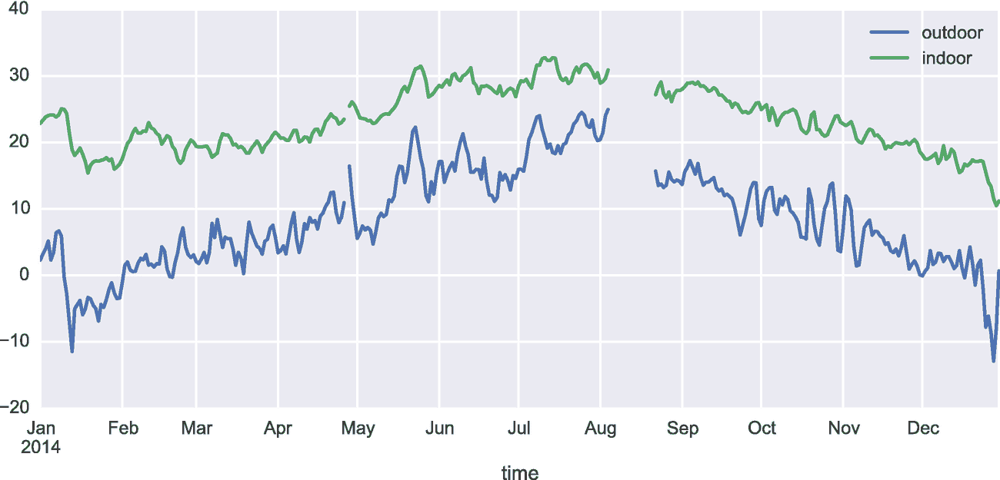

图 12-7

由 Matplotlib 通过 Pandas 库生成的时间序列图，其绘图样式由 Seaborn 库设置。

```
In [117]: df1 = pd.read_csv('temperature_outdoor_2014.tsv', delimiter="\t",
...:                   names=["time", "outdoor"])
...: df1.time = (pd.to_datetime(df1.time.values, unit="s")
...:               .tz_localize('UTC').tz_convert('Europe/Stockholm'))
...: df1 = df1.set_index("time").resample("10min").mean()
In [118]: df2 = pd.read_csv('temperature_indoor_2014.tsv', delimiter="\t",
...:                   names=["time", "indoor"])
...: df2.time = (pd.to_datetime(df2.time.values, unit="s")
...:               .tz_localize('UTC').tz_convert('Europe/Stockholm'))
...: df2 = df2.set_index("time").resample("10min").mean()
In [119]: df_temp = pd.concat([df1, df2], axis=1)
In [120]: fig, ax = plt.subplots(1, 1, figsize=(8, 4))
...: df_temp.resample("D").mean().plot(y=["outdoor", "indoor"], ax=ax)
```

Seaborn 库的主要优势，除了生成漂亮的图形外，还在于其易于使用的统计绘图集合。例如 `kdeplot` 和 `distplot`，它们分别绘制核密度估计图和直方图（并在直方图上叠加核密度估计）。例如，下面两行代码生成如图 12-8 所示的图形。该图中的蓝色和绿色实线是核密度估计，也可以使用 `kdeplot` 函数单独绘制（此处未显示）。

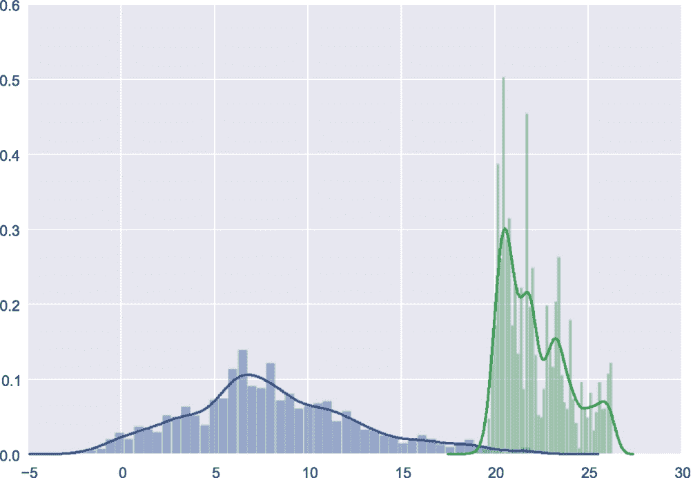

图 12-8

对应于四月份的室内外数据子集的直方图（条形）和核密度图（实线）。

```
In [121]: sns.distplot(df_temp.to_period("M")["outdoor"]["2014-04"].dropna().values, bins=50);
...: sns.distplot(df_temp.to_period("M")["indoor"]["2014-04"].dropna().values, bins=50);
```

`kdeplot` 函数也可以处理二维数据，显示联合核密度估计的等高线图。与此相关，我们可以使用 `jointplot` 函数绘制两个独立数据集的联合分布。在以下示例中，我们使用 `kdeplot` 和 `jointplot` 来展示室内外数据序列之间的相关性，这些数据在可视化之前被重采样为每小时平均值（我们还使用 `dropna` 方法删除了缺失值，因为 `seaborn` 模块中的函数不接受包含缺失数据的数组）。结果显示在图 12-9 中。

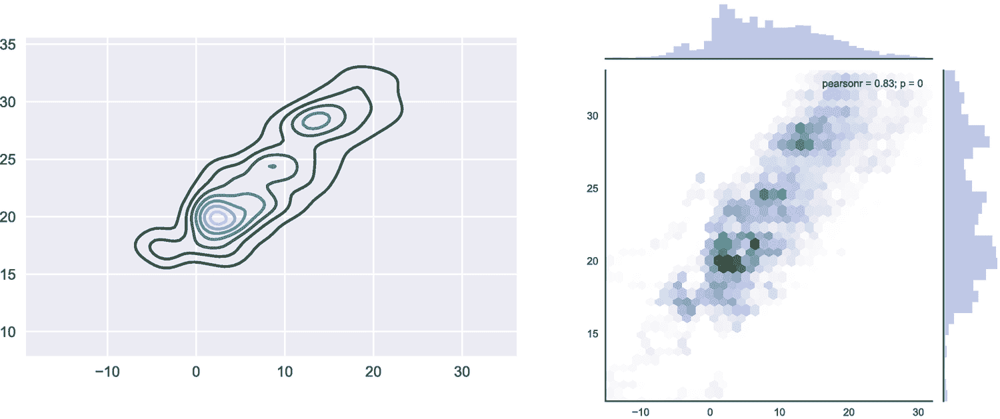

图 12-9

二维核密度估计等高线（左）和室内外温度数据集的联合分布（右）。室外温度显示在 x 轴上，室内温度显示在 y 轴上。

```
In [122]: sns.kdeplot(df_temp.resample("H").mean()["outdoor"].dropna().values,
...:             df_temp.resample("H").mean()["indoor"].dropna().values, shade=False)
In [123]: with sns.axes_style("white"):
...:     sns.jointplot(df_temp.resample("H").mean()["outdoor"].values,
...:                   df_temp.resample("H").mean()["indoor"].values, kind="hex")
```

`seaborn` 库还提供了处理分类数据的函数。对于包含分类变量的数据集，一种简单且常用的图形类型是标准箱线图，用于可视化数据集的描述性统计量（最小值、最大值、中位数和四分位数）。标准箱线图的一个有趣变体是提琴图，其中核密度估计以箱线图的宽度呈现。`boxplot` 和 `violinplot` 函数可用于生成此类图形，如下例所示，生成的图形如图 12-10 所示。

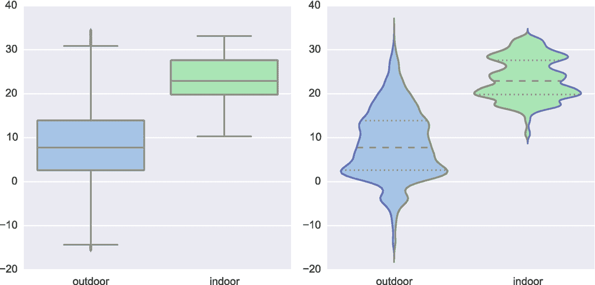

图 12-10

室内外温度数据集的箱线图（左）和提琴图（右）。

```
In [124]: fig, (ax1, ax2) = plt.subplots(1, 2, figsize=(8, 4))
...: sns.boxplot(df_temp.dropna(), ax=ax1, palette="pastel")
...: sns.violinplot(df_temp.dropna(), ax=ax2, palette="pastel")
```

作为提琴图的另一个示例，考虑按月份划分的室外温度数据集，这可以通过将数据框索引的月份字段作为第二个参数（用于将数据分组为类别）来生成。生成的图形如图 12-11 所示，它提供了一种紧凑且信息丰富的可视化，展示了全年每个月份的温度分布。

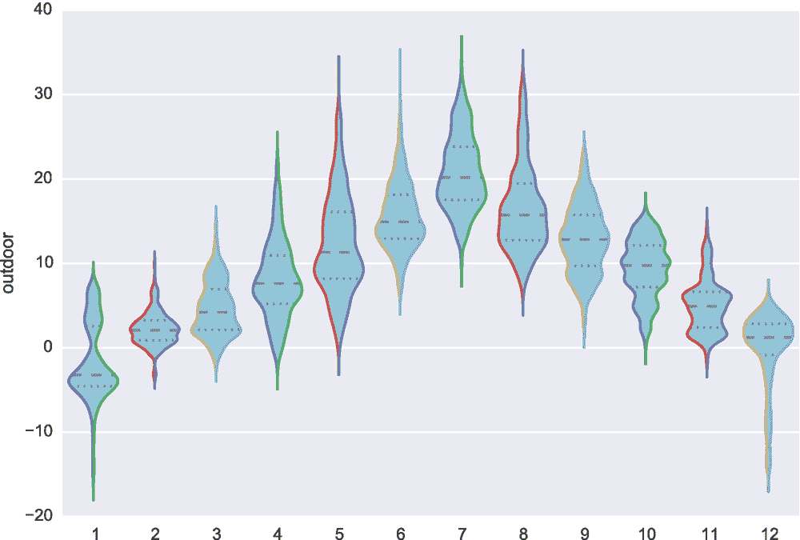

图 12-11

按月份分组的室外温度提琴图。

```
In [125]: sns.violinplot(x=df_temp.dropna().index.month,
...:                y=df_temp.dropna().outdoor, color="skyblue");
```


热力图是另一种处理分类变量（尤其是类别数量较多的变量）时非常有用的图表类型。`Seaborn`库提供了`heatmap`函数用于生成此类图表。例如，在处理室外温度数据集时，我们可以通过从索引中提取`month`和`hour`字段，并将其赋值给数据框中的新列，来创建两个分类列。接下来，我们可以使用`pandas`中的`pivot_table`函数将这些列透视成一个表格（矩阵），其中两个选定的分类变量构成新的索引和列。这里，我们将温度数据集进行透视，使得一天中的小时作为列，一年中的月份作为行（`index`）。为了聚合每个小时-月份类别中的多个数据点，我们使用`aggfunc=np.mean`参数计算所有值的平均值：

```
In [126]: df_temp["month"] = df_temp.index.month
...: df_temp["hour"] = df_temp.index.hour
In [127]: table = pd.pivot_table(df_temp, values="outdoor", index=['month'], columns=['hour'],
...:                        aggfunc=np.mean)
```

一旦创建了透视表，我们就可以使用`Seaborn`中的`heatmap`函数将其可视化为热力图。结果如图 12-12 所示。

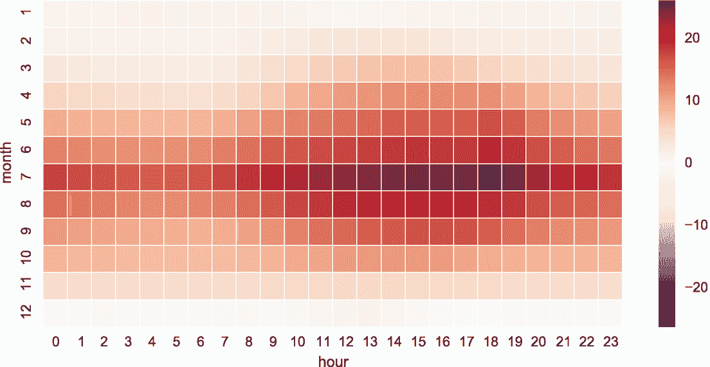

**图 12-12**

按一天中的小时和一年中的月份分组的室外温度数据热力图

```
In [128]: fig, ax = plt.subplots(1, 1, figsize=(8, 4))
...: sns.heatmap(table, ax=ax)
```

`Seaborn`库包含的统计可视化工具远不止我们在此所能概述的这些。然而，我希望通过观察这个库的几个示例，能够阐释`Seaborn`库的精髓——它是一个用于统计分析和数据探索的便捷工具，能够以最少的努力生成许多标准的统计图表。在接下来的章节中，我们将看到`Seaborn`库应用的更多示例。

## 总结

在本章中，我们探讨了使用`Pandas`库进行数据表示和数据处理，并简要了解了`Seaborn`可视化库提供的统计图形工具。`Pandas`库为使用 Python 进行的大多数数据整理工作提供了后端支持。它通过在`NumPy`数组之上的数据表示中添加更高层次的抽象层，以及用于操作底层数据的额外方法来实现这一点。数据加载、转换和操作的便利性使其成为 Python 数据处理流程中不可或缺的一部分。`pandas`库还包含用于可视化其数据结构所表示数据的基本函数。能够快速可视化表示为`Pandas`序列和数据框的数据，是探索性数据分析和数据展示的重要工具。`Seaborn`库更进一步，提供了丰富的统计图形集合，通常只需一行代码即可生成。`Seaborn`库中的许多函数可以直接操作`Pandas`数据结构。

## 延伸阅读

该库的原始创建者 McKinney（2013）对`Pandas`库进行了很好的介绍，同时也相当详细地介绍了`NumPy`。`Pandas`的官方文档（可在[`http://pandas.pydata.org/pandas-docs/stable`](http://pandas.pydata.org/pandas-docs/stable)获取）也对该库的功能提供了易于理解且非常详细的说明。另一个学习`Pandas`的优秀在线资源是[`http://github.com/jvns/pandas-cookbook`](http://github.com/jvns/pandas-cookbook)。在数据可视化方面，我们在本章中介绍了`Seaborn`库，其网站上的文档对此进行了详细描述。关于更高级的可视化工具，也值得探索 Python 的`ggplot`库（[`http://ggplot.yhathq.com`](http://ggplot.yhathq.com)），它基于著名的《图形语法》（L. Wilkinson, 2005）实现。该库也与`Pandas`库紧密集成，并提供在分析数据时方便的统计可视化工具。有关 Python 中可视化方面的更多信息，请参阅例如 Vaingast（2014）。

