# 13. 统计学

统计学长期以来一直是数学的一个领域，与几乎所有应用科学和工程学科，以及商业、医学和其他利用数据获取知识和做出决策的领域都息息相关。随着数据分析的普及，人们对统计方法的兴趣重新高涨。尽管如此，计算机辅助统计学有着悠久的历史，并且传统上一直由特定领域的软件包和编程环境主导，例如 `S` 语言，以及最近出现的其开源对应物：`R` 语言。在过去几年中，使用 `Python` 进行统计分析的应用迅速增长，到现在已经形成了成熟的 `Python` 统计库集合。借助这些库，`Python` 在许多统计学领域（尽管并非全部）可以匹敌特定领域语言的性能和功能，同时还提供了 `Python` 编程语言及其环境的独特优势。我们在第 12 章中讨论的 `Pandas` 库就是 `Python` 社区内一个受统计软件强烈影响的发展实例，它将数据框数据结构引入到了 `Python` 环境中。`NumPy` 和 `SciPy` 库为许多基本统计概念提供了计算工具，更高级的统计建模和机器学习则由 `statsmodels` 和 `scikit-learn` 库涵盖，我们将在接下来的章节中进一步了解这些库。

在本章中，我们重点介绍使用 `Python` 以及特别是 `SciPy` 中的 `stats` 模块进行基本统计应用。我们将讨论描述性统计、随机数、随机变量、分布和假设检验的计算。我们将更复杂的统计建模和机器学习应用留到后续章节。一些基本的统计函数也可以通过 `NumPy` 库获得，例如其用于计算描述性统计的函数和方法，以及用于生成随机数的模块。`SciPy` 的 `stats` 模块建立在 `NumPy` 之上，例如，它提供了具有更专门分布的随机数生成器。

## 导入模块

在本章中，我们主要使用 `SciPy` 中的 `stats` 模块。按照选择性导入 `SciPy` 模块的惯例，我们假设该模块以及 `optimize` 模块按以下方式导入：

```python
In [1]: from scipy import stats
        from scipy import optimize
```

此外，像往常一样，我们还需要 `NumPy` 和 `Matplotlib` 库：

```python
In [2]: import numpy as np
In [3]: import matplotlib.pyplot as plt
```

并且为了统计图形和样式，我们使用 `Seaborn` 库：

```python
In [4]: import seaborn as sns
In [5]: sns.set(style="whitegrid")
```

## 统计学与概率论回顾

我们首先简要回顾统计学，以介绍本书及后续章节中使用的一些关键概念和符号。统计学涉及数据的收集与分析，旨在获取洞见、得出结论并支持决策。当我们对某个现象掌握的信息不完全时，统计方法就不可或缺。通常情况下，我们之所以信息不完全，是因为无法从`总体`中的所有个体收集数据，或者观测结果存在`不确定性`（例如由测量噪声引起）。当无法对完整总体进行调查时，可以转而研究随机选取的`样本`，并运用统计方法计算描述性统计量（如均值和方差等参数），从而以系统化的方式、在可控的误差风险下推断整个总体（也称为`样本空间`）的性质。

统计方法建立在概率论的基础之上。借助概率论，我们可以使用概率随机变量来对不确定性和不完整信息进行建模。例如，从总体中随机抽取样本，我们有望获得具有代表性的样本，并利用其性质推断整个总体的性质。在概率论中，每个可能的观测结果都被赋予一个概率，所有可能结果的概率共同构成概率分布。给定概率分布，我们可以计算总体的性质，如均值和方差；但对于随机选取的样本，我们只能知晓`期望`结果或平均结果。

在统计分析中，区分总体统计量与样本统计量至关重要。本文中，我们使用希腊字母表示总体参数，并在对应的总体符号上加下标 *x*（或表示样本的符号）来表示样本参数。例如，总体的均值和方差用 *μ* 和 *σ*² 表示，而样本 *x* 的均值和方差则记为 *μ*[*x*] 和 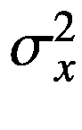。此外，我们用大写字母（如 *X*）表示代表总体的变量（随机变量），用小写字母（如 *x*）表示样本元素的集合。符号上方加横线表示平均值或均值：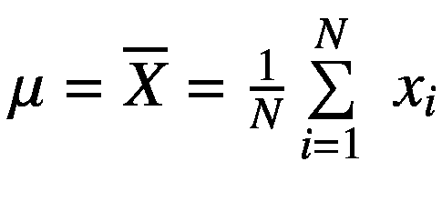 和 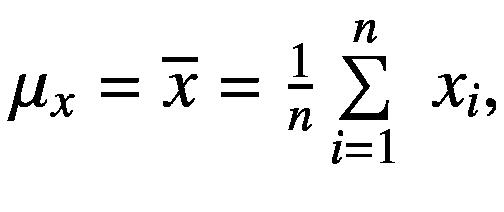，其中 *N* 是总体 *X* 中的元素个数，*n* 是样本 *x* 中的元素个数。这两个表达式唯一的区别在于求和项的数量（*N* ≥ *n*）。方差的计算则稍显复杂：总体方差是各数据点与均值之差的平方的均值，即 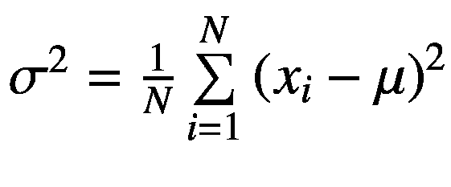；而对应的样本方差为 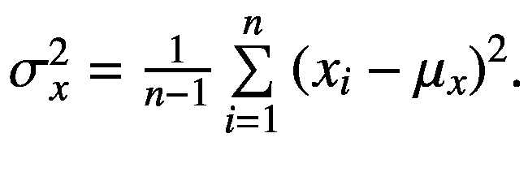。在后一个表达式中，我们将总体均值 *μ* 替换为了样本均值 *μ*[*x*]，并且将分母改为 *n* − 1 而非 *n*。其原因在于，计算样本均值 *μ*[*x*] 时，样本集合已失去一个自由度；因此，计算样本方差时仅剩下 *n* − 1 个自由度。由此，总体方差与样本方差的计算方式略有不同。这一点也体现在 `Python` 中用于计算这些统计量的函数上。

在第 2 章中，我们已经看到可以使用 `NumPy` 函数或对应的 `ndarray` 方法计算数据的描述性统计量。例如，要计算数据集的均值和中位数，可以使用 `NumPy` 的 `mean` 和 `median` 函数：

```python
In [6]: x = np.array([3.5, 1.1, 3.2, 2.8, 6.7, 4.4, 0.9, 2.2])
In [7]: np.mean(x)
Out[7]: 3.1
In [8]: np.median(x)
Out[8]: 3.0
```

类似地，我们可以使用 `min` 和 `max` 函数或 `ndarray` 方法计算数组中的最小值和最大值：

```python
In [9]: x.min(), x.max()
Out[9]: (0.90, 6.70)
```

要计算数据集的方差和标准差，可以使用 `var` 和 `std` 方法。默认情况下，这些方法使用总体方差和标准差的计算公式（即假定数据集代表整个总体）。

```python
In [10]: x.var()
Out[10]: 3.07
In [11]: x.std()
Out[11]: 1.7521415467935233
```

但是，若要改变这一默认行为，我们可以使用参数 `ddof`（自由度差值）。方差表达式中的分母是数组元素个数减去 `ddof`，因此要从样本中计算方差和标准差的无偏估计，需要设置 `ddof=1`：

```python
In [12]: x.var(ddof=1)
Out[12]: 3.5085714285714293
In [13]: x.std(ddof=1)
Out[13]: 1.8731181032095732
```

在接下来的章节中，我们将更详细地探讨如何使用 `NumPy` 和 `SciPy` 的 `stats` 模块来生成随机数、表示随机变量与分布，以及进行假设检验。

## 随机数

`Python` 标准库包含`random`模块，该模块提供了生成几种基本分布的单随机数的函数。`NumPy` 模块中的`random`模块提供了类似的功能，但提供了生成具有随机数的 `NumPy` 数组的函数，并支持更广泛的概率分布。用于计算目的的随机数数组通常很实用，因此这里我们重点介绍 `NumPy` 中的`random`模块，稍后还会介绍`scipy.stats`中更高级的函数和类，它们构建在 `NumPy` 之上并对其进行了扩展。

在本书的前面部分，我们已经使用过`np.random.rand`，它会生成在半开区间 [0, 1) 内均匀分布的浮点数（即，0.0 是可能的结果，但 1.0 不是）。除了这个函数之外，`np.random`模块还包含大量其他用于生成随机数的函数，这些随机数覆盖不同的区间，具有不同的分布，并采用不同类型的值（例如，浮点数和整数）。例如，`randn`函数生成服从`标准正态分布`（均值为 0、标准差为 1 的正态分布）的随机数，而`randint`函数则生成在给定的下限（包含）和上限（不包含）之间均匀分布的整数。当不带任何参数调用`rand`和`randn`函数时，它们会生成单个随机数：

然而，将数组的形状作为参数传递给这些函数，则会生成随机数的数组。例如，这里我们通过向`rand`传递单个参数 5 来生成一个长度为 5 的向量，并通过向`randn`传递 2 和 4 作为参数来生成一个 2 × 4 的数组（通过传递每个维度的长度作为参数来生成更高维度的数组）：

```
In [16]: np.random.rand(5)
Out[16]: array([ 0.71356403,  0.25699895,  0.75269361,  0.88387918,  0.15489908])
In [17]: np.random.randn(2, 4)
Out[17]: array([[ 3.13325952,  1.15727052,  1.37591514,  0.94302846],
[ 0.8478706 ,  0.52969142, -0.56940469,  0.83180456]])
```

要使用`randint`（另请参见`random_integers`）生成随机整数，我们需要提供随机数的上限（在这种情况下，下限隐式为零），或者同时提供下限和上限。生成数组的大小使用`size`关键字参数指定，它可以是一个整数，也可以是一个指定多维数组形状的元组：

```
In [18]: np.random.randint(10, size=10)
Out[18]: array([0, 3, 8, 3, 9, 0, 6, 9, 2, 7])
In [19]: np.random.randint(low=10, high=20, size=(2, 10))
Out[19]: array([[12, 18, 18, 17, 14, 12, 14, 10, 16, 19],
[15, 13, 15, 18, 11, 17, 17, 10, 13, 17]])
```

注意，`randint`函数在半开区间 `[low, high)` 内生成随机整数。为了证明`rand`、`randn`和`randint`产生的随机数确实分布不同，我们可以绘制每个函数生成的 10000 个随机数的直方图。结果显示在图 13-1 中。我们注意到，`rand`和`randint`的分布看起来是均匀的，但具有不同的范围和类型，而`randn`产生的数字分布则类似于以零为中心的高斯曲线，正如预期的那样。

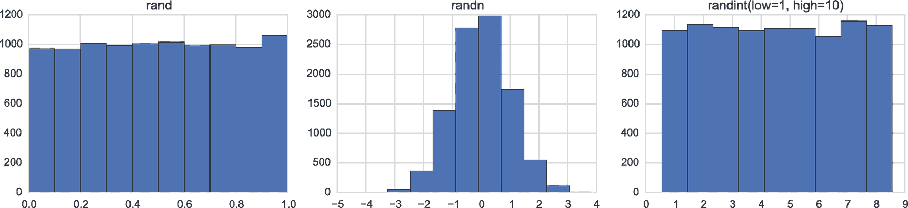

图 13-1

NumPy 的`random`模块中`rand`、`randn`和`randint`函数生成的 10000 个随机数的分布

```
In [20]: fig, axes = plt.subplots(1, 3, figsize=(12, 3))
...: axes[0].hist(np.random.rand(10000))
...: axes[0].set_title("rand")
...: axes[1].hist(np.random.randn(10000))
...: axes[1].set_title("randn")
...: axes[2].hist(np.random.randint(low=1, high=10, size=10000), bins=9, align="left")
...: axes[2].set_title("randint(low=1, high=10)")
```

在统计分析中，通常需要生成唯一的整数列表。这相当于从一个集合（总体）中采样（随机选择）项目且不放回（这样我们就不会两次得到相同的项目）。我们可以使用 NumPy `random`模块中的`choice`函数来生成这种随机数。作为第一个参数，我们可以提供一个包含总体值的列表（或数组），或者一个对应总体中元素数量的整数。作为第二个参数，我们给出要采样的值的数量。是否放回采样可以通过`replace`关键字参数指定，它接受布尔值`True`或`False`。例如，要从 0（包含）到 10（不包含）之间的整数集合中采样五个唯一（不放回）的项目，我们可以使用

```
In [21]: np.random.choice(10, 5, replace=False)
Out[21]: array([9, 0, 5, 8, 1])
```

在处理随机数生成时，为随机数生成器提供*种子*可能会很有用。种子是一个数字，它将随机数生成器初始化为特定状态，因此一旦使用特定数字为其播种，它就会始终生成相同的随机数序列。这在测试、重现先前结果以及在某些需要重新播种随机数生成器的应用（例如，在分叉进程之后）中可能很有用。要为 NumPy 中的随机数生成器播种，我们可以使用`seed`函数，它接受一个整数作为参数：

```
In [22]: np.random.seed(123456789)
In [23]: np.random.rand()
Out[23]: 0.532833024789759
```

注意，在使用特定数字（此处为 123456789）为随机数生成器播种后，后续对随机数生成器的调用将始终产生相同的结果：

```
In [24]: np.random.seed(123456789); np.random.rand()
Out[24]: 0.532833024789759
```

随机数生成器的种子是`np.random`模块的一个全局状态。通过使用`RandomState`类，可以更精细地控制随机数生成器的状态，该类可选地在其初始化器中接受一个种子整数作为参数。`RandomState`对象跟踪随机数生成器的状态，并允许在同一程序中维护多个独立的随机数生成器（例如，在处理线程应用程序时这可能很有用）。一旦创建了`RandomState`对象，我们就可以使用该对象的方法来生成随机数。`RandomState`类具有与`np.random`模块中可用的函数相对应的方法。例如，我们可以使用`RandomState`类的`randn`方法来生成标准正态分布的随机数：

```
In [25]: prng = np.random.RandomState(123456789)
In [26]: prng.randn(2, 4)
Out[26]: array([[ 2.212902,    2.1283978,   1.8417114,   0.08238248],
[ 0.85896368, -0.82601643,  1.15727052,  1.37591514]])
```

类似地，还有`rand`、`randint`、`random_integers`和`choice`方法，它们也与`np.random`模块中同名的函数相对应。使用`RandomState`实例而不是直接使用`np.random`模块中的函数被认为是良好的编程实践，因为它避免依赖全局状态变量并提高了代码的隔离性。在开发使用随机数的库函数时，这是一个重要的考虑因素，但在较小的应用程序和计算中可能不那么重要。

除了我们之前讨论的基本随机数分布（离散和连续均匀分布`randint`和`rand`，以及标准正态分布`randn`）之外，还有大量用于统计学中出现的概率分布的函数和`RandomState`方法。仅举几例，有连续 `χ²` 分布（`chisquare`）、学生 `t` 分布（`standard_t`）和 `F` 分布（`f`）：

```
In [27]: prng.chisquare(1, size=(2, 2))
Out[27]: array([[ 0.78631596,  0.19891367],
[ 0.11741336,  2.8713997 ]])
In [28]: prng.standard_t(1, size=(2, 3))
Out[28]: array([[ 0.39697518, -0.19469463,  1.15544019],
[-0.65730814, -0.55125015,  0.13578694]])
In [29]: prng.f(5, 2, size=(2, 4))
Out[29]: array([[  0.45471421,  17.64891848,   1.48620557,   2.55433261],
[  1.21823269,   3.47619315,   0.50835525,   0.70599655]])
```

以及离散二项分布（`binomial`）和泊松分布（`poisson`）：

```
有关可用分布函数的完整列表，请参阅 `np.random` 模块的文档字符串、`help(np.random)` 以及 `RandomState` 类。虽然可以使用 `np.random` 中的函数和 `RandomState` 中的方法从许多不同的统计分布函数中抽取随机数，但在处理分布时，`scipy.stats` 模块提供了一个更高级的接口，它将随机数抽样与许多其他便捷的概率分布函数结合在一起。在下一节中，我们将更详细地探讨这一点。

## 随机变量与分布

在概率论中，随机过程所有可能结果的集合称为 `样本空间`。样本空间中的每个元素（即实验或观察的结果）都可以被赋予一个概率，所有可能结果的概率定义了概率分布。`随机变量` 是从样本空间到实数或整数的映射。例如，抛硬币的可能结果是正面和反面，因此样本空间为 {正面，反面}，一个可能的随机变量对正面取值为 0，对反面取值为 1。通常，对于给定随机过程的可能结果，有多种定义随机变量的方法。随机变量是随机过程的与问题无关的表示。使用随机变量更容易，因为它们用数字描述，而不是来自特定问题样本空间的结果。因此，统计问题解决中的一个常见步骤是将结果映射到数值，并找出这些数值的概率分布。

因此，随机变量的特征在于其可能取值及其概率分布，概率分布为每个可能值分配一个概率。每次对随机变量的观察都会产生一个随机数，观察值的分布由概率分布描述。分布主要有两种类型：离散分布和连续分布，分别取值整数和实数。在处理统计学问题时，处理随机变量至关重要，而在实践中，这通常意味着处理概率分布。SciPy 的 `stats` 模块提供了表示随机变量的类，这些类支持大量的概率分布。离散和连续随机变量有两个基类：`rv_discrete` 和 `rv_continuous`。这些类不直接使用，而是作为具有特定分布的随机变量的基类，并为 SciPy `stats` 中的所有随机变量类定义了一个通用接口。表 13-1 总结了离散和连续随机变量的部分方法。

**表 13-1** SciPy `stats` 模块中离散与连续随机变量的部分方法

| 方法 | 描述 |
| --- | --- |
| `pdf/pmf` | 概率分布函数（连续）或概率质量函数（离散）。 |
| `cdf` | 累积分布函数。 |
| `sf` | 生存函数（1 – `cdf`）。 |
| `ppf` | 百分点函数（`cdf` 的逆函数）。 |
| `moment` | *n*阶非中心矩。 |
| `stats` | 分布的统计量（通常为均值和方差，有时包括其他统计量）。 |
| `fit` | 使用数值最大似然优化将分布拟合到数据（适用于连续分布）。 |
| `expect` | 函数关于分布的期望值。 |
| `interval` | 包含给定分布百分比的区间端点（置信区间）。 |
| `rvs` | 随机变量样本。参数为结果样本数组的大小。 |
| `mean`、`median`、`std`、`var` | 描述性统计量：分布的均值、中位数、标准差和方差。 |

SciPy 的 `stats` 模块中有大量用于离散和连续随机变量的类。在撰写本文时，共有 13 个离散分布类和 98 个连续分布类，这些涵盖了最常见的分布（以及许多不太常见的分布）。有关完整参考，请参阅 `stats` 模块的文档字符串：`help(stats)`。下面我们将探索一些更常见的分布，但所有其他分布的使用都遵循相同的模式。

SciPy `stats` 模块中的随机变量类有多种用途。它们既是分布的表示，可用于计算描述性统计和绘图，也可以用于使用 `rvs`（随机变量样本）方法生成遵循给定分布的随机数。后一种用途类似于我们在本章前面使用 `np.random` 模块所做的操作。

作为如何使用 SciPy `stats` 中随机变量类的演示，请考虑以下示例，其中我们创建了一个均值为 1.0、标准差为 0.5 的正态分布随机变量：

```
In [32]: X = stats.norm(1, 0.5)
```

现在 `X` 是一个表示随机变量的对象，我们可以使用例如 `mean`、`median`、`std` 和 `var` 方法计算该随机变量的描述性统计量：

```
In [33]: X.mean()
Out[33]: 1.0
In [34]: X.median()
Out[34]: 1.0
In [35]: X.std()
Out[35]: 0.5
In [36]: X.var()
Out[36]: 0.25
```

任意阶的非中心矩可以使用 `moment` 方法计算：

```
In [37]: [X.moment(n) for n in range(5)]
Out[37]: [1.0, 1.0, 1.25, 1.75, 2.6875]
```

我们可以使用 `stats` 方法获取一个依赖分布的统计量列表（此处，对于正态分布随机变量，我们得到均值和方差）：

```
In [38]: X.stats()
Out[38]: (array(1.0), array(0.25))
```

我们可以使用方法 `pdf`、`cdf`、`sf` 等评估概率分布函数、累积分布函数、生存函数等。这些方法都接受一个值或一个值数组，用于评估函数：

```
In [39]: X.pdf([0, 1, 2])
Out[39]: array([ 0.10798193,  0.79788456,  0.10798193])
In [40]: X.cdf([0, 1, 2])
Out[40]: array([ 0.02275013,  0.5,         0.97724987])
```

`interval` 方法可用于计算 *x* 的下限和上限值，使得给定百分比的概率分布落在区间 `(lower, upper)` 内。该方法对于计算置信区间和为绘图选择 *x* 值的范围非常有用：

```
In [41]: X.interval(0.95)
Out[41]: (0.020018007729972975, 1.979981992270027)
In [42]: X.interval(0.99)
Out[42]: (-0.28791465177445019, 2.2879146517744502)
```

为了直观理解概率分布的性质，将其与相应的累积概率函数和百分点函数一起绘制是很有用的。为了更容易地对多个分布重复此操作，我们首先创建一个函数 `plot_rv_distribution`，该函数在包含 99.9% 概率分布函数的区间上，绘制 SciPy `stats` 随机变量对象的 `pdf` 或 `pmf`、`cdf` 和 `sf` 以及 `ppf` 方法的结果。我们还会使用 `fill_between` 绘图方法突出显示包含 95% 概率分布的区域：

```
In [43]: def plot_rv_distribution(X, axes=None):
...:     """绘制给定随机变量的 PDF 或 PMF、CDF、SF 和 PPF"""
...:     if axes is None:
...:         fig, axes = plt.subplots(1, 3, figsize=(12, 3))
...:
...:     x_min_999, x_max_999 = X.interval(0.999)
...:     x999 = np.linspace(x_min_999, x_max_999, 1000)
...:     x_min_95, x_max_95 = X.interval(0.95)
...:     x95 = np.linspace(x_min_95, x_max_95, 1000)
...:
...:     if hasattr(X.dist, "pdf"):
...:         axes[0].plot(x999, X.pdf(x999), label="PDF")
...:         axes[0].fill_between(x95, X.pdf(x95), alpha=0.25)
...:     else:
...:         # 离散随机变量没有 pdf 方法，而是使用 pmf：
...:         x999_int = np.unique(x999.astype(int))
...:         axes[0].bar(x999_int, X.pmf(x999_int), label="PMF")
...:     axes[1].plot(x999, X.cdf(x999), label="CDF")
...:     axes[1].plot(x999, X.sf(x999), label="SF")
...:     axes[2].plot(x999, X.ppf(x999), label="PPF")
...:
...:     for ax in axes:
...:         ax.legend()
```
```

接下来，我们使用此函数绘制几个分布示例：正态分布、`F`分布和离散泊松分布。结果如图 13-2 所示。

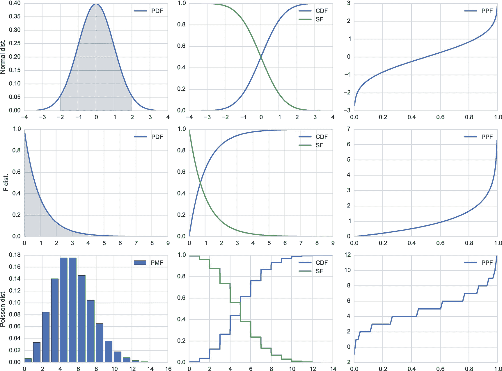

图 13-2 正态分布（顶部）、`F`分布（中间）和泊松分布（底部）的概率分布函数（PDF）或概率质量函数（PMF）、累积分布函数（CDF）、生存函数（SF）和百分点函数（PPF）示例

```python
In [44]: fig, axes = plt.subplots(3, 3, figsize=(12, 9))
        X = stats.norm()
        plot_rv_distribution(X, axes=axes[0, :])
        axes[0, 0].set_ylabel("正态分布")
        X = stats.f(2, 50)
        plot_rv_distribution(X, axes=axes[1, :])
        axes[1, 0].set_ylabel("F 分布")
        X = stats.poisson(5)
        plot_rv_distribution(X, axes=axes[2, :])
        axes[2, 0].set_ylabel("泊松分布")
```

在到目前为止的示例中，我们实例化了一个随机变量类，并通过方法调用计算了统计量和其他属性。另一种使用 SciPy `stats` 模块中随机变量类的方式是使用类方法，例如 `stats.norm.mean`，并将分布参数作为参数传递（通常为 `loc` 和 `scale`，如本例中针对正态分布值）：

```python
In [45]: stats.norm.stats(loc=2, scale=0.5)
Out[45]: (array(2.0), array(0.25))
```

这等同于先创建实例再调用相应方法：

```python
In [46]: stats.norm(loc=1, scale=0.5).stats()
Out[46]: (array(1.0), array(0.25))
```

`rv_discrete` 和 `rv_continuous` 类中的大多数方法都可以以这种类方法的方式使用。

到目前为止，我们只研究了随机变量分布函数的性质。请注意，尽管分布函数描述了随机变量，但分布本身是完全确定的。要抽取遵循给定概率分布的随机数，我们可以使用 `rvs`（随机变量样本）方法。它接受所需数组的形状作为参数（对于向量可以是整数，对于更高维数组可以是维度长度的元组）。这里我们使用 `rvs(10)` 生成一个包含十个值的一维数组：

```python
In [47]: X = stats.norm(1, 0.5)
In [48]: X.rvs(10)
Out[48]: array([2.106451,    2.0641989,   1.9208557,  1.04119124,  1.42948184,
        0.58699179,  1.57863526,  1.68795757, 1.47151423,  1.4239353 ])
```

为了验证生成的随机数确实遵循相应的概率分布函数，我们可以绘制大量随机变量样本的直方图，并将其与概率分布函数进行比较。再次强调，为了能够轻松地对多个随机变量的样本执行此操作，我们为此目的创建了一个函数 `plot_dist_samples`。该函数使用 `interval` 方法为给定的随机变量对象获取合适的绘图范围。

```python
In [49]: def plot_dist_samples(X, X_samples, title=None, ax=None):
            """绘制连续随机变量的 PDF 和样本的直方图"""
            if ax is None:
                 fig, ax = plt.subplots(1, 1, figsize=(8, 4))

            x_lim = X.interval(.99)
            x = np.linspace(*x_lim, num=100)

            ax.plot(x, X.pdf(x), label="PDF", lw=3)
            ax.hist(X_samples, label="样本", normed=1, bins=75)
            ax.set_xlim(*x_lim)
            ax.legend()

            if title:
                ax.set_title(title)
            return ax
```

请注意，在此函数中，我们使用了元组解包语法 `*x_lim`，它将元组 `x_lim` 中的元素分发到函数的各个参数中。在这种情况下，它等价于 `np.linspace(x_lim[0], x_lim[1], num=100)`。

接下来我们使用此函数可视化 2000 个来自三种不同分布的随机变量样本：这里我们使用学生 `t` 分布、`χ²` 分布和指数分布，结果如图 13-3 所示。由于 2000 个样本是相当大的样本量，样本的直方图与概率分布函数吻合良好。如果样本量更大，可以预期吻合度会更高。

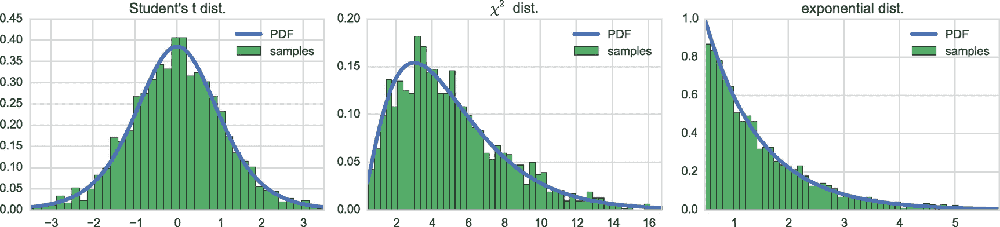

**图 13-3** 概率分布函数（PDF）与来自学生 `t` 分布（左）、`χ²` 分布（中）和指数分布（右）的 2000 个随机样本的直方图

```python
In [50]: fig, axes = plt.subplots(1, 3, figsize=(12, 3))
        N = 2000
        # Student's t distribution
        X = stats.t(7.0)
        plot_dist_samples(X, X.rvs(N), "Student's t dist.", ax=axes[0])
        # The chisquared distribution
        X = stats.chi2(5.0)
        plot_dist_samples(X, X.rvs(N), r"$\chi²$ dist.", ax=axes[1])
        # The exponential distribution
        X = stats.expon(0.5)
        plot_dist_samples(X, X.rvs(N), "exponential dist.", ax=axes[2])
```

从已知分布函数中抽取随机样本的逆过程是：将具有未知参数的概率分布拟合到一组数据点上。在这种拟合中，我们通常希望优化未知参数，使得观测到给定数据的可能性最大化。这被称为**最大似然拟合**。SciPy `stats` 模块中的许多随机变量类实现了 `fit` 方法，该方法可以对给定数据执行此类拟合。作为第一个示例，考虑从自由度为 5（`df=5`）的 `χ²` 分布中抽取 500 个随机样本，然后使用 `fit` 方法将这些随机变量重新拟合到 `χ²` 分布。

```python
In [51]: X = stats.chi2(df=5)
In [52]: X_samples = X.rvs(500)
In [53]: df, loc, scale = stats.chi2.fit(X_samples)
In [54]: df, loc, scale
Out[54]: (5.2886783664198465, 0.0077028130326141243, 0.93310362175739658)
In [55]: Y = stats.chi2(df=df, loc=loc, scale=scale)
```

`fit` 方法返回给定数据的分布的最大似然参数。我们可以将这些参数传递给 `stats.chi2` 的初始化器，以创建一个新的随机变量实例 `Y`。`Y` 的概率分布应与原始随机变量 `X` 的概率分布相似。为了验证这一点，我们可以绘制两个随机变量的概率分布函数。结果图如图 13-4 所示。

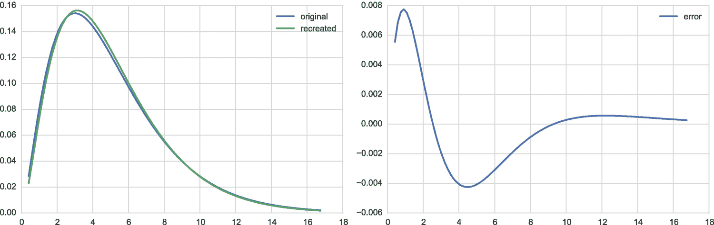

**图 13-4** 原始和重建的概率分布函数（左）及其误差（右），基于对原始分布的 500 个随机样本进行的最大似然拟合

```
In [56]:  fig, axes = plt.subplots(1, 2, figsize=(12, 4))
...: x_lim = X.interval(.99)
...: x = np.linspace(*x_lim, num=100)
...:
...: axes[0].plot(x, X.pdf(x), label="original")
...: axes[0].plot(x, Y.pdf(x), label="recreated")
...: axes[0].legend()
...:
...: axes[1].plot(x, X.pdf(x) - Y.pdf(x), label="error")
...: axes[1].legend()
```

在本节中，我们探讨了如何使用 SciPy `stats` 模块中的随机变量对象来描述具有各种分布的随机变量，以及如何使用它们计算给定分布的属性，以及生成随机变量样本和执行最大似然拟合。在下一节中，我们将了解如何进一步使用这些随机变量对象进行假设检验。

## 假设检验

假设检验是科学方法的基石，它要求对主张进行客观调查，并基于事实观察来拒绝或接受主张。统计假设检验具有更具体的含义。它是一种系统性的方法论，用于基于数据评估某个主张或假设是否合理。因此，它是统计学的一个重要应用。在这种方法中，我们以零假设（`H[0]`）的形式表述假设，它代表当前公认的知识状态；以及备择假设（`H[A]`），它代表挑战当前知识状态的新主张。零假设和备择假设必须互斥且互补，因此有且仅有一个假设为真。

一旦定义了 `H[0]` 和 `H[A]`，就必须收集支持检验的数据，例如通过测量、观察或调查。下一步是找到一个检验统计量，该统计量可以从数据中计算得出，并且其概率分布函数可以在零假设下找到。接下来，我们可以通过计算在零假设下获得检验统计量观测值（或更极端值）的概率（`p` 值）来评估数据。如果 `p` 值小于预定阈值（称为显著性水平，记为 `α`，通常为 5%或 1%），我们可以得出结论：观测到的数据不太可能由零假设对应的分布描述。在这种情况下，我们可以拒绝零假设，转而支持备择假设。执行假设检验的步骤总结如下：

1. 明确零假设和备择假设。
2. 选择一个检验统计量，使其在零假设下的抽样分布已知（精确或近似）。
3. 收集数据。
4. 根据数据计算检验统计量，并计算其在零假设下的 `p` 值。
5. 如果 `p` 值小于预先确定的显著性水平 `α`，则拒绝零假设。如果 `p` 值较大，则无法拒绝零假设。

统计假设检验是一种概率方法，这意味着我们无法确定拒绝或不拒绝零假设的决定是否正确。可能存在两种类型的错误：当零假设实际上不应被拒绝时，我们错误地拒绝了它；以及当零假设应被拒绝时，我们未能拒绝它。这两种错误分别称为第一类错误和第二类错误。通过选择合适的显著性水平，我们可以在这两种错误之间进行权衡。

通常，前述方法中最具挑战性的步骤是了解检验统计量的抽样分布。幸运的是，许多假设检验属于少数几个标准类别，这些类别的概率分布是已知的。常见假设检验案例及其相应检验统计量分布的简要总结和概述见表 13-2。关于为什么每个检验适用于所述情况以及检验有效性的完整条件集的动机，请参阅统计学教科书，例如 Wasserman (2004) 或 Rice (1995)。SciPy `stats` 模块中每个列出函数的文档字符串也包含有关每个检验的进一步信息。

**表 13-2**

常见假设检验案例及其相应分布和 SciPy 函数总结

| 零假设 | 分布 | SciPy 检验函数 |
| --- | --- | --- |
| 检验总体均值是否等于给定值。 | 正态分布（`stats.norm`），或学生 *t* 分布（`stats.t`） | `stats.ttest_1samp` |
| 检验两个随机变量的均值是否相等（独立样本或配对样本）。 | 学生 *t* 分布（`stats.t`） | `stats.ttest_ind`, `stats.ttest_rel` |
| 检验连续分布是否与数据拟合良好。 | 柯尔莫戈洛夫-斯米尔诺夫分布 | `stats.kstest` |
| 检验分类数据是否以给定频率出现（正态分布变量的平方和）。 | χ² 分布（`stats.chi2`） | `stats.chisquare` |
| 检验列联表中分类变量的独立性。 | χ² 分布（`stats.chi2`） | `stats.chi2_contingency` |
| 检验两个或多个变量的样本方差是否相等。 | *F* 分布（`stats.f`） | `stats.bartlett`, `stats.levene` |
| 检验两个变量之间是否不相关。 | Beta 分布（`stats.beta`, `stats.mstats.betai`） | `stats.pearsonr`, `stats.spearmanr` |
| 检验两个或多个变量是否具有相同的总体均值（ANOVA-方差分析）。 | *F* 分布 | `stats.f_oneway`, `stats.kruskal` |

下面，我们还将通过示例展示如何使用 SciPy `stats` 模块中的相应函数来执行前面给出的步骤 4 和步骤 5：计算检验统计量和相应的 `p` 值。

例如，一个常见的零假设是声称总体均值 `μ` 等于某个值 `μ[0]`。然后我们可以对总体进行抽样，并使用样本均值 `\overline{x}` 来形成一个检验统计量 `z = (\overline{x} - μ_0) / (σ / √n)`，其中 `n` 是样本量。如果总体很大且方差 `σ` 已知，那么可以合理地假设检验统计量服从正态分布。如果方差未知，我们可以用样本方差 `σ_x²` 代替 `σ²`。那么检验统计量服从学生 `t` 分布，当样本量足够大时，该分布趋近于正态分布。无论我们最终使用哪种分布，我们都可以利用该分布计算出检验统计量的 `p` 值。

以下示例展示了如何使用 SciPy `stats` 模块提供的函数执行此类假设检验。考虑一个零假设，它声称随机变量 `X` 的均值 `μ[0] = 1`。给定 `X` 的样本，我们希望检验样本数据是否与零假设一致。这里我们通过从与零假设声称的分布略有不同的分布中抽取 100 个随机样本来模拟样本（使用 `μ = 0.8`）：

```
In [57]: mu0, mu, sigma = 1.0, 0.8, 0.5
In [58]: X = stats.norm(mu, sigma)
In [59]: n = 100
In [60]: X_samples = X.rvs(n)
```

有了样本数据 `X_samples`，接下来我们需要计算一个检验统计量。如果本例中总体标准差 `σ` 已知，我们可以使用 `z = (\overline{x} - μ_0) / (σ / √n)`，它服从正态分布。

```
In [61]: z = (X_samples.mean() - mu0)/(sigma/np.sqrt(n))
In [62]: z
Out[62]: -2.8338979550098298
```

如果总体方差未知，我们可以使用样本标准差代替：`t = (\overline{x} - μ) / (σ_x / √n)`。不过在这种情况下，检验统计量 `t` 服从学生 `t` 分布，而不是正态分布。要计算此时的 `t`，我们可以使用 NumPy 的 `std` 方法，并加上 `ddof=1` 参数来计算样本标准差：

```
In [63]: t = (X_samples.mean() - mu0)/(X_samples.std(ddof=1)/np.sqrt(n))
In [64]: t
Out[64]: -2.9680338545657845
```

无论哪种情况，我们都能得到一个检验统计量，可以将其与相应的分布进行比较，以获得 `p` 值。例如，对于正态分布，我们可以使用 `stats.norm` 实例来表示一个正态分布的随机变量，并通过其 `ppf` 方法查找对应于某个显著性水平的统计量值。对于一个显著性水平为 5%（每侧 2.5%）的双侧假设检验，统计量的阈值为：

```
In [65]: stats.norm().ppf(0.025)
Out[65]: -1.9599639845400545
```

由于观测到的统计量约为 -2.83，小于对于显著性水平 5%的双侧检验阈值 -1.96，因此我们在此案例中有充分理由拒绝零假设。我们可以使用 `cdf` 方法（对于双侧检验，结果乘以 2）明确计算观测检验统计量的 `p` 值。得到的 `p` 值确实很小，这支持了拒绝零假设的结论：

```
In [66]: 2 * stats.norm().cdf(-abs(z))
Out[66]: 0.0045984013290753566
```

如果我们希望使用 `t` 分布，可以用 `stats.t` 类代替 `stats.norm`。计算样本均值 `\overline{x}` 后，样本数据中只剩下 `n − 1` 个自由度（`df`）。自由度数量是 `t` 分布的一个重要参数，在创建随机变量实例时需要指定：
```

# 假设检验与参数方法

```
In [67]: 2 * stats.t(df=(n-1)).cdf(-abs(t))
Out[67]: 0.0037586479674227209
```

这里的 *p* 值同样非常小，表明我们应该拒绝零假设。除了显式执行这些步骤（计算检验统计量，然后计算 *p* 值）外，SciPy 的 `stats` 模块还内置了许多常用检验的函数，如表 13-2 所总结。对于我们这里使用的检验，可以直接使用 `stats.ttest_1samp` 函数计算检验统计量和 *p* 值：

```
In [68]: t, p = stats.ttest_1samp(X_samples, mu)
In [69]: t
Out[69]: -2.9680338545657841
In [70]: p
Out[70]: 0.0037586479674227209
```

再次看到 *p* 值非常小（与上文中的值相同），我们应该拒绝零假设。同时，绘制对应于零假设的分布以及样本数据（见图 13-5）也具有说明意义：

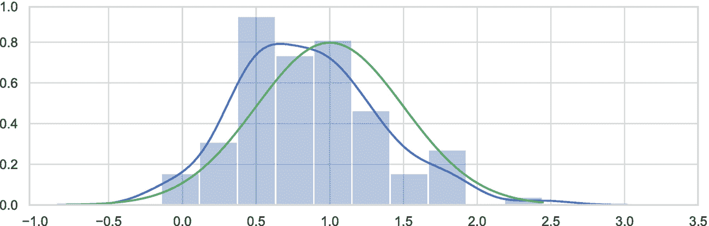

图 13-5

根据零假设的分布函数（浅绿色）和样本估计的分布函数（深蓝色）。

```
In [71]: fig, ax = plt.subplots(figsize=(8, 3))
...: sns.distplot(X_samples, ax=ax)
...: x = np.linspace(*X.interval(0.999), num=100)
...: ax.plot(x, stats.norm(loc=mu, scale=sigma).pdf(x))
```

再举一个例子，考虑一个双变量问题，其中零假设声称两个随机变量的总体均值相等（例如，对应接受治疗和未接受治疗的独立受试者）。我们可以通过创建两个具有正态分布、总体均值随机选取的随机变量来模拟这种检验。这里我们为每个随机变量选择 50 个样本。

```
In [72]: n, sigma = 50, 1.0
In [73]: mu1, mu2 = np.random.rand(2)
In [74]: X1 = stats.norm(mu1, sigma)
In [75]: X1_sample = X1.rvs(n)
In [76]: X2 = stats.norm(mu2, sigma)
In [77]: X2_sample = X2.rvs(n)
```

## 假设检验

我们关注的是评估观测样本是否提供了充分证据，证明两个总体均值不相等（拒绝原假设）。针对这种情况，我们可以使用适用于两个独立样本的 `t` 检验，该检验在 SciPy 中可通过 `stats.ttest_ind` 实现，它会返回检验统计量及相应的 `p` 值：

```
In [78]: t, p = stats.ttest_ind(X1_sample, X2_sample)
In [79]: t
Out[79]: -1.4283175246005888
In [80]: p
Out[80]: 0.15637981059673237
```

这里的 `p` 值约为 0.156，不足以支持拒绝两个均值存在差异的原假设。在本例中，两个总体均值实际上确实不同：

```
In [81]: mu1, mu2
Out[81]: (0.24764580637159606, 0.42145435527527897)
```

然而，从这些分布中抽取的特定样本并未在统计学上证明这些均值存在差异（第二类错误）。要提高统计检验的效力，我们需要增加每个随机变量的样本数量。

SciPy 的 `stats` 模块包含了常见类型假设检验的函数（参见表 13-2 的总结），其使用方法与我们在此节示例中看到的非常相似。不过，某些检验需要为分布参数提供额外参数。详情请参阅各检验函数的文档字符串。

## 非参数方法

到目前为止，我们所描述的随机变量其分布完全由少数参数决定，例如正态分布的均值和方差。给定采样数据后，我们可以通过针对分布参数进行最大似然优化来拟合分布函数。这类分布函数被称为*参数化*分布函数，而基于此类分布函数的统计方法（例如假设检验）则被称为*参数方法*。使用这些方法时，我们做了一个很强的假设：采样数据确实服从给定的分布。构建未知分布函数表示的另一种方法是*核密度估计*（KDE），它可被视为采样数据直方图的平滑版本（例如，见图 13-6）。该方法中，概率分布通过以每个数据点为中心的核函数之和来估计：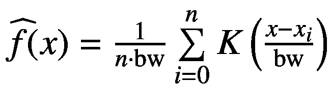，其中 `bw` 是一个自由参数，称为带宽，而 `K` 是核函数（已归一化，使其积分总和为 1）。带宽是一个重要参数，它定义了求和项中每一项影响范围的尺度。带宽过宽会导致概率分布估计丢失特征，而过窄则会产生噪声大、结构过于复杂的估计（见图 13-6 中间的图）。也可以选择不同的核函数。高斯核因其光滑的局部支撑形状而成为一种常用选择，并且相对容易进行计算。

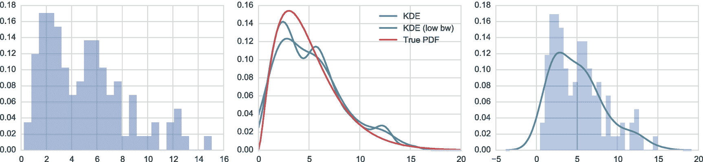

**图 13-6** 直方图（左）、分布函数的核密度估计（中）、以及在同一张图上的直方图和核密度估计（右）

在 SciPy 中，使用高斯核的 KDE 方法在函数 `stats.kde.gaussian_kde` 中实现。该函数返回一个可调用对象，该对象的行为类似于概率分布函数，并且可以像概率分布函数一样使用。例如，考虑一组从分布未知的随机变量 `X` 中抽取的样本 `X_samples`（此处使用自由度为 5 的 *χ*² 分布模拟）：

```
In [82]: X = stats.chi2(df=5)
In [83]: X_samples = X.rvs(100)
```

为了计算给定数据的核密度估计，我们调用函数 `stats.kde.gaussian_kde`，并将样本点数组作为参数传入：

```
In [84]: kde = stats.kde.gaussian_kde(X_samples)
```

默认情况下，会使用一种计算合适带宽的标准方法，通常能得到可接受的结果。然而，如果我们愿意，也可以使用 `bw_method` 参数指定一个计算带宽的函数，或者直接设置带宽。例如，要设置一个较小的带宽，我们可以使用：

```
In [85]: kde_low_bw = stats.kde.gaussian_kde(X_samples, bw_method=0.25)
```

`gaussian_kde` 函数返回一个分布函数的估计，我们可以将其绘制成图表或用于其他应用。这里，我们绘制了数据的直方图和两种核密度估计（使用默认带宽与显式设置带宽）。作为参考，我们还绘制了样本的真实概率分布函数。结果如图 13-6 所示。

```
In [86]: x = np.linspace(0, 20, 100)
```

```
In [87]: fig, axes = plt.subplots(1, 3, figsize=(12, 3))
...: axes[0].hist(X_samples, normed=True, alpha=0.5, bins=25)
...: axes[1].plot(x, kde(x), label="KDE")
...: axes[1].plot(x, kde_low_bw(x), label="KDE (low bw)")
...: axes[1].plot(x, X.pdf(x), label="True PDF")
...: axes[1].legend()
...: sns.distplot(X_samples, bins=25, ax=axes[2])
```

统计图形库 `seaborn` 提供了一个便捷函数 `distplot`，用于绘制一组数据的直方图和核密度估计。该函数生成的图形如图 13-6 的右侧面板所示。

给定核密度估计后，我们还可以使用 `resample` 方法生成新的随机数，该方法将数据点数量作为参数：

```
In [88]: kde.resample(10)
Out[88]: array([[1.75376869,  0.5812183,  8.19080268,  1.38539326,  7.56980335,
1.16144715,  3.07747215,  5.69498716,  1.25685068,  9.55169736]])
```

核密度估计对象不直接包含计算累积分布函数（CDF）及其反函数——百分点函数（PPF）的方法。但有一些方法可以对概率密度函数的核密度估计进行积分。例如，对于一维 KDE，我们可以使用 `integrate_box_1d` 来获取对应的 CDF：

在本节中，我们完成了核密度估计的累积分布函数（CDF）与百分位点函数（PPF）的计算。

```python
In [89]: def _kde_cdf(x):
...:     return kde.integrate_box_1d(-np.inf, x)
In [90]: kde_cdf = np.vectorize(_kde_cdf)
```

并且可以使用SciPy的`optimize.fsolve`函数来求其反函数（PPF）：

```python
In [91]: def _kde_ppf(q):
...:     return optimize.fsolve(lambda x, q: kde_cdf(x) - q, kde.dataset.mean(), args=(q,))[0]
...:
In [92]: kde_ppf = np.vectorize(_kde_ppf)
```

有了核密度估计的CDF和PPF，我们可以执行统计假设检验并计算置信区间。例如，使用前一节定义的`kde_ppf`函数，我们可以计算样本所来自总体均值的近似90%置信区间：

```python
In [93]: kde_ppf([0.05, 0.95])
Out[93]: array([  0.39074674,  11.94993578])
```

如本例所示，一旦我们拥有了代表某个统计问题概率分布的KDE，就可以沿用参数统计中的许多相同方法。非参数方法的优点在于我们不必对分布函数的形态做出假设。然而，由于非参数方法使用的信息（较弱的假设）少于参数方法，其统计功效较低。因此，如果我们能证明使用参数方法是合理的，那么这通常是最佳方法。当参数方法不可行时，非参数方法提供了一种通用的替代方案。

## 总结

在本章中，我们探讨了如何使用NumPy和SciPy的`stats`模块进行基本统计应用，包括随机数生成、表示随机变量和概率密度函数、对数据进行分布的最大似然拟合，以及使用概率分布和检验统计量进行假设检验。我们还简要介绍了对未知概率分布进行核密度估计，作为非参数方法的一个示例。本章讨论的概念和方法是进行统计工作的基础，而这里介绍的计算工具也为许多统计应用奠定了基础。在接下来的章节中，我们将基于本章的讨论，更深入地探索统计建模和机器学习。

## 延伸阅读

关于统计学和数据分析基础的优秀入门书籍有Rice (1995)和Wasserman (2004)。Dalgaard (2008)提供了一本以计算为导向的统计入门书籍，尽管它使用了R语言，但与Python中的统计学也密切相关。此外，还有一些免费的在线统计学资源，例如OpenIntro Statistics，可从[`www.openintro.org/stat/textbook.php`](http://www.openintro.org/stat/textbook.php)获取。