# Patsy公式与统计建模

在设计矩阵中，与名称为`I(a+b)`的项对应的列是变量`a`和`b`数组的算术和。如果我们想包含表示为变量幂的项，则必须使用相同的技巧：
```
In [42]: patsy.dmatrices("y ~ a**2", data=data)[1].design_info.term_names
Out[42]: ['Intercept', 'a']
In [43]: patsy.dmatrices("y ~ I(a**2)", data=data)[1].design_info.term_names
Out[43]: ['Intercept', 'I(a ** 2)']
```

这里使用的符号`I(...)`是函数调用符号的一个示例。我们可以通过在 Patsy 公式中包含任意的 Python 函数调用来对输入数据应用转换。特别是，我们可以使用 NumPy 中的函数来转换输入数据数组：
```
In [44]: patsy.dmatrices("y ~ np.log(a) + b", data=data)[1].design_info.term_names
Out[44]: ['Intercept', 'np.log(a)', 'b']
```

甚至可以使用任意的 Python 函数来转换变量：
```
In [45]: z = lambda x1, x2: x1+x2
In [46]: patsy.dmatrices("y ~ z(a, b)", data=data)[1].design_info.term_names
Out[46]: ['Intercept', 'z(a, b)']
```

到目前为止，我们考虑的是具有数值响应变量和解释变量的模型。统计建模也经常包含分类变量，这些变量可以取一组没有有意义的数值顺序的离散值（例如，“女性”或“男性”；类型“A”、“B”或“C”；等等）。在线性模型中使用此类变量时，我们通常需要通过引入二元虚拟变量来对其重新编码。在 Patsy 公式中，任何不具有数值数据类型（`float` 或 `int`）的变量都将被解释为分类变量并自动进行相应编码。对于数值变量，我们可以使用 `C(x)` 符号显式要求将变量 `x` 视为分类变量。

例如，比较以下两个示例，它们显示了公式 `"y ~ - 1 + a"` 和 `"y ~ - 1 + C(a)"` 的设计矩阵，这两个公式分别对应于 `a` 是数值解释变量和分类解释变量的模型：
|    | `a` |
|----|-----|
| `0` | `1` |
| `1` | `2` |
| `2` | `3` |
```
In [48]: data = {"y": [1, 2, 3], "a": [1, 2, 3]}
In [48]: patsy.dmatrices("y ~ - 1 + a", data=data, return_type="dataframe")[1]
Out[48]:
```

对于数值变量，设计矩阵中相应的列简单地对应于数据向量，而对于分类变量 `C(a)`，新的二元值列（具有对原始变量各个值的掩码式编码）会被添加到设计矩阵中：
|    | `C(a)[1]` | `C(a)[2]` | `C(a)[3]` |
|----|-----------|-----------|-----------|
| `0` | `1`       | `0`       | `0`       |
| `1` | `0`       | `1`       | `0`       |
| `2` | `0`       | `0`       | `1`       |
```
In [49]: patsy.dmatrices("y ~ - 1 + C(a)", data=data, return_type="dataframe")[1]
Out[49]:
```

具有非数值值的变量会被自动解释并视为分类值：
|    | `a[type A]` | `a[type B]` | `a[type C]` |
|----|-------------|-------------|-------------|
| `0` | `1`         | `0`         | `0`         |
| `1` | `0`         | `1`         | `0`         |
| `2` | `0`         | `0`         | `1`         |
```
In [50]: data = {"y": [1, 2, 3], "a": ["type A", "type B", "type C"]}
In [51]: patsy.dmatrices("y ~ - 1 + a", data=data, return_type="dataframe")[1]
Out[51]:
```

将分类变量编码为二元处理字段的默认类型可以由用户更改和扩展。例如，要使用正交多项式而不是处理指标来编码分类变量，我们可以使用 `C(a, Poly)`：
|    | `C(a, Poly).Constant` | `C(a, Poly).Linear` | `C(a, Poly).Quadratic` |
|----|-----------------------|---------------------|------------------------|
| `0` | `1`                   | `-7.071068e-01`     | `0.408248`             |
| `1` | `1`                   | `-5.551115e-17`     | `-0.816497`            |
| `2` | `1`                   | `7.071068e-01`      | `0.408248`             |
```
In [52]: patsy.dmatrices("y ~ - 1 + C(a, Poly)", data=data, return_type="dataframe")[1]
Out[52]:
```

Patsy 对分类变量的自动编码是 Patsy 公式一个非常方便的方面，它允许用户在模型中轻松添加和移除数值变量和分类变量。这可以说是使用 Patsy 库定义模型方程的主要优势之一。

## 线性回归

statsmodels 库支持多种适用于不同情况的统计模型类型，但几乎所有模型都遵循相同的使用模式，这使得在不同模型之间切换变得容易。statsmodels 中的统计模型由模型类表示。这些类可以根据线性模型的响应变量和解释变量的设计矩阵进行初始化，或者根据 Patsy 公式和数据框（或其他类似字典的对象）进行初始化。使用 statsmodels 建立和分析统计模型的基本工作流程包括以下步骤：

1.  创建模型类的实例，例如，使用 `model = sm.MODEL(y, X)` 或 `model = smf.model(formula, data)`，其中 `MODEL` 和 `model` 是特定模型的名称，例如 OLS、GLS、Logit 等。这里的约定是，大写名称用于接受设计矩阵作为参数的类，小写名称用于接受 Patsy 公式和数据框作为参数的类。

2.  创建模型实例不会执行任何计算。要将模型拟合到数据，我们必须调用 `fit` 方法：`result = model.fit()`，该方法执行拟合并返回一个结果对象，该对象具有用于进一步分析的方法和属性。

3.  打印由 `fit` 方法返回的结果对象的摘要统计信息。结果对象的内容因每个统计模型而略有不同，但大多数模型都实现了 `summary` 方法，该方法生成一个摘要文本，描述拟合结果，包括几种有助于判断统计模型是否成功解释数据的统计量。在分析拟合过程的结果时，查看 `summary` 方法的输出通常是一个好的起点。

4.  后处理模型拟合结果：除了 `summary` 方法之外，结果对象还包含用于获取拟合参数（`params`）、模型和数据的残差（`resid`）、拟合值（`fittedvalues`）的方法和属性，以及用于预测新自变量响应变量值的方法（`predict`）。

5.  最后，可视化拟合结果可能很有用，例如，使用 Matplotlib 和 Seaborn 图形库，或者使用 statsmodels 库中直接包含的许多绘图例程（请参阅 `statsmodels.graphics` 模块）。

为了用一个简单的示例演示此工作流程，下面我们考虑拟合一个模型，该模型生成真实值为 *y* = 1 + 2*x*[1] + 3*x*[2] + 4*x*[1]*x*[2] 的数据。我们首先将数据存储在 Pandas 数据框对象中：
```
In [53]: N = 100
In [54]: x1 = np.random.randn(N)
In [55]: x2 = np.random.randn(N)
In [56]: data = pd.DataFrame({"x1": x1, "x2": x2})
In [57]: def y_true(x1, x2):
...:     return 1  + 2 * x1 + 3 * x2 + 4 * x1 * x2
In [58]: data["y_true"] = y_true(x1, x2)
```

此处我们将 *y* 的真实值存储在 `DataFrame` 对象 `data` 的 `y_true` 列中。我们通过向真实值添加正态分布噪声来模拟 *y* 的含噪观测值，并将结果存储在 `y` 列中：
```
In [59]: e = 0.5 * np.random.randn(N)
In [60]: data["y"] = data["y_true"] + e
```

现在，从数据中我们知道除了响应变量 `y` 之外，我们还有两个解释变量 `x1` 和 `x2`。我们可以从最简单可能的线性模型开始：`Y = β[0] + β[1]x[1] + β[2]x[2]`，我们可以使用 Patsy 公式 `"y ~ x1 + x2"` 来定义。由于响应变量是连续的，使用普通最小二乘法将模型拟合到数据是一个很好的起点，为此我们可以使用 `smf.ols` 类。

```
In [61]: model = smf.ols("y ~ x1 + x2", data)
In [62]: result = model.fit()
```

普通最小二乘回归假设拟合模型及其数据的残差服从正态分布。然而，在分析数据之前，我们可能不知道这个条件是否满足。尽管如此，我们可以先将数据拟合到模型中，然后使用图形方法和统计检验（原假设为残差确实服从正态分布）来研究残差的分布。使用 `summary` 方法可以显示大量有用的信息，包括几种类型的检验统计量：

```
In [63]: print(result.summary())

OLS Regression Results
===========================================================================
Dep. Variable:                      y   R-squared:                    0.380
Model:                            OLS   Adj. R-squared:               0.367
Method:                 Least Squares   F-statistic:                  29.76
Date:                Wed, 22 Apr 2015   Prob (F-statistic):        8.36e-11
Time:                        22:40:33   Log-Likelihood:             -271.52
No. Observations:                 100   AIC:                          549.0
Df Residuals:                      97   BIC:                          556.9
Df Model:                           2
Covariance Type:            nonrobust
===========================================================================
                 coef    std err          t      P>|t|      [95.0% Conf. Int.]
-------------------------------------------------------------------------------
Intercept      0.9868      0.382      2.581      0.011         0.228     1.746
x1             1.0810      0.391      2.766      0.007         0.305     1.857
x2             3.0793      0.432      7.134      0.000         2.223     3.936
===========================================================================
Omnibus:                       19.951   Durbin-Watson:                   1.682
Prob(Omnibus):                  0.000   Jarque-Bera (JB):               49.964
Skew:                          -0.660   Prob(JB):                     1.41e-11
Kurtosis:                       6.201   Cond. No.                         132
===========================================================================

Warnings:
[1] Standard errors assume that the covariance matrix of the errors is correctly specified.
```

`summary` 方法产生的输出相当冗长，详细描述该方法提供的所有信息超出了本讨论的范围。相反，这里我们只关注几个关键指标。首先，`R-squared` 值是一个统计量，用于指示模型对数据的拟合程度。它的取值范围在 0 到 1 之间，其中 `R-squared` 值为 1 表示完美拟合。前面 `summary` 方法中报告的 `R-squared` 值 0.380 相当差，这表明我们需要改进模型（这是预料之中的，因为我们省略了交互项 `x[1] ∙ x[2]`）。我们还可以通过 `rsquared` 属性从结果对象中显式访问 `R-squared` 统计量。

```
In [64]: result.rsquared
Out[64]: 0.38025383255132539
```

此外，表格中间的 `coef` 列提供了拟合的模型参数。假设残差确实服从正态分布，`std err` 列提供了模型系数标准误差的估计值，而 `t` 和 `P>|t|` 列是 *t* 统计量以及相应检验的 *p* 值，该检验的原假设是对应系数为零。因此，请记住此分析假设残差服从正态分布，我们可以查看 *p* 值较小的列，并判断哪些解释变量的系数很可能不为零（意味着它们具有显著的预测能力）。

为了研究残差服从正态分布的假设是否成立，我们需要查看模型对数据拟合后的残差。残差可以通过结果对象的 `resid` 属性访问：

```
In [65]: result.resid.head()
Out[65]: 0    -3.370455
1    -11.153477
2    -11.721319
3    -0.948410
4     0.306215
dtype: float64
```

使用这些残差，我们可以通过 SciPy 的 `stats` 模块中的 `normaltest` 函数来检验正态性：

```
In [66]: z, p = stats.normaltest(result.fittedvalues.values)
In [67]: p
Out[67]: 4.6524990253009316e-05
```

在这个例子中，得到的 *p* 值确实非常小，这表明我们能够拒绝残差服从正态分布的原假设（也就是说，我们可以得出结论：残差服从正态分布的假设被违反了）。一种用于检验样本正态性的图形方法是使用 `statsmodels.graphics` 模块中的 `qqplot`。QQ 图将样本分位数与理论分位数进行比较，如果样本值确实服从正态分布，那么 QQ 图应该接近一条直线。以下对 `smg.qqplot` 的函数调用生成了图 14-1 中所示的 QQ 图：

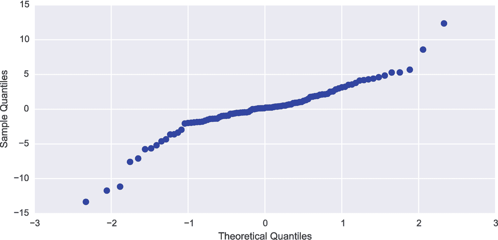

**图 14-1** 具有两个解释变量且不含任何交互项的线性模型的 QQ 图

```
In [68]: fig, ax = plt.subplots(figsize=(8, 4))
        smg.qqplot(result.resid, ax=ax)
```

如图 14-1 所示，QQ 图中的点显著偏离线性关系，这表明观察到的残差不太可能来自服从正态分布的随机变量样本。总之，这些指标提供了证据，表明我们使用的模型不够充分，可能需要改进模型。我们可以通过将缺失的交互项添加到 Patsy 公式中来包含它，并重复之前分析中的步骤：

```
In [69]: model = smf.ols("y ~ x1 + x2 + x1*x2", data)
In [70]: result = model.fit()
In [71]: print(result.summary())

OLS Regression Results
===========================================================================
Dep. Variable:                      y   R-squared:                       0.963
```

Model: OLS  
Adj. R-squared: 0.961

Method: Least Squares  
F-statistic: 821.8

Date: Tue, 21 Apr 2015  
Prob (F-statistic): 2.69e-68

Time: 23:52:12  
Log-Likelihood: -138.39

No. Observations: 100  
AIC: 284.8

Df Residuals: 96  
BIC: 295.2

Df Model: 3

Covariance Type: nonrobust

==============================================================================

coef std err t P>|t| [95.0% Conf. Int.]

Intercept 1.1023 0.100 10.996 0.000 0.903 1.301

x1 2.0102 0.110 18.262 0.000 1.792 2.229

x2 2.9085 0.095 30.565 0.000 2.720 3.097

x1:x2 4.1715 0.134 31.066 0.000 3.905 4.438

==============================================================================

Omnibus: 1.472  
Durbin-Watson: 1.912

Prob(Omnibus): 0.479  
Jarque-Bera (JB): 0.937

Skew: 0.166  
Prob(JB): 0.626

Kurtosis: 3.338  
Cond. No. 1.54

==============================================================================

Warnings: [1] Standard errors assume that the covariance matrix of the errors is correctly specified.

```
在此例中我们可以看到，`R-squared`统计量显著升高至 0.963，表明模型与数据之间近乎完美吻合。
```

```
In [72]: result.rsquared
Out[72]: 0.96252198253140375
```

需要注意的是，我们总可以通过引入更多变量来提高`R-squared`统计量，但必须确保不添加预测能力较低的变量（即系数小且对应的 p 值高），因为这会使模型容易过拟合。同往常一样，我们要求残差服从正态分布。对更新后的模型重复进行正态性检验和 QQ 图分析，结果得到相对较高的*p*值（0.081）和相对线性的 QQ 图（见图 14-2）。这表明在该情况下，残差很可能服从正态分布（在本示例中，我们已知它们确实是按设计服从正态分布的）。

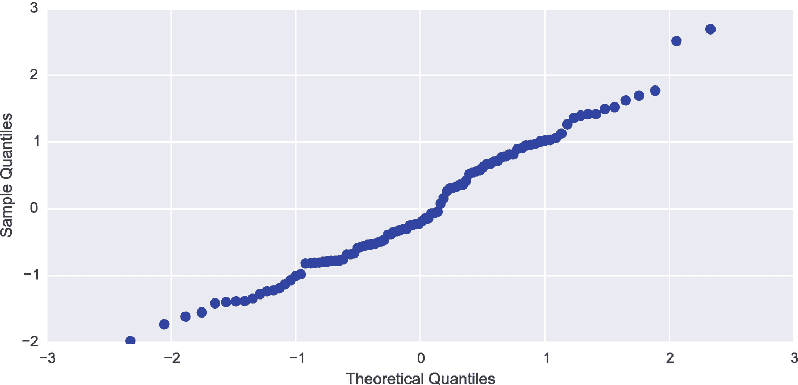

图 14-2

包含交互项的两个解释变量的线性模型的 QQ 图

```
In [73]: z, p = stats.normaltest(result.fittedvalues.values)
In [74]: p
Out[74]: 0.081352587523644201
In [75]: fig, ax = plt.subplots(figsize=(8, 4))
...: smg.qqplot(result.resid, ax=ax)
```

一旦我们对模型的拟合效果感到满意，就可以使用`params`属性从结果对象中提取模型系数。

```
In [76]: result.params
Out[76]: Intercept    1.102297
x1           2.010154
x2           2.908453
x1:x2        4.171501
dtype: float64
```

此外，我们可以使用`predict`方法预测新观测值，该方法接受一个 NumPy 数组或`DataFrame`对象作为参数，其中包含自变量（本例中的*x*[1]和*x*[2]）的值。例如，由于当前问题只有两个自变量，我们可以将模型预测结果可视化为等高线图。为此，我们首先构建一个`DataFrame`对象，包含我们希望使用拟合模型预测*y*值的*x*[1]和*x*[2]值。

```
In [77]: x = np.linspace(-1, 1, 50)
In [78]: X1, X2 = np.meshgrid(x, x)
In [79]: new_data = pd.DataFrame({"x1": X1.ravel(), "x2": X2.ravel()})
```

使用模型拟合后得到的结果对象的`predict`方法，我们可以计算新响应变量值集合对应的预测 y 值。

```
In [80]: y_pred = result.predict(new_data)
```

其结果是一个 NumPy 数组（向量），长度与数据向量`X1.ravel()`和`X2.ravel()`相同。为了能够使用 Matplotlib 的等高线函数绘制数据，我们首先将`y_pred`向量重新调整为方阵。

```
In [81]: y_pred.shape
Out[81]: (2500,)
In [82]: y_pred = y_pred.values.reshape(50, 50)
```

真实模型和拟合模型的等高线图如图 14-3 所示，这表明基于 100 个带正态分布噪声的*y*观测值拟合的模型，在本例中足以相当准确地重现函数关系。

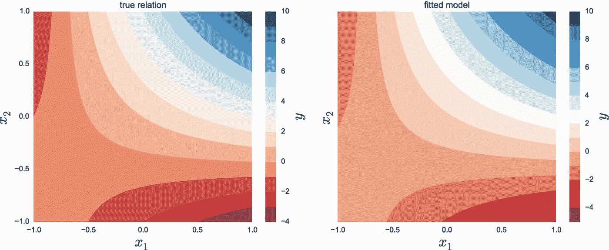

图 14-3

真实关系与正确模型基于 100 个带正态分布噪声的真实关系样本的拟合结果

```
In [83]: fig, axes = plt.subplots(1, 2, figsize=(12, 5), sharey=True)
...: def plot_y_contour(ax, Y, title):
...:     c = ax.contourf(X1, X2, Y, 15, cmap=plt.cm.RdBu)
...:     ax.set_xlabel(r"$x_1$", fontsize=20)
...:     ax.set_ylabel(r"$x_2$", fontsize=20)
...:     ax.set_title(title)
...:     cb = fig.colorbar(c, ax=ax)
...:     cb.set_label(r"$y$", fontsize=20)
...:
...: plot_y_contour(axes[0], y_true(X1, X2), "真实关系")
...: plot_y_contour(axes[1], y_pred, "拟合模型")
```

在我们讨论的这个例子中，我们使用了普通最小二乘法（`ols`）对数据进行模型拟合。此外还有其他几种选项可用，例如鲁棒线性模型（`rlm`），适用于观测值中存在显著异常值的情况；以及广义线性模型的变体，适用于例如响应变量只能取离散值的情况。这将是下一节的主题。在下一章中，我们还将看到正则化回归的实例，其最小化目标不仅限于最小化残差平方和，还包括例如惩罚模型中的大系数。

### 示例数据集

在使用统计方法时，拥有可供探索的示例数据集会很有帮助。`statsmodels` 包提供了一个接口，用于从 R 统计软件的一个大型数据集仓库^(⁶¹)中加载示例数据集。`sm.datasets` 模块包含一个函数 `get_rdataset`，可用于加载 [`http://vincentarelbundock.github.io/Rdatasets/datasets.html`](http://vincentarelbundock.github.io/Rdatasets/datasets.html) 页面上列出的数据集。`get_rdataset` 函数接受数据集的名称，并可选择性接受包（数据集的集合）的名称。

例如，要加载来自 `Ecdat` 包的一个名为 `Icecream` 的数据集，我们可以使用
```python
In [84]: dataset = sm.datasets.get_rdataset("Icecream", "Ecdat")
```
结果是一个包含数据集及描述该数据集的元数据的数据结构。数据集的名称由 `title` 属性给出，`__doc__` 属性包含描述数据集的解释性文本（此处因过长不显示）：
```python
In [85]: dataset.title
Out[85]: 'Ice Cream Consumption'
```
以 Pandas 的 `DataFrame` 对象形式呈现的数据，可以通过 `data` 属性访问：
```python
In [86]: dataset.data.info()

Int64Index: 30 entries, 0 to 29
Data columns (total 4 columns):
cons      30 non-null float64
income    30 non-null int64
price     30 non-null float64
temp      30 non-null int64
dtypes: float64(2), int64(2)
memory usage: 1.2 KB
```
从 `DataFrame` 的 `info` 方法给出的输出中，我们可以看到 `Icecream` 数据集包含四个变量：`cons`（消费量）、`income`（收入）、`price`（价格）和 `temp`（温度）。加载数据集后，我们可以按照常规流程对其进行探索并将其拟合到统计模型中。例如，要建立以消费量为因变量、价格和温度为自变量的线性模型，我们可以使用
```python
In [87]: model = smf.ols("cons ~ -1 + price + temp", data=dataset.data)
In [88]: result = model.fit()
```
结果对象可以通过描述性统计和统计检验进行分析，例如，像我们之前看到的那样，从打印 `summary` 方法的输出开始。我们也可以采用图形化方法并绘制回归图，例如，使用 `smg` 模块中的 `plot_fit` 函数（另请参见 `seaborn` 库中的 `regplot` 函数）：

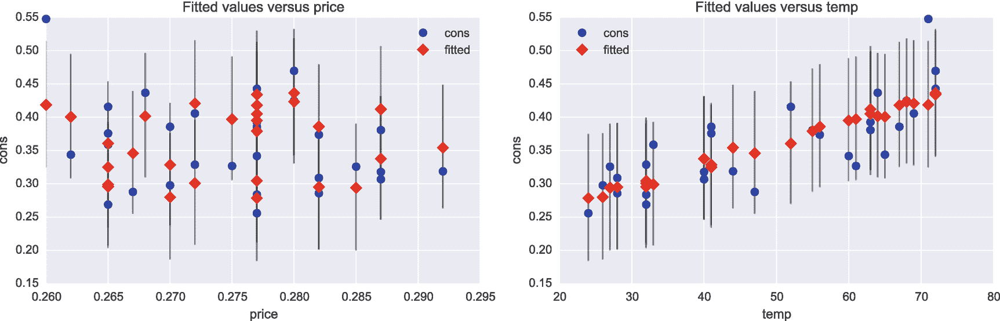

图 14-4 Icecream 数据集中消费量与价格和温度拟合的回归图
```python
In [89]: fig, (ax1, ax2) = plt.subplots(1, 2, figsize=(12, 4))
...: smg.plot_fit(result, 0, ax=ax1)
...: smg.plot_fit(result, 1, ax=ax2)
```
从图 14-4 所示的回归图可以看出，在这个 Icecream 数据集中，消费量与温度似乎呈线性相关，但与价格没有明显的依赖关系（可能因为价格范围相当小）。像 `plot_fit` 这样的图形化工具在开发统计模型时可能非常有用。

### 离散回归

处理离散因变量（例如二元结果）的回归需要不同于我们迄今为止所见的线性回归模型的技术。原因是线性回归要求响应变量是正态分布的*连续*变量，不能直接用于只有少数离散可能结果的响应变量，例如二元变量或取正整数值的变量。然而，通过使用适当的变换，可以将线性预测器映射到一个可以解释为不同离散结果概率的区间。例如，在二元结果的情况下，一种流行的变换是逻辑函数 `log(p/(1 − p)) = β[0] + β ∙ x`，或 `p = (1 + exp(−β[0] − β[1] ∙ x))^(−1)`，它将 `x ∈ [−∞, ∞]` 映射到 `p ∈ [0, 1]`。换句话说，连续的或离散的特征向量 `x` 通过模型参数 `β[0]` 和 `β[1]` 以及逻辑变换映射到概率 p。如果 `p < 0.5`，则可据此预测 `y = 0`，如果 `p ≥ 0.5`，则可据此预测 `y = 1`。这个过程被称为逻辑回归，是二元分类器的一个例子。我们将在关于机器学习的第 15 章中看到更多关于分类器的内容。

`statsmodels` 库提供了几种离散回归的方法，包括 `Logit` 类⁶²、相关的 `Probit` 类（它使用正态分布的累积分布函数而非逻辑函数将线性预测器映射到 [0, 1] 区间）、多项逻辑回归类 `MNLogit`（用于两个以上的类别）以及用于泊松分布计数变量（正整数）的泊松回归类 `Poisson`。

### 逻辑回归

作为如何使用 `statsmodels` 执行逻辑回归的一个例子，我们首先使用 `sm.datasets.get_rdataset` 函数加载一个经典数据集，该数据集包含一组鸢尾花的样本的萼片和花瓣的长宽数据，以及这些花朵的物种分类。这里我们将选择数据集中对应两个不同物种的子集，并建立一个逻辑模型，根据花瓣长度和宽度的值来预测物种类型。`info` 方法提供了数据集中所含变量的摘要：
```python
In [90]: df = sm.datasets.get_rdataset("iris").data
In [91]: df.info()

Int64Index: 150 entries, 0 to 149
Data columns (total 5 columns):
Sepal.Length    150 non-null float64
Sepal.Width     150 non-null float64
Petal.Length    150 non-null float64
Petal.Width     150 non-null float64
Species         150 non-null object
dtypes: float64(4), object(1)
memory usage: 7.0+ KB
```
要查看 `Species` 列中存在多少种唯一的物种类型，我们可以对从数据框对象中提取该列时返回的 Pandas 序列使用 `unique` 方法：
```python
In [92]: df.Species.unique()
Out[92]: array(['setosa', 'versicolor', 'virginica'], dtype=object)
```
该数据集包含三种不同的物种类型。为了获得一个可以在逻辑回归中用作响应变量的二元变量，这里我们只关注两个物种*变色鸢尾*和*维吉尼亚鸢尾*的数据。为方便起见，我们创建一个新的数据框 `df_subset`，用于对应这些物种的数据子集：
```python
In [93]: df_subset = df[df.Species.isin(["versicolor", "virginica"])].copy()
```
为了能够使用逻辑回归，将其他变量作为自变量来预测物种，我们首先需要创建一个对应这两个不同物种的二元变量。使用 Pandas 序列对象的 `map` 方法，我们可以将两个物种名称映射为二元值 0 和 1：
```python
In [94]: df_subset.Species = df_subset.Species.map({"versicolor": 1, "virginica": 0})
```
我们还需要将包含句点字符的列名重命名为在 Python 中有效的符号名称（例如，将“.”字符替换为“_”），否则包含这些列名的 Patsy 公式将被错误地解释。要重命名 `DataFrame` 对象中的列，我们可以使用 `rename` 方法，并将包含名称翻译的字典作为 `columns` 参数传递：
```python
In [95]: df_subset.rename(columns={"Sepal.Length": "Sepal_Length",
...:                           "Sepal.Width": "Sepal_Width",
...:                           "Petal.Length": "Petal_Length",
...:                           "Petal.Width": "Petal_Width"}, inplace=True)
```
经过这些变换后，我们就得到了一个适用于逻辑回归分析的 `DataFrame` 实例：


|   | `Sepal_Length` | `Sepal_Width` | `Petal_Length` | `Petal_Width` | `Species` |
| --- | --- | --- | --- | --- | --- |
| `50` | `7.0` | `3.2` | `4.7` | `1.4` | `1` |
| `51` | `6.4` | `3.2` | `4.5` | `1.5` | `1` |
| `52` | `6.9` | `3.1` | `4.7` | `1.5` | `1` |

```
In [96]: df_subset.head(3)
Out[96]:
```

要创建一个试图以 `Petal_Length` 和 `Petal_Width` 为自变量来解释 `Species` 变量值的逻辑模型，我们可以创建一个 `smf.logit` 类的实例，并使用 Patsy 公式 `"Species ~ Petal_Length + Petal_Width"`：

```
In [97]: model = smf.logit("Species ~ Petal_Length + Petal_Width", data=df_subset)
```

像往常一样，我们需要调用结果模型实例的 `fit` 方法来实际拟合所提供的数据。该拟合使用最大似然优化进行：

```
In [98]: result = model.fit()
Optimization terminated successfully.
Current function value: 0.102818
Iterations 10
```

对于常规线性回归，我们可以通过打印结果对象的 `summary` 方法产生的输出来获取模型拟合数据的摘要。特别是，我们可以看到拟合的模型参数及其 z 分数和相应 p 值的估计值，这有助于我们判断解释变量在模型中是否显著。

```
In [99]: print(result.summary())
Logit Regression Results===========================================================================
Dep. Variable:                Species   No. Observations:                  100
Model:                          Logit   Df Residuals:                       97
Method:                           MLE   Df Model:                            2
Date:                Sun, 26 Apr 2015   Pseudo R-squ.:                  0.8517
Time:                        01:41:04   Log-Likelihood:                -10.282
converged:                       True   LL-Null:                       -69.315LLR p-value:                 2.303e-26  ===========================================================================
coef    std err         z      P>|z|      [95.0% Conf. Int.]

Intercept      45.2723     13.612     3.326      0.001        18.594    71.951
Petal_Length   -5.7545      2.306     -2.496     0.013       -10.274    -1.235
Petal_Width   -10.4467      3.756     -2.782     0.005       -17.808    -3.086===========================================================================
```

逻辑回归的结果对象还提供了 `get_margeff` 方法，该方法返回一个对象，该对象也实现了 `summary` 方法，输出模型中每个解释变量边际效应的信息。

```
In [100]: print(result.get_margeff().summary())
Logit Marginal Effects
=====================================
Dep. Variable:                Species
Method:                          dydx
At:                           overall  ===========================================================================
dy/dx   std err         z      P>|z|      [95.0% Conf. Int.]

Petal_Length    -0.1736      0.052     -3.347     0.001       -0.275    -0.072
Petal_Width     -0.3151      0.068     -4.608     0.000       -0.449    -0.181===========================================================================
```

当我们对模型拟合数据的结果满意时，例如，我们可以用它来预测解释变量的新值对应的响应变量值。为此，我们可以使用模型拟合产生的结果对象中的 `predict` 方法，并需要向其传递一个包含自变量新值的数据框对象。

```
In [101]: df_new = pd.DataFrame({"Petal_Length": np.random.randn(20)*0.5 + 5,
...:                    "Petal_Width": np.random.randn(20)*0.5 + 1.7})
In [102]: df_new["P-Species"] = result.predict(df_new)
```

结果是一个数组，其中包含每个观测值对应于响应变量 *y* = 1 的概率。通过将该概率与阈值 0.5 进行比较，我们可以生成响应变量二元值的预测结果：

```
In [103]: df_new["P-Species"].head(3)
Out[103]: 0    0.995472
1    0.799899
2    0.000033
Name: P-Species, dtype: float64
In [104]: df_new["Species"] = (df_new["P-Species"] > 0.5).astype(int)
```

由坐标 `Petal_Width` 和 `Petal_Length` 所张成的平面中，定义被分类为 *y* = 0 和 *y* = 1 的点之间边界的直线的截距和斜率，可以从拟合的模型参数计算得出。模型参数可以使用结果对象的 `params` 属性获取：

```
In [105]: params = result.params
...: alpha0 = -params['Intercept']/params['Petal_Width']
...: alpha1 = -params['Petal_Length']/params['Petal_Width']
```

最后，为了访问模型及其对新数据点的预测，我们绘制了一个散点图，其中包含拟合数据（方形）和预测数据（圆形），对应于 *virginica* 种类的数据用蓝色（深色）编码，*versicolor* 种类用绿色（浅色）编码。结果显示在图 14-10 中。

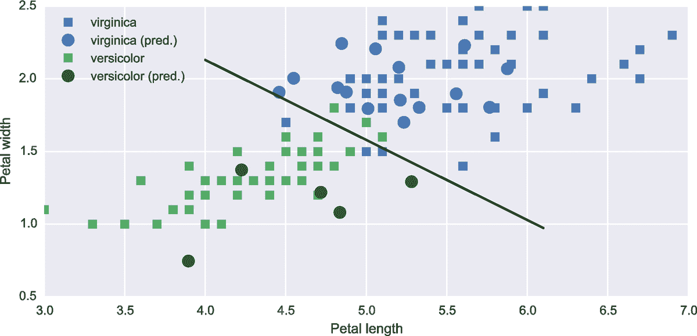

图 14-5

使用花瓣长度和宽度作为自变量，通过 Logit 回归对鸢尾花种类进行分类的结果


In [106]: fig, ax = plt.subplots(1, 1, figsize=(8, 4))
...:  # species virginica
...: ax.plot(df_subset[df_subset.Species == 0].Petal_Length.values,
...:         df_subset[df_subset.Species == 0].Petal_Width.values, 's', label="virginica")
...: ax.plot(df_new[df_new.Species == 0].Petal_Length.values,
...:         df_new[df_new.Species == 0].Petal_Width.values,
...:         'o', markersize=10, color="steelblue", label='virginica (pred.)')
...:
...: # species versicolor
...: ax.plot(df_subset[df_subset.Species == 1].Petal_Length.values,
...:         df_subset[df_subset.Species == 1].Petal_Width.values, 's', label="versicolor")
...: ax.plot(df_new[df_new.Species == 1].Petal_Length.values,
...:         df_new[df_new.Species == 1].Petal_Width.values,
...:         'o', markersize=10, color="green", label='versicolor (pred.)')
...:
...: # boundary line
...: _x = np.array([4.0, 6.1])
...: ax.plot(_x, alpha0 + alpha1 * _x, 'k')
...: ax.set_xlabel('Petal length')
...: ax.set_ylabel('Petal width')
...: ax.legend()
```

### 泊松模型

离散回归的另一个示例是泊松模型，该模型可以描述这样一个过程：响应变量是在多次尝试中成功的次数，且每次尝试成功的概率很低。泊松模型也是可以使用广义线性模型处理的示例之一，此时使用自然对数作为链接函数。为了了解如何使用 `statsmodels` 库将数据拟合到泊松模型，我们将分析来自 R 数据集库中的另一个有趣数据集：`discoveries` 数据集包含 1860 年至 1959 年间重大发现的计数。根据数据性质，可以合理地假设这些计数可能服从泊松分布。为了探究这一假设，我们首先使用 `sm.datasets.get_rdataset` 函数加载数据集，并显示前几个数值以了解数据的格式。

| `时间`       | `1860` | `1861` | `1862` | `1863` | `1864` | `1865` | `1866` | `1867` | `1868` | `1869` |
|--------------|--------|--------|--------|--------|--------|--------|--------|--------|--------|--------|
| `发现数` | `5`    | `3`    | `0`    | `2`    | `0`    | `3`    | `2`    | `3`    | `6`    | `1`    |

```
In [107]: dataset = sm.datasets.get_rdataset("discoveries")
In [108]: df = dataset.data.set_index("time").rename(columns={"values": "discoveries"})
In [109]: df.head(10).T
Out[109]:
```

在此，我们可以看到数据集的`发现数`序列包含整数计数，并且序列中最初几年的平均重大发现数不多。为了判断整个序列是否都具有这种典型数据，我们可以绘制每年发现数量的条形图，如图 14-6 所示。

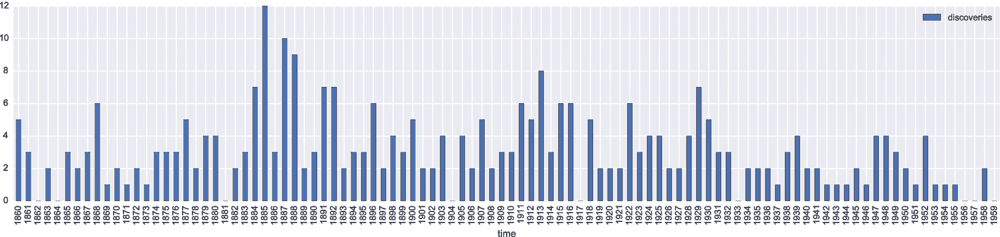

**图 14-6** 每年重大发现的数量

```
In [109]: fig, ax = plt.subplots(1, 1, figsize=(16, 4))
...: df.plot(kind='bar', ax=ax)
```

从图 14-6 来看，重大发现的数量似乎随时间相对恒定，虽然可能注意到略微下降的趋势。尽管如此，最初关于发现数量可能服从泊松分布的假设看起来并非毫无道理。为了更系统地探究这一假设，我们可以将数据拟合到泊松过程，例如使用 `smf.poisson` 类和 Patsy 公式 `"discoveries ~ 1"`，这意味着我们仅用一个截距系数（泊松分布参数）对 `discoveries` 变量进行建模。

```
In [110]: model = smf.poisson("discoveries ~ 1", data=df)
```

像往常一样，我们必须调用 `fit` 方法才能实际将模型拟合到提供的数据：

```
In [111]: result = model.fit()
Optimization terminated successfully.
Current function value: 2.168457
Iterations 7
```

结果对象的 `summary` 方法会显示模型拟合的摘要以及几个拟合统计量。

```
In [112]: print(result.summary())
Poisson Regression Results==============================================================================
Dep. Variable:            discoveries   No. Observations:                  100
Model:                        Poisson   Df Residuals:                       99
Method:                           MLE   Df Model:                            0
Date:                Sun, 26 Apr 2015   Pseudo R-squ.:                   0.000
Time:                        14:51:41   Log-Likelihood:                -216.85
converged:                       True   LL-Null:                       -216.85LLR p-value:                       nan==============================================================================
coef    std err          z      P>|z|      [95.0% Conf. Int.]

Intercept      1.1314      0.057     19.920      0.000         1.020     1.243==============================================================================
```

模型参数（可通过结果对象的 `params` 属性获取）通过指数函数（链接函数的反函数）与泊松分布的 *λ* 参数相关联：

```
In [113]: lmbda = np.exp(result.params)
```

一旦我们得到了泊松分布中估计的 *λ* 参数，我们就可以将观测到的计数值的直方图与理论计数值进行比较，理论计数值可以从 SciPy `stats` 库中的泊松分布随机变量获得。

```
In [114]: X = stats.poisson(lmbda)
```

除了拟合参数之外，我们还可以使用 `conf_int` 方法获得参数的估计置信区间：

|            | `0`       | `1`       |
|------------|-----------|-----------|
| `截距` | `1.020084` | `1.242721` |

```
为了评估数据对泊松分布的拟合效果，我们还为模型参数的置信区间的下限和上限创建了随机变量：

```
In [115]: result.conf_int()
Out[115]:
```

```
In [116]: X_ci_l = stats.poisson(np.exp(result.conf_int().values)[0, 0])
In [117]: X_ci_u = stats.poisson(np.exp(result.conf_int().values)[0, 1])
```

最后，我们绘制观测计数值的直方图，以及对应于拟合模型参数及其置信区间的泊松分布的理论概率质量函数。结果如图 14-7 所示。

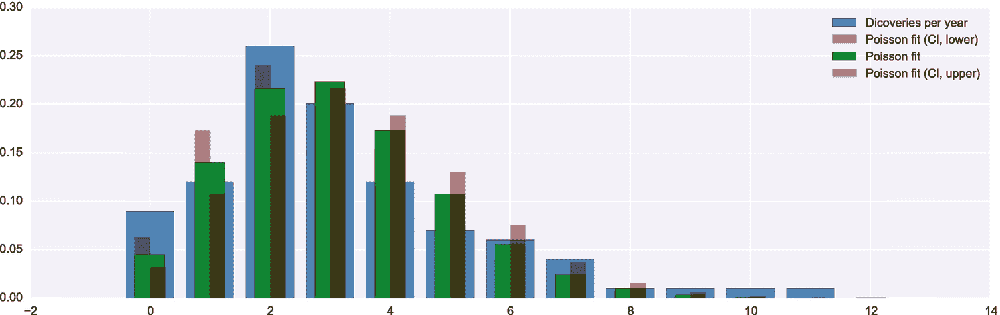

**图 14-7** 每年重大发现数量直方图与拟合泊松模型的概率质量函数比较

```
In [118]: v, k = np.histogram(df.values, bins=12, range=(0, 12), normed=True)
In [119]: fig, ax = plt.subplots(1, 1, figsize=(12, 4))
...: ax.bar(k[:-1], v, color="steelblue",  align='center', label='每年发现数')
...: ax.bar(k-0.125, X_ci_l.pmf(k), color="red", alpha=0.5, align="center", width=0.25,
...:        label='泊松拟合 (置信区间, 下限)')
...: ax.bar(k, X.pmf(k), color="green",  align='center', width=0.5, label='泊松拟合')
...: ax.bar(k+0.125, X_ci_u.pmf(k), color="red",  alpha=0.5, align="center", width=0.25,
...:        label='泊松拟合 (置信区间, 上限)')
...: ax.legend()
```

图 14-7 所示的结果表明，重大发现的数据集并不能很好地用泊松过程来描述，因为泊松概率质量函数与观测计数值之间的吻合度存在显著偏差。因此，必须拒绝每年重大发现数量是泊松过程的假设。未能将模型拟合到给定数据集当然是统计建模过程中的自然组成部分，尽管事实证明该数据集不服从泊松分布（可能是因为拥有大量和少量重大发现的年份倾向于聚集在一起），但我们仍然通过将其建模为泊松分布的失败尝试获得了洞察。鉴于任意一年的发现数量与其近期历史之间存在相关性，如下一节所讨论的时间序列分析可能是一种更好的方法。

## 时间序列

时间序列分析是统计建模中的一个重要领域，它处理的是分析和预测随时间观测到的数据的未来值。时间序列建模与我们目前研究的常规回归模型在几个方面有所不同。或许最重要的是，一个时间序列的观测值通常不能被视为来自总体的独立随机样本序列。相反，在时间上相近的观测值之间通常存在相当强的相关成分。此外，时间序列模型中的自变量是同一序列的过去观测值，而不是一组不同的因素。例如，虽然常规回归可以将产品需求描述为其价格的函数，但在时间序列模型中，通常尝试根据过去的观测值预测未来值。当所考虑的时间序列中存在自相关时（例如，日周期或周周期、稳步上升趋势、或其数值变化的惯性），这是一种合理的方法。时间序列的例子包括股票价格、天气和气候观测，以及自然界和经济学中的许多其他时间过程。

一种时间序列统计模型的例子是自回归模型，在该模型中，未来值线性依赖于 *p* 个先前值：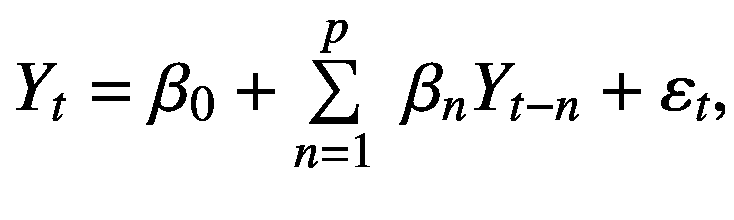 其中 `β[0]` 是一个常数，`β[n]`（`1 ≤ n ≤ N`）是定义 AR 模型的系数。误差项 `ε[t]` 被假定为无自相关的白噪声。在这个模型中，时间序列中的所有自相关因此都应该被对 *p* 个先前值的线性依赖所捕获。一个仅线性依赖于一个先前值（以合适的时间单位计）的时间序列，可以完全用 `p=1` 的 AR 过程（记为 AR(1)）来建模，而一个线性依赖于两个先前值的时间序列可以用 AR(2) 过程来建模，依此类推。AR 模型是 ARMA 模型的一个特例，后者是一种更通用的模型，它还包含了对序列 *q* 个先前残差项的移动平均：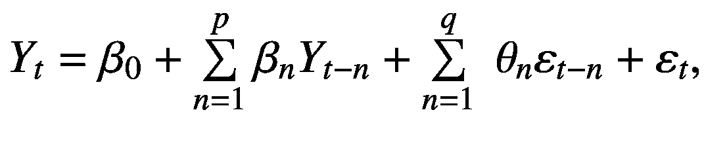 其中模型参数 `θ[n]` 是移动平均的权重因子。该模型被称为 ARMA 模型，用 ARMA(`p`, `q`) 表示，其中 `p` 是自回归项的数量，`q` 是移动平均项的数量。还存在许多其他时间序列模型，但 AR 和 ARMA 模型抓住了许多时间序列应用的基本思想。

`statsmodels` 库有一个专用于时间序列分析的子模块：`sm.tsa`，它实现了几个用于时间序列分析的标准模型，以及用于探索时间序列数据属性的图形和统计分析工具。例如，让我们重新审视第 12 章中使用过的室外温度测量时间序列，并假设我们希望使用 AR 模型，根据之前的观测值预测未来几天的逐时温度。具体来说，我们将使用三月份测量的温度，并预测四月份前三天每小时的温度。我们首先将数据集加载到 Pandas 的 `DataFrame` 对象中：

```
In [120]: df = pd.read_csv("temperature_outdoor_2014.tsv", header=None, delimiter="\t", names=["time", "temp"])
...: df.time = pd.to_datetime(df.time, unit="s")
...: df = df.set_index("time").resample("H").mean()
```

为了方便，我们提取三月份和四月份的观测值，并将它们分别存储在新的 `DataFrame` 对象 `df_march` 和 `df_april` 中：

```
In [121]: df_march = df[df.index.month == 3]
In [122]: df_april = df[df.index.month == 4]
```

这里我们将尝试使用 AR 模型对温度观测值的时间序列进行建模，其适用性的一个重要条件是它应用于平稳过程，即除了模型中的项所解释的自相关或趋势外，没有其他自相关或趋势。`smg.tsa` 模型中的 `plot_acf` 函数是一个用于可视化时间序列自相关的实用图形工具。它接受一个时间序列观测值数组，并在 *x* 轴上绘制随时间延迟增加的自相关图。可选的 `lags` 参数可用于确定图中包含多少个时间步长，这对于长时间序列以及当我们只想查看有限数量时间步长的自相关时非常有用。以下代码使用 `plot_acf` 函数生成并绘制了温度观测值及其一阶、二阶和三阶差分的自相关函数，生成图如图 14-8 所示。

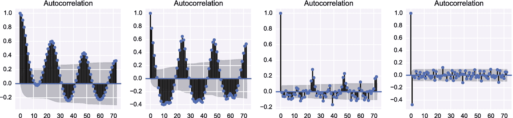

**图 14-8** 不同差分阶数下温度数据的自相关函数，从左到右依次递增

```
In [123]: fig, axes = plt.subplots(1, 4, figsize=(12, 3))
...: smg.tsa.plot_acf(df_march.temp, lags=72, ax=axes[0])
...: smg.tsa.plot_acf(df_march.temp.diff().dropna(), lags=72, ax=axes[1])
...: smg.tsa.plot_acf(df_march.temp.diff().diff().dropna(), lags=72, ax=axes[2])
...: smg.tsa.plot_acf(df_march.temp.diff().diff().diff().dropna(), lags=72, ax=axes[3])
```

在图 14-8 最左侧的图中，我们可以看到时间序列中连续值之间存在明显的相关性，但随着阶数的增加，对时间序列进行差分处理显著降低了自相关性。这表明，虽然每个连续的温度观测值与其前一个值高度相关，但对于连续观测值之间的高阶*变化*，这种相关性并不那么强。对时间序列进行差分处理通常是去除其趋势和消除相关性的有效方法。差分处理减少了结构性自相关这一事实表明，一个足够高阶的 AR 模型可能能够对该时间序列进行建模。
```

为了对所考虑的时间序列创建一个 AR 模型，我们可以使用 `sm.tsa.AR` 类。例如，它可以由一个具有 `DatetimeIndex` 或 `PeriodIndex` 索引的 Pandas 序列来初始化（关于向此类传递时间序列数据的其他方法，请参阅 `AR` 的文档字符串）：

```
In [124]: model = sm.tsa.AR(df_march.temp)
```

当我们对时间序列数据拟合模型时，需要提供 AR 模型的阶数。这里，由于我们在图 14-8 中可以看到一个滞后 24 个周期（24 小时）的强自相关性，我们必须*至少*在模型中包含 24 个先前项的项。为稳妥起见，并且由于我们的目标是预测未来 3 天（即 72 小时）的温度，这里我们选择让 AR 模型的阶数也对应 72 小时：

```
In [125]: result = model.fit(72)
```

AR 过程适用的一个重要条件是序列的残差是平稳的（无剩余自相关且无趋势）。可以使用 Durbin-Watson 统计检验来检验时间序列的平稳性。该检验返回一个介于 0 到 4 之间的值，接近 2 的值对应没有剩余自相关的时间序列。我们也可以使用 `plot_acf` 函数绘制残差的自相关函数图，并验证没有显著的自相关。

```
In [126]: sm.stats.durbin_watson(result.resid)
Out[126]: 1.9985623006352975
```

我们也可以使用 `plot_acf` 函数绘制残差的自相关函数图，并验证没有显著的自相关。

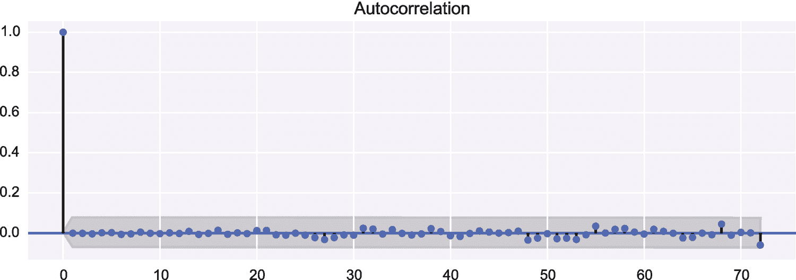

图 14-9

温度观测值的 AR(72) 模型残差的自相关图

```
In [127]: fig, ax = plt.subplots(1, 1, figsize=(8, 3))
...: smg.tsa.plot_acf(result.resid, lags=72, ax=ax)
```

接近 2 的 Durbin-Watson 统计量以及图 14-9 中不存在自相关，表明当前模型成功地解释了拟合数据。我们现在可以使用模型 `fit` 方法返回的结果对象中的 `predict` 方法来预测未来日期的温度：

```
In [128]: temp_3d_forecast = result.predict("2014-04-01", "2014-04-4")
```

接下来，我们将预测结果（红色）与之前 3 天的温度观测值（蓝色）以及实际结果（绿色）一起绘制成图，结果如图 14-10 所示：

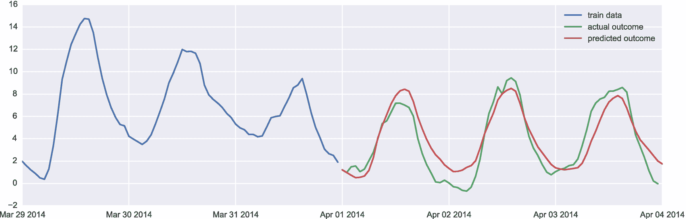

图 14-10

观测和预测温度随时间的变化

```
In [129]: fig, ax = plt.subplots(1, 1, figsize=(12, 4))
...: ax.plot(df_march.index.values[-72:], df_march.temp.values[-72:], label="训练数据")
...: ax.plot(df_april.index.values[:72], df_april.temp.values[:72], label="实际结果")
...: ax.plot(pd.date_range("2014-04-01", "2014-04-4", freq="H").values, temp_3d_forecast, label="预测结果")
...:
...: ax.legend()
```

图 14-10 中显示的预测温度与实际结果的一致性相当好。然而，情况当然并非总是如此，因为不能仅基于之前的观测值来预测温度。尽管如此，在稳定的天气系统周期内，考虑日变化和其他稳定趋势，AR 模型可以准确预测一小时的逐时温度。

除了基本的 AR 模型，`statsmodels` 还提供了 `sm.tsa.ARMA`（自回归滑动平均）和 `sm.tsa.ARIMA`（差分自回归滑动平均）模型。这些模型的使用模式与我们在此使用的 AR 模型类似，但在细节上存在一些差异。有关更多信息，请参阅 `sm.tsa.ARMA` 和 `sm.tsa.ARIMA` 类的文档字符串以及官方 `statsmodels` 文档。

## 小结

在本章中，我们简要介绍了统计建模，并介绍了 `statsmodels` 库的基本统计建模功能以及使用 Patsy 公式进行模型规范。统计建模是一个广泛的领域，在本章中我们仅触及了 `statsmodels` 库功能的皮毛。我们从介绍如何使用 Patsy 公式语言指定统计模型开始，然后在“线性回归”部分将其用于连续型（常规线性回归）和离散型（逻辑回归和名义回归）响应变量。在介绍完线性回归之后，我们简要地探讨了时间序列分析，由于时间序列中自然出现的连续观测值之间的相关性，该分析需要与线性回归略有不同的方法。在这次介绍中，我们并未涉及统计建模的许多方面，但我们在此涵盖的线性回归和时间序列建模基础应该为进一步的探索提供了背景。在第 15 章中，我们将继续学习机器学习，这是一个在动机和方法上都与统计建模密切相关的主题。

## 延伸阅读

关于统计建模的出色且全面的介绍，可参阅 G. James (2013)，该书也可从 [`www-bcf.usc.edu/~gareth/ISL/index.html`](http://www-bcf.usc.edu/%257Egareth/ISL/index.html) 免费获取，以及 M. Kuhn (2013)。关于时间序列分析的易读性介绍，可参阅 R.J. Hyndman (2013)，该书也可从 [`www.otexts.org/fpp`](http://www.otexts.org/fpp) 免费在线阅读。