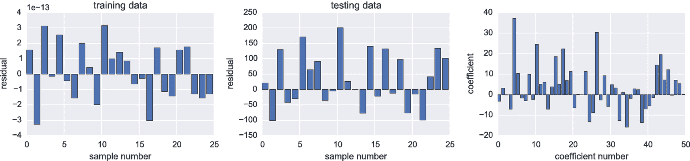
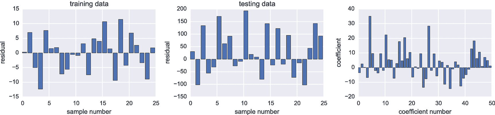
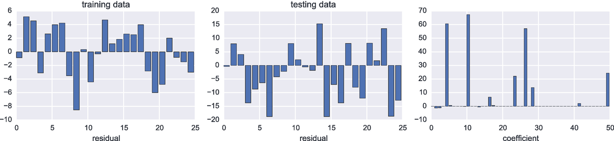
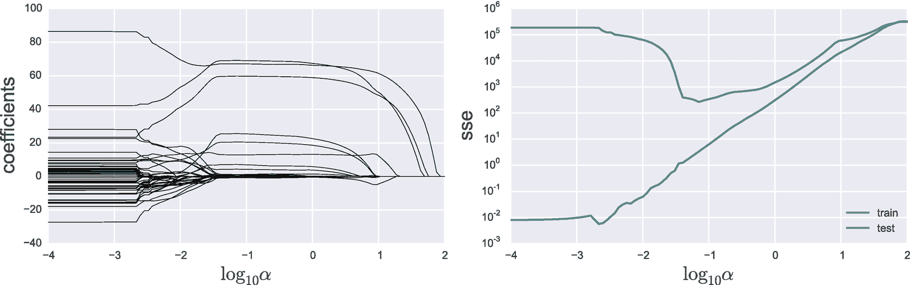
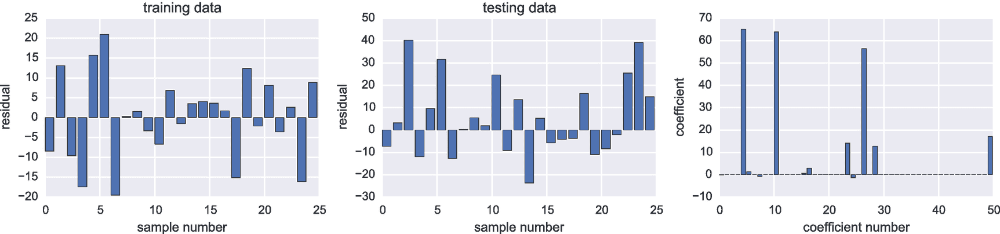
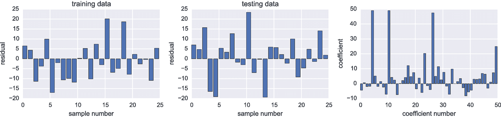
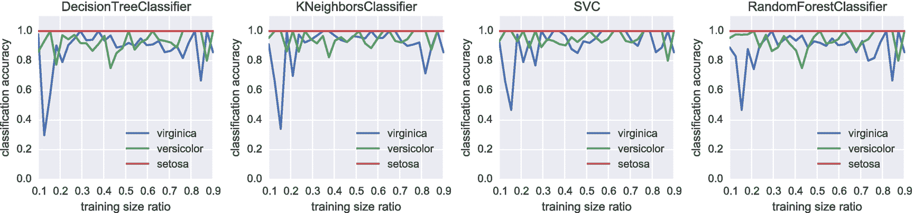
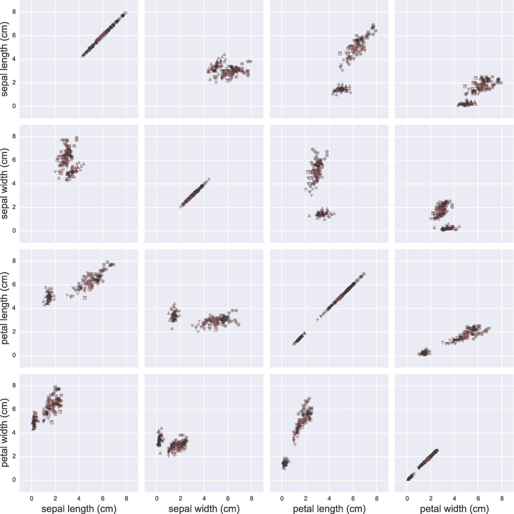

# 15. 机器学习

在本章中，我们将探讨机器学习。这一主题与我们在第 14 章中讨论的统计建模密切相关，因为两者都涉及利用数据来描述和预测不确定或未知过程的结果。然而，统计建模强调分析中使用的模型，而机器学习则绕过模型部分，专注于能够通过训练来预测新观测结果的算法。换言之，统计建模采用的方法侧重于通过设计模型并拟合数据来调整其参数，从而理解数据的生成方式。如果模型能够很好地拟合数据并满足相关的模型假设，那么该模型就能对过程进行整体描述，并可用于计算已知分布的统计量以及评估统计检验。但是，如果实际数据过于复杂，无法用现有的统计模型来解释，这种方法就达到了它的极限。另一方面，在机器学习中，生成数据的实际过程及其潜在模型并非核心。相反，观测数据和解释变量才是机器学习应用的根本起点。给定数据后，机器学习方法可用于发现数据中的模式和结构，这些模式和结构可用来预测新观测的结果。因此，机器学习并不能提供对数据生成方式的理解，并且由于对数据的分布和统计特性所做的假设较少，我们通常无法计算统计量，也无法对特定观测的显著性进行统计检验。取而代之的是，机器学习非常强调预测新观测结果的准确性。

尽管统计建模和机器学习在基本方法上存在显著差异，但所使用的许多数学方法却密切相关，有时甚至完全相同。在本章中，我们会再次遇到在第 14 章关于统计建模中使用过的几种方法，但它们将以不同的思路和略有不同的目标来运用。

在本章中，我们将简要介绍基本的机器学习方法，并概述如何在 Python 中使用这些方法。重点将放在那些在科学和技术计算的众多领域具有广泛应用的机器学习方法上。Python 中最著名、最全面的机器学习库是 `scikit-learn`，尽管还有其他一些替代和补充库，例如 `TensorFlow`、`Keras`、`PyTorch` 等。在本章中，我们将专门使用 `scikit-learn` 库，该库提供了最常见机器学习算法的实现。不过，我们鼓励对机器学习特别感兴趣的读者也去探索前面提到的其他库。

## Scikit-learn

`scikit-learn` 库包含了大量的机器学习相关算法，包括回归、分类、降维和聚类。有关该项目的更多信息及其文档，请访问项目网站 [`http://scikit-learn.org`](http://scikit-learn.org)。在撰写本文时，`scikit-learn` 的最新版本是 0.19.2。

## 导入模块

在本章中，我们将使用 `scikit-learn` 库，它提供了 `sklearn` Python 模块。对于 `sklearn` 模块，我们采用与 SciPy 库相同的导入策略：即显式导入我们工作所需的库中的子模块。在本章中，我们将使用 `sklearn` 库中的以下子模块：

```
In [1]: from sklearn import datasets
In [2]: from sklearn import model_selection
In [3]: from sklearn import linear_model
In [4]: from sklearn import metrics
In [5]: from sklearn import tree
In [6]: from sklearn import neighbors
In [7]: from sklearn import svm
In [8]: from sklearn import ensemble
In [9]: from sklearn import cluster
```

为了进行绘图和基本的数值计算，我们还需要 Matplotlib 和 NumPy 库，我们按通常方式导入它们：

```
In [10]: import matplotlib.pyplot as plt
In [11]: import numpy as np
```

我们还使用 Seaborn 库进行图形绘制和样式设置：

```
In [12]: import seaborn as sns
```

## 机器学习简述

机器学习是计算机科学人工智能领域的一个主题。机器学习可以被视为包括所有将训练数据输入计算机程序使其能够执行特定任务的应用。这是一个非常宽泛的定义，但在实践中，机器学习通常与一套更为具体的技术和方法相关联。这里我们采取一种实用的方法，通过示例来探讨机器学习中的几种基本方法和关键概念。在开始具体示例之前，我们先简要介绍一些术语和核心概念。

在机器学习中，将模型或算法拟合到观测数据的过程被称为*训练*。机器学习应用通常可以分为两类：*监督学习*和*无监督学习*，它们的区别在于应用所训练的数据类型不同。在*监督学习*中，数据包含特征变量和已知的响应变量。特征变量和响应变量都可以是连续的或离散的。准备这样的数据通常需要人工投入，有时甚至需要专家领域的知识。因此，应用是用精心准备的数据进行训练的，因此这种训练可以被视为监督式机器学习。应用的例子包括回归（预测连续响应变量）和分类（预测离散响应变量），其中训练数据集的响应变量值是已知的，但对于新样本是未知的。

相比之下，*无监督学习*对应于机器学习应用使用未标记或以其他方式手工准备的原始数据进行训练的情况。无监督学习的一个例子是将数据聚类成组，换句话说，就是将数据分组到合适的类别中。与监督分类相比，无监督学习的典型特点是最终类别事先未知，因此训练数据无法相应地进行标记。也可能存在手动标记数据困难或成本高昂的情况，例如样本数量过大。不言而喻，无监督机器学习比监督机器学习更困难，且用途更有限，因此只要有可能，应优先选择监督机器学习。然而，当无法创建带标签的训练数据集时，无监督机器学习可能是一个强大的工具。

自然，机器学习远比前面概述的基本问题类型所暗示的要复杂得多，但这些概念是许多机器学习应用中反复出现的主题。在本章中，我们将通过几个基本的机器学习技术示例来展示机器学习的几个核心概念。在此之前，我们将简要介绍在后续章节中会引用到的常见机器学习术语。


*交叉验证*是将可用数据划分为*训练数据*和*测试数据*（也称为*验证数据*）的做法，其中仅使用训练数据来训练机器学习模型，而测试数据则允许在未见过的数据上对训练好的应用进行测试。其目的是衡量模型预测新观测值的能力，并限制过拟合问题。将数据划分为训练数据集和测试数据集有几种方法。例如，一种极端方法是测试所有可能的数据划分方式（*穷举交叉验证*），并使用结果的聚合值（例如，根据情况使用平均值或最小值）。然而，对于大型数据集，训练数据和测试数据可能的组合数量变得极其庞大，使得穷举交叉验证不切实际。另一种极端方法是使用训练集中除一个样本外的所有样本，并将剩下的那个样本放入测试集中（*留一法交叉验证*），然后针对从可用数据中选择一个样本的所有组合重复训练-测试循环。该方法的一种变体是将可用数据划分为 *k* 组，并使用这 *k* 组数据集进行留一法交叉验证。这种方法被称为 *k* 折交叉验证，是一种在实践中常用的流行技术。在 scikit-learn 库中，`sklearn.model_selection` 模块包含了用于处理交叉验证的函数。

*特征提取*是机器学习问题预处理阶段的一个重要步骤。它涉及创建合适的特征变量和相应的特征矩阵，这些矩阵可以传递给 scikit-learn 库中实现的众多机器学习算法之一。scikit-learn 的 `sklearn.feature_extraction` 模块在许多机器学习应用中的作用类似于 Patsy 公式库在统计建模中的作用，尤其是在基于文本和图像的机器学习问题中。使用 `sklearn.feature_extraction` 模块中的方法，我们可以自动从各种数据源组装特征矩阵（设计矩阵）。

*降维*和*特征选择*是机器学习应用中常用的技术，在这些应用中，通常会有大量解释变量（特征），其中许多变量可能对应用的预测能力贡献不大。为了降低模型的复杂度，通常期望消除不太有用的特征，从而降低问题的维度。当特征数量与观测值数量相当或大于观测值数量时，这一点尤为重要。scikit-learn 的 `sklearn.decomposition` 和 `sklearn.feature_selection` 模块包含了用于降低机器学习问题维度的函数：例如，主成分分析（PCA）是一种流行的降维技术，它通过对特征矩阵进行奇异值分解，并仅保留与最重要奇异向量相对应的维度来实现降维。

在接下来的部分中，我们将研究如何使用 scikit-learn 来解决前面讨论的技术所涉及的机器学习问题示例。在这里，我们将使用生成的数据和内置数据集。与 statsmodels 库类似，scikit-learn 附带了许多可用于探索机器学习方法的内置数据集。`sklearn` 中的 `datasets` 模块提供了三组函数：用于加载内置数据集（前缀为 `load_`，例如 `load_boston`），用于获取外部数据集（前缀为 `fetch_`，例如 `fetch_californa_housing`），以及最后用于从随机数生成数据集（前缀为 `make_`，例如 `make_regression`）。

## 回归

正如我们在第 14 章中已经看到的，回归是机器学习和统计建模的核心部分。在机器学习中，我们不太关心回归模型对数据的拟合程度，而是更关心它预测新观测值的能力。例如，如果我们有大量特征但观测值数量较少，我们通常可以使回归完美地拟合数据，但这对预测新值可能用处不大。这就是过拟合的一个例子：数据和回归模型之间的小残差并不能保证模型能够准确预测未来的观测值。在机器学习中，处理这个问题的常用方法是将可用数据划分为训练数据集和测试数据集，测试数据集用于针对未见过的数据验证回归结果。

为了了解拟合训练数据集并使用测试数据集验证结果是如何进行的，让我们考虑一个有 50 个样本和 50 个特征的回归问题，其中只有 10 个特征是有信息量的（与响应变量线性相关）。这模拟了一个场景：我们有 50 个已知特征，但结果发现只有其中 10 个特征对回归模型的预测能力有贡献。`sklearn.datasets` 模块中的 `make_regression` 函数按如下方式生成数据：

```
In [13]: X_all, y_all = datasets.make_regression(n_samples=50, n_features=50, n_informative=10)
```

结果是两个数组 `X_all` 和 `y_all`，形状分别为 `(50, 50)` 和 `(50,)`，对应于一个有 50 个样本和 50 个特征的回归问题的设计矩阵。我们没有对整个数据集进行回归（并由于观测数量过少而获得完美拟合），而是使用 `sklearn.model_selection` 模块中的 `train_test_split` 函数将数据集分成两个大小相等的数据集。结果是训练数据集 `X_train`、`y_train` 和测试数据集 `X_test`、`y_test`：

```
In [14]: X_train, X_test, y_train, y_test = \
...:     model_selection.train_test_split(X_all, y_all, train_size=0.5)
```

在 scikit-learn 中，可以使用 `sklearn.linear_model` 模块中的 `LinearRegression` 类执行普通线性回归，该类与 statsmodels 库中的 `statsmodels.api.OLS` 功能相似。要执行回归，我们首先创建一个 `LinearRegression` 实例：

```
In [15]: model = linear_model.LinearRegression()
```

为了实际将模型拟合到数据，我们需要调用 `fit` 方法，该方法将特征矩阵和响应变量向量作为第一和第二个参数：

```
In [16]: model.fit(X_train, y_train)
Out[16]: LinearRegression(copy_X=True, fit_intercept=True, n_jobs=1, normalize=False)
```

请注意，与 statsmodels 中的 `OLS` 类相比，特征矩阵和响应变量向量的顺序是相反的，并且在 statsmodels 中，数据是在创建类实例时指定的，而不是在调用 `fit` 方法时指定的。此外，在 scikit-learn 中，调用 `fit` 方法不会返回新的结果对象，而是将结果直接存储在模型实例中。这些细微的差异在交替使用 statsmodels 和 scikit-learn 模块时会带来一些不便，值得注意。^(⁶³)

由于回归问题有 50 个特征，而我们只用了 25 个样本来训练模型，我们可以预期会出现完全拟合数据的完全过拟合。这可以通过计算模型和数据之间的误差平方和（SSE）来量化。为了评估给定特征集的模型，我们可以使用 `predict` 方法，从中我们可以计算残差和 SSE：

```
In [17]: def sse(resid):
...:     return np.sum(resid**2)
In [18]: resid_train = y_train - model.predict(X_train)
...: sse_train = sse(resid_train)
...: sse_train
Out[18]: 8.1172209425431673e-25
```


正如预期的那样，对于训练数据集，由于特征数量是数据点数量的两倍，导致过拟合，残差基本为零。然而，这种过拟合模型完全不适合预测未见数据。通过计算测试数据集的 `SSE` 可以验证这一点：

```
In [19]: resid_test = y_test - model.predict(X_test)
...: sse_test = sse(resid_test)
...: sse_test
Out[19]: 213555.61203039082
```

结果是一个非常大的 `SSE` 值，表明该模型在预测新观测值方面表现不佳。衡量模型对数据集拟合程度的另一种指标是 R 方分数（参见第 14 章），我们可以使用 `score` 方法计算它。该方法接受特征矩阵和响应变量向量作为参数，并计算分数。对于训练数据集，我们如预期得到了 `1.0` 的 *r* 方分数，但对于测试数据集，我们得到了一个较低的分数：

```
In [20]: model.score(X_train, y_train)
Out[20]: 1.0
In [21]: model.score(X_test, y_test)
Out[21]: 0.31407400675201746
```

训练数据集和测试数据集分数之间的巨大差异再次表明模型过拟合了。

最后，我们还可以采用图形化方法，绘制训练和测试数据集的残差图，并目视检查系数值和残差。从 `LinearRegression` 对象中，我们可以使用 `coef_` 属性提取拟合参数。为了简化重复绘制训练和测试残差以及模型参数的过程，这里我们首先创建一个函数 `plot_residuals_and_coeff` 来绘制这些量。然后，我们调用该函数，并分别传入在训练和测试数据集上训练和测试的普通线性回归模型的结果。结果如图 15-1 所示，可以清楚地看到，对于每个样本，测试数据集和训练数据集的残差大小存在很大差异。



**图 15-1** 普通线性回归模型与训练数据之间的残差（左）、模型与测试数据之间的残差（中），以及 50 个特征的系数值（右）

```
In [22]: def plot_residuals_and_coeff(resid_train, resid_test, coeff):
...:    fig, axes = plt.subplots(1, 3, figsize=(12, 3))
...:    axes[0].bar(np.arange(len(resid_train)), resid_train)
...:    axes[0].set_xlabel("样本编号")
...:    axes[0].set_ylabel("残差")
...:    axes[0].set_title("训练数据")
...:    axes[1].bar(np.arange(len(resid_test)), resid_test)
...:    axes[1].set_xlabel("样本编号")
...:    axes[1].set_ylabel("残差")
...:    axes[1].set_title("测试数据")
...:    axes[2].bar(np.arange(len(coeff)), coeff)
...:    axes[2].set_xlabel("系数编号")
...:    axes[2].set_ylabel("系数")
...:    fig.tight_layout()
...:    return fig, axes
In [23]: fig, ax = plot_residuals_and_coeff(resid_train, resid_test, model.coef_)
```

这个例子中发生过拟合是因为我们样本太少，一种解决方案是收集更多样本，直到过拟合不再是问题。然而，这并不总是可行的，因为收集观测值可能很昂贵，而且在某些应用中，我们可能拥有非常多的特征。对于这种情况，希望能够以尽可能避免过拟合的方式（以不完全拟合训练数据为代价）来拟合回归问题，从而使模型能够为新观测值提供有意义的预测。

*正则化回归*是解决此问题的一种可行方案。下面我们将探讨几种不同的正则化回归变体。在普通线性回归中，模型参数的选择使得残差平方和最小化。从优化问题的角度来看，目标函数因此是 `min_β ||Xβ - y||²₂`，其中 `X` 是特征矩阵，`y` 是响应变量，`β` 是模型参数向量，`||·||₂` 表示 L2 范数。在*正则化*回归中，我们在最小化问题的目标函数中添加一个*惩罚项*。不同类型的惩罚项会对原始回归问题施加不同类型的正则化。两种流行的正则化方法是通过将参数向量的 L1 或 L2 范数添加到最小化目标函数中得到的，即 `min_β {||Xβ - y||²₂ + α||β||₁}` 和 `min_β {||Xβ - y||²₂ + α||β||²₂}`。它们分别被称为 LASSO 回归和岭回归。这里 `α` 是一个自由参数，决定了正则化的强度。添加 L2 范数 `||β||²₂` 有利于系数更小的模型参数向量，而添加 L1 范数 `||β||₁` 有利于零元素尽可能少的模型参数向量。哪种正则化更合适取决于具体问题：当我们希望尽可能多地消除特征时，可以使用 LASSO 回归的 L1 正则化；当我们希望限制模型系数的大小时，可以使用岭回归的 L2 正则化。

使用 `scikit-learn`，我们可以通过 `sklearn.linear_model` 模块中的 `Ridge` 类来执行岭回归。该类的用法与我们前面使用的 `LinearRegression` 类几乎相同，但我们还可以在初始化该类时将确定正则化强度的 `α` 参数作为参数传入。这里我们选择值 `α = 2.5`。有关选择 `α` 的更系统方法将在本章后面介绍。

```
In [24]: model = linear_model.Ridge(alpha=2.5)
```

为了将回归模型拟合到数据，我们再次使用 `fit` 方法，将训练特征矩阵和响应变量作为参数传入：

```
In [25]: model.fit(X_train, y_train)
Out[25]: Ridge(alpha=2.5, copy_X=True, fit_intercept=True, max_iter=None,
normalize=False, solver="auto", tol=0.001)
```

一旦模型拟合到训练数据，我们就可以计算训练和测试数据集的模型预测值，并计算相应的 `SSE` 值：

```
In [26]: resid_train = y_train - model.predict(X_train)
...: sse_train = sse(resid_train)
...: sse_train
Out[26]: 178.50695164950841
In [27]: resid_test = y_test - model.predict(X_test)
...: sse_test = sse(resid_test)
...: sse_test
Out[27]: 212737.00160105844
```

我们注意到，训练数据的 `SSE` 不再接近于零，但测试数据的 `SSE` 略有下降。为了与普通回归进行比较，我们还使用前面定义的函数 `plot_residuals_and_coeff` 绘制了训练和测试残差以及模型参数。结果如图 15-2 所示。



**图 15-2**


岭正则化回归模型与训练数据之间的残差（左图）、模型与测试数据之间的残差（中图），以及 50 个特征的系数值（右图）

```
In [28]: fig, ax = plot_residuals_and_coeff(resid_train, resid_test, model.coef_)
```

类似地，我们可以使用来自`sklearn.linear_model`模块的`Lasso`类执行 L1 正则化的 LASSO 回归。在初始化类实例时，它同样接受*α*参数的值作为参数。这里我们选择*α* = 1.0，并按照前述相同方式对训练数据进行模型拟合，以及计算训练集和测试集的 SSE：

```
In [29]: model = linear_model.Lasso(alpha=1.0)
In [30]: model.fit(X_train, y_train)
Out[30]: Lasso(alpha=1.0, copy_X=True, fit_intercept=True, max_iter=1000,
normalize=False, positive=False, precompute=False, random_state=None,
selection='cyclic', tol=0.0001, warm_start=False)
In [31]: resid_train = y_train - model.predict(X_train)
...: sse_train = sse(resid_train)
...: sse_train
Out[31]: 309.74971389531891
In [32]: resid_test = y_test - model.predict(X_test)
...: sse_test = sse(resid_test)
...: sse_test
Out[32]: 1489.1176065002333
```

此处我们注意到，虽然训练数据的 SSE 相较于普通回归有所增加，但测试数据的 SSE 却显著降低。因此，通过在回归模型拟合训练数据的程度上付出一些代价，我们获得了对测试数据集预测能力显著提升的模型。为了与先前的方法进行比较，我们再次使用`plot_residuals_and_coeff`函数绘制残差和模型参数。结果如图 15-3 所示。在该图的右侧面板中，我们看到系数轮廓与图 15-1 和图 15-2 中显示的显著不同，并且通过 LASSO 回归生成的系数向量大部分为零。这对于当前数据而言是一种合适的方法，因为在最初生成数据集时，我们选择了 50 个特征，其中只有 10 个是有信息量的。如果我们怀疑可能有大量特征对回归模型贡献不大，那么使用 LASSO 回归的 L1 正则化将是一个值得尝试的好方法。



图 15-3

LASSO 正则化回归模型与训练数据之间的残差（左图）、模型与测试数据之间的残差（中图），以及 50 个特征的系数值（右图）

```
In [33]: fig, ax = plot_residuals_and_coeff(resid_train, resid_test, model.coef_)
```

我们先前在使用 Ridge 和 LASSO 回归的两个示例中使用的*α*值是任意选择的。*α*的最合适值取决于具体问题，对于每个新问题，我们需要通过试错法找到合适的值。scikit-learn 库提供了辅助此过程的方法，我们将在后续内容中看到，但在探索这些方法之前，先了解回归模型参数以及训练集和测试集的 SSE 如何随特定问题的*α*值变化是很有启发性的。此处我们重点关注 LASSO 回归，因为它看起来对当前问题效果很好，我们使用不同的正则化强度参数*α*值重复求解同一个问题，并将系数值和 SSE 值存储在 NumPy 数组中。

我们首先创建所需的 NumPy 数组。使用`np.logspace`创建一个跨越多个数量级的*α*值范围：

```
In [34]: alphas = np.logspace(-4, 2, 100)
In [35]: coeffs = np.zeros((len(alphas), X_train.shape[1]))
In [36]: sse_train = np.zeros_like(alphas)
In [37]: sse_test = np.zeros_like(alphas)
```

接下来，我们遍历*α*值，并为每个值执行 LASSO 回归：

```
In [38]: for n, alpha in enumerate(alphas):
...:     model = linear_model.Lasso(alpha=alpha)
...:     model.fit(X_train, y_train)
...:     coeffs[n, :] = model.coef_
...:     sse_train[n] = sse(y_train - model.predict(X_train))
...:     sse_test[n] = sse(y_test - model.predict(X_test))
```

最后，我们使用 Matplotlib 绘制系数以及训练集和测试集的 SSE。结果如图 15-4 所示。在该图的左侧面板中，我们可以看到对于非常小的α值，大量系数非零。这对应于过拟合状态。我们还可以看到，当α增加到一定阈值以上时，许多系数降为零，只有少数系数保持非零。在该图的右侧面板中，我们看到虽然训练集的 SSE 随着*α*增大而稳步增加，但测试数据集的 SSE 却有一个急剧下降。这正是 LASSO 回归所追求的效果。然而，对于过大的α值，所有系数都收敛到零，训练集和测试数据集的 SSE 都变得很大。因此，存在一个防止过拟合并提升模型预测未见数据能力的最优α区域。虽然这些观察结果并非普遍成立，但在许多问题中都可以看到类似的模式。



图 15-4

对于 LASSO 回归，系数（左图）以及训练集和测试数据集的误差平方和（SSE，右图），随正则化强度参数*α*的对数变化

```
In [39]: fig, axes = plt.subplots(1, 2, figsize=(12, 4), sharex=True)
...: for n in range(coeffs.shape[1]):
...:     axes[0].plot(np.log10(alphas), coeffs[:, n], color="k", lw=0.5)
...:
...: axes[1].semilogy(np.log10(alphas), sse_train, label="train")
...: axes[1].semilogy(np.log10(alphas), sse_test, label="test")
...: axes[1].legend(loc=0)
...:
...: axes[0].set_xlabel(r"${\log_{10}}\alpha$", fontsize=18)
...: axes[0].set_ylabel(r"coefficients", fontsize=18)
...: axes[1].set_xlabel(r"${\log_{10}}\alpha$", fontsize=18)
...: axes[1].set_ylabel(r"sse", fontsize=18)
```

使用多个*α*值测试正则化回归的过程可以通过使用`RidgeCV`和`LassoCV`等类来自动执行。这些 Ridge 和 LASSO 回归的变体内部使用交叉验证方法搜索最优*α*。默认情况下，使用*k=3*的*k*折交叉验证，尽管可以通过这些类的`cv`参数进行更改。由于内建了交叉验证，我们无需像之前那样显式地将数据集划分为训练集和测试集。

要使用自动选择*α*的 LASSO 方法，我们只需创建`LassoCV`的一个实例并调用其`fit`方法：

```
In [40]: model = linear_model.LassoCV()
In [41]: model.fit(X_all, y_all)
Out[41]: LassoCV(alphas=None, copy_X=True, cv=None, eps=0.001, fit_intercept=True, max_iter=1000, n_alphas=100, n_jobs=1, normalize=False, positive=False, precompute="auto", random_state=None, selection="cyclic", tol=0.0001, verbose=False)
```

通过交叉验证搜索选择的正则化强度参数*α*值可以通过`alpha_`属性访问：

```
In [42]: model.alpha_
Out[42]: 0.13118477495069433
```


我们注意到，`α`的建议值与根据图 15-5 可能推测出的数值吻合得相当好。为了与之前的方法进行比较，我们还计算了训练数据集和测试数据集的 SSE（尽管在调用`LassoCV.fit`时两者都用于训练），并将 SSE 值与模型参数一起绘制成图，如图 15-5 所示。通过使用交叉验证的 LASSO 方法，我们获得了一个能够以相对较高的精度预测训练和测试数据集的模型，并且尽管样本数量相对于特征数量较少⁶⁴，我们也不太可能再遭受过拟合问题的困扰。



图 15-5

经过交叉验证的 LASSO 正则化回归模型在训练数据（左）和测试数据（中）上的残差。还展示了 50 个特征的系数值（右）。

```
In [43]: resid_train = y_train - model.predict(X_train)
...: sse_train = sse(resid_train)
...: sse_train
Out[43]: 66.900068715063625
In [44]: resid_test = y_test - model.predict(X_test)
...: sse_test = sse(resid_test)
...: sse_test
Out[44]: 966.39293785448456
In [45]: fig, ax = plot_residuals_and_coeff(resid_train, resid_test, model.coef_)
```

最后，另一种流行的正则化回归类型，它结合了 LASSO 和 Ridge 方法的 L1 和 L2 正则化，被称为弹性网络正则化（elastic-net regularization）。该方法的极小化目标函数是 `min_{β}(‖Xβ - y‖²₂ + αρ‖β‖₁ + α(1-ρ)‖β‖²₂)`，其中参数 `ρ`（在 scikit-learn 中为`l1_ratio`）决定了 L1 和 L2 惩罚的相对权重，从而决定了该方法在多大程度上表现得像 LASSO 和 Ridge 方法。在 scikit-learn 中，我们可以使用`ElasticNet`类执行弹性网络回归，我们可以为其提供`α`（`alpha`）和`ρ`（`l1_ratio`）参数的显式值，或者使用其交叉验证版本`ElasticNetCV`，它会自动找到合适的`α`和`ρ`参数值：

```
In [46]: model = linear_model.ElasticNetCV()
In [47]: model.fit(X_train, y_train)
Out[47]: ElasticNetCV(alphas=None, copy_X=True, cv=None, eps=0.001, fit_intercept=True, l1_ratio=0.5, max_iter=1000, n_alphas=100, n_jobs=1, normalize=False, positive=False, precompute="auto", random_state=None, selection="cyclic", tol=0.0001, verbose=0)
```

交叉验证搜索建议的正则化参数`α`和`ρ`的值可以通过`alpha_`和`l1_ratio`属性获取：

```
In [48]: model.alpha_
Out[48]: 0.13118477495069433
In [49]: model.l1_ratio
Out[49]: 0.5
```

为了与之前的方法进行比较，我们再次计算 SSE 并绘制模型系数图，如图 15-6 所示。正如预期，当 `ρ = 0.5` 时，结果兼具 LASSO 回归（倾向于只有少数主导元素的稀疏解向量）和 Ridge 回归（抑制系数幅度）的特性。



图 15-6

经过交叉验证的弹性网络正则化回归模型在训练数据（左）和测试数据（中）上的残差。还展示了 50 个特征的系数值（右）。

```
In [50]: resid_train = y_train - model.predict(X_train)
...: sse_train = sse(resid_train)
...: sse_train
Out[50]: 2183.8391729391255
In [51]: resid_test = y_test - model.predict(X_test)
...: sse_test = sse(resid_test)
...: sse_test
Out[51]: 2650.0504463382508
In [52]: fig, ax = plot_residuals_and_coeff(resid_train, resid_test, model.coef_)
```

## 分类

与回归一样，分类是机器学习的核心话题。在第 14 章关于统计建模的内容中，我们已经看到过分类的例子，当时我们使用逻辑回归模型将观测值分类为离散类别。逻辑回归在机器学习中也用于同样的任务，但还有各种各样的分类算法可供选择，例如最近邻方法、支持向量机（SVM）、决策树和随机森林方法。scikit-learn 库提供了一个便捷的统一 API，允许针对任何给定的分类问题互换地使用所有这些不同的方法。

为了了解如何使用训练数据集训练分类模型并在测试数据集上测试其性能，让我们再次查看鸢尾花（Iris）数据集，该数据集提供了鸢尾花样本的特征（花萼和花瓣的宽度与高度），以及每个样本的物种（`setosa`、`versicolor`和`virginica`）。scikit-learn 库（以及 statsmodels 库）中包含的鸢尾花数据集是一个经典数据集，常用于测试和演示机器学习算法与统计模型。这里我们重新审视了根据花萼和花瓣的宽度与高度对花样本物种进行分类的问题（另请参见第 14 章）。首先，为了加载数据集，我们调用了`datasets`模块中的`load_iris`函数。结果是一个容器对象（在 scikit-learn 术语中称为`Bunch`对象），其中包含数据以及元数据。

```
In [53]: iris = datasets.load_iris()
In [54]: type(iris)
Out[54]: sklearn.datasets.base.Bunch
```

例如，特征和目标类别的描述性名称可通过`feature_names`和`target_names`属性获得：

```
In [55]: iris.target_names
Out[55]: array(['setosa', 'versicolor', 'virginica'], dtype='|S10')
In [56]: iris.feature_names
Out[56]: ['sepal length (cm)',  'sepal width (cm)',  'petal length (cm)',  'petal width (cm)']
```

实际数据集可通过`data`和`target`属性获得：

```
In [57]: iris.data.shape
Out[57]: (150, 4)
In [58]: iris.target.shape
Out[58]: (150,)
```

我们首先使用`train_test_split`函数将数据集分成训练和测试两部分。我们选择将 70%的样本包含在训练集中，剩下的 30%用于测试和验证：

```
In [59]: X_train, X_test, y_train, y_test = \
...:      model_selection.train_test_split(iris.data, iris.target, train_size=0.7)
```

使用 scikit-learn 进行训练分类器和执行分类任务的第一步是创建一个分类器实例。如前文所述并在下面演示的那样，有大量可用的分类器。我们从一个逻辑回归分类器开始，它由`linear_model`模块中的`LogisticRegression`类提供：

```
In [60]: classifier = linear_model.LogisticRegression()
```

分类器的训练是通过调用分类器实例的`fit`方法进行的。参数是特征变量和目标变量的设计矩阵。这里我们使用的是`load_iris`函数加载数据集时为我们在鸢尾花数据集数组中创建的训练部分。如果设计矩阵尚不可用，我们可以使用第 14 章中使用的相同技术：即使用 NumPy 函数手动构建矩阵，或者使用 Patsy 库自动构建适当的数组。我们还可以使用 scikit-learn 库中`feature_extraction`模块的特征提取工具。


```python
In [61]: classifier.fit(X_train, y_train)
Out[61]: LogisticRegression(C=1.0, class_weight=None, dual=False, fit_intercept=True, intercept_scaling=1, max_iter=100, multi_class="ovr", penalty="l2", random_state=None, solver="liblinear", tol=0.0001, verbose=0)
```

一旦分类器训练完成，我们就可以立即使用`predict`方法预测新观测值的类别。这里我们将此方法应用于测试数据集中的样本，以便将预测值与实际值进行比较。

```python
In [62]: y_test_pred = classifier.predict(X_test)
```

`sklearn.metrics`模块包含辅助函数，用于分析分类器的性能和准确率。例如，`classification_report`函数接收实际值和预测值数组，返回与假阴性和假阳性率相关的信息分类指标的表格摘要：

```python
In [63]: print(metrics.classification_report(y_test, y_test_pred))
              precision    recall  f1-score   support
0       1.00      1.00      1.00        13
1       1.00      0.92      0.96        13
2       0.95      1.00      0.97        19
avg / total       0.98      0.98      0.98        45
```

所谓的混淆矩阵，可以使用`confusion_matrix`函数计算，也以紧凑的形式呈现有用的分类指标：对角线对应每个类别变量水平上正确分类的样本数，非对角线元素是错误分类的样本数。更具体地说，混淆矩阵`C`的元素`C[ij]`是类别`i`被归类为`j`的样本数。对于当前数据，我们得到的混淆矩阵为：

```python
In [64]: metrics.confusion_matrix(y_test, y_test_pred)
Out[64]: array([[13  0  0]
[ 0 12  1]
[ 0  0 19]])
```

该混淆矩阵显示，第一类和第三类中的所有元素都被正确分类，但第二类中的一个元素被错误归类为第三类。请注意，混淆矩阵每行中的元素之和等于对应类别的样本总数。在这个测试样本中，第一类和第二类各有 13 个元素，第三类有 19 个元素，这也可以通过统计`y_test`数组中的唯一值看出：

```python
In [65]: np.bincount(y_test)
Out[65]: array([13, 13, 19])
```

要使用不同的分类器算法进行分类，我们只需创建相应分类器类的实例。例如，要使用决策树而不是逻辑回归，我们可以使用`sklearn.tree`模块中的`DecisionTreeClassifier`类。所有分类器的训练和预测新观测值的方式完全相同：

```python
In [66]: classifier = tree.DecisionTreeClassifier()
...: classifier.fit(X_train, y_train)
...: y_test_pred = classifier.predict(X_test)
...: metrics.confusion_matrix(y_test, y_test_pred)
Out[66]: array([[13,  0,  0],
[ 0, 12,  1],
[ 0,  1, 18]])
```

使用决策树分类器，得到的混淆矩阵略有不同，对应测试数据集中多了一次错误分类。

scikit-learn 可用的其他流行分类器包括`sklearn.neighbors`模块中的最近邻分类器`KNeighborsClassifier`、`sklearn.svm`模块中的支持向量分类器`SVC`，以及`sklearn.ensemble`模块中的随机森林分类器`RandomForestClassifier`。由于它们都具有相同的使用模式，我们可以以编程方式将一系列分类器应用于同一问题，并比较它们的性能（针对这个特定问题），例如，作为训练和测试样本大小的函数。为此，我们创建一个包含训练大小比例的 NumPy 数组，范围从 10%到 90%：

```python
In [67]: train_size_vec = np.linspace(0.1, 0.9, 30)
```

接下来，我们创建一个希望应用的分类器类列表：

```python
In [68]: classifiers = [tree.DecisionTreeClassifier,
...:                neighbors.KNeighborsClassifier,
...:                svm.SVC,
...:                ensemble.RandomForestClassifier]
```

以及一个数组，用于存储作为训练大小比例和分类器函数的混淆矩阵对角线：

```python
In [69]: cm_diags = np.zeros((3, len(train_size_vec), len(classifiers)), dtype=float)
```

最后，我们遍历每个训练大小比例和分类器，对于每种组合，训练分类器、预测测试数据的值、计算混淆矩阵，并将其对角线除以理想值后存储在`cm_diags`数组中：

```python
In [70]: for n, train_size in enumerate(train_size_vec):
...:     X_train, X_test, y_train, y_test = \
...:         model_selection.train_test_split(iris.data, iris.target,
...:                                           train_size=train_size)
...:     for m, Classifier in enumerate(classifiers):
...:         classifier = Classifier()
...:         classifier.fit(X_train, y_train)
...:         y_test_p = classifier.predict(X_test)
...:         cm_diags[:, n, m] = metrics.confusion_matrix(y_test, y_test_p).diagonal()
...:         cm_diags[:, n, m] /= np.bincount(y_test)
```

每个分类器随训练大小比例变化的最终分类准确率如图 15-7 所示。



图 15-7：四种不同分类器的分类准确率比较

```python
In [71]: fig, axes = plt.subplots(1, len(classifiers), figsize=(12, 3))
...: for m, Classifier in enumerate(classifiers):
...:     axes[m].plot(train_size_vec, cm_diags[2, :, m], label=iris.target_names[2])
...:     axes[m].plot(train_size_vec, cm_diags[1, :, m], label=iris.target_names[1])
...:     axes[m].plot(train_size_vec, cm_diags[0, :, m], label=iris.target_names[0])
...:     axes[m].set_title(type(Classifier()).__name__)
...:     axes[m].set_ylim(0, 1.1)
...:     axes[m].set_ylabel("classification accuracy")
...:     axes[m].set_xlabel("training size ratio")
...:     axes[m].legend(loc=4)
```

在图 15-7 中，我们看到每个模型的分类错误不同，但对于这个特定示例，它们的性能相当。哪个分类器最好取决于具体问题，很难给出一个确定的答案。幸运的是，在 scikit-learn 中切换不同分类器非常容易，因此对于给定的分类问题，可以轻松尝试几种不同的分类器。除了分类准确率，另一个重要方面是计算性能和对更大问题的扩展性。对于具有大量特征的大型分类问题，决策树方法（如随机森林）通常是一个很好的起点。


## 聚类

在前两节中，我们探讨了回归和分类，它们都是监督学习的例子，因为数据集中给出了响应变量。聚类是另一种类型的问题，也是机器学习中的一个重要课题。它可以被视为一个类别未知的分类问题，这使得聚类成为无监督学习的一个例子。聚类算法的训练数据集仅包含特征变量，算法的输出是一个整数数组，将每个样本分配到一个簇（或类别）。这个输出数组对应于监督分类问题中的响应变量。

`scikit-learn` 库实现了大量适用于不同类型聚类问题和不同类型数据集的聚类算法。流行的通用聚类方法包括 **K-means 算法**（将样本分组到簇中，使得组内样本与组中心的平方偏差之和最小）和 **均值漂移算法**（通过将数据拟合到密度函数（例如高斯函数）来对样本进行聚类）。

在 `scikit-learn` 中，`sklearn.cluster` 模块包含几种聚类算法，包括 K-means 算法 `KMeans` 和均值漂移算法 `MeanShift`，仅举几例。要使用这些方法之一执行聚类任务，我们首先初始化相应类的一个实例，并使用 `fit` 方法用仅包含特征的数据集对其进行训练，最后通过调用 `predict` 方法获得聚类结果。许多聚类算法需要将簇数作为输入参数，我们可以在创建类实例时使用 `n_clusters` 参数指定该值。

作为聚类的一个例子，再次考虑我们在上一节中使用的 Iris 数据集，但这次我们将不使用在监督分类中使用的响应变量，而是尝试使用 *K*-means 方法自动发现样本的合适聚类。我们首先像之前一样加载 Iris 数据，并将特征数据和目标数据分别存储在变量 `X` 和 `y` 中：

```
In [72]: X, y = iris.data, iris.target
```

使用 K-means 聚类方法，我们需要指定输出中想要有多少个簇。最合适的簇数并不总是事先显而易见的，通常需要用几个不同的簇数尝试聚类。然而，这里我们知道数据对应三种不同的鸢尾花，所以我们使用三个簇。为了执行聚类，我们创建一个 `KMeans` 类的实例，使用 `n_clusters` 参数设置簇数。

```
In [73]: n_clusters = 3
In [74]: clustering = cluster.KMeans(n_clusters=n_clusters)
```

为了实际进行计算，我们调用 `fit` 方法，并将 Iris 特征矩阵作为参数传递给它：

```
In [75]: clustering.fit(X)
Out[75]: KMeans(copy_x=True, init='k-means++', max_iter=300, n_clusters=3, n_init=10, n_jobs=1, precompute_distances="auto", random_state=None, tol=0.0001, verbose=0)
```

聚类结果可以通过 `predict` 方法获得，我们向该方法传递一个特征数据集，该数据集可以可选地包含新样本的特征。然而，并非 `scikit-learn` 中实现的所有聚类方法都支持预测新样本的簇。在这种情况下，`predict` 方法不可用，我们需要改用 `fit_predict` 方法。这里，我们使用 `predict` 方法并传入训练特征数据集来获取聚类结果：

```
In [76]: y_pred = clustering.predict(X)
```

结果是一个整数数组，其长度与训练数据集中的样本数相同。数组中的元素指示每个样本被分配到了哪个组（从 `0` 到 `n_samples-1`）。由于结果数组 `y_pred` 很长，我们使用 NumPy 跨步索引 `::8` 仅显示数组中的每第八个元素。

```
In [77]: y_pred[::8]
Out[77]: array([1, 1, 1, 1, 1, 1, 1, 2, 2, 2, 2, 2, 2, 0, 0, 0, 0, 0, 0], dtype=int32)
```

我们可以将得到的聚类与 Iris 样本的监督分类进行比较：

```
In [78]: y[::8]
Out[78]: array([0, 0, 0, 0, 0, 0, 0, 1, 1, 1, 1, 1, 1, 2, 2, 2, 2, 2, 2])
```

两者之间似乎有很好的相关性，但聚类的输出对组分配了与监督分类中目标向量不同的整数值。为了能够使用诸如 `confusion_matrix` 函数之类的指标比较这两个数组，我们首先需要重命名元素，以便对同一个组使用相同的整数值。我们可以使用 NumPy 数组操作来执行此操作：

```
In [79]: idx_0, idx_1, idx_2 = (np.where(y_pred == n) for n in range(3))
In [80]: y_pred[idx_0], y_pred[idx_1], y_pred[idx_2] = 2, 0, 1
In [81]: y_pred[::8]
Out[81]: array([0, 0, 0, 0, 0, 0, 0, 1, 1, 1, 1, 1, 1, 2, 2, 2, 2, 2, 2], dtype=int32)
```

现在，我们用相同的整数表示对应的组，可以使用 `confusion_matrix` 函数总结 Iris 样本监督分类与无监督分类之间的重叠情况：

```
In [82]: metrics.confusion_matrix(y, y_pred)
Out[82]: array([[50,  0,  0],
[ 0, 48,  2],
[ 0, 14, 36]])
```

这个混淆矩阵表明，聚类算法能够正确识别所有对应第一个物种的样本并将其作为一个独立组，但由于第二组和第三组中的样本存在重叠，这些样本未能完全区分为不同的簇。例如，来自组一的 2 个元素被分配到了组二，而来自组二的 14 个元素被分配到了组一。

聚类结果也可以可视化，例如，像我们下面所做的那样，为每对特征绘制散点图。我们遍历每对特征和每个簇，并使用不同颜色（橙色、蓝色和绿色，在图 15-8 中显示为不同深浅的灰色）为每个簇绘制散点图，同时还在每个聚类结果与监督分类不一致的样本周围画一个红色方框。结果如图 15-8 所示。



图 15-8

使用 K-means 算法对 Iris 数据集特征进行聚类的结果

```
In [83]: N = X.shape[1]
...: fig, axes = plt.subplots(N, N, figsize=(12, 12), sharex=True, sharey=True)
...: colors = ["coral", "blue", "green"]
...: markers = ["^", "v", "o"]
...: for m in range(N):
...:     for n in range(N):
...:         for p in range(n_clusters):
...:             mask = y_pred == p
...:             axes[m, n].scatter(X[:, m][mask], X[:, n][mask], s=30,
...:                                marker=markers[p], color=colors[p], alpha=0.25)
...:         for idx in np.where(y != y_pred):
...:             axes[m, n].scatter(X[idx, m], X[idx, n], s=30,
...:                                marker="s", edgecolor="red", facecolor=(1,1,1,0))
...:     axes[N-1, m].set_xlabel(iris.feature_names[m], fontsize=16)
...:     axes[m, 0].set_ylabel(iris.feature_names[m], fontsize=16)
```


图 15-8 中鸢尾花样本的聚类结果表明，聚类在识别不同组别样本方面做得非常出色。当然，由于图中蓝色（深灰色）和绿色（中灰色）类别的特征存在重叠，我们不能期望任何无监督聚类算法能完全区分数据集中的各个分组，因此与监督响应变量存在一定偏差是意料之中的。

## 总结

本章介绍了如何使用 Python 进行机器学习。我们从简要回顾和总结该领域及其术语入手，随后介绍了 Python 库 `scikit-learn`，并将其应用于机器学习的三个基础问题：首先从机器学习角度重新审视回归，接着是分类，最后考虑了聚类示例。前两个主题是监督式机器学习，而聚类方法则是无监督式机器学习的典型例子。除本章涵盖的内容外，机器学习这一广阔领域还包含更多方法与问题域。例如，文本相关问题是我们在本简介中未曾触及的机器学习重要组成部分。`scikit-learn` 包含一个用于处理文本问题的扩展模块（`sklearn.text`），其中提供了丰富的工具和方法；而自然语言工具包（[www.nltk.org](http://www.nltk.org)）则是一个处理人类语言文本数据的强大平台。图像处理与计算机视觉是机器学习中另一个重要的问题域，例如可通过 OpenCV（[`opencv.org`](http://opencv.org)）及其 Python 绑定来处理。其他机器学习热门方向还包括近年来备受关注的神经网络与深度学习。对此类方法感兴趣的读者，建议进一步探索 TensorFlow（[www.tensorflow.org](http://www.tensorflow.org)）与 Keras 库（[`keras.io`](http://keras.io)）。

## 延伸阅读

机器学习是计算机科学中人工智能领域的一部分，该领域技术、方法与应用极为广泛。本章仅展示了少数基础机器学习方法，但它们在许多实际应用中仍具实用价值。如需更全面地了解机器学习，可参阅 T. Hastie (2013) 的著作；针对 Python 环境下的机器学习入门，可参考 R. Garreta (2013)、Hackeling (2014) 及 L. Pedro Coelho (2015) 的书籍。

