# 16. 贝叶斯统计

本章我们将探讨统计学的一种替代解释——贝叶斯统计——及其相关方法。与我们在第 13 章和第 14 章中使用的频率学派统计不同，贝叶斯统计学将概率视为信念程度，而非观测结果比例的度量。这种不同的视角衍生出独特的统计方法，可用于解决实际问题。虽然从原则上讲，统计问题通常既可以用频率学派统计也可以用贝叶斯统计解决，但两者在实际操作中存在差异，这使它们分别适用于不同类型的问题。

贝叶斯统计基于贝叶斯定理，该定理关联了条件概率与非条件概率。贝叶斯定理是概率论的基本结果，同时适用于频率学派和贝叶斯学派的统计解释。在贝叶斯推断语境下，非条件概率用于描述系统的先验知识，而贝叶斯定理提供了在获得新观测后更新该知识的规则。更新后的知识由条件概率描述，该概率以观测数据为条件。系统的初始知识由`先验概率分布`描述，而基于观测数据更新后的知识则是`后验概率分布`。在使用贝叶斯统计解决问题时，后验概率分布是我们寻求的未知量，从中可计算感兴趣随机变量的期望值及其他统计量。尽管贝叶斯定理描述了如何从先验分布计算后验分布，但对于大多数实际问题，计算涉及评估高维积分，这在解析和数值计算上都极其困难。这直到近期仍阻碍着贝叶斯统计的广泛应用。然而，随着计算统计学的发展和高效模拟方法的出现——这些方法允许我们直接从后验分布中采样（而非直接计算）——贝叶斯方法正日益普及。使我们能够从后验分布采样的方法首先是所谓的马尔可夫链蒙特卡洛（MCMC）方法。MCMC 方法有多种实现方式，例如传统的吉布斯采样和 `Metropolis-Hastings` 算法，以及较新的哈密顿算法和 `No-U-Turn` 算法。本章我们将探讨如何使用其中几种方法。

使用贝叶斯推断方法解决统计问题有时被称为`概率编程`。概率编程的关键步骤如下：(1) 创建统计模型。(2) 使用 MCMC 方法从感兴趣量的后验分布中采样。(3) 利用获得的后验分布计算当前问题所需性质，并根据结果做出推断决策。本章我们将探讨如何在 Python 环境中借助 `PyMC` 库完成这些步骤。

### `PyMC`

`PyMC` 库，目前称为 `PyMC3`，提供了一个进行概率编程的框架——即使用贝叶斯方法通过模拟解决统计问题。撰写本文时，最新正式版本为 3.4.1。更多项目信息请访问 [`docs.pymc.io`](http://docs.pymc.io)。

## 导入模块

本章主要使用 `pymc3` 库，按以下方式导入：

```python
In [1]: import pymc3 as mc
```

此外，我们还需要 NumPy、Pandas 和 Matplotlib 分别用于基础数值计算、数据分析和绘图。这些库按常规方式导入：

```python
In [2]: import numpy as np
In [3]: import pandas as pd
In [4]: import matplotlib.pyplot as plt
```

为与非贝叶斯统计进行比较，我们还会用到 SciPy 的 `stats` 模块、`statsmodels` 库以及 Seaborn 可视化库：

```python
In [5]: from scipy import stats
In [6]: import statsmodels.api as sm
In [7]: import statsmodels.formula.api as smf
In [8]: import seaborn as sns
```

## 贝叶斯统计导论

贝叶斯统计的基础是贝叶斯定理，该定理给出了两个事件 `A` 和 `B` 的无条件概率与条件概率之间的关系：

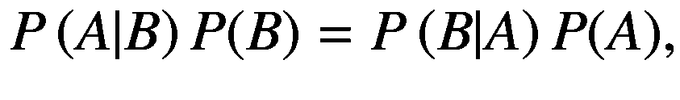

其中 `P(A)` 和 `P(B)` 是事件 `A` 和 `B` 的无条件概率，而 `P(A|B)` 是在事件 `B` 为真的条件下事件 `A` 的条件概率，`P(B|A)` 则是在事件 `A` 为真的条件下事件 `B` 的条件概率。上述等式两边都等于事件 `A` 和 `B` 同时为真的概率：`P(A ∩ B)`。换句话说，贝叶斯法则表明，`A` 和 `B` 同时为真的概率等于 `A` 的概率乘以在 `A` 为真的条件下 `B` 的概率，即 `P(A)P(B|A)`，或者等价地，等于 `B` 的概率乘以在 `B` 为真的条件下 `A` 的概率：`P(B)P(A|B)`。

在贝叶斯推断的语境中，贝叶斯法则通常用于以下情况：我们对事件 `A` 的概率有一个先验信念，由无条件概率 `P(A)` 表示，并希望在观察到事件 `B` 后更新这一信念。在这种表述中，更新后的信念由给定观测 `B` 的条件下 `A` 的条件概率表示：`P(A|B)`，我们可以使用贝叶斯法则进行计算：

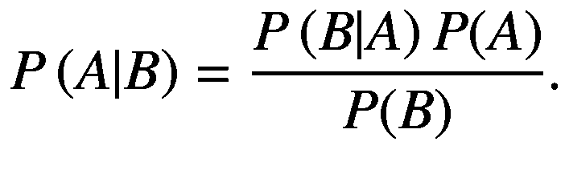

该表达式中的每个因子都有不同的解释和名称：`P(A)` 是事件 `A` 的`先验`概率，而 `P(A|B)` 是给定观测 `B` 后 `A` 的`后验`概率。`P(B|A)` 是在 `A` 为真的条件下观测到 `B` 的`似然`，而无论 `A` 为何值观测到 `B` 的概率 `P(B)` 被称为`模型证据`，可以视为（相对于 `A` 的）归一化常数。

在统计建模中，我们通常关注一组由具有特定参数 `θ` 的概率分布所表征的随机变量 `X`。在收集了我们感兴趣建模过程的数据后，我们希望从数据中推断出模型参数的值。在频率论统计方法中，我们可以最大化给定观测数据的似然函数，并获得模型参数的估计量。贝叶斯方法则将未知的模型参数 `θ` 本身视为随机变量，并使用贝叶斯法则推导出模型参数 `θ` 的概率分布。如果我们用 `x` 表示观测到的数据，则可以利用贝叶斯法则将给定观测数据 `x` 时 `θ` 的概率分布表示为

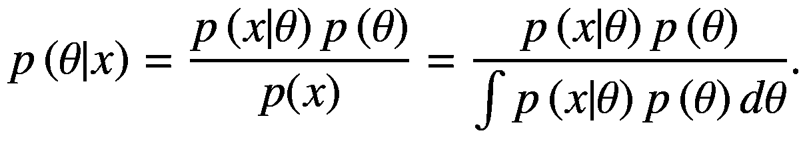

该等式中的第二个等式源于全概率公式 `p(x) = ∫ p(x|θ)p(θ)dθ`。一旦我们计算出了模型参数的后验概率分布 `p(θ|x)`，我们就可以，例如，计算模型参数的期望值，并得到类似于在频率论方法中可计算出的估计量的结果。此外，当我们拥有 `p(θ|x)` 完整概率分布的估计时，我们还可以计算其他量，例如可信区间，以及在 `θ` 为多元情况下某些特定模型参数的边缘分布。例如，如果我们有两个模型参数 `θ = (θ[1], θ[2])`，但只对 `θ[1]` 感兴趣，我们可以通过积分联合概率分布 `p(θ[1], θ[2]|x)` 来获得边缘后验概率分布 `p(θ[1]|x)`，使用的表达式来自贝叶斯定理：


这里请注意，最终表达式包含对已知似然函数 `p(x|θ[1], θ[2])` 和先验分布 `p(θ[1], θ[2])` 的积分，因此我们无需知道联合概率分布 `p(θ[1], θ[2]|x)` 即可计算边缘概率分布 `p(θ[1]|x)`。这种方法为计算模型参数的概率分布以及在新数据可用时连续更新这些分布提供了一种强大且通用的方法论。然而，直接计算 `p(θ|x)` 或其边缘分布，要求我们能够写出似然函数 `p(x|θ)` 和先验分布 `p(θ)`，并能评估由此产生的积分。对于许多简单但重要的问题，可以解析地计算这些积分，并找到后验分布的精确闭式表达式。像 Gelman (2013) 这样的教科书提供了许多可以这样精确求解的问题的例子。然而，对于更复杂的模型，其先验分布和似然函数导致的积分不易评估，或者对于多元统计模型，其产生的积分可能是高维的，那么精确和数值评估都可能变得不可行。

正是在那些无法用精确方法求解的模型中，我们可以受益于使用模拟方法，例如马尔可夫链蒙特卡罗方法，该方法允许我们对模型参数的后验概率分布进行采样，从而构建联合或边缘后验分布的近似，或者直接评估诸如期望值之类的积分。基于模拟的方法的另一个重要优势是建模过程可以自动化。在这里，我们将专门专注于使用蒙特卡罗模拟方法进行贝叶斯统计建模。关于理论的详尽回顾以及许多可解析求解问题的例子，请参阅本章末尾给出的参考文献。在本章的其余部分，我们将探讨统计模型的定义以及使用`PyMC`库作为概率编程框架对其后验分布进行采样。

在继续讨论计算贝叶斯统计之前，有必要花一点时间来总结贝叶斯方法与我们在前几章中使用的经典频率论方法之间的关键区别：在这两种统计建模方法中，我们都用随机变量来表述模型。定义统计模型的一个关键步骤是对模型中定义的随机变量的概率分布做出假设。在参数化方法中，每个概率分布都由少量参数来表征。在频率论方法中，这些模型参数具有某些特定的真实值，而观测到的数据被解释为来自真实分布的随机样本。换句话说，模型参数被认为是固定的，而数据被认为是随机的。贝叶斯方法则持相反观点：数据被解释为固定的，而模型参数被描述为随机变量。从模型参数的先验分布出发，我们可以更新该分布以考虑观测到的数据，并最终获得以观测数据为条件的相关模型参数的概率分布。

## 模型定义

统计模型是通过一组随机变量来定义的。给定模型中的随机变量可以是相互独立的，或者更有趣的是，彼此之间存在依赖关系。`PyMC`库提供了用于表示大量概率分布中随机变量的类：例如，`mc.Normal`的实例可用于表示正态分布的随机变量。其他例子还有用于表示离散伯努利分布随机变量的`mc.Bernoulli`、用于均匀分布随机变量的`mc.Uniform`、用于伽马分布随机变量的`mc.Gamma`等等。有关可用分布的完整列表，请参阅`dir(mc.distributions)`以及每个可用分布的文档字符串，以了解如何使用它们。也可以使用`mc.DensityDist`类来定义自定义分布，该类接受一个指定随机变量概率密度函数对数的函数。

在第13章中，我们看到`SciPy`的`stats`模块也包含用于表示随机变量的类。与SciPy `stats`中的随机变量类类似，我们可以使用PyMC分布来表示具有固定参数的随机变量。然而，PyMC随机变量的基本特征在于，其分布参数（例如，对于服从正态分布 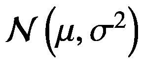 的随机变量，其均值*μ*和方差*σ*²）本身也可以是随机变量。这使我们能够在模型中链式连接随机变量，并构建具有层次结构的模型，该层次结构体现在模型中出现的随机变量之间的依赖关系上。

让我们从最简单的例子开始。在PyMC中，模型由`mc.Model`类的实例表示，并且使用Python上下文语法将随机变量添加到模型中：在模型上下文主体内创建的随机变量实例会自动添加到模型中。假设我们感兴趣的是一个由单个随机变量组成的模型，该随机变量服从参数固定的正态分布，即*μ* = 4 和*σ* = 2。我们首先定义固定的模型参数，然后创建一个`mc.Model`实例来表示我们的模型。

```
In [9]: mu = 4.0
In [10]: sigma = 2.0
In [11]: model = mc.Model()
```

接下来，我们通过在模型上下文中创建随机变量来将它们附加到模型上。这里，我们在模型上下文中创建了一个随机变量`X`，该上下文通过`with model`语句激活：

```
In [12]: with model:
...:     mc.Normal('X', mu, tau=1/sigma**2)
```

`PyMC`中所有随机变量类的第一个参数都是变量的名称。对于`mc.Normal`，第二个参数是正态分布的均值，第三个参数`tau`是精度*τ* = 1/*σ*²，其中*σ*²是方差。或者，我们可以使用`sd`关键字参数来指定标准差，而不是精度：`mc.Normal('X', mu, sd=sigma)`。

我们可以使用`vars`属性来检查模型中存在哪些随机变量。这里，模型中只有一个随机变量：

```
In [13]: model.vars
Out[13]: [X]
```

为了从模型中的随机变量进行采样，我们使用实现了MCMC算法的`mc.sample`函数。`mc.sample`函数接受许多参数，但至少我们需要提供采样数量作为第一个参数，以及一个步长类实例作为第二个参数，该实例实现了MCMC步进。可选地，我们还可以使用`start`关键字参数提供一个起始点，该起始点是一个字典，包含采样开始的参数值。对于步进方法，这里我们使用`mc.Metropolis`类的一个实例，该类为MCMC采样器实现了Metropolis-Hastings步进方法^(⁶⁵)。请注意，我们在模型上下文中执行所有与模型相关的代码：

```
In [14]: start = dict(X=2)
In [15]: with model:
...:     step = mc.Metropolis()
...:     trace = mc.sample(10000, start=start, step=step)
[-----------------100%-----------------] 10000 of 10000 complete in 1.6 sec
```

通过这些步骤，我们从模型内定义的随机变量中采样了10000个值，在这个简单案例中，该随机变量只是一个正态分布的随机变量。要访问这些样本，我们可以使用`mc.sample`函数返回的追踪对象的`get_values`方法：

```
In [16]: X = trace.get_values("X")
```

当然，正态分布的概率密度函数（PDF）是已知解析形式的。使用SciPy `stats`模块，我们可以通过`norm`类实例的`pdf`方法来访问PDF，以便与采样的随机变量进行比较。采样值以及当前模型的真实PDF如图16-1所示。

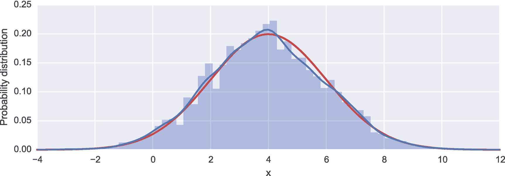

图 16-1

正态分布随机变量的概率密度函数（红色/粗线）以及来自10000个MCMC样本的直方图

```
In [17]: x = np.linspace(-4, 12, 1000)
In [18]: y = stats.norm(mu, sigma).pdf(x)
In [19]: fig, ax = plt.subplots(figsize=(8, 3))
...: ax.plot(x, y, 'r', lw=2)
...: sns.distplot(X, ax=ax)
...: ax.set_xlim(-4, 12)
...: ax.set_xlabel("x")
...: ax.set_ylabel("概率分布")
```

使用`mc.traceplot`函数，我们还可以可视化生成这些样本的MCMC随机游走，如图16-2所示。`mc.traceplot`函数会自动为模型中每个随机变量绘制核密度估计值和采样轨迹。

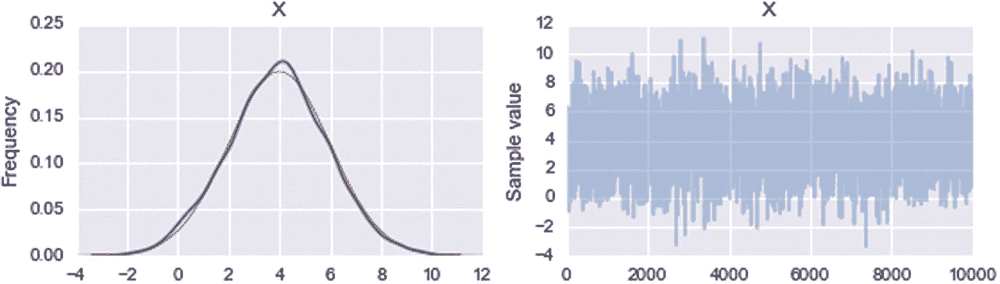

图 16-2

左图：采样轨迹的密度核估计（蓝色/粗线）和正态概率分布（红色/细线）。右图：MCMC采样轨迹

```
In [20]: fig, axes = plt.subplots(1, 2, figsize=(8, 2.5), squeeze=False)
...: mc.traceplot(trace, ax=axes)
...: axes[0, 0].plot(x, y, 'r', lw=0.5)
```

作为构建更复杂统计模型的下一步，再次考虑一个具有正态分布随机变量 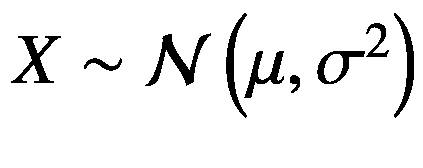 的模型，但是其中的参数*μ*和*σ*本身是随机变量。在`PyMC`中，我们可以通过在创建其他随机变量时将它们作为参数传递来轻松创建依赖变量。例如，对于 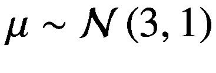 和 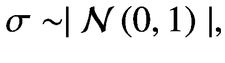 我们可以使用以下模型规范来创建依赖的随机变量*X*：

```markdown
In [21]: model = mc.Model()
In [22]: with model:
...:     mean = mc.Normal('mean', 3.0)
...:     sigma = mc.HalfNormal('sigma', sd=1.0)
...:     X = mc.Normal('X', mean, sd=sigma)
```

这里我们使用 `mc.HalfNormal` 来表示随机变量 ，并且 `mc.Normal` 类中用于 *X* 的均值和标准差参数是随机变量实例，而非固定的模型参数。和之前一样，我们可以使用 `vars` 属性来检查一个模型包含哪些随机变量。

```
In [23]: model.vars
Out[23]: [mean, sigma_log__, X]
```

请注意，这里的 `pymc3` 库用一个经对数变换的变量 `sigma_log__` 来表示 `sigma` 变量，以此处理半正态分布。不过，我们仍然可以直接从模型中访问 `sigma` 变量，后续内容将展示这一点。

当模型复杂度增加时，显式地为采样过程选择合适的起始点可能不再那么简单直接。`mc.find_MAP` 函数可用于在参数空间中找出与后验分布最大值相对应的点，该点可作为采样过程的一个良好起始点。

```
In [24]: with model:
...:     start = mc.find_MAP()
In [25]: start
Out[25]: {'X': array(3.0), 'mean': array(3.0),
'sigma': array(0.70710674), 'sigma_log__': array(-0.34657365)}
```

和之前一样，一旦模型被定义，并且计算出了起始点，我们就可以使用 `mc.sample` 函数从模型中的随机变量进行采样，例如，使用 `mc.Metropolis` 作为 MCMC 采样步进方法：

```
In [26]: with model:
...:     step = mc.Metropolis()
...:     trace = mc.sample(100000, start=start, step=step)
[-----------------100%-----------------] 100000 of 100000 complete in 53.4 sec
```

例如，要获取 `sigma` 变量的样本轨迹，我们可以使用 `get_values('sigma')`。结果是一个包含样本值的 NumPy 数组，我们可以从中计算进一步的统计量，如其样本均值和标准差：

```
In [27]: trace.get_values('sigma').mean()
Out[27]: 0.80054476153369014
```

同样的方法可用于获取 `X` 的样本并计算其统计量：

```
In [28]: X = trace.get_values('X')
In [29]: X.mean()
Out[29]: 2.9993248663922092
In [30]: trace.get_values('X').std()
Out[30]: 1.4065656512676457
```

使用 `mc.traceplot` 创建的当前模型的轨迹图如图 16-3 所示，我们在 `mc.traceplot` 中使用了 `varnames` 参数来明确选择要绘制的随机变量。

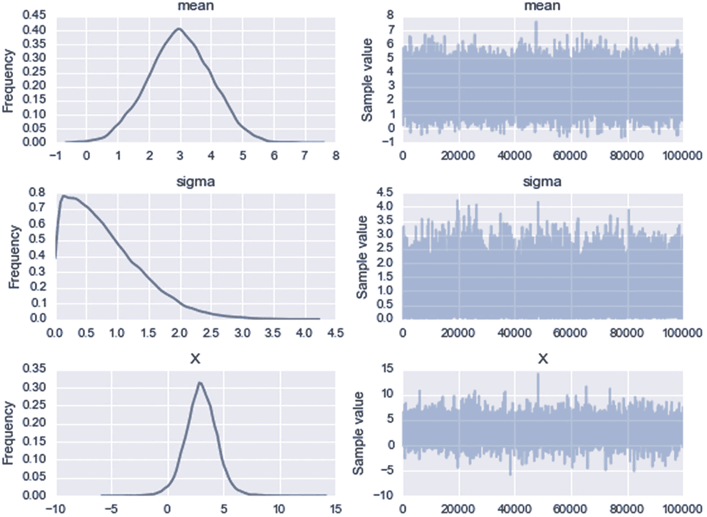

**图 16-3**

三个随机变量：*均值*、*sigma* 和 *X* 的核密度估计（左）和 MCMC 随机采样轨迹（右）。

```
In [31]: fig, axes = plt.subplots(3, 2, figsize=(8, 6), squeeze=False)
...: mc.traceplot(trace, varnames=['mean', 'sigma', 'X'], ax=axes)
```

## 采样后验分布

到目前为止，我们已定义并采样了仅包含随机变量且未引用任何观测数据的模型。在贝叶斯模型的语境中，这类随机变量代表了未知模型参数的先验分布。因此，在前面的示例中，我们使用 MCMC 方法从模型的先验分布中采样。然而，MCMC 算法的真正应用是从后验分布中采样，该后验分布代表了在更新先验分布以考虑观测数据影响后，模型变量的概率分布。

要使模型以观测数据为条件，我们只需在模型中创建相应随机变量时，使用 `observed` 关键字参数添加数据即可：例如，`mc.Normal('X', mean, 1/sigma**2, observed=data)` 表示随机变量 `X` 的观测值取自数组 `data`。向模型添加观测随机变量会自动导致后续使用 `mc.sample` 进行的采样，是对模型后验分布的采样，该后验分布根据贝叶斯规则和所选用于观测数据的分布所隐含的似然函数，正确地以观测数据为条件。例如，考虑我们在前文中使用的模型，该模型带有一个正态分布随机变量 *X*，其均值和标准差也是随机变量。这里我们通过使用 SciPy `stats` 模块中的 `norm` 类，从一个均值为 *μ* = 2.5 且标准差为 *σ* = 1.5 的正态分布随机变量中抽取样本来模拟 *X* 的观测值：

```
In [32]: mu = 2.5
In [33]: s = 1.5
In [34]: data = stats.norm(mu, s).rvs(100)
```

数据通过设置关键字参数 `observed=data` 馈入模型，该参数在创建观测变量并将其添加到模型时使用：

```
In [35]: with mc.Model() as model:
...:     mean = mc.Normal('mean', 4.0, 1.0) # 真实值 2.5
...:     sigma = mc.HalfNormal('sigma', 3.0 * np.sqrt(np.pi/2)) # 真实值 1.5
...:     X = mc.Normal('X', mean, 1/sigma**2, observed=data)
```

为 *X* 提供观测数据的一个结果是，它不再被视为模型中的随机变量。这可以通过使用 `vars` 属性检查模型来看到，其中 `X` 不再出现：

```
In [36]: model.vars
Out[36]: [mean, sigma_log_]
```

相反，在这种情况下，`X` 是一个确定性变量，用于构建将先验分布（由 `mean` 和 `sigma` 表示）与这些随机变量的后验分布联系起来的似然函数。和之前一样，我们可以使用 `mc.find_MAP` 函数为采样过程找到合适的起始点。在创建 MCMC 步进实例后，我们可以使用 `mc.sample` 对模型的后验分布进行采样：

```
In [37]: with model:
...:     start = mc.find_MAP()
...:     step = mc.Metropolis()
...:     trace = mc.sample(100000, start=start, step=step)
[-----------------100%-----------------] 100000 of 100000 complete in 36.1 sec
```

使用 `mc.find_MAP` 计算出的起始点使给定观测数据下的后验似然最大化，并提供了先验分布未知参数的估计值：

```
In [38]: start
Out[38]: {'mean': array(2.5064940359768246), 'sigma_log': array(0.394681633456101)}
```

然而，为了获得这些参数（它们本身就是随机变量）分布的估计值，我们需要按照前文所述，使用 `mc.sample` 函数执行 MCMC 采样。后验分布采样的结果如图 16-4 所示。请注意，由于数据及相应似然函数的影响，`mean` 和 `sigma` 变量的分布更接近真实参数值 *μ* = 2.5 和 *σ* = 1.5，而非先验猜测值 4.0 和 3.0。

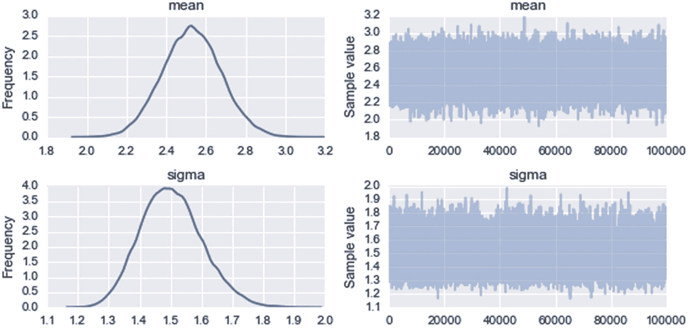

**图 16-4**

*均值*和*西格玛*后验分布的 MCMC 采样轨迹
```

```markdown
# 线性回归

回归是统计建模中最基本的工具之一，我们已经在经典统计形式中看到过线性回归的例子，例如在第 14 章和第 15 章中。线性回归也可以通过贝叶斯方法处理，并将其视为一个建模问题：我们为未知模型参数（斜率和截距）分配先验概率分布，并根据现有观测数据计算后验分布。为了能够比较贝叶斯线性回归与频率学派方法（例如，使用第 14 章的方法）在处理相同问题时的异同，我们首先使用 `statsmodels` 库对线性回归问题进行简要分析。接着，我们使用 `PyMC` 对同一问题进行分析。

作为执行线性回归分析的示例数据，我们使用了一个包含 200 名男性和女性身高与体重的数据集。我们可以使用 `statsmodels` 库中 `datasets` 模块的 `get_rdataset` 函数加载该数据集：

```python
dataset = sm.datasets.get_rdataset("Davis", "carData")
```

为简单起见，我们首先只使用数据集中对应男性受试者的子集，并且为了避免处理异常值，我们过滤掉所有体重超过 110 千克的受试者。使用 `Pandas` 通过布尔掩码过滤 `DataFrame` 的方法可以轻松完成这些操作：

```python
data = dataset.data[dataset.data.sex == 'M']
data = data[data.weight < 110]
```

生成的 `Pandas` `DataFrame` 对象 `data` 包含多个列：

|   | `sex` | `weight` | `height` | `repwt` | `repht` |
|---|---|---|---|---|---|
| `0` | `M` | `77` | `182` | `77` | `180` |
| `3` | `M` | `68` | `177` | `70` | `175` |
| `5` | `M` | `76` | `170` | `76` | `165` |

```python
data.head(3)
```

这里我们专注于一个线性回归模型，用于分析该数据集中 `weight` 列和 `height` 列之间的关系。使用 `statsmodels` 库及其普通最小二乘回归模型以及 `Patsy` 公式语言，我们可以用一行代码为这种关系创建一个统计模型：

```python
model = smf.ols("height ~ weight", data=data)
```

为了实际将指定模型拟合到观测数据，我们使用模型实例的 `fit` 方法：

```python
result = model.fit()
```

一旦模型拟合完成并创建了模型结果对象，我们就可以使用 `predict` 方法来计算对新观测值的预测，并绘制身高与体重之间的线性关系图，如图 16-6 所示。

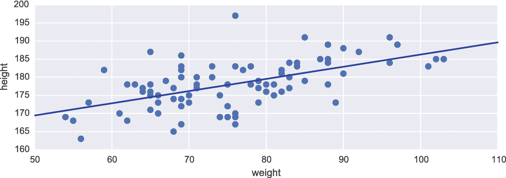

**图 16-6**

身高与体重的关系图，以及使用普通最小二乘法拟合的线性模型

```python
x = np.linspace(50, 110, 25)
y = result.predict({"weight": x})
fig, ax = plt.subplots(1, 1, figsize=(8, 3))
ax.plot(data.weight, data.height, 'o')
ax.plot(x, y, color="blue")
ax.set_xlabel("weight")
ax.set_ylabel("height")
```

图 16-6 中所示的线性关系总结了在该数据集上执行线性回归的主要结果。它给出了最佳拟合线，该线由模型参数（截距和斜率）的特定值描述。在频率学派的统计方法中，我们还可以计算众多统计量，例如，针对各种假设的 *p* 值，比如模型参数为零（无影响）的假设。

贝叶斯回归分析的结果是每个模型参数的边缘分布的后验分布。根据这些边缘分布，我们可以计算模型参数的均值估计，这大致对应于频率学派分析得到的模型参数。我们还可以计算其他量，例如置信区间，它表征了估计的不确定性。要使用贝叶斯模型对身高与体重的关系进行建模，我们可以使用如下关系式：`height ~ N(intercept + β * weight, σ²)`，其中 `intercept`、`β` 和 `σ` 是分布和参数未知的随机变量。我们还需要为模型中的所有随机变量赋予先验分布。根据应用场景的不同，先验的具体选择可能是一个敏感问题，但当有大量数据需要拟合时，使用合理的初始猜测通常就足够了。这里，我们仅从代表所有模型参数宽泛分布的先验开始。

要在 `PyMC` 中对模型进行编程，我们使用与本章前面部分相同的方法：首先，为模型中的随机分量创建随机变量，并将它们分配给具有特定参数（代表先验分布）的分布。接下来，我们创建一个确定性变量，该变量是随机变量的函数，但使用 `observed` 关键字参数以及身高分布期望值（`height_mu`）的表达式将观测数据附加到它上面。

## 使用 PyMC 进行贝叶斯线性回归

现在，我们使用 `PyMC` 对相同的线性回归问题进行分析。首先，我们导入 `pymc`（在代码中通常缩写为 `mc`）：

```python
import pymc as mc
```

接下来，我们为模型参数定义先验分布。对于这个简单的线性模型，我们为截距和斜率选择正态先验，为噪声的标准差选择半正态先验：

```python
with mc.Model() as model:
    # 先验分布
    intercept = mc.Normal('intercept', mu=0, sd=100)
    beta = mc.Normal('beta', mu=0, sd=100)
    sigma = mc.HalfNormal('sigma', sd=10)
```

然后，我们定义预期身高（`height_mu`）的确定性变量，并将其与观测数据联系起来：

```python
    # 预期身高的确定性变量
    height_mu = intercept + beta * data.weight
    # 似然函数：将观测到的身高数据与模型关联
    height = mc.Normal('height', mu=height_mu, sd=sigma, observed=data.height)
```

定义好模型后，我们进行采样以获得后验分布：

```python
    # 使用 MCMC 采样
    trace = mc.sample(2000, tune=1000, cores=2)
```

我们可以使用 `mc.traceplot` 和 `mc.summary` 来可视化和总结后验分布：

```python
mc.traceplot(trace, varnames=['intercept', 'beta', 'sigma'])
```

```python
mc.summary(trace, varnames=['intercept', 'beta', 'sigma'])
```

从后验分布中，我们可以提取参数的均值估计，这些估计可以与之前使用 `statsmodels` 得到的结果进行比较。我们还可以绘制贝叶斯模型的预测线及其不确定性区间（后验预测区间）：

```python
# 计算预测值（使用后验均值）
x = np.linspace(50, 110, 25)
pred_height = trace['intercept'].mean() + trace['beta'].mean() * x

fig, ax = plt.subplots(1, 1, figsize=(8, 3))
ax.plot(data.weight, data.height, 'o', label='Data')
ax.plot(x, pred_height, color="blue", label='Mean Posterior Fit')
ax.set_xlabel("weight")
ax.set_ylabel("height")
ax.legend()
```

通过这种方式，贝叶斯方法不仅给出了参数的点估计，还提供了完整的后验分布，使我们能够量化估计的不确定性，并基于概率进行更丰富的推断。
```

```python
In [51]: with mc.Model() as model:
...:     sigma = mc.Uniform('sigma', 0, 10)
...:     intercept = mc.Normal('intercept', 125, sd=30)
...:     beta = mc.Normal('beta', 0, sd=5)
...:     height_mu = intercept + beta * data.weight
...:     mc.Normal('height', mu=height_mu, sd=sigma, observed=data.height)
...:     predict_height = mc.Normal('predict_height', mu=intercept + beta * x, sd=sigma, shape=len(x))
```

如果我们想使用该模型预测特定体重值对应的身高，还可以向模型中添加一个额外的随机变量。在上述模型规范中，`predict_height`变量就是一个例子。这里的`x`是之前创建的、数值范围在 50 到 110 之间的`NumPy`数组。因为它是一个数组，所以我们需要将`mc.Normal`类的`shape`属性设置为该数组相应的长度。如果我们检查模型的`vars`属性，现在会看到它包含了两个模型参数（`intercept`和`beta`）、模型误差的分布（`sigma`），以及用于根据`x`数组预测特定体重值对应身高的`predict_height`变量：

```python
In [52]: model.vars
Out[52]: [sigma_interval, intercept, beta, predict_height]
```

一旦模型完全指定，我们就可以转向`MCMC`算法，根据观测数据对模型的后验边缘分布进行采样。和之前一样，我们可以使用`mc.find_MAP`来找到一个合适的起始点。这里我们使用另一个采样器`mc.NUTS`（No-U-Turn Sampler），这是一个新增到`PyMC`第三版的、功能强大的新采样器。

```python
In [53]: with model:
...:     start = mc.find_MAP()
...:     step = mc.NUTS()
...:     trace = mc.sample(10000, step, start=start)
[-----------------100%-----------------] 10000 of 10000 complete in 43.1 sec
```

采样的结果存储在由`mc.sample`返回的`trace`对象中。我们可以使用`mc.traceplot`函数可视化概率分布的核密度估计以及生成样本的`MCMC`随机游走轨迹。这里我们再次使用`varnames`参数来明确选择要在轨迹图中显示的模型中的随机变量。结果如图[16-7]所示。

**图 16-7**

线性模型截距和`beta`系数的分布与采样轨迹

```python
In [54]: fig, axes = plt.subplots(2, 2, figsize=(8, 4), squeeze=False)
...: mc.traceplot(trace, varnames=['intercept', 'beta'], ax=axes)
```

线性模型中与上述`statsmodels`分析结果最接近的截距和系数值，是通过计算贝叶斯模型中随机变量轨迹的均值得到的：

```python
In [55]: intercept = trace.get_values("intercept").mean()
In [56]: intercept
Out[56]: 149.97546241676989
In [57]: beta = trace.get_values("beta").mean()
In [58]: beta
Out[58]: 0.37077795098761318
```

`statsmodels`分析的相应结果是通过访问`fit`方法返回的结果类中的`params`属性得到的（见上文）：

```python
In [59]: result.params
Out[59]: Intercept    152.617348
weight         0.336477
dtype: float64
```

通过比较这些截距和系数的值，我们看到两种方法对未知模型参数的最大似然估计给出了相似的结果。在`statsmodels`方法中，要预测给定体重（例如 90 公斤）的期望身高，我们可以使用`predict`方法来获得具体身高：

```python
In [60]: result.predict({"weight": 90}).values
Out[60]: array([ 182.90030002])
```

贝叶斯模型中的相应结果是通过计算给定体重下随机变量`predict_height`分布的均值得到的：

```python
In [61]: weight_index = np.where(x == 90)[0][0]
In [62]: trace.get_values("predict_height")[:, weight_index].mean()
Out[62]: 183.33943635274935
```

同样，两种方法得到的结果是可比的。然而，在贝叶斯模型中，我们可以获得每个建模体重下身高完整概率分布的估计。例如，我们可以使用`Seaborn`库的`distplot`函数绘制体重为 90 公斤时概率分布的直方图和核密度估计，结果如图[16-8]所示。

**图 16-8**

体重为 90 公斤时身高预测的概率分布

```python
In [63]: fig, ax = plt.subplots(figsize=(8, 3))
...: sns.distplot(trace.get_values("predict_height")[:, weight_index], ax=ax)
...: ax.set_xlim(150, 210)
...: ax.set_xlabel("height")
...: ax.set_ylabel("Probability distribution")
```

MCMC 轨迹中的每个样本都代表了我们希望用其拟合观测数据的线性模型中截距和系数的一个可能值。为了可视化我们可以作为最终线性模型参数估计值的均值截距和系数的不确定性，将每个样本点对应的直线与数据散点图以及均值截距和斜率对应的直线一起绘制出来是很有启发性的。这将得到一个类似于图[16-9]所示的图形。这些直线的离散程度代表了给定体重下身高估计的不确定性。在数据点较少的边缘区域，离散程度通常较大，而在数据点密集的云团中间区域，离散程度较小。

**图 16-9**

身高与体重的关系，以及使用 OLS 和贝叶斯模型进行线性拟合的结果

```python
In [64]: fig, ax = plt.subplots(1, 1, figsize=(8, 3))
...: for n in range(500, 2000, 1):
...:     intercept = trace.get_values("intercept")[n]
...:     beta = trace.get_values("beta")[n]
...:     ax.plot(x, intercept + beta * x, color="red", lw=0.25, alpha=0.05)
...: intercept = trace.get_values("intercept").mean()
...: beta = trace.get_values("beta").mean()
...: ax.plot(x, intercept + beta * x, color="k", label="Mean Bayesian prediction")
...: ax.plot(data.weight, data.height, 'o')
...: ax.plot(x, y, '--', color="blue", label="OLS prediction")
...: ax.set_xlabel("weight")
...: ax.set_ylabel("height")
...: ax.legend(loc=0)
```

在我们此处看到的线性回归问题中，我们显式定义了统计模型以及模型中包含的随机变量。这展示了使用贝叶斯方法和 `PyMC` 库进行统计模型分析所需的一般步骤。不过，对于广义线性模型，`PyMC` 库提供了一个简化的 API，它可以为我们创建模型和所需的随机变量。通过 `mc.glm.GLM.from_formula` 函数，我们可以使用 Patsy 公式（参见第 14 章）定义广义线性模型，并使用 Pandas 数据框提供数据。这会自动处理模型的设置工作。使用 `mc.glm.glm` 完成模型设置后，我们可以继续使用与之前相同的方法，从模型的后验分布中进行采样。

# 贝叶斯广义线性模型

## GLM模型的采样与可视化

```
In [65]: with mc.Model() as model:
...:     mc.glm.GLM.from_formula('height ~ weight', data)
...:     step = mc.NUTS()
...:     trace = mc.sample(2000, step)
[-----------------100%-----------------] 2000 of 2000 complete in 99.1 sec
```

通过 `mc.traceplot` 函数可视化的 GLM 模型采样结果如图 16-10 所示。在这些轨迹图中，`sd` 对应前文显式模型定义中的 `sigma` 变量，它代表了模型与观测数据之间残差的标准误差。在轨迹中，注意采样需要经过几百次采样才能达到稳定水平。初始瞬态阶段所采集的样本不具备正确的分布，因此，在使用这些样本进行计算估计时，我们应该排除初始阶段的样本。

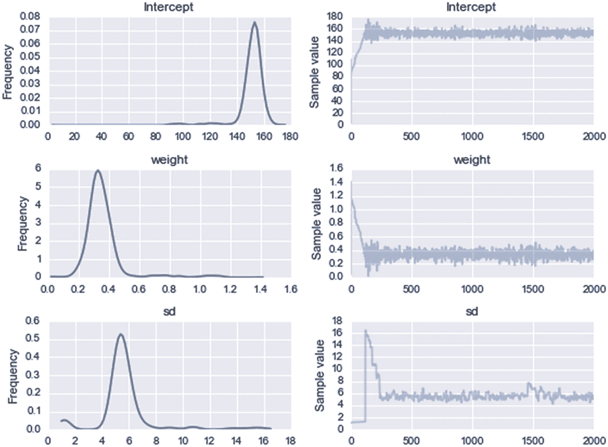

**图 16-10**

使用 `mc.glm` 模块定义的贝叶斯 GLM 模型的样本轨迹图

```
In [66]: fig, axes = plt.subplots(3, 2, figsize=(8, 6), squeeze=False)
...: mc.traceplot(trace, varnames=['Intercept', 'weight', 'sd'], ax=axes)
```

## 与频率学派方法的比较

通过 `mc.glm.glm`，我们几乎可以用与使用 `statsmodels` 进行频率学派方法定义和分析模型相同的方式，来创建和分析贝叶斯统计下的线性模型。对于本文研究的这个简单例子，两种统计方法下的回归分析得出了相似的结果，没有哪种方法比另一种更适用。然而，在某些情况下，实际存在的差异可能会使其中一种方法更占优势。例如，使用贝叶斯方法，我们可以获得完整边际后验分布的估计值，这对于计算均值之外的统计量非常有用。然而，对像这里考虑的简单模型执行 `MCMC`，其计算量远大于执行普通最小二乘拟合。贝叶斯方法真正的优势体现在分析高维度（包含许多未知模型参数）的复杂模型时。在这种情况下，定义合适的频率学派模型可能很困难，并且求解由此产生的模型也颇具挑战性。`MCMC` 算法具有非常好的可扩展性，能够很好地处理高维问题，因此对于复杂的统计模型具有很强的竞争力。尽管我们这里考虑的模型都很简单，并且可以轻松地使用频率学派方法求解，但这里使用的一般方法论保持不变，创建更复杂的模型仅仅是向模型中添加更多随机变量的问题。

## 多层次贝叶斯模型

作为最后一个示例，我们说明当贝叶斯模型的复杂性增加时，同样的一般过程依然适用。我们回到身高和体重数据集，但这里我们不仅选择男性受试者，还在模型中考虑一个额外的层级，即受试者的性别，这样男性和女性就可以用可能不同的斜率和截距来建模。在 `PyMC` 中，我们可以通过使用 `shape` 参数来指定添加到模型中的每个随机变量的维度，从而创建多层级模型，如下例所示。

我们首先准备数据集。在这里，我们再次将分析限制在体重小于 110 公斤的受试者上，以消除异常值，并将 `sex` 列转换为一个二值变量，其中 0 代表男性，1 代表女性。

```
In [67]: data = dataset.data.copy()
In [68]: data = data[data.weight < 110]
In [69]: data["sex"] = data["sex"].apply(lambda x: 1 if x == "F" else 0)
```

接下来，我们定义统计模型，这里我们将其设为 `height ~ N(intercept[i] + β[i] * weight, σ²)`，其中 `i` 是一个索引，对于男性受试者取值为 0，对于女性受试者取值为 1。在创建 `intercept[i]` 和 `β[i]` 的随机变量时，我们通过指定 `shape=2` 来表示多层级结构（因为在这种情况下，我们有两个层级：男性和女性）。与之前模型定义相比，唯一的不同之处在于，在定义 `height_mu` 的表达式时，我们还需要使用一个索引掩码，以便 `data.weight` 中的每个值都能关联到正确的层级。

```
In [70]: with mc.Model() as model:
...:     intercept_mu, intercept_sigma = 125, 30
...:     beta_mu, beta_sigma = 0, 5
...:
...:     intercept = mc.Normal('intercept', intercept_mu, sd=intercept_sigma, shape=2)
...:     beta = mc.Normal('beta', beta_mu, sd=beta_sigma, shape=2)
...:     error = mc.Uniform('error', 0, 10)
...:
...:     sex_idx = data.sex.values
...:     height_mu = intercept[sex_idx] + beta[sex_idx] * data.weight
...:
...:     mc.Normal('height', mu=height_mu, sd=error, observed=data.height)
```

使用 `vars` 属性对象检查模型变量，显示模型中再次包含了三个随机变量：`intercept`、`beta` 和 `error`。然而，与之前的模型不同，这里的 `intercept` 和 `beta` 都有两个层级。

```
In [71]: model.vars
Out[71]: [intercept, beta, error_interval]
```

我们调用`MCMC`采样算法的方式与本章前面的示例相同。这里我们使用`NUTS`采样器并收集 5000 个样本：

```
In [72]: with model:
    ...:     start = mc.find_MAP()
    ...:     step = mc.NUTS()
    ...:     trace = mc.sample(5000, step, start=start)
[-----------------100%-----------------] 5000 of 5000 complete in 64.2 sec
```

和之前一样，我们也可以使用`mc.traceplot`函数来可视化采样结果。这使我们能够快速了解模型参数的分布，并验证`MCMC`采样是否产生了合理的结果。当前模型的迹线图如图 16-11 所示，与之前的示例不同，这里`intercept`和`beta`变量的面板中有多条曲线，反映了它们的多层次性质：蓝色（深色）线条表示男性受试者的结果，绿色（浅色）线条表示女性受试者的结果。

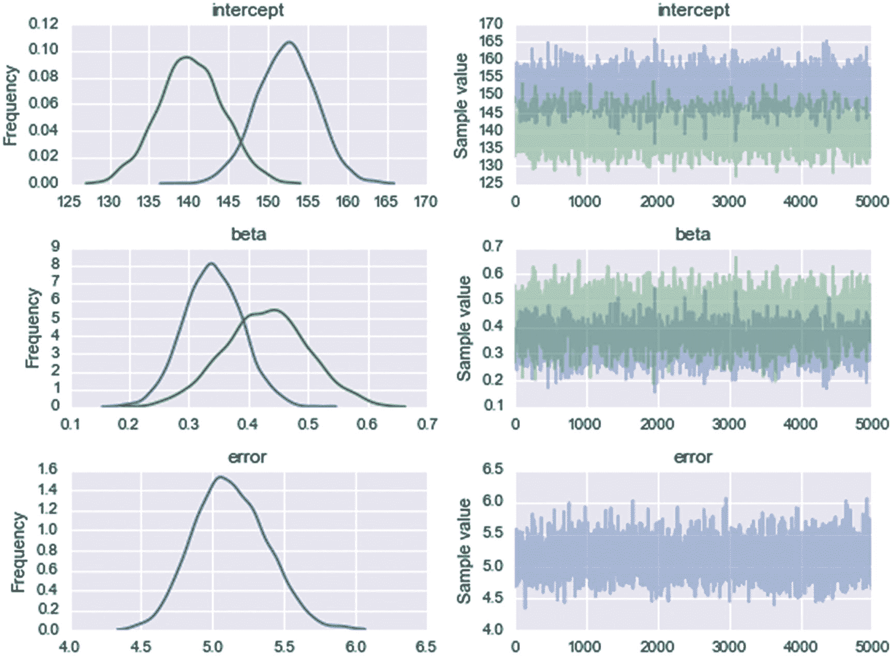

**图 16-11** 身高与体重多层次模型中的模型参数概率分布的内核密度估计以及每个变量的`MCMC`采样迹线

```
In [73]: mc.traceplot(trace, figsize=(8, 6))
```

使用`trace`对象的`get_values`方法，我们可以提取模型变量的采样数据。这里，`intercept`和`beta`的采样数据是形状为`(5000, 2)`的二维数组：第一维代表每个样本，第二维代表变量的层次。这里我们关心的是每个性别对应的截距和斜率，所以我们沿着第一轴（所有样本）取平均值：

```
In [74]: intercept_m, intercept_f = trace.get_values('intercept').mean(axis=0)
In [75]: beta_m, beta_f = trace.get_values('beta').mean(axis=0)
```

通过对两个维度求平均，我们还可以得到代表整个数据集（将男性和女性受试者归为一组）的截距和斜率：

```
In [76]: intercept = trace.get_values('intercept').mean()
In [77]: beta = trace.get_values('beta').mean()
```

最后，我们通过将数据绘制成散点图，并绘制对应于我们获得的男性和女性受试者的截距和斜率的线，以及将所有受试者分组在一起的结果，来可视化结果。结果如图 16-12 所示。

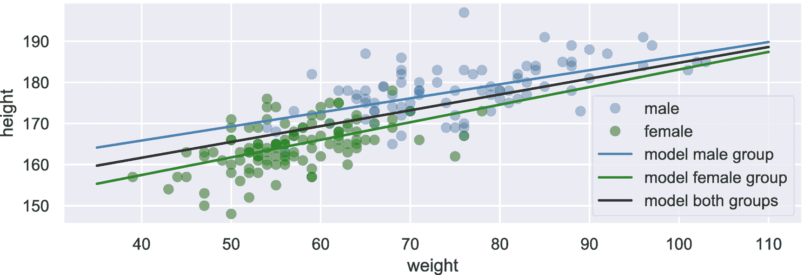

**图 16-12** 男性（深色/蓝色）和女性（浅色/绿色）受试者的身高与体重关系

# 代码与分析

```
In [78]: fig, ax = plt.subplots(1, 1, figsize=(8, 3))
    ...: mask_m = data.sex == 0
    ...: mask_f = data.sex == 1
    ...: ax.plot(data.weight[mask_m], data.height[mask_m], 'o', color="steelblue",
    ...:         label="male", alpha=0.5)
    ...: ax.plot(data.weight[mask_f], data.height[mask_f], 'o', color="green",
    ...:         label="female", alpha=0.5)
    ...: x = np.linspace(35, 110, 50)
    ...: ax.plot(x, intercept_m + x * beta_m, color="steelblue", label="model male group")
    ...: ax.plot(x, intercept_f + x * beta_f, color="green", label="model female group")
    ...: ax.plot(x, intercept + x * beta, color="black", label="model both groups")
    ...: ax.set_xlabel("weight")
    ...: ax.set_ylabel("height")
    ...: ax.legend(loc=0)
```

回归线如图 16-12 所示，图 16-11 所示的分布图表明，通过考虑男性和女性受试者的不同截距和斜率，模型得到了改进。在使用 `PyMC` 的贝叶斯模型中，改变分析中使用的底层模型只需向模型中添加随机变量，定义它们之间的关系，并为每个随机变量分配一个先验分布即可。实际求解模型所需的 `MCMC` 采样与模型细节无关。这是贝叶斯统计建模最吸引人的方面之一。例如，在前面考虑的多层次模型中，我们可以将截距和斜率变量的先验分布参数与另一个随机变量相关联，而不是将它们指定为独立的概率分布，从而获得一个分层贝叶斯模型，其中描述每个层次截距和斜率分布的模型参数是从一个共同分布中抽取的。分层模型有很多用途，是贝叶斯统计擅长的众多应用之一。

## 总结

在本章中，我们使用 `PyMC` 库提供的计算方法探索了贝叶斯统计。贝叶斯统计方法在几个基本观点上与经典的频率学派统计不同。从实际计算的角度来看，贝叶斯方法通常很难精确求解。事实上，精确计算贝叶斯模型的后验分布通常代价高昂，以至于无法实现。然而，我们通常可以应用强大而高效的采样方法，通过模拟找到近似的后验分布。贝叶斯统计框架的关键作用是允许我们定义统计模型，然后应用采样方法为模型找到近似的后验分布。在这里，我们将 `PyMC` 库用作 `Python` 中的贝叶斯建模框架。我们简要探讨了根据具有给定分布的随机变量定义统计模型，并使用 `PyMC` 库中实现的 `MCMC` 方法对这些模型的后验分布进行模拟和采样。

## 进一步阅读

关于贝叶斯统计理论的入门介绍，请参阅 Kruschke (2014) 和 Downey (2013)。更技术性的讨论见 Gelman (2013)。有关使用 `Python` 的贝叶斯方法的计算导向介绍，请参阅《概率编程与贝叶斯方法黑客教程》，可在线免费获取：[`http://camdavidsonpilon.github.io/Probabilistic-Programming-and-Bayesian-Methods-for-Hackers`](http://camdavidsonpilon.github.io/Probabilistic-Programming-and-Bayesian-Methods-for-Hackers)。关于贝叶斯和频率学派统计方法差异的有趣讨论，以及使用 `Python` 编写的示例，见 VanderPlas (2014)，也可在 [`http://arxiv.org/pdf/1411.5018.pdf`](http://arxiv.org/pdf/1411.5018.pdf) 获取。