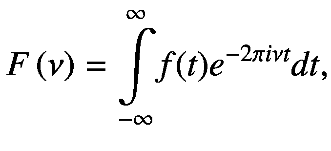
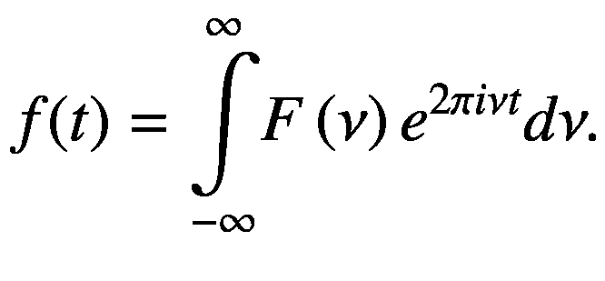
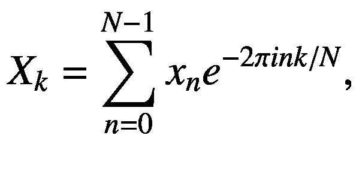
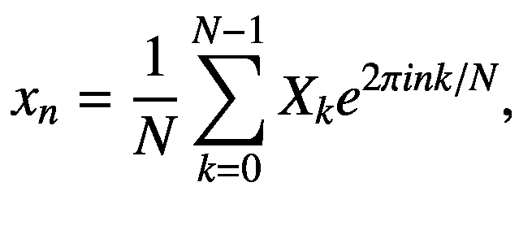

# 17. 信号处理

本章我们将探讨信号处理，这是一个在科学和工程的多个分支中都有应用的学科。此处的信号可以是随时间变化的量（时间信号），也可以是随空间坐标变化的函数（空间信号）。例如，音频信号是典型的时间信号，而图像则是典型的二维空间信号。现实中，信号通常是连续函数，但在计算应用中，我们通常处理离散化信号，即原始的连续信号在等距的离散点上被采样。采样定理为连续信号何时能被离散样本序列精确表示提供了严谨且量化的条件。

信号处理的计算方法在科学计算中占据核心地位，不仅因为其应用广泛，还因为对于重要的信号处理问题存在非常高效的计算方法。特别是，**快速傅里叶变换（FFT）** 是许多信号处理问题的重要算法，而且它可能是整个计算领域最重要的数值算法之一。本章将探讨如何将 FFT 用于谱分析，但除了这一基本应用外，FFT 也作为其他算法的组成部分被直接或间接地广泛使用。其他信号处理方法，如卷积、相关分析以及线性滤波器，也具有广泛的应用，尤其是在控制理论等工程领域。

在本章中，我们将使用 SciPy 库中的 `fftpack` 和 `signal` 模块来讨论谱分析和线性滤波器的基本应用。

## 导入模块

在本章中，我们主要使用 SciPy 库的 `fftpack` 和 `signal` 模块。与 SciPy 库的其他模块一样，我们使用以下模式导入模块：

```
In [1]: from scipy import fftpack
In [2]: from scipy import signal
```

我们还将在一个示例中使用 SciPy 的 `io.wavefile` 模块来读写 WAV 音频文件。我们按如下方式导入此模块：

```
In [3]: import scipy.io.wavfile
In [4]: from scipy import io
```

对于基本的数值计算和绘图，我们还需要 NumPy、Pandas 和 Matplotlib 库：

```
In [5]: import numpy as np
In [6]: import pandas as pd
In [7]: import matplotlib.pyplot as plt
In [8]: import matplotlib as mpl
```

## 谱分析

我们首先通过讨论谱分析来开启对信号处理的探索。谱分析是傅里叶变换的一个基本应用。傅里叶变换是一种数学积分变换，它允许我们将信号从时域（描述为时间的函数）转换到频域（描述为频率的函数）。信号的频域表示有多种用途，例如提取信号的主频率分量等特征、对信号应用滤波器以及求解微分方程（参见第 9 章），等等。

### 傅里叶变换

连续信号 *f*(*t*) 的傅里叶变换 *F*(*v*) 的数学表达式为⁶⁶



逆傅里叶变换由下式给出



这里 *F*(*v*) 是信号 *f*(*t*) 的复值幅度谱，*v* 是频率。从 *F*(*v*) 我们可以计算其他类型的谱，例如功率谱 |*F*(*v*)|²。在这个公式中，*f*(*t*) 是持续时间无限的连续信号。在实际应用中，我们通常更关心如何使用有限持续时间内采集的有限数量样本来近似 *f*(*t*)。例如，我们可以在时间区间 *t* ∈ [0, *T*] 内的 *N* 个均匀间隔点上对函数 *f*(*t*) 进行采样，得到一个样本序列，记作 (*x*[0], *x*[1], …, *x*[*N*])。前面提到的连续傅里叶变换可以适应离散情况：均匀间隔样本序列的离散傅里叶变换 (DFT) 为



类似地，我们有逆 DFT



其中 *X*[*k*] 是样本 *x*[*n*] 的离散傅里叶变换，*k* 是一个频率仓编号，可以关联到实际频率。样本序列的 DFT 可以使用称为快速傅里叶变换 (FFT) 的算法非常高效地计算。SciPy 的 `fftpack` 模块 ⁶⁷ 提供了 FFT 算法的实现。`fftpack` 模块包含了针对多种情况的 FFT 函数：总结见表 17-1。这里我们重点演示 `fft` 和 `ifft` 函数以及 `fftpack` 模块中几个辅助函数的用法。然而，表 17-1 中所有 FFT 函数的通用用法是相似的。

**表 17-1**

**SciPy 中 `fftpack` 模块部分函数总结。** 有关每个函数的详细用法，包括其参数和返回值，请参阅其文档字符串，例如，使用 `help(fftpack.fft)` 可查看。

| 函数 | 描述 |
| --- | --- |
| `fft`, `ifft` | 实值或复值信号的通用 FFT 和逆 FFT。得到的频谱是复值的。 |
| `rfft`, `irfft` | 实值信号的 FFT 和逆 FFT。 |
| `dct`, `idct` | 离散余弦变换 (DCT) 及其逆变换。 |
| `dst`, `idst` | 离散正弦变换 (DST) 及其逆变换。 |
| `fft2`, `ifft2`, `fftn`, `ifftn` | 复值信号的二维和 N 维 FFT 及其逆变换。 |
| `fftshift`, `ifftshift`, `rfftshift`, `irfftshift` | 分别对 `fft` 和 `rfft` 产生的结果向量中的频率仓进行移位，使得频谱排列为**零频率分量位于数组中间**。 |
| `fftfreq` | 计算与 `fft` 返回结果中的 FFT 仓相对应的频率。 |


