# 请注意

DFT 以离散样本作为输入，并输出离散频谱。为了将 DFT 应用于原本连续的信号，我们必须首先通过采样将信号缩减为离散值。根据采样定理，带宽为 `B` 的连续信号（即信号不包含高于 `B` 的频率），可以从采样频率为 `f[s]` ≥ 2`B` 的离散样本中完全重构。这是信号处理中一个非常重要的结论，因为它告诉我们，在何种情况下可以使用离散信号代替连续信号。它允许我们在测量连续过程时确定合适的采样率，因为通常可以通过物理因素等来了解或大致估计一个过程的带宽。虽然采样率决定了我们可以用离散傅里叶变换描述的最大频率，但频率空间中的样本间隔由总采样时间 `T` 决定，或者等效地，在采样频率确定后，由样本点数决定，即 `T` = `N`/`f[s]`。

作为一个入门示例，考虑一个模拟信号，它在 1 Hz 和 22 Hz 处具有纯正弦分量，并叠加了正态分布的噪声基底。我们首先定义一个函数 `signal_samples`，用于生成该信号的含噪样本：
```
In [9]: def signal_samples(t):
...:     return (2 * np.sin(2 * np.pi * t) + 3 * np.sin(22 * 2 * np.pi * t) + 2 * np.random.randn(*np.shape(t)))
```
我们可以通过调用此函数并以一个包含采样时间的数组作为参数来获得一个样本向量。假设我们想要计算该信号最高到 30 Hz 的频率谱。那么我们需要选择采样频率 `f[s]` = 60 Hz，并且如果我们想要获得分辨率为 ∆`f` = 0.01 Hz 的频谱，我们需要至少采集 `N` = `f[s]`/∆`f` = 6000 个样本，对应的采样周期为 `T` = `N`/`f[s]` = 100 秒：
```
In [10]: B = 30.0
In [11]: f_s = 2 * B
In [12]: delta_f = 0.01
In [13]: N = int(f_s / delta_f); N
Out[13]: 6000
In [14]: T = N / f_s; T
Out[14]: 100.0
```
接下来，我们在时间上均匀分布的 `N` 个点处对信号函数进行采样：首先创建一个包含各采样时间的数组 `t`，然后用它来计算 `signal_samples` 函数：
```
In [15]: t = np.linspace(0, T, N)
In [16]: f_t = signal_samples(t)
```
得到的信号绘制在图 17-1 中。无论从整个采样时间还是从较短的时间段观察，该信号都相当嘈杂，并且在时域中，添加的随机噪声在很大程度上掩盖了纯净的正弦信号。
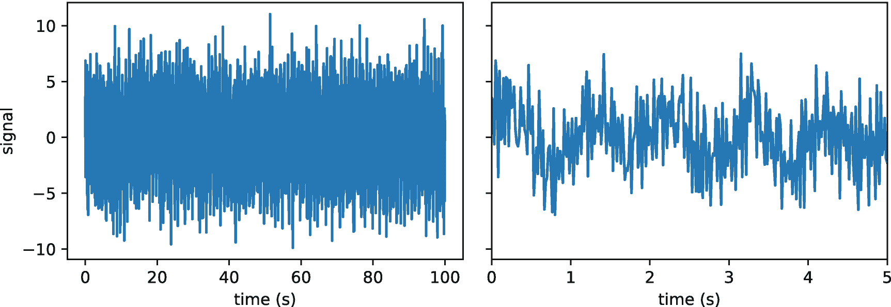
图 17-1：带有随机噪声的模拟信号。左侧为完整信号，右侧为早期时间的放大图
```
In [17]: fig, axes = plt.subplots(1, 2, figsize=(8, 3), sharey=True)
...: axes[0].plot(t, f_t)
...: axes[0].set_xlabel("时间 (秒)")
...: axes[0].set_ylabel("信号")
...: axes[1].plot(t, f_t)
...: axes[1].set_xlim(0, 5)
...: axes[1].set_xlabel("时间 (秒)")
```
为了揭示信号中的正弦分量，我们可以使用 FFT 来计算信号的频谱（或者说，信号的频域表示）。我们通过对离散样本数组 `f_t` 应用 `fft` 函数来获得信号的离散傅里叶变换：
```
In [18]: F = fftpack.fft(f_t)
```
结果是一个数组 `F`，它包含了频谱的频率分量，这些分量对应的频率由采样率和样本数决定。在计算这些频率时，使用辅助函数 `fftfreq` 会很方便，该函数将样本数和连续样本之间的时间间隔作为参数，并返回一个与 `F` 大小相同的数组，该数组包含每个频率仓对应的频率。
```
In [19]: f = fftpack.fftfreq(N, 1.0/f_s)
```
由 `fft` 函数返回的幅值对应的频率仓同时包含正频率和负频率，最高到采样率的一半，即 `f[s]`/2。对于实值信号，频谱在正负频率处是对称的，因此我们通常只对正频率分量感兴趣。利用频率数组 `f`，我们可以方便地创建一个掩码，用于提取频谱中与我们感兴趣频率对应的部分。这里我们创建一个用于选择正频率分量的掩码：
```
In [20]: mask = np.where(f >= 0)
```
正频率分量的频谱如图 17-2 所示。顶部面板包含了整个正频率频谱，并采用对数坐标绘制，以增加信号与噪声之间的对比度。我们可以看到，在接近 1 Hz 和 22 Hz 处有尖锐的峰值，分别对应信号中的正弦分量。这些峰值在频谱中清晰地突出于噪声基底。尽管噪声在时域信号中掩盖了正弦分量，但我们可以在频域表示中清晰地检测到它们的存在。图 17-2 中的下面两个面板分别显示了 1 Hz 和 22 Hz 处两个峰值的放大图。
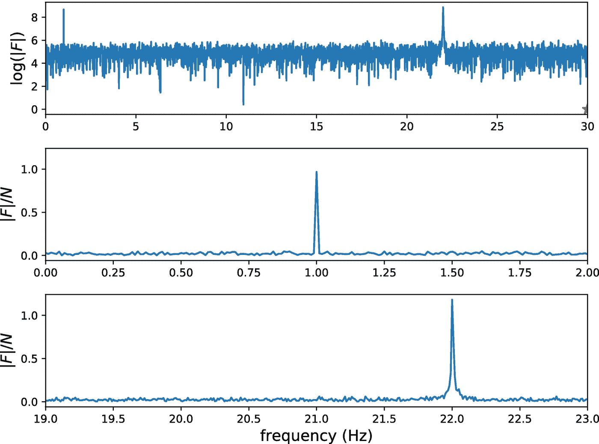
图 17-2：模拟信号的频谱，频率分量位于 1 Hz 和 22 Hz 处
```
In [21]: fig, axes = plt.subplots(3, 1, figsize=(8, 6))
...: axes[0].plot(f[mask], np.log(abs(F[mask])), label="实部")
...: axes[0].plot(B, 0, 'r*', markersize=10)
...: axes[0].set_ylabel("$\log(|F|)$", fontsize=14)
...: axes[1].plot(f[mask], abs(F[mask])/N, label="实部")
...: axes[1].set_xlim(0, 2)
...: axes[1].set_ylabel("$|F|/N$", fontsize=14)
...: axes[2].plot(f[mask], abs(F[mask])/N, label="实部")
...: axes[2].set_xlim(21, 23)
...: axes[2].set_xlabel("频率 (Hz)", fontsize=14)
...: axes[2].set_ylabel("$|F|/N$", fontsize=14)
```

## 频域滤波

正如我们可以使用 FFT 函数 `fft` 从时域信号计算频域表示，我们也可以使用逆 FFT 函数 `ifft` 从频域表示计算出时域信号。例如，对 `F` 数组应用 `ifft` 函数将重构出 `f_t` 数组。通过在应用逆变换之前修改频谱，我们可以实现频域滤波器。例如，在频谱中仅选择 2 Hz 以下的频率，相当于应用一个 2 Hz 的低通滤波器，它抑制了信号中的高频分量（在本例中高于 2 Hz 的频率）：
```
In [22]: F_filtered = F * (abs(f) < 2)
In [23]: f_t_filtered = fftpack.ifft(F_filtered)
```
对滤波后的信号计算逆 FFT，将得到一个不存在高频振荡的时域信号，如图 17-3 所示。这个简单的例子概括了许多频域滤波器的精髓。在本章的后面部分，我们将更详细地探讨信号处理分析中常用的多种滤波器类型。
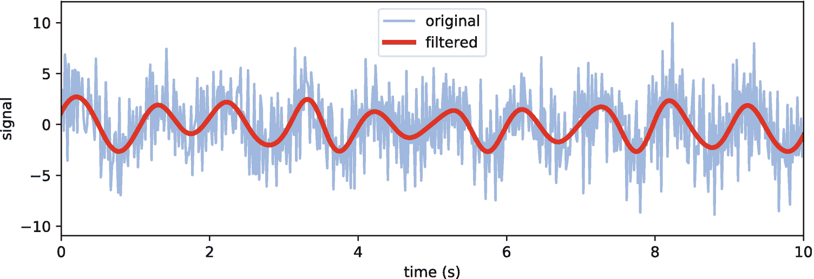
图 17-3：原始时域信号以及对信号的频域表示应用低通滤波器后重构的信号
```
In [24]: fig, ax = plt.subplots(figsize=(8, 3))
...: ax.plot(t, f_t, label="原始信号")
...: ax.plot(t, f_t_filtered.real, color="red", lw=3, label="滤波后")
...: ax.set_xlim(0, 10)
...: ax.set_xlabel("时间 (秒)")
...: ax.set_ylabel("信号")
...: ax.legend()
```

## 加窗

在上一节中，我们直接对信号应用了 FFT。这可以得到可接受的结果，但通常可以在应用 FFT 之前，对信号应用所谓的窗函数，从而进一步提高频谱的质量和对比度。窗函数是一种函数，当它与信号相乘时，会调制信号的幅度，使其在采样时段的开始和结束处趋近于零。有许多函数可以用作窗函数，SciPy 的 `signal` 模块提供了多种常见窗函数的实现，包括布莱克曼函数、汉恩函数、汉明函数、高斯窗函数（具有可变标准差）以及凯泽窗函数 ^(⁶⁸)。所有这些函数都绘制在图 17-4 中。该图显示，尽管所有这些窗函数略有不同，但整体形状非常相似。

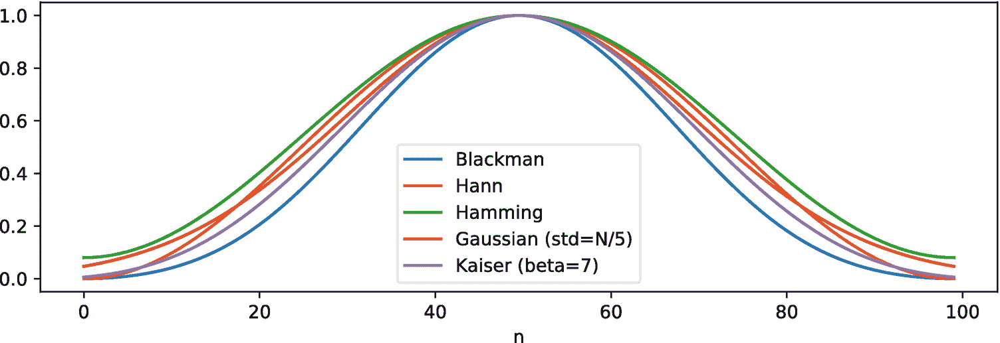

图 17-4 常用窗函数示例

```python
In [25]: fig, ax = plt.subplots(1, 1, figsize=(8, 3))
...: N = 100
...: ax.plot(signal.blackman(N), label="布莱克曼")
...: ax.plot(signal.hann(N), label="汉恩")
...: ax.plot(signal.hamming(N), label="汉明")
...: ax.plot(signal.gaussian(N, N/5), label="高斯 (标准差=N/5)")
...: ax.plot(signal.kaiser(N, 7), label="凯泽 (beta=7)")
...: ax.set_xlabel("n")
...: ax.legend(loc=0)
```

这些备选的窗函数在特性和目标上略有不同，但在大多数情况下，它们可以互换使用。窗函数的主要目的是减少相邻频率区间之间的频谱泄漏，当信号包含周期不能被采样周期整除的分量时，这种泄漏会出现在离散傅里叶变换计算中。因此，具有此类频率的信号分量无法在采样周期内容纳完整的整数个周期，并且由于离散傅里叶变换假设信号是周期的，周期边界处由此产生的不连续性可能导致频谱泄漏。将信号与窗函数相乘可以缓解这个问题。或者，我们也可以增加采样点数（增加采样周期）以获得更高的频率分辨率，但这并不总是可行的。

为了了解在对时间序列信号应用 FFT 之前如何使用窗函数，让我们回顾一下我们在第 12 章中看过的室外温度测量数据。首先，我们使用 `Pandas` 库加载数据集，并使用 `fillna` 方法聚合元素，将其重采样为均匀间隔的每小时采样数据。

```python
In [26]: df = pd.read_csv('temperature_outdoor_2014.tsv', delimiter="\t",
...:                  names=["time", "temperature"])
In [27]: df.time = (pd.to_datetime(df.time.values, unit="s").
...:               tz_localize('UTC').tz_convert('Europe/Stockholm'))
In [28]: df = df.set_index("time")
In [29]: df = df.resample("H").ffill()
In [30]: df = df[(df.index >= "2014-04-01")*(df.index < "2014-06-01")].dropna()
```

创建并处理完 `Pandas` 数据帧后，我们提取底层的 `NumPy` 数组，以便能够使用 `fftpack` 模块处理时间序列数据。

```python
In [31]: time = df.index.astype('int64')/1.0e9
In [32]: temperature = df.temperature.values
```

现在，我们希望在计算 FFT 之前，对 `temperature` 数组中的数据应用一个窗函数。这里我们使用布莱克曼窗函数，它适合用于减少频谱泄漏。该函数在 SciPy 的 `signal` 模块中作为 `blackman` 函数提供。我们需要将样本数组的长度作为参数传递给窗函数，它将返回一个相同长度的数组。

```python
In [33]: window = signal.blackman(len(temperature))
```

要应用窗函数，我们只需将其与时域信号数组相乘，并将结果用于后续的 FFT 计算。然而，在对加窗后的温度信号进行 FFT 之前，我们先绘制原始温度时间序列和加窗后的版本。结果如图 17-5 所示。将时间序列与窗函数相乘，所得信号在采样周期边界处趋于零，可以看作是一个在周期边界上具有平滑过渡的周期函数，因此加窗信号的 FFT 具有更良好的特性。

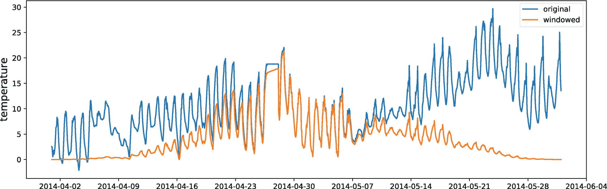

图 17-5 加窗与原始温度时间序列信号

```python
In [34]: temperature_windowed = temperature * window
In [35]: fig, ax = plt.subplots(figsize=(8, 3))
...: ax.plot(df.index, temperature, label="original")
...: ax.plot(df.index, temperature_windowed, label="windowed")
...: ax.set_ylabel("temperature", fontsize=14)
...: ax.legend(loc=0)
```

准备好加窗信号后，频谱分析的其余步骤与之前相同：我们可以使用 `fft` 函数计算频谱，并使用 `fftfreq` 函数计算每个频率仓对应的频率。

```python
In [36]: data_fft_windowed = fftpack.fft(temperature_windowed)
In [37]: f = fftpack.fftfreq(len(temperature), time[1]-time[0])
```

在这里，我们还通过从数组 `f` 中创建一个掩码数组来选取正频率，并绘制所得的正频率频谱，如图 17-6 所示。图 17-6 中的频谱清晰地显示了对应于 1 天（`1/86400 Hz`）频率及其高次谐波（`2/86400 Hz`, `3/86400 Hz` 等）的峰值。

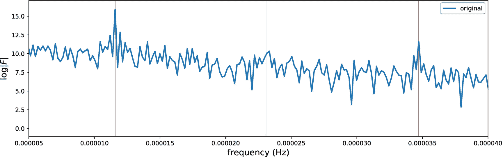

图 17-6 加窗温度时间序列的频谱。主峰出现在对应于 1 天周期及其高次谐波的频率上。

```python
In [38]: mask = f > 0
In [39]: fig, ax = plt.subplots(figsize=(8, 3))
...: ax.set_xlim(0.000005, 0.00004)
...: ax.axvline(1./86400, color="r", lw=0.5)
...: ax.axvline(2./86400, color="r", lw=0.5)
...: ax.axvline(3./86400, color="r", lw=0.5)
...: ax.plot(f[mask], np.log(abs(data_fft_windowed[mask])), lw=2)
...: ax.set_ylabel("$\log|F|$", fontsize=14)
...: ax.set_xlabel("frequency (Hz)", fontsize=14)
```

为了从给定的样本集中获得最准确的频谱，通常建议在应用 FFT 之前对时间序列信号施加窗函数。SciPy 中可用的大多数窗函数可以互换使用，窗函数的选择通常并不关键。一个流行的选择是 `Blackman` 窗函数，它被设计用来最小化频谱泄漏。关于不同窗函数特性的更多细节，请参见例如第 9 章 (Smith, 1999)。

### 语谱图

作为本节频谱分析的最后一个示例，这里我们分析从吉他采样的音频信号的频谱。^(⁶⁹) 首先，我们使用 SciPy 库中的 `io.wavefile.read` 函数从 `guitar.wav` 文件中加载采样数据：

```python
In [40]: sample_rate, data = io.wavfile.read("guitar.wav")
```

`io.wavefile.read` 函数返回一个元组，包含采样率 `sample_rate` 和一个包含音频强度的 `NumPy` 数组。对于这个特定文件，我们得到 `44.1 kHz` 的采样率，音频信号以立体声录制，由一个包含两个通道的数据数组表示。每个通道包含 `1181625` 个样本：

```python
In [41]: sample_rate
Out[41]: 44100
In [42]: data.shape
Out[42]: (1181625, 2)
```

### 频谱与语谱图

在这里，我们只关心分析单个音频通道，因此我们对两个通道取平均值以获得单声道信号：

```python
In [43]: data = data.mean(axis=1)
```

通过将样本数除以采样率，我们可以计算音频录音的总时长。结果表明录音大约为 26.8 秒。

```python
In [44]: data.shape[0] / sample_rate
Out[44]: 26.79421768707483
```

通常情况下，我们喜欢分段计算信号的频谱，而不是一次性计算整个信号的频谱。例如，当信号的性质在长时间尺度上随时间变化，但在短时间尺度上包含近乎周期的成分时。这对于音乐来说尤其如此，从人类感知的角度来看，音乐在短时间尺度（亚秒级）上可以被认为是近乎周期的，但在更长时间尺度上则会变化。因此，对于吉他样本，我们希望将 FFT 应用于时域信号上的滑动窗口。结果是一个依赖于时间的频谱，在音乐设备和应用中通常可视化为均衡器图。另一种方法是使用二维热力图来可视化依赖于时间的频谱，在此上下文中，这被称为语谱图。接下来，我们将计算吉他样本的语谱图。

在继续语谱图可视化之前，我们首先计算样本一小部分的频谱。我们首先确定从完整样本数组中使用的样本数。如果我们想要分析 0.5 秒的时间，我们可以使用采样率来计算要使用的样本数：

```python
In [45]: N = int(sample_rate/2.0) # 半秒 -> 22050 个样本
```

接下来，给定样本数和采样率，我们可以计算即将进行的 FFT 计算结果中频率仓的频率`f`，以及时域信号中每个样本的采样时间`t`。我们还创建一个频率掩码，用于选择小于 1000 Hz 的正频率，稍后将用它来选择计算所得频谱的一个子集。

```python
In [46]: f = fftpack.fftfreq(N, 1.0/sample_rate)
In [47]: t = np.linspace(0, 0.5, N)
In [48]: mask = (f > 0) * (f < 1000)
```

接下来，我们从完整样本数组`data`中提取前`N`个样本，并对其应用`fft`函数：

```python
In [49]: subdata = data[:N]
In [50]: F = fftpack.fft(subdata)
```

时域和频域信号如图 17-7 所示。左图中的时域信号在初始阶段（第一个吉他弦拨动前）为零。频域频谱显示了几个主频，对应于吉他产生的不同音调。

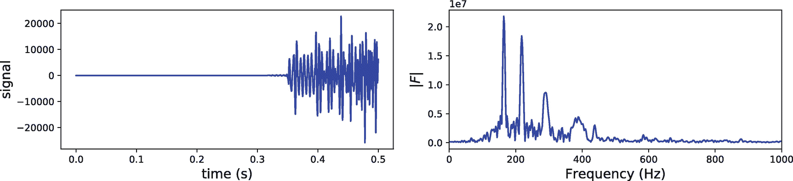

图 17-7

吉他声音半秒时长样本的信号与频谱

```python
In [51]: fig, axes = plt.subplots(1, 2, figsize=(12, 3))
...: axes[0].plot(t, subdata)
...: axes[0].set_ylabel("signal", fontsize=14)
...: axes[0].set_xlabel("time (s)", fontsize=14)
...: axes[1].plot(f[mask], abs(F[mask]))
...: axes[1].set_xlim(0, 1000)
...: axes[1].set_ylabel("$|F|$", fontsize=14)
...: axes[1].set_xlabel("Frequency (Hz)", fontsize=14)
```

下一步是对完整样本数组中的连续片段重复上述分析。频谱的时间演化可以可视化为声谱图，其 *x* 轴表示频率，*y* 轴表示时间。为了能够使用 Matplotlib 的 `imshow` 函数绘制声谱图，我们创建一个二维 NumPy 数组 `spectrogram_data`，用于存储连续样本片段的频谱。`spectrogram_data` 数组的形状为 (`n_max`, `f_values`)，其中 `n_max` 是样本数组 `data` 中长度为 `N` 的片段数量，`f_values` 是满足计算 `mask` 所用条件（频率为正且小于 1000 Hz）的频率区间的数量：

```python
In [52]: n_max = int(data.shape[0] / N)
In [53]: f_values = np.sum(mask)
In [54]: spectogram_data = np.zeros((n_max, f_values))
```

为了提高最终声谱图的对比度，我们在计算 FFT 之前，还对样本数据的每个子集应用了布莱克曼窗函数。这里我们选择布莱克曼窗函数，是因为它具有降低频谱泄漏的特性，但其他许多窗函数也能得到类似的结果。窗数组的长度必须与 `subdata` 数组的长度相同，因此我们将其长度参数传递给 `Blackman` 函数：

```python
In [55]: window = signal.blackman(len(subdata))
```

最后，通过循环遍历大小为 `N` 的数组切片，应用窗函数，计算 FFT，并将结果中我们感兴趣频率的子集存储到 `spectrogram_data` 数组中，从而计算出样本中每个片段的频谱：

```python
In [56]: for n in range(0, n_max):
...:     subdata = data[(N * n):(N * (n + 1))]
...:     F = fftpack.fft(subdata * window)
...:     spectogram_data[n, :] = np.log(abs(F[mask]))
```

当 `spectrogram_data` 计算完成后，我们可以使用 Matplotlib 的 `imshow` 函数来可视化声谱图。结果如图 17-8 所示。

```python
In [57]: fig, ax = plt.subplots(1, 1, figsize=(8, 6))
...: p = ax.imshow(spectogram_data, origin="lower",
...:               extent=(0, 1000, 0, data.shape[0] / sample_rate),
...:               aspect='auto',
...:               cmap=mpl.cm.RdBu_r)
...: cb = fig.colorbar(p, ax=ax)
...: cb.set_label("$\log|F|$", fontsize=14)
...: ax.set_ylabel("time (s)", fontsize=14)
...: ax.set_xlabel("Frequency (Hz)", fontsize=14)
```

图 17-8 中的声谱图包含了关于采样信号及其随时间演化的丰富信息。图中狭窄的垂直条纹对应吉他发出的音调，这些信号随时间推移而缓慢衰减。较宽的横向条带大致对应于吉他琴弦被拨动的时段，这会在短时间内产生非常宽的频率响应。不过请注意，颜色轴表示的是对数尺度，因此颜色的微小变化代表了实际强度的巨大变化。

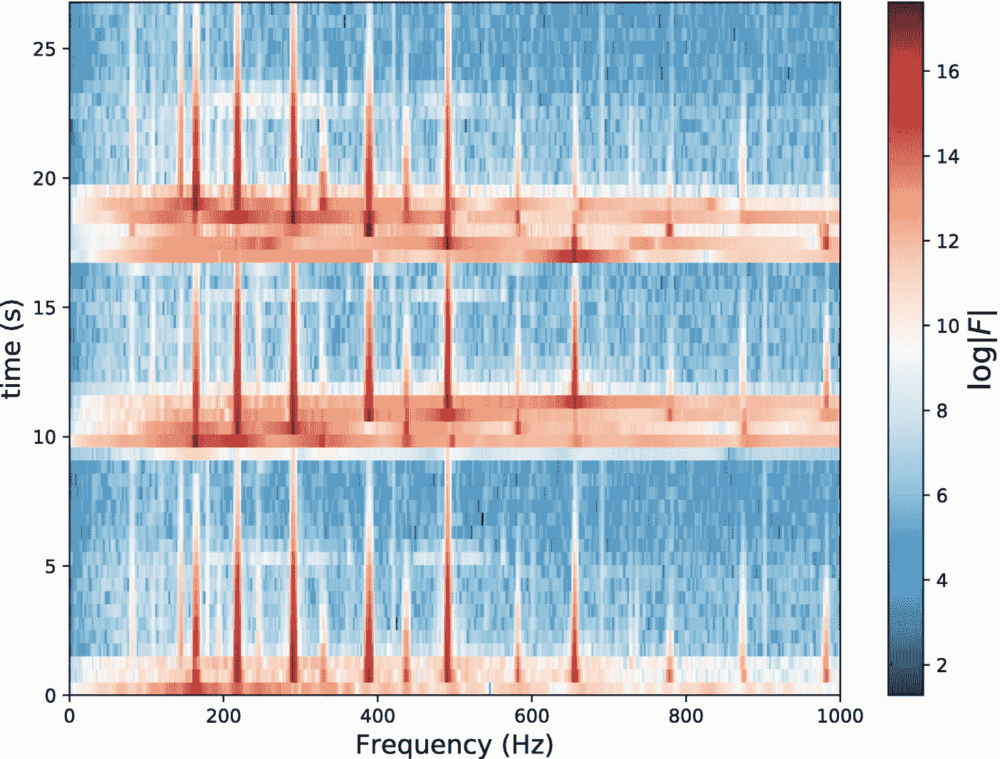

图 17-8

吉他声音频采样的声谱图

## 信号滤波器

信号处理的主要目标之一是操作和变换时间或空间信号，以改变其特性。典型的应用包括降噪、音频信号中的音效，以及图像数据中的模糊、锐化、对比度增强和色彩平衡调整等效果。许多常见的变换都可以实现为滤波器，作用于信号的频域表示，例如，通过抑制某些频率分量来实现。在上一节中，我们看到了一个低通滤波器的示例，我们通过对信号进行傅里叶变换、去除高频分量，最后进行逆傅里叶变换来获得新的时域信号。通过这种方法，我们可以实现任意频率滤波器，但未必能实时应用于流式信号，因为它们需要缓冲足够的样本才能执行离散傅里叶变换。在许多应用中，我们需要以连续方式应用滤波器并变换信号，例如在传输信号或处理实时音频信号时。

### 卷积滤波器

某些类型的频率滤波器可以直接在时域中实现，方法是将信号与一个表征滤波器的函数进行卷积。傅里叶变换的一个重要性质是，两个函数（例如，信号的频谱和滤波器形状函数）乘积的（逆）傅里叶变换是这两个函数（逆）傅里叶变换的卷积。因此，如果我们想将一个滤波器 `H[k]` 应用于信号 `x[n]` 的频谱 `X[k]`，我们可以改为计算 `x[n]` 与 `h[m]`（滤波器函数 `H[k]` 的逆傅里叶变换）的卷积。通常，我们可以将卷积形式的滤波器写为

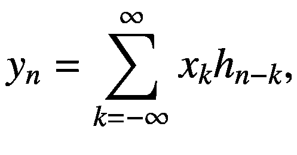

其中，`x[k]` 是输入，`y[n]` 是输出，`h[n - k]` 是表征滤波器的卷积核。请注意，在这种一般形式中，时间步 `n` 处的信号 `y[n]` 依赖于输入 `x[k]` 的较早和较晚的值。为了说明这一点，让我们回到本章的第一个示例，在该示例中，我们对一个包含 1 Hz 和 22 Hz 分量的模拟信号应用了低通滤波器。在该示例中，我们对信号进行了傅里叶变换，并将其频谱与一个抑制所有高频分量的阶跃函数相乘，最后将信号逆傅里叶变换回时域。结果是原始含噪信号的平滑版本（图 17-3）。另一种使用卷积的方法是，对滤波器 `H` 的频率响应函数进行逆傅里叶变换，并将结果 `h` 作为一个核，用于与原始时域信号 `f_t` 进行卷积：

```python
In [58]: t = np.linspace(0, T, N)
In [59]: f_t = signal_samples(t)
In [60]: H = abs(f) < 2
In [61]: h = fftpack.fftshift(fftpack.ifft(H))
In [62]: f_t_filtered_conv = signal.convolve(f_t, h, mode="same")
```

为了执行卷积，这里我们使用了 SciPy 中 `signal` 模块的 `convolve` 函数。它接受两个包含要计算卷积的信号的 NumPy 数组作为参数。使用可选的关键字参数 `mode`，我们可以将输出数组的大小设置为与第一个输入相同 (`mode='same'`)，或者设置为在数组进行零填充以处理瞬态后的完整卷积输出 (`mode='full'`)，或者设置为仅包含不依赖于零填充的元素 (`mode='valid'`)。这里我们使用 `mode='same'`，这样我们可以方便地将结果与原始信号 `f_t` 进行比较和绘图。应用此卷积滤波器的结果 `f_t_filtered_conv` 如图 17-9 所示，同时显示的还有使用 `fft` 和 `ifft` 以及修改后的频谱 (`f_t_filtered`) 计算出的相应结果。正如预期的那样，这两种方法给出了相同的结果。

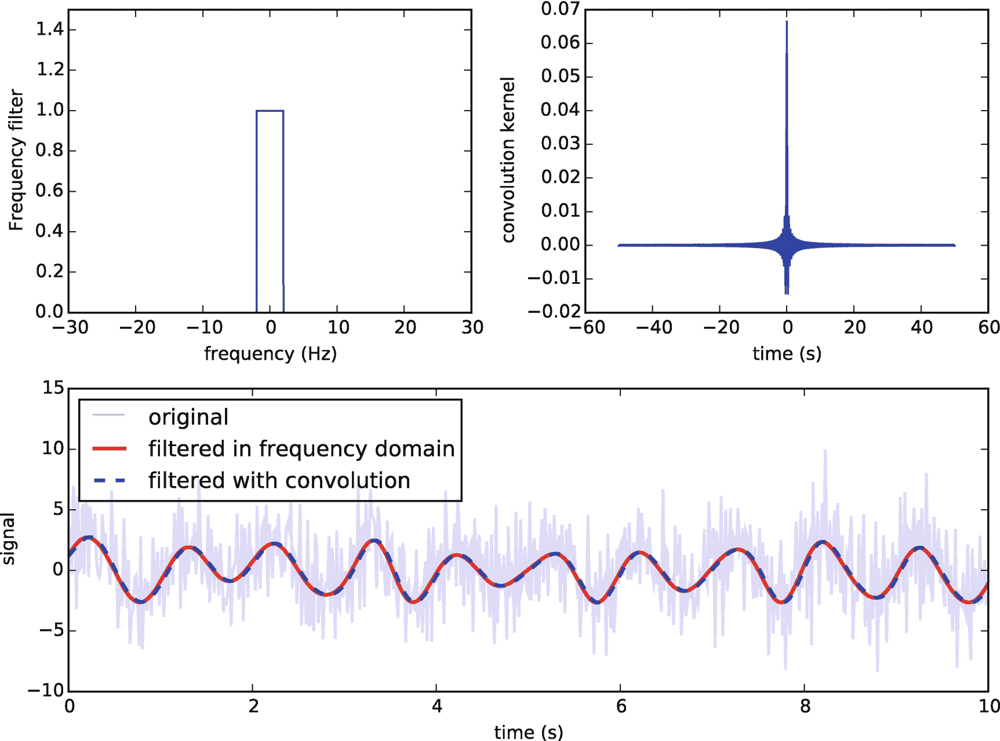

图 17-9

左上：频率滤波器。右上：对应于频率滤波器的卷积核（其离散傅里叶逆变换）。下方：通过卷积应用的简单低通滤波器

```python
In [63]: fig = plt.figure(figsize=(8, 6))
...: ax = plt.subplot2grid((2,2), (0,0))
...: ax.plot(f, H)
...: ax.set_xlabel("频率 (Hz)")
...: ax.set_ylabel("频率滤波器")
...: ax.set_ylim(0, 1.5)
...: ax = plt.subplot2grid((2,2), (0,1))
...: ax.plot(t - t[-1]/2.0, h.real)
...: ax.set_xlabel("时间 (s)")
...: ax.set_ylabel("卷积核")
...: ax = plt.subplot2grid((2,2), (1,0), colspan=2)
...: ax.plot(t, f_t, label="原始", alpha=0.25)
...: ax.plot(t, f_t_filtered.real, 'r', lw=2, label='在频域中滤波')
...: ax.plot(t, f_t_filtered_conv.real, 'b--', lw=2, label='通过卷积滤波')
...: ax.set_xlim(0, 10)
...: ax.set_xlabel("时间 (s)")
...: ax.set_ylabel("信号")
...: ax.legend(loc=2)
```

### FIR 和 IIR 滤波器

在上一节卷积滤波器的示例中，使用卷积来实现滤波器与调用 `fft`、修改频谱、然后调用 `ifft` 这一系列操作相比，并没有计算上的优势。实际上，这里的卷积通常比额外的 FFT 变换要求更高，而 SciPy 的 `signal` 模块实际上提供了一个函数调用 `fftconvolve`，它使用 FFT 及其逆变换来实现卷积。此外，滤波器的卷积核具有许多不希望的属性，例如非因果性，即输出信号依赖于输入的将来值（见图 17-9 的右上角面板）。然而，存在一些重要的类卷积滤波器特例，它们可以在专用的数字信号处理器 (DSP) 和通用处理器上高效实现。这类滤波器的一个重要家族是*有限冲激响应* (FIR) 滤波器，其形式为 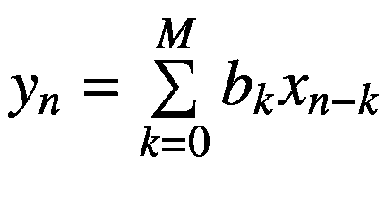。这种时域滤波器是因果的，因为输出 `y[n]` 只依赖于较早时间步的输入值。

另一种类似的滤波器是*无限冲激响应* (IIR) 滤波器，它可以写成如下形式：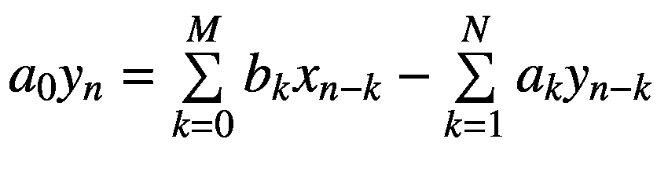。这严格来说不是卷积，因为它在计算新的输出值时额外包含了*输出*的过去值（一个反馈项），但它仍然以类似的形式存在。给定信号和输出的近期历史，FIR 和 IIR 滤波器都可以用来评估新的输出值，因此，如果我们知道 `b[k]` 和 `a[k]` 的有限序列值，就可以在时域中顺序地进行评估。

根据一组滤波器特性的要求来计算 `b[k]` 和 `a[k]` 的值被称为滤波器设计。SciPy 的 `signal` 模块为此提供了许多函数。例如，使用 `firwin` 函数，我们可以根据频带边界频率计算出 FIR 滤波器的 `b[k]` 系数，例如，滤波器从通带过渡到阻带（对于低通滤波器）。`firwin` 函数的第一个参数是 `a[k]` 序列中的值的数量（在此上下文中也称为*抽头数*）。第二个参数 `cutoff` 定义了以奈奎斯特频率（采样率的一半）为单位的低通截止频率。奈奎斯特频率的比例可以使用 `nyq` 参数（默认为 1）进行设置。最后，我们可以使用 `window` 参数指定要使用的窗口函数类型。

```python
In [64]: n = 101
In [65]: f_s = 1 / 3600
In [66]: nyq = f_s/2
In [67]: b = signal.firwin(n, cutoff=nyq/12, nyq=nyq, window="hamming")
```

结果是一个定义 FIR 滤波器的系数序列 `b[k]`，它可以用于通过时域卷积来实现该滤波器。给定系数 `b[k]`，我们可以使用 `signal` 模块的 `freqz` 函数来评估滤波器的幅频和相频响应。它返回包含频率和相应的复数值频率响应的数组，这些数组适合绘图，如图 17-10 所示。

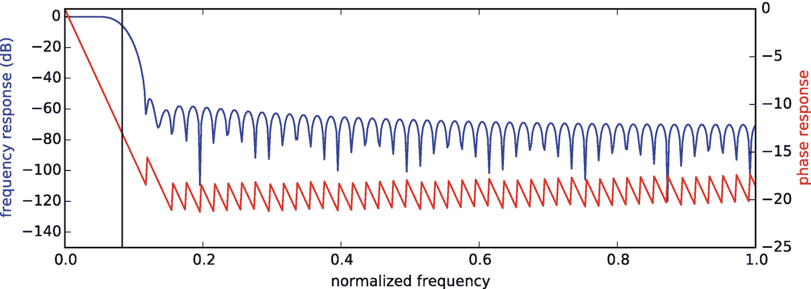

图 17-10

低通 FIR 滤波器的幅频和相频响应

```python
In [68]: f, h = signal.freqz(b)
In [69]: fig, ax = plt.subplots(1, 1, figsize=(12, 3))
...: h_ampl = 20 * np.log10(abs(h))
...: h_phase = np.unwrap(np.angle(h))
...: ax.plot(f/max(f), h_ampl, 'b')
...: ax.set_ylim(-150, 5)
...: ax.set_ylabel('frequency response (dB)', color="b")
...: ax.set_xlabel(r'normalized frequency')
...: ax = ax.twinx()
...: ax.plot(f/max(f), h_phase, 'r')
...: ax.set_ylabel('phase response', color="r")
...: ax.axvline(1.0/12, color="black")
```

图 17-10 所示的低通滤波器旨在让频率低于`f[s]/24`（用垂直线标示）的信号通过，并抑制更高频率的信号分量。通带与阻带之间有限的过渡区域，以及截止频率以上不完美的抑制效果，是我们为能够以 FIR 形式表示滤波器而必须付出的代价。FIR 滤波器的精度可以通过增加系数`b[k]`的数量来提高，但这会增加计算复杂度。

给定 FIR 滤波器的系数`b[k]`，以及 IIR 滤波器的系数`b[k]`和`a[k]`，可以使用`signal`模块中的`lfilter`函数来评估滤波效果。该函数的第一个参数是系数数组`b[k]`，第二个参数对于 IIR 滤波器是系数数组`a[k]`，对于 FIR 滤波器则是标量`1`。第三个参数是输入信号数组，返回值是滤波器的输出。例如，要将之前创建的 FIR 滤波器应用于包含每小时温度测量值的数组`temperature`，可以这样操作：
```
In [70]: temperature_filt = signal.lfilter(b, 1, temperature)
```
对信号应用低通 FIR 滤波器的效果是消除高频振荡，从而使函数变得平滑，如图 17-11 所示。另一种实现类似结果的方法是应用移动平均滤波器，其输出是附近几个输入值的加权平均值或中位数。`signal`模块中的`medfilt`函数可以对给定的输入信号应用中值滤波器，并使用该函数的第二个参数指定过去附近值的数量：
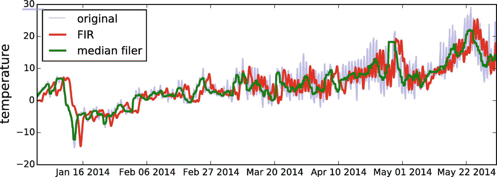
图 17-11
FIR 滤波器和`中值滤波器的输出`
```
In [71]: temperature_median_filt = signal.medfilt(temperature, 25)
```
将 FIR 低通滤波器和中值滤波器应用于每小时温度测量数据集的结果如图 17-11 所示。值得注意的是，FIR 滤波器的输出相对于原始信号存在一个对应 FIR 滤波器抽头数的时间延迟。而使用`medfilt`实现的中值滤波器不存在此问题，因为中位数是根据过去和未来的值共同计算得出的，这使得它成为一个非因果滤波器，无法对实时输入的流数据即时评估。
```
In [72]: fig, ax = plt.subplots(figsize=(8, 3))
...: ax.plot(df.index, temperature, label="original", alpha=0.5)
...: ax.plot(df.index, temperature_filt, color="red", lw=2, label="FIR")
...: ax.plot(df.index, temperature_median_filt, color="green", lw=2, label="median filer")
...: ax.set_ylabel("temperature", fontsize=14)
...: ax.legend(loc=0)
```
要设计 IIR 滤波器，可以使用`signal`模块中的`iirdesign`函数，或者使用多种预定义的 IIR 滤波器类型，包括巴特沃斯滤波器（`signal.butter`）、切比雪夫 I 型和 II 型滤波器（`signal.cheby1`和`signal.cheby2`）以及椭圆滤波器（`signal.ellip`）。例如，要创建一个允许频率高于临界频率 7/365 Hz 的信号通过、同时抑制较低频率的巴特沃斯高通滤波器，可以这样操作：
```
In [73]: b, a = signal.butter(2, 7/365.0, btype="high")
```
该函数的第一个参数是巴特沃斯滤波器的阶数，第二个参数是滤波器的临界频率（在该频率处，滤波器从阻带功能转变为通带功能）。可选参数`btype`可用于指定滤波器是低通滤波器（`low`）还是高通滤波器（`high`）。更多选项在函数的文档字符串中有描述：例如，可参考`help(signal.butter)`。输出值`a`和`b`分别是定义 IIR 滤波器的`a[k]`和`b[k]`系数。这里我们计算了一个二阶巴特沃斯滤波器，因此`a`和`b`各有三个元素：
```
In [74]: b
Out[74]: array([ 0.95829139, -1.91658277,  0.95829139])
In [75]: a
Out[75]: array([ 1.        , -1.91484241,  0.91832314])
```
和之前一样，我们可以将滤波器应用于输入信号（此处再次以每小时温度数据集为例）：
```
In [76]: temperature_iir = signal.lfilter(b, a, temperature)
```
或者，我们可以使用`filtfilt`函数来应用滤波器，该函数会正向和反向两次应用滤波器，从而产生一个非因果滤波器。
```
In [77]: temperature_filtfilt = signal.filtfilt(b, a, temperature)
```
两种滤波器的结果如图 17-12 所示。消除低频分量可以对时间序列进行去趋势处理，仅保留高频振荡和波动。因此，滤波后的信号可以被视为衡量原始信号波动性的指标。在这个例子中，我们可以看到，与冬季的一月、二月相比，春季的三月、四月和五月的日变化幅度更大。
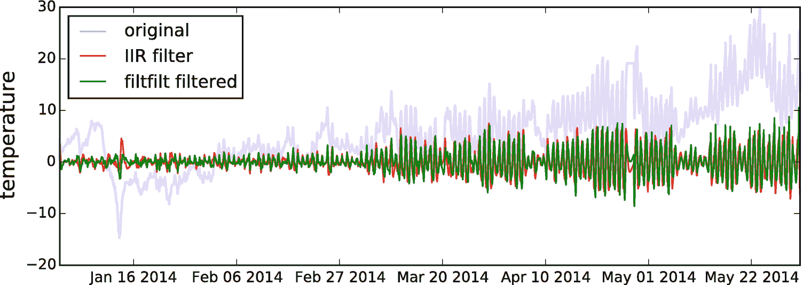
图 17-12
IIR 高通滤波器的输出以及相应的`filtfilt`滤波器（正向和反向应用）的输出
```
In [78]: fig, ax = plt.subplots(figsize=(8, 3))
...: ax.plot(df.index, temperature, label="original", alpha=0.5)
...: ax.plot(df.index, temperature_iir, color="red", label="IIR filter")
...: ax.plot(df.index, temperature_filtfilt, color="green", label="filtfilt filtered")
...: ax.set_ylabel("temperature", fontsize=14)
...: ax.legend(loc=0)
```
这些技术可以直接应用于音频和图像数据。例如，要将滤波器应用于吉他样本的音频信号，可以使用`lfilter`函数。FIR 滤波器的系数`b[k]`有时可以手动构建。例如，要应用简单的回声效果，可以创建一个 FIR 滤波器，以一定的时间延迟重复过去的信号：`y[n] = x[n] + x[n - N]`，其中`N`是以时间步长为单位的时间延迟。相应的系数`b[k]`很容易构建，并可以应用于音频信号`data`。
```
In [79]: b = np.zeros(10000)
...: b[0] = b[-1] = 1
...: b /= b.sum()
In [80]: data_filt = signal.lfilter(b, 1, data)
```
为了能够听到修改后的音频信号，我们可以使用 SciPy 中`io.wavefile`模块的`write`函数将其写入 WAV 文件：
```
In [81]: io.wavfile.write("guitar-echo.wav", sample_rate,
...:                  np.vstack([data_filt, data_filt]).T.astype(np.int16))
```
类似地，我们可以使用`signal`模块中的工具实现多种类型的图像处理滤波器。SciPy 还提供了一个`ndimage`模块，其中包含许多常见的图像处理函数和滤波器，这些函数专为应用于二维图像数据而设计。Scikit-Image 库^(⁷⁰)为在 Python 中进行图像处理提供了更高级的框架。
## 摘要
信号处理是一个极其广泛的领域，其应用遍及科学和工程的大多数分支。因此，在本章中我们仅能介绍信号处理的一些基本应用，并重点阐述如何使用 Python 生态系统中的科学计算库和工具，以计算方法来处理这类问题。具体而言，我们探讨了如何利用快速傅里叶变换对时变信号进行频谱分析，以及如何使用 SciPy 库中的 `signal` 模块设计和应用线性滤波器。
## 延伸阅读
如需全面了解信号处理理论，可参阅 Smith（1999），该书也可在线浏览，网址为 [`www.dspguide.com/pdfbook.htm`](http://www.dspguide.com/pdfbook.htm)。若想了解面向 Python 的信号处理讨论，可参阅 Unpingco（2014），其内容以 IPython 笔记本形式提供，网址为 [`http://nbviewer.ipython.org/github/unpingco/Python-for-Signal-Processing`](http://nbviewer.ipython.org/github/unpingco/Python-for-Signal-Processing)。