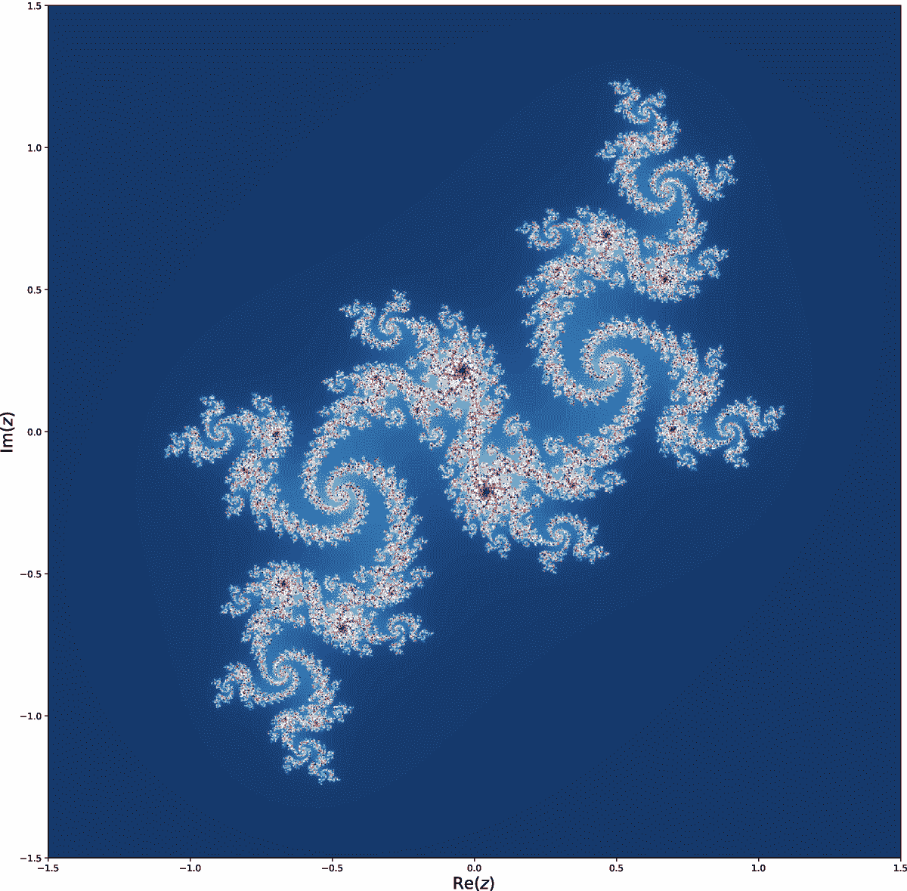
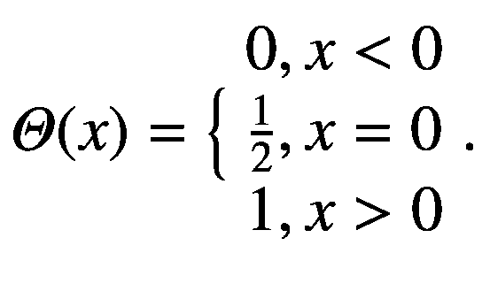
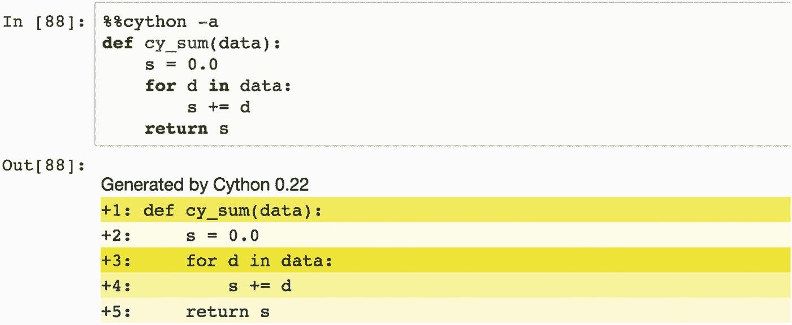

# 19. 代码优化

在本书中，我们探讨了使用 Python 及其库生态系统进行科学与技术计算的各个主题。正如本书第一章所提及的，用于科学计算的 Python 环境通常在高层次环境（适合探索性计算和快速原型开发，从而最大限度地减少开发工作量）与高性能数值计算（最大限度地缩短应用程序运行时间）之间取得了良好的平衡。高性能数值计算并非通过 Python 语言本身实现，而是通过利用包含或使用外部编译代码（通常用 C 或 Fortran 编写）的库来实现。因此，在严重依赖 `NumPy` 和 `SciPy` 等库的计算应用中，大部分数字运算由编译代码执行，其性能因此远超纯 Python 实现的相同计算。

因此，实现高性能 Python 程序的关键在于高效利用 `NumPy` 和 `SciPy` 等库进行基于数组的计算。绝大多数科学与技术计算都可以通过常见的数组运算和基础计算例程来表达。本书大部分篇幅都在介绍这种 Python 科学计算风格，即引入不同科学计算领域的主要 Python 库。然而，有时会遇到难以用数组表达式表述或不符合现有计算模式的计算需求。在这种情况下，可能需要从头开始实现计算，例如使用纯 Python 代码。但是，与用编译语言编写的等效代码相比，纯 Python 代码通常较慢，如果纯 Python 的性能开销过大，则有必要探索替代方案。传统的解决方案是用 C 或 Fortran 等语言编写外部库来执行耗时计算，并通过扩展模块将其与 Python 代码对接。

创建 Python 扩展模块有多种方法。最基本的方法是使用 Python 的 C API 构建一个扩展模块，其中包含用 C 实现且可从 Python 调用的函数。这种方法通常非常繁琐且需要大量精力。Python 标准库本身提供了 `ctypes` 模块来简化 Python 与 C 之间的对接。其他替代方案包括用于 Python 与 C 对接的 CFFI（C 外部函数接口）库^(⁷⁷)，以及用于生成 Python 与 Fortran 接口的 F2PY^(⁷⁸) 程序。这些都是将 Python 与编译代码对接的有效工具，它们在使 Python 适合科学计算方面发挥着重要作用。然而，使用这些工具需要具备 Python 以外的编程语言技能和精力，并且它们最适用于处理已用 C 或 Fortran 编写的代码库。

对于新的开发工作，在着手直接用编译语言完整实现某个问题之前，有一些更接近 Python 的替代方法值得考虑。在本章中，我们将探讨两种此类方法：`Numba` 和 `Cython`。它们在 Python 与底层语言之间提供了一个中间地带，既保留了高级语言的许多优势，又能实现与编译代码相当的性能。

`Numba` 是一个针对使用 `NumPy` 的 Python 代码的即时 (JIT) 编译器，它能生成执行效率高于原始 Python 代码的机器码。为此，`Numba` 利用了 LLVM 编译器套件（[`http://llvm.org`](http://llvm.org)），这是一个近年来因其模块化、可重用的设计与接口而变得非常流行的编译器工具链，从而支持了 `Numba` 等应用。`Numba` 是一个相对较新的项目，尚未在许多科学计算库中得到广泛应用，但它是一个有潜力的项目，得到了 Continuum Analytics Inc.^(⁷⁹) 的强力支持，并且在 Python 科学计算领域很可能前途光明。

## Numba

`Numba` 库为 Python 和 `NumPy` 代码提供了一个基于 LLVM 编译器的即时编译器。`Numba` 的主要优势在于，它可以在对原始 Python 代码进行极少甚至无需修改的情况下生成机器码。有关该项目的更多信息和文档，请访问项目网页 [`http://numba.pydata.org`](http://numba.pydata.org)。在撰写本文时，该库的最新版本是 0.39.0。`Numba` 是由 Continuum Analytics Inc. 创建的开源项目，该公司还提供名为 `NumbaPro` 的 `Numba` 商业扩展版本（更多信息见 [`http://docs.continuum.io/numbapro/index`](http://docs.continuum.io/numbapro/index)）。

`Cython` 是 Python 语言的一个超集，它可以自动翻译成 C 或 C++ 并编译成机器码，其运行速度远快于 Python 代码。`Cython` 广泛应用于面向计算的 Python 项目中，用于加速代码库中时间关键的部分，而代码库的其他部分则用 Python 编写。我们在本书前面使用过的多个库严重依赖于 `Cython`。这些库包括 `NumPy`、`SciPy`、`Pandas` 和 `scikit-learn` 等，仅举几例。


## Cython

`Cython`库提供了将 Python 代码（或经装饰后的 Python 代码）转换为 C 或 C++代码的功能，这些代码可被编译为二进制扩展模块。有关该项目及其文档的更多信息，请访问项目主页[`http://cython.org`](http://cython.org)。截至撰写本文时，`Cython`的最新版本为 0.28.4。

本章中，我们将探讨如何利用`Numba`和`Cython`加速原始 Python 编写的代码。当 Python 实现的运行速度慢到无法接受时，可以尝试这些方法。不过，在尝试优化任何 Python 代码之前，建议先对代码进行性能分析，例如使用`cProfile`模块或 IPython 的性能分析工具（参见第 1 章），以精确定位代码中的性能瓶颈。如果能够识别出明显的瓶颈，那么这些部分便是优化的理想候选。首要的优化尝试应该是尽可能高效地利用现有库（如`NumPy`和`SciPy`）解决手头问题，同时以最高效的方式使用 Python 语言本身^( ⁸⁰)。仅当现有库无法提供有效实现计算的函数和方法时，才应考虑使用`Numba`或`Cython`来优化代码。代码优化应作为最后手段，因为过早优化往往徒劳无功，且会导致代码可维护性降低：“过早优化是万恶之源”（唐纳德·克努特）。

## 导入模块

本章我们将使用`Numba`和`Cython`。`Numba`作为一个常规 Python 模块使用，这里我们假设使用以下方式完整导入该库：

```
In [1]: import numba
```

`Cython`可以通过多种方式使用，本章后续会详细介绍。通常，在 Python 中使用`Cython`代码时，我们无需显式导入`Cython`库，而是导入`Cython`提供的`pyximport`库，并通过`pyximport.install()`注册一个导入钩子：

```
In [2]: import pyximport
```

这将改变 Python 模块的导入方式，尤其允许我们直接导入以`*.pyx`为后缀的 Cython 文件，就像它们是纯 Python 模块一样。有时显式导入`Cython`库也很有用，这种情况下我们假定采用以下方式导入：

```
In [3]: import cython
```

对于基本的数值计算和绘图，我们还需要`NumPy`和`Matplotlib`库：

```
In [4]: import numpy as np
In [5]: import matplotlib.pyplot as plt
```

## Numba

`Numba`库最吸引人的特点之一是，它通常可以在不修改目标代码的情况下加速使用`NumPy`的 Python 代码。我们唯一需要做的就是使用`@numba.jit`装饰器修饰函数，这会使函数被即时编译为代码，其速度可能比纯 Python 代码快数百倍甚至更多。速度提升主要针对使用`NumPy`数组的函数，`Numba`可以自动对这些函数进行类型推断，并为所需的类型签名生成优化代码。

为了开始使用`Numba`，考虑以下简单问题：计算数组中所有元素的总和。使用 Python 的`for`循环实现此功能的函数非常简单：

```
In [6]: def py_sum(data):
...:     s = 0
...:     for d in data:
...:         s += d
...:     return s
```

尽管这个函数几乎微不足道，但它很好地展示了`Numba`的潜力和能力。由于 Python 的灵活性和动态类型，其`for`循环众所周知地慢。为了量化这一说法并对`py_sum()`函数进行基准测试，我们生成一个包含 50000 个随机数的数组，并使用`%timeit` IPython 命令测量典型计算时间：

```
In [7]: data = np.random.randn(50000)
In [8]: %timeit py_sum(data)
100 loops, best of 3: 8.43 ms per loop
```

结果表明，在该特定系统上，使用`py_sum()`函数对`data`数组中的 50000 个元素求和通常需要 8.43 毫秒。与我们下面要探讨的其他方法相比，这个性能并不理想。通常的解决方案是使用数组操作（例如`NumPy`提供的操作），而不是手动迭代数组。事实上，`NumPy`提供了`sum()`函数，这正是我们想要的功能。为了验证前面定义的`py_sum()`函数与`NumPy`的`sum()`函数产生相同的结果，我们首先发出一个`assert`语句来确认：

```
In [9]: assert abs(py_sum(data) - np.sum(data)) < 1e-10
```

由于`assert`没有引发错误，我们得出结论：这两个函数产生相同的结果。接下来，我们使用`%timeit`对`NumPy`的`sum()`函数进行基准测试，方法与前面示例相同：

```
In [10]: %timeit np.sum(data)
10000 loops, best of 3: 29.8 μs per loop
```

`NumPy`的`sum()`函数比`py_sum()`函数快几百倍，这表明使用例如`NumPy`的向量化表达式和操作是在 Python 中获得良好性能的关键。我们可以在其他使用`for`循环的函数中看到同样的现象。例如，考虑累加和函数`py_cumsum()`，它接收一个数组作为输入，并生成一个数组作为输出：

```
In [11]: def py_cumsum(data):
...:     out = np.zeros_like(data)
...:     s = 0
...:     for n in range(len(data)):
...:         s += data[n]
...:         out[n] = s
...:     return out
```

对该函数进行基准测试，结果显示其速度远慢于对应的基于数组的`NumPy`函数：

```
In [12]: %timeit py_cumsum(data)
100 loops, best of 3: 14.4 ms per loop
In [13]: %timeit np.cumsum(data)
10000 loops, best of 3: 147 μs per loop
```

现在，我们来看看如何使用`Numba`加速缓慢的`py_sum()`和`py_cumsum()`函数。要激活函数的即时编译，我们只需应用装饰器`@numba.jit`：

```
In [14]: @numba.jit
...: def jit_sum(data):
...:     s = 0
...:     for d in data:
...:         s += d
...:     return s
```

接下来，我们验证即时编译后的函数与`NumPy`的`sum()`函数产生相同的结果，并使用`%timeit`函数对其进行基准测试。

```
In [15]: assert abs(jit_sum(data) - np.sum(data)) < 1e-10
In [16]: %timeit jit_sum(data)
10000 loops, best of 3: 47.7 μs per loop
```


与纯 Python 函数相比，`jit_sum` 函数的速度提高了约 300 倍，性能可与 NumPy 的 `sum` 函数媲美，尽管它本身是用纯 Python 编写的。

除了在定义函数时通过应用 `numba.jit` 装饰器来 JIT 编译函数外，我们也可以事后应用该装饰器。例如，要对之前定义的 `py_cumsum` 函数进行 JIT 编译，我们可以使用：

```
In [17]: jit_cumsum = numba.jit()(py_cumsum)
```

我们验证生成的 `jit_cumsum` 函数确实产生了与相应 NumPy 函数相同的结果，并使用 `%timeit` 进行基准测试：

```
In [18]: assert np.allclose(np.cumsum(data), jit_cumsum(data))
In [19]: %timeit jit_cumsum(data)
10000 loops, best of 3: 66.6 μs per loop
```

在这个例子中，`jit_cumsum` 函数的性能比 NumPy 的 `cumsum` 函数快一倍。NumPy 的 `cumsum` 函数比 `jit_cumsum` 函数更通用，因此这种比较并不完全公平，但值得注意的是，通过仅使用一个函数装饰器对 Python 代码进行 JIT 编译，我们就能达到与编译代码相媲美的性能。这使得我们可以在 Python 中使用基于循环的计算而不会出现性能下降，这对于那些不易用向量化形式编写的算法尤其有用。

这类算法的一个例子是 Julia 分形的计算，它需要对复平面中坐标点矩阵的每个元素进行可变次数的迭代：复平面中的点 *z* 属于 Julia 集，如果迭代公式 *z* ← *z*² + *c* 在经过大量迭代后仍未发散。因此，为了生成 Julia 分形图，我们可以遍历一组坐标点并迭代 *z* ← *z*² + *c*，并存储在发散超过某个预定界限（在以下实现中为绝对值大于 2.0）之前所需的迭代次数：

```
In [20]: def py_julia_fractal(z_re, z_im, j):
...:    for m in range(len(z_re)):
...:        for n in range(len(z_im)):
...:            z = z_re[m] + 1j * z_im[n]
...:            for t in range(256):
...:                z = z ** 2 - 0.05 + 0.68j
...:                if np.abs(z) > 2.0:
...:                    j[m, n] = t
...:                    break
```

当使用显式循环时，这种实现非常简单直接，但在纯 Python 中，这三个嵌套循环的速度慢得令人难以接受，我们将在后续内容中看到这一点。然而，通过使用 Numba 进行 JIT 编译，我们可以获得巨大的速度提升。

默认情况下，当 Numba 无法生成优化代码时，它会优雅地回退到标准 Python 解释器。一个例外情况是当 `numba.jit` 给出了 `nopython=True` 参数时，在这种情况下，如果 Numba 无法生成静态类型代码，JIT 编译将会失败。当自动类型推断失败时，Numba 生成的 JIT 编译代码通常不会带来任何加速，因此通常建议在 `jit` 装饰器中使用 `nopython=True` 参数，以便在生成的 JIT 编译代码不太可能带来加速时快速失败。为了帮助 Numba 进行代码生成，有时显式定义函数体中出现的变量类型会很有用，我们可以通过 `jit` 装饰器的 `locals` 关键字参数来实现，该参数可以赋值为一个将符号名称映射到显式类型的字典：例如，`locals=dict(z=numba.complex)` 指定变量 `z` 是一个复数。然而，对于当前的示例，我们不需要显式指定局部变量的类型，因为它们都可以从传递给函数的 NumPy 数组的数据类型中推断出来。我们可以通过在装饰 `py_julia_fractal` 函数时使用 `numba.jit` 的 `nopython=True` 参数来验证这一点：

```
In [21]: jit_julia_fractal = numba.jit(nopython=True)(py_julia_fractal)
```

接下来，我们调用生成的 `jit_julia_fractal` 函数来计算 Julia 集。请注意，这里我们编写函数的方式是使所有涉及的 NumPy 数组都在函数外部定义。这有助于 Numba 识别计算中涉及的类型，并允许它在 JIT 编译中生成高效的代码：

```
In [22]: N = 1024
In [23]: j = np.zeros((N, N), np.int64)
In [24]: z_real = np.linspace(-1.5, 1.5, N)
In [25]: z_imag = np.linspace(-1.5, 1.5, N)
In [26]: jit_julia_fractal(z_real, z_imag, j)
```

调用 `jit_julia_fractal` 函数后，计算结果存储在 `j` 数组中。为了可视化结果，我们可以使用 Matplotlib 的 `imshow` 函数绘制 `j` 数组。结果如图 19-1 所示：



图 19-1 由使用 Numba 的 JIT 编译 Python 函数生成的 Julia 分形

```
In [27]: fig, ax = plt.subplots(figsize=(8, 8))
...: ax.imshow(j, cmap=plt.cm.RdBu_r, extent=[-1.5, 1.5, -1.5, 1.5])
...: ax.set_xlabel("$\mathrm{Re}(z)$", fontsize=18)
...: ax.set_ylabel("$\mathrm{Im}(z)$", fontsize=18)
```

我们可以使用 `%timeit` 命令来比较纯 Python 函数 `py_julia_fractal` 和相应的 JIT 编译函数 `jit_julia_fractal` 的速度：

```
In [28]: %timeit py_julia_fractal(z_real, z_imag, j)
1 loops, best of 3: 60 s per loop
In [29]: %timeit jit_julia_fractal(z_real, z_imag, j)
10 loops, best of 3: 140 ms per loop
```

在这个特定案例中，加速效果惊人，达到了 430 倍，同样只需向 Python 函数添加一个装饰器即可实现。有了这种速度提升，在 Python 中其实不再需要刻意避免使用 for 循环。

Numba 库中另一个有用的装饰器是 `numba.vectorize`。它从为标量输入和输出编写的核函数生成并 JIT 编译一个向量化函数，非常类似于 NumPy 的 `vectorize` 函数。例如，考虑赫维赛德阶跃函数：



如果我们想为标量输入 *x* 实现这个函数，我们可以使用：

```
In [30]: def py_Heaviside(x):
...:     if x == 0.0:
...:         return 0.5
...:     if x < 0.0:
...:         return 0.0
...:     else:
...:         return 1.0
```

这个函数只适用于标量输入，如果我们想将其应用于数组或列表，必须显式地遍历数组并对每个元素应用该函数：

```
In [31]: x = np.linspace(-2, 2, 50001)
In [32]: %timeit [py_Heaviside(xx) for xx in x]
100 loops, best of 3: 16.7 ms per loop
```

这既不方便又速度慢。NumPy 的 `vectorize` 函数通过将标量核函数自动包装成一个能感知 NumPy 数组的函数，解决了不方便的问题：

```
In [33]: np_vec_Heaviside = np.vectorize(py_Heaviside)
In [34]: np_vec_Heaviside(x)
Out[34]: array([ 0.,  0.,  0., ...,  1.,  1.,  1.])
```

然而，NumPy 的 `vectorize` 函数并没有解决性能问题。从使用 `%timeit` 对 `np_vec_Heaviside` 函数进行基准测试的结果来看，其性能与显式遍历数组并依次为每个元素调用 `py_Heaviside` 函数相当：

```
In [35]: %timeit np_vec_Heaviside(x)
100 loops, best of 3: 13.6 ms per loop
```

使用 NumPy 数组表达式而不是对用 Python 编写的标量核使用 NumPy 的 `vectorize` 函数，可以获得更好的性能：

```
In [36]: def np_Heaviside(x):
...:     return (x > 0.0) + (x == 0.0)/2.0
In [37]: %timeit np_Heaviside(x)
1000 loops, best of 3: 268 μs per loop
```


然而，通过使用 `Numba` 和 `vectorize` 装饰器（它接收一个函数签名列表，用于生成 JIT 编译的代码）可以实现更佳的性能。在此，我们为两种签名生成了向量化函数——一种签名输入和输出都是 32 位浮点数数组，定义为 `numba.float32(numba.float32)`；另一种签名输入和输出都是 64 位浮点数数组，定义为 `numba.float64(numba.float64)`：

```
In [38]: @numba.vectorize([numba.float32(numba.float32),
...:                   numba.float64(numba.float64)])
...: def jit_Heaviside(x):
...:     if x == 0.0:
...:         return 0.5
...:     if x < 0:
...:         return 0.0
...:     else:
...:         return 1.0
```

对生成的 `jit_Heaviside` 函数进行基准测试，结果显示，在我们考察过的方法中，它的性能最佳：

```
In [39]: %timeit jit_Heaviside(x)
10000 loops, best of 3: 58.5 μs per loop
```

`jit_Heaviside` 函数可以像任何 `NumPy` 通用函数一样使用，包括支持广播和其他 `NumPy` 特性。为了验证该函数确实实现了所需功能，我们可以用一组简单的输入值进行测试：

```
In [40]: jit_Heaviside([-1, -0.5, 0.0, 0.5, 1.0])
Out[40]: array([ 0\. ,  0\. ,  0.5,  1\. ,  1\. ])
```

在本节中，我们探讨了如何使用 `Numba` 库通过 JIT 编译加速 Python 代码。我们研究了四个示例：两个用于演示 `Numba` 基本用法的简单示例——数组求总和与累加求和；一个更贴近实际、但不易用向量表达式表述的 `Numba` 用例——朱利亚集计算；最后，我们通过实现 Heaviside 阶跃函数探索了标量核的向量化。这些示例展示了 `Numba` 的常见使用模式，但 `Numba` 库还有更多值得探索的功能，例如为 GPU 生成代码。有关此主题及其他内容的更多信息，请参阅 `Numba` 官方文档，网址为 [`http://numba.pydata.org/doc.html`](http://numba.pydata.org/doc.html)。

## Cython

与 `Numba` 类似，`Cython` 也是一套加速 Python 代码的解决方案，不过 `Cython` 处理此问题的方式截然不同。`Numba` 是一个 Python 库，它将纯 Python 代码转换为 LLVM 代码，再 JIT 编译为机器码；而 `Cython` 是一种编程语言，它是 Python 编程语言的超集：`Cython` 通过引入类似 C 语言的特性来扩展 Python。最值得注意的是，`Cython` 允许我们使用显式且静态的类型声明。`Cython` 为 Python 引入这些扩展的目的，是为了使代码能够被转换为高效的 C 或 C++ 代码，这些代码随后可编译成 Python 扩展模块，从而可以从常规的 Python 代码中导入并使用。

`Cython` 主要有两种用途：加速 Python 代码，以及为与编译库交互生成包装器。使用 `Cython` 时，我们需要修改目标 Python 代码，因此与使用 `Numba` 相比，需要多做一点工作，并且我们需要学习 `Cython` 的语法和行为，才能用它来加速 Python 代码。然而，正如我们将在本节中看到的，`Cython` 提供了对 Python 代码处理方式的更精细控制，并且 `Cython` 还具备一些 `Numba` 无法实现的功能，例如生成 Python 与外部库之间的接口，以及加速不使用 `NumPy` 数组的 Python 代码。

虽然 `Numba` 采用透明的即时编译，但 `Cython` 主要设计用于传统的预编译（提前编译）。有几种将 `Cython` 代码编译成 Python 扩展模块的方法，每种适用于不同的用例。我们首先回顾编译 `Cython` 代码的选项，然后介绍 `Cython` 对于加速用 Python 编写的计算有用的特性。在本节中，我们将主要使用上一节中与 `Numba` 示例基本相同的示例，以便我们能够轻松比较方法和结果。我们首先探讨如何加速上一节中定义的 `py_sum` 和 `py_cumsum` 函数。

要从 Python 中使用 `Cython` 代码，它必须经过 `Cython` 编译管道：首先，`Cython` 代码必须被翻译成 C 或 C++ 代码，然后，需要使用 C 或 C++ 编译器将其编译成机器码。从 `Cython` 代码到 C 或 C++ 的翻译可以使用 `cython` 命令行工具完成。该工具接收一个包含 `Cython` 代码的文件（我们通常使用 `.pyx` 文件扩展名存储这些文件），并生成一个 C 或 C++ 文件。例如，考虑文件 `cy_sum.pyx`，其内容如代码清单 [19-1] 所示。为了从这个 `Cython` 文件生成 C 文件，我们可以运行命令 `cython cy_sum.pyx`。结果是生成 `cy_sum.c` 文件，我们可以使用标准的 C 编译器将其编译成 Python 扩展模块。此编译步骤依赖于平台，需要使用正确的编译器标志和选项才能生成合适的 Python 扩展。

```
def cy_sum(data):
    s = 0.0
    for d in data:
        s += d
    return s
代码清单 19-1
Cython 文件 cy_sum.pyx 的内容
```

为了避免与平台特定的 C 和 C++ 代码编译选项相关的复杂性，我们可以使用 `distutils` 和 `Cython` 库自动将 `Cython` 代码翻译成有用的 Python 扩展模块。这需要创建一个 `setup.py` 脚本，它调用 `distutils.core` 中的 `setup` 函数（该函数知道如何将 C 代码编译成 Python 扩展）以及 `Cython.Build` 中的 `cythonize` 函数（该函数知道如何将 `Cython` 代码翻译成 C 代码），如代码清单 [19-2] 所示。当 `setup.py` 文件准备好后，我们可以使用命令 `python setup.py build_ext --inplace` 编译 `Cython` 模块，该命令指示 `distutils` 构建扩展模块并将其放置在源代码所在的同一目录中。


```content
```
from distutils.core import setup
from Cython.Build import cythonize
import numpy as np
setup(ext_modules=cythonize('cy_sum.pyx'),
include_dirs=[np.get_include()],
requires=['Cython', 'numpy'])
```

*代码清单 19-2* 一个可用于自动将 Cython 文件编译为 Python 扩展模块的`setup.py`脚本

一旦 Cython 代码被编译为 Python 扩展模块（无论是手动编译还是使用`distutils`库），我们就可以将其导入并像常规 Python 模块一样使用：

```
In [41]: from cy_sum import cy_sum
In [42]: cy_sum(data)
Out[42]: -189.70046227549025
In [43]: %timeit cy_sum(data)
100 loops, best of 3: 5.56 ms per loop
In [44]: %timeit py_sum(data)
100 loops, best of 3: 8.08 ms per loop
```

此示例表明，直接使用 Cython 编译代码清单 19-1 中的纯 Python 代码，可获得约 30%的加速。这虽是可观的加速，但或许不值得为通过 Cython 编译流程而费周折。后续我们将介绍如何利用 Cython 的更多特性来进一步提升加速效果。

```
cimport numpy
import numpy
def cy_cumsum(data):
out = numpy.zeros_like(data)
s = 0
for n in range(len(data)):
s += data[n]
out[n] = s
return out
```

*代码清单 19-3* Cython 文件`cy_cumsum.pyx`的内容

上述代码展示了将 Cython 代码显式编译为 Python 扩展模块的过程。这对于分发用 Cython 编写的预编译模块非常有用，因为最终生成的扩展模块在使用时无需安装 Cython。另一种隐式调用 Cython 编译流程的方法是在模块导入时自动触发，这可通过随 Cython 分发的`pyximport`库实现。要无缝地从 Python 直接导入 Cython 文件，我们首先需要调用`pyximport`库中的`install`函数：

```
In [45]: pyximport.install(setup_args=dict(include_dirs=np.get_include()))
```

这将修改 Python `import`语句的行为，增加对 Cython `pyx`文件的支持。当导入一个 Cython 模块时，它会先被编译为 C 或 C++代码，然后再编译为 Python 解释器可导入的 Python 扩展模块格式的机器码。这些隐式步骤有时需要额外配置，我们可以通过`pyximport.install`函数的参数进行传递。例如，为了导入使用了 NumPy 相关功能的 Cython 代码，生成的 C 代码需要针对 NumPy C 头文件进行编译。我们可以通过在`install`函数的`setup_args`参数中将`include_dirs`设置为`np.get_include()`的值来配置这一点，如上代码所示。此外，还有其他可用选项，我们也可以自定义编译和链接参数。详细信息请参阅`pyximport.install`的文档字符串。一旦调用了`pyximport.install`，我们就可以使用标准的 Python `import`语句从 Cython 模块中导入函数：

```
In [46]: from cy_cumsum import cy_cumsum
In [47]: %timeit cy_cumsum(data)
100 loops, best of 3: 5.91 ms per loop
In [48]: %timeit py_cumsum(data)
100 loops, best of 3: 13.8 ms per loop
```

在此示例中，我们看到经过 Cython 编译流程的 Python 代码获得了虽可喜但不算惊艳的两倍加速。

在深入探讨 Cython 的详细用法以进一步提升加速倍数之前，我们先快速介绍另一种编译和导入 Cython 代码的方式。在使用 IPython（尤其是 Jupyter Notebook）时，我们可以使用便捷的`%%cython`命令，该命令会自动将代码单元格中的 Cython 代码编译并加载为 Python 扩展，并在 IPython 会话中提供使用。要使用此命令，我们首先需要使用`%load_ext cython`命令激活它：

```
In [49]: %load_ext cython
```

激活`%%cython`命令后，我们可以在 IPython 会话中交互式地编写和加载 Cython 代码：

```
In [50]: %%cython
...: def cy_sum(data):
...:     s = 0.0
...:     for d in data:
...:         s += d
...:     return s
In [51]: %timeit cy_sum(data)
100 loops, best of 3: 5.21 ms per loop
In [52]: %timeit py_sum(data)
100 loops, best of 3: 8.6 ms per loop
```

如之前所见，只需在 IPython 代码单元格的第一行添加`%%cython`即可直接获得加速。这让人联想到给函数添加`@numba.jit`装饰器，但这两种方法背后的机制截然不同。在本节剩余部分，我们将使用此方法编译和加载 Cython 代码。在使用`%%cython` IPython 命令时，添加`-a`参数也很有用。这会使 Cython 的注释输出显示为代码单元格的输出，如图 19-2 所示。注释会以黄色深浅度显示每一行代码：亮黄色表示该行代码被翻译为对 Python C/API 有强依赖的 C 代码，而白色行代码则被直接翻译为纯 C 代码。在优化 Cython 代码时，我们通常需要尽力让 Cython 代码尽可能被翻译为纯 C 代码，因此检查注释输出并查找通常代表代码瓶颈的黄色行非常有用。额外的好处是，点击注释输出中的一行代码，可以在我们提供的 Cython 代码和它被翻译成的 C 代码之间切换显示。



*图 19-2* 使用带`-a`参数的`%%cython` IPython 命令生成的 Cython 注释

在本节剩余部分，我们将探索利用 Cython 引入的语言特性（尤其适用于计算问题）来加速 Cython 代码的方法。我们首先重新审视前面代码中`cy_sum`的实现。在首次尝试加速此函数时，我们仅使用了纯 Python 代码并通过 Cython 编译流程，结果获得了约 30%的加速。实现更大幅度加速的关键步骤是为函数的所有变量和参数添加类型声明。通过显式声明变量类型，Cython 编译器将能够生成更高效的 C 代码。要指定变量类型，我们需要使用 Cython 关键字`cdef`，它可与任何标准 C 类型一起使用。例如，要声明整数类型的变量`n`，可以使用`cdef int n`。我们也可以使用 NumPy 库的类型定义：例如，`cdef numpy.float64_t s`将变量`s`声明为 64 位浮点数。NumPy 数组可以使用格式为`numpy.ndarray[numpy.float64_t, ndim=1] data`的类型规范来声明，这表示`data`是一个元素类型为 64 位浮点数、一维（向量）、长度未指定的数组。为之前的`cy_sum`函数添加此类类型声明后，得到如下代码：

```
In [53]: %%cython
...: cimport numpy
...: cimport cython
...:
...: @cython.boundscheck(False)
...: @cython.wraparound(False)
...: def cy_sum(numpy.ndarray[numpy.float64_t, ndim=1] data):
...:     cdef numpy.float64_t s = 0.0
...:     cdef int n, N = len(data)
...:     for n in range(N):
...:         s += data[n]
...:     return s
```

好的，作为一名高级文档工程师和翻译员，我将严格遵循您提供的注意事项和示例格式，对给定的英文文本进行翻译。


在该实现中，我们对`cy_sum`函数应用了两个装饰器`@cython.boundscheck(False)`和`@cython.wraparound(False)`，这两个装饰器禁用了对 NumPy 数组索引进行耗时的边界检查。这会导致代码安全性降低，但如果我们确信该函数中的 NumPy 数组不会被索引到有效范围之外，可以通过禁用这些检查获得额外的加速。现在，我们已经显式声明了函数所有变量和参数的类型，Cython 能够生成高效的 C 代码，这些代码在编译成 Python 模块后，其性能与使用 Numba 的 JIT 编译代码相当，并且接近 NumPy 内置的`sum`函数（该函数同样用 C 实现）的性能：

```
In [54]: %timeit cy_sum(data)
10000 loops, best of 3: 49.2 μs per loop
In [55]: %timeit jit_sum(data)
10000 loops, best of 3: 47.6 μs per loop
In [56]: %timeit np.sum(data)
10000 loops, best of 3: 29.7 μs per loop
```

接下来，让我们将注意力转向`cy_cumsum`函数。与`cy_sum`函数一样，该函数也将受益于显式类型声明。为了简化 NumPy 数组类型的声明，我们在这里使用`ctypedef`关键字为`numpy.float64_t`创建了一个别名`FTYPE_t`。还需要注意，在 Cython 代码中，有两种不同的导入语句：`cimport`和`import`。`import`语句可用于导入任何 Python 模块，但这会生成回调 Python 解释器的 C 代码，因此可能速度较慢。`cimport`语句的工作方式类似于常规的`import`，但用于导入其他 Cython 模块。这里的`cimport numpy`导入了一个名为`numpy`的 Cython 模块，该模块提供了对 NumPy 的 Cython 扩展，主要是类型和函数声明。特别是，诸如`numpy.float64_t`之类的 C 风格类型就是在该 Cython 模块中声明的。但是，在下面代码定义的函数中调用`numpy.zeros`会导致对 NumPy 模块中`zeros`函数的调用，为此，我们需要使用`import numpy`引入 Python 模块`numpy`。

将上述类型声明添加到之前定义的`cy_cumsum`函数中，得到如下实现：

```
In [57]: %%cython
...: cimport numpy
...: import numpy
...: cimport cython
...:
...: ctypedef numpy.float64_t FTYPE_t
...:
...: @cython.boundscheck(False)
...: @cython.wraparound(False)
...: def cy_cumsum(numpy.ndarray[FTYPE_t, ndim=1] data):
...:     cdef int n, N = data.size
...:     cdef numpy.ndarray[FTYPE_t, ndim=1] out = numpy.zeros(N, dtype=data.dtype)
...:     cdef numpy.float64_t s = 0.0
...:     for n in range(N):
...:         s += data[n]
...:         out[n] = s
...:     return out
```

与`cy_sum`类似，在声明了函数中所有变量的类型后，我们看到了显著的加速，并且`cy_cumsum`的性能现在与 JIT 编译的 Numba 函数`jit_cumsum`相当，且比 NumPy 内置的`cumsum`函数（后者功能更为通用）更快：

```
In [58]: %timeit cy_cumsum(data)
10000 loops, best of 3: 69.7 μs per loop
In [59]: %timeit jit_cumsum(data)
10000 loops, best of 3: 70 μs per loop
In [60]: %timeit np.cumsum(data)
10000 loops, best of 3: 148 μs per loop
```

当添加显式类型声明时，我们通过 Cython 编译函数获得了性能提升，但同时也失去了通用性，因为该函数现在无法接受任何其他类型的参数。例如，原始的`py_sum`函数以及 NumPy 的`sum`函数，能够接受更广泛的输入类型。我们可以对 Python 列表以及包含浮点数和整数的 NumPy 数组进行求和：

```
In [61]: py_sum([1.0, 2.0, 3.0, 4.0, 5.0])
Out[61]: 15.0
In [62]: py_sum([1, 2, 3, 4, 5])
Out[62]: 15
```

另一方面，带有显式类型声明的 Cython 编译版本仅能处理我们声明的确切类型：

```
In [63]: cy_sum(np.array([1.0, 2.0, 3.0, 4.0, 5.0]))
Out[63]: 15.0
In [64]: cy_sum(np.array([1, 2, 3, 4, 5]))

ValueError: Buffer dtype mismatch, expected 'float64_t' but got 'long'
```

通常，我们希望支持多种输入类型，例如，能够使用同一函数对浮点数和整数数组进行求和。Cython 通过`ctypedef fused`关键字提供了解决此问题的方案，借助该关键字，我们可以定义一种新类型，这种类型是若干种给定类型中的一种。例如，考虑对`py_sum`函数进行如下修改，得到`py_fused_sum`函数：

```
In [65]: %%cython
...: cimport numpy
...: cimport cython
...:
...: ctypedef fused I_OR_F_t:
...:     numpy.int64_t
...:     numpy.float64_t
...:
...: @cython.boundscheck(False)
...: @cython.wraparound(False)
...: def cy_fused_sum(numpy.ndarray[I_OR_F_t, ndim=1] data):
...:     cdef I_OR_F_t s = 0
...:     cdef int n, N = len(data)
...:     for n in range(N):
...:         s += data[n]
...:     return s
```

这里，函数是依据类型`I_OR_F_t`定义的，该类型使用`ctypedef fused`定义为可以是`numpy.int64_t`或`numpy.float64_t`。Cython 会自动为这两种类型的函数生成必要的代码，这样我们就可以在浮点数和整数数组上使用该函数（代价是性能略有下降）：

```
In [66]: cy_fused_sum(np.array([1.0, 2.0, 3.0, 4.0, 5.0]))
Out[66]: 15.0
In [67]: cy_fused_sum(np.array([1, 2, 3, 4, 5]))
Out[67]: 15
```

作为使用 Cython 加速 Python 代码的最后一个示例，让我们再次考虑上一节中看到的用于生成 Julia 集的 Python 代码。要实现此函数的 Cython 版本，我们只需采用原始 Python 代码，并按照前面所述的过程，显式声明函数中使用的所有变量的类型。我们还添加了用于禁用索引边界检查和环绕检查的装饰器。这里我们既有 NumPy 整数数组又有浮点数数组作为输入，因此我们分别将参数类型定义为`numpy.ndarray[numpy.float64_t, ndim=1]`和`numpy.ndarray[numpy.int64_t, ndim=2]`。

下面代码中给出的`cy_julia_fractal`实现还包含一个复数模平方的 Cython 实现。该函数使用`inline`关键字声明为内联函数，这意味着编译器会将函数体放在每次调用它的地方，而不是创建一个从这些位置调用的函数。这会导致生成较大的代码，但避免了额外函数调用的开销。我们还使用`cdef`而非通常的`def`关键字定义此函数。在 Cython 中，`def`定义一个可以从 Python 调用的函数，而`cdef`定义一个可以从 C 调用的函数。使用`cpdef`关键字，我们可以同时定义一个既可以从 C 调用又可以从 Python 调用的函数。按照这里的写法，使用的是`cdef`，我们无法在执行此代码单元后从 IPython 会话中调用`abs2`函数，但如果将`cdef`改为`cpdef`，则可以调用。

```
In [68]: %%cython
...: cimport numpy
...: cimport cython
...:
...: cdef inline double abs2(double complex z):
...:     return z.real * z.real + z.imag * z.imag
...:
...: @cython.boundscheck(False)
...: @cython.wraparound(False)
...: def cy_julia_fractal(numpy.ndarray[numpy.float64_t, ndim=1] z_re,
...:                      numpy.ndarray[numpy.float64_t, ndim=1] z_im,
...:                      numpy.ndarray[numpy.int64_t, ndim=2] j):
...:     cdef int m, n, t, M = z_re.size, N = z_im.size
...:     cdef double complex z
...:     for m in range(M):
...:         for n in range(N):
...:             z = z_re[m] + 1.0j * z_im[n]
...:             for t in range(256):
...:                 z = z ** 2 - 0.05 + 0.68j
...:                 if abs2(z) > 4.0:
...:                     j[m, n] = t
...:                     break
```


如果我们使用与之前调用使用 Numba 进行 JIT 编译的 Python 实现时相同的参数来调用 `cy_julia_fractal` 函数，会发现这两个实现的性能相当。

```
In [69]: N = 1024
In [70]: j = np.zeros((N, N), dtype=np.int64)
In [71]: z_real = np.linspace(-1.5, 1.5, N)
In [72]: z_imag = np.linspace(-1.5, 1.5, N)
In [73]: %timeit cy_julia_fractal(z_real, z_imag, j)
10 loops, best of 3: 113 ms per loop
In [74]: %timeit jit_julia_fractal(z_real, z_imag, j)
10 loops, best of 3: 141 ms per loop
```

`cy_julia_fractal` 实现略微占优，这主要归因于最内层循环中对 `abs2` 函数的内联调用，以及 `abs2` 函数避免了计算平方根这一事实。在 `jit_julia_fractal` 中做出类似的更改可以提高其性能，并且大致能够解释这里展示的性能差异。

到目前为止，我们已经探索了将 Cython 作为一种通过将 Python 代码编译成机器码（以 Python 扩展模块的形式提供）来加速其运行的方法。Cython 还有另一个重要的用例，这个用例至少与其在 Python 科学计算社区中的广泛使用同样重要：Cython 还可以用于轻松创建已编译的 C 和 C++ 库的封装器。我们不会在此深入探讨这个问题，但会给出一个简单的示例，说明如何使用 Cython 在短短几行代码中调用任意 C 库。以 C 标准库中的数学库为例。它提供了数学函数，类似于 Python 标准库中同名模块 `math` 定义的函数。要在 C 程序中使用这些函数，我们需要包含 `math.h` 头文件以获取它们的声明，然后将程序与 `libm` 库进行编译和链接。在 Cython 中，我们可以使用 `cdef extern from` 关键字获取函数声明，之后需要给出 C 头文件的名称，并在随后的代码块中列出我们想要使用的函数的声明。例如，要使 `libm` 中的 `acos` 函数在 Cython 中可用，我们可以使用以下代码：

```
In [75]: %%cython
...: cdef extern from "math.h":
...:      double acos(double)
...:
...: def cy_acos1(double x):
...:     return acos(x)
```

这里我们还定义了 Python 函数 `cy_acos1`，我们可以从 Python 中调用它：

```
In [76]: %timeit cy_acos1(0.5)
10000000 loops, best of 3: 83.2 ns per loop
```

使用这种方法，我们可以将任意的 C 函数封装成可从常规 Python 代码调用的函数。这对于科学计算应用来说是一个非常实用的特性，因为它使得现有的用 C 和 C++ 编写的代码能够轻松地从 Python 中调用。对于标准库，Cython 已经通过 `libc` 模块提供了类型声明，因此我们不需要使用 `cdef extern from` 显式定义函数。对于 `acos` 这个例子，我们可以直接使用 `cimport` 语句从 `libc.math` 中导入该函数：

```
In [77]: %%cython
...: from libc.math cimport acos
...:
...: def cy_acos2(double x):
...:     return acos(x)
In [78]: %timeit cy_acos2(0.5)
10000000 loops, best of 3: 85.6 ns per loop
```

生成的函数 `cy_acos2` 与之前从 `math.h` 显式导入的 `cy_acos1` 是相同的。将这些 C 数学库函数的性能与 NumPy 和 Python 标准数学库中相应的函数进行比较是很有启发性的：

```
In [79]: from numpy import arccos
In [80]: %timeit arccos(0.5)
1000000 loops, best of 3: 1.07 μs per loop
In [81]: from math import acos
In [82]: %timeit acos(0.5)
10000000 loops, best of 3: 95.9 ns per loop
```

NumPy 版本的速度比 Python 的 `math` 函数和 C 标准库函数的 Cython 封装器慢了大约十倍，这是因为与 NumPy 数组数据结构相关的开销所致。

## 总结

在本章中，我们探索了使用 Numba 和 Cython 加速 Python 代码的方法。Numba 通过即时编译生成优化的机器码，而 Cython 生成 C 代码，该代码可以通过预编译编译成机器码。Numba 适用于纯 Python 代码，但严重依赖于利用 NumPy 数组进行类型推断，而 Cython 则使用 Python 语言的扩展，允许显式的类型声明。这些方法的优势在于，我们可以获得与编译后的机器码相媲美的性能，同时仍然停留在 Python 或类 Python 的编程环境中。加速 Python 代码的关键在于使用类型化变量，要么像 Numba 那样利用 NumPy 数组进行类型推断，要么像 Cython 那样显式声明变量的类型。显式类型化的代码可以转换成比纯 Python 中的动态类型化代码高效得多的代码，并且可以避免 Python 中类型查找所涉及的许多开销。Numba 和 Cython 都是获得显著的 Python 代码加速的便捷方式，并且它们生成的代码通常具有相似的性能。Cython 还提供了一种简便的方法来创建外部库的接口，以便可以从 Python 中调用它们。在 Numba 和 Cython 中，共同的主题是利用类型信息（来自 NumPy 数组或显式声明）来生成更高效的类型化机器码。在 Python 社区中，最近也有一个趋势，即向 Python 语言本身添加对可选类型提示（type hints）的支持。有关类型提示的更多详细信息，请参阅 PEP 484 ([`www.python.org/dev/peps/pep-0484`](http://www.python.org/dev/peps/pep-0484))，该规范已从 Python 3.5 版本开始纳入 Python。虽然 Python 中的类型提示在不久的将来不太可能被广泛使用，但它无疑是一个值得关注的有趣发展。

## 延伸阅读

关于使用 Cython 的详尽指南，请参考 Smith (2015) 和 Herron (2013)。有关 Numba 的更多信息，请参阅其官方文档 ([`http://numba.pydata.org/numba-doc`](http://numba.pydata.org/numba-doc))。关于使用 Python 进行高性能计算的详细讨论，另请参见 M. Gorelick (2014)。

### 索引

#### A

Adams-Bashforth 方法
Adams-Moulton 方法
`add_axes` 方法
`add_subplot` 函数
解析解
应用程序编程接口 (API)
任意精度积分
数组创建
- 常量值
- 增量序列
- 列表
- 对数序列
- 矩阵
- 数组
- 未初始化数组
自回归 (AR) 模型
- ARIMA
- ARMA
- Durbin-Watson 统计检验
- 高阶
- `sm.tsa.AR` 类
- 温度观测值
差分整合移动平均自回归 (ARIMA) 模型
自回归移动平均 (ARMA) 模型
`autoscale` 方法
`AutoSubDomain` 实例
`ax.annotation`
坐标轴
- 图例方法
- 线条属性
- 绘图类型
- 属性 (*参见* 属性, 轴)
- 文本标注
坐标轴布局
- `GridSpec`
- 嵌入式图 (insets)
- `subplot2grid`
- 子图 (subplots)
`Axes.text` 方法
轴刻度
`ax.legend` 方法
`ax.set_xlabel` 方法
`ax.set_ylabel` 方法
`ax.text`

#### B

贝叶斯定理
`bbox_to_anchor` 参数
BFGS 方法
二分法
二元插值
Blackman 函数
布尔值数组
区间分割法 (Bracketing methods)
`brent` 函数
Broyden 方法
`Bunch` 对象
巴特沃斯滤波器


#### C

`微积分`，`SymPy` 级数展开 `sympy.diff` 函数 `sympy.integrate` 函数 `sympy.limit` 函数 `sympy.Product` 类 `sympy.Sum` 类 `切比雪夫滤波器` `切比雪夫多项式` `经典优化问题` `闭式表达式` `代码优化` `C/Fortran` `cProfile` 模块 `Cython` (*参见* `Cython`) 导入模块 `Numba` (*参见* `Numba`) `NumPy` 和 `SciPy` `色图绘制` `按列优先格式` `逗号分隔值(CSV)` 首字母缩略词 数组 列 注释行 数据 数据框 非数值数据 `np.loadtxt` 函数 `np.savetxt` `NumPy` 数组 一维/二维数组 `pandas read_csv` 函数 纯文本文件格式 `Python` 字符串列表 `pandas read_csv` 函数 数据规格的大小和复杂度 制表符 向量和矩阵 `复杂数据结构` `复值数组` `复合求积规则` `计算机代数系统(CAS)` `计算环境` `Conda create` 命令 环境，更新 包 重新创建 `混淆矩阵` `约束优化` 等高线图 等值线图 坐标变量 不等式约束 线性规划 `SymPy` `约束条件` `连续实值函数` `Continuum Analytics 的 Anaconda` `contourf` 函数 `凸问题` `cProfile` 模块 `交叉验证` `ctypes` `cvxopt` 库 `cvxopt.solvers.lp` 求解器 `cvxopt.matrix` 函数 `cy_cumsum` 函数 `Cython` `C` 数学库函数 代码编译流水线 `cpdef` 关键字 `cy_cumsum` 函数 `cy_cumsum.pyx` `cy_julia_fractal` 函数 `cy_sum` 函数 `cy_sum.pyx` `%%cython` `IPython` 命令 `cython cy_sum.pyx` 设计 `distutils` 库 显式类型声明 浮点数和整数数组 生成，`C` 代码 `libc` 模块 `%load_ext cython` 命令 机器码 `math.h` 头文件 `py_sum` 函数 `Python` 项目 具有 `C` 类似特性的 `Python` `pyximport` 库 `pyximport.install` 函数 `setup` 函数 加速 用法 `Cythonimport`

#### D

`数据输入与输出` 数组与表格数据 类别与类型 `CSV` (*参见* `逗号分隔值(CSV)`) `HDF5` (*参见* `分层数据格式 5(HDF5)`) `JSON` (*参见* `JavaScript 对象表示法(JSON)`) 库 选项 序列化 存储结构化和非结构化数据 `dblquad` 函数 `默认刻度放置` `稠密矩阵` `稠密 NumPy 数组` `DesicisionTreeClassifier` 类 `数字信号处理器(DSP)` `降维` `狄拉克δ函数` `方向场图形技术` `DirichletBC` 类 `狄利克雷边界条件` `离散余弦变换(DCT)` `离散傅里叶变换(DFT)` `离散正弦变换(DST)` `doit` 方法 `dolfin.AutoSubDomain` 实例 `dolfin.FunctionSpace` 类 `dolfin` 库 `dolfin.MeshFunction` 实例 `dolfin.refine` 函数 `dolfin.solve` 函数 `dolfin.TrialFunction` 和 `dolfin.TestFunction` 类 `多曼德-普林斯` 方法 `每英寸点数(DPI)` `dpi` 参数 `3D 绘图` `dplquad` 函数 `德宾-沃森` 统计检验

#### E

`eigenvals` 方法 `特征值方程` `特征值问题` `SciPy` `SymPy` `eigenvects` 方法 `爱因斯坦求和约定` `ElasticNet` 类 `弹性网络正则化回归` `Enthought 的 Canopy` `环境`，管理 `环境`，切换 `欧拉方法` `evalf` 方法 `expr_func` 函数 `extent` 参数 `外推法`

#### F

`facecolor` 参数 `花式索引` `快速傅里叶变换(FFT)` `特征提取` `FEniCS` 框架，`偏微分方程` `AutoSubDomain` 实例 `狄利克雷边界条件` `dolfin.assemble` 函数 `dolfin.AutoSubDomain` 实例 `dolfin.Constant` 对象 `dolfin.Expression` 对象 `dolfin.FunctionSpace` 类 `dolfin.MeshFunction` `dolfin.parameters` 字典 `dolfin.plot` `dolfin.RectangleMesh` `dolfin.refine` 函数 `dolfin.solve` `dolfin.TrialFunction` 和 `dolfin.TestFunction` 类 域和子域参数 `Expression` 类 外部可视化软件 函数对象 函数和类 `dolfin` 库 `mshr` 库 库与工具 `Matplotlib` `Matplotlib` 的 `pcolor` 函数 网格和 `boundary_parts` 对象 网格函数 网格生成 网格对象 生成，`mshr` 库 `mshr.Circle` `诺依曼边界条件` `np.array` 函数 `on_boundary` `Python` 接口 `RectangleMesh` 函数 `refined_mesh` 稳态热方程 温度分布 试探函数和检验函数 `triplot` 和 `tripcolor` `ufl_element` 方法 均匀细结构化网格 `u_sol.vector()` 和 `mesh.coordinates()` 向量方法 `FEniCS` 库 `fftpack` 模块 `figsize` 参数 `Figure.add_subplot` 方法 `Figure` 对象 `Figure`，技巧 `滤波器设计` `有限差分公式` `有限差分法(FDM)` 代数方程 后向差分公式 边界条件 稠密 `NumPy` 数组 `eye` 和 `kron` 函数 `NumPy` 中的 `eye` 函数 有限差分公式 `SciPy` 中的线性方程求解器 `偏微分方程` 问题 `reshape` 方法 二阶 `常微分方程` 边值问题 求解 `常微分方程` 边值问题 稀疏矩阵 稀疏矩阵数据结构 二维热方程，`狄利克雷边界条件` `有限元法(FEM)` 基函数 连续函数 `FiPy`，`SfePy` 和 `FEniCS` 库 无限维函数空间 网格生成 `泊松方程` 求解 `偏微分方程` 问题 标准线性代数方法 稳态热方程 强形式 检验函数 `有限冲激响应(FIR)滤波器` `有限体积法(FVM)` 软件 `FiPy` 框架 `FiPy` 库 `fixed_quad` 函数 `浮点值数组` `format` 参数 `傅里叶变换` `F(v)` `free_symbols` 属性 `频域滤波器` `Function` 对象

#### G

`Gaussian_kde` 函数 `高斯求积` `高斯窗` 函数 `广义最小二乘法(GLS)` `广义线性模型` `胶水语言` `黄金分割搜索方法` `使用 Matplotlib 创建图形` `图形用户界面` `图与网络` 邻接矩阵 边数据 `EdgeView` `NetworkX` 库 `NodeView` 对象与方法 `东京地铁` 站点 邻接矩阵 `布尔` 属性 `Cuthill-McKee` 排序 `degree` 方法 `graphviz_layout` 函数 `JSON` 文件 `nx.draw_network_edges` `nx.draw_networkx_labels` 最优行驶路线 路径与行驶时间 最短路径与行驶时间 换乘边与车内边 `travel_times` 和 `transfers` 权重属性 `grid` 方法 `网格线`，结果 `GridSpec` 布局管理器

#### H

`h5py` 库 `API` 数据集 `布尔索引` `create_dataset` 方法 创建 空数组 `experiment1/simulation/data1` 组 `experiment2/measurement` 花式索引 `fillvalue` `float64` `meas1` 数据集 `NumPy` 数组 对象 检索值 `visititems` 方法 文件 组 `Hamming` 函数 `Hann` 函数 `埃尔米特多项式` `海森矩阵` `分层数据格式 5(HDF5)` 属性 `h5py` 库 (*参见* `h5py` 库) 高性能并行 `I/O` 实现 库 长期存储 `Pandas HDFStore` `PyTables` 库 存储数值数据 结构 `高阶方法` `高阶求积规则`

#### I

`imshow` 方法 `索引与切片` 花式索引与布尔索引 多维数组 一维数组 `resize` 与 `reshape` 视图 视觉总结 `无限维函数空间` `无限冲激响应(IIR)滤波器` `安装说明` `积分方程` `恒等式积分` `积分变换` `被积函数` `被积函数表格化值` `交互模式` `插值函数` `interpolate.griddata` 函数 `插值与曲线拟合` `积分的解释` `解释器` `逆拉普拉斯变换` `逆变换` `IPython` 命令 `IPython` 控制台 自动补全与对象内省 文档 输入与输出缓存 交互 `IPython` 环境 `IPython` 扩展 调试器 导航 重置 运行脚本 文本编辑器 代码计时与分析 `IPython`，安装 `IPython`，交互函数 `鸢尾花数据集` `is_real` 属性


#### J

`Jacobian` 矩阵  
`JavaScript Object Notation (JSON)` 文件 `data.json` 格式  
`json.dumps` 函数  
`json.loads` 函数  
列表与字典嵌套结构的多行数据  
`Python` 代码  
`Python` 数据结构序列化  
`东京地铁` 网络  
`JIT` 编译代码  
`jit_cumsum` 函数  
`jit_sum` 函数  
`联合概率分布`  
`Julia` 分形  
`Jupyter` 单元格类型  
编辑单元格框架  
`HTML` 代码  
`Lab` 环境  
`LaTeX` 公式  
Markdown 单元格  
输出显示  
`Jupyter Notebook`  
`Jupyter QtConsole`

#### K

`Kaiser` 窗函数  
`核密度估计 (KDE)`  
*k* 折交叉验证  
*K* 均值方法  
节点 (knot)

#### L

`la.eig` 函数  
`la.eigvals` 函数  
`拉格朗日` 乘数法  
`拉格朗日` 函数  
`la.lstsq` 方法  
`la.lu` 函数  
`lambda` 函数  
`拉普拉斯` 变换  
`la.solve` 函数  
`LASSO` 回归  
`LASSO` *与* 正则化回归  
`LaTeX` 代码表达式标记  
`布局` 管理器  
`L-BFGS-B` 方法  
`最小二乘解`  
`legend` 方法  
`勒让德` 多项式  
`Levenberg-Marquardt` 方法  
`libc` 模块  
`似然` 函数  
`线性代数` 函数/方法，`SymPy` 矩阵  
矩阵乘法方法  
`sympy.Matrix` 类  
`线性方程组` 矩阵形式  
矩形方程组（*参见* 矩形方程组）  
正方形方程组（*参见* 正方形方程组）  
`线性函数`  
`线性规划` 问题  
`LinearRegression` 类  
`线性回归`，`statsmodels`  
二进制变量  
等高线图  
数据集  
解释变量  
图形方法与统计检验  
含噪声观测值  
正态分布误差  
零假设  
`NumPy` 数组  
普通最小二乘法 (`ols`)  
`params` 属性  
`QQ` 图  
响应变量  
稳健线性模型 (`rlm`)  
`R` 平方值  
标准误差  
`SciPy` `stats` 模块  
工作流程  
`线积分`  
`线条属性`，结果  
`线搜索` 参数  
`代码行数`  
`loc` 参数  
`逻辑回归`  
`DataFrame` 实例  
拟合模型参数  
`get_margeff` 方法  
自变量  
`info` 方法  
`鸢尾花` 数据集  
最大似然优化  
`Patsy` 公式  
句点字符  
`Petal_Width` 和 `Petal_Length`  
`predict` 方法  
`Species` 列  
*versicolor* 和 *virginica*  
`LUdecomposition` 方法  
`LUsolve` 方法

#### M

`机器学习` 算法应用  
分类  
聚类方法  
回归  
`主刻度` *与* 次刻度  
`make_axes` 方法  
`表达式操作`，`SymPy`  
黑箱简化  
简化表达式  
代入  
`sympy.expand` 函数  
`边缘概率分布`  
`马尔可夫链蒙特卡洛 (MCMC)`  
`数学表达式`  
`args` 属性  
算术运算符  
表达式树  
`数学优化`  
`数学符号`  
假设关键字参数与属性  
`Float` 整数类  
`lambda` 函数  
有理数  
正弦函数  
`Symbol` 类  
`SymPy` 符号  
`Matplotlib`  
定义函数库  
三角剖分函数  
`triplot` 和 `tripcolor` 函数  
`matplotlib.pyplot` 模块  
`矩阵` 方法  
`矩阵与向量运算`  
`mc.forestplot` 函数  
`mc.glm` 模块  
`mcquad` 函数  
`mc.traceplot` 函数  
`网格` 对象  
`网格函数`  
`meshgrid` 函数  
`网格` 数组  
`Metropolis-Hastings` 步进方法  
`中点法则`  
`Miniconda`  
`蒙特卡洛` 积分  
`mpl.gridspec` 模块  
`mpl.is_interactive` 函数  
`mpl.rcParams` 字典  
`mpl.ticker` 模块  
`mpl_toolkits.mplot3d` 模块  
`mpmath` 表达式  
`mpmath` 库  
`mpmath.quad` 函数  
`多精度` 库  
`多精度浮点数 (mpf)`  
`多元插值`  
参数  
`interp2d` 函数  
`Python` 函数  
`多元优化`  
`牛顿` 方法  
目标函数  
`optimize.minimize` 函数  
`SciPy`  
切片对象

#### N

`nbconvert` 应用程序  
`HTML`  
`PDF`  
`Python`  
`ncols` 参数  
`ndarray` 类  
`诺伊曼` 边界条件  
`牛顿-柯特斯` 求积法则  
`牛顿` 方法  
`非因果` 滤波器  
`非交互` 模式  
`非线性方程组` 系统  
多元  
`optimize.fsolve` 函数  
`SciPy`  
`SymPy`  
可视化  
`非线性函数`  
`非线性最小二乘问题`  
模型函数  
`optimize.leastsq` 函数  
`非参数` 方法  
分布函数  
`KDE`  
`非平凡诺伊曼` 边界条件  
`np.fill` 函数  
`np.polynomial` 模块  
`nquad` 函数  
`Numba`  
算法  
数组  
断言  
基准测试  
计算  
实现  
导入  
`JIT` 编译函数  
`jit_cumsum` 函数  
`jit_Heaviside` 函数  
`jit_julia_fractal` 函数  
`jit_sum` 函数  
`Julia` 集合  
`LLVM` 编译器套件  
`nopython=True` 参数  
`numba.vectorize`  
`py_cumsum` 函数  
`py_Heaviside` 函数  
`py_julia_fractal` 函数  
`py_sum` 函数  
科学计算库  
`NumPy` `sum` 函数  
目标代码  
`@numba.jit` 装饰器  
`数值积分` 方法  
`SciPy`  
`数值方法`  
`NumPy` 数组  
数据类型  
内存段  
实部与虚部  
导入模块  
`NumPy` 函数  
`NumPy` 库  
`NumPy` 风格数组索引  
`NumPy` `sum` 函数

#### O

`目标函数`  
`Odeint` 函数  
`一维插值`  
`最优值`  
`优化问题`  
凸函数  
线性最小化  
多元  
非凸函数  
非线性  
单变量  
`optimize` 模块  
`optimize.bisect` 函数  
`optimize.brenth` 函数  
`optimize.brute` 函数  
`optimize.fminbound`  
`optimize.fmin_cobyla` 函数  
`optimize.fmin_ncg` 函数  
`optimize.fsolve` 函数  
`optimize.leastsq` 函数  
`optimize.minimize` 函数  
`optimize.minimize_scalar` 函数  
`optimize.newton` 函数  
`optimize.slsqp` 函数  
`常微分方程 (ODEs)`  
方向场图  
一阶  
导入模块  
数值方法  
问题  
`spicy` `integrate` 模块（*参见* Spicy）  
`Sympy`  
`普通最小二乘法 (OLS)`


#### P

`Pandas` `数据框` `Pandas HDFStore` `Pandas 库` `DataFrame 对象` `优势` `apply 方法` `升序/降序` `布尔值` `城市` `计数与总人口` `列` `数据集` `数据类型` `df.head(n)` `drop 方法` `groupby 方法` `head`和`tail`方法 `层级索引` `高维数组` `index`和`columns`属性 `info 方法` `loc 索引器` 方法（`mean`、`std`、`median`、`min`和`max`） `NumericPopulation` `城市人口` `read_csv 函数` `set_index 方法` `sort_index 方法` `sort_values 方法` `State 列` `sum 方法` `表格数据结构` `value_counts 方法` `数据结构` 导入模块 `Matplotlib` `NumPy` `Seaborn` `Series 对象` 构造 `describe 方法` `描述性统计` `index`和`values` `整数索引数组` `name 属性` `plot 方法` `城市人口` `statmodels`、`patsy`和`scikit-learn` 时间序列（*参见* 时间序列）

`偏导数` `偏微分方程` `边界条件` `有限差分法`（*参见* 有限差分法） `有限元法`（*参见* 有限元法） `FEniCS`（*参见* FEniCS 框架，求解偏微分方程） 导入模块 `自变量` `库与框架` `多元函数` `NumPy`和`Matplotlib`库 `二阶导数` `Patsy 库` `+`和`-`运算符 `任意 Python 函数` `分类变量` `计算框架` `数据数组` `design_info 属性` `DesignMatrix` `类字典对象` `解释变量` `高阶展开` `输入数据数组` `线性模型` `对数线性` `非线性模型` `非数值` `np.linalg.lstsq 函数` `数值变量` `NumPy 数组` `NumPy vstack 函数` `patsy.dmatrices 函数` `语法` `PETSc`和`Trilinos`框架 `分段线性函数` `Plot 函数` `Plot 方法` `plot_surface 函数` `plt.colorbar 函数` `plt.draw 函数` `plt.figure 函数` `plt.figure 方法` `plt.ion 函数` `plt.show 函数` `plt.subplots_adjust 函数` `plt.subplots 函数` `泊松方程` `泊松模型` `置信区间` `conf_int 方法` `fit 方法` `广义线性模型` `每年发现数` `params 属性` `概率质量函数`与`每年发现数` `sm.datasets.get_rdataset` `smf.poisson 类` `SciPy stats 库` `summary 方法` `多项式基函数` `多项式插值` `功率谱` `预测-校正法` `主成分分析` `先验分布` `概率编程` `概率密度函数` `概率分布函数` `概率论` `属性`、`坐标轴` `坐标轴范围` `网格` `标签与标题` `对数刻度图` `脊线` `双坐标轴` `py_cumsum 函数` `py_julia_fractal 函数` `py_sum 函数` `PyTables 库` 创建 `特性` `flush 方法` `对象` `PlayerStat 对象` `玩家统计数据数据集` `read_csv 函数` `规则同质数组` `根节点` `行访问器` `类结构` `Python`、组件与层次 `Python 生态系统` `Python 模块` `Python 包索引` `Python 脚本`

#### Q

`Qt4 后端` `Qt 控制台` `quadrature 函数` `求积规则` `拟牛顿法`

#### R

`RandomForestClassifier` `随机数` `布尔值` `分布函数` `高斯曲线` 生成 `多维数组` `np.random.rand` `NumPy 数组` `NumPy 随机模块` `RandomState 类` `rand`、`randn`和`randint`函数 `单个随机数种子` `随机变量与分布` 特征 `类` `离散与连续` `离散泊松分布` 绘图方法 `fit 方法` `interval 方法` `mean`、`median`、`std`和`var`方法 `moment 方法` `原始与重构概率` `概率密度函数` `plot_dist_samples` `属性` `样本空间` `stats 方法` `SciPy 的 stats 模块` `可视化` 2000 个样本 `real=True`关键字 `RectangleMesh 函数` `矩形系统` `数据拟合` `超定系统` `符号解` `正则化回归` `岭回归` `岭正则化回归` `romb 函数` `行主序格式` `r 方`得分 `龙格-库塔-费尔伯格法` `龙格-库塔法` `龙格函数`

#### S

`savefig 方法` `scikit-learn 库` `Scikit-monaco` `SciPy` 导入模块 `integrate 模块` `integrate.odeint` `积分函数` `接口` `雅可比矩阵` `lambdify` `洛特卡-沃尔泰拉方程` `Odeint 函数` `优化函数` `scipy.linalg 模块` `scipy.optimize 模块` `scipy.special 模块` `Seaborn 统计图形库` `Seaborn 图形库` `boxplot`和`violinplot`函数 `分类数据` `darkgrid` `热力图` `直方图与核密度图` `室内外温度时间序列` `kdeplot`和`distplot` `kdeplot`和`jointplot` `Matplotlib` `sns.set 函数` `统计可视化工具` `统计与数据分析` `时间序列图` `二维核密度估计等高线` `小提琴图`、`室外温度` `Seaborn 库` `序列最小二乘规划` `序列化` `set_minor_locator 方法` `set_powerlimits 方法` `set_scientific 方法` `set_title 方法` `set_xlabel 方法` `set_ylabel 方法` `SfePy 库` `sharex 参数` `sharey 参数` `信号滤波器` 卷积 `FIR`和`IIR` `信号处理` `计算方法` `谱分析` `单纯形算法` `simps`函数 `辛普森求积规则` `单变量求积函数` `sklearn.datasets 模块` `sklearn.ensemble 模块` `sklearn 库` `sklearn.linear_model 模块` `sklearn.model_selection 模块` `sklearn.neighbors 模块` `sklearn.tree 模块` `skmonaco 库` `skmonaco.mcquad 函数` `solve_least_squares 方法` `稀疏矩阵`、`SciPy` 应用 `属性` `列索引` `方法比较` `计算` `构造`、`更新`和`算术运算` `COO 格式` `坐标列表格式` `CSR 格式` `数据结构` `稠密矩阵` `特征值` `格式` 函数 `导入模块` `索引语法` `线性代数运算` `线性方程组` `数学函数` `NumPy ndarray 数据结构` `非零元素` `非零值` `PyTrilinos`和`PETSc`包 `sp.coo_matrix` `零值元素` `谱分析` `频谱图` `样条插值` `Spyder 代码编辑器` 控制台 `布局` `对象检查器` 面板 `方阵系统` `条件数` `LU 分解` `矩阵范数` `关系` `数值解` `NumPy/SciPy` `秩亏损` `符号解` `SymPy` `驻点` `统计应用` `计算机辅助假设检验` `导入模块` `线性回归` `非参数方法`（*参见* 非参数方法） `NumPy`和`SciPy`库 `随机数` `随机变量`（*参见* 随机变量与分布） `样本回顾` `SciPy 的 stats 模块` `statsmodels 库` `类与函数` `广义线性模型` `GLS`和`WLS` `导入模块` `线性回归`（*参见* 线性回归，statsmodels） `数学模型` `多元线性回归` `观测值` `参数` `Patsy 库`（*参见* Patsy 库） `随机变量` `响应变量` `SciPy` `简单线性回归` `稳态热方程` `最速下降法` `子图网格管理器` `subplot_kw 参数` `误差平方和` `监督学习` `支持向量分类器` `支持向量机` `SVG 图形` `符号计算` `符号表达式` `SymPy` `方程求解` `导入符号计算` `符号`（*参见* 数学符号） `sympy.apart 函数` `sympy.cancel 函数` `sympy.collect 函数` `sympy.Derivative 类` `sympy.diff 函数` `sympy.factor 函数` `sympy.Float` `sympy.fourier_transform` `sympy.Function 类` `sympy.init_printing 函数` `sympy.Integer 类` `sympy.integrate 函数` `sympy.Lambda 函数` `sympy.lambdify 函数` `sympy.laplace_transform` `SymPy 库` `sympy.N 函数` `sympy.powsimp 函数` `sympy.Rational 类` `sympy.series 函数` `sympy.simplify 函数` `sympy.solve 函数` `sympy.sqrt 函数` `sympy.symbols 函数` `sympy.sympify 函数` `sympy.together 函数` `sympy.trigsimp 函数`


#### T

- `泰勒级数`
- `测试函数`
- `文本格式与注释`
- `刻度标签`
- `时间序列`
- `apply` 函数
- `月平均气温`
- `平均温度`
- `布尔索引`
- `concat` 函数
- `日温度，室外与室内`
- `数据文件`、`read_csv`
- `DataFrame` 对象
- `DataFrame.plot` 方法
- `日期与时间字符串`
- `date_range` 函数
- `datetime` 类
- `DatetimeIndex` 与 `PeriodIndex`
- `DatetimeIndex` 实例
- `Europe/Stockholm` 时区
- `室内与室外温度`
- `info` 方法
- `join` 方法
- `mean` 函数
- `NaN` 值
- `PeriodIndex`
- `periods`
- `plot` 方法
- `resample` 方法
- `采样频率`
- `statsmodels` AR 模型（*参见* 自回归（AR）模型）
- `自相关`
- `德宾-沃森` 统计检验
- `自变量`
- `观测与预测温度`
- `室外温度测量`
- `常规回归`
- `温度测量`
- `Timestamp` 与 `datetime`
- `to_period` 与 `groupby` 方法
- `UNIX 时间戳`
- `tplquad` 函数
- `权衡`，编程语言
- `梯形法则`
- `trapz` 函数
- `试函数`
- `三角剖分` 对象
- `twinx` 方法
- `二维被积函数`

#### U

- `均匀狄利克雷型边界条件`
- `单变量函数`
- `非线性函数求根方法`
- `SciPy optimize` 模块
- `SymPy`
- `sympy.solve` 函数
- `三角方程`
- `单变量优化`
- `牛顿法`
- `SymPy`
- `无监督学习`
- `用户界面（UI）`

#### V

- `范德蒙矩阵`
- `向量化表达式`
- `聚合函数`
- `算术运算`
- `数组运算`
- `布尔数组与条件表达式`
- `逐元素函数`
- `集合运算`
- `版本`
- `view_init` 方法
- `可视化`，方法

#### W, X

- `波形文件`
- `加权最小二乘法（WLS）`
- `窗函数`
- `包装函数`

#### Y

- `YAML 格式`

#### Z

- `零阶贝塞尔函数`

`脚注` 1   2   3   4   5   6   7   8   9   10   11
