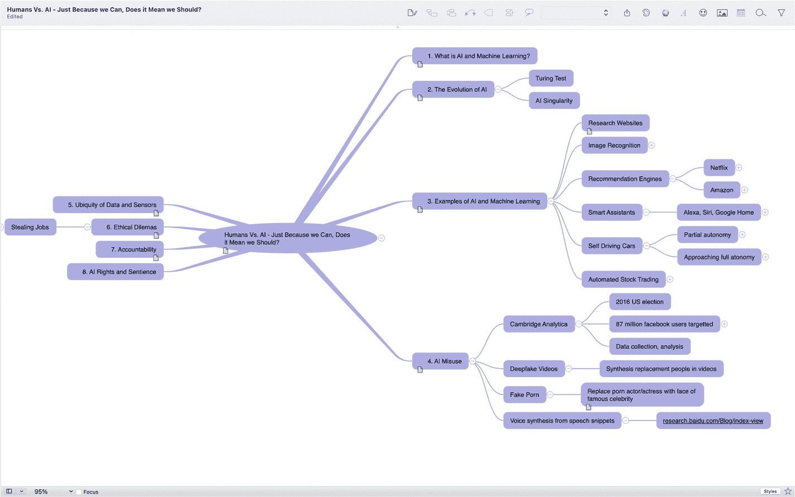
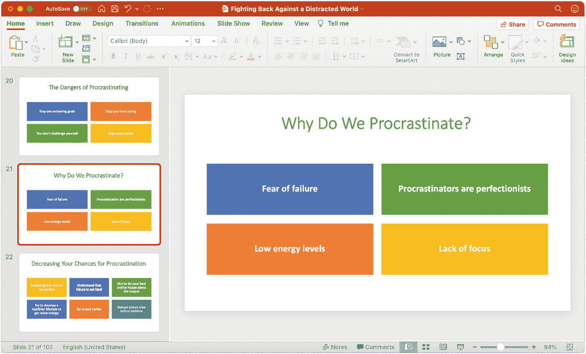
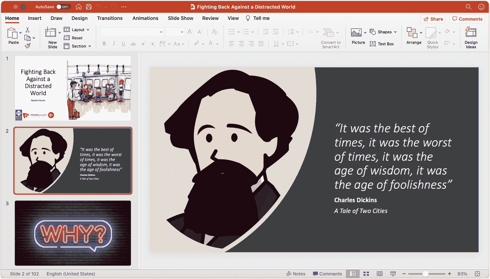
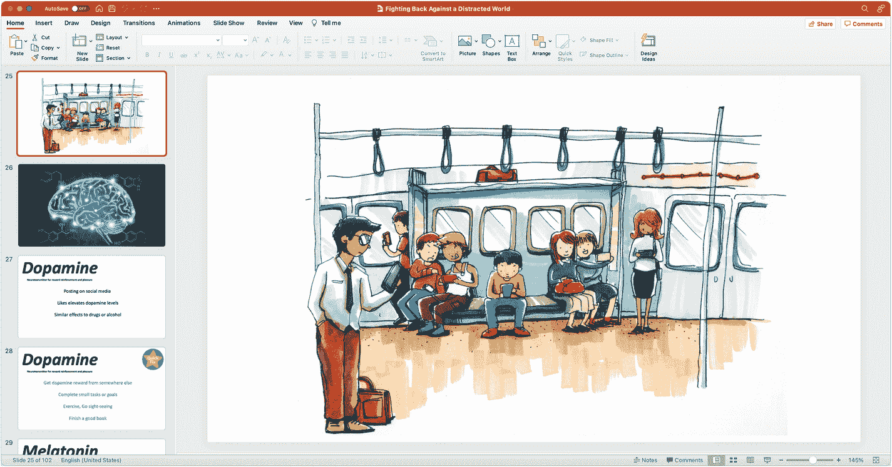
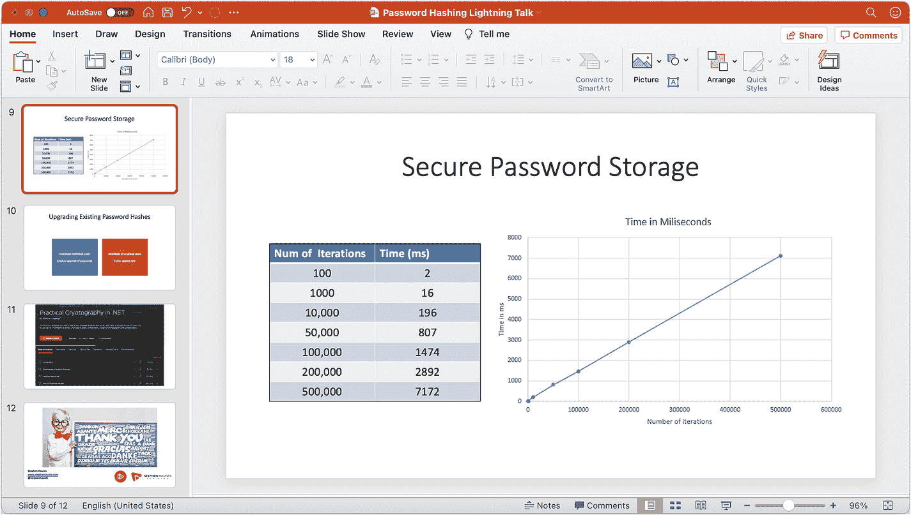

# 2. 撰写引人入胜的演示文稿

演示内容是你公开演讲表现的基石。人们会根据他们记住的信息来评判你的整体表现。一个出色的演示文稿需要具备若干特质，才能有效地传达你的信息。

## 围绕一个相关问题展开

有效的演示文稿聚焦于一个问题。重要的是，你的听众必须熟悉这个问题。如果他们已经面临这些难题并且尚无解决方案，那就更好了，这正是他们前来听你演讲的首要原因。如果你讨论的话题与听众的兴趣不符，他们就不会投入，而如果你把错误的问题抛给了错误的群体，你所有的努力都将付诸东流。

我的演讲聚焦于我的行业和专业领域中的问题——软件开发、个人发展、领导力和安全。企业主和软件开发人员对软件开发的最新技术感兴趣。我讨论的具体问题会根据听众群体的不同而变化。

在舞台上谈论问题时，更重要的部分是展示你将如何解决这个问题。当人们聆听并参与到演讲中时，他们希望得到一个结论。呈现一个问题会吊起他们的胃口，让他们想听下去。如果你不提供你的解决方案版本，他们可能会带着不满离开演讲现场。这可能会让你作为专业人士留下错误的印象，因为你未能提供一个好的解决方案作为回报。

## 应能吸引观众

演示本身应具有吸引听众的魅力。使用出色的幻灯片是提升吸引力的方式之一。你可以融入讲故事、说笑话、肢体语言和直接与观众互动等演讲技巧，让演讲妙趣横生且引人入胜。

我始终认为，最令我享受的演讲都围绕着讲故事展开。故事可以是真实经历，也可以是虚构的，用以传达演讲的核心信息。人类天生就爱听故事，因此，如果你要讲一个略显枯燥的主题，编织一个叙事框架会极大地增强吸引力。

最具吸引力的演讲，是那些让观众专注于台上的你的演讲。即使你借助幻灯片传递信息，也不希望观众只盯着屏幕，因为这会分散他们对你说内容的注意力。我们稍后会详细讨论幻灯片与演讲设计，但请记住，不要在幻灯片中堆砌大量文字，以免观众只顾着阅读而忽略你的讲述。

## 应结构清晰

一场优秀的演讲会采用逻辑清晰的信息排列方式。如果你所呈现的信息缺乏逻辑顺序，听众将很难记住你的内容。人们通常会将结构混乱与准备不足联系起来。

就像好故事一样，你的演讲应有开头、发展和结尾——这也就是所谓的“三段式结构”。开头部分，你要说明即将涵盖的内容，包括引入试图解决的问题。发展部分，你要呈现关于解决问题或演讲主题的核心内容，并开始提出解决方案。结尾部分，则要给出问题的最终答案或你想传达的核心观点，并在结束前总结你在演讲中提到的关键要点。

遵循这样一个简单的结构，你就更容易满足观众的期待，他们也能自然而然地预判你演讲的走向。

## 演讲创作流程

要成为公众演讲大师，你首先需要掌握演讲的准备流程。最终你会形成自己的一套构建演讲的方法，但在此过程中，你可以参考本节中的步骤。

### 在会议前很久就准备好讲稿和幻灯片

在准备第一次演讲时，你可能会忍不住拖延到最后一刻才开始动手。但如果你想成为一名成功的公众演讲者，这种习惯是行不通的。当人们参加活动——甚至是付费参加的会议时，他们期望演讲者专业且准备充分。他们希望每场演讲都尽可能完美无缺。而完美的演讲，只有通过多次事先演练和修改才能实现。

遗憾的是，我参加过许多会议，看到过演讲者在我于后台候场区进行最终走台时，还在疯狂地修改他们的幻灯片。这种最后一刻的修改显得很不专业，通常导致演讲显得仓促。对于缺乏经验的演讲者，你总能从他们频繁忘记下一张幻灯片内容的情况中，判断出他们是临时抱佛脚完成的演讲。这会带来几次尴尬的沉默，打断演讲的流畅性。

理想情况下，如果是一场全新的演讲，你应该在会议开始前几个月就准备好幻灯片。你还需要练习使用幻灯片，确保自己熟悉演讲的流程。请你的家人、朋友或同事试听你的演讲，以获取他们的反馈。如果无法实现，你也可以在练习时给自己录音。回听录音能让你以第三方的视角审视自己的演讲。这是了解观众听感的好方法。最好尽早完成这一切，远远早于会议日期，这样你可以反复聆听，对自己的表现做出客观评判并进行修正。

你还应当将自己的幻灯片与过去看过的优秀演讲进行对比。在 YouTube 上研究精彩的演讲，分析演讲者的幻灯片。找出你喜欢的特质，比如配色方案、字体类型与风格，以及所使用的媒体类型。

然后，你可以将他人的优点应用到自己的演讲中。通过提前准备，你就能避免将所有工作堆积到最终演讲前的一周。你也会有足够的时间来全面评估你的幻灯片和演讲，并在必要时做出调整。

通过提前准备幻灯片并反复练习，你就能在此之前尝试找到最高效的演讲方法。等到活动当天，你早已演练过无数次，即使没有提示也能自信完成。

### 确立演示主题或问题

你应在演示的开头部分与观众共同确立问题；这将确保你们处于同一认知层面。

在呈现问题时，你的挑战在于让观众重视问题，并让自己被视作权威。若你有选择演示主题的余地，请挑选自己经验丰富的领域。多数情况下，演讲内容会围绕你的工作或个人兴趣展开。

在演示开头呈现问题的相关证据，以及能让观众更加关注该主题的信息，是个明智的做法。对你而言重要的问题，对观众可能未必同等重要，因此你需要描绘一幅图景——或许通过一个故事——来唤起观众的关注。理想情况下，你希望观众在听到问题描述时能与你产生共情。若能引导他们透过你的视角看待问题，使其设身处地思考，那么你就能在整个演示过程中牢牢抓住他们的注意力。

在观众心中确立问题的有效方法之一是呈现相关数据与事实。例如，在向企业主进行软件安全演示时，你可从讲述遭受黑客攻击和数据泄露的企业数量统计入手。你也可以考虑列举企业主身份被盗并在网上泄露的具体案例。你甚至可以补充这些安全漏洞给受害者造成的经济损失，因为财务后果总是确保观众参与度的绝佳手段。如果观众都是企业主，他们更有可能认真听后续的演讲，因为这与他们面临的问题息息相关。

在选择演示要探讨的问题时，你应心中装着目标受众，为其创建一个人物画像。思考观众群体的典型特征：他们是否属于同一行业？是否有共同的兴趣或爱好？若有，他们在爱好或工作中会遇到哪些共同问题？他们希望从你这里听到哪些与你专业领域相关的内容？

通过创建符合总体受众画像的人物模型，你将能够预判观众的需求，从而选择相应的话题和问题进行讨论。你还能根据他们的需求来设计演示幻灯片。

例如，过去我曾在会议上就敏捷软件开发发表过演讲。对此类演讲感兴趣的典型人物画像是软件开发人员——他们是技术性很强的人。向这类人群发表演讲时，他们期望获得大量细节和具体事实，并有展示原则应用的实例作为支撑。

我也曾在另一场活动中发表过同样的演讲，当时的观众是软件公司的经理及其领导团队成员。这场演讲的人物画像就不同了，他们对演讲成果的期待也不一样。尽管我向经理们做的演讲中 70%的内容与面向软件开发人员的相同，但我必须调整演讲以适合观众。在那个以非技术专业人士为主的群体中，我不得不删除一些更侧重于软件开发的内容，并将演讲调整得更为通用、更贴合听众。我关于软件团队使用敏捷开发技术益处的核心信息没有变，但他们不需要软件开发人员观众所期待的那么多底层技术细节。

### 设立演示目标

每次向观众呈现内容时，你都希望演示能带来某种成果；演示需要有一个最终目标。大多数演示在这方面是失败的。在听完缺乏目标的演示后，观众没有动力去改变自己的行为。演示未能鼓励观众针对问题采取行动。

我曾听过许多演讲，演讲者呈现了大量有趣的信息，但随后他们突然说道“谢谢聆听”，演讲便戛然而止。在这些情况下，观众没有得到任何回报或令人满意的最终目标。

演讲的目标之所以重要，是因为它能给观众带来一种义务感。这就像在说：“我已尽我所能创作内容并呈现信息。现在轮到你来运用所学的知识了。”

当你确立了演示的目标后，就该创建行动号召了。行动号召是一条信息，它明确告诉观众在演讲结束后如何运用这些信息。理想情况下，行动号召应简洁明了、直击要点。同时，行动号召最好也能惠及听众。换句话说，通过遵循你所呈现的内容，观众的生活、职业等应能因此得到改善。你的演讲不必改变人生，但若能产生这样的效果，那自然令人印象深刻。更进一步，观众应该能从你的内容中获取一些益处，而非仅仅是一场信息灌输。

行动号召还为你提供了一个绝佳的机会，围绕你的主题领域建立社群。你可以告诉观众，你已在自己的网站上发布了一篇关于刚才所做演示的文章。这样，如果他们愿意响应你的行动号召，就可以在演讲结束后访问你的网站了解更多信息。通过运用此类技巧，你将鼓励人们访问你的网站，浏览你提供的所有内容。如果你设置了邮箱采集工具，他们可能会选择订阅你的网站内容。这一技巧对咨询行业人士也很有帮助。你在网站上发布的信息将进一步巩固你在该行业的权威地位。如果你的业务围绕这些内容展开，这一技巧还能显著提升你的收入。

**注意**

理解你的总体目标对于撰写和呈现一场有效的演示至关重要。没有目标，你的演示将漫无目的地在各个主题间游荡，最终毫无收获。

### 信息收集与研究

现在你有了演讲主题和目标，是时候收集将要展示的信息了。换句话说，需要进行一些研究。在决定包含哪些信息时，应当同时牢记主题和演讲目的。在这一环节，你需要可靠的来源来支撑你即将阐述的观点。还需要开始思考如何以吸引观众的方式组织所有这些信息。

首先，你需要收集信息资源。这可能包括书籍、博客文章、网络文章或科学期刊。你使用的许多信息可能基于你对该主题的经验。你也可以查阅特定行业的教科书，看看它们是如何引入主题的。

最有价值的信息形式是那些观众不易获取的。如果你展示的是不常见的信息，你已经在为观众提供价值，因为他们可以学到无法轻易从博客文章或 YouTube 视频中获取的内容。这可能包括你与团队整理分析的数据，也可能意味着分享你参与过的失败项目细节——人们总是喜欢听失败案例以及如何避免这些失败。

演示文稿中包含的所有信息都应与你想要实现的目标相关。例如，一位鼓励人们回收利用的公共演讲者，应该展示支持为什么应该回收垃圾的数据。任何与回收论点无关的数据都不应包含在演示文稿中。

我建议你将所有来源都包含在幻灯片中，因此在整理信息时记得复制来源细节。这样你就不会忘记数据的出处。你可以在演示文稿中以多种方式引用来源。在展示数据时，可以在幻灯片角落注明来源名称和发布日期。你也可以在最后增加一张汇总所有来源的幻灯片，以便观众核实你展示的数据。当你的信息出人意料或可能引发争议时，这一点尤为重要。

### 以最具吸引力的方式呈现数据

当你找到想要在演示中讨论的数据和信息时，就应该开始思考向观众展示的最佳方式。对于数据而言，最佳方式取决于你首先将其纳入的原因。你可以使用图表和其他视觉工具来帮助观众理解。也可以决定使用照片或插图来传达你想要呈现的观点、主题或情感。

例如，显示政府教育预算下降的数字，用折线图展示效果更佳。相比之下，使用饼图来比较资源分配则更为合适。大多数演示软件都配备了创建这些视觉辅助工具的功能。然而，选择最合适的数据呈现方法是你的任务。

使用这些方法呈现信息远比在幻灯片中塞满大量文字或项目符号要好得多。没有人愿意在听你演讲的同时阅读大量文字或浏览项目符号。老实说，我认为应该尽可能用最少的幻灯片来呈现信息或表达观点。用两张幻灯片传达含义总比用十张好，因此利用可视化工具呈现信息总是有益的。如果你的幻灯片塞满了大量文字，这说明你的幻灯片无法吸引观众——请寻找其他方式来呈现信息。

## 选择演示风格

此时，你已经拥有支持演示观点的数据。对于如何呈现这些数据（图表、图示、照片或插图）也应该有了大致思路。现在可以开始寻找最佳方式来呈现这些数据，使你的演示既有趣又令人难忘。为此，你需要选择一种演示风格。

公共演讲和演示没有唯一的最佳风格。许多人往往忽视选择一种能娱乐观众的风格。演示既是关于艺术和表演，也是关于传达数据。为了让你的演示更具吸引力，你需要在演讲中注入自己的个性。

演示风格很重要，因为它将指导你设计的创作。要找到适合你个性的风格，可以研究其他成功演讲者的风格。YouTube 是观看现有演讲的绝佳资源。我在 YouTube 上观看许多演讲，部分是为了学习新信息，但大多数时候，我是为了观察其他演讲者的演示风格和表达方式。让我们在这里讨论几种风格。

### 高度视觉化的演示

采用高度视觉化风格的公共演讲者会利用幻灯片来补充他们在舞台上讲述的叙事。他们的幻灯片是为了支持叙事，而不是成为焦点。在这种情况下，演示从脚本开始，脚本不需要完全写出来，而是演讲者要对观众说的话的一个想法或大纲。在这种风格中，你的演示文稿的文字和信息必须极具吸引力才能有效，因为幻灯片不会包含大量文字、图表或示意图。

这种风格的一个实际例子是史蒂夫·乔布斯展示第一代 iPhone 时的演示。在他的演示中，他运用悬念和幽默来保持观众的参与度。人们观看这些演示是因为它们有趣，并且他们对新型消费技术感兴趣。

在乔布斯的演示中，他的幻灯片很少包含大量文字。相反，他的演示叙事传达了信息。幻灯片呈现了与脚本完美配合的、时机精准的图像和文字。例如，在展示 iPhone 的触摸屏功能时，乔布斯并没有直接说你可以用手指点击手机屏幕。相反，他先谈论当时智能手机在管理 QWERTY 键盘方面的挑战，以及有些手机使用触控笔，以此制造悬念。史蒂夫·乔布斯的叙事随后暗示你可以用手指控制设备。就在他说这句话的同时，他使用遥控器在幻灯片上展示了一根手指触摸 iPhone 表面的图像。他用幻灯片上的视觉效果来阐述他所说的内容。

虽然这一切看似简单，但要做到完美需要大量的练习。你需要选择合适的图像，并练习让这些图像出现的时机。

刚接触公共演讲的人往往将幻灯片当作“拐杖”，以免忘记要说什么。他们通过在幻灯片上塞满过多信息来做到这一点，这样看着幻灯片就能想起要说什么。如果你采用更具视觉化的演示风格，你的幻灯片内容会更精简，因此你不能把它们当作提示。幻灯片是用来支持你所讲的内容的，而不是反过来。使用以图像代替文字的更为精简的风格，意味着演讲者必须对自己要说的内容更加自信，并且要经过充分演练。

### 数据密集型演示风格

如果你计划向观众呈现复杂数据，可能需要采用数据密集型演示风格来建立联系。这种风格通过精心设计的信息顺序，确保所有内容都指向一个核心要点：演示的主旨。

在此风格中，演示者需专注于制作能支撑结论的幻灯片。例如，若你想论证"吃蔬菜有益健康"，就应使用数据展示以蔬菜为主食的人群的预期寿命。

当你需要呈现大量事实和数字时，数据密集型演示风格尤为合适。通常在企业或更具科学性的演示中能看到这种风格。

然而，这并非简单地在屏幕上展示图表。要确保所呈现的信息对观众产生持久影响，你需要让一切易于记忆。可以通过确保信息遵循以下简单规则来实现这一点。

#### 信息应易于理解

用统计数据和科学依据支撑观点，是让演示显得专业的最佳方式之一。但如果数据选择和呈现方式欠佳，观众可能无法理解。你需要通过聚焦数据清晰度，确保观众能轻松理解你决定包含的任何内容。

为此，你需要选择并纳入观众能够领会的数据类型。例如，医生向无医学背景的观众演讲时，应限制医学术语的使用。解释医学概念时还应尝试使用类比。相反，如果医生向其他医疗专业人士解释问题，使用专业术语是可以接受的，因为听众也熟悉这些术语。

尽管如此，你仍应确保以最简单的方式解释每项数据。这样才能保证所有观众都能理解所呈现的数据，不会有人感到被排斥。

#### 信息必须遵循特定顺序

你还应决定呈现数据的最佳顺序。可以从最直观的数据开始，逐步增加复杂度。在讲座中运用此方法的最佳时机是教授新概念时——从简单入手，循序渐进地建立在先前内容之上。

若呈现历史数据，可以利用时间线——这是展现信息如何随时间发展演变的绝佳方式。用这种方式解释数据能有效吸引观众，因为你可以将数据点随时间的变化以及促成变化所采取的措施编织成故事。

确保你采用的排列顺序对观众而言同样清晰。在前例中，应明确指出数据按时间顺序排列。这样一来，如果观众了解数据的呈现方式，他们就更容易跟上思路。如果你在未说明解释背景的情况下直接展示历史数据，观众就需要耗费大量脑力来理解所有数据之间的关联。

数据和信息的呈现顺序至关重要。几乎总是从简单开始，再构建复杂性。这样，即使部分观众处于新手水平，他们也能更好地跟上并理解。如果有人在演讲开始时就跟不上，他们就会走神停止倾听——这绝对是你最不希望看到的。

#### 避免用数据过度填充演示

当你明确了信息呈现顺序后，还应确保计划呈现的信息量不会造成认知负担。例如，如果展示 20 张图表，观众可能连其中一张都记不住，更别提全部了。最终他们会经历信息过载，使演示变得缺乏趣味和吸引力。观众记住的将是糟糕的体验，而非你想传达的实际要点。

呈现数据时有一条黄金法则：少即是多。只向观众展示他们理解你观点所需的最少信息。展示庞大的数据表格会让你失去观众。只需展示足够证明观点、讲述故事的内容即可。

### 自由流畅的演示风格

专业单口喜剧演员是公开演讲和自由流畅演示风格的大师。他们极其擅长保持观众参与度，以至于多数人都不用幻灯片来表演。他们采用对话式演讲风格来逗笑观众。

这种演讲风格并不仅限于喜剧。许多公共演说家，如政客，在人群前演讲时也会使用自由流畅的风格。大多数政治家发表公开演讲时，仿佛就在与你直接交谈。这种情况下完全不需要幻灯片。只有你、演讲者和你的观众。

演讲的场合和观众类型是决定是否采用自由流畅风格的重要因素。采用这种风格时，你的演讲会更像对话——就像在酒吧里向朋友讲故事。我发现自由流畅风格更适合非数据密集型或基于故事的演讲，比如励志故事，或关于如何克服问题/障碍的分享。

如果你要进行数据密集型演讲（如销售数据或研究成果），自由流畅风格可能行不通——观众期待的是硬核事实，而非娱乐故事。

再比如在喜剧俱乐部，单口喜剧演员的观众希望被娱乐。他们已经说服自己想要享受欢乐时光，并希望通过演员的笑话开怀大笑。如果单口喜剧演员决定用数据密集型风格，用图表和图形来讲笑话，那效果肯定不行。

如果你不擅长即兴构思正在讲述的故事——即使练习过——自由流畅的演讲风格可能很难驾驭。你没有幻灯片或幻灯片备注作为提示。如果卡壳或忘记接下来要讲什么，除非事先经过大量排练，否则很难补救。而当你有幻灯片辅助时，如果忘词或记不起后续内容，通常可以通过瞥一眼幻灯片备注，或笔记本演示者视图中的下一张幻灯片来救场。

如果想到要在没有视觉提示的情况下对观众演讲就让你感到恐惧，那我建议你先远离自由流畅风格，直到你对面对大舞台的大规模观众更有经验为止。

### 激励型演讲风格

激励型演讲风格诉诸于听众的情感层面。它侧重于信息中号召行动的部分。演讲中的每个元素都旨在鼓励听众遵循你的号召，从而提升自我。

激励型的公共演说者通常被称为“气氛带动者”，因为他们擅长激发听众对特定任务的热情。这说起来容易做起来难，因为要成功带动气氛，演说者自身需具备一定程度的自信。缺乏自信，演说者就无法激励任何人。

除了自信，演说者还需要能够呈现一场高能量的演讲。一场执行得当的激励型演讲能让听众在结束后感觉良好——事实上，是充满动力的。

激励型演说者经常使用讲故事的方式来阐述观点。例如，一场关于成功的激励型演讲，可能会讲述他人如何通过展示所面临的挣扎、以及如何克服这些挣扎最终获得成功的故事。这些故事不仅要提供范例，还应能与听众产生共鸣。如果听众来自工薪阶层背景，演说者可以选择讲述一个从公司底层努力打拼的员工、最终成功跻身高层的故事。人人都喜欢白手起家的好故事。

理想情况下，故事中的主角应与听众有显著的相似之处，这就是了解你的听众尤为重要原因。听众可能来自同一行业或领域；他们可能都是教师、家长或火箭科学家。演说者需要建立这些相似之处，使故事中的人物能与听众产生关联。

故事旨在向听众灌输一种特定的信念体系。例如，在大多数销售激励型演讲中，演说者试图让听众相信他们能够成功达成销售目标。为此，演说者需要运用多个激励故事，并利用自身高涨的精力来激发听众。这种类型的演讲通常设计为在演讲过程中逐步提升听众的情绪。当听众情绪达到顶峰时，演说者便引入号召行动，邀请他们参与其中。

如果你想亲眼目睹激励型公共演说者的风采，不妨看看诸如托尼·罗宾斯这类作家的研讨会，他是一位在演讲过程中将听众情绪推向狂热的专家。你可以在 YouTube 上找到他的演讲视频。

### 教学型演讲

教学型演讲旨在教导听众，这与自由式或激励型演讲不同。你可以将教学型演讲视为一场讲座，在其中传授信息以讲授某个主题。其最终目标是传授听众在演讲前不具备的知识。

在演示如何使用产品或技术时，教学型演讲风格非常有用。不要将其与产品推销混淆，二者并非同一回事。教学型演讲是关于教学的。

我出身于软件开发背景。我演讲的领域之一是软件安全，尤其是在微软技术栈中。在`Azure`（他们的云计算平台）上，有一项名为`Azure Key Vault`的服务。这是一个用于存储和操作加密密钥的软件系统。听起来很复杂，对吧？我的一个演讲通过一系列六个指导性示例来讲解`Key Vault`是什么、如何设置以及如何使用，每个示例随着演讲的进行难度逐渐增加。在一个小时的时间里，听众从对`Key Vault`几乎一无所知，到学会如何设置和使用它。这是一个教学型演讲风格的好例子。那次演讲的目的不是娱乐。我没想讲一个有趣的故事。我是在教他们如何使用一个复杂的产品，并且希望以一种引人入胜的方式做到这一点。

在软件开发领域，大多数会议演讲都是教学型的——并非全部，因为也有一些自我提升和激励型的演讲。

### 树立你在该话题上的权威形象

人们往往尊重那些在自身技艺或专业领域投入了大量时间的人。为了鼓励人们倾听你的演讲——尤其是如果你是新手上路且尚未拥有追随者——你需要确立自己在你将要讨论的话题上的权威地位。

做到这一点最佳方法之一，是以一个关于你自己的故事开场，在故事中你需要解释自己为何站在台上进行这次演讲。这个故事不必很长，但如果你是在一个专业会议上演讲，你可以说明你的雇主和你的职位。然后，你可以列举在所在领域的一些令人印象深刻的成就，并自然地过渡到你演讲的主题，或者你试图解决的问题。你无需在这个故事上花太多时间；一两分钟就足够了。你需要说足以证明你的资历，并希望以此赢得听众的信任。

我在观众面前做的第一次演讲是关于使用微软软件开发库进行密码学和加密技术的。因为当时我是个不知名的演讲者，我解释了我的工作单位和职位，然后简要谈了一下我在金融服务领域参与开发的一个安全系统。这有助于确立我的权威角色。接着，我指出我的演讲将涵盖我在开发该安全系统时学到的知识，以及如何使用微软这些当时文档不佳的复杂库。这个过程大约花了一分钟。我没有更详细地介绍自己，因为演讲并非关于我，而是关于微软的库。我只是想让听众知道为什么我有资格谈论这些库。

要成为一名公共演说者，你不一定非得是某个领域的专家。你或许正在学习一项新技能，并想就此做一场演讲。这类入门级的技能演讲可能很受欢迎。仅仅因为你并非该领域的专家，并不意味着你不能谈论这个主题。如果你将演讲纲要定位于初学者水平，你很可能比听众中的大多数人领先一两步，这完全没问题。我个人喜欢听定位于初学者的演讲，因为这是了解一个你原本可能忽略的主题新信息的绝佳方式。

**注意**：在某话题上拥有权威并不意味着你必须成为专家。专家可能对某个主题有深入的知识，但权威能够影响经验不如自己的人。一个人可以既是一个话题的专家，也是该话题的权威。

## 使用你习惯的组织工具

在规划和准备演讲内容时，你将面临多种组织和研究内容的方式选择。我每次构建新的演讲时，都遵循相同的流程。

### 研究

我们在本书前面提到过研究，但我想在此更详细地探讨，因为它是演示文稿制作过程中至关重要的一环。经过充分研究的演讲总是比仓促拼凑的演讲更受听众欢迎。你不需要成为某个领域的专家才能谈论它，但你确实需要成为一名优秀的研究者。

如今，借助互联网，研究变得异常简单；你只需要一个浏览器和一个搜索引擎。然而，你也要避免陷入只搜索那些证实自己观点或信念的信息的陷阱。这被称为**确认偏误**，它可能导致极其片面的演讲。即使你对某个特定主题有强烈的看法，并且知道存在不同观点，我也建议你研究这些不同观点，并将其纳入你的演讲中。你可以表示不同意这些观点；这没问题。作为一个文明社会，我们能够对某个主题持有不同看法是件好事，表达这些观点也完全可以，但一个全面的演讲应该包含他人的观点，以便你的听众能够自行作出判断。

如今，人们普遍担心分享观点会冒犯他人或招致反对，尤其是年轻人。就我个人而言，我认为分享你的观点没问题，特别是当你生活在一个支持言论自由的国家时。当然，总会有一条界限，例如，如果你的观点涉及种族歧视、恐同、跨性别恐惧等，就可能越界。然而，只要你的意图不是造成伤害或故意冒犯任何人，在演讲中表达自己的观点是完全可接受且受到鼓励的。你会知道自己的观点是否属于那个范畴，所以我建议你做出良好的判断。但与他人分享不同的观点是健康的，辩论也应该被鼓励。

当你引用研究中的信息时，我建议你做记录，以便记住来源。如果你想引用他人的作品或包含他们可能已发布的任何数据，只要注明他们的工作，给予其署名，这就是合理使用。注明他们的工作也意味着，如果听众想查找任何信息，他们就有一个参考依据。

为演讲调研信息时，你需要考虑信息的来源，特别是如果它来自某个人的博客。信息可能是错误的，因此你应该查看来源，并尝试寻找其他独立来源来佐证你找到的信息。这与记者撰写报道时通过核查多个来源来核实信息的过程相同。这样，如果有人对你演讲中的任何信息提出质疑，你就有据可查。

为演讲调研信息可能是一个相当深入的过程，所以请确保清晰记录你的研究笔记和来源。我认识很多人喜欢把它们记在实体笔记本上，但我认为，如果你使用笔记应用，生活会轻松得多。如果你是 Apple Mac 或 iPad 用户，`Apple Notes` 是电脑自带的免费应用，也是我正在使用的。还有许多其他优秀的笔记应用，包括如果你是 Microsoft Office 用户可用的 `Microsoft OneNote`，以及 `Evernote` 或其他任何同类应用。

### 大纲

当你完成所有研究后，需要组织这些信息来构建一场连贯的演讲。设计演讲结构的最好方法是制定一个**大纲**。这也是小说家构思一本书的方式，这样他们就能了解故事的情节弧线、人物发展、冲突和回报。到现在，你应该已经知道自己要准备什么风格的演讲了。接下来，你需要考虑将演讲分成几个部分。就像具有三幕结构的故事一样，你需要规划开头、中间和结尾。

***第一幕（开头）***：介绍你自己以及你为何在这里发言。然后，引入你想要讨论的主题或问题。

***第二幕（中间）***：开始更详细地探索主题。你研究的大部分内容将在此处发挥作用。根据你的听众，你可能需要提供大量介绍性材料或包含主题细节。你有研究数据要展示吗？你对这个主题的看法是什么？有与你相反的观点吗？这里很适合探讨它们。你的演讲更偏向教学性吗？如果是，这里很适合通过从简单例子开始，然后逐渐增加难度来演示过程。

***第三幕（结尾）***：到这个阶段，你已经涵盖了主要内容，现在应该开始总结关键点。总结尤其重要，应该仔细撰写。你的演讲可能包含了大量信息，听众难以全部记住。如果你在较大的会议上演讲，请记住，如果你的演讲被安排在日程较晚的时间，与会者会更疲劳。总结是一个很好的机会，可以确保听众带着几个最重要的事实离开。总结完成后，你可以开放提问环节。

大多数书面内容被分成这种三幕结构是有原因的——因为它有效，而且人们通常期望任何长篇信息都以这种方式呈现。当然，任何规则都可以被打破，你完全可以那么做。但如果你是一位新手演讲者，我建议你坚持使用三幕结构，直到你在公开演讲方面有了更多经验，然后再进行变通。不过，说实话，我看不出你为什么要那么做。

你的大纲可以写在用来存储研究笔记的同一个笔记应用中，也可以使用更视觉化的应用，例如思维导图（图 2-1）。思维导图是我构思演讲的首选方式，因为它很直观。市面上有许多思维导图应用，从免费开源到付费应用都有；选择一个最适合你的。我在 Mac 上使用的是一款名为 `iThoughtsX` 的应用。以下截图展示了我关于人工智能演讲大纲的开头部分。

**图 2-1**

使用思维导图构思演讲大纲

**注意**

大多数现代娱乐形式（小说、电视节目和电影）都以三幕结构作为叙事的基础。设计一场演示文稿也不例外。

制定大纲是一个强大的工具，我强烈建议你经历这个过程，因为它总能帮助你写出全面且内容丰富的演讲。

### 讲稿撰写

为你的演讲撰写讲稿是一个颇具争议的步骤。有些演讲者坚信要为演讲写一份完整的讲稿，而另一些人则讨厌这个想法。就我个人而言，我现在已经不写讲稿了，除了接下来会提到的一种特殊情况。不过，我最开始的几场演讲确实是写了讲稿的。

讲稿是你演讲内容的书面形式。在这种组织工具中，你要完整地写下你在演讲过程中将要说的每一句话。这可以有几种形式。它可以是你大纲的扩展版本，包含更详尽的笔记，为你想要讨论的每个要点写下一小段内容；也可以是一份逐字逐句写下的完整讲稿。有些人认为写一份完整的讲稿很有帮助，尽管背诵讲稿需要大量的努力和练习。讲稿在演讲当天以及你练习的时候都可能很重要。在练习时，讲稿是一份有用的指南，可以提醒你演讲的顺序。通过照着讲稿练习，你将能够记住你准备好的演讲流程。

对于某些类型的会议或大会，组织者可能会特别要求你提供讲稿，以便上传到活动的提词器中。在我多年的公开演讲生涯中，只有一次被提前要求提供讲稿用于提词器，而我真的很不喜欢那次体验。使用提词器时，你被迫站在讲台后面，对着屏幕念稿——就像新闻播报员一样。那次活动的主办方对检查演讲者的内容非常谨慎，所以他们事先审核了讲稿。我发现，使用书面讲稿配合提词器的情况更多是例外，而非常态。尽管如此，这种情况确实存在，所以一定要提前了解清楚与这场预约活动相关的具体规则。

如果你第一次使用提词器，可能会感到不自在。这可能会很别扭，因为它们让演讲受到了限制。没有提词器，你可以在演讲中随时插入任何你想谈论的话题。然而，一旦屏幕上有了讲稿，你就很难这么做，主要是因为讲稿的设计时间长度与演讲正好吻合。在我大部分的演讲中，我会根据观众的反应或观众提出的问题，在现场临时增减内容。就个人而言，我认为这能带来更有趣的体验，因为你可以为演讲注入更多个人特色。

当你对使用提词器感到更得心应手时，它们会变得很有价值。它们有助于帮助演讲者紧扣主题，也能帮助提醒演讲者演讲的顺序。如果你担心记不住演讲的流程，那么提词器可能会有所帮助，但请记住，从专业提词器上阅读，与在你的笔记本电脑屏幕上阅读讲稿是完全不同的。提词器被设置在视线水平的位置，这样你可以在阅读的同时看着观众。如果你想保持观众的参与感，看着观众这一点非常重要。如果你是从笔记本电脑屏幕上读稿，你会低着头看屏幕，无法与观众进行眼神交流。这会让观众非常反感，而且显得非常不专业。没有什么比不看你的听众更能暴露你的经验不足了。

我最初是从写讲稿开始的，现在在编写培训课程时也仍然会写，但如今我更有经验了，我只会瞄一眼`Microsoft PowerPoint`演示者视图中我的备注。

拥有完整书面讲稿的另一个巨大好处是，你可以利用它来发布一篇或一系列关于同一主题的博客文章。将讲稿改编成文章非常容易，几乎不费什么力气，这为你向世界展示你的观点提供了另一条绝佳途径。

### 提示卡与提词提示

在没有提词器的活动中，提示卡也能起到类似的作用。这些卡片上写着演讲者准备的演讲大纲。

提示卡并不会自动让你的演讲变得更好。要确保提示卡发挥作用，你需要做好两件简单的事情。首先，确保卡片上的内容简短易懂。卡片上应该只包含关键词和短语，而不是完整的句子。这些词语或短语的作用是提醒你下一个话题。你应该只需扫一眼卡片就能获取所需信息。其次，你需要练习使用它们。一开始，你并不会自然而然地会使用提示卡。具体来说，你需要练习何时低头看卡片上的内容，何时看向观众。虽然提词器通常被放置得看起来像是演讲者在阅读的同时正看着观众，但使用提示卡时，你需要低头去看上面的信息。

要正确使用提示卡，你需要知道何时适合查看它们，何时最好与观众保持眼神交流。理想情况下，你应该在讨论某个话题的过程中看着观众。只要你在讲同一个话题，就应该把注意力放在观众身上。查看提示卡的最佳时机是在话题转换之间。当你低头看卡片，准备核对下一个要讨论的话题时，你需要在脑海中构建出你想要讨论的整个部分的图像。不要只看卡片上的下一个话题，而是要看接下来的三到五个话题。这样，你就能在再次查看卡片之前，讨论相当多的内容。

如果你在演讲中使用幻灯片，那么你可以使用演示软件演示者视图中的备注功能，比如`Microsoft PowerPoint`或`Apple Keynote`。每张幻灯片的备注区域起着与提示卡相同的作用；你可以放上几个要点，来提醒自己需要涵盖的内容。再次强调，不要在这里写太多内容，否则很难阅读，也难以与观众保持互动。我更喜欢使用这些演示者视图中的备注，而不是实体提示卡。但如果你做的演讲不需要使用幻灯片，那么实体提示卡会很有帮助，尤其是当你感到紧张的时候。

如果你使用提示（例如提示卡或笔记本电脑上的演讲者备注），一个好的技巧是：在某个部分即将结束时，喝一小口水，同时快速扫一眼你的卡片或备注。观众不会对此有任何想法，因为在演讲过程中，演讲者常常会喝好几口水，因为他们的嘴巴很容易变干。

## 创建有效的幻灯片

幻灯片是大多数演示中的主要视觉工具。通过使用幻灯片，演示者能够运用各种类型的媒体内容，例如文本、照片、图像和视频。如果设计得当，这些幻灯片将帮助演示者呈现一场引人入胜的演讲。

然而，如果幻灯片设计不佳，则可能让观众感到失望。设计糟糕的幻灯片非但不能提升演示效果，反而常使演示更难以理解，因为观众会花更多时间试图解读幻灯片内容，而非听你讲话。这其中最大的问题之一，就是幻灯片中充斥着项目符号列表的演示。

作为演示者，你需要意识到，幻灯片是为观众的利益而存在的，而不是为你自己。精心设计的幻灯片能够支持和增强你正在讲述的内容，并强化你的信息。缺乏经验的演讲者常犯的一个错误是，在幻灯片上塞入过多的信息，以便将其用作视觉提示来记住自己要说什么。请不要这样做；相反，你应该在演讲前多加排练以帮助自己记住内容，并在幻灯片软件的演示者视图中添加一些简单的笔记。我们来梳理一下设计幻灯片时需要考虑的几个要点。

### 减少文字量

你的幻灯片是你与观众分享叙事内容的辅助工具。因此，在那一刻最关键的是你所说的内容。如果你在幻灯片上放大量文字，观众的目光自然会投向幻灯片，并试图阅读那些文字。在他们阅读时，就不会听你讲话，这会令观众感到失望，因为你给他们增加了过多负担。

如果你希望观众阅读，那么最好指引他们去看一篇博文。有些演讲者试图通过在幻灯片上布满项目符号来规避文字过多的问题，但这与大段文字几乎一样糟糕。如果你让观众做超出必要范围的工作，他们就会失去兴趣并走神。这时你就会看到观众玩手机或操作笔记本电脑。

我并不是说你完全不应该使用任何文字，但谨慎控制文字量是明智之举。如果我想展示文字，我偏爱一种叫做“文字分块”的技巧。你可以在下面这张来自我某次演讲的幻灯片截图中看到这一点（图 2-2）。

图 2-2

使用文字分块来减少屏幕上的文字

通过使用彩色框（或称“区块”），你可以轻松地在屏幕上用文字提示来总结你所说的内容。如果我打算花一分钟描述每个框的内容，我可能会一次只展示一个框。在上述示例中，我会先展示蓝色框，然后是绿色、橙色，最后是黄色。通过使用蓝牙翻页器，我可以逐步推进幻灯片。这种技巧效果相当不错。

有时，你可能需要展示一段文字——比如一句引文——你可以通过巧妙的图像使其更具视觉吸引力。在上面的截图中（图 2-3），你可以看到我展示了一句来自查尔斯·狄更斯《双城记》的引文。这句引文对我当时阐述的观点产生了强有力的影响，因此我通过使用查尔斯·狄更斯的漫画像来让幻灯片更具视觉吸引力。

图 2-3

使用图像来呈现文字

对于幻灯片上应该放什么，并没有硬性规定。我并不是说永远不要使用大段文字，但一个好的指导原则是，在制作幻灯片时把自己放在观众的位置上思考：他们在努力听你演讲的同时，需要付出多少努力才能解读幻灯片上的内容？

### 使用幻灯片模板

设计出色的幻灯片可能很困难，因为并非人人都是设计天才。我当然也不是。创建具有视觉冲击力的幻灯片的一种方法是下载免费的幻灯片模板或购买模板。有许多网站允许你下载适用于 Microsoft PowerPoint 和 Apple Keynote 应用程序的模板。模板是创建悦目幻灯片的好方法。

在下载任何模板之前，你需要仔细注意使用条款。有些模板声明仅允许在公司内部私密使用。如果你将其用于公开演讲，并可能将幻灯片副本分发给与会者，那么你需要明确检查自己是否被允许这样做。

就我个人而言，我从不在演讲中使用第三方幻灯片模板。我倾向于使用默认的 PowerPoint 模板，并尽可能使用全屏库存照片或前面提到的文字分块技巧。

### 图像、图表和减少杂乱

常言道“一图胜千言”，在为演示设计幻灯片时确实如此。以下面的截图为例（图 2-4）。

图 2-4

使用图像增强影响力

在这次演讲中，我解释了社交媒体成瘾的危险，以及我们如何需要教育和保护在这种技术下成长的孩子。在设计幻灯片时，我使用了一个名为 Shutterstock 的网站来寻找灵感，并找到了这张关于火车上人群的精彩插图。图片里没有人相互交谈；他们都在盯着手机。我认为这张强有力的图片支持了我正在阐述的观点。在发表这次演讲时，我让这张图片在屏幕上停留了几分钟，同时阐述我的观点。观众会查看图片了解发生了什么，然后立刻将目光转回我身上听我说话。我坚信使用全屏照片来说明观点，并根据需要让图像在屏幕上停留足够长的时间。

有时，全屏照片或插图并不合适，这时你必须展示一些数据。数据的问题在于，即使你在讲解，人们也需要动用认知能力来解读数据，因此你需要小心控制展示的数据量。

在上面的截图中（图 2-5），我展示了 Microsoft 软件开发库中安全操作的时间数据。这些时间细节对于本书这一部分的目的并不重要，重要的是我展示数据的方式。

图 2-5

使用简单的图表和表格来呈现数据

在左侧，我放了一个包含一些数据的简单表格。旁边则是这些数据的图表。使用这个图表，可以很容易地看出表格中两列数据的相关性。在这种情况下，你可以立即看到迭代次数与以毫秒计的时间之间存在线性增长关系。包含这个图表是我特意做出的决定，目的是让观众更容易解读数据。

#### 谨慎使用动画

`PowerPoint` 和 `Keynote` 等演示工具允许你为屏幕上的元素设置精妙的动画。动画是增强演示视觉冲击力的强大方式，但稍有不慎就可能变成一种干扰。如果在幻灯片之间以及幻灯片内元素之间使用动画进行过渡，效果会相当不错。不过，我建议要避免过于花哨，因为你不希望过多的动态效果分散观众的注意力。

就我个人而言，我不会使用任何动画，因为它很容易从微妙的雅致变成一种噱头。我不是一个特别出色的视觉设计师，所以我宁愿谨慎行事，让我的幻灯片尽可能保持简洁。

作为你自己幻灯片的设计者，只有你能决定什么对于你和你的观众是可接受的。如前所述，这里其实没有硬性规定——只有一些通用建议。

#### 为后排观众着想

在设计你的幻灯片时，建议——如前所述——要考虑到观看幻灯片的观众。你还需要考虑坐在房间后排的观众，尤其是在大型场馆对一群人演讲时。除非场地内遍布屏幕，否则大多数人都会看向舞台前方的屏幕。

结合本章已阐述的内容，想象一下：如果你的幻灯片充斥着文字且过于拥挤，坐在后排的人会是什么感觉？他们将无法看清幻灯片，并会立即对演讲失去兴趣。你可能正在进行一场毕生最精彩的演讲，但如果幻灯片难以解读和阅读，你将很难让现场的参与度保持在高水平。

幻灯片的对比度也是如此，它会极大地影响可读性。这里的对比度，指的是屏幕上色彩强度的差异。如果你有一个浅蓝色的框，上面再配上颜色稍浅的蓝色文字，那么文字将很难辨认，尤其是当你在房间后排时。如果你有一个蓝色的框，配以白色或黑色的文字，那么在后排阅读这些文字就会容易得多。

并不是每个人都有完美的视力，因此有些人需要依靠屏幕上的高对比度颜色才能舒适地阅读任何文本。

> **注意**  
> 规划、撰写和发表演讲能够帮助你加强批判性思维能力。

### 总结信息

当你的演示接近尾声，你已经阐述了所有要点并实现了总体目标后，你需要用一个很好的总结来收尾。届时，观众已经听了长达一小时的演讲。根据演讲的长度，你向观众传达了大量的信息。例如，一个标准的会议演讲是 60 分钟。进行这么长时间的演讲意味着你将提供很多信息。当演讲接近尾声时，你需要总结你的主要讨论要点。

演讲总结不应仅仅是对前面所有内容的简要复述。相反，要利用总结的机会来阐明演讲的要点、演讲目标的关键解决方案，以及任何重要的收获。

大多数会议与会者可能每天至少观看五场演讲，持续两到三天。在几天内吸收如此大量的信息是很困难的。总结提供了一个至关重要的工具，以确保你的观众记住你的核心信息。不要在总结上吝啬；它可能就是你整个演讲中最重要、最有影响力的部分。

### 创建行动号召

写下总结之后，你就可以提出行动号召了，这是演示文稿的重要组成部分，因为这是你能对观众产生最显著影响的地方。首先，我们来谈谈什么是行动号召。

行动号召指的是你内容中鼓励观众在演示后采取行动的部分。你要求他们做的活动可以简单到在社交网站上关注你。它也可能需要更重大的承诺，比如要求他们注册你的新闻通讯或购买产品。

虽然你可能想推广自己的产品和服务，但根据活动的性质，这或许并不合适。例如，在会议上，人们期望的是学习，而不是听到营销宣传。在这种情况下，最好少用基于销售的行动号召。同时，请记住，许多会议对推销有严格的规定，所以要确保你没有违反任何活动规则；否则，将来你可能不会再被邀请。

行动号召可以巧妙地包含在你的演示中，或者也可以在结尾处快速提及。如果你在倡导某项事业，并且认为这与你的演示很契合，你可以将其添加到结论中，或者创造一个与行动号召相关的引人入胜的故事，以便对观众产生更大的影响。你也可以在幻灯片中加入行动号召，以提醒专注的观众你希望他们做一些事情。

你还应该确保你的行动号召易于理解。如果观众需要完成的任务看起来很复杂，你可以将它们分解成步骤，并按顺序呈现。

我见过一个很棒的技术：在幻灯片上放置一个二维码，链接到一个网页，而不是把网址放在幻灯片上。这样，所有与会者需要做的就是拍下屏幕上的幻灯片照片，而不是费力地输入 URL。如果你想生成二维码，有很多免费网站可以使用。

> **提示**  
> 最有效的行动号召是观众在和你同处一室、当场就能采取的行动。如果你在会议上发言，他们很可能会忘记执行你要求的任何行动。

## 总结

在本章中，我们明确了什么是一次好的演示。要在观众面前清楚地表达你的观点，你需要提前规划并设计你的演示，就像你做任何创造性工作（无论是软件、书籍等）一样。

如果你遵循本章的建议，并利用下面的研讨会问题来协助自己，稍加规划，你就能就任何你感兴趣的主题创作出一场引人入胜的演示。

## 研讨会问题

1.  针对你选择的演讲主题，撰写一段简短的电梯演讲，描述该演讲的内容以及你将解决的问题。目前这并非完整的概要，而是如果有人问起你的演讲内容时你会如何回答。尝试将这段演讲控制在 150 字以内。

2.  根据你选择的主题，挑选一种你希望在幻灯片设计中使用的演讲风格。
    *   高视觉化演讲
    *   数据密集型演讲
    *   自由流畅型演讲
    *   激励型演讲
    *   指导型演讲

3.  既然你已经了解了自己的演讲风格，现在开始思考你的三幕结构，以及希望在每一部分传达什么信息。以下是每幕的提示。
    *   **第一幕（开头）**：介绍你自己，以及为什么你要谈论这个主题。然后，引入主题或问题。
    *   **第二幕（中间）**：开始更详细地探讨主题。
    *   **第三幕（结尾）**：你现在已经详细涵盖了你的主要主题。开始总结你的关键点并得出结论。

4.  思考你想在演讲中讲述的故事。仅仅陈述事实可能会使演讲缺乏吸引力，但将你的主题编织成一个故事则会非常引人入胜。你有来自自身经历的真实案例可以用于你的故事吗？如果有，真实的故事效果非常好，因为它们能让你的主题更具共鸣感。如果你没有真实案例可以借鉴，那么你可以虚构一个场景。

5.  使用你选择的幻灯片设计工具（如 Microsoft PowerPoint、Apple Keynote、Google Slides 等），开始构思演讲的视觉主题。不要让它过于复杂，使用基础模板就很好，但考虑设计元素以建立一个视觉风格指南。思考屏幕上的色彩对比度以及文本/图像的大小。你能否在较远距离看清幻灯片？如果你要在大型房间内进行演讲，这一点非常重要。对比度差的深色主题在远距离或对有视力障碍的人而言难以辨认。
    *   你将如何格式化标题——字体、字号、标题大小写等。
    *   你将使用什么配色方案——蓝色、红色、绿色、单色等。
    *   你将如何呈现信息列表——项目符号的使用或文本分块。
    *   你将如何使用图片——在屏幕上的位置或作为全屏图像。

