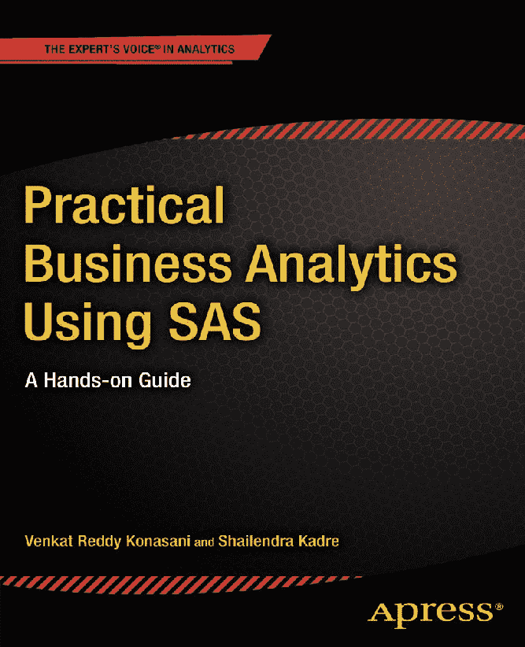

 作者：文卡特·雷迪·科纳萨尼（Venkat Reddy Konasani）和谢伦德拉·卡德雷（Shailendra Kadre）《实用商业分析：使用 SAS 动手实践指南》

ISBN 978-1-4842-0044-5  
电子版 ISBN 978-1-4842-0043-8  
DOI 10.1007/978-1-4842-0043-8  
© Apress 2015

《实用商业分析：使用 SAS 动手实践指南》  
版权所有 © 2015，作者：文卡特·雷迪·科纳萨尼（Venkat Reddy Konasani）和谢伦德拉·卡德雷（Shailendra Kadre）

本作品受版权保护。出版商保留所有权利，无论是针对材料的全部或部分内容，特别是翻译、重印、重用插图、朗诵、广播、以微缩胶片或任何其他物理方式复制，以及信息存储和检索、电子改编、计算机软件，或任何目前已知或今后开发的相似或不同方法的权利。与本法律保留条款相豁免的是与评论或学术分析相关的简短摘录，或专门为在计算机系统上输入和执行而提供的材料，仅供本作品的购买者独家使用。仅允许在出版商所在地现行版权法的规定下复制本出版物或其部分内容，且使用许可必须始终从 Springer 获取。使用许可可通过 Copyright Clearance Center 的 RightsLink 获得。违反者将根据相应的版权法被起诉。

ISBN-13（平装本）：978-1-4842-0044-5  
ISBN-13（电子版）：978-1-4842-0043-8

本书中可能出现商标名称、标志和图像。我们并未在每个商标名称、标志或图像出现时都使用商标符号，而是仅以编辑方式使用这些名称、标志和图像，以惠及商标所有者，且无意侵犯商标权。

安卓机器人（01/Android Robot）的图像复制自 Google 创建和共享的作品，并根据 Creative Commons 3.0 署名许可中描述的条款使用。Android 以及所有基于 Android 和 Google 的标志是美国及其他国家/地区 Google Inc. 的商标或注册商标。Apress Media LLC 与 Google Inc. 无关联关系，且本书的编写未获得 Google Inc. 的认可。

本出版物中对商品名称、商标、服务标志及类似术语的使用，即使未明确标识，也不应被视为对这些术语是否受专有权利约束的意见表达。

尽管本书中的建议和信息在出版时被认为是真实和准确的，但作者、编辑及出版商均不对可能出现的任何错误或遗漏承担法律责任。出版商对本书所载内容不作任何明示或暗示的保证。

管理总监：维尔莫德·斯帕尔（Welmoed Spahr）  
主编：杰夫·奥尔森（Jeff Olson）  
发展编辑：安妮·玛丽·沃克（Anne Marie Walker）  
编辑委员会：史蒂夫·安格林（Steve Anglin）、马克·贝克纳（Mark Beckner）、加里·康奈尔（Gary Cornell）、路易丝·科里根（Louise Corrigan）、詹姆斯·德沃尔夫（James DeWolf）、乔纳森·根尼克（Jonathan Gennick）、罗伯特·哈钦森（Robert Hutchinson）、米歇尔·洛曼（Michelle Lowman）、詹姆斯·马克汉姆（James Markham）、马修·穆迪（Matthew Moodie）、杰夫·奥尔森（Jeff Olson）、杰弗里·佩珀（Jeffrey Pepper）、道格拉斯·庞迪克（Douglas Pundick）、本·雷诺-克拉克（Ben Renow-Clarke）、格温南·斯皮林（Gwenan Spearing）、马特·韦德（Matt Wade）、史蒂夫·韦斯（Steve Weiss）  
统筹编辑：凯文·沃尔特（Kevin Walter）  
文字编辑：金·威普塞特（Kim Wimpsett）  
排版：SPi Global  
索引编制：SPi Global  
美术：SPi Global  
封面设计：安娜·伊什琴科（Anna Ishchenko）

向全球图书贸易发行由 Springer Science+Business Media New York, 233 Spring Street, 6th Floor, New York, NY 10013 负责。电话：1-800-SPRINGER，传真：(201) 348-4505，电子邮件：`orders-ny@springer-sbm.com`，或访问 `www.springeronline.com`。

Apress Media, LLC 是一家加利福尼亚有限责任公司，其唯一成员（所有者）是 Springer Science + Business Media Finance Inc (SSBM Finance Inc)。SSBM Finance Inc 是一家特拉华州公司。

如需获取翻译信息，请发送电子邮件至 `rights@apress.com`，或访问 `www.apress.com`。

Apress 和 friends of ED 的书籍可用于学术、公司或促销用途的大宗采购。大多数图书也提供电子版本和许可证。如需更多信息，请参考我们的特殊大宗销售 – 电子书许可网页：`www.apress.com/bulk-sales`。

作者在本文中提到的任何源代码或其他补充材料，读者可在 `www.apress.com` 获取。有关如何找到您图书源代码的详细信息，请访问 `www.apress.com/source-code/`。

致我的母亲，阿特查玛·科纳萨尼（Atchamma Konasani）  
我的妻子，娜迦·拉尼·科纳萨尼（Naga Rani Konasani）  
——文卡特

致我全家人：  
父亲，沙拉德·马德哈夫·卡德雷（Sharad Madhav Kadre）  
母亲，沙昆塔拉·沙拉德·卡德雷（Shakuntala Sharad Kadre）  
妻子，米纳克希·卡德雷（Meenakshi Kadre）  
女儿，尼哈·卡德雷（Neha Kadre）  
儿子，维韦克·卡德雷（Vivek Kadre）  
——谢伦德拉

