# 2. SAS 简介

第 1 章介绍了 `SAS`，这是分析领域中使用最广泛的工具。`SAS` 是一个软件套件，可以从各种数据源中检索数据。它可以帮助你清洗数据并对其执行统计操作。对于非技术用户，它还提供了一个图形用户界面（`GUI`）来执行各种分析操作。`SAS` 的灵魂在于它的编程语言，大多数分析师都在使用它。与 `GUI` 相比，它提供了更高级的数据处理和分析能力。`SAS` 编程语言，也称为 `SAS` 脚本语言，比大多数其他编程语言（如 `FORTRAN`、`C` 和 `Java`）更容易学习。

在本书中，你将使用 `SAS` 编程语言，而不是 `GUI`，但我们鼓励你自己探索 `GUI`。本书无意提供对 `SAS` 编程语言的深入介绍；这里仅涵盖基础 `SAS` 和数据分析所需的程序。

`SAS` 最初用于农业项目的统计应用。现在它被应用于以下行业：赌场、通信、教育、金融服务、政府、健康保险、医疗服务提供商、酒店、保险、生命科学、制造业、媒体、石油和天然气、零售、旅游、运输、公用事业等等。

接下来，你将学习一些简单的 `SAS` 编程步骤。

## 在 Windows 中启动 SAS

在 Windows 中，你可以像启动其他软件一样，通过选择“开始” ➤ “程序”来启动 `SAS`。“开始”菜单程序列表中的 `SAS` 文件夹可能会显示 `SAS` 中所有与 `SAS` 相关的软件。你需要根据你安装的 `SAS` 版本，点击 `Base SAS`，即 `SAS 9.1`、`SAS 9.2` 或 `SAS 9.3`。图 2-1 展示了如何在 Windows 中启动 `SAS`。

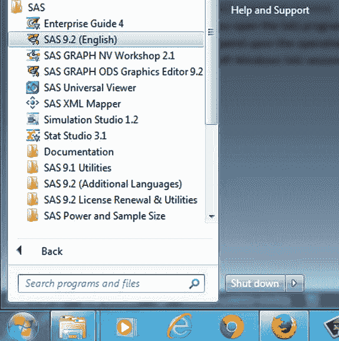
图 2-1. 在 Windows 中启动 SAS

有时你可能会遇到图 2-2 所示的错误。当你的 `SAS` 许可证过期时，会弹出此错误，这种情况下你可能需要续订许可证。你可以通过从 `SAS` 购买续订许可来续订 `SAS`。`SAS` 会提供一个全新的 `SAS` 安装数据（`SID`）文件，使其正常运行。

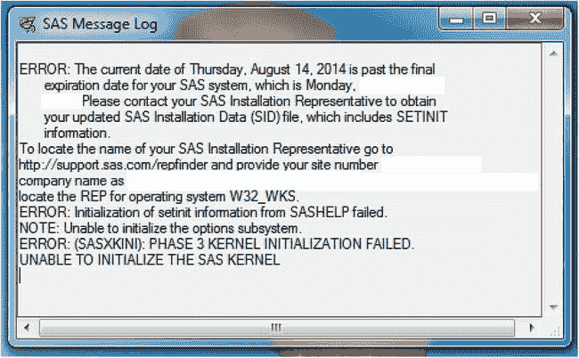
图 2-2. SAS 中的许可证过期错误

## SAS 启动画面

在 Windows 中打开 `SAS` 程序时，大多数情况下，你的屏幕看起来应该像图 2-3 中所示的 `SAS` Windows 环境。这可能取决于你所使用机器的操作系统；图 2-3 展示了一个 Microsoft Windows 的 `SAS` 会话。这是你的 `SAS` 屏幕最常出现的样子。但根据安装过程和设置，某些窗口或图标可能在部分系统中被隐藏。

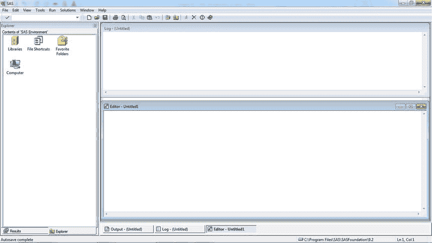
图 2-3. 一个典型的 SAS Windows 环境

## 五大主窗口

打开 SAS 屏幕后，您会看到许多图标和窗口。SAS 环境中有五个主窗口，如图 2-4 所示。

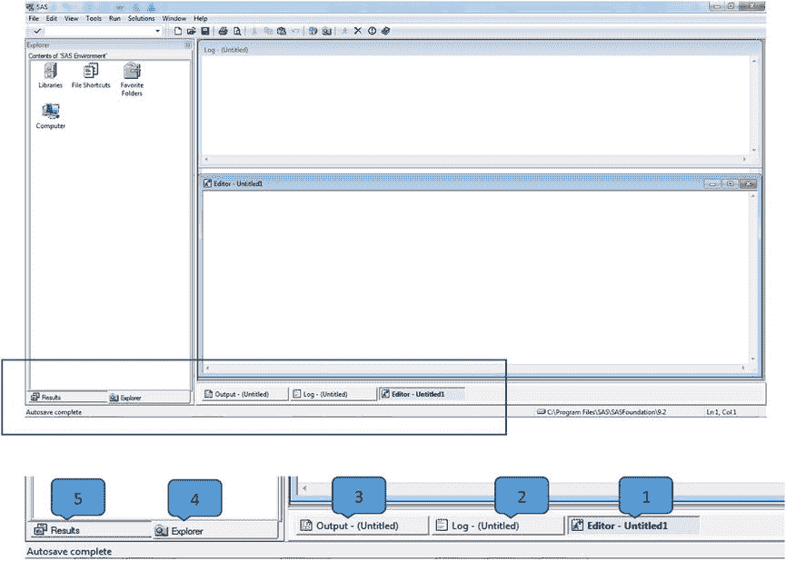
图 2-4. SAS 环境中的窗口

这五个主要的 SAS 窗口分别是：编辑器窗口、日志窗口、输出窗口、资源管理器窗口和结果窗口。如果您找不到其中任何一个窗口，可以通过顶部菜单栏的“视图”（View）选项使其可见。

### 编辑器窗口

编辑器窗口用于编写将在数据建模和分析中使用的 SAS 脚本。它与其他编程文本编辑器类似。该编辑器具有语法敏感性，并能对您的 SAS 脚本进行彩色编码，从而便于阅读程序或识别程序中的错误。

要执行代码，您可以使用顶部的“提交”（Submit）图标，或者从顶部菜单栏中选择`运行 ➤ 提交`（`Run ➤ Submit`）（图 2-5）。

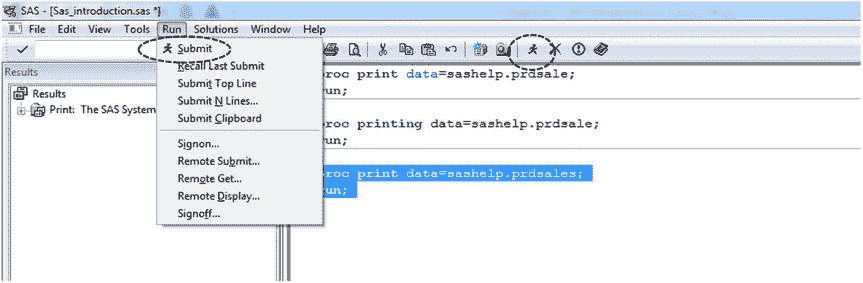
图 2-5. 提交 SAS 程序

图 2-6 显示了带有一些示例代码的编辑器窗口。这段代码打印了 SAS 帮助库中的 `prdsale` 表（本书后面将对此进行详细解释）。

```
proc print data=sashelp.prdsale;
run;
```

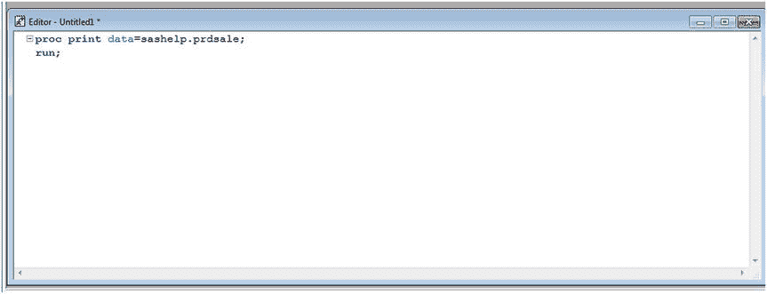
图 2-6. SAS 编辑器窗口

这段 SAS 代码以 `.sas` 格式保存，这是所有 SAS 编程脚本文件的常用扩展名。您可以使用 SAS 或任何其他文本编辑器打开这些代码文件。

### 日志窗口

日志窗口用于调试。SAS 软件包生成的任何观察结果或调试建议都会显示在日志窗口中。具体来说，与您的程序相关的编程语句、注释、错误或警告都会出现在此窗口中。通常，代码中的错误会以红色高亮显示，并附带解释。

图 2-7 显示了运行以下程序时的日志窗口。此代码中没有语法错误。

```
proc print data=sashelp.prdsale;
run;
```

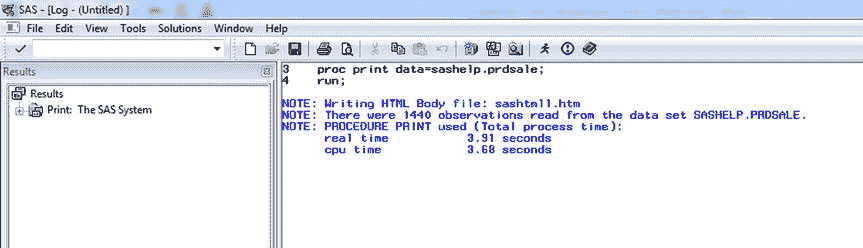
图 2-7. SAS 日志窗口

图 2-8 显示了在代码中故意引入语法错误后的日志窗口。

```
proc printing data=sashelp.prdsale;
run;
```

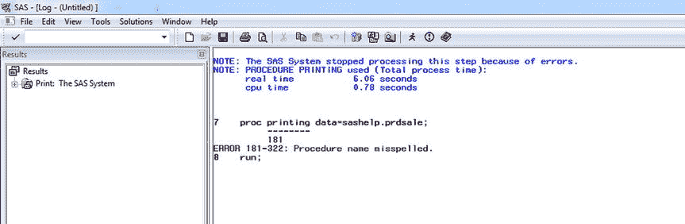
图 2-8. SAS 代码中的语法错误

请注意，错误信息正确地指出了过程名称拼写错误。

图 2-9 显示了代码中存在非语法相关错误时的日志窗口。

```
proc print data=sashelp.prdsales;
run;
```

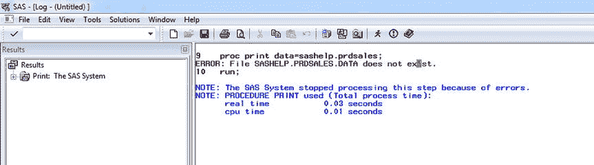
图 2-9. 典型的非语法相关错误

这里的错误信息正确地指出了数据文件名拼写错误，并且该文件在 SAS 帮助库中不存在。

如果您尝试保存日志代码文件，它将以 `.log` 格式保存。通常，日志文件是追加的。因此，您可能会在当前日志文件中看到所有以前的日志信息。您可以按 `Ctrl+E` 来擦除或清空日志文件。

### 输出窗口

程序的实际输出，例如任何 SAS 过程产生的打印数据或输出数据，都会显示在输出窗口中。只有您的程序中可打印的输出才会出现在此窗口中。如果程序没有生成任何输出，或者代码中存在导致 SAS 系统突然停止的语法错误，那么输出窗口可能为空。

图 2-10 显示了运行以下代码时的输出窗口：

```
proc print data=sashelp.prdsale;
run;
```

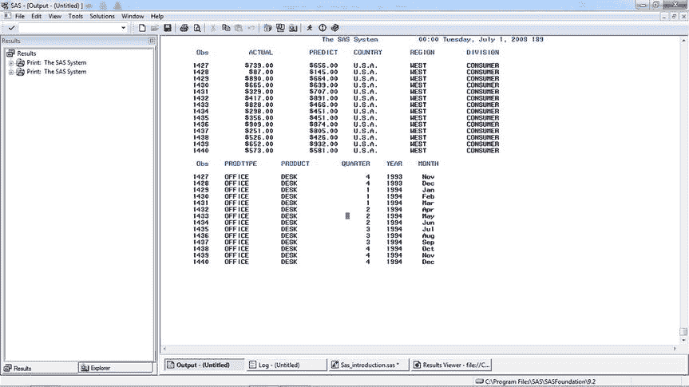
图 2-10. SAS 输出窗口

我编写了一些用于打印 `prdsale` 数据集的代码，输出窗口显示了该表的数据记录。输出结果显示该表包含一些产品销售额数据，字段包括 `actual`、`predict`、`country` 和 `division`。

默认输出是列表或文件列表格式。如果您尝试保存此输出文件，它将以 `.lst` 格式保存。但是，对于 SAS 9.3 及更新版本，HTML 是默认选项。

#### HTML 输出

默认情况下，SAS 生成列表输出，但 HTML 输出是一个不错的选择，可以以更具可读性和格式化方式查看输出文件。总的来说，与默认的列表文件相比，HTML 文件更易于浏览和理解。通过简单的复制和粘贴命令，可以轻松地将 HTML 文件转换为其他格式，例如 Excel 和 PowerPoint。您可以在代码中使用 HTML 选项来创建 HTML 输出，也可以直接设置 SAS 选项，以便每次程序执行都创建 HTML 输出。

以下是从 SAS 菜单环境中设置 HTML 输出创建的步骤：

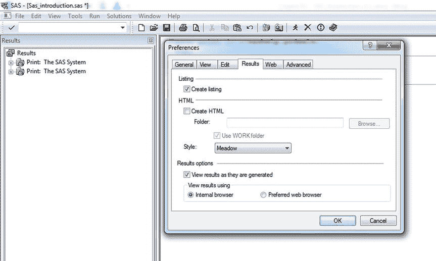
图 2-12. 选择“创建 HTML”

在“首选项”窗口中，选择“结果”选项卡，并勾选`创建 HTML`（Create HTML）（图 2-12）。

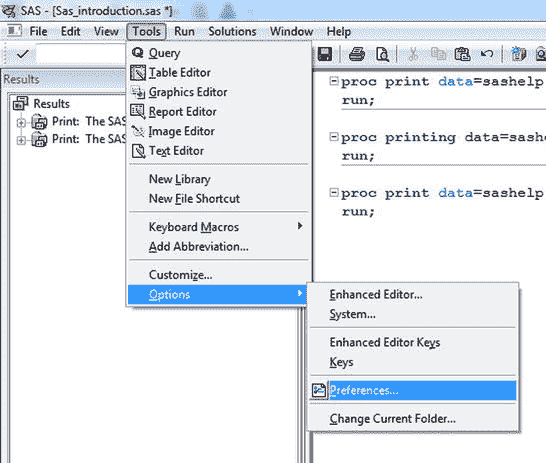
图 2-11. 选择“首选项”

# SAS软件操作指南

选择：`工具 ➤ 选项 ➤ 首选项`（`Tools ➤ Options ➤ Preferences`）（图 2-11）。

图 2-13 显示了勾选`创建 HTML` 选项后的“首选项”对话框。

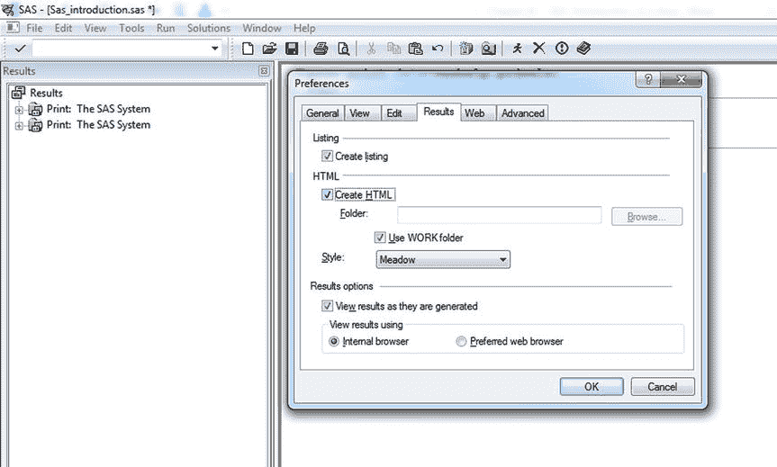

图 2-13. 选择“创建 HTML”后

HTML 输出类型提供了多种主题供您选择。您可以根据报告的样式和业务的主题来选择 HTML 样式。除了格式之外，HTML 输出和列表输出之间绝对没有区别。在本书中，您将把 HTML 输出设置为默认的输出格式。图 2-14 显示了之前打印代码的 HTML 输出。

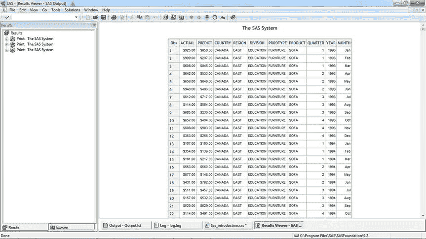

图 2-14. 典型的 HTML 输出

### 资源管理器窗口

资源管理器窗口为您所有的文件和逻辑库提供了一个便捷的访问点（见图 2-15）。逻辑库是存储数据集和其他 SAS 文件的对象。您通常会访问资源管理器窗口来查看各个逻辑库及其中的文件。

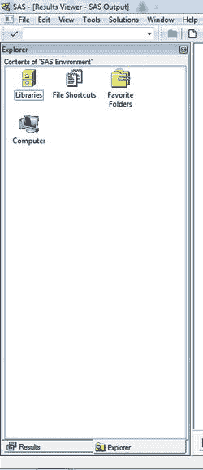

图 2-15. SAS 资源管理器窗口

### 结果窗口

结果窗口充当输出窗口的目录（`TOC`），以大纲形式列出您结果的每个部分。结果窗口同时显示列表和 HTML 输出文件，以及当前会话中运行的结果的累积树形结构（见图 2-16）。

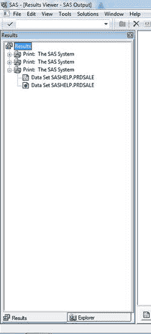

图 2-16. SAS 结果窗口

资源管理器窗口和结果窗口显示在图形用户界面的左侧，一上一下。您可以通过点击底部任务栏上的`资源管理器`（`Explorer`）或`结果`（`Results`）来在资源管理器窗口和结果窗口之间切换。

## 重要菜单选项和图标

本节我们讨论一些重要的 SAS 菜单选项，例如创建、关闭和保存 SAS 程序文件，这些操作将在您日常使用 SAS 环境时经常用到。

要创建一个新的 SAS 程序文件，请选择：顶部菜单栏中的 `文件` ➤ `新建程序`，如图 2-17 所示。

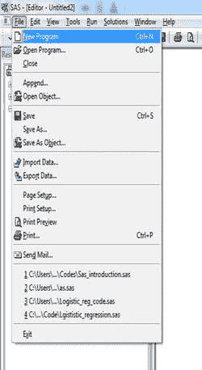

图 2-17. 创建新程序文件的菜单选项

要打开一个已有的 SAS 程序文件，请选择：顶部菜单栏中的 `文件` ➤ `打开程序`，如图 2-18 所示。

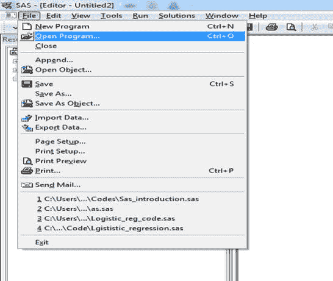

图 2-18. 打开一个程序文件

要保存一个 SAS 程序文件，请选择：顶部菜单栏中的 `文件` ➤ `保存` 或 `另存为`，如图 2-19 所示。

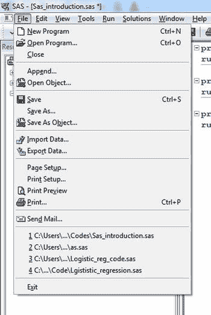

图 2-19. 保存一个程序文件

### 视图选项

有时您找不到所需的窗口，或者不小心关闭了某个窗口。您可以使用 `视图` 菜单选项将它们找回来。只需点击顶部菜单栏上的 `视图` 选项，然后打开所需的窗口，如图 2-20 所示。

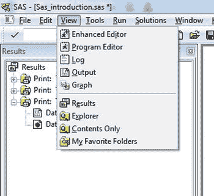

图 2-20. 视图选项

### 运行菜单

`运行` 菜单用于提交整个 SAS 程序或选定的部分程序，如图 2-21 所示。

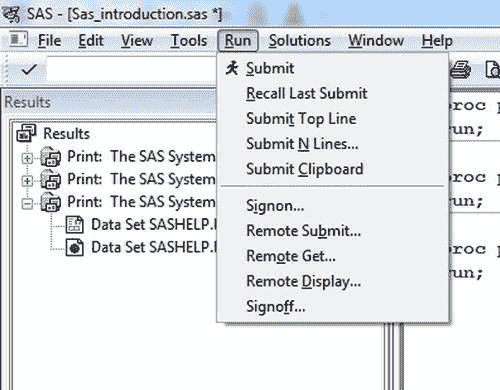

图 2-21. 提交一个 SAS 程序

### 解决方案菜单

`解决方案` 菜单使您可以访问各种定制的 SAS 解决方案，具体取决于您已安装的软件选项，如图 2-22 所示。在本书中，您将只使用简单的 Base SAS 脚本；不会使用任何定制的解决方案。

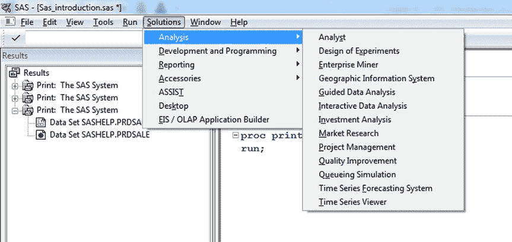

图 2-22. SAS 解决方案选项

至此，您已经了解了一个简短的 SAS 打印程序以及在后续使用 SAS 进行分析时所有对您很重要的窗口。

### 快捷图标

图 2-23 显示了一些有用的快捷图标。

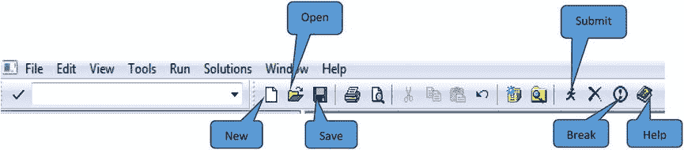

图 2-23. 便捷的快捷图标

以下是最有用的快捷方式：

- **新建**：启动一个新程序

- **打开**：打开一个已有的代码文件

- **保存**：保存当前的代码文件

- **提交**：提交代码

- **中断**：停止已提交的代码执行

- **帮助**：提供关于 SAS 语法和选项的帮助

## 编写和执行 SAS 程序

要开始编写 SAS 程序，请打开一个新的编辑器窗口。SAS 编程脚本本质上就是一系列语句。SAS 代码包含语句、表达式、函数和调用例程、选项以及格式。与其他编程语言相比，SAS 代码易于编写。它是一种简化的编程语言，内嵌了称为 SAS 过程（预编写代码）的程序。这些过程已经在 SAS 中编写并测试完成。您只需在 SAS 脚本中的正确位置调用正确的过程。例如，如果您想求一个变量的平均值，则无需编写计算平均值的代码。只需调用 SAS 过程 `Proc Means`，它就会为您计算出平均值。SAS 程序中有一些规则和一些用户友好的特性，您应该了解。

- SAS 语句以分号结束。

- SAS 语句可以在行的任何位置开始和结束。

- 一条语句可以跨越多行。

- 一行可以包含多条语句。

- SAS 语句不区分大小写。

- 空格或特殊字符分隔 SAS 语句中的“词”。

- SAS 程序以 `run` 或 `quit` 结束，这提示 SAS 开始执行代码。

以下是在 `sashelp` 库的 `prdsale` 数据集中查找 `actual`（实际销售额）变量平均值的代码：

```
proc means data =sashelp.prdsale;
var actual;
run ;
```

同样的代码也可以像下面这样书写（所有这些代码示例都能无错误地执行）：

```
proc means data =sashelp.prdsale;
var actual;
run ;
```

```
proc
means data =sashelp.prdsale;
var actual;
run;
```

```
proc means data =sashelp.prdsale;var actual; run ;
```

```
PROC MEANS Data =sashelp.prdsale;
var actual;
Run ;
```

在本书中，您将编写简单的 SAS 代码脚本来完成分析项目中的所有重要任务，例如导入数据、清洗数据、分析数据以及报告结果。

### 代码中的注释

即使您只做过一点编程，您也知道可以在代码中编写注释，用于文档说明，解释代码中涉及的逻辑或流程，或者只是为了以后提醒自己关于代码的某些内容。同样，在编写 SAS 脚本时，您也可以编写注释。与可能长达数页的传统 COBOL 或 Java 代码相比，大多数 SAS 脚本都比较短小。

您可以使用两种注释风格。

- 一种以星号（`*`）开头，以分号（`;`）结尾。示例如下：

```
* This script does logistic regression for the price table data;
```

- 另一种风格以斜杠星号（`/*`）开头，以星号斜杠（`*/`）结尾。示例如下：

```
/* This script does logistic regression for the price table data */
```

以下是一些带有注释的示例代码。

```
*program to find the mean of actual sales;
PROC MEANS Data =sashelp.prdsale;
var actual;
Run ;
```

上面的代码与下面的代码相同：

```
/*below program illustrates how to write a SAS code that finds the average actual sales
The dataset used here is prdsale, it is in sashelp library
MEANS is the produce that finds the averages
Var statement is used to specify the variables*/
PROC MEANS Data =sashelp.prdsale;
var actual;
Run ;
```

## 你的第一个 SAS 程序

在编辑器窗口中输入以下代码。这段代码用于打印来自 `sashelp` 逻辑库的 `prdsale` 数据集。（第 3 章会讨论逻辑库。）可以将此代码中的 `sashelp.prdsale` 视为数据库中的一张表，其中 `sashelp` 是数据库，`prdsale` 是其中的一张表。

```
proc print data=sashelp.prdsale;
run;
```

末尾的 `run` 语句告诉 `SAS` 开始处理前面的语句。你可以使用提交图标，或者选择**运行**➤**提交**菜单选项。一个良好的习惯是先选中代码再执行。如果你直接提交，`SAS` 系统会执行程序文件或编辑器窗口中的所有代码。执行此代码后，你将在输出文件和日志文件中看到一些信息。在本例中，日志文件显示没有错误，输出屏幕显示 `prdsale` 表（数据集）中的数据值，如下表 2-1 所示。

**表 2-1.** `prdsale` 表中的数据值

| Obs | ACTUAL | PREDICT | COUNTRY | REGION | DIVISION | PRODTYPE | PRODUCT | QUARTER | YEAR | MONTH |
| --- | --- | --- | --- | --- | --- | --- | --- | --- | --- | --- |
| 1 | $925.00 | $850.00 | CANADA | EAST | EDUCATION | FURNITURE | SOFA | 1 | 1993 | Jan |
| 2 | $999.00 | $297.00 | CANADA | EAST | EDUCATION | FURNITURE | SOFA | 1 | 1993 | Feb |
| 3 | $608.00 | $846.00 | CANADA | EAST | EDUCATION | FURNITURE | SOFA | 1 | 1993 | Mar |
| 4 | $642.00 | $533.00 | CANADA | EAST | EDUCATION | FURNITURE | SOFA | 2 | 1993 | Apr |
| 5 | $656.00 | $646.00 | CANADA | EAST | EDUCATION | FURNITURE | SOFA | 2 | 1993 | May |
| 6 | $948.00 | $486.00 | CANADA | EAST | EDUCATION | FURNITURE | SOFA | 2 | 1993 | Jun |
| 7 | $612.00 | $717.00 | CANADA | EAST | EDUCATION | FURNITURE | SOFA | 3 | 1993 | Jul |
| 8 | $114.00 | $564.00 | CANADA | EAST | EDUCATION | FURNITURE | SOFA | 3 | 1993 | Aug |
| 9 | $685.00 | $230.00 | CANADA | EAST | EDUCATION | FURNITURE | SOFA | 3 | 1993 | Sep |
| 10 | $657.00 | $494.00 | CANADA | EAST | EDUCATION | FURNITURE | SOFA | 4 | 1993 | Oct |
| 11 | $608.00 | $903.00 | CANADA | EAST | EDUCATION | FURNITURE | SOFA | 4 | 1993 | Nov |
| 12 | $353.00 | $266.00 | CANADA | EAST | EDUCATION | FURNITURE | SOFA | 4 | 1993 | Dec |
| 13 | $107.00 | $190.00 | CANADA | EAST | EDUCATION | FURNITURE | SOFA | 1 | 1994 | Jan |
| 14 | $354.00 | $139.00 | CANADA | EAST | EDUCATION | FURNITURE | SOFA | 1 | 1994 | Feb |
| 15 | $101.00 | $217.00 | CANADA | EAST | EDUCATION | FURNITURE | SOFA | 1 | 1994 | Mar |
| 16 | $553.00 | $560.00 | CANADA | EAST | EDUCATION | FURNITURE | SOFA | 2 | 1994 | Apr |
| 17 | $877.00 | $148.00 | CANADA | EAST | EDUCATION | FURNITURE | SOFA | 2 | 1994 | May |
| 18 | $431.00 | $762.00 | CANADA | EAST | EDUCATION | FURNITURE | SOFA | 2 | 1994 | Jun |
| 19 | $511.00 | $457.00 | CANADA | EAST | EDUCATION | FURNITURE | SOFA | 3 | 1994 | Jul |
| 20 | $157.00 | $532.00 | CANADA | EAST | EDUCATION | FURNITURE | SOFA | 3 | 1994 | Aug |

类似地，你可以使用以下代码来计算 `actual` 变量的平均值：

```
proc means data=sashelp.prdsale;
var actual;
run;
```

执行上述代码后，日志文件显示没有错误，你会得到如下表 2-2 所示的输出。

**表 2-2.** `SAS` `means` 过程用于 `prdsale` 的输出

| 分析变量 : ACTUAL 实际销售额 |
| --- |
| N | 均值 | 标准差 | 最小值 | 最大值 |
| --- | --- | --- | --- | --- |
| 1440 | 507.1784722 | 287.0313065 | 3.0000000 | 1000.00 |

以下是另一个代码示例：

```
data income_data;
Input income expenses;
Cards;
1200 1000
9000 600
;
run;

Proc print data=income_data;
Run;
```

这会生成如表 2-3 所示的输出。

**表 2-3.** `income_data` 的打印输出

| Obs | income | expenses |
| --- | --- | --- |
| 1 | 1200 | 1000 |
| 2 | 9000 | 600 |

### 使用日志文件调试 SAS 程序

阅读日志文件是 `SAS` 程序执行的一个重要方面。通常，新手用户编写代码后倾向于直接查看输出，但查看日志文件同样重要。日志文件主要有三种通知类型：错误、警告和注释。

*   错误意味着存在语法或其他错误。有时错误会阻止脚本执行。

*   警告表示 `SAS` 系统已自动纠正了你的错误并执行了代码。当 `SAS` 误判并执行时，这是很危险的。

*   注释在执行程序时提供关键步骤的实时注释。

用于打印 `prdsale` 的 `SAS` 代码的日志文件提供以下信息：

```
31   proc print data=sashelp.prdsale;
32   run;

NOTE: Writing HTML Body file: sashtml8.htm
NOTE: There were 1440 observations read from the data set SASHELP.PRDSALE.
NOTE: PROCEDURE PRINT used (Total process time):
      real time           3.85 seconds
      cpu time            3.79 seconds
```

来自日志文件的上述消息表明代码中没有错误迹象，并且从数据中读取了 1,440 个观测值用于打印。

# 结论

## 日志文件分析与示例

用于计算平均值的SAS代码的日志文件提供以下信息。日志文件中的注释显示从数据集中读取了1,440个观测值。

```
33   proc means data=sashelp.prdsale;
34   var actual;
35   run;

NOTE: Writing HTML Body file: sashtml9.htm
NOTE: There were 1440 observations read from the data set SASHELP.PRDSALE.
NOTE: PROCEDURE MEANS used (Total process time):
      real time           0.25 seconds
      cpu time            0.09 seconds
```

再次强调，没有错误，`means`过程成功运行。

以下是用于创建并打印`income_data`的第三个代码片段的日志文件：

```
53   data income_data;
54   Input income expenses;
55   Cards;

NOTE: The data set WORK.INCOME_DATA has 2 observations and 2 variables.
NOTE: DATA statement used (Total process time):
      real time           0.00 seconds
      cpu time            0.00 seconds

58   ;
59   run;
60   Proc print data=income_data;
61   Run;

NOTE: Writing HTML Body file: sashtml11.htm
NOTE: There were 2 observations read from the data set WORK.INCOME_DATA.
NOTE: PROCEDURE PRINT used (Total process time):
      real time             0.29 seconds
      cpu time              0.18 seconds
```

日志文件未显示任何错误。如果你故意编写一些错误的语法并提交，你会看到日志文件中出现错误。

以下代码在日志文件中生成了随后的消息。

```
proc dataprinting data=sashelp.prdsale;
run;
```

```
40   proc dataprinting data=sashelp.prdsale;
ERROR: Procedure DATAPRINTING not found.
41   run;

NOTE: The SAS System stopped processing this step because of errors.
NOTE: PROCEDURE DATAPRINTING used (Total process time):
      real time           0.01 seconds
      cpu time            0.00 seconds
```

错误被清楚地指出。

以下是另一个错误示例：

```
proc print data=sashelp.prdsales;
run;
```

```
42   proc print data=sashelp.prdsales;
ERROR: File SASHELP.PRDSALES.DATA does not exist.
43   run;

NOTE: The SAS System stopped processing this step because of errors.
NOTE: PROCEDURE PRINT used (Total process time):
      real time           0.03 seconds
      cpu time            0.01 seconds
```

## 日志文件中的警告示例

以下代码用于将SAS帮助库中的`prdsale`数据集复制到一个新的数据文件中：

```
data new_data;
set sashelp.prdsale;
where actuals< 1000;
run;
```

以下是上述代码对应的日志文件：

```
14   data new_data;
15   set sashelp.prdsale;
16   where actuals<1000;
ERROR: Variable actuals is not on file SASHELP.PRDSALE.
17   run;
NOTE: The SAS System stopped processing this step because of errors.
WARNING: The data set WORK.NEW_DATA may be incomplete.  When this step was stopped there were
0 observations and 10 variables.
WARNING: Data set WORK.NEW_DATA was not replaced because this step was stopped.
NOTE: DATA statement used (Total process time):
real time           0.07 seconds
cpu time            0.03 seconds
```

这些警告表明，SAS已经继续执行并创建了一个包含`10`个变量和`0`个观测的数据文件。

## 编写、阅读日志文件以及调试的技巧

以下是为初学者提供的关于编写和调试SAS程序的一些技巧：

-   尽量保持日志文件整洁，在代码执行后将其清空。按`Ctrl+E`可清空日志文件。

-   即使代码成功执行，也不要直接查看输出。养成先查看日志文件，然后再查看输出文件的习惯。

-   始终从日志信息开头的第一个错误开始排查。通常SAS只显示日志文件的最后几行，但多数情况下，如果你纠正了开头的几个错误，后面的错误可能会消失。不过，这取决于代码中包含的错误类型。

-   理解通知内容；日志文件中有三种类型的通知：错误、警告和提示。

-   尽量避免以下几种最常见的错误。

    -   缺少分号

    -   在代码开头或更早的位置缺少分号，这可能导致在很靠后的语句中产生错误

    -   缺少`run`语句

    -   关键词和数据集名称拼写错误

    -   引号和括号不匹配

-   始终以注释的形式编写代码说明。

-   不要一次性运行整个SAS程序，尝试逐个执行代码片段。这样更容易定位错误。

## 保存SAS 文件

你可以使用`文件`菜单中的`保存`或`另存为`选项，系统会提示你将SAS程序文件保存到所需位置，如图2-24所示。

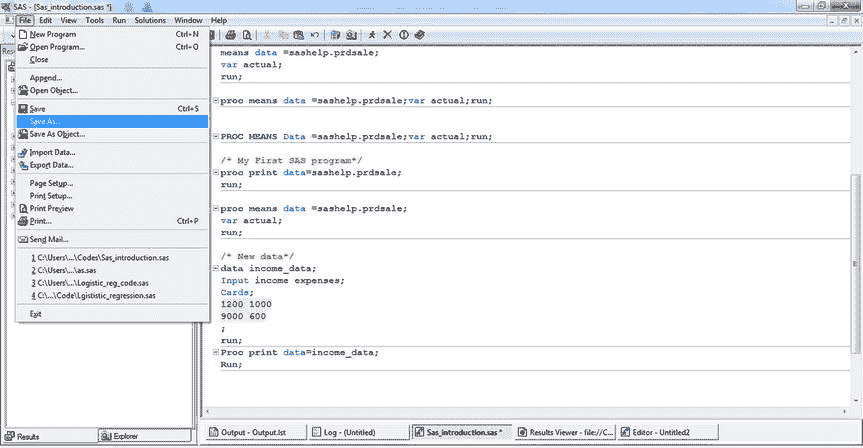

图2-24. 保存SAS 文件

### 练习

以下是一些练习，旨在帮助你更熟悉阅读日志文件。

编写并执行以下代码。查看日志文件并识别任何可能存在的错误。

```
proc print data=sashelp.airr;run;
```

保存你的SAS 文件，并使用`文件`菜单打开它。编写并执行以下代码。查看日志文件并识别任何可能存在的错误。

```
proc print data=sashelp.buy;run;
```

本章向你介绍了SAS编程环境。讨论了在SAS Windows 环境中的导航、各种菜单选项以及一些快捷键图标。还讨论了如何编写简单的SAS代码以及如何阅读日志文件。在接下来的几章中，你将进一步学习SAS编程的更多细节。后续，这些编程知识将帮助你在分析中通过编写SAS程序与SAS交互来分析数据。

