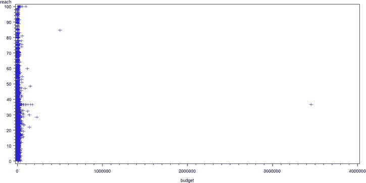
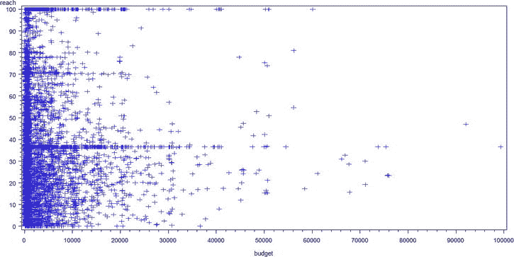
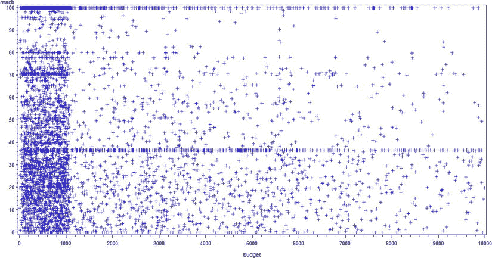
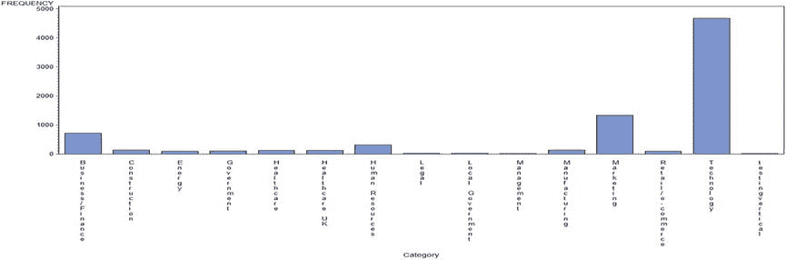
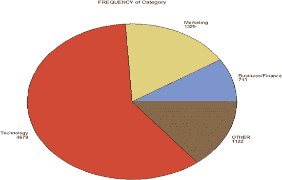
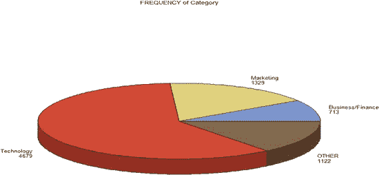
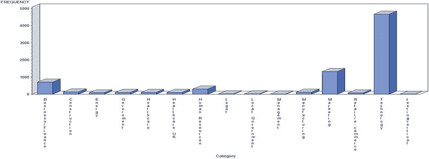

# 4. 重要的 SAS 函数和过程

在上一章中，你学习了一些重要的数据操作技术。你通常会获取原始数据并为其分析做好准备。一旦最终数据准备就绪，你就可以继续进行分析。分析可能涉及以有意义的图形表示简单的汇总表，将简单的描述性统计应用于高级分析和预测建模。你可能需要高级算法和函数来执行分析。在学习分析工具时，了解如何使用一些重要的函数和算法至关重要。

在本章中，你将学习基本函数和重要的 SAS 过程。本章将讨论数值、字符和日期函数，以及一些重要的 SAS 过程，例如 `CONTENTS` 和 `SORT`。最后，你将学习一些图形函数，例如 `GCHART` 和 `GPLOT`。

## SAS 函数

SAS 为大多数数值、字符串和日期操作预置了例程。这些被称为函数。在 SAS 中使用函数与其他编程语言没有太大区别。事实上，它更简单。你需要编写函数名称并传递一些必需和可选参数。通常，每个函数都会带有括号。如果某个函数不需要参数，那么括号内将为空，如 `today()`。

让我们从一个活动开始，准备一些数据供后续使用。让我们导入 `Market_data_two` 数据集，该数据集将在多个示例中使用。该数据集包含典型营销活动中使用的各种资产类型。名为 `White_Paper`、`Webinar`、`Software_Download`、`Free_Offer`、`Live_Event` 和 `Case_Study` 的变量代表用于营销活动的不同资产类型。

以下 SAS 代码导入并打印数据的一个快照：

```
PROC IMPORT
OUT= WORK.market_asset
DATAFILE= "C:\Users\ Documents\Training\Books\Content\4\. SAS Programs and Analytics\Datasets\Market_data_two.csv"
DBMS=CSV REPLACE;
GETNAMES=YES;
DATAROW= 2;
RUN;

proc print
data=market_asset(obs= 10) noobs;
run;
```

表 4-1 列出了此代码的结果。

**表 4-1.** 市场资产数据快照

| `id` | `name` | `num_assets` | `White_Paper` | `Webinar` | `Software_Download` | `Free_Offer` | `Live_Event` | `Case_Study` |
| --- | --- | --- | --- | --- | --- | --- | --- | --- |
| 1 | Citrix WP_Q1_13 CPG | 8 | 3 | 2 | 0 | 3 | 0 | 0 |
| 2 | Evergreen WP27 CPG | 0 | 0 | 0 | 0 | 0 | 0 | 0 |
| 3 | Stratus WP CPG | 3 | 0 | 0 | 0 | 0 | 0 | 0 |
| 4 | Oco WP_PAN CPG | 0 | 0 | 0 | 0 | 0 | 0 | 0 |
| 5 | DTI wp CPG | 0 | 0 | 0 | 0 | 0 | 0 | 0 |
| 6 | APSFC yourlessthan$2,Unlimiteddomains CPG | 0 | 0 | 0 | 0 | 0 | 0 | 0 |
| 7 | Hubspot WP CPG | 10 | 9 | 1 | 0 | 0 | 0 | 0 |
| 8 | Info WP CPG | 5 | 3 | 1 | 0 | 0 | 0 | 1 |
| 9 | Cognos WP CPG | 3 | 3 | 0 | 0 | 0 | 0 | 0 |
| 10 | HP WP CPG | 2 | 2 | 0 | 0 | 0 | 0 | 0 |

现在数据集已准备就绪，你将学习如何使用函数。

### 数值函数

数值函数对数值变量执行算术运算。以下部分提供了一些示例。

#### 数值函数示例：均值

在本示例中，数值型 SAS 函数返回给定数量数值变量或一组数字的算术平均值。我们这里讨论的均值是行级的，而非某个特定列的均值。如果 `num_assets` 是字段名，那么 SAS 中（对 `num_assets` 计算的）均值与该行中的数值结果相同，因为它是行级均值。平均值或平均数通常针对多个变量计算，并在每一行中显示。

均值函数的语法如下：

`MEAN(Var1, Var2, Var3...)`

在第一个示例中，你将确定每个营销活动中 `White_Paper` 和 `Case_Study` 这两个变量的平均值。以下代码用于计算平均值。此处你将使用在上一节中创建的数据集 `market_asset`。

```
Data market_asset_v1;
set market_asset;
mean_val=Mean(White_Paper, Case_Study);
run;
proc print data=market_asset_v1(obs=10) noobs;
run;
```

表 4-2 列出新数据集的快照，其中最后一列添加了均值（`mean_val`）。

表 4-2. 在最后一列添加的变量 `White_Paper` 和 `Case_Study` 的均值

| id | name | num_assets | White_Paper | Webinar | Software_Download | Free_Offer | Live Event | Case_Study | mean_val |
| --- | --- | --- | --- | --- | --- | --- | --- | --- | --- |
| 1 | Citrix WP_Q1_13 CPG | 8 | 3 | 2 | 0 | 3 | 0 | 0 | 1.5 |
| 2 | Evergreen WP27 CPG | 0 | 0 | 0 | 0 | 0 | 0 | 0 | 0.0 |
| 3 | Stratus WP CPG | 3 | 0 | 0 | 0 | 0 | 0 | 0 | 0.0 |
| 4 | Oco WP_PAN CPG | 0 | 0 | 0 | 0 | 0 | 0 | 0 | 0.0 |
| 5 | DTI wp CPG | 0 | 0 | 0 | 0 | 0 | 0 | 0 | 0.0 |
| 6 | APSFC yourlessthan$2,Unlimiteddomains CPG | 0 | 0 | 0 | 0 | 0 | 0 | 0 | 0.0 |
| 7 | Hubspot WP CPG | 10 | 9 | 1 | 0 | 0 | 0 | 0 | 4.5 |
| 8 | Info WP CPG | 5 | 3 | 1 | 0 | 0 | 0 | 1 | 2.0 |
| 9 | Cognos WP CPG | 3 | 3 | 0 | 0 | 0 | 0 | 0 | 1.5 |
| 10 | HP WP CPG | 2 | 2 | 0 | 0 | 0 | 0 | 0 | 1.0 |

以下是与均值类似的几个函数：`sum`、`min` 和 `max`。

```
data market_asset_v2;
set market_asset;
sum_two=Sum(White_Paper, Case_Study);
min_two=min(White_Paper, Case_Study);
max_two=max(White_Paper, Case_Study);
mean_val=Mean(White_Paper, Case_Study);
run;
proc print data=market_asset_v2(obs=10) noobs;
run;
```

表 4-3 包含新数据集的快照，其中最后四列列出了 SAS 数值函数的计算结果。

表 4-3. 应用于变量 `White_Paper` 和 `Case_Study` 的数值函数，添加在最后四列

| id | name | num_assets | White_Paper | Webinar | Software Download | Free_Offer | Live_Event | Case_Study | sum_two | min_two | max_two | mean_val |
| --- | --- | --- | --- | --- | --- | --- | --- | --- | --- | --- | --- | --- |
| 1 | Citrix WP_Q1_13 CPG | 8 | 3 | 2 | 0 | 3 | 0 | 0 | 3 | 0 | 3 | 1.5 |
| 2 | Evergreen WP27 CPG | 0 | 0 | 0 | 0 | 0 | 0 | 0 | 0 | 0 | 0 | 0.0 |
| 3 | Stratus WP CPG | 3 | 0 | 0 | 0 | 0 | 0 | 0 | 0 | 0 | 0 | 0.0 |

### 示例数据

首先，列出一些市场活动数据示例：

| id | name | num_assets | White_Paper | Webinar | Software_Download | Free_Offer | Live_Event | Case_Study | 总和 |
| --- | --- | --- | --- | --- | --- | --- | --- | --- | --- |
| 4 | Oco WP_PAN CPG | 0 | 0 | 0 | 0 | 0 | 0 | 0 | 0.0 |
| 5 | DTI wp CPG | 0 | 0 | 0 | 0 | 0 | 0 | 0 | 0.0 |
| 6 | APSFC yourlessthan$2,Unlimiteddomains CPG | 0 | 0 | 0 | 0 | 0 | 0 | 0 | 0.0 |
| 7 | Hubspot WP CPG | 10 | 9 | 1 | 0 | 0 | 0 | 9 | 4.5 |
| 8 | Info WP CPG | 5 | 3 | 1 | 0 | 0 | 0 | 4 | 2.0 |
| 9 | Cognos WP CPG | 3 | 3 | 0 | 0 | 0 | 0 | 3 | 1.5 |
| 10 | HP WP CPG | 2 | 2 | 0 | 0 | 0 | 0 | 2 | 1.0 |

### 验证 `num_assets`

在第二个示例中，市场资产数据中，数据集里填充的资产数量（`num_assets`）本应是所有资产的简单总和：`White_Paper`、`Webinar`、`Software_Download`、`Free_Offer`、`Live_Event` 和 `Case_Study`。一位分析师声称 `num_assets` 并非精确总和。你需要验证这一说法。

以下是该分析师为证实其说法而编写的代码及说明性注释：

```sas
/* 引入一个新数据集 */
data market_asset_v3;
/* 使用 market_asset 数据集 */
set market_asset;
/* 求数据集中各列的总和，并将其存储到 num_asset_new 中 */
num_asset_new=Sum(White_Paper, Webinar, Software_Download, Free_Offer, Live_Event, Case_Study);
/* 求 num_asset_new 与列 num_assets 之间的绝对差值，并将其存储到 Difference 变量中 */
Difference=    abs( num_asset_new-num_assets);
run;
/* 打印数据集中 Difference 不为零的前 10 个观测值 */
proc print data=market_asset_v3(obs=10) noobs;
where  Difference ne 0;
run;
```

为便于阅读，以下是相同的无注释代码。是的，SAS 代码文件确实比大多数其他编程语言的文件要小得多。本书中使用的 SAS 代码的大小与此类似、相同，甚至更小。非常酷！

```sas
data market_asset_v3;
set market_asset;
num_asset_new=Sum(White_Paper, Webinar, Software_Download, Free_Offer, Live_Event, Case_Study);
Difference=    abs( num_asset_new-num_assets);
run;
proc print data=market_asset_v3(obs=10) noobs;
where  Difference ne 0;
run;
```

表 4-4 显示了绝对差值不为零的新数据集的快照。

表 4-4. 第二个示例的数据集列表，验证分析师的说法

| id | name | num_assets | White_Paper | Webinar | Software_Download | Free_Offer | Live_Event | Case_Study | `num_asset_new` | `Difference` |
| --- | --- | --- | --- | --- | --- | --- | --- | --- | --- | --- |
| 3 | Stratus WP CPG | 3 | 0 | 0 | 0 | 0 | 0 | 0 | 0 | 3 |
| 14 | Trade WPITHMay-August'11 CPG | 3 | 2 | 0 | 0 | 0 | 0 | 0 | 2 | 1 |
| 24 | Vendor Word CPG | 2 | 7 | 0 | 0 | 0 | 0 | 1 | 8 | 6 |
| 41 | VeriSign WindsTrialNTA81310 CPG | 5 | 0 | 0 | 0 | 0 | 0 | 0 | 0 | 5 |
| 42 | uptime WindsTrialNPM81310 CPG | 8 | 0 | 0 | 0 | 0 | 0 | 0 | 0 | 8 |
| 54 | Fathom WindowsHubonlyNov12 CPG | 9 | 0 | 0 | 0 | 0 | 0 | 0 | 0 | 9 |
| 61 | Motorola Win8 CPG | 10 | 0 | 0 | 0 | 0 | 0 | 0 | 0 | 10 |
| 64 | IBM WightForm) CPG | 7 | 3 | 0 | 0 | 0 | 0 | 0 | 3 | 4 |
| 77 | NexGen whitepaper CPG | 5 | 0 | 0 | 0 | 0 | 0 | 0 | 0 | 5 |
| 84 | Adaptive Whitepaper CPG | 2 | 6 | 0 | 0 | 0 | 0 | 4 | 10 | 8 |

### SAS 数值函数

表 4-5 列出了一些其他常用的数值函数及其用法。

表 4-5. 常用的 SAS 数值函数

| 函数 | 功能 | 示例 |
| --- | --- | --- |
| `LOG` | 返回自然（以 `e` 为底）对数值 | `x=log(5);` `y=log(2.2);` `z=log(x+y);` |
| `EXP` | 返回指数函数的值 | `x=exp(1);` `y=exp(0);` `z=exp(x*y);` |
| `SQRT` | 返回平方根 | `x=sqrt(14);` `y=sqrt(2*3*4);` `z=sqrt(abs (x-y));` |
| `N` | 返回非缺失值的数量 | `x=n(2,4,.);` |
| `STD` | 返回输入变量的标准差 | `y=std(2,4,.);` |
| `VAR` | 返回输入变量的方差 | `z=var(2,4,.);` |
| `INT` | 返回变量的整数值 | `x1=int(543.210);` |

### 字符函数

字符或字符串函数用于处理文本变量。以下各节将介绍一些常用的字符函数。

#### 子字符串

`SUBSTR`函数用于提取字符串变量的一部分。当你只想使用变量的前四个或五个字符时，`SUBSTR`函数可以完成这项工作。

以下是`SUBSTR`函数的语法：

`New variable= SUBSTR(variable, start character, number of characters)`

在下面的例子中，你只提取了市场活动名称（`market_asset`数据集中的`name`变量）的前十个字符，并将其存储在新变量`name_part1`中。之后，你提取了接下来的十个字符，并将其存储在变量`name_part2`中。

以下代码不言自明：

```sas
data market_asset_v4;
set market_asset;
name_part1=substr(name, 1, 10); /* Substring first 10 characters */
name_part2=substr(name, 11, 10); /* Substring characters from 11 to 20 */
run;
proc print data=market_asset_v4(obs=10) noobs;
run;
```

表 4-6 列出了新数据集的快照，其末尾新增了两列字符串列。

表 4-6. 市场活动数据快照（末尾新增两列字符串列）

| id | name | num_assets | White_Paper | Webinar | Software_Download | Free_Offer | Live_Event | Case_Study | `name_part1` | `name_part2` |
| --- | --- | --- | --- | --- | --- | --- | --- | --- | --- | --- |
| 1 | Citrix WP_Q1_13 CPG | 8 | 3 | 2 | 0 | 3 | 0 | 0 | Citrix WP_ | Q1_13 CPG |
| 2 | Evergreen WP27 CPG | 0 | 0 | 0 | 0 | 0 | 0 | 0 | Evergreen | WP27 CPG |

### 字符串函数示例

以下是一些更多的字符串函数：

```
data market_asset_v5;
set  market_asset;
/* LENGTH: returns an integer number, which is the position of the rightmost character in the string variable */
length_name=length(name);
/* TRIM: it removes trailing and following blanks. This function is useful for string concatenation */
trim_name=trim(name);
/* UPCASE: converts all lowercase letters in the string to uppercase letters */
Captial_name=Upcase(name);
/* LOWCASE: converts all uppercase letters in the string to lowercase letters */
Small_name=Lowcase(name);
run;
/* This print code lists the selected variables only */
proc print data=market_asset_v5(obs=10) noobs;
var id name length_name trim_name Captial_name    Small_name ;
run;
proc print data=market_asset_v5(obs=10) noobs;
var id name length_name trim_name Captial_name    Small_name ;
run;
```

表 4-7 列出了这段代码的输出。您需要仔细观察第二列中的原始字符串名称及其在后续列中的转换结果，以理解这些函数的作用。

表 4-7. 市场活动数据（所选变量及字符串函数应用结果）

| id | name | `length_name` | `trim_name` | `Captial_name` | `Small_name` |
| --- | --- | --- | --- | --- | --- |
| 1 | Citrix WP_Q1_13 CPG | 19 | Citrix WP_Q1_13 CPG | CITRIX WP_Q1_13 CPG | citrix wp_q1_13 cpg |
| 2 | Evergreen WP27 CPG | 18 | Evergreen WP27 CPG | EVERGREEN WP27 CPG | evergreen wp27 cpg |
| 3 | Stratus WP CPG | 14 | Stratus WP CPG | STRATUS WP CPG | stratus wp cpg |
| 4 | Oco WP_PAN CPG | 14 | Oco WP_PAN CPG | OCO WP_PAN CPG | oco wp_pan cpg |
| 5 | DTI wp CPG | 10 | DTI wp CPG | DTI WP CPG | dti wp cpg |
| 6 | APSFC yourlessthan$2,Unlimiteddomains CPG | 41 | APSFC yourlessthan$2,Unlimiteddomains CPG | APSFC YOURLESSTHAN$2,UNLIMITEDDOMAINS CPG | apsfc yourlessthan$2,unlimiteddomains cpg |
| 7 | Hubspot WP CPG | 14 | Hubspot WP CPG | HUBSPOT WP CPG | hubspot wp cpg |
| 8 | Info WP CPG | 11 | Info WP CPG | INFO WP CPG | info wp cpg |
| 9 | Cognos WP CPG | 13 | Cognos WP CPG | COGNOS WP CPG | cognos wp cpg |
| 10 | HP WP CPG | 9 | HP WP CPG | HP WP CPG | hp wp cpg |

### 日期函数

本节介绍数据分析人员常用的一些日期函数。使用日期函数，您可以操作日期变量，例如格式化、计算周数和天数等。

#### 日期区间

你通常需要计算两个日期之间的区间。这并非简单地计算起始日期和结束日期之间的差值（以天数为单位）。差值可能以天、月、年或季度来表示。你可以使用 `INTCK` 函数来查找两个日期之间的区间长度。

本例再次引用市场活动数据集。该数据集包含每次活动的开始日期和结束日期。你需要找出每次活动的持续时间。

代码如下：

```
data market_campaign_v1;
set market_campaign;
Duration_days=INTCK('day',start_date,end_date); /* 以天为单位查找持续时间 */
Duration_months=INTCK('month',start_date,end_date); /* 以月为单位查找持续时间 */
Duration_weeks=INTCK('week',start_date,end_date); /* 以周为单位查找持续时间 */
run;

proc print data=market_campaign_v1(obs=10) noobs;
var camp_id name Duration_days Duration_months Duration_weeks;
run;
```

表 4-8 展示了输出结果的快照。

表 4-8. 使用 `INTCK` 函数以天、月和周为单位计算的活动持续时间

| Camp_ID | Name | `Duration_days` | `Duration_months` | `Duration_weeks` |
| --- | --- | --- | --- | --- |
| 1 | Citrix WP_Q1_13 CPG | 452 | 15 | 65 |
| 2 | Evergreen WP27 CPG | 306 | 10 | 44 |
| 3 | Stratus WP CPG | 109 | 3 | 16 |
| 4 | Oco WP_PAN CPG | 109 | 3 | 16 |
| 5 | DTI wp CPG | 1469 | 48 | 210 |
| 6 | APSFC yourlessthan$2,Unlimiteddomains CPG | 0 | 0 | 0 |
| 7 | Hubspot WP CPG | 62 | 2 | 9 |
| 8 | Info WP CPG | 734 | 24 | 105 |
| 9 | Cognos WP CPG | 1463 | 48 | 209 |
| 10 | HP WP CPG | 3282 | 108 | 469 |

以下是一些更有用的日期函数：

```
data market_campaign_v2;
set market_campaign;

/* MONTH(date): 返回 SAS 日期中年份的月份数值 */
start_month=month(start_date);

/* YEAR(date): 返回有效 SAS 日期的年份 */
start_year=year(start_date);
run;

proc print data=market_campaign_v2(obs=10) noobs;
run;
```

表 4-9 是该代码的输出快照。新计算的 `start_month` 和 `start_year` 已作为最后两列添加。

**表 4-9.** 使用日期函数计算起始月份和年份的市场数据快照

| Camp_ID | Name | start_date | end_date | Category | reach | budget | start_month | start_year |
| --- | --- | --- | --- | --- | --- | --- | --- | --- |
| 1 | Citrix WP_Q1_13 CPG | 10/25/2008 | 01/20/2010 | Technology | 36.6 | 15396 | 10 | 2008 |
| 2 | Evergreen WP27 CPG | 11/01/2008 | 09/03/2009 | Technology | 36.6 | 9603 | 11 | 2008 |
| 3 | Stratus WP CPG | 11/06/2008 | 02/23/2009 | Technology | 36.6 | 19173 | 11 | 2008 |
| 4 | Oco WP_PAN CPG | 11/06/2008 | 02/23/2009 | Technology | 36.6 | 5305 | 11 | 2008 |
| 5 | DTI wp CPG | 11/08/2008 | 11/16/2012 | Business/Finance | 100 | 2735 | 11 | 2008 |
| 6 | APSFC yourlessthan$2,Unlimiteddomains CPG | 11/09/2008 | 11/09/2008 | Technology | 36.6 | 1937 | 11 | 2008 |
| 7 | Hubspot WP CPG | 11/10/2008 | 01/11/2009 | Technology | 36.6 | 2144 | 11 | 2008 |
| 8 | Info WP CPG | 11/10/2008 | 11/14/2010 | Marketing | 69.2 | 6657 | 11 | 2008 |
| 9 | Cognos WP CPG | 11/10/2008 | 11/12/2012 | Technology | 38.5 | 8783 | 11 | 2008 |
| 10 | HP WP CPG | 11/11/2008 | 11/06/2017 | Technology | 29.4 | 1414 | 11 | 2008 |

SAS 中还有许多其他的数值、字符和日期函数。它们大多数都很直观。这里不再一一列出，但你可以在需要时轻松地通过 Google 搜索找到它们。

## 重要的 SAS 过程

在本节中，你将看到 SAS 中一些重要的过程。数据步骤用于数据操作，而过程步骤则用于调用算法和预编写的 SAS 程序。SAS 过程在从生成简单的数据洞察到基于高级分析获得推论等各个方面都非常有用。

### 过程步

过程步以关键字 `PROC` 开头，并且在 `PROC` 后面总是跟着一个过程名称。你需要清楚地理解 SAS 中函数和过程的区别。函数是一种例程。在接下来的部分中，你将从一个名为 `PROC CONTENTS` 的过程开始。

### PROC CONTENTS

`PROC CONTENTS` 提供 SAS 数据集的信息，类似于数据库表的元数据。在进行分析之前，始终建议先查看 `proc contents` 的输出，以快速获取关于数据（或者更准确地说，数据集）的一些信息。内容数据提供两个层面的信息。

*   **数据集层面：** 包括数据集的详细信息，如名称、总记录数、创建日期、变量数量、文件大小、文件位置和访问权限等。
*   **变量层面：** 提供的详细信息包括变量的类型、变量的长度、变量的格式以及变量的标签。

`Proc contents` 可用于以下目的：

*   快速检查数据集的总体详细信息，而不是打开或打印它
*   将外部文件导入 SAS 后检查观测总数
*   检查数据集中是否存在某个变量
*   验证变量的类型和格式

#### PROC CONTENTS 示例

以下代码显示 `sashelp` 逻辑库中 `Stocks` 数据集的内容：

```
proc contents data=sashelp.stocks;
run;
```

表 4-10 列出了此 SAS 代码的输出。

**表 4-10.** 对 `sashelp.stocks` 执行 `PROC CONTENTS` 的 SAS 代码输出

| 数据集名称 | SASHELP.STOCKS | 观测数 | 699 |
| --- | --- | --- | --- |
| 成员类型 | DATA | 变量数 | 8 |
| 引擎 | V9 | 索引数 | 0 |
| 创建时间 | 2008 年 1 月 16 日 星期三 09:50:30 AM | 观测长度 | 72 |
| 最后修改时间 | 2008 年 1 月 16 日 星期三 09:50:30 AM | 已删除观测数 | 0 |
| 保护 | | 压缩 | 否 |
| 数据集类型 | | 排序 | 否 |
| 标签 | 1996 年至 2005 年间三种股票的表现 | | |
| 数据表示 | WINDOWS_32 | | |
| 编码 | us-ascii ASCII (ANSI) | | |
| 引擎/主机依赖信息 | --- |
| 数据页大小 | 8192 |
| 数据页数量 | 7 |
| 首数据页 | 1 |
| 每页最大观测数 | 113 |
| 首数据页观测数 | 86 |
| 数据集修复次数 | 0 |
| 文件名 | C:\Program Files\SAS\SASFoundation\9.2(32-bit)\graph\sashelp\stocks.sas7bdat |
| 创建版本 | 9.0201M0 |
| 主机创建于 | XP_PRO |

以下是对 `sashelp.stocks` 数据集执行 `proc contents` 的输出。

| 变量和属性列表（按字母顺序） |
| --- |
| # | 变量 | 类型 | 长度 | 格式 | 输入格式 | 标签 |
| --- | --- | --- | --- | --- | --- | --- |
| 8 | AdjClose | 数值 | 8 | DOLLAR8.2 | BEST32. | 调整后收盘价 |
| 6 | Close | 数值 | 8 | DOLLAR8.2 | BEST32. | |
| 2 | Date | 数值 | 8 | DATE. | DATE. | |
| 4 | High | 数值 | 8 | DOLLAR8.2 | BEST32. | |
| 5 | Low | 数值 | 8 | DOLLAR8.2 | BEST32. | |
| 3 | Open | 数值 | 8 | DOLLAR8.2 | BEST32. | |
| 1 | Stock | 字符 | 9 | | | |
| 7 | Volume | 数值 | 8 | COMMA12. | BEST32. | |

输出中有三个表格。第一个表格完全关于数据集属性。从分析师的角度来看，第二个表格可能不太重要。它列出了 SAS 如何存储这些数据。第三个表格，可能是最重要的一个，是关于数据集中的变量及其属性。

`PROC Contents` 的两个有用选项是 `VARNUM` 和 `Short`。

#### `VARNUM` 选项

`Proc Contents` 输出中的变量默认按字母顺序排列，而非数据集中的原始出现顺序。若希望按数据集的原始顺序打印变量，可使用 `varnum` 选项。以下是使用此选项的代码：

```
proc contents data=sashelp.stocks varnum;
run;
```

表 4-11 列出了该代码的输出。可以看到，输出中第三个表格内的变量已按数据集的原始顺序打印，这与表 4-10 的字母顺序不同。

**表 4-11.** 使用 `varnum` 选项对 `sashelp.stocks` 数据集执行 `proc contents` 的输出

| 数据集名称 | `SASHELP.STOCKS` | 观测数 | 699 |
| --- | --- | --- | --- |
| 成员类型 | DATA | 变量数 | 8 |
| 引擎 | V9 | 索引数 | 0 |
| 创建时间 | 2008 年 1 月 16 日 星期三 09:50:30 | 观测长度 | 72 |
| 最后修改时间 | 2008 年 1 月 16 日 星期三 09:50:30 | 已删除观测数 | 0 |
| 保护 | | 压缩 | 否 |
| 数据集类型 | | 排序 | 否 |
| 标签 | 1996 年至 2005 年三只股票的表现 | | |
| 数据表示 | WINDOWS_32 | | |

# `PROC CONTENTS` 与 `PROC SORT`

## `PROC CONTENTS`

### 数据集信息

| 项目 | 值 |
| :--- | :--- |
| 编码 | `us-ascii ASCII (ANSI)` |
| **引擎/主机相关信息** | |
| 数据集页面大小 | `8192` |
| 数据集页数 | `7` |
| 第一个数据页 | `1` |
| 每页最大观测数 | `113` |
| 第一个数据页中的观测数 | `86` |
| 数据集修复次数 | `0` |
| 文件名 | `C:\Program Files\SAS\SASFoundation\9.2(32-bit)\graph\sashelp\stocks.sas7bdat` |
| 创建版本 | `9.0201M0` |
| 创建主机 | `XP_PRO` |

### 按创建顺序排列的变量

| # | 变量 | 类型 | 长度 | 格式 | 输入格式 | 标签 |
| :--- | :--- | :--- | :--- | :--- | :--- | :--- |
| 1 | `Stock` | 字符 | `9` | | | |
| 2 | `Date` | 数值 | `8` | `DATE.` | `DATE.` | |
| 3 | `Open` | 数值 | `8` | `DOLLAR8.2` | `BEST32.` | |
| 4 | `High` | 数值 | `8` | `DOLLAR8.2` | `BEST32.` | |
| 5 | `Low` | 数值 | `8` | `DOLLAR8.2` | `BEST32.` | |
| 6 | `Close` | 数值 | `8` | `DOLLAR8.2` | `BEST32.` | |
| 7 | `Volume` | 数值 | `8` | `COMMA12.` | `BEST32.` | |
| 8 | `AdjClose` | 数值 | `8` | `DOLLAR8.2` | `BEST32.` | 调整收盘价 |

#### `SHORT` 选项

有时你只想查看数据集中的变量列表，而无需其他信息。`proc contents` 中的 `short` 选项即可实现此目的。

```
proc contents data=sashelp.stocks short;
run;
```

表 4-12 列出了输出结果。

**表 4-12.** 使用 `short` 选项对 `sashelp.stocks` 数据集执行 `proc contents` 的输出

| `SASHELP.STOCKS` 的变量字母顺序列表 |
| :--- |
| `AdjClose Close Date High Low Open Stock Volume` |

以下代码可按原始顺序打印变量：

```
proc contents data=sashelp.stocks varnum short;
run;
```

表 4-13 列出了输出结果。

**表 4-13.** 使用 `varnum short` 选项对 `sashelp.stocks` 数据集执行 `proc contents` 的输出

| 按创建顺序排列的变量 |
| :--- |
| `Stock Date Open High Low Close Volume AdjClose` |

## `PROC SORT`

数据排序用于按升序或降序排列数据或呈现结果。表 4-14 展示了相关代码及其解释。

```
proc sort data=<数据集>;
by <变量>;
run;
```

```
proc sort data=<数据集> out=<新数据集>;
by <变量>;
run;
```

**表 4-14.** `proc sort` 通用代码及解释

| 代码 | 解释 |
| :--- | :--- |
| `proc sort` | 调用排序过程 |
| `data=<数据集>;` | 数据集名称 |
| `by <变量>;` | 排序变量 |
| `out=<新数据集>;` | 用于避免排序后覆盖原始数据集的选项。另需注意，若执行 `proc sort` 代码时发生错误，且未指定 `out` 选项，则可能丢失原始数据集。 |

### `PROC SORT` 示例

电信账单数据包含客户 ID、账户开始日期、账单编号、账单金额及其他详细信息。你希望按账单金额对数据进行排序，并查看数据集中前 20 位付款额最高的客户。

以下代码按账单金额排序，并将输出保存至另一个数据集。

```
proc sort data=MYDATA.bill out=mydata.bill_top;
by Bill_Amount;
run;
```

```
proc print data=mydata.bill_top (obs=20);
run;
```

表 4-15 列出了此代码的结果。

**表 4-15.** 对 `bill` 数据集执行 `proc sort` 并按 `Bill_Amount` 升序排序的输出

| 观测编号 | Cust_id | Cust_type | ACCOUNT_catid_NO | cust_account_start_date | Bill Id | Bill_Amount |
| :--- | :--- | :--- | :--- | :--- | :--- | :--- |
| 1 | 2019204440 | ATTI -BC | 1443853747 | 2010 年 5 月 9 日 | 1215319470 | -2058248 |
| 2 | 2019204438 | ATTI -AB | 1443857521 | 2010 年 11 月 9 日 | 1215389205 | -377764 |
| 3 | 2019125220 | ATTI -CC | 1443793995 | 2009 年 12 月 29 日 | 1215446415 | -348840 |
| 4 | 2019136109 | ATTI -EE | 1443823015 | 2009 年 6 月 25 日 | 1215442222 | -313563 |
| 5 | 2019125239 | ATTI -DC | 1443794102 | 2009 年 6 月 10 日 | 1229801727 | -209281 |
| 6 | 2019125217 | ATTI -FC | 1443793992 | 2009 年 10 月 11 日 | 1229827979 | -206416 |
| 7 | 2019135322 | ATTI -FA | 1443826795 | 2009 年 12 月 18 日 | 1215370453 | -40606 |
| 8 | 2019134557 | ATTI -DF | 1443824017 | 2009 年 5 月 21 日 | 1215453672 | -40316 |
| 9 | 2019134558 | ATTI -CD | 1443824018 | 2009 年 9 月 11 日 | 1215368904 | -40316 |
| 10 | 2019134559 | ATTI -AD | 1443824019 | 2010 年 6 月 13 日 | 1215452882 | -40316 |
| 11 | 2019136069 | ATTI -AD | 1443826797 | 2009 年 10 月 17 日 | 1215443526 | -39431 |
| 12 | 2019136070 | ATTI -DE | 1443826798 | 2009 年 10 月 11 日 | 1215455626 | -39431 |
| 13 | 2019136071 | ATTI -BA | 1443826799 | 2010 年 3 月 29 日 | 1215316125 | -39431 |
| 14 | 2019139219 | ATTI -BD | 1443826096 | 2010 年 4 月 5 日 | 1215453906 | -30168 |
| 15 | 2019139216 | ATTI -CE | 1443826097 | 2010 年 2 月 7 日 | 1215417828 | -30168 |
| 16 | 2019133998 | ATTI -DA | 1443812661 | 2009 年 3 月 28 日 | 1215391817 | -24298 |
| 17 | 2019133999 | ATTI -CC | 1443812662 | 2009 年 9 月 4 日 | 1215385903 | -24298 |
| 18 | 2019134001 | ATTI -CB | 1443812665 | 2010 年 2 月 25 日 | 1215455806 | -24298 |
| 19 | 2019135323 | ATTI -EB | 1443826796 | 2009 年 9 月 26 日 | 1215378799 | -16778 |
| 20 | 2019136729 | ATTI -FC | 1443823483 | 2009 年 12 月 12 日 | 1215438097 | -16646 |

你得到了输出结果，新表已按账单金额排序，但最终输出可能让你略感意外：数据是按升序排列的。没错！SAS 默认按升序排序。若要降序排列，需指定降序选项。本例中，你想查看前 20 位付款额最高的客户。同时请注意，负值可能表示客户在之前的账期内已超额付款。以下代码按账单金额降序排序：

```
对`bill`数据集执行`proc sort`并按`Bill_Amount`降序排序后，`proc print`语句显示结果如下：

```
proc sort data=MYDATA.bill out=mydata.bill_top;
by descending Bill_Amount;
run;
```

```
proc print data=mydata.bill_top (obs=20);
run;
```

表 4-16 列出了输出结果。

表 4-16. 对 `bill` 数据集执行 `proc sort` 并按 `Bill_Amount` 降序排序的输出

| 观测序号 | 客户 ID | 客户类型 | 账户类别编号 | 客户账户开始日期 | 账单 ID | 账单金额 |
| --- | --- | --- | --- | --- | --- | --- |
| 1 | 2019163645 | ATTI -ED | 1443831475 | 12/12/2009 | 1208136629 | 2498886 |
| 2 | 6019124803 | ATTI -FA | 1443792516 | 10/17/2008 | 1229767424 | 1264144 |
| 3 | 9077649354 | ATTI -FF | 1442268246 | 02/16/2007 | 1208060015 | 842793 |
| 4 | 2019163654 | ATTI -AF | 1443831587 | 02/21/2010 | 1208133216 | 637458 |
| 5 | 9077692456 | ATTI -AA | 1439417474 | 11/22/2005 | 1227041576 | 611285 |
| 6 | 10254469134 | ATTI -FC | 2146374084 | 02/14/2012 | 1234675885 | 582857 |
| 7 | 10254646912 | ATTI -AB | 2146412749 | 08/18/2012 | 1234570950 | 506827 |
| 8 | 2019163646 | ATTI -EE | 1443831477 | 12/28/2009 | 1208069539 | 493230 |
| 9 | 10254658023 | ATTI -CE | 2146412750 | 01/15/2012 | 1234688311 | 490434 |
| 10 | 2019165914 | ATTI -EC | 1443836616 | 01/26/2010 | 1208155818 | 449101 |
| 11 | 9077692456 | ATTI -CB | 1439417474 | 10/31/2006 | 1239190652 | 435840 |
| 12 | 2019145910 | ATTI -FC | 1443832534 | 01/07/2010 | 1208101338 | 354218 |
| 13 | 10254315887 | ATTI -DF | 2146895608 | 11/08/2012 | 1234667240 | 331287 |
| 14 | 9077583456 | ATTI -CC | 1441012525 | 06/21/2007 | 1229999711 | 329104 |
| 15 | 2019145904 | ATTI -EC | 1443832496 | 07/18/2009 | 1208054195 | 324730 |
| 16 | 9078289456 | ATTI -AC | 2142893560 | 10/30/2011 | 1239181341 | 275988 |
| 17 | 6019123940 | ATTI -FF | 1443795885 | 01/16/2009 | 1208032704 | 252900 |
| 18 | 9077651540 | ATTI -FE | 1442286993 | 12/19/2007 | 1208104760 | 236049 |
| 19 | 2019134657 | ATTI -BE | 1443814020 | 11/15/2009 | 1238345134 | 233339 |
| 20 | 2019134656 | ATTI -FF | 1443814018 | 12/20/2009 | 1238346617 | 233339 |

表 4-16 清楚地显示了前十位账单支付者。接下来，我们在此基础上继续。

沿用同一个例子，假设您希望首先根据账户开始日期从旧到新对客户进行排序，如果存在并列情况，则根据账单金额进行排序。以下是实现这一功能的 SAS 代码：

```
proc sort data=MYDATA.bill out=mydata.StartDate_bill_top;
by cust_account_start_date descending Bill_Amount ;
run ;

proc print data=mydata.StartDate_bill_top(obs=20);
run ;
```

表 4-17 列出了输出结果。

表 4-17. 对账单数据集执行`proc sort`的输出结果（按账户开始日期和账单金额排序）

| 观测序号 | 客户 ID | 客户类型 | 账户类别编号 | 客户账户开始日期 | 账单 ID | 账单金额 |
| --- | --- | --- | --- | --- | --- | --- |
| 1 | 9077106503 | ATTI -CA | 1434718728 | 03/14/2003 | 1210568508 | 295 |
| 2 | 9077104492 | ATTI -AA | 1434730232 | 04/28/2003 | 1211768733 | 737 |
| 3 | 9076721940 | ATTI -DE | 1434576799 | 05/03/2003 | 1231816553 | 624 |
| 4 | 9077106815 | ATTI -FD | 1434719649 | 06/08/2003 | 1231739507 | 94 |
| 5 | 9078044456 | ATTI -BC | 1435104581 | 06/26/2003 | 1226902254 | 30506 |
| 6 | 9077742460 | ATTI -CB | 1435109506 | 07/02/2003 | 1239407855 | 93 |
| 7 | 9077078485 | ATTI -AF | 1435032433 | 07/26/2003 | 1231567944 | 373 |
| 8 | 9077742460 | ATTI -DD | 1435109506 | 07/31/2003 | 1226859630 | 93 |
| 9 | 9077745206 | ATTI -FB | 1435147808 | 08/30/2003 | 1227052025 | 396 |
| 10 | 9077105547 | ATTI -DD | 1434714874 | 09/16/2003 | 1211774448 | 117 |
| 11 | 9077745206 | ATTI -EE | 1435147808 | 09/26/2003 | 1239195535 | 396 |
| 12 | 9077107856 | ATTI -DB | 1434723773 | 10/06/2003 | 1210826627 | 94 |
| 13 | 9077104492 | ATTI -BB | 1434730232 | 10/14/2003 | 1231589956 | 737 |
| 14 | 9077108226 | ATTI -DA | 1434725027 | 10/15/2003 | 1231303951 | 254 |
| 15 | 9077108226 | ATTI -AB | 1434725027 | 10/27/2003 | 1210433693 | 93 |
| 16 | 9078054456 | ATTI -ED | 1435104581 | 11/03/2003 | 1239153363 | 39338 |
| 17 | 9077109927 | ATTI -DC | 1434731250 | 11/05/2003 | 1231681405 | 709 |
| 18 | 9077106815 | ATTI -DB | 1434719649 | 11/16/2003 | 1210622786 | 141 |
| 19 | 9077105547 | ATTI -CF | 1434714874 | 11/25/2003 | 1231330690 | 141 |
| 20 | 9077742464 | ATTI -FE | 1435131450 | 12/16/2003 | 1239381137 | 93 |

表 4-17 中的数据按账户开始日期升序和账单金额降序排列。

## 结合其他选项使用 PROC SORT
```

您可以使用`proc sort`过程中的`rename`、`keep`、`drop`以及`where`条件。以下示例根据账单金额对数据进行排序，并仅保留账单金额超过 100,000 的账户。

```
proc sort data=MYDATA.bill out=mydata.bill_top100k;
by descending Bill_Amount ;
where Bill_Amount>100000 ;
run ;

proc print data=mydata.bill_top100k;
run ;
```

表 4-18 列出了输出结果。

表 4-18. 在账单数据集上使用包含`where`子句的`proc sort`的输出结果（`Bill_Amount>100000`）

| 观测号 | 客户 ID | 客户类型 | 账户类别编号 | 客户账户起始日期 | 账单 ID | 账单金额 |
| --- | --- | --- | --- | --- | --- | --- |
| 1 | 2019163645 | ATTI -ED | 1443831475 | 12/12/2009 | 1208136629 | 2498886 |
| 2 | 6019124803 | ATTI -FA | 1443792516 | 10/17/2008 | 1229767424 | 1264144 |
| 3 | 9077649354 | ATTI -FF | 1442268246 | 02/16/2007 | 1208060015 | 842793 |
| 4 | 2019163654 | ATTI -AF | 1443831587 | 02/21/2010 | 1208133216 | 637458 |
| 5 | 9077692456 | ATTI -AA | 1439417474 | 11/22/2005 | 1227041576 | 611285 |
| 6 | 10254469134 | ATTI -FC | 2146374084 | 02/14/2012 | 1234675885 | 582857 |
| 7 | 10254646912 | ATTI -AB | 2146412749 | 08/18/2012 | 1234570950 | 506827 |
| 8 | 2019163646 | ATTI -EE | 1443831477 | 12/28/2009 | 1208069539 | 493230 |
| 9 | 10254658023 | ATTI -CE | 2146412750 | 01/15/2012 | 1234688311 | 490434 |
| 10 | 2019165914 | ATTI -EC | 1443836616 | 01/26/2010 | 1208155818 | 449101 |
| 11 | 9077692456 | ATTI -CB | 1439417474 | 10/31/2006 | 1239190652 | 435840 |
| 12 | 2019145910 | ATTI -FC | 1443832534 | 01/07/2010 | 1208101338 | 354218 |
| 13 | 10254315887 | ATTI -DF | 2146895608 | 11/08/2012 | 1234667240 | 331287 |
| 14 | 9077583456 | ATTI -CC | 1441012525 | 06/21/2007 | 1229999711 | 329104 |
| 15 | 2019145904 | ATTI -EC | 1443832496 | 07/18/2009 | 1208054195 | 324730 |
| 16 | 9078289456 | ATTI -AC | 2142893560 | 10/30/2011 | 1239181341 | 275988 |
| 17 | 6019123940 | ATTI -FF | 1443795885 | 01/16/2009 | 1208032704 | 252900 |
| 18 | 9077651540 | ATTI -FE | 1442286993 | 12/19/2007 | 1208104760 | 236049 |
| 19 | 2019134657 | ATTI -BE | 1443814020 | 11/15/2009 | 1238345134 | 233339 |
| 20 | 2019134656 | ATTI -FF | 1443814018 | 12/20/2009 | 1238346617 | 233339 |
| 21 | 2019163655 | ATTI -FE | 1443832487 | 08/23/2009 | 1208057193 | 221453 |
| 22 | 9078289456 | ATTI -FB | 2142893560 | 06/26/2011 | 1227030890 | 219704 |
| 23 | 4011125545 | ATTI -DD | 1443797530 | 01/11/2009 | 1208034685 | 211467 |
| 24 | 2019204479 | ATTI -EF | 1443855060 | 09/22/2010 | 1208105777 | 210767 |
| 25 | 9077583456 | ATTI -BC | 1441012525 | 04/05/2007 | 1207790642 | 203463 |
| 26 | 6019189714 | ATTI -FC | 1443870327 | 04/12/2011 | 1207981367 | 202345 |
| 27 | 9077317566 | ATTI -EB | 1443768772 | 12/04/2008 | 1225081608 | 196723 |
| 28 | 9077320429 | ATTI -BF | 1443765739 | 08/18/2009 | 1229715387 | 193601 |
| 29 | 2019145134 | ATTI -DC | 1443833256 | 09/06/2010 | 1208058102 | 187826 |
| 30 | 9077314727 | ATTI -CD | 1443257150 | 07/18/2008 | 1208104221 | 182678 |
| 31 | 2019126967 | ATTI -DD | 1443819722 | 04/20/2009 | 1208043167 | 180400 |
| 32 | 2019133923 | ATTI -FF | 1443812511 | 08/29/2009 | 1208140810 | 180398 |
| 33 | 8019133567 | ATTI -EE | 1443832612 | 10/21/2009 | 1208086678 | 176451 |
| 34 | 8019133565 | ATTI -EF | 1443832615 | 11/24/2009 | 1208123022 | 176438 |
| 35 | 9077319490 | ATTI -DC | 1443716173 | 09/29/2008 | 1207983440 | 173663 |
| 36 | 9078431556 | ATTI -AB | 2144787600 | 02/24/2012 | 1235745034 | 151896 |
| 37 | 9078431556 | ATTI -CE | 2144787600 | 07/08/2012 | 1215806763 | 148594 |
| 38 | 10254646912 | ATTI -FF | 2146412749 | 03/10/2012 | 1214536083 | 140433 |
| 39 | 9078848456 | ATTI -EA | 2144373403 | 06/13/2012 | 1214398775 | 139701 |
| 40 | 2019147405 | ATTI -EA | 1443836711 | 01/24/2010 | 1208170734 | 131113 |
| 41 | 2019150164 | ATTI -DF | 1443850596 | 02/27/2010 | 1226457535 | 130443 |
| 42 | 2019163640 | ATTI -CE | 1443831580 | 06/12/2010 | 1208123432 | 129329 |
| 43 | 2019163641 | ATTI -EB | 1443831583 | 08/02/2009 | 1208136399 | 129329 |
| 44 | 2019163642 | ATTI -CC | 1443831582 | 01/29/2010 | 1208011444 | 129329 |

| 45 | 2019163644 | ATTI -DF | 1443831476 | 09/05/2009 | 1208160793 | 129329 |
| --- | --- | --- | --- | --- | --- | --- |
| 46 | 2019184355 | ATTI -CD | 1443834259 | 09/22/2009 | 1208137492 | 129307 |
| 47 | 9078740456 | ATTI -CC | 1443822918 | 06/01/2010 | 1239713907 | 122922 |
| 48 | 9078740456 | ATTI -AC | 1443822918 | 01/22/2010 | 1225547457 | 122379 |
| 49 | 2019136337 | ATTI -BC | 1443824559 | 11/06/2009 | 1208083564 | 118071 |
| 50 | 8830333572 | ATTI -AE | 1443833396 | 09/05/2009 | 1208095895 | 111322 |
| 51 | 10254469134 | ATTI -CE | 2146374084 | 11/30/2012 | 1214478721 | 110284 |
| 52 | 2019144773 | ATTI -AB | 1443828846 | 08/07/2010 | 1208102132 | 109644 |
| 53 | 10254658023 | ATTI -AD | 2146412750 | 05/01/2012 | 1214634671 | 108807 |
| 54 | 9077970856 | ATTI -EC | 1440365282 | 01/31/2007 | 1225081133 | 105935 |
| 55 | 2019136664 | ATTI -FE | 1443823171 | 06/15/2010 | 1208104946 | 105932 |
| 56 | 2019163647 | ATTI -AC | 1443832461 | 01/30/2010 | 1208083716 | 103660 |
| 57 | 9077970856 | ATTI -FD | 1440365282 | 09/22/2007 | 1239333478 | 102318 |
| 58 | 2019185719 | ATTI -AD | 1443837684 | 03/13/2010 | 1208168642 | 100200 |

### 使用 PROC SORT 去除重复项

除了简单地对数据进行排序外，`proc sort` 还可用于删除重复记录。在多种情况下，您可能需要删除重复项。想象一下一组员工的薪资记录。无论如何，您都不希望对任何单个员工多次发放薪资。使用 `proc sort`，您可以很好地删除重复记录。您在 `proc sort` 代码中使用 `nodup` 选项来删除重复记录。

举例来说，您希望基于客户 ID 对某些数据进行排序，并在同一步骤中删除重复记录。下面的代码基于客户 ID 对整个数据进行排序，并在将输入数据存储到新数据集之前删除其中的重复项：

```
proc sort data=MYDATA.bill out=mydata.bill_wod nodup;
by cust_id   ;
run ;
```

以下是来自 SAS 的日志消息：

```
NOTE: There were 31183 observations read from the data set MYDATA.BILL.
NOTE: 19 duplicate observations were deleted.
NOTE: The data set MYDATA.BILL_WOD has 31164 observations and 6 variables.
NOTE: PROCEDURE SORT used (Total process time):
real time           0.06 seconds
cpu time            0.05 seconds
```

日志消息明确指出有 19 个重复观测值，并且它们已被删除。

您可以看到上述代码删除了重复记录。当一个完整的观测值重复时，将使用 `nodup` 选项将其删除。如果您希望基于少数几个变量来删除记录呢？例如，假设您希望基于账单 ID 删除所有重复项。每个账单应该只有一个 ID，并且不应重复。在这种情况下，`nodup` 选项是不够的。您必须使用 `nodupkey`，以便根据键（即账单 ID）删除重复项。

此代码基于账单 ID 删除重复项：

```
proc sort data=MYDATA.bill out=mydata.bill_cust_wod nodupkey;
by Bill_Id ;
run ;
```

以下是来自 SAS 的日志消息：

```
NOTE: There were 31183 observations read from the data set MYDATA.BILL.
NOTE: 93 observations with duplicate key values were deleted.
NOTE: The data set MYDATA.BILL_CUST_WOD has 31090 observations and 6 variables.
NOTE: PROCEDURE SORT used (Total process time):
real time           0.03 seconds
cpu time            0.04 seconds
```

账单数据集中有 93 个条目具有重复的账单 ID。它们可能具有不同的账单金额。此外，它们也可能是不同的账户类型，但账单 ID 仍然相同。因此，它们将被删除。

#### 将重复项提取至新文件

在上一节中，您已经了解了如何删除重复项。很多时候，您需要将这些重复条目放入另一个文件，并在后续分析中使用它们。`out` 选项会生成输出文件，但不会包含重复项。您需要使用 `dupout` 选项来将重复项放入一个单独的文件。

以下代码将重复条目发送至一个新文件。此代码使用了与上一节相同的示例。

```
proc sort data=MYDATA.bill out=mydata.bill_wod nodup dupout=mydata.nodup_cust_id ;
by cust_id ;
run ;
proc print data=mydata.nodup_cust_id;
run ;
```

表 4-19 列出了此代码的输出。

**表 4-19. 账单数据集中重复的 `cust_id` 记录被放入单独文件**

| Obs | Cust_id | Cust_type | ACCOUNT_catid_NO | cust_account_start_date | Bill_Id | Bill_Amount |
| --- | --- | --- | --- | --- | --- | --- |
| 1 | 2019129785 | ATTI -DF | 1443826763 | 01/14/2010 | 1208093336 | 89277 |
| 2 | 2019134442 | ATTI -FA | 1443817418 | 06/11/2009 | 1208121521 | 80394 |
| 3 | 2019134963 | ATTI -EF | 1443821926 | 04/27/2010 | 1207962346 | 76932 |
| 4 | 2019136596 | ATTI -BB | 1443822377 | 01/25/2010 | 1208154630 | 89393 |
| 5 | 2019137840 | ATTI -CD | 1443824086 | 01/04/2010 | 1208057924 | 75513 |
| 6 | 2019144899 | ATTI -AF | 1443829413 | 07/24/2010 | 1208115566 | 83972 |
| 7 | 2019148052 | ATTI -AC | 1443839399 | 07/29/2010 | 1207978398 | 76482 |
| 8 | 2019165851 | ATTI -AC | 1443836159 | 10/07/2009 | 1208043440 | 78155 |
| 9 | 2019167569 | ATTI -ED | 1443844753 | 06/08/2010 | 1226481397 | 89072 |
| 10 | 2019184898 | ATTI -AD | 1443834883 | 07/21/2009 | 1208066185 | 78522 |
| 11 | 6019168766 | ATTI -AC | 1443848706 | 01/11/2011 | 1225067938 | 77335 |

| Obs | Bill_id | Cust_type | ACCOUNT_catid_NO | cust_account_start_date | Bill_Id | Bill_Amount |
| --- | --- | --- | --- | --- | --- | --- |
| 12 | 8019133564 | ATTI -BB | 1443832614 | 09/08/2009 | 1207956396 | 90781 |
| 13 | 8019133566 | ATTI -AB | 1443832611 | 09/06/2009 | 1208050388 | 90781 |
| 14 | 8019133568 | ATTI -AF | 1443832613 | 09/04/2009 | 1208056363 | 90781 |
| 15 | 8019133569 | ATTI -FD | 1443833390 | 05/23/2010 | 1208032121 | 90781 |
| 16 | 8094233570 | ATTI -EC | 1443833399 | 10/01/2009 | 1207996575 | 90781 |
| 17 | 8850333571 | ATTI -CF | 1443833863 | 09/25/2009 | 1208050518 | 90781 |
| 18 | 8858333573 | ATTI -CD | 1443833860 | 03/09/2010 | 1208056802 | 90781 |
| 19 | 9077315059 | ATTI -CE | 1443353495 | 04/01/2008 | 1226921413 | 85501 |

现在，您对 `Bill_id` 重复相同的流程，并将重复记录放入一个单独的文件。

```sas
proc sort data=MYDATA.bill out=mydata.bill_cust_wod nodupkey dupout=mydata.nodupkeys_bill_id ;
by Bill_Id ;
run ;
proc print data=mydata.nodupkeys_bill_id;
run ;
```

表 4-20 列出了此代码的输出。

**表 4-20. 账单数据集中重复的 `bill_id` 记录被提取至单独文件**

| Obs | `Cust_id` | `Cust_type` | `ACCOUNT_catid_NO` | `cust_account_start_date` | `Bill_Id` | `Bill_Amount` |
| --- | --- | --- | --- | --- | --- | --- |
| 1 | 8019133564 | ATTI -BB | 1443832614 | 09/08/2009 | 1207956396 | 90781 |
| 2 | 2019134963 | ATTI -EF | 1443821926 | 04/27/2010 | 1207962346 | 76932 |
| 3 | 2019148052 | ATTI -AC | 1443839399 | 07/29/2010 | 1207978398 | 76482 |
| 4 | 9078135827 | ATTI -EF | 2138991994 | 12/30/2009 | 1207979140 | 205 |
| 5 | 2019125219 | ATTI -DE | 1443793994 | 03/22/2009 | 1207986127 | 85035 |
| 6 | 8094233570 | ATTI -EC | 1443833399 | 10/01/2009 | 1207996575 | 90781 |
| 7 | 2019141114 | ATTI -CD | 1443835683 | 07/09/2009 | 1208014658 | 10314 |
| 8 | 2019186225 | ATTI -DD | 1443844885 | 01/29/2010 | 1208020055 | 3397 |
| 9 | 2019186412 | ATTI -FC | 1443854447 | 10/28/2010 | 1208020303 | 21575 |
| 10 | 2019184834 | ATTI -FF | 1443834947 | 08/18/2010 | 1208027910 | 2865 |
| 11 | 8019133569 | ATTI -FD | 1443833390 | 05/23/2010 | 1208032121 | 90781 |
| 12 | 2019165851 | ATTI -AC | 1443836159 | 10/07/2009 | 1208043440 | 78155 |
| 13 | 8019133566 | ATTI -AB | 1443832611 | 09/06/2009 | 1208050388 | 90781 |
| 14 | 8850333571 | ATTI -CF | 1443833863 | 09/25/2009 | 1208050518 | 90781 |
| 15 | 2019185979 | ATTI -DA | 1443843731 | 09/10/2010 | 1208056276 | 2865 |
| 16 | 8019133568 | ATTI -AF | 1443832613 | 09/04/2009 | 1208056363 | 90781 |
| 17 | 8858333573 | ATTI -CD | 1443833860 | 03/09/2010 | 1208056802 | 90781 |
| 18 | 2019137840 | ATTI -CD | 1443824086 | 01/04/2010 | 1208057924 | 75513 |
| 19 | 2019184898 | ATTI -AD | 1443834883 | 07/21/2009 | 1208066185 | 78522 |
| 20 | 2019139922 | ATTI -EA | 1443830204 | 02/26/2010 | 1208071592 | 2865 |

## 使用 SAS 绘制图形

在本节中，您将使用 SAS 绘制数据。SAS 可以生成日常业务中使用的大多数图形。您将使用 `GPLOT` 和 `GCHART` 过程来绘制图形。

### PROC gplot 和 Gchart

使用 `gplot` 和 `Gchart` 过程，您可以绘制单变量和双变量图。例如，您想绘制一个展示预算与触达量之间关系的图形。随着市场活动预算的增加，触达量会发生什么变化？它会无条件增加吗？您可以通过观察预算与触达量之间的散点图来推断这些信息。

绘制散点图的通用代码如下：

```sas
proc gplot data= <data set>;
plot y*x;
run ;
```

表 4-21 解释了这段代码。

**表 4-21. `proc gplot` 通用代码的代码说明**

| 代码 | 说明 |
| --- | --- |
| `proc gplot` | 调用 `gplot` 过程 |
| `data=<data set>;` | 数据集名称 |
| `plot y*x;` | Y 与 X 之间的散点图 |

以下是绘制预算与触达量之间散点图的代码：

```sas
symbol i=none;
proc gplot data= market_asset;
plot reach*budget;
run ;
```

图 4-1 显示了这段代码的结果。



**图 4-1.** 触达量与预算的散点图（`market_asset` 数据集）

从图 4-1 中无法得出明确的结论。预算中有几个极高的值。让我们为子集绘制一个散点图。

```sas
proc gplot data= market_asset;
plot reach*budget;
where budget < 100000 ;
run ;
```

图 4-2 显示了这段代码的结果。



**图 4-2.** 触达量与预算的散点图（`market_asset` 数据集，`budget`< 100000）

这里也看不到任何明确的证据。它没有说明任何问题：如果预算增加，触达量会发生什么变化？

让我们尝试一个更小的预算子集。

```sas
proc gplot data= market_asset;
plot reach*budget;
where budget < 1000 ;
run ;
```

图 4-3 显示了这段代码的结果。



**图 4-3.** 触达量与预算的散点图（`market_asset` 数据集，`budget`< 1000）

同样，触达量与预算之间没有明显的趋势。因此，您可能会得出结论：就本输入数据而言，预算和触达量并不相互依赖。

### 使用 SAS 绘制条形图和饼图

你也可以使用 SAS 绘制条形图。为此，你需要使用`proc Gchart`。为了说明这一点，我们将再次使用相同的市场活动示例。这次你想要查看每个类别中的市场活动数量。代码如下：

```sas
proc gchart data= market_asset;
vbar category;
Run ;
```

图 4-4 展示了这段代码的输出结果。



图 4-4. 按类别统计的市场活动数量：使用 `proc gchart` 绘制的条形图

类似地，你也可以使用以下代码基于相同的数据创建饼图：

```sas
proc gchart data= market_asset;
pie category ;
Run ;
```

图 4-5 展示了这段代码的输出结果。



图 4-5. 按类别统计的市场活动数量：使用 `proc gchart` 绘制的饼图

你可以使用以下代码绘制相同的条形图和饼图的三维（3D）版本。请参见图 4-6 和图 4-7。

```sas
/* 3D 条形图 */
proc gchart data= market_asset;
vbar3d category ;
Run ;

/* 3D 饼图 */
proc gchart data= market_asset;
pie3d category ;
Run ;
```



图 4-7. 按类别统计的市场活动数量：使用 `proc gchart` 绘制的 3D 饼图



图 4-6. 按类别统计的市场活动数量：使用 `proc gchart` 绘制的 3D 条形图

### PROC SQL

对于具有数据库和 SQL 背景的用户来说，`PROC SQL` 过程是一个福音。SAS 拥有一个 SQL 引擎，你可以通过使用 `PROC SQL` 来启用它。一旦在代码中使用了 `PROC SQL` 语句，你就可以编写标准 SQL 命令来处理数据。最后，你需要使用 `QUIT` 语句来停止 SQL 引擎。下面是通用的代码模板：

```sas
proc sql;
<SQL Statements> ;
Quit;
```

请注意，在 `proc sql` 中，你使用的是 `QUIT` 而不是通常的 `RUN` 语句。这只是为了停止 SQL 语句的执行。如果你不使用 `QUIT`，那么 SQL 引擎将持续运行，直到你显式地终止它。

#### PROC SQL 示例 1

我们将再次使用你已经熟悉的市场活动数据。这次市场活动分析的管理员只想查看属于商业和金融类别的活动。首先，你在 SAS 中编写一些 SQL 代码来获取所需的数据子集，并将其放入一个新的数据集中。这段代码非常简单明了。

```sas
proc sql ;
create buss_fin /* 这是新数据集 */
as select *
from  market_asset
where Category= 'Business/Finance';
Quit ;
```

以下是上述代码的日志文件信息：

```
87   proc sql;
88   create table buss_fin
89   as select *
90   from  market_asset
91   where Category= 'Business/Finance';
NOTE: Table WORK.BUSS_FIN created, with 713 rows and 7 columns.
92   Quit;
NOTE: PROCEDURE SQL used (Total process time):
real time           0.01 seconds
cpu time            0.01 seconds
```

新数据集中有 713 行。我们打印前十个观测值，以便对数据有一个直观的感受。

```sas
proc print data=buss_fin(obs=10);
run;
```

表 4-22 列出了这段代码的输出结果。

表 4-22. `buss_fin` 数据集快照

| Obs | Camp_ID | Name | start_date | end_date | Category | reach | budget |
| --- | --- | --- | --- | --- | --- | --- | --- |
| 1 | 5 | DTI wp CPG | 11/08/2008 | 11/16/2012 | Business/Finance | 100 | 2735 |
| 2 | 13 | MTI WP CPG | 11/28/2008 | 12/23/2013 | Business/Finance | 100 | 11085 |
| 3 | 14 | Trade WPITHMay-August'11 CPG | 11/29/2008 | 08/14/2010 | Business/Finance | 36.6 | 30180 |
| 4 | 50 | Direct WindowsNov2012 CPG | 01/19/2009 | 12/31/2012 | Business/Finance | 100 | 1517 |
| 5 | 56 | MARI Windows2012 CPG | 01/25/2009 | 04/09/2009 | Business/Finance | 36.6 | 6878 |
| 6 | 73 | Excel Whitepapers CPG | 02/06/2009 | 02/15/2016 | Business/Finance | 100 | 40588 |
| 7 | 75 | DOI Whitepaper CPG | 02/08/2009 | 06/27/2009 | Business/Finance | 36.6 | 54532 |
| 8 | 77 | NexGen whitepaper CPG | 02/12/2009 | 07/24/2010 | Business/Finance | 36.6 | 30774 |
| 9 | 89 | Direct White90711 CPG | 02/22/2009 | 06/27/2009 | Business/Finance | 36.6 | 21034 |
| 10 | 118 | Lone Website CPG | 03/23/2009 | 06/20/2010 | Business/Finance | 36.6 | 1540 |

#### PROC SQL 示例 2

如果管理员想要查看每个类别的总预算支出，可以使用以下 SQL 代码：

```sas
proc sql;
select  Category, sum(budget) as total_budget
from  market_asset
group by  Category;
Quit;
```

表 4-23 列出了此代码的输出结果。

表 4-23. 市场活动数据中各类别的预算支出

| Category | total_budget |
| --- | --- |
| Business/Finance | 5388826 |
| Construction | 174274.5 |
| Energy | 66633 |
| Government | 124867 |
| Healthcare | 522192 |
| Healthcare UK | 692567 |
| Human Resources | 1288243 |
| Legal | 18624.5 |
| Local Government | 32442 |
| Management | 5102 |
| Manufacturing | 194594 |
| Marketing | 4920834 |
| Retail/e-commerce | 235812.9 |
| Technology | 20757224 |
| testingvertical | 1234 |

注意：在 `proc sql` 中，用于左连接、右连接和内连接的 SQL 代码保持不变。此处不再重复。你可以参考任何标准的 SQL 教材或通过谷歌搜索。搜索类似“SAS 左连接”的关键词应该能帮你找到所需的答案。

## 数据合并

# 数据合并的概念与操作

分析师可能需要处理多个数据集，并将它们连接或合并，以准备一个最终的数据集进行分析。想象一个市场活动数据的场景。有关潜在客户的信息存储在不同的表中。你可能希望合并这两个数据集，以准备一个用于分析的最终数据集。

让我们尝试通过示例来理解这些概念，这也是贯穿本书的常用方法。以下代码使用了两个学生数据集。每个数据集包含五名学生。第一个数据集中的学生参加了数学考试，第二个数据集中的学生参加了科学考试。前三名学生同时出现在两个数据集中。我们将使用这两个简单的数据集来理解不同类型的数据合并概念：

```
data students1;
input name $ maths;
cards;
Andy 78
Bill 90
Mark 80
Jeff 75
John 60
;

data students2;
input name $ science;
cards;
Andy 56
Bill 75
Mark 78
Fred 86
Alex 77
;
```

## 追加数据

追加数据简单来说就是将第二个数据集附加在第一个数据集之后。这其实并不复杂。在生成的数据集中，第二个数据集的行会直接出现在第一个数据集的行之后。下面是用于追加数据集的代码。你只需要使用一个 `SET` 语句。

```
Data Students_1_2;
set students1 students2;
run;
```

以下是执行这段代码时的日志文件：

```
NOTE: There were 5 observations read from the data set WORK.STUDENTS1.
NOTE: There were 5 observations read from the data set WORK.STUDENTS2.
NOTE: The data set WORK.STUDENTS_1_2 has 10 observations and 3 variables.
NOTE: DATA statement used (Total process time):
     real time           0.03 seconds
     cpu time            0.01 seconds
```

让我们看看生成的数据集快照（表 4-24）。

```
proc print data=Students_1_2;
run;
```

**表 4-24.** 使用 `SET` 关键字生成的 `Students_1_2` 数据集快照

| 观测序号 | 姓名 | 数学 | 科学 |
| --- | --- | --- | --- |
| 1 | Andy | 78 | . |
| 2 | Bill | 90 | . |
| 3 | Mark | 80 | . |
| 4 | Jeff | 75 | . |
| 5 | John | 60 | . |
| 6 | Andy | . | 56 |
| 7 | Bill | . | 75 |
| 8 | Mark | . | 78 |
| 9 | Fred | . | 86 |
| 10 | Alex | . | 77 |

如果数据集中存在一些公共列，它们会在新数据集中（作为单个列）被填充；否则，这些列将留空。在此数据集中，`name` 列被自动填充，但 `maths`（数学）和 `science`（科学）列在不相关的数据行中保持空白。

表 4-24 显示 Andy、Bill 和 Mark 各出现了两次。你可以看到 `SET` 语句只是简单地追加数据。你可能希望做更多操作。如果你希望在 Andy、Bill 和 Mark 的名字不重复的情况下，同时看到他们的科学和数学成绩，`SET` 语句无法实现这一目标（表 4-25）。为此，你需要使用 `MERGE` 选项来代替 `SET`。

**表 4-25.** 在 SAS 代码中使用 `SET` 和 `MERGE` 选项的数据集对比

| 观测序号 (SET 结果) | 姓名 | 数学 | 科学 | 观测序号 (MERGE 结果) | 姓名 | 数学 | 科学 |
| --- | --- | --- | --- | --- | --- | --- | --- |
| 1 | Andy | 78 | . | 1 | Andy | 78 | 56 |
| 2 | Bill | 90 | . | 2 | Bill | 90 | 75 |
| 3 | Mark | 80 | . | 3 | Mark | 80 | 78 |
| 4 | Jeff | 75 | . | 4 | Jeff | 75 | . |
| 5 | John | 60 | . | 5 | John | 60 | . |
| 6 | Andy | . | 56 | 6 | Fred | . | 86 |
| 7 | Bill | . | 75 | 7 | Alex | . | 77 |
| 8 | Mark | . | 78 | | | | |
| 9 | Fred | . | 86 | | | | |
| 10 | Alex | . | 77 | | | | |

## 从 `SET` 到 `MERGE`

要得到表 4-25 右侧所示的结果，你需要在 SAS 代码中将 `set` 替换为 `merge` 语句。在合并数据集之前必须进行排序；否则 SAS 会报错。以下是合并两个学生数据集的代码：

```
proc sort data=students1;
by name;
run;

proc sort data=students2;
by name;
run;

data studentmerge;
Merge students1 students2;
by name;
run;

proc print data=studentmerge;
run;
```

执行后的日志文件如下：

```
182  proc sort data=students1;
183  by name;
184  run;

NOTE: There were 5 observations read from the data set WORK.STUDENTS1.
NOTE: The data set WORK.STUDENTS1 has 5 observations and 2 variables.
NOTE: PROCEDURE SORT used (Total process time):
     real time           0.03 seconds
     cpu time            0.03 seconds

185  proc sort data=students2;
186  by name;
187  run;

NOTE: There were 5 observations read from the data set WORK.STUDENTS2.
NOTE: The data set WORK.STUDENTS2 has 5 observations and 2 variables.
NOTE: PROCEDURE SORT used (Total process time):
     real time           0.03 seconds
     cpu time            0.01 seconds

188
189  data studentmerge;
190  Merge students1 students2;
191  by name;
192  run;

NOTE: There were 5 observations read from the data set WORK.STUDENTS1.
NOTE: There were 5 observations read from the data set WORK.STUDENTS2.
NOTE: The data set WORK.STUDENTMERGE has 7 observations and 3 variables.
NOTE: DATA statement used (Total process time):
     real time           0.03 seconds
     cpu time            0.03 seconds
```

表 4-26 列出了输出结果。

**表 4-26.** 使用 `MERGE` 关键字生成的 `studentmerge` 数据集快照

| 观测序号 | 姓名 | 数学 | 科学 |
| --- | --- | --- | --- |
| 1 | Alex | . | 77 |
| 2 | Andy | 78 | 56 |
| 3 | Bill | 90 | 75 |
| 4 | Fred | . | 86 |
| 5 | Jeff | 75 | . |
| 6 | John | 60 | . |
| 7 | Mark | 80 | 78 |

### 带条件的混合

有时情况要求你从一个数据集中获取所有观测值，而从另一个数据集中仅获取匹配的观测值。换句话说，你想要数据集 2 中的所有观测值，以及数据集 1 中仅匹配的值。

表 4-27 展示了数据集 1 的示例，其中数学成绩完全填满，而科学成绩列有一些空值。

**表 4-27.** 示例数据集 1（科学列有两个空值）

| 观测序号 | 姓名 | 数学 | 科学 |
| --- | --- | --- | --- |
| 1 | Andy | 78 | 56 |
| 2 | Bill | 90 | 75 |
| 3 | Mark | 80 | 78 |
| 4 | Jeff | 75 | . |
| 5 | John | 60 | . |

表 4-28 展示了数据集 2 的示例，其中数学列有一些空值。

**表 4-28.** 示例数据集 2（`maths` 列有两个空值）

| 观测序号 | 姓名 | 数学 | 科学 |
| --- | --- | --- | --- |
| 1 | Andy | 78 | 56 |
| 2 | Bill | 90 | 75 |
| 3 | Mark | 80 | 78 |
| 4 | Fred | . | 86 |
| 5 | Alex | . | 77 |

首先，你从数据集 1 中获取所有观测值，并从数据集 2 中仅获取匹配的观测值。代码如下：

```
data final;
Merge data1(in=a) data2(in=b);
by var;
if a;
run;
```

`if a` 语句将保留数据集 1 中的所有条目以及数据集 2 中仅匹配的记录。类似地，你可以使用以下代码进行反向操作：

```
data final1;
Merge data1(in=a) data2(in=b);
by var;
if b;
run;
```

`if b` 语句将保留数据集 2 中的所有条目以及数据集 1 中仅匹配的记录。

如果你希望保留同时出现在两个数据集中的记录，可以使用 `if a and b` 语句，如下所示：

```
data final2;
Merge data1(in=a) data2(in=b);
by var;
if a and b;
run;
```

作为练习，你可以打印数据集 `final`、`final1` 和 `final2` 来验证结果。

## 匹配合并

在本节中，为了演示匹配合并的概念，您将使用数据合并部分中的 `students1` 和 `students2` 数据集。您可能还记得，这两个数据集都只有两列。以下代码用于保留 `students1` 中的所有记录，以及 `students2` 中的匹配记录：

```
/*matched merging example-1 */
proc sort data=students1;
by name;
run;

proc sort data=students2;
by name;
run;

data studentmerge1;
Merge students1(in=a) students2(in=b);
by name;
if a;
run;
```

上述代码的日志文件如下：

```
NOTE: There were 5 observations read from the data set WORK.STUDENTS1.
NOTE: There were 5 observations read from the data set WORK.STUDENTS2.
NOTE: The data set WORK.STUDENTMERGE1 has 5 observations and 3 variables.
NOTE: DATA statement used (Total process time):
real time           0.03 seconds
cpu time            0.01 seconds
```

表 4-29 是该代码的结果。

**表 4-29.** 匹配合并示例 1

| Obs | name | maths | science |
| --- | --- | --- | --- |
| 1 | Andy | 78 | 56 |
| 2 | Bill | 90 | 75 |
| 3 | Jeff | 75 | . |
| 4 | John | 60 | . |
| 5 | Mark | 80 | 78 |

以下代码保留 `students2` 中的所有记录，以及 `students1` 中的匹配记录：

```
/*Matched merging example-2 */
data studentmerge3;
Merge students1(in=a) students2(in=b);
by name;
if a and b;
run;
```

上述代码的日志文件如下：

```
NOTE: There were 5 observations read from the data set WORK.STUDENTS1.
NOTE: There were 5 observations read from the data set WORK.STUDENTS2.
NOTE: The data set WORK.STUDENTMERGE2 has 5 observations and 3 variables.
NOTE: DATA statement used (Total process time):
real time           0.03 seconds
cpu time            0.01 seconds
```

表 4-30 展示了该代码的输出。

**表 4-30.** 匹配合并示例 2

| Obs | name | maths | science |
| --- | --- | --- | --- |
| 1 | Alex | . | 77 |
| 2 | Andy | 78 | 56 |
| 3 | Bill | 90 | 75 |
| 4 | Fred | . | 86 |
| 5 | Mark | 80 | 78 |

以下代码保留 `students1` 和 `students2` 中所有匹配的记录：

```
/* Matched merging example-3 */
data studentmerge3;
Merge students1(in=a) students2(in=b);
by name;
if a and b;
run;
```

日志文件显示如下：

```
NOTE: There were 5 observations read from the data set WORK.STUDENTS1.
NOTE: There were 5 observations read from the data set WORK.STUDENTS2.
NOTE: The data set WORK.STUDENTMERGE3 has 3 observations and 3 variables.
NOTE: DATA statement used (Total process time):
real time           0.03 seconds
cpu time            0.03 seconds
```

表 4-31 是该代码的输出。

**表 4-31.** 匹配合并示例 3

| Obs | name | maths | science |
| --- | --- | --- | --- |
| 1 | Andy | 78 | 56 |
| 2 | Bill | 90 | 75 |
| 3 | Mark | 80 | 78 |

### 匹配合并：一个简短的案例研究

您从某个电信案例研究中有两个数据集：账单数据和投诉数据。账单数据包含客户及账单相关的变量，而投诉数据包含过去六个月内客户提出的投诉类型。投诉数据还包含已销户客户的详细信息，这些客户不在账单数据中。您希望执行以下操作来准备数据以进行进一步分析：

- 按客户 ID 对账单数据进行排序并删除重复项。
- 创建一个合并数据集，其中仅包含提出投诉的现有账单客户。您还需要在结果数据集中附加评论类型；将此数据集命名为 `active_complaints` 数据。
- 将客户的账单详情附加到那些提出投诉的客户。您可能希望将其用于综合分析投诉和使用信息。
- 将客户的投诉详情附加到那些正在积极支付账单的客户。您可能希望将其用于获取使用模式以及投诉类型。

以下是执行这些任务的代码和结果：

按客户 ID 对账单数据进行排序并删除重复项。

```
proc sort data= bill nodupkey;
by cust_id;
run;
```

日志文件显示如下：

```
NOTE: There were 31183 observations read from the data set WORK.BILL.
NOTE: 13259 observations with duplicate key values were deleted.
NOTE: The data set WORK.BILL has 17924 observations and 6 variables.
NOTE: PROCEDURE SORT used (Total process time):
real time           0.06 seconds
cpu time            0.03 seconds
```

作为练习，您可以打印结果数据集的快照。

创建一个合并数据集，其中仅包含提出投诉的现有账单客户。在结果数据集中附加评论类型。将结果数据集命名为`active_complaints`。

```
proc sort data=    bill nodupkey;
by cust_id;
run;

proc sort data=    complaints nodupkey;
by cust_id;
run;

data active_complaints;
merge  bill(in=a)  complaints(in=b);
by     cust_id;
if a and b;
run;

proc print data= active_complaints(obs= 10 ) noobs;
run;
```

以下是上述代码的日志文件：

```
NOTE: There were 17924 observations read from the data set WORK.BILL.
NOTE: There were 29687 observations read from the data set WORK.COMPLAINTS.
NOTE: The data set WORK.ACTIVE_COMPLAINTS has 12638 observations and 11 variables.
NOTE: DATA statement used (Total process time):
real time           0.03 seconds
cpu time            0.03 seconds
```

`表 4-32`列出了此代码集的输出快照。

`表 4-32.` 仅包含提出投诉的现有账单客户的合并数据集

| 客户编号 | 客户类型 | 账户类别编号 | 客户账户启用日期 | 账单编号 | 账单金额 | 网络投诉 | 数据包投诉 | 账单投诉 | 短信包投诉 | 其他投诉 |
| --- | --- | --- | --- | --- | --- | --- | --- | --- | --- | --- |
| 2019123897 | ATTI -CC | 1443789382 | 11/16/2009 | 1229877873 | 64332 | 否 | 否 | 是 | 否 | 否 |
| 2019124254 | ATTI -EA | 1443793896 | 11/08/2009 | 1238191219 | 55430 | 否 | 否 | 是 | 否 | 否 |
| 2019124521 | ATTI -CE | 1443793879 | 01/21/2009 | 1229772481 | 4868 | 否 | 否 | 否 | 是 | 否 |
| 2019124885 | ATTI -EF | 1443812409 | 01/29/2009 | 1208124832 | 11350 | 是 | 否 | 否 | 否 | 否 |
| 2019125217 | ATTI -DD | 1443793992 | 01/04/2009 | 1215443283 | 12416 | 是 | 否 | 否 | 否 | 否 |
| 2019125219 | ATTI -DE | 1443793994 | 03/22/2009 | 1207986127 | 85035 | 是 | 否 | 否 | 否 | 否 |
| 2019125220 | ATTI -DF | 1443793995 | 12/24/2008 | 1229768364 | 10040 | 是 | 否 | 否 | 否 | 否 |
| 2019125239 | ATTI -FE | 1443794102 | 02/25/2009 | 1215444698 | 11306 | 否 | 否 | 否 | 否 | 是 |
| 2019125336 | ATTI -EA | 1443808857 | 07/13/2009 | 1229866699 | 24500 | 否 | 是 | 否 | 否 | 否 |
| 2019125337 | ATTI -AA | 1443808858 | 08/27/2009 | 1229821661 | 24500 | 是 | 否 | 否 | 否 | 否 |

将客户的账单明细关联至提出投诉的客户。

```
data complaints_bill;
merge  bill(in=a)  complaints(in=b);
by     cust_id;
if b;
run ;
proc print data= complaints_bill(obs= 10 ) noobs;
run ;
```

此代码的日志文件信息如下：

```
NOTE: There were 17924 observations read from the data set WORK.BILL.
NOTE: There were 29687 observations read from the data set WORK.COMPLAINTS.
NOTE: The data set WORK.COMPLAINTS_BILL has 29687 observations and 11 variables.
NOTE: DATA statement used (Total process time):
real time           0.10 seconds
cpu time            0.11 seconds
```

`表格 4-33`展示了此代码得到的输出快照。

`表格 4-33.` 客户账单明细与提出投诉的客户对照表

| 客户编号 | 客户类型 | 账户类别编号 | 客户账户启用日期 | 账单编号 | 账单金额 | 网络投诉 | 数据包投诉 | 账单投诉 | 短信包投诉 | 其他投诉 |
| --- | --- | --- | --- | --- | --- | --- | --- | --- | --- | --- |
| 2019115772 |   | . | . | . | . | 否 | 否 | 是 | 否 | 否 |
| 2019116058 |   | . | . | . | . | 是 | 否 | 否 | 否 | 否 |
| 2019119805 |   | . | . | . | . | 否 | 否 | 是 | 否 | 否 |
| 2019119981 |   | . | . | . | . | 否 | 是 | 否 | 否 | 否 |
| 2019120532 |   | . | . | . | . | 否 | 是 | 否 | 否 | 否 |
| 2019120656 |   | . | . | . | . | 否 | 否 | 否 | 否 | 是 |
| 2019120937 |   | . | . | . | . | 否 | 否 | 否 | 否 | 是 |
| 2019120969 |   | . | . | . | . | 否 | 否 | 是 | 否 | 否 |
| 2019121082 |   | . | . | . | . | 是 | 否 | 否 | 否 | 否 |
| 2019121188 |   | . | . | . | . | 否 | 否 | 否 | 是 | 否 |

前十条观测值看起来没有任何账单明细。因此，让我们根据`Bill_Amount`对结果数据集进行排序。

```
proc sort data= complaints_bill;
by descending Bill_Amount;
run ;
proc print data= complaints_bill(obs= 10 ) noobs;
run ;
```

`表格 4-34`展示了执行此代码时的输出快照。

`表格 4-34.` 对`complaints_bill`按账单金额降序排序后的输出结果

| 客户编号 | 客户类型 | 账户类别编号 | 客户账户启用日期 | 账单编号 | 账单金额 | 网络投诉 | 数据包投诉 | 账单投诉 | 短信包投诉 | 其他投诉 |
| --- | --- | --- | --- | --- | --- | --- | --- | --- | --- | --- |

表 4-34 中的排序输出现在有意义了。

| 2019163645 | ATTI -ED | 1443831475 | 12/12/2009 | 1208136629 | 2498886 | 否 | 否 | 是 | 否 | 否 |
| --- | --- | --- | --- | --- | --- | --- | --- | --- | --- | --- |
| 6019124803 | ATTI -FA | 1443792516 | 10/17/2008 | 1229767424 | 1264144 | 否 | 是 | 否 | 否 | 否 |
| 9077649354 | ATTI -FF | 1442268246 | 02/16/2007 | 1208060015 | 842793 | 是 | 否 | 否 | 否 | 否 |
| 2019163654 | ATTI -AF | 1443831587 | 02/21/2010 | 1208133216 | 637458 | 否 | 否 | 否 | 是 | 否 |
| 9077692456 | ATTI -AA | 1439417474 | 11/22/2005 | 1227041576 | 611285 | 否 | 是 | 否 | 否 | 否 |
| 10254469134 | ATTI -FC | 2146374084 | 02/14/2012 | 1234675885 | 582857 | 否 | 否 | 是 | 否 | 否 |
| 10254646912 | ATTI -AB | 2146412749 | 08/18/2012 | 1234570950 | 506827 | 否 | 否 | 是 | 否 | 否 |
| 2019163646 | ATTI -EE | 1443831477 | 12/28/2009 | 1208069539 | 493230 | 否 | 否 | 否 | 否 | 是 |
| 10254658023 | ATTI -CE | 2146412750 | 01/15/2012 | 1234688311 | 490434 | 是 | 否 | 否 | 否 | 否 |
| 2019165914 | ATTI -EC | 1443836616 | 01/26/2010 | 1208155818 | 449101 | 否 | 否 | 否 | 是 | 否 |

将客户的投诉详情关联至正在积极支付账单的客户。

```
data bill_with_complaints;
merge  bill(in=a)  complaints(in=b);
by     cust_id;
if a;
run ;
proc print data= bill_with_complaints(obs= 10 ) noobs;
run ;
```

执行此代码时的日志文件如下：

```
NOTE: There were 17924 observations read from the data set WORK.BILL.
NOTE: There were 29687 observations read from the data set WORK.COMPLAINTS.
NOTE: The data set WORK.BILL_WITH_COMPLAINTS has 17924 observations and 11 variables.
NOTE: DATA statement used (Total process time):
real time           0.10 seconds
cpu time            0.07 seconds
```

表格 4-35 列出了输出快照。

**表 4-35. 客户投诉详情与正在积极支付账单的客户对照表**

| 客户编号 | 客户类型 | 账户类别编号 | 客户账户启用日期 | 账单编号 | 账单金额 | 网络投诉 | 数据包投诉 | 账单投诉 | 短信包投诉 | 其他投诉 |
| --- | --- | --- | --- | --- | --- | --- | --- | --- | --- | --- |
| 2019123897 | ATTI -CC | 1443789382 | 11/16/2009 | 1229877873 | 64332 | 否 | 否 | 是 | 否 | 否 |
| 2019124254 | ATTI -EA | 1443793896 | 11/08/2009 | 1238191219 | 55430 | 否 | 否 | 是 | 否 | 否 |
| 2019124521 | ATTI -CE | 1443793879 | 01/21/2009 | 1229772481 | 4868 | 否 | 否 | 否 | 是 | 否 |
| 2019124885 | ATTI -EF | 1443812409 | 01/29/2009 | 1208124832 | 11350 | 是 | 否 | 否 | 否 | 否 |
| 2019125217 | ATTI -DD | 1443793992 | 01/04/2009 | 1215443283 | 12416 | 是 | 否 | 否 | 否 | 否 |
| 2019125219 | ATTI -DE | 1443793994 | 03/22/2009 | 1207986127 | 85035 | 是 | 否 | 否 | 否 | 否 |
| 2019125220 | ATTI -DF | 1443793995 | 12/24/2008 | 1229768364 | 10040 | 是 | 否 | 否 | 否 | 否 |
| 2019125239 | ATTI -FE | 1443794102 | 02/25/2009 | 1215444698 | 11306 | 否 | 否 | 否 | 否 | 是 |
| 2019125267 | ATTI -DD | 1443803173 | 12/06/2009 | 1208100364 | 14561 |   |   |   |   |   |
| 2019125335 | ATTI -EB | 1443808856 | 01/26/2009 | 1229750007 | 24500 |   |   |   |   |   |

## 本章小结

在本章中，你学习了一些常用的 SAS 函数和过程及其选项，这些选项使它们在分析中更加有用。本章还讨论了使用 SAS 创建图表和数据合并。此外，你还学习了分析学的基础知识以及 SAS 的基本编程——SAS 无疑是目前最广泛使用的分析工具。

接下来，在第 5 章中，你将进入商业分析的世界，并运用到目前为止所学的概念。你将学习更多的编程和分析概念。在接下来的章节中，你将学习基本的描述性统计、相关性和预测建模。前几章掌握的 SAS 知识对于在后续章节中执行分析算法至关重要。祝你好运！准备好迎接更多乐趣和精彩吧。

