# 7. 数据探索、验证与数据清理

为实际分析准备数据是任何分析项目的重要部分。原始数据来源多样，例如经典的关系型数据库、平面文件、电子表格，以及来自社交媒体文本等来源的非结构化数据。一个项目可能同时包含结构化和非结构化数据，更复杂的是，可能涉及众多数据源。正如您所料，数据将在质量和数量上都面临许多挑战。分析师需要首先从数据源读取数据（这本身可能就是一项艰巨的任务），然后对其进行解析，以便用于后续分析。SAS 需要将数据转换为自身的数据集之后，才能使用其任何分析例程。简而言之，原始数据并不总能直接用于分析；在分析之前，需要对其进行验证和清理。

考虑到这一主题的重要性，我们对其进行了足够详细的阐述。本章首先让您了解在为分析准备数据时可能遇到的一般性问题。然后，我们涵盖数据验证和清理的主题。最后，我们以一个银行业非常详细的案例研究来演示如何将概念应用于实际数据。

## 统计分析生命周期中的数据探索步骤

前面的章节讨论了基础描述性统计的应用。已经确定，如果能有效运用，数据分析可以产生巨大的成果。图 7-1 回顾了统计分析中遵循的步骤。

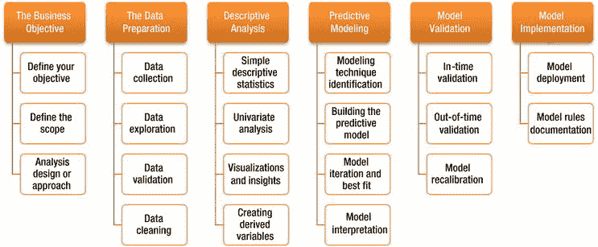

**图 7-1.** 数据分析项目的步骤

一旦确定了数据的业务目标，在继续分析过程之前，必须对数据有全面的理解。图 7-1 所示顺序中第二列的数据准备步骤提出了以下问题：

- 为什么理解和探索数据在统计分析中是如此重要的一步？
- 为什么这个步骤需要与描述性分析和预测建模等其他重要步骤一同提及？

以下示例将解答这两个问题。

### 示例：联系中心呼叫量

考虑某个大型组织典型客户联系中心的呼叫量数据。表 7-1 中的数据快照仅包含三列。第一列是天数，第二列是当天的小时数，第三列是特定小时内的呼叫量（呼叫次数）。该数据连续记录了五天。

**表 7-1.** 呼叫量数据

| 天数 | 小时 | 呼叫量 |
| :--- | :--- | :--- |
| 1 | 1 | 3,504 |
| 1 | 2 | 3,378 |
| 1 | 3 | 6,872 |
| 1 | 4 | 5,993 |
| 1 | 5 | 3,093 |
| 1 | 6 | 3,512 |
| 1 | 7 | 4,142 |
| 1 | 8 | 6,441 |
| 1 | 9 | 61,906 |
| 1 | 10 | 43,175 |
| 1 | 11 | 49,989 |
| 1 | 12 | 9,862 |
| 1 | 13 | 18,231 |
| 1 | 14 | 46,282 |
| 1 | 15 | 36,665 |

假设你试图回答以下问题：平均呼叫次数是多少？前 8 小时的平均呼叫次数是否确实低于其余 16 小时？需要运行以下 SAS 代码来实现这一分析：

```sas
/*Import the data set into SAS */
PROC IMPORT OUT = WORK.call_volume
DATAFILE= "D:\Backup\SkyDrive\Books\Content\Chapter-12 Data Exploration and Cleaning\Data sets\Call_volume.csv"
DBMS=CSV REPLACE;
GETNAMES=YES;
DATAROW= 2 ;
RUN ;

/*Get the contents of the SAS data set */
Proc contents data=WORK.call_volume varnum;
run ;
```

上述代码中的 `varnum` 选项会按照变量在原始数据集中出现的顺序列出它们。SAS 通常按字母顺序打印变量。

该代码的输出请参见表 7-2。

**表 7-2.** `PROC CONTENTS` 的 SAS 输出变量列表

| # | 变量 | 类型 | 长度 | 格式 | 输入格式 |
| :--- | :--- | :--- | :--- | :--- | :--- |
| 1 | `Day` | 数值型 | 8 | BEST12. | BEST32. |
| 2 | `Hour` | 数值型 | 8 | BEST12. | BEST32. |
| 3 | `Volume` | 数值型 | 8 | BEST12. | BEST32. |

为了计算每小时平均呼叫量，需要执行 `PROC MEANS`。

以下 SAS 代码用于计算变量 `call_volume` 的平均值。

```sas
Title'Overall mean of the call volume';
Proc means data=WORK.call_volume ;
var volume ;
run ;
```

`Proc means data` 默认输出表 7-3 所示的结果。

**表 7-3.** `call_volume` 数据集的 `PROC MEANS` 输出

| N | 平均值 | 标准差 | 最小值 | 最大值 |
| :--- | :--- | :--- | :--- | :--- |
| 120 | 168812.73 | 862472.38 | 0 | 7260664.00 |

由于你只需要平均值，可以在代码中使用 `mean` 选项，如下所示：

```sas
Title'Overall mean of the call volume';
proc means data=WORK.call_volume mean;
var volume ;
run ;
```

表 7-4 显示了上述代码的输出。

**表 7-4.** 变量 `volume` 的平均值

| 平均值 |
| :--- |
| 168,812.73 |

以下是计算前 8 小时平均呼叫量的代码。

```sas
Title 'Mean of the call volume in 1 to 8 Hours';
proc means data=WORK.call_volume mean;
var volume;
where Hour < 9 ;
run ;
```

表 7-5 显示了上述代码的输出。

**表 7-5.** 第 1 至 8 小时的平均呼叫量

| 平均值 |
| :--- |
| 417,169.30 |

以下是计算后 16 小时（即第 9 至 24 小时）平均呼叫量的代码。

```sas
Title 'Mean of the call volume in 9 to 24 Hours';
procmeans data=WORK.call_volume mean;
var volume;
where Hour ge 9 ;
run ;
title;
```

表 7-6 显示了上述代码的输出。

**表 7-6.** 第 9 至 24 小时的平均呼叫量

| 平均值 |
| :--- |
| 44,634.44 |

在整个文件的所有呼叫次数中，整体平均值已在表 7-4 之前的 SAS 代码中计算得出。随后计算了前 8 小时的平均值以及后 16 小时的平均值（表 7-5 和 7-6）。因此，一个简单的 `proc means` SAS 脚本即可帮助发现每小时平均呼叫次数为 168,812。前 8 小时的平均每小时呼叫次数低于后 16 小时的假设并不成立。前 8 小时的呼叫率几乎是后 16 小时数据的 10 倍。

现在，联系中心可以根据每小时平均呼叫量来部署资源。然而，经理审阅了这些结果并将其驳回。

驳回的原因如下。

## 数据探索与验证的必要性

为了说明数据探索与验证的必要性，我们将继续沿用同一个呼叫中心通话量示例进行阐述。

- 经理根据经验了解到，每小时的呼叫量平均值通常在 50,000 到 100,000 之间。
- 他还质疑一天中前 8 小时（午夜 12 点至早上 8 点）的呼叫量是否可能比后 16 小时更高。他的经验也告诉他，后 16 小时的呼叫率应该明显更高。

他的这一信心促使我们需要重新审视这五天原始呼叫量数据的结果。

表 7-7 列出了连续 5 天、每天 24 小时中每个小时的呼叫数量数据。每一行数据都包含观测序号、小时以及该小时收到的呼叫数量。

**表 7-7.** 5 天的每小时呼叫量数据

| 天数=1 |  |  | 天数=2 |  |  | 天数=3 |  |  |
| :--- | :--- | :--- | :--- | :--- | :--- | :--- | :--- | :--- |
| 观测 | 小时 | 呼叫量 | 观测 | 小时 | 呼叫量 | 观测 | 小时 | 呼叫量 |
| 1 | 1 | 3504 | 25 | 1 | 6288 | 49 | 1 | 2135 |
| 2 | 2 | 3378 | 26 | 2 | 6091 | 50 | 2 | 1392 |
| 3 | 3 | 6872 | 27 | 3 | 2546 | 51 | 3 | 4502 |

# 数据分析与清洗：处理异常值并重新计算平均值

请注意，在第 3 天的 `Volume` 列中有几个异常高的值。它们可能是真实的记录，但高呼叫率可能是因为某些并非每天都会发生的事件。其他记录看起来正常。另外，请注意第 2、3、4 天的第 17 个小时的值为零。这些零值可能是由于技术错误或其他未知原因造成的。这些极少出现的值就是异常值。你需要移除它们，然后重新计算同样的三个平均值。为此，将样本限制在呼叫量在 1,000 到 100,000 之间的数据。

```sas
/* 呼叫量子集 */
Data call_Volume_subset;
Set WORK.call_volume;
if volume > 1000 and volume < 100000 ;
run ;
```

当执行上述 SAS 代码时，日志文件会显示以下内容：

```
NOTE: 从数据集 WORK.CALL_VOLUME 中读取了 120 条观测。
NOTE: 数据集 WORK.CALL_VOLUME_SUBSET 包含 113 个观测和 3 个变量。
NOTE: DATA 语句使用情况（总处理时间）：
real time           0.01 seconds
cpu time            0.01 seconds
```

新的平均值如下：

```sas
Title '呼叫量的总体平均值';
proc means data=WORK.call_Volume_subset mean;
var volume ;
run ;
```

表 7-8 显示了上述代码的输出结果。

表 7-8. `call_volume` 的总体平均值

| 平均 |
| :--- |
| 32,952.86 |

以下代码用于计算移除异常值后，前 8 小时的平均值。

```sas
Title '1 到 8 小时呼叫量的平均值';
proc means data=WORK.call_Volume_subset mean;
var volume;
where Hour < 9 ;
run ;
```

表 7-9 显示了上述代码的输出结果。

表 7-9. 1 到 8 小时呼叫量的平均值

| 平均 |
| :--- |
| 4,247.72 |

以下代码用于计算移除异常值后，后 16 小时的平均值。

```sas
Title '9 到 24 小时呼叫量的平均值';
proc means data=WORK.call_Volume_subset mean;
var volume;
where  Hour ge 9 ;
run ;
title;
```

表 7-10 显示了上述代码的输出结果。

表 7-10. 9 到 24 小时呼叫量的平均值

| 平均 |
| :--- |
| 46,373.44 |

修改后的数据集显示，每小时的平均呼叫量为 32,952。前 8 小时的呼叫数量几乎是后 16 小时呼叫数量的十分之一。这些数字符合业务逻辑，也与经理的经验相符。分析推理的结果并非总是与经验一致。分析后，结果也可能相反。无论哪种情况，分析结果都应该具备合理性，并符合业务逻辑。在呼叫中心示例中，对原始数据进行的盲目平均计算得出了与业务实际情况相反的结果。而对数据的仔细检查则揭示了异常值的存在。

尽管 120 条记录中仅有 7 条存在问题，但结果却产生了巨大差异。在开始分析之前，养成例行检查数据的习惯总是一个好主意。

## 真实世界数据的问题及解决方法

真实世界的数据通常是粗糙的，无法以其原始形式进行分析。以下是数据分析项目中经常遇到的一些挑战：

-   真实世界数据通常包含缺失值，这些可能是未采集到或不可用的数据点。
-   数据集中经常包含异常值。例如，样本中少数几个人的月收入记录达到数百万。
-   某些数据集中的一些字段有时是常量，例如在所有记录中看到 `age = 11` 和 `number of personal loans = 6`。
-   数据存在明显错误，例如 `number of dependents = -3`。
-   数据可能包含默认值，例如 `999999`、`1111111`、`#VALUE`、`NULL` 或 `N/A`。

-   数据不完整，或者仅在汇总级别可用，而非交易级别，大多数经济指标便是如此。如果你在交易级别进行分析，可能会产生很大的误差。

-   数据量不足。分析所需的关键变量可能不存在于数据集中。

### 缺失值

缺失值和异常值是数据集中最常见的两个问题。数据不可用也是一个常见问题。有时，大量总体或样本数据中可能存在缺失值。以下是一些示例：

-   在涉及发展中国家和欠发达国家的信贷机构数据中，可能会存在大量缺失值。

-   一项包含可选字段的市场调研，在设计上就必然会出现缺失值。

### 异常值

异常值并非严格意义上的错误，但它们可能导致误导性的结果。异常值通常是指与该变量其他值差异极大的数值。例如，在某个数据列中，95% 的数据落在特定范围内，而其余 5%的数据则完全不同，这可能会显著改变整体结果。这个问题在呼叫量示例中出现过。其他一些异常值的实例如下：

-   保险理赔数据中，仅有 2%的索赔金额超过 500 万美元，其余均低于 80 万美元。

-   超级门店的客户消费数据中，一个月内仅有 4 位客户消费了 5 万美元，其余客户消费均低于 6000 美元。

以上仅是原始数据中可能存在的两个问题示例，这些数据可供分析。在数据集层面可能还存在其他若干问题，例如与变量类型（如日期、数字和字符）相关的格式挑战。变量长度可能不具有业务意义。此外，在将数据从一个数据库平台传输到另一个时，还可能产生其他多种数据问题。本章仅聚焦于与数据分析相关的问题。

### 手动检查数据集并非可行之策

呼叫量示例中的数据量较小，使得手动查找数据异常成为可能。但对于包含众多变量的大型数据集而言，这并不可行。一个拥有超过 100 个变量和 100 万条记录的数据集，不允许我们手动检查其中的异常值和其他数据相关问题。

因此，在进行分析之前，你需要一种可靠、科学的方法来审视数据。数据探索过程应能凸显所有难以手动识别的隐蔽问题。

### 删除记录并非总是正确的方法

能否简单地删除有问题的记录？这是正确的方法吗？如果不是，处理数据错误的最佳方式是什么？在识别出异常值和缺失值等问题后，人们很容易丢弃这些错误记录，然后继续进行余下的分析。但这样做也会失去一些宝贵的信息。

例如，考虑表 7-11 中给出的员工档案数据。该数据分为七列：

**表 7-11. 员工档案数据**

| 员工编号 | 姓名 | 年龄 | 学历 | 经验年限 | 性别 | 团队 |
| --- | --- | --- | --- | --- | --- | --- |
| `EMP001` | - | 45 | 硕士 | 20 | 男 | 分析部 |
| `EMP002` | 威尔 | 34 | 硕士 | 12 | 男 | - |
| `EMP003` | 怀特 | 35 | 博士 | 10 | - | IT 部 |
| `EMP004` | 菲比 | - | 硕士 | 9 | 女 | IT 部 |
| `EMP005` | 杰克 | 32 | 学士 | - | 男 | 分析部 |
| `EMP006` | 迈克 | 45 | - | 10 | 男 | 财务部 |

-   `EmpID`：员工编号

-   `Name`：员工姓名

-   `Age`：员工年龄

-   `Qualification`：员工学历

-   `Experience`：员工工作年限

-   `Gender`：员工性别

-   `Team`：员工所在团队

从这些列可以明显看出，每条记录至少缺少一个字段，因此删除含有缺失值的记录并非解决方案。你需要一个稳健且一致的解决方案。

## 理解与准备数据

第 6 章使用了箱线图技术来识别变量中的异常值。为了全面理解数据，也可以在数据分析中使用一些简单的描述性统计技术和检查点。正如之前在呼叫量示例中讨论的那样，需要首先理解和清理数据。只有这样，数据才能准备好用于分析。以下各节将详细探讨数据探索、数据验证和数据清洗。

### 数据探索

数据检查的第一步是全面理解数据及其结构的细微细节。需要回答以下问题：

-   数据是如何构成的？

-   变量有哪些？

-   它们的类型是什么？

-   有多少个变量？

-   有多少条记录？

-   是否存在缺失值？

### 数据验证

数据验证将回答以下问题：

-   所有值都正确吗？

-   存在异常值吗？

-   变量类型正确吗？

-   数据是否与数据字典（描述了数据集中所有涉及的变量）相匹配？

所有这些问题都涉及对数据进行准确性检查。此步骤可以在数据探索期间执行，也可以作为一个单独的步骤进行。在此阶段，会用到简单的描述性统计技术。

### 数据清洗

通过数据探索和数据验证，你可以识别出数据集中几乎所有的问题。接下来，需要清洗数据，使其准备好用于分析。异常值和缺失值，以及任何其他错误，都需要通过适当的替换进行修正。但是，当变量是离散型或连续型时，数据清洗的过程相同吗？如果数据中只有 1%的值缺失怎么办？如果 30%的值缺失呢？对于 10%、30%和 90%的缺失值情况，处理方法是否相同？

数据探索、验证和清洗的步骤在项目生命周期中会占用相当多的时间，有时甚至高达项目总可用人力的 70%。而且没有捷径可走。你需要探索所有变量以理解和解决问题。本章后续主题将讨论如何使用一个信用风险案例研究来理解、验证和清洗数据。

## 数据探索、验证与清洗案例研究：信用风险数据

以下是一个信用风险案例研究，我们在本章中会使用该案例来演示在实际分析过程开始之前，与数据准备相关的各个步骤和概念。

### 信用评分系统

参考：本案例研究使用的数据集基于 Kaggle 网站并获其许可使用，网址为 [`https://www.kaggle.com/c/GiveMeSomeCredit`](https://www.kaggle.com/c/GiveMeSomeCredit)。

众所周知，银行会提供多种产品，例如个人贷款、信用卡、抵押贷款和汽车贷款。每家银行都会在发放贷款或信用卡之前，评估与客户相关的风险。每个客户都基于一些关键参数进行评估，例如过往贷款次数、平均收入、年龄、受抚养人数等。银行会使用高级分析方法并构建预测模型，以在发卡或放贷前找到违约的概率。

历史客户付款和使用数据被用于构建预测模型，该模型将量化与每个客户相关的风险。银行会确定一个临界点，任何风险高于该临界点的客户都将被拒绝。这种量化风险的方法被称为信用评分。每个客户都会根据这个基于历史数据构建的模型获得一个信用评分。信用评分越高，客户获得信贷的可能性就越大。通常，信用评分范围在 0 到 1000 之间，但这不是强制性的。例如，如果某个客户的信用评分为 850，她申请贷款或信用卡很可能会获批。另一方面，如果客户评分为 350，她获得信贷的可能性几乎为零。

在构建信用风险模型时，需要注意缺失值和异常值等数据错误。如果处理不当，一个错误可能会否定整个模型的可信度，而一笔重大的贷款违约就可能抵消从 100 个优质案例中获得的利润。该模型在任何情况下都必须稳健，因为没有银行愿意给一个不良客户打高分。因此，在涉及金融交易的模型中，数据探索、验证和清洗变得非常重要。

### 数据字典

参考：基础数据集取自 Kaggle 并经过修改。

表 7-12 和 7-13 给出的是用于构建预测模型的数据集。通常随数据一起提供的数据字典解释了所有变量的详细信息。每个变量都需要被检查，以便在必要时理解、验证和清理。以下是银行数据团队提供的信息。

提供了在过去两年业绩窗口期内收集的 250,000 名借款人的历史数据。这些数据的一部分用于构建模型，另一部分则留作测试和验证之用。

数据集的文件名为 `Customer_loan_data.csv`，数据字典（变量详细信息）见表 7-12。

**表 7-12. 示例数据字典**

| 变量名称 | 描述 | 类型 |
| --- | --- | --- |
| `SeriousDlqin2yrs` | 个人是否出现逾期 90 天或更严重的情况 | 是/否 |
| `RevolvingUtilizationOfUnsecuredLines` | 信用卡和个人信用额度（不含房地产和无分期债务，如汽车贷款）的总余额除以信用额度总和 | 百分比 |
| `Age` | 借款人的年龄（以年计） | 整数 |
| `NumberOfTime30-59DaysPastDueNotWorse` | 过去 2 年内借款人逾期 30 至 59 天但未超期的次数 | 整数 |
| `DebtRatio` | 每月债务支付、赡养费、生活成本除以月总收入 | 百分比 |
| `MonthlyIncome` | 月收入 | 实数 |
| `NumberOfOpenCreditLinesAndLoans` | 未结清贷款（分期贷款，如汽车贷款或抵押贷款）和信用额度（如信用卡）的数量 | 整数 |
| `NumberOfTimes90DaysLate` | 借款人逾期 90 天或以上的次数 | 整数 |
| `NumberRealEstateLoansOrLines` | 抵押贷款和房地产贷款（包括房屋净值信用额度）的数量 | 整数 |
| `NumberOfTime60-89DaysPastDueNotWorse` | 过去 2 年内借款人逾期 60 至 89 天但未超期的次数 | 整数 |

表 7-12 中的所有变量都与信用风险相关。表 7-13 提供了这些变量的详细解释。

## 表 7-13. 变量详细解释

| 变量名称 | 描述 | 类型 |
| --- | --- | --- |
| `SeriousDlqin2yrs` | 个人是否出现逾期 90 天或更严重的违约情况。这些账户也称为不良账户。不良定义因产品而异。例如，信用卡的严重违约是指逾期 180 天。这可能是一笔贷款或抵押贷款，因此逾期 90 天即为严重违约。通常，这是需要预测的目标变量。 | 是/否 |
| `RevolvingUtilizationOfUnsecuredLines` | 信用卡和个人信用额度（不含房地产及无分期债务，如汽车贷款）的总余额除以信用额度总和。假设一张信用卡的信用额度为 100,000 美元。如果每月平均使用 25,000 美元，则使用率为 25%。如果平均使用 10,000 美元，则使用率为 10%。因此，使用率的取值范围在 0 到 1 之间（0% 到 100%）。 | 百分比 |
| `Age` | 借款人的年龄（以年计）。 | 整数 |
| `NumberOfTime30-59DaysPastDueNotWorse` | 过去 2 年内借款人逾期 30 至 59 天但未超期的次数。该数据跨度为 2 年。客户曾有多少次逾期 30 天但不超过 59 天？一次、两次、三次或六次？ | 整数 |
| `DebtRatio` | 每月债务支付、赡养费、生活成本除以月总收入。债务收入比。收入为 50,000 美元，债务为 10,000 美元，债务比率为 20%。因此，债务比率可取值在 0% 到 100% 之间。也可能略高于 100%。 | 百分比 |
| `MonthlyIncome` | 月收入。 | 实数 |
| `NumberOfOpenCreditLinesAndLoans` | 未结清贷款（分期贷款，如汽车贷款或抵押贷款）和信用额度（如信用卡）的数量。 | 整数 |
| `NumberOfTimes90DaysLate` | 借款人逾期 90 天或以上的次数。该数据跨度为 2 年。客户有多少次逾期 90 天？一次、两次、三次或五次？ | 整数 |
| `NumberRealEstateLoansOrLines` | 抵押贷款和房地产贷款（包括房屋净值信用额度）的数量。 | 整数 |
| `NumberOfTime60-89DaysPastDueNotWorse` | 过去 2 年内借款人逾期 60 至 89 天但未超期的次数。该数据跨度为 2 年。客户有多少次逾期 60 至 89 天但未超期？一次、两次、三次或五次？ | 整数 |
| `NumberOfDependents` | 家庭中除申请人之外的受抚养人数（配偶、子女等）。 | 整数 |

以下章节将使用简单的描述性统计技术来探索、验证和清洗信用风险数据。

### 导入数据

以下 SAS 代码将 `.csv` 文件导入 SAS：

```sas
/*Import the customer raw data into SAS */
PROC IMPORT OUT= WORK.cust_cred_raw
DATAFILE= "C:\Users\Google Drive\Training\Books\Content\Chapter-12 Data Exploration and Cleaning\Datasets\Customer_loan_data.csv"
DBMS=CSV REPLACE;
GETNAMES=YES;
DATAROW= 2 ;
RUN ;
```

以下是执行上述代码后 SAS 日志文件中的主要记录：

```
NOTE: The infile 'C:\Users\Google Drive\Training\Books\Content\Chapter-12 Data
Exploration and Cleaning\Datasets\Customer_loan_data.csv' is:
Filename=C:\Users\Google Drive\Training\Books\Content\Chapter-12 Data Exploration
and Cleaning\Datasets\Customer_loan_data.csv,
RECFM=V,LRECL=32767,File Size (bytes)=14516824,
Last Modified=05Mar2014:14:55:27,
Create Time=05Mar2014:12:54:18
NOTE: 251503 records were read from the infile 'C:\Users\Google
Drive\Training\Books\Content\Chapter-12 Data Exploration and
Cleaning\Datasets\Customer_loan_data.csv'.
The minimum record length was 33.
The maximum record length was 64.
NOTE: The data set WORK.CUST_CRED_RAW has 251503 observations and 13 variables.
NOTE: DATA statement used (Total process time):
real time           1.82 seconds
cpu time            1.52 seconds
251503 rows created in WORK.CUST_CRED_RAW from C:\Users\Google
Drive\Training\Books\Content\Chapter-12 Data Exploration and
Cleaning\Datasets\Customer_loan_data.csv.
NOTE: WORK.CUST_CRED_RAW data set was successfully created.
NOTE: PROCEDURE IMPORT used (Total process time):
real time           2.07 seconds
cpu time            1.76 seconds
```

根据上述分析，未发现重大警告或错误。该 SAS 数据集的名称是 `cust_cred_raw`。以下是数据探索的流程。

## 步骤 1：使用 `PROC CONTENTS` 进行数据探索与验证

`PROC CONTENTS` 数据用于获取数据的基本详细信息，例如记录数、变量及变量类型。由于目标是全面了解数据而无需实际打开数据文件，因此 `PROC CONTENTS` 可作为获取元数据（关于数据的数据）及相关细节的切入点。

用于查看内容的 SAS 代码如下：

```sas
title 'Proc Contents on raw data';
proc contents data= WORK.cust_cred_raw varnum ;
run ;
```

上述 SAS 代码生成了如表 7-14 所示的输出。

### 表 7-14. `cust_cred_raw` 数据集的 `proc contents` 输出

| CONTENTS 过程 |
| --- |
| 数据集名称 | `WORK.CUST_CRED_RAW` | 观测数 | 251503 |
| 成员类型 | DATA | 变量数 | 13 |
| 引擎 | V9 | 索引数 | 0 |
| 创建时间 | 2008 年 7 月 1 日 星期二 12:06:40 AM | 观测长度 | 104 |
| 最后修改时间 | 2008 年 7 月 1 日 星期二 12:06:40 AM | 删除的观测数 | 0 |
| 保护 |  | 压缩 | NO |
| 数据集类型 |  | 排序 | NO |
| 标签 |  |  |  |
| 数据表示 | WINDOWS_32 |  |  |
| 编码 | wlatin1 Western (Windows) |  |  |
| 引擎/主机相关信息 |
| --- |
| 数据集页面大小 | 12288 |
| 数据集页面数 | 2150 |
| 第一个数据页面 | 1 |
| 每页最大观测数 | 117 |
| 第一个数据页中的观测数 | 93 |
| 数据集修复次数 | 0 |
| 文件名 | `C:\Users\AppData\Local\Temp\SAS Temporary Files\_TD6600\cust_cred_raw.sas7bdat` |
| 创建时的版本 | 9.0201M0 |
| 创建主机 | W32_VSPRO |
| 按创建顺序排列的变量 |
| --- |
| # | 变量 | 类型 | 长度 | 格式 | 输入格式 |
| --- | --- | --- | --- | --- | --- |

## 整体内容中的验证与检查点

尽管 `PROC CONTENTS` 是一个简单的过程，但它提供了所有基本细节以及对某些关键问题的解答。阅读 `PROC CONTENTS` 输出时，请留意以下清单：

- 所有变量是否符合预期？是否缺少任何变量？
- 记录数是否符合预期？
- 是否有意外变量，例如 `x10`、`AAA`、`q90`、`r10`、`VAR1`？
- 变量名称是否与数据字典一致？是否存在名称被截断的变量？
- 数据类型是否符合预期？是否有日期变量被读取为数字？是否有数值变量被读取为字符？
- 各变量的长度是否正确？是否存在某些字符变量在特定字符后被截断的情况？
- 是否提供了标签？如果提供了，标签是否合理？

针对客户贷款数据检查以上清单（表 7-15）。

**表 7-15.** 客户贷款数据的检查点

| 编号 | 检查点 | 观察结果 | 问题？ |
| --- | --- | --- | --- |
| 1 | 所有变量是否符合预期？ | 数据字典中的全部 11 个变量都出现在最终数据集中。 | 否 |
| 2 | 记录数是否符合预期？ | 是。预期大约 250,000 条记录，输出显示为 251,503 条记录。如果需要，可以查询多出来的 1,503 条记录，但该数字看起来微不足道。 | 否 |
| 3 | 是否有意外变量？ | 是，有两个意外变量。数据字典中只提到了 11 个变量。`Sr_num` 和 `Obs_type` 是多余的。显然 `Sr_num` 是序列号，但 `obs_type` 是什么？ | 是 |
| 4 | 变量名称是否相同？ | 否。由于 SAS 对变量名称的限制，数据集中某些变量名称被截断。例如，`RevolvingUtilizationOfUnsecuredLines` 被读取为 `RevolvingUtilizationOfUnsecuredL`；同理，以下两个变量也被截断：`NumberOfTime30_59DaysPastDueNotW` `NumberOfTime60_89DaysPastDueNotW` 但这些可以与原始变量对应上。看起来没问题。 | 否 |
| 5 | 数据类型是否符合预期？ | 否。月收入应为数值型，但在导入数据中却是字符型。同理，亲属数量也应为数值型。`SeriousDlqin2yrs` 应为 Y/N 但被读取为数字。月收入和亲属数量存在严重问题。 | 是 |
| 6 | 各变量的长度是否正确？ | 长度似乎没有问题。 | 否 |
| 7 | 是否提供了标签且合理？ | 当前数据集中没有为变量提供标签。 | 否 |

检查完 `PROC CONTENTS` 的清单后，发现了以下问题：

- 存在两个额外的变量：`Sr_num` 和 `obs_type`。
- 月收入和亲属数量应为数值型，但被存储为字符型。这意味着无法对这两个变量进行算术或数值运算。此问题可能对分析造成破坏性影响，并在项目后期阶段产生灾难性后果。
- `SeriousDlqin2yrs` 应为 Y/N 但被读取为数字。Y/N 可能已被转换为 0/1。

其余的数据探索步骤将继续进行。将仔细检查并解决这些差异。如果找不到这些问题的答案，请与数据团队核实是手动错误还是系统错误。

### 第 2 步：使用数据快照进行数据探索与验证

`PROC CONTENTS` 数据提供了观测值和变量的概览。下一步是检查每个变量中的值。如前所述，打印整个数据集并不实际；只需打印数据的一个快照。快照是数据的一小部分。它可以是随机的 100 条观测值、前 30 条观测值或后 50 条观测值。快照的大小没有规定。基本上，它不过是带有限制条件的数据打印。

**警告**

打印数据时要小心；切勿尝试打印大型数据集。计算机系统和软件可能会卡住，重启可能是使其恢复的唯一选择。

打印前 20 条记录的 SAS 代码如下：

```sas
title 'Proc Print on raw data (first 20 observations only)';
proc print data=WORK.cust_cred_raw (obs=20);
run;
```

表 7-16 列出了此代码的输出。

**表 7-16.** `cust_cred_raw` 数据集中的前 20 条观测值

| Obs | `sr_num` | `SeriousDlqin2yrs` | `RevolvingUtilizationOfUnsecuredL` | `age` | `NumberOfTime30_59DaysPastDueNotW` | `DebtRatio` | `MonthlyIncome` | `NumberOfOpenCreditLinesAndLoans` | `NumberOfTimes90DaysLate` | `NumberRealEstateLoansOrLines` | `NumberOfTime60_89DaysPastDueNotW` | `NumberOfDependents` | `obs_type` |
| --- | --- | --- | --- | --- | --- | --- | --- | --- | --- | --- | --- | --- | --- |
| 1 | 1 | 1 | 0.766 | 45 | 2 | 0.80 | 9120 | 13 | 0 | 6 | 0 | 2 | training |
| 2 | 2 | 0 | 0.957 | 40 | 0 | 0.12 | 2600 | 4 | 0 | 0 | 0 | 1 | training |
| 3 | 3 | 0 | 0.658 | 38 | 1 | 0.09 | 3042 | 2 | 1 | 0 | 0 | 0 | training |
| 4 | 4 | 0 | 0.234 | 30 | 0 | 0.04 | 3300 | 5 | 0 | 0 | 0 | 0 | training |
| 5 | 5 | 0 | 0.907 | 49 | 1 | 0.02 | 63588 | 7 | 0 | 1 | 0 | 0 | training |
| 6 | 6 | 0 | 0.213 | 74 | 0 | 0.38 | 3500 | 3 | 0 | 1 | 0 | 1 | training |
| 7 | 7 | 0 | 0.306 | 57 | 0 | 5710.00 | NA | 8 | 0 | 3 | 0 | 0 | training |
| 8 | 8 | 0 | 0.754 | 39 | 0 | 0.21 | 3500 | 8 | 0 | 0 | 0 | 0 | training |
| 9 | 9 | 0 | 0.117 | 27 | 0 | 46.00 | NA | 2 | 0 | 0 | 0 | NA | training |
| 10 | 10 | 0 | 0.189 | 57 | 0 | 0.61 | 23684 | 9 | 0 | 4 | 0 | 2 | training |
| 11 | 11 | 0 | 0.644 | 30 | 0 | 0.31 | 2500 | 5 | 0 | 0 | 0 | 0 | training |
| 12 | 12 | 0 | 0.019 | 51 | 0 | 0.53 | 6501 | 7 | 0 | 2 | 0 | 2 | training |

# 数据验证与清洗：过程记录与检查点分析

## 数据快照中的验证与检查点

快照是对部分实际数据的粗略查看。这有助于您通过查看变量所取的值来理解变量。以下是需要在`PROC PRINT`步骤中观察的检查点：

*   寻找唯一标识符或主键。是否有某个变量取唯一值？
*   所有文本变量是否都包含相关数据？或者它们之间是否有一些意外的文本，例如`@!$#`或`&&&&`？
*   所有已知的数值变量是否都有适当的值？它们是否也包含非数值？
*   是否存在使用编码值代替实际值的情况？例如，州字段中的州代码如`NY`或`ID`。
*   所有变量是否都有数据？或者是否有任何变量包含缺失值？
*   `PROC CONTENTS`输出中识别的问题是否清晰？这包括关于变量长度、变量类型、变量数量等的任何信息。

查看客户贷款数据的检查清单（表7-17）。

| 编号 | 检查点 | 观察结果 | 存在问题？ |
| :--- | :--- | :--- | :--- |
| 1 | 寻找唯一标识符或主键。是否有某个变量取唯一值？ | `Sr_num`看起来像一个序列号和唯一标识符。 | 无 |
| 2 | 所有文本变量是否都包含相关数据？或者它们之间是否有一些意外文本，比如`@!$#`或`&&&&`？ | 变量月收入和受抚养人数在某些记录中包含`NA`。`Obs_type`仅将training作为列值。这可能与数据描述中的训练样本和测试样本有关。 | 是 |
| 3 | 所有已知的数值变量是否都有适当的值？它们是否有任何非数值？ | 是，这里没有重大问题。我们已经注意到了月收入和受抚养人数。 | 无 |
| 4 | 是否存在使用编码值代替实际值的情况？例如，州字段中是否有像`NY`或`ID`这样的州代码？ | 根据数据字典，`SeriousDlqin2yrs`应为“是”或“否”类型。看起来它已被编码为0和1。但Y=1还是0？ | 是 |
| 5 | 所有变量是否都有数据？或者是否有任何变量包含缺失值？ | 快照中没有明显的缺失值。 | 无 |
| 6 | 能否澄清在`PROC CONTENTS`输出中识别的问题？您是否需要关于变量长度、变量类型或变量数量的任何信息？ | 是，有关于月收入、受抚养人数以及`Sr_num`和`obs_type`的附加信息。 | 无 |

以下是内容信息中的一些未解决问题：
*   存在两个额外的变量：`Sr_num`和`obs_type`。
*   月收入和受抚养人数应为数值型，但被写成了字符型。
*   `SeriousDlqin2yrs`应为Y/N，但被读取为数字。Y/N可能已被转换为0/1。

### 解析 `sr_num`

从快照中观察到，`Sr_num`是一个序列号，以下代码是用于确认这一点的测试。使用`proc univariate`对`Sr_num`进行详细分析将揭示事实。

```sas
Title 'Univariate on Sr_num';
proc univariate data=WORK.cust_cred_raw;
var sr_num;
run;
```

表7-18更仔细地展示了输出中的四分位数和极值。

| 分位数（定义5） | 估计值 |
| :--- | :--- |
| 100% 最大值 | 251503 |
| 99% | 248988 |
| 95% | 238928 |
| 90% | 226353 |
| 75% Q3 | 188628 |
| 50% 中位数 | 125752 |
| 25% Q1 | 62876 |
| 10% | 25151 |
| 5% | 12576 |
| 1% | 2516 |
| 0% 最小值 | 1 |

| 极端观测值 | | | |
| :--- | :--- | :--- | :--- |
| 最低值 | | 最高值 | |
| 值 | 观测值 | 值 | 观测值 |
| 1 | 1 | 251499 | 251499 |
| 2 | 2 | 251500 | 251500 |
| 3 | 3 | 251501 | 251501 |
| 4 | 4 | 251502 | 251502 |
| 5 | 5 | 251503 | 251503 |

`sr_num`的五个最高值是251499、251500、251501、251502和251503，并且`sr_num`以1、2、3、4、5开头。因此，可以安全地得出结论：`sr_num`是记录编号。

### 解决月收入与受抚养人数问题

以下是一些亟待解决的未决事项：

对于`obs_type`，`proc print`提供的信息不多。月收入和受抚养人数应为数值型，但当前存为字符型。`SeriousDlqin2yrs`本应为Y/N，但被读取为数值。Y/N可能已被转换为0/1。

月收入和受抚养人数均为缺失值（NA），导致整个变量被存储为字符型。需将其转换为数值型缺失值。可在SAS中使用`if-then-else`语句或如下代码：

```sas
/* 月收入与受抚养人数字符型问题 */
Data cust_cred_raw_v1;
Set cust_cred_raw;
MonthlyIncome_new= MonthlyIncome*1;
NumberOfDependents_new=NumberOfDependents*1;
run;
```

该代码创建了两个新变量`MonthlyIncome_new`和`NumberOfDependents_new`，并从原数据集`cust_cred_raw`生成新数据集`cust_cred_raw_v1`。

执行代码时，会看到一些关于将缺失值（NA）乘以1的警告信息。日志文件中将出现类似以下内容的提示：

```
NOTE: Character values have been converted to numeric values at the places given by:
(Line):(Column).
71:21   72:24
NOTE: Invalid numeric data, MonthlyIncome='NA', at line 71 column 21.
NOTE: Invalid numeric data, NumberOfDependents='NA', at line 72 column 24.
```

已创建两个新变量以解决字符型相关问题。以下是新数据集的`PROC CONTENTS`输出结果：

```sas
title'Proc Contents on data version1';
proc contents data=cust_cred_raw_v1 varnum ;
run;
```

表7-19列出了该代码的输出结果。

| 按创建顺序排列的变量 | | | | | |
| :--- | :--- | :--- | :--- | :--- | :--- |
| # | 变量 | 类型 | 长度 | 格式 | 输入格式 |
| 1 | `Sr_num` | 数值 | 8 | BEST12. | BEST32. |
| 2 | `SeriousDlqin2yrs` | 数值 | 8 | BEST12. | BEST32. |

| 原始数据列 | | | | | |
| :--- | :--- | :--- | :--- | :--- | :--- |
| # | 变量 | 类型 | 长度 | 格式 | 输入格式 |
| 3 | `RevolvingUtilizationOfUnsecuredLines` | 数值 | 8 | BEST12. | BEST32. |
| 4 | `age` | 数值 | 8 | BEST12. | BEST32. |
| 5 | `NumberOfTime30-59DaysPastDueNotWorse` | 数值 | 8 | BEST12. | BEST32. |
| 6 | `DebtRatio` | 数值 | 8 | BEST12. | BEST32. |
| 7 | `MonthlyIncome` | 字符 | 4 | $4. | $4. |
| 8 | `NumberOfOpenCreditLinesAndLoans` | 数值 | 8 | BEST12. | BEST32. |
| 9 | `NumberOfTimes90DaysLate` | 数值 | 8 | BEST12. | BEST32. |
| 10 | `NumberRealEstateLoansOrLines` | 数值 | 8 | BEST12. | BEST32. |
| 11 | `NumberOfTime60-89DaysPastDueNotWorse` | 数值 | 8 | BEST12. | BEST32. |
| 12 | `NumberOfDependents` | 字符 | 4 | $4. | $4. |
| 13 | `obs_type` | 字符 | 8 | $8. | $8. |

| # | 变量 | 类型 | 字节 | 格式 | 最佳格式 |
| :--- | :--- | :--- | :--- | :--- | :--- |
| 3 | `RevolvingUtilizationOfUnsecuredL` | 数值 | 8 | BEST12. | BEST32. |
| 4 | `Age` | 数值 | 8 | BEST12. | BEST32. |
| 5 | `NumberOfTime30_59DaysPastDueNotW` | 数值 | 8 | BEST12. | BEST32. |
| 6 | `DebtRatio` | 数值 | 8 | BEST12. | BEST32. |
| 7 | `MonthlyIncome` | 字符 | 6 | $6. | $6. |
| 8 | `NumberOfOpenCreditLinesAndLoans` | 数值 | 8 | BEST12. | BEST32. |
| 9 | `NumberOfTimes90DaysLate` | 数值 | 8 | BEST12. | BEST32. |
| 10 | `NumberRealEstateLoansOrLines` | 数值 | 8 | BEST12. | BEST32. |
| 11 | `NumberOfTime60_89DaysPastDueNotW` | 数值 | 8 | BEST12. | BEST32. |
| 12 | `NumberOfDependents` | 字符 | 3 | $3. | $3. |
| 13 | `obs_type` | 字符 | 8 | $8. | $8. |
| 14 | `MonthlyIncome_new` | 数值 | 8 | | |
| 15 | `NumberOfDependents_new` | 数值 | 8 | | |

已新增两个数值型变量，现在可以用它们替代字符型变量。

以下为未决事项：

对于`obs_type`，`PROC PRINT`提供的信息不足。`SeriousDlqin2yrs`本应为 Y/N，但被读取为数值。Y/N 可能已被转换为 0/1，需要确定 0 和 1 分别代表什么。

通过`PROC PRINT`和快照可以获取真实值，从而识别并解决某些问题。并非所有变量都存在明显的数据问题。例如，虽然`obs_type`显然与测试数据和训练数据有关，但`PROC PRINT`并未呈现清晰的全貌。有时，增加打印尺寸可以更细致地观察数值。通常打印四到五部分数据就足以获得更好的整体认识。

### 连续变量与离散变量

前文已讨论过连续变量和离散变量。在两个界限之间可取任意值的变量称为连续变量（例如，以英尺为单位的身高）。只能取有限个值的变量称为离散变量（例如，一个家庭中的孩子数量）。模拟手表的时间是连续变量，而数字手表的时间是离散变量。两者都显示时间，但模拟手表的精度不固定，数字手表则仅显示到其最小度量单位，甚至可精确到百分之一秒。

表 7-20 显示了给定数据中变量被划分为连续变量和离散变量的情况。

运行基本内容查看和打印过程后，接下来是描述性统计。如前所述，没有捷径可走。每个变量都需要单独检查。在分析之前，一切都需要探索和验证。基本描述性分析的第一步是识别连续变量和离散变量。由于连续变量可取无限个值，频率表等组件会非常冗长。另一方面，离散变量取值个数可数，因此频率表有一定意义。

**表 7-20. 数据中的离散变量与连续变量**

| # | 变量 | 类型 | 变量类型 | 需进一步检查 |
| :--- | :--- | :--- | :--- | :--- |
| 1 | `Sr_num` | 数值 | 离散 | 否 |
| 2 | `SeriousDlqin2yrs` | 数值 | 离散 | 是 |
| 3 | `RevolvingUtilizationOfUnsecuredL` | 数值 | 连续 | 是 |
| 4 | `Age` | 数值 | 离散 | 是 |
| 5 | `NumberOfTime30_59DaysPastDueNotW` | 数值 | 离散 | 是 |
| 6 | `DebtRatio` | 数值 | 连续 | 是 |
| 7 | `MonthlyIncome` | 字符 | 不适用 | 不适用 |
| 8 | `NumberOfOpenCreditLinesAndLoans` | 数值 | 离散 | 是 |
| 9 | `NumberOfTimes90DaysLate` | 数值 | 离散 | 是 |
| 10 | `NumberRealEstateLoansOrLines` | 数值 | 离散 | 是 |
| 11 | `NumberOfTime60_89DaysPastDueNotW` | 数值 | 离散 | 是 |
| 12 | `NumberOfDependents` | 字符 | 不适用 | 不适用 |
| 13 | `obs_type` | 字符 | 离散（分类） | 是 |
| 14 | `MonthlyIncome_new` | 数值 | 连续 | 是 |
| 15 | `NumberOfDependents_new` | 数值 | 离散 | 是 |

下一步是对连续变量进行单变量分析，对离散变量生成频率表。为连续变量制作频率表并非好主意，因为它可取无限个值，但对离散变量来说频率表则很有用。

### 第 3 步：使用单变量分析进行数据探索和验证

单变量分析几乎就像是一份关于某个变量的完整报告，从各个角度涵盖了细节。此处将使用单变量分析来探索和验证所有连续变量。该分析提供以下统计参数的结果：

- `N`（非缺失观测值计数）
- `Nmiss`（缺失观测值计数）
- `最小值`、`最大值`、`中位数`、`均值`
- 四分位数和百分位数（`P1`、`p5`、`p10`、`q1(p25)`、`q3(p75)`、`p90`、`p99`）
- `Stdde`（标准差）
- `Var`（方差）
- `偏度`
- `峰度`

`偏度`和`峰度`与变量分布有关。本分析中不会用到这两个度量。出于完整性考虑，这里对其进行简要说明。

`偏度`解释了大多数变量分布偏向哪一侧。负偏度意味着，当绘制变量的分布图时，左侧的尾巴更长。考虑一个变量，比如自然死亡人群的年龄；在大多数此类情况下，年龄会非常大。类似地，右偏分布可能在右侧有一条尾巴。一个人一生中的事故次数可能是右偏分布的一个例子。请参见图 7-2 和图 7-3。

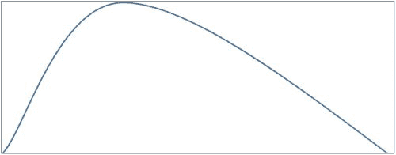

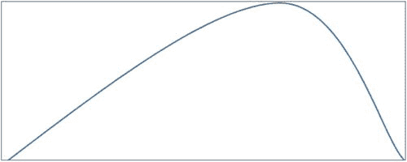

`峰度`详细说明了变量在峰值尖锐程度方面的分布情况。下图展示了三种不同类型的峰值。图 7-4 显示某个值处有一个尖锐的峰值。图 7-5 几乎没有峰值，而图 7-6 有一个中等程度的峰值。第一个图的峰度度量值将超过 3；第二个图的峰度值将远小于 3；对于第三个变量，峰度将接近 3。

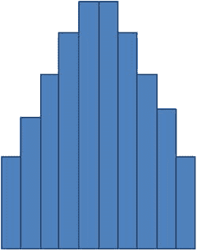

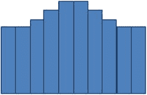

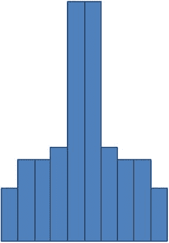

下面的 SAS 代码用于对变量`RevolvingUtilizationOfUnsecuredL`进行单变量分析。如有必要，可以添加更多变量，但您将从一个变量开始。

> **注意：** 回顾一下，`RevolvingUtilizationOfUnsecuredL`是信用卡和个人信用额度（不包括房地产）的总余额，除以信用额度总和（例如汽车贷款等分期债务）。

考虑一张信用额度为 10 万美元的信用卡。如果平均每月使用 2.5 万美元，则使用率为 25%。如果平均使用 1 万美元，则使用率为 10%。因此，使用率取值在 0 和 1 之间（即 0 至 100%）。

`Title 'Proc Univriate on utilization -RevolvingUtilizationOfUnsecuredL ';`

```
Proc univariate data= cust_cred_raw_v1;
Var RevolvingUtilizationOfUnsecuredL;
run ;
```

此代码产生如表 7-21 所示的输出。

**表 7-21. 针对`cust_cred_raw_v1`的`proc univariate`输出（`Var RevolvingUtilizationOfUnsecuredL`）**

| UNIVARIATE 过程 变量：RevolvingUtilizationOfUnsecuredL |
| --- |
| **矩** |

### 单变量分析中的验证与检查点

单变量分析给出了几乎所有集中趋势的度量。以下是单变量分析的检查清单：

- 变量的集中趋势是什么？每个变量的均值、中位数和众数是多少？均值是否接近中位数？
- 变量的集中程度是否符合预期？四分位数是多少？变量是偏向较高值还是较低值？四分位数的分布情况如何？是否有任何迹象表明存在异常值？
- 与变量相关的缺失值百分比是多少？
- 变量是否存在异常值/极端值？
- 该变量的标准差是多少？是接近 0，还是过高？变量是否在限制或可能范围内？

表 7-22 包含了关于输出的观察结果。

#### `RevolvingUtilizationOfUnsecuredL` 的输出统计量

| `N` | 251503 | 权重和 | 251503 |
| :--- | :--- | :--- | :--- |
| **均值** | 5.75041518 | **观测值总和** | 1446246.67 |
| **标准差** | 229.63398 | **方差** | 52731.7647 |
| **偏度** | 89.5880819 | **峰度** | 13043.6294 |
| **未校正平方和** | 1.32705E10 | **校正平方和** | 1.32621E10 |
| **变异系数** | 3993.3461 | **均值标准误差** | 0.45789359 |

#### 基本统计测度

| 位置 | | 变异性 | |
| :--- | :--- | :--- | :--- |
| **均值** | 5.750415 | **标准差** | 229.63398 |
| **中位数** | 0.153575 | **方差** | 52732 |
| **众数** | 0.000000 | **极差** | 50708 |
| | | **四分位距** | 0.53132 |

#### 位置检验：`Mu0=0`

| 检验 | 统计量 | p 值 | |
| :--- | :--- | :--- | :--- |
| Student `t` | `t` | 12.55841 | `Pr> \|t\|` | <.0001 |
| 符号 | `M` | 116657 | `Pr>= \|M\|` | <.0001 |
| 符号秩 | `S` | 1.361E10 | `Pr>= \|S\|` | <.0001 |

#### 分位数（定义 5）

| 分位数 | 估计值 |
| :--- | :--- |
| 100% 最大值 | 5.07080E+04 |
| 99% | 1.09129E+00 |
| 95% | 1.00000E+00 |
| 90% | 9.82102E-01 |
| 75% `Q3` | 5.61298E-01 |
| 50% 中位数 | 1.53575E-01 |
| 25% `Q1` | 2.99746E-02 |
| 10% | 2.99276E-03 |
| 5% | 0.00000E+00 |
| 1% | 0.00000E+00 |
| 0% 最小值 | 0.00000E+00 |

#### 极端观测值

| 最小值 | | 最大值 | |
| :--- | :--- | :--- | :--- |
| 值 | 观测序号 | 值 | 观测序号 |
| 0 | 251479 | 21821 | 189198 |
| 0 | 251455 | 22000 | 149161 |
| 0 | 251452 | 22198 | 16957 |
| 0 | 251438 | 29110 | 31415 |
| 0 | 251434 | 50708 | 85490 |

### 表 7-22. 变量 `RevolvingUtilizationOfUnsecuredL` 输出的观察结果

| 序号 | 检查点 | 观察结果 | 存在问题？ |
| :--- | :--- | :--- | :--- |
| 1 | 变量的集中趋势是什么？每个变量的均值、中位数和众数是多少？均值是否接近中位数？ | 均值：5.750415 中位数：0.153575 众数：0.000000 均值为 575%，中位数为 15%。均值远高于中位数。这明显表明存在异常值，且是一个严重问题。 | 是 |
| 2 | 变量的集中程度是否符合预期？四分位数是多少？变量是偏向较高值还是较低值？ | 分位数（定义 5） | 是 |
| | 四分位数的分布情况如何？是否有任何迹象表明存在异常值？ | **分位数** | **估计值** |
| | 100% 最大值 | 5070800% | |
| | 99% | 109% | |
| | 95% | 100% | |
| | 90% | 98% | |
| | 75% `Q3` | 56% | |
| | 50% 中位数 | 15% | |
| | 25% `Q1` | 3% | |
| | 10% | 0% | |
| | 5% | 0% | |
| | 1% | 0% | |
| | 0% 最小值 | 0% | |
| | 均值与中位数的差异已经表明了这些值。百分之十的客户几乎从未使用过他们的信用卡。百分之五十的客户，即大约 125,000 名客户，仅使用了其信用额度的 15%。有趣的是，一小部分客户使用了超过 100% 的额度。这是否意味着大约 5% 的客户使用了超过 100% 的信用额度？少数客户使用了其信用额度的 5000 倍，这在业务逻辑上看起来是不可能的。 | |
| 3 | 与变量相关的缺失值百分比是多少？ | 没有缺失值。所有客户的使用率数据都是可用的。 | 否 |
| 4 | 变量是否存在异常值/极端值？ | 是，已识别。大约 5% 的数值是异常值。看起来像是直接记录了使用金额而非使用百分比。 | 是 |
| 5 | 该变量的标准差是多少？是接近 0，还是过高？变量是否在限制或可能范围内？ | 标准差不为零；由于存在异常巨大的异常值，它略微偏高。 | 否 |

输出结果清楚地表明存在异常值，并且这 5% 的异常值正在对所有度量造成剧烈误差。其中一个例子是所有客户的总体平均使用率为 500%，而实际平均值是 15%。异常值也可以使用箱线图来验证。需要在 `PROC UNIVARIATE` 代码中指定 "plot" 选项来创建箱线图：

```
title 'ProcUnivriate and boxplot on utilization';
Proc univariate data= cust_cred_raw_v1 plot;
Var RevolvingUtilizationOfUnsecuredL;
run ;
```

图 7-7 展示了生成的箱线图。

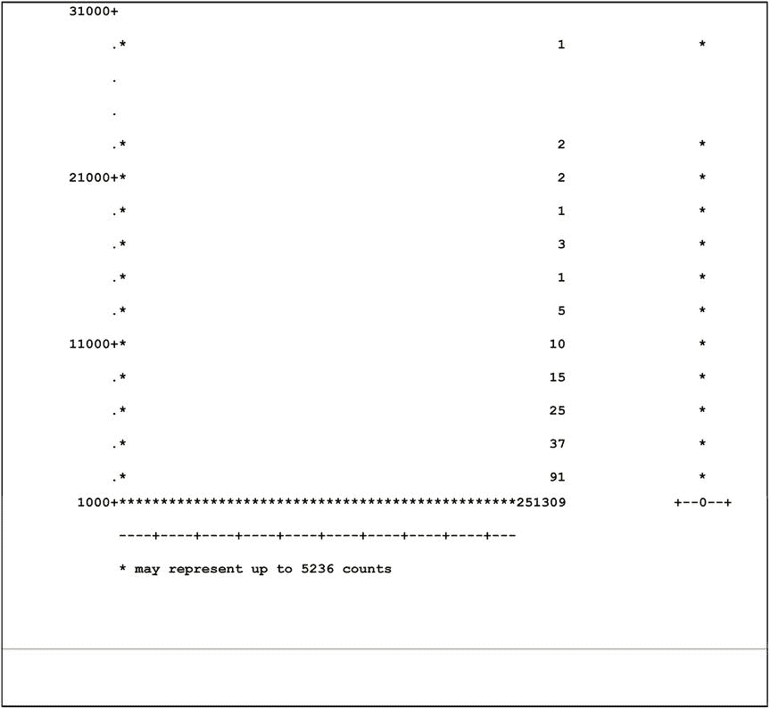 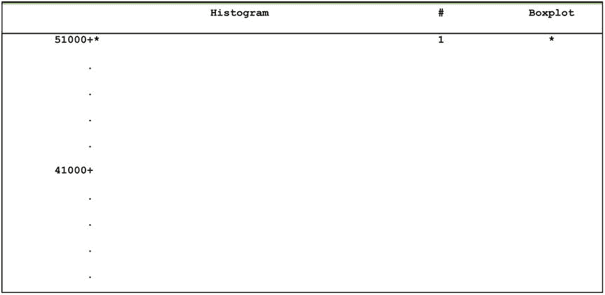

**图 7-7.** 变量 `RevolvingUtilizationOfUnsecuredL` 的箱线图

在上面的箱线图中看不到箱体；回顾一下箱线图的解读：箱体包含 `Q1`、中位数和 `Q3`。从图中可以明显看出，该变量完全被异常值所主导。为了进一步验证，只考虑 100% 以下的数值。SAS 代码和输出如下所示：

```
title 'Proc Univariate on utilization less than or equal to 100%';
Proc univariate data= cust_cred_raw_v1 plot;
Var RevolvingUtilizationOfUnsecuredL;
Where RevolvingUtilizationOfUnsecuredL <= 1 ;
run ;
```

表 7-23 和图 7-8 展示了 `PROC UNIVARIATE` 以及在小于等于 100% 的使用率上的箱线图。

#### 表 7-23. `PROC UNIVARIATE` 在 `RevolvingUtilizationOfUnsecuredL<=1` 上的输出

**单变量分析过程 变量: `RevolvingUtilizationOfUnsecuredL`**

**矩**

| `N` | 246001 | 权重和 | 246001 |
| :--- | :--- | :--- | :--- |
| **均值** | 0.30432543 | **观测值总和** | 74864.3601 |
| **标准差** | 0.33851892 | **方差** | 0.11459506 |
| **偏度** | 0.95463481 | **峰度** | -0.5317455 |
| **未校正平方和** | 50973.513 | **校正平方和** | 28190.3844 |
| **变异系数** | 111.23583 | **均值标准误差** | 0.00068252 |

**基本统计量**

| 位置 | | 变异性 | |
| :--- | :--- | :--- | :--- |
| **均值** | 0.304325 | **标准差** | 0.33852 |
| **中位数** | 0.143964 | **方差** | 0.11460 |
| **众数** | 0.000000 | **极差** | 1.00000 |
| | | **四分位距** | 0.49351 |

**位置检验: `Mu0=0`**

| 检验 | 统计量 | p 值 |
| :--- | :--- | :--- |
| --- | --- | --- |

| 学生 t 检验 | t | 445.8859 | Pr> \|t\| | <.0001 |

| 符号检验 | M | 113906 | Pr>= \|M\| | <.0001 |

| 符号秩检验 | S | 1.297E10 | Pr>= \|S\| | <.0001 |

| 分位数（定义 5） |

| --- |

| 分位数 | 估计值 |

| --- | --- |

| 100% 最大值 | 1.00000000 |

| 99% | 0.99999990 |

| 95% | 0.99999990 |

| 90% | 0.93870941 |

| 75% Q3 | 0.52224629 |

| 50% 中位数 | 0.14396401 |

| 25% Q1 | 0.02873321 |

| 10% | 0.00270126 |

| 5% | 0.00000000 |

| 1% | 0.00000000 |

| 0% 最小值 | 0.00000000 |

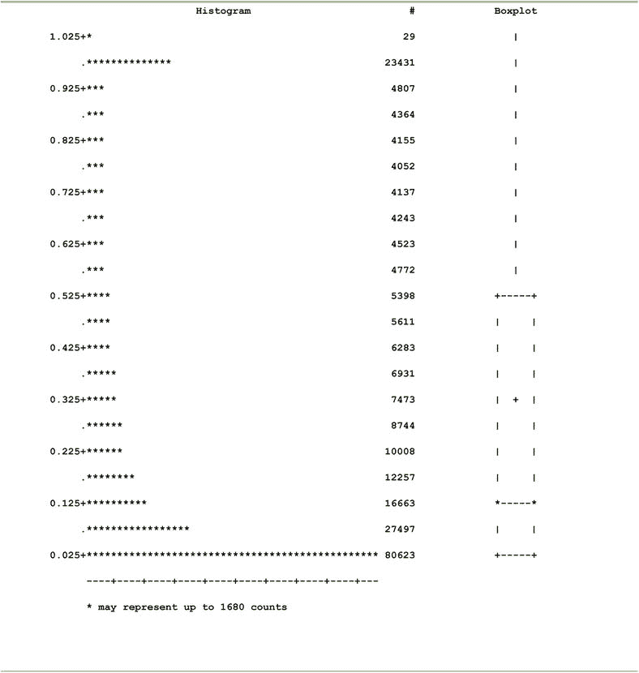

**图 7-8.** `PROC UNIVARIATE` 在 `RevolvingUtilizationOfUnsecuredL<=1` 上的箱线图

| 极端观测值 |

| --- |

| 最小值 | 最大值 |

| --- | --- |

| 值 | 观测序号 | 值 | 观测序号 |

| --- | --- | --- | --- |

| 0 | 251479 | 1 | 224166 |

| 0 | 251455 | 1 | 228890 |

| 0 | 251452 | 1 | 231077 |

| 0 | 251438 | 1 | 238536 |

| 0 | 251434 | 1 | 244591 |

现在你可以看到箱体了。尽管存在一些高值，但在此情况下没有持续不断的异常值。但简单地移除异常值并非解决方案。这个问题需要被记录下来并在以后解决。目前已经有两个待办事项，而这里的循环使用率变量包含异常值，需要进行处理。这是列表中的第三个问题。

对于 `obs_type`，`PROC PRINT` 没有提供足够的信息。`SeriousDlqin2yrs` 应该是 Y/N，但它被读取为数字。可能 Y/N 被转换成了 0/1。需要确定 0 和 1 分别代表什么。循环使用率有异常值，大约占 5%。

类似地，使用以下代码对月收入进行单变量分析：

```
title 'Univariate on monthly income';
Proc univariate data= cust_cred_raw_v1 ;
Var MonthlyIncome_new;
run ;
```

表 7-24 展示了这段代码的输出。

**表 7-24.** `proc univariate` 在 `cust_cred_raw_v1` 上的输出（变量 `MonthlyIncome_new`）

| 单变量分析过程 变量: MonthlyIncome_new |

| --- |

| 矩 |

| --- |

| N | 201669 | 权重和 | 201669 |

| 均值 | 6626.1771 | 观测值总和 | 1336294510 |

| 标准差 | 8746.29438 | 方差 | 76497665.3 |

| 偏度 | 36.3109836 | 峰度 | 2449.29916 |

| 未校正平方和 | 2.42817E13 | 校正平方和 | 1.54271E13 |

| 变异系数 | 131.996085 | 均值标准误差 | 19.4762131 |

好的，作为一名高级文档工程师和翻译员，我将严格遵守您提供的注意事项和示例格式，将给定的英文文本翻译成中文。

---

| 基本统计量 |

| --- |

| 位置 | 变异性 |

| --- | --- |

| 均值 | 6626.177 | 标准差 | 8746 |

| 中位数 | 5400.000 | 方差 | 76497665 |

| 众数 | 5000.000 | 极差 | 835040 |

|   |   | 四分位距 | 4812 |

| 位置检验：Mu0=0 |

| --- |

| 检验 | 统计量 | p 值 |

| --- | --- | --- |

| 学生 t 检验 | t | 340.219 | Pr> &#124;t&#124; | <.0001 |

| 符号检验 | M | 99507.5 | Pr>= &#124;M&#124; | <.0001 |

| 符号秩检验 | S | 9.9018E9 | Pr>= &#124;S&#124; | <.0001 |

| 分位数（定义 5） |

| --- |

| 分位数 | 估计值 |

| --- | --- |

| 100% 最大值 | 835040 |

| 99% | 25083 |

| 95% | 14583 |

| 90% | 11600 |

| 75% Q3 | 8212 |

| 50% 中位数 | 5400 |

| 25% Q1 | 3400 |

| 10% | 2044 |

| 5% | 1300 |

| 1% | 0 |

| 0% 最小值 | 0 |

| 极端观测值 |

| --- |

| 最小值 | 最大值 |

| --- | --- |

| 值 | 观测序号 | 值 | 观测序号 |

| --- | --- | --- | --- |

| 0 | 251388 | 702500 | 93565 |

| 0 | 251374 | 729033 | 151133 |

| 0 | 251359 | 730483 | 123292 |

| 0 | 251305 | 772700 | 174163 |

| 0 | 251300 | 835040 | 122544 |

| 缺失值 |

| --- |

| 缺失值 | 计数 | 占总观测值的百分比 | 占缺失观测值的百分比 |

| . | 49834 | 19.81 | 100.00 |

月收入中存在异常值，因为均值略高于中位数，并且这些异常值位于该变量取值范围的较高端。但除了这些轻微的异常值之外，一个更严重的问题是变量存在缺失值，数量几乎达到 49,834。也就是说，总体月收入记录中有 20% 是缺失的。这对分析是有害的。每当使用月收入时，SAS 都会忽略这 20% 的记录。这是以下列表中的第四个问题：

对于 `obs_type`，`Proc print` 没有提供足够的信息。`SeriousDlqin2yrs` 应该是 Y/N 格式，但它被读取为数字。有可能 Y/N 已被转换为 0/1。需要确定 0 和 1 各自代表什么。循环利用额度存在异常值，大约为 5%。月收入在近 20% 的情况下是缺失的。

类似地，可以对所有连续变量执行单变量分析；对它们进行验证，并记录相关问题。

### 第 4 步：使用频率进行数据探索和验证

第 4 步检查所有取值为可数个数的离散变量。频率表应该仅为离散变量和分类变量创建。对连续变量创建频率表可能会导致系统卡死，因为连续变量预期会取几乎无限多个值。因此，如果数据中的记录过多，在选择用于频率分布的变量时需要小心。

以下是 `SeriousDlqin2yrs` 和 `obs_type` 的频率表代码。在展示频率表之后，我们将解释如何利用它们为你服务。

```
Title '2 年内严重违约的频率表';
proc freq data= cust_cred_raw_v1;
table SeriousDlqin2yrs;
run ;
```

表 7-25 给出了此代码的输出结果。

**表 7-25.** 在 `cust_cred_raw_v1` 数据集上执行 `proc freq` 的输出结果（表 `SeriousDlqin2yrs`）

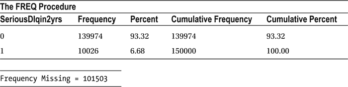

输出结果中缺失了 101,503 个值。缺失值的计数在 `PROC FREQ` 的输出中给出。数据团队之前已经提到，严重违约的数值对于测试群体是不可用的。如果在 `obs_type` 上运行 `proc frequency`，它应该会得到恰好 101,503 条测试记录。

```
title 'obs_type 的频率表';
proc freq data= cust_cred_raw_v1;
table obs_type;
run ;
```

表 7-26 列出了此代码的输出结果。

**表 7-26.** 在 `cust_cred_raw_v1` 数据集上执行 `proc freq` 的输出结果（表 `obs_type`）

| FREQ 过程 |

| --- |

| obs_type | 频数 | 百分比 | 累积频数 | 累积百分比 |

| --- | --- | --- | --- | --- |

| test | 101503 | 40.36 | 101503 | 40.36 |

| training | 150000 | 59.64 | 251503 | 100.00 |

因此，将使用 150,000 个观测值进行模型构建，其余的用于测试。`Obs_type` 仅用于指示测试记录和训练记录。

我们还将创建其他离散变量的频率表。严重违约变量在 93.3% 的记录中为 0，在 6.7% 的记录中为 1。通过应用一些银行知识可以解决列表中的第二个问题。严重违约通常少于非违约。对于一个借款人群体，可以预期 93% 的好客户基础和 7% 的坏客户基础，但反过来几乎是不可能的。因此，可以安全地推断出 Y 被编码为 1，N 被编码为 0。

这样，列表中只剩下两个待解决的问题：循环利用额度存在大约 5% 的异常值。月收入在 20% 的情况下是缺失的。

## 频率表中的验证与检查点

以下是 `NumberOfTime30_59DaysPastDueNotW` 的频率表续。该变量表示客户逾期一个月但不超过 59 天的次数。客户可能在 24 个月内逾期 1 次、2 次，最多 24 次。在 24 个月内最多逾期 24 次意味着该客户每个月都在账单支付中违约。

以下是该变量频率表的代码：

```
title' 30-59 天逾期的频率表';
proc freq data= cust_cred_raw_v1;
table NumberOfTime30_59DaysPastDueNotW;
run;
```

表 7-27 列出了此代码的输出结果。

**表 7-27.** 在 `cust_cred_raw_v1` 上执行 `proc freq` 的输出结果（表 `NumberOfTime30_59DaysPastDueNotW`）

| NumberOfTime30_59DaysPastDueNotW | 频数 | 百分比 | 累积频数 | 累积百分比 |
| --- | --- | --- | --- | --- |
| 0 | 211208 | 83.98 | 211208 | 83.98 |
| 1 | 26870 | 10.68 | 238078 | 94.66 |
| 2 | 7766 | 3.09 | 245844 | 97.75 |
| 3 | 2955 | 1.17 | 248799 | 98.92 |
| 4 | 1257 | 0.50 | 250056 | 99.42 |
| 5 | 547 | 0.22 | 250603 | 99.64 |
| 6 | 228 | 0.09 | 250831 | 99.73 |
| 7 | 96 | 0.04 | 250927 | 99.77 |
| 8 | 53 | 0.02 | 250980 | 99.79 |
| 9 | 22 | 0.01 | 251002 | 99.80 |
| 10 | 11 | 0.00 | 251013 | 99.81 |
| 11 | 2 | 0.00 | 251015 | 99.81 |
| 12 | 3 | 0.00 | 251018 | 99.81 |
| 13 | 1 | 0.00 | 251019 | 99.81 |
| 19 | 1 | 0.00 | 251020 | 99.81 |
| 96 | 6 | 0.00 | 251026 | 99.81 |
| 98 | 477 | 0.19 | 251503 | 100.00 |

### 频率表中的验证与检查点

以下是利用频率表进行数据验证和探索时可以考虑的要点：

- 数值是否符合预期？
- 变量集中度是否符合预期？
- 是否存在缺失值？缺失值的百分比是多少？
- 是否存在极端值或异常值？
- 是否有可能通过将某些类别与其他类别分组，来创建一个具有少量不同类别的新变量？

表 7-28 显示了逾期 30 至 59 天（DPD）输出的观测结果。

> **注：** 回顾一下，30 至 59 DPD 是之前定义的变量 `NumberOfTime30-59DaysPastDueNotWorse` 的简称。它指的是借款人在过去 2 年内逾期 30 至 59 天（但未更糟）的次数。

**表 7-28.** 逾期 30 至 59 天输出观测结果

| 序号 | 检查点 | 观测结果 | 存在问题？ |
| --- | --- | --- | --- |
| 1 | 数值是否符合预期？ | 存在一些意外的数值，96 和 98。 | 是 |
| 2 | 变量集中度是否符合预期？ | 频率表显示，83% 的客户从未逾期超过 30 天，10% 的客户逾期超过 30 天一次。有些客户逾期了 10 次。但这里的问题是出现了数值 96 和 98。一个客户怎么能在 24 个月内违约 98 次呢？ | 是 |
| 3 | 是否存在缺失值？缺失值的百分比是多少？是否存在极端值或异常值？ | 无缺失值。 | 否 |
| 4 | 是否有可能通过将某些类别与其他类别合并，来创建一个具有少量不同类别的新变量？ | 是的，可以将 96 和 98 合并为一个错误类别。但这不会对分析产生重大影响。 | 否 |

还有两个与 30 至 59 DPD 类似的变量：60 至 89 DPD 和 90 DPD。

> **注：** 回顾一下，60 至 89 DPD 是变量 `NumberOfTime60-89DaysPastDueNotWorse`。它指的是借款人在过去 2 年内逾期 60 至 89 天（但未更糟）的次数。
>
> 90 DPD 是变量 `NumberOfTimes90Days`。它指的是借款人逾期 90 天或以上的次数。该数据涵盖 2 年。客户逾期 90 天但未更糟的情况有多少次？一次、两次、三次还是五次？

考虑以下代码，它生成了 60 至 89 DPD 和 90 DPD 的频率表：

```
title 'Frquency table for 60-89, and 90+ days past due ';
proc freq data=cust_cred_raw_v1;
table NumberOfTime60_89DaysPastDueNotW NumberOfTimes90DaysLate;
run;
```

表 7-29 显示了此代码的输出。

**表 7-29.** 逾期 60 至 89 天及 90 天以上的频率表

| `NumberOfTime60_89DaysPastDueNotW` | 频率 | 百分比 | 累积频率 | 累积百分比 |
| --- | --- | --- | --- | --- |
| 0 | 238771 | 94.94 | 238771 | 94.94 |
| 1 | 9594 | 3.81 | 248365 | 98.75 |
| 2 | 1849 | 0.74 | 250214 | 99.49 |
| 3 | 534 | 0.21 | 250748 | 99.70 |
| 4 | 166 | 0.07 | 250914 | 99.77 |
| 5 | 59 | 0.02 | 250973 | 99.79 |
| 6 | 23 | 0.01 | 250996 | 99.80 |
| 7 | 16 | 0.01 | 251012 | 99.80 |
| 8 | 3 | 0.00 | 251015 | 99.81 |
| 9 | 4 | 0.00 | 251019 | 99.81 |
| 11 | 1 | 0.00 | 251020 | 99.81 |
| 96 | 6 | 0.00 | 251026 | 99.81 |
| 98 | 477 | 0.19 | 251503 | 100.00 |
| `NumberOfTimes90DaysLate` | 频率 | 百分比 | 累积频率 | 累积百分比 |
| 0 | 237447 | 94.41 | 237447 | 94.41 |
| 1 | 8837 | 3.51 | 246284 | 97.92 |
| 2 | 2617 | 1.04 | 248901 | 98.97 |
| 3 | 1112 | 0.44 | 250013 | 99.41 |
| 4 | 482 | 0.19 | 250495 | 99.60 |
| 5 | 233 | 0.09 | 250728 | 99.69 |
| 6 | 124 | 0.05 | 250852 | 99.74 |
| 7 | 64 | 0.03 | 250916 | 99.77 |
| 8 | 40 | 0.02 | 250956 | 99.78 |
| 9 | 33 | 0.01 | 250989 | 99.80 |
| 10 | 10 | 0.00 | 250999 | 99.80 |
| 11 | 6 | 0.00 | 251005 | 99.80 |
| 12 | 3 | 0.00 | 251008 | 99.80 |
| 13 | 4 | 0.00 | 251012 | 99.80 |
| 14 | 2 | 0.00 | 251014 | 99.81 |

# 第五步：缺失值与异常值处理

## 数据探索与问题识别

在完成内容填充、打印、单变量分析和频数统计等步骤后，数据探索和验证工作可能就接近尾声了。对部分变量执行这些操作时，前文提到的四个问题便浮现出来。其他变量也可能存在类似问题。请记录这些问题，并进入数据清洗的下一个步骤。这也被称为为分析准备数据。存在异常值固然是个问题，但简单地删除它们并非解决之道。

数据探索和验证之后，以下问题仍未得到解答：

-   某些变量存在缺失值/异常值，但这些记录不能删除。
-   某些变量缺失值/异常值的比例很高。能否删除这些变量？
-   某些变量缺失值/异常值的比例可以忽略不计。当缺失值比例为 2%、40%和 95%时，应分别如何处理？
-   能否用其他值来替代缺失值？
-   有些变量是离散型的，有些是连续型的。对于离散变量和连续变量，处理方法（删除或替代）是否相同？如果一个连续变量有 20%的缺失值，而一个仅有四个级别的离散变量也有 20%的缺失值，它们能否采用相同的处理方法？带着这些问题，你现在可以进入数据准备过程的下一步。

## 问题清单（示例）

根据初步分析，已识别出以下具体问题：

-   循环利用率存在约 5% 的异常值。
-   月收入在 20% 的案例中缺失。
-   30 至 59 DPD、60 至 89 DPD 和 90 DPD 存在 96 和 98 的问题。
-   家属人数 (`NumberOfDependents_new`) 缺失约 2% 的值。

示例数据与分析代码：

```
/* 示例数据片段 */
| 15 | 2 | 0.00 | 251016 | 99.81 |
| 16 | 1 | 0.00 | 251017 | 99.81 |
| 96 | 6 | 0.00 | 251026 | 99.81 |
| 98 | 477 | 0.19 | 251503 | 100.00 |
```

类似地，需要为所有变量创建频率表，以便全面了解完整的数据集。以下代码也给出了其他变量的频率表：

```
Proc freq data=cust_cred_raw_v1;
tables
age
NumberOfOpenCreditLinesAndLoans
NumberRealEstateLoansOrLines
NumberOfDependents_new;
run;
```

表 7-30 是 `NumberOfDependents_new` 的频率表。其余变量也有类似的频率表，此处未显示。

**表 7-30.** `NumberOfDependents_new` 的频率表

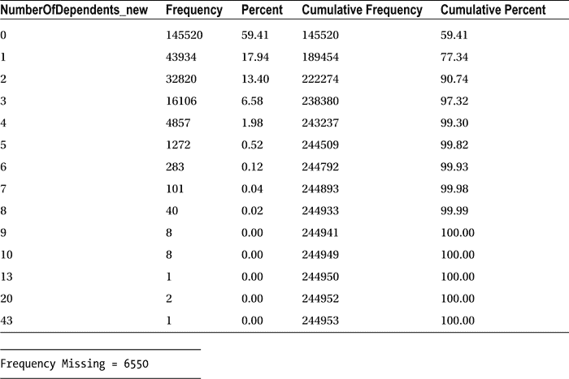

前述输出中的变量值缺失了 2% 的观测值。这是一个问题。如以下代码所示，可以使用 `missing` 选项在 `proc frequency` 中查看缺失百分比：

```
title 'Frequency table for All discrete variables with missing %';
proc freq data=cust_cred_raw_v1;
tables
age NumberOfOpenCreditLinesAndLoans NumberRealEstateLoansOrLines
NumberOfDependents_new / missing;
run;
```

表 7-31 是使用此代码生成的 `NumberOfDependents_new` 的频率表。其余变量也有类似的频率表，此处未显示。

**表 7-31.** 使用 `/missing` 选项的 `NumberOfDependents_new` 频率表

| `NumberOfDependents_new` | 频率 | 百分比 | 累积频率 | 累积百分比 |
| :----------------------- | ---: | -----: | -------: | ---------: |
| .                        | 6550 |   2.60 |     6550 |       2.60 |
| 0                        | 145520 |  57.86 |   152070 |      60.46 |
| 1                        | 43934 |  17.47 |   196004 |      77.93 |
| 2                        | 32820 |  13.05 |   228824 |      90.98 |
| 3                        | 16106 |   6.40 |   244930 |      97.39 |
| 4                        | 4857 |   1.93 |   249787 |      99.32 |
| 5                        | 1272 |   0.51 |   251059 |      99.82 |
| 6                        | 283 |   0.11 |   251342 |      99.94 |
| 7                        | 101 |   0.04 |   251443 |      99.98 |
| 8                        | 40 |   0.02 |   251483 |      99.99 |
| 9                        | 8 |   0.00 |   251491 |     100.00 |
| 10                       | 8 |   0.00 |   251499 |     100.00 |
| 13                       | 1 |   0.00 |   251500 |     100.00 |
| 20                       | 2 |   0.00 |   251502 |     100.00 |
| 43                       | 1 |   0.00 |   251503 |     100.00 |

## 缺失值与异常值处理方法

前文已明确，因缺失值而删除记录并非良策。相反，可以采用一种称为“插补”的技术。该技术涉及用最佳可能的替代值来替换缺失/错误的值，以最大程度减少损失，同时获得准确结果。插补有不同类型；我们将讨论两种：独立插补和基于相关变量的插补。

### 独立插补

缺失值需要用均值或中位数来替换，具体取决于其余的值以及哪种选择更符合商业直觉。独立插补方便且易于实施。其假设是缺失值与现有值之间没有显著差异。

表 7-32 中的数据显示了 21 名运动员的年龄；其中一名运动员的年龄缺失。因为仅缺失一个值，所以用其余值的平均年龄 27 来替换该缺失值。（一般来说，运动员的年龄不会超过 50 或 60 岁。）

**表 7-32. 运动员年龄数据**

| 年龄 | 30 | 25 | 29 | 29 | 26 | 26 | 25 | 30 | 27 | 27 | .... | 30 | 28 | 29 | 26 | 25 | 28 | 26 | 26 | 25 | 30 | 27 |
| :--- | -- | -- | -- | -- | -- | -- | -- | -- | -- | -- | :--- | -- | -- | -- | -- | -- | -- | -- | -- | -- | -- | -- |

经过独立插补（使用其余年龄值的均值替换缺失值）后，新数据将如表 7-33 所示。

**表 7-33. 独立插补后的运动员年龄数据**

| 年龄 | 30 | 25 | 29 | 29 | 26 | 26 | 25 | 30 | 27 | 27 | 27 | 30 | 28 | 29 | 26 | 25 | 28 | 26 | 26 | 25 | 30 | 27 |
| :--- | -- | -- | -- | -- | -- | -- | -- | -- | -- | -- | -- | -- | -- | -- | -- | -- | -- | -- | -- | -- | -- | -- |

如果只有少量数据缺失或属于异常值类别，独立插补是一种不错的方法。

### 基于相关变量的插补

在某些情况下，可以利用变量之间的关系进行插补。考虑表 7-34 中给出的数据，其中两列分别显示了运动员的比赛场次和年龄。

**表 7-34. 运动员年龄与出场次数对比**

| 年龄 | 出场次数 |
| :--- | ------: |
| 25 | 201 |
| 32 | 265 |
| 25 | 206 |
| 19 | 154 |
| 23 | 193 |
| 31 | 257 |
|   | 178 |
| 37 | 301 |
| 33 | 268 |
| 28 | 229 |
| 24 | 194 |
| 31 | 251 |
| 30 | 247 |
| 36 | 295 |
| 38 | 312 |
| 26 | 213 |
| 40 | 330 |
| 26 | 209 |
| 40 | 330 |
| 20 | 162 |
| 35 | 283 |
| 22 | 177 |

一名运动员的年龄缺失。如果使用独立插补，得出的平均年龄为 30。为了判断能否用 30 来替换该缺失值，可以利用比赛场次的信息。对比赛场次进行简单排序后得到表 7-35。

**表 7-35. 排序后运动员年龄与出场次数对比**

| 年龄 | 出场次数 |
| :--- | ------: |
| 40 | 330 |

| 40 | 330 |

| 38 | 312 |

| 37 | 301 |

| 36 | 295 |

| 35 | 283 |

| 33 | 268 |

| 32 | 265 |

| 31 | 257 |

| 31 | 251 |

| 30 | 247 |

| 28 | 229 |

| 26 | 213 |

| 26 | 209 |

| 25 | 206 |

| 25 | 201 |

| 24 | 194 |

| 23 | 193 |

|   | 178 |

| 22 | 177 |

| 20 | 162 |

| 19 | 154 |

比赛场次推断出 22 是比 30 更好的值。基于变量关系的插补无疑是更好的方法，但在进行插补时需要考虑哪些变量？要回答这个问题，你需要对当前所有变量和业务问题有清晰的认识。如下一小节所述，在所有缺失值的情况下，插补可能并非最佳技术。

#### 缺失值过多

如果缺失值过多，插补的效果就不会那么好（表 7-36）。例如，如果一个变量中 70%的值缺失，就无法根据剩余 30%的值进行插补。在这种情况下，创建一个指示变量（表 7-37）来标记原始变量值是缺失还是存在，是唯一可行的解决方案。

**表 7-36. 数据中缺失值过多的示例**

| 年龄 | 31 |   |   |   |   | 32 |   |   |   |   | 35 |   | 29 |   | 30 |   | 35 |

| --- | --- | --- | --- | --- | --- | --- | --- | --- | --- | --- | --- | --- | --- | --- | --- | --- | --- |

表 7-37 展示了从表 7-36 中列出的变量所能提取的最佳信息。

**表 7-37. 表 7-36 的指示变量**

| Age_ind | 1 | 0 | 0 | 0 | 0 | 1 | 0 | 0 | 0 | 0 | 1 | 0 | 1 | 0 | 1 | 0 | 1 |

| --- | --- | --- | --- | --- | --- | --- | --- | --- | --- | --- | --- | --- | --- | --- | --- | --- | --- |

因此，当缺失值过多时，应删除原始变量，并用指示变量替换。

##### 缺失值与异常值处理

前面的主题讲解了如何探索和验证变量。在验证数据时，发现了一些缺失值和异常值的问题。图 7-9 中的图表展示了针对不同缺失值百分比的连续变量和离散变量，所对应的缺失值与异常值处理方法。你可以先从缺失值处理开始，然后再进行异常值处理。如果一个变量同时存在缺失值和异常值，也应遵循同样的顺序。

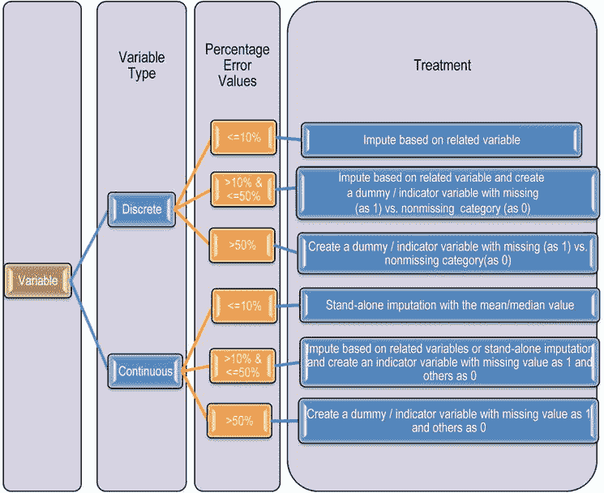

图 7-9. 如何处理缺失值与异常值

此图表可用于数据清洗。变量分为两类：离散变量和连续变量。每个变量的缺失百分比可能不同。

从实践角度来说，离散变量和连续变量中缺失值的可能百分比如下：

*   缺失值或异常值少于 10%的离散变量

*   缺失值或异常值在 10%至 50%之间的离散变量

*   缺失值或异常值超过 50%的离散变量

*   缺失值或异常值少于 10%的连续变量

*   缺失值或异常值在 10%至 50%之间的连续变量

*   缺失值或异常值超过 50%的连续变量

针对每种情况的处理方法如下。

**对于缺失值或异常值少于 10%的离散变量：**

表 7-38. 客户持有的储蓄账户数量

| 账户数量 | 客户数量 |

| --- | --- |

| 0 | 2,505 |

| 1 | 351,234 |

| 2 | 339,778 |

| 3 | 139,918 |

| 4 | 124,044 |

| 5 | 94,003 |

| 6 | 74,325 |

| 7 | 64,469 |

| 8 | 1,456 |

| `#N/A` | 34,530 |

| 总计 | 1,226,262 |

*   最好基于相关变量进行插补。由于离散变量有多个层级，独立的插补可能效果不佳。

*   以表 7-38 中“客户持有的储蓄账户数量”这一变量为例。

在客户总数中，有 34,530 名客户的数据缺失。他们持有的账户数量未知。这约占总数据的 2.8%。对数据进行的独立插补得出总体平均账户数为 2.7。可以简单地推断这 34,530 名客户每人持有三个账户，或者可以利用其他相关变量进行推断。

要选择最佳的相关变量进行插补，需要具备良好的业务洞察力。本例考虑另一个名为“信用卡持有者标识”的变量。该变量只取两个值：“是”或“否”。假设你试图使用这个标识来进行插补。这如何实现？为此，你需要更多信息。

在 1,226,262 名客户中，一些人有信用卡，一些人没有。表 7-39 仍然显示了持有 1、2、3、4 和 8 个储蓄账户的客户频数。在拥有一个储蓄账户的 351,234 名客户中，有多少人有信用卡？多少人没有任何信用卡？有 339,778 名客户拥有两个储蓄账户，那么其中有多少人有信用卡？多少人没有卡？这些问题将通过一个简单的账户数量与信用卡标识的交叉关联表来解答。

表 7-39. 拥有储蓄账户和信用卡的客户频数（数据填写于表 7-40）

|   | 信用卡持有者 | 客户数量 |

| --- | --- | --- |

| 账户数量 | 是 | 否 |   |

| 0 |   |   | 2,505 |

| 1 |   |   | 351,234 |

| 2 |   |   | 339,778 |

| 3 |   |   | 139,918 |

| 4 |   |   | 124,044 |

| 5 |   |   | 94,003 |

| 6 |   |   | 74,325 |

| 7 |   |   | 64,469 |

| 8 |   |   | 1,456 |

| `N/A` |   |   | 34,530 |

|   |   |   | 1,226,262 |

表 7-40 中显示的储蓄账户数量与信用卡标识的交叉关联表，将决定`N/A`的正确替代值是什么。

表 7-40. 拥有储蓄账户和信用卡的客户频数

|   | 信用卡持有者 | 客户数量 |

| --- | --- | --- |

| 账户数量 | 是 | 否 |   |

| 0 | 25 | 2,480 | 2,505 |

| 1 | 245,863 | 105,371 | 351,234 |

| 2 | 254,833 | 84,945 | 339,778 |

| 3 | 110,535 | 29,383 | 139,918 |

| 4 | 100,475 | 23,569 | 124,044 |

| 5 | 79,902 | 14,101 | 94,003 |

| 6 | 63,176 | 11,149 | 74,325 |

| 7 | 56,732 | 7,737 | 64,469 |

| 8 | 1,295 | 161 | 1,456 |

| `N/A` | 345 | 34,185 | 34,530 |

|   | 913,181 | 313,081 | 1,226,262 |

表 7-41 以百分比形式显示了同一张表。

表 7-41. 拥有储蓄账户和信用卡的客户频数（百分比值）

|   | 信用卡持有者 |   |

| --- | --- | --- |

| 账户数量 | 是 | 否 |

| 0 | 1% | 99% |

| 1 | 70% | 30% |

| 2 | 75% | 25% |

| 3 | 79% | 21% |

| 4 | 81% | 19% |

| 5 | 85% | 15% |

| 6 | 85% | 15% |

| 7 | 88% | 12% |

| 8 | 89% | 11% |

| `N/A` | 1% | 99% |

|   | 74% | 26% |

在每人拥有一个储蓄账户的客户总数中，70%的人至少有一张信用卡。同样，拥有四个储蓄账户的客户中，81%的人有信用卡。在储蓄账户数量为`N/A`的组中，只有 1%的人有信用卡，其余 99%的人没有任何信用卡。储蓄账户数量为 0 的组情况相同。

0 个储蓄账户和`N/A`账户的客户中，分别有 1%是信用卡持有者。因此，一个很好的解决方案是将`N/A`替换为 0，而不是使用总体均值 3。这是相对于另一个相关变量进行的插补。选择相关变量没有固定的经验法则，它取决于要解决的业务问题。

**对于缺失值或异常值在 10%至 50%之间的离散变量：**

*   在这种情况下需要执行两项任务：基于相关变量插补缺失值，以及创建一个将缺失（标记为 1）与非缺失类别区分开的虚拟/指示变量。

*   第一项任务是确保没有缺失值。由于数据中有相当一部分缺失，务必在数据中标记缺失/非缺失记录。需要创建一个新的指示变量，用于捕获变量缺失与非缺失记录的信息。该变量将在后续分析中使用。如何创建指示变量已在前面章节中解释过。第二项任务是基于相关变量插补缺失值。

## 对于缺失值或异常值超过 50%的离散变量

需要创建一个新的指示变量，并删除原始变量，因为可用的数值百分比极小，无法使用。

## 对于缺失值或异常值少于 10%的连续变量

独立的插补就足够了。

## 对于缺失值或异常值在 10%至 50%之间的连续变量

既需要创建指示变量，也需要对缺失值进行插补。

## 对于缺失值或异常值超过 50%的连续变量

创建一个指示变量，并删除原始变量。

回到案例，到目前为止的问题如下：

`RevolvingUtilizationOfUnsecuredL`（循环利用额度）是一个连续变量，约有 5%的异常值。`MonthlyIncome`（月收入）是一个连续变量，有 20%的个案存在缺失值。`NumberOfTime30-59DaysPastDueNotWorse`（逾期 30-59 天次数）、`NumberOfTime60-89DaysPastDueNotWorse`（逾期 60-89 天次数）和`NumberOfTimes90DaysLate`（逾期 90 天及以上次数）均为离散变量，其取值为 96 和 98 时存在问题，这类错误占比小于 10%。`NumberOfDependents`（家属数量）是一个离散变量，约有 2%的缺失值。

以下各节将检查每个变量存在的问题，并对其进行相应处理。

## 清洗连续变量

在前面的章节中，你在变量`RevolvingUtilizationOfUnsecuredL`中发现了异常值。现在你将尝试处理它们。

让我们从变量`RevolvingUtilizationOfUnsecuredL`（循环利用额度）开始。表 7-42 给出了该变量在`proc univariate`过程中的输出结果（取自表 7-21）。

**表 7-42.** `RevolvingUtilizationOfUnsecuredL`单变量分析的百分位数表

| 百分位数 (定义 5) |
| :--- |
| 百分位 | 估计值 |
| 100% 最大值 | 5070800% |
| 99% | 109% |
| 95% | 100% |
| 90% | 98% |
| 75% Q3 | 56% |
| 50% 中位数 | 15% |
| 25% Q1 | 3% |
| 10% | 0% |
| 5% | 0% |
| 1% | 0% |
| 0% 最小值 | 0% |

`RevolvingUtilizationOfUnsecuredL`是一个连续变量，大约有 5%的异常值。请参考图 7-10。

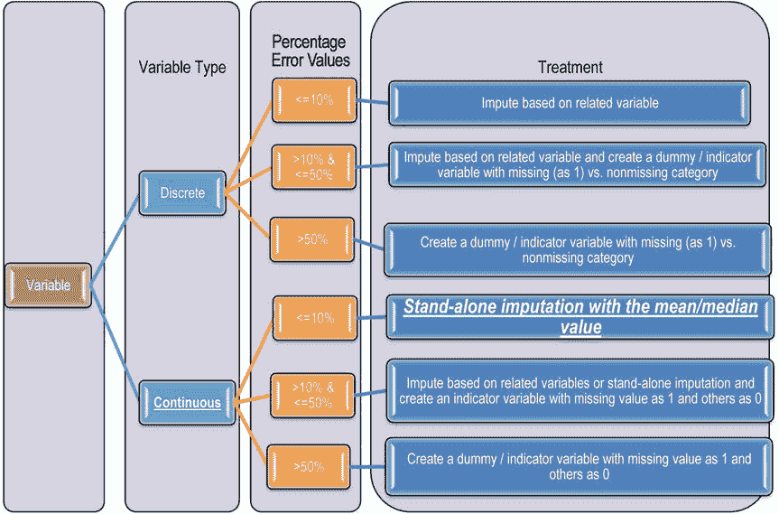

**图 7-10.** 处理含 5%异常值的连续变量

忽略异常值后的平均利用率可通过以下代码求得：

```
Title 'Proc Univariate on utilization less than or equal to 100% ';
Proc univariate data= cust_cred_raw_v1 plot;
Var RevolvingUtilizationOfUnsecuredL;
Where RevolvingUtilizationOfUnsecuredL<= 1;
run;
```

表 7-43 列出了此代码的输出。

**表 7-43.** 带有条件`RevolvingUtilizationOfUnsecuredL<=1`的`proc univariate`输出

| 基本统计量 |
| :--- |
| 位置度量 | 变异性度量 |
| :--- | :--- |
| 均值 | 0.304325 | 标准差 | 0.33852 |
| 中位数 | 0.143964 | 方差 | 0.11460 |
| 众数 | 0.000000 | 极差 | 1.00000 |
| | | 四分位距 | 0.49351 |

由于异常值已被移除，新的均值 30.4%可以作为实际的集中趋势使用。以下代码通过使用均值替换异常值来执行独立插补：

```
title 'Treating utilization ';
data cust_cred_raw_v2;
set cust_cred_raw_v1;
if RevolvingUtilizationOfUnsecuredL > 1 then utilization_new = 0.304325;
else utilization_new = RevolvingUtilizationOfUnsecuredL;
run;
```

上述代码使用数据集`cust_cred_raw_v1`创建了一个名为`cust_cred_raw_v2`的新数据集；并创建了一个名为`utilization_new`的新变量，其逻辑为：如果`RevolvingUtilizationOfUnsecuredL`大于 1（即 100%），则`utilization_new`取值为`RevolvingUtilizationOfUnsecuredL`的均值 0.304325；否则，保持原值不变。

前面代码的日志文件如下所示：

```
NOTE: There were 251503 observations read from the data set WORK.CUST_CRED_RAW_V1.
NOTE: The data set WORK.CUST_CRED_RAW_V2 has 251503 observations and 16 variables.
NOTE: DATA statement used (Total process time):
real time           0.84 seconds
cpu time            0.40 seconds
```

以下是新变量的单变量分析：

```
Title 'New utilization univariate ';
Proc univariate data= cust_cred_raw_v2 plot;
Var utilization_new;
run;
```

此代码的输出结果见表 7-44 和图 7-11。

**表 7-44.** 变量`utilization_new`的`proc univariate`输出

| UNIVARIATE 过程 变量: utilization_new |
| :--- |
| 矩 |
| :--- | :--- |
| N | 251503 | 权重总和 | 251503 |
| 均值 | 0.30432542 | 观测值总和 | 76538.7562 |
| 标准差 | 0.33479563 | 方差 | 0.11208811 |
| 偏度 | 0.9652513 | 峰度 | -0.4765405 |
| 未校正平方和 | 51483.0736 | 校正平方和 | 28190.3844 |
| 变异系数 | 110.012377 | 均值的标准误差 | 0.00066759 |

| 基本统计量 |
| :--- |
| 位置度量 | 变异性度量 |
| :--- | :--- |
| 均值 | 0.304325 | 标准差 | 0.33480 |
| 中位数 | 0.153575 | 方差 | 0.11209 |
| 众数 | 0.000000 | 极差 | 1.00000 |
| | | 四分位距 | 0.47923 |

| 位置检验: Mu0=0 |
| :--- |
| 检验 | 统计量 | p 值 |
| :--- | :--- | :--- |
| Student t | t | 455.8585 | Pr> &#124;t&#124; | <.0001 |
| 符号 | M | 116657 | Pr>= &#124;M&#124; | <.0001 |
| 符号秩 | S | 1.361E10 | Pr>= &#124;S&#124; | <.0001 |

| 百分位数 (定义 5) |
| :--- |
| 百分位 | 估计值 |
| :--- | :--- |
| 100% 最大值 | 1.00000000 |
| 99% | 0.99999990 |
| 95% | 0.99999990 |
| 90% | 0.93255772 |
| 75% Q3 | 0.50920204 |
| 50% 中位数 | 0.15357490 |
| 25% Q1 | 0.02997462 |
| 10% | 0.00299276 |
| 5% | 0.00000000 |
| 1% | 0.00000000 |
| 0% 最小值 | 0.00000000 |

# 数据清洗与缺失值处理

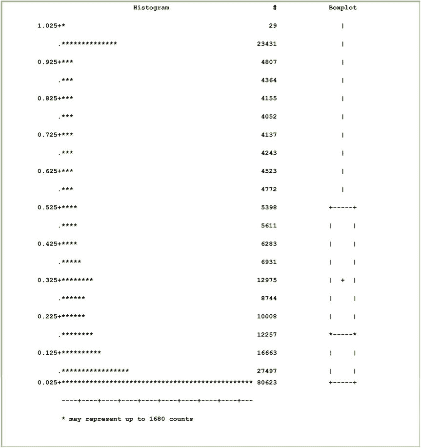

图 7-11. `utilization_new`变量的箱线图

| 极端观测值 |
| --- |
| 最小值 | 最大值 |
| :--- | :--- |
| 值 | 观测序号 | 值 | 观测序号 |
| :--- | :--- | :--- | :--- |
| 0 | 251479 | 1 | 224166 |
| 0 | 251455 | 1 | 228890 |
| 0 | 251452 | 1 | 231077 |
| 0 | 251438 | 1 | 238536 |
| 0 | 251434 | 1 | 244591 |

此后分析将使用`utilization_new`变量。异常值问题现已解决。在下一节中，你将处理有 20%缺失值的`MonthlyIncome`变量。

## 处理月收入

月收入是一个连续变量，且数据中 20% 的值为缺失值。请参考图 7-12。

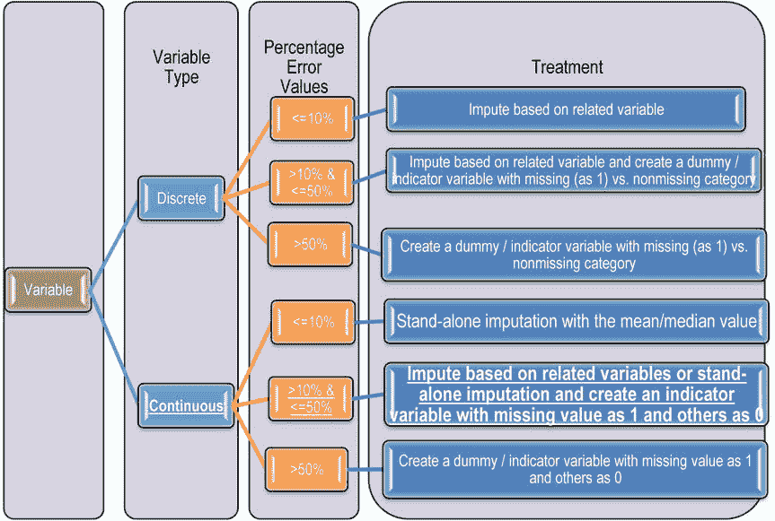

图 7-12 处理包含 20% 缺失值的连续变量

由于月收入是连续变量且缺失了 20% 的值，需要创建一个月收入指示变量，并使用中位数对缺失值进行填补，如下列代码所示：

```
title 'Treating Monthly income ';
data cust_cred_raw_v2;
set  cust_cred_raw_v2;
if    MonthlyIncome_new = . then    MonthlyIncome_ind = 1 ;
else MonthlyIncome_ind = 0 ;
run ;
```

上述代码创建了一个名为`MonthlyIncome_ind`的新变量，当`MonthlyIncome_new`为`.`（缺失值）时，该变量取值为 1，否则为 0。

以下代码创建了一个名为`MonthlyIncome_final`的新变量，当`MonthlyIncome_new`为`.`（缺失值）时，该变量取值为`5400`。否则，新变量与原变量保持一致。此操作仅用中位数替换了缺失值。

```
data cust_cred_raw_v2;
set  cust_cred_raw_v2;
if    MonthlyIncome_new = . then    MonthlyIncome_final= 5400.000 ;
else MonthlyIncome_final = MonthlyIncome_new;
run;
```

现在，在下面的代码中，你将对该月收入变量进行处理后的单变量分析。一切看起来都步入了正轨。

```
title 'Univariate Analysis on Final  Monthly income ';
Proc univariate data= cust_cred_raw_v2 ;
Var MonthlyIncome_final;
run ;
```

表 7-45 展示了这段代码的输出结果。

表 7-45 解决缺失值问题后的月收入（对`MonthlyIncome_final`执行`PROC UNIVARIATE`的结果）

| UNIVARIATE 过程 变量：MonthlyIncome_final |
| --- |
| 矩 |
| --- |
| N | 251503 | 权重总和 | 251503 |
| 均值 | 6383.21654 | 观测值总和 | 1605398110 |
| 标准差 | 7847.22102 | 方差 | 61578877.8 |
| 偏度 | 40.4062915 | 峰度 | 3036.58327 |
| 未校正平方和 | 2.57348E13 | 校正平方和 | 1.54872E13 |
| 变异系数 | 122.935216 | 均值标准误差 | 15.6474762 |
| 基本统计度量 |
| --- |
| 集中趋势 | 离散程度 |
| --- | --- |
| 均值 | 6383.217 | 标准差 | 7847 |
| 中位数 | 5400.000 | 方差 | 61578878 |
| 众数 | 5400.000 | 极差 | 835040 |
|   |   | 四分位距 | 3485 |
| 位置检验：Mu0=0 |
| --- |
| 检验 | 统计量 | p 值 |
| --- | --- | --- |
| Student t | t | 407.939 | Pr>&#124;t&#124; | <.0001 |
| 符号检验 | M | 124424.5 | Pr>= &#124;M&#124; | <.0001 |
| 符号秩检验 | S | 1.548E10 | Pr>= &#124;S&#124; | <.0001 |
| 分位数（定义 5） |
| --- |
| 分位数 | 估计值 |
| --- | --- |
| 100% 最大值 | 835040 |
| 99% | 23250 |
| 95% | 13500 |
| 90% | 10700 |
| 75% 上四分位数 Q3 | 7385 |
| 50% 中位数 | 5400 |
| 25% 下四分位数 Q1 | 3900 |
| 10% | 2348 |
| 5% | 1516 |
| 1% | 0 |
| 0% 最小值 | 0 |
| 极端观测值 |
| --- |
| 最小值 | 最大值 |
| --- | --- |
| 值 | 观测序号 | 值 | 观测序号 |
| --- | --- | --- | --- |
| 0 | 251388 | 702500 | 93565 |
| 0 | 251374 | 729033 | 151133 |
| 0 | 251359 | 730483 | 123292 |
| 0 | 251305 | 772700 | 174163 |
| 0 | 251300 | 835040 | 122544 |

月收入变量现已清理完毕。从现在开始，我们可以使用这两个新变量进行分析。

## 逾期 30-59 天

逾期 30-59 天、逾期 60-89 天以及逾期 90 天均为离散变量。它们存在值为 96 和 98 的问题。此类错误的比例低于 10%。图 7-13 给出了解决方案。

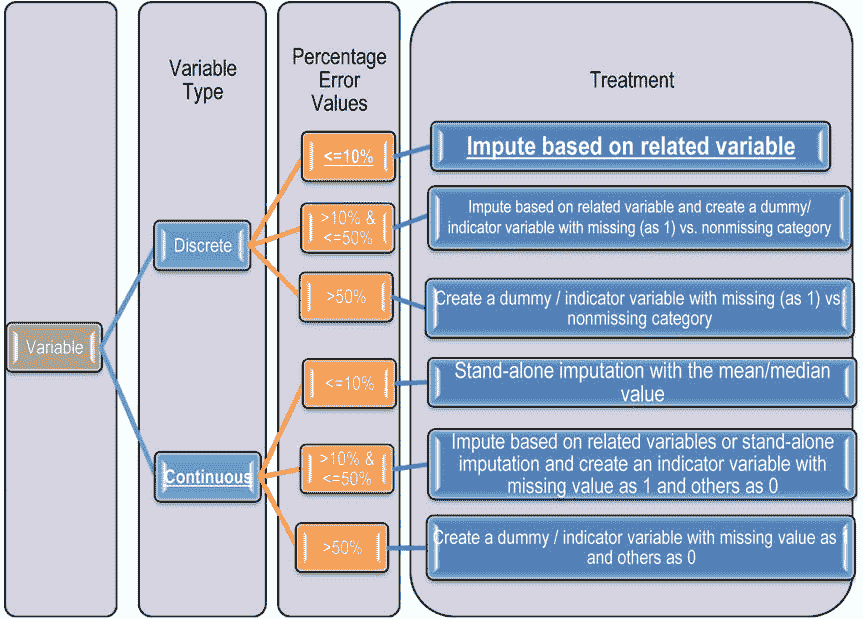

图 7-13 处理错误值比例低于 10% 的离散变量

对该变量的处理方法是基于一个相关变量进行填补。经验/观察表明，逾期 30 天与严重拖欠（即目标变量，也是最重要的变量）的组合分布情况。以下代码计算了严重拖欠（不良指标）与逾期 30 天的交叉列联表频率：

```
Title 'Cross tab frequency of NumberOfTime30_59DaysPastDue1 and SeriousDlqin2yrs';
proc freq data=cust_cred_raw_v2;
tables NumberOfTime30_59DaysPastDueNotW*SeriousDlqin2yrs;
run ;
```

表 7-46 是上述代码的输出结果。

表 7-46 `NumberOfTime30_59DaysPastDueNotW`与`SeriousDlqin2yrs`的交叉列联表频率

| 频率 行百分比 列百分比 | NumberOfTime30_59DaysPastDueNotW 与 SeriousDlqin2yrs 的列联表 |
| --- | --- |
| NumberOfTime30_59DaysPastDueNotW | SeriousDlqin2yrs |
| --- | --- |
| 0 | 1 | 合计 |
| --- | --- | --- |
|   | 0 | 120977 | 5041 | 126018 |
| 80.65 | 3.36 | 84.01 |
| 96 | 4 |   |
| 86.43 | 50.28 |   |
| 1 | 13624 | 2409 | 16033 |
| 9.08 | 1.61 | 10.69 |
| 84.97 | 15.03 |   |
| 9.73 | 24.03 |   |
| 2 | 3379 | 1219 | 4598 |
| 2.25 | 0.81 | 3.07 |
| 73.49 | 26.51 |   |
| 2.41 | 12.16 |   |
| 3 | 1136 | 618 | 1754 |
| 0.76 | 0.41 | 1.17 |
| 64.77 | 35.23 |   |
| 0.81 | 6.16 |   |

交叉列联表频率显示了该值对应的整体频率、整体百分比、行百分比和列百分比。类别 98 中（逾期客户的）百分比为 45.83，与之百分比最接近的组是类别 6，即 47.14。因此，类别 98 中的不良率为 54%，与之不良率最接近的组是类别 6，其不良率为 52.8%。由于没有其他组别的不良率与该组相似，因此对于 98 合适的替代值将是 6。鉴于类别 6 是可接受的，且其不良率为 52.8%，因此可以安全地将 98 替换为 6。由于类别 96 中仅有 5 个观测值，因此可以将 96 和 98 都替换为 6。

以下代码简单地创建了一个新变量，当逾期 30 天的值为 96 或 98 时，该变量取值为 6。否则，该变量与逾期 30 天的值相同。

```sas
title 'Treating 30DPD';
data cust_cred_raw_v2;
set   cust_cred_raw_v2;
if    NumberOfTime30_59DaysPastDueNotW in ( 96 , 98 ) then    NumberOfTime30_59DaysPastDue1= 6 ;
else  NumberOfTime30_59DaysPastDue1= NumberOfTime30_59DaysPastDueNotW;
run ;
```

在前面的代码中，基于`NumberOfTime30_59DaysPastDueNot`创建了一个名为`NumberOfTime30_59DaysPastDue1`的新变量。当`NumberOfTime30_59DaysPastDueNotW`取值为 96 或 98 时，新变量取值为 6。否则，它与原变量保持一致。

以下是日志文件和输出：

```
NOTE: There were 251503 observations read from the data set WORK.CUST_CRED_RAW_V2.
NOTE: The data set WORK.CUST_CRED_RAW_V2 has 251503 observations and 19 variables.
NOTE: DATA statement used (Total process time):
      real time           0.60 seconds
      cpu time            0.49 seconds
```

新变量现已无错误。以下代码对变量`NumberOfTime30_59DaysPastDue1`运行`PROC FREQUENCY`：

```sas
Proc freq data=cust_cred_raw_v2;
tables NumberOfTime30_59DaysPastDue1;
run;
```

表 7-47 给出了该代码的输出。

**表 7-47.** 对`NumberOfTime30_59DaysPastDue1`执行`proc freq`的输出

| `NumberOfTime30_59DaysPastDue1` | 频数 | 百分比 | 累积频数 | 累积百分比 |
| :--- | :--- | :--- | :--- | :--- |
| 0 | 211208 | 83.98 | 211208 | 83.98 |
| 1 | 26870 | 10.68 | 238078 | 94.66 |
| 2 | 7766 | 3.09 | 245844 | 97.75 |
| 3 | 2955 | 1.17 | 248799 | 98.92 |
| 4 | 1257 | 0.50 | 250056 | 99.42 |
| 5 | 547 | 0.22 | 250603 | 99.64 |
| 6 | 711 | 0.28 | 251314 | 99.92 |
| 7 | 96 | 0.04 | 251410 | 99.96 |
| 8 | 53 | 0.02 | 251463 | 99.98 |
| 9 | 22 | 0.01 | 251485 | 99.99 |
| 10 | 11 | 0.00 | 251496 | 100.00 |
| 11 | 2 | 0.00 | 251498 | 100.00 |
| 12 | 3 | 0.00 | 251501 | 100.00 |
| 13 | 1 | 0.00 | 251502 | 100.00 |
| 19 | 1 | 0.00 | 251503 | 100.00 |

类似地，其余变量可以使用图 7-13 中描绘的处理图表进行处理。一旦我们处理完所有变量并完成所有探索、验证和清洗步骤，数据就可以用于分析了。

**注意**

图 7-13 中展示的先前处理图表仅具有建议性；也可以使用略微不同的异常值处理方法。当异常值占比为 10%到 50%时，可以将其视为一个不同的类别，或者从总体中抽取一个子集。这取决于手头的问题目标。

## 结论

本章涵盖了探索和验证数据的各种方法，还涉及识别数据中的问题，然后使用插补技术来解决这些问题。如您所见，数据清洗需要花费大量时间。在分析中使用垃圾数据只会导致无用的见解。此处提供的方法是指导原则而非硬性规则，它们源自我们在此领域的工作经验。在准备用于分析的数据时，运用智慧和合理性判断非常重要。因此，需要给予数据清洗与数据分析同等程度的重视。准备用于分析的数据是分析的第二步。后续章节将探讨分析和预测建模技术。

