# 13. 大数据分析入门

至此，你已经阅读了关于商业分析的 12 个章节，现在能够理解构成这一领域的理论与实务。但学习的脚步永不停歇，尤其是在这样一个快速发展的领域。到现在，你可能已经意识到`大数据`正迅速流行起来。越来越多的组织，尤其是那些拥有大量访客流量的在线组织，每天都在产生前所未有的数据量，这些数据用传统技术几乎无法处理。

我们在第 1 章中对此略有提及，在本书的最后一章中，我们将扩展你的认知，让你能够领略大数据领域，并了解该领域专家们使用的工具和技术。

### 传统数据处理工具

在日常工作中，你可能会使用以下一种或多种工具：

- 文本编辑器/记事本：用于修改少量数据
- `Microsoft Excel`：用于简单和中等程度的计算
- `Microsoft Access/SQL`：用于存储和查询关系型数据
- `SAS/R`：用于高级分析
- `Tableau/QlikView`：用于数据可视化和报告

你是否曾尝试用记事本打开一个 2GB 的文件？你是否处理过 4GB 的 `Excel` 文件？首先，有可能创建一个 4GB 的 `Excel` 文件吗？查询一个 10GB 的数据库需要多长时间？你是否曾对 20GB 的数据集执行过回归分析之类的分析操作？`SAS` 或 `R` 在处理 20GB 数据时能否像处理相对较小的数据集那样高效？我们将提供一些例子，让你了解我们为何提出这些问题。

### 沃尔玛客户数据

大约有 2.45 亿活跃客户和会员光顾沃尔玛，这些交易发生在 27 个国家的 71 个品牌下的 11,000 家门店，这其中包括其电子商务网站 (`http://corporate.walmart.com/our-story/`)。假设沃尔玛想了解其客户上个月的购买模式。让我们粗略估算一下沃尔玛一个月会产生多少数据。以下计算可能是一个保守的估计：

```
(245,000,000 客户) × (每月 2 次访问) × (每次购买 20 件商品) = 9,800,000,000 行
```

一个月内可能有高达 98 亿行数据。对于每一行，沃尔玛都必须记录诸如日期戳、商品 ID、商品数量、商品价格、净价等详细信息。再次采用保守方法，假设每行至少有 6 列。那么一个包含 98 亿行和 6 列的文件大小会是多少？一般来说，对于一个有 10,000 行、每行 6 列的 CSV 或 TXT 文件，文件大小大约在 210KB 左右。基于此，一个包含 98 亿行的类似文件大小将约为 196GB。而这仅仅是基于账单交易的一个月保守估算。再想想客户的过往购买数据、人口统计数据、产品详情、门店详情等等。任何客户分析所需考虑的基础文件都将远大于我们估算的 196GB。

### Facebook 数据

假设 `Facebook`（或同等规模的社交网络）想要构建一个高效的在线广告引擎。根据用户画像，`Facebook` 希望在每个网页上展示最相关的广告，或者想要改进其信息流（News Feed）。我们来估算一下 `Facebook` 一个月内生成的最低数据量。

`Facebook` 拥有超过 10 亿用户，其中日活跃用户为 8.64 亿。为简单起见，我们将用户活动（如分享、点赞、状态更新、上传图片、登录和登出等）统一视为一次活动。考虑以下保守计算：

```
(864,000,000 用户) × (每月 30 次活动) = 25,920,000,000 行
```

一个包含 259.2 亿行、6 列（例如）的文件，大小可能在 510GB 左右。如果 `Facebook` 想要为其广告引擎进行任何有意义的分析，它至少需要处理这个量级的数据。这只是一个模拟示例，旨在让您对过程中涉及的数据量有一个直观感受。

请注意，沃尔玛和 `Facebook` 在数据量方面的估算都是保守的。实际涉及的数据规模可能要大得多。一些真实的业务场景可能需要您处理 PB 级的数据。什么是 PB？请参考表 13-1。

表 13-1. 数据单位

| 单位度量 | 换算关系 |
| --- | --- |
| 1GB 吉字节 | 1024MB |
| 1TB 太字节 | 1024GB |
| 1PB 拍字节 | 1024TB = 1024GB × 1024GB = 1,048,576GB |

举个例子，一张典型的 DVD 存储约 4.7GB 数据。要存储 1PB 的数据，您需要 223,101 张 DVD。

### 数据规模不断增长的实例

一些企业实时生产和分析的数据量，有时甚至超乎我们的想象。

- 沃尔玛拥有一个超过 2.5 PB 数据的数据库。
- `Facebook` 每天处理 300 PB 的数据。
- 谷歌每天处理近 200 PB 的数据。
- NASA 存储和处理约 32 PB 的气候数据及相关模拟结果。
- 欧洲核子研究中心（CERN）的大型强子对撞机（LHC）在 2012 年产生了 30TB 的数据。

到现在，您可能已经清楚，传统工具无法处理如此庞大的数据量。大数据真的就意味着数据量大吗？大数据的定义是什么？

## 什么是大数据？

大数据没有标准的定义。以下是互联网上流传的一些定义：

- 任何难以用常规或传统数据处理工具处理的数据集都被称为大数据。
- 难以捕获、存储、处理、搜索、查询、传输、分析和可视化的数据被称为大数据。
- 大数据是一个复杂、多样、快速增长且庞大的数据集，需要新的架构、技术和算法来分析它。
- 大数据是一个可以被分析和挖掘以获取洞见的数据集，但因其规模、复杂性和增长速度，传统工具无法处理它。

接下来的两个部分基本上是对第 1 章中所讨论内容的修订。

### 大数据的三个主要组成部分

大数据不仅仅关乎规模，尽管数据量是传统工具在处理它时失效的一个重要因素。大数据主要有三个组成部分：体量（Volume）、多样（Variety）和速度（Velocity）。传统的方法和工具在数据处理方面有其自身的局限性。以下要点进一步阐述了这些特性中的每一个：

表 13-2. 大数据与常规数据对比

| 大数据 | 普通或常规数据 |
| --- | --- |
| 庞大的数据集。 | 数据集规模可控。 |
| 非结构化数据，如文本、视频和音频。 | 通常是结构化数据，如数字和类别，但也可能采用其他形式。 |
| 难以执行的查询和分析。 | 相对易于执行的查询和分析。 |
| 需要新的分析方法论。 | 可以使用常规方法进行数据分析。 |
| 需要 `Apache Hadoop`、`Hive`、`HBase`、`Pig`、`Sqoop` 等工具来处理大数据。 | 仅使用 `SQL`、`SAS`、`R` 和 `Excel` 等工具可能就足以处理传统数据。 |
| 原始事务数据。 | 聚合、抽样或过滤后的数据。 |
| 用于报告、基础分析和文本挖掘。高级分析在大数据中仍处于起步阶段。 | 用于报告、高级分析和预测建模。 |
| 大数据分析需要编程技能（如 `Java`）和分析技能来执行分析（就目前而言）。 | 对于常规数据，分析技能已足够；高级分析工具不需要专业的编程技能。 |
| PB/EB 级数据。数百万/数十亿账户。数十亿/万亿笔交易。 | MB/GB 级数据。数千/数百万账户。数百万笔交易。 |
| 由大型金融机构、`Facebook`、谷歌、亚马逊、eBay、沃尔玛等产生。 | 主要由小型企业产生。 |

- **体量**：在大数据分析中，数据本身的规模巨大，以至于几乎不可能处理。到目前为止，我们已经提到了几个例子，再补充一些，信用卡公司的事务数据、移动电话公司的通话数据以及像亚马逊这样的大型零售商的账单数据都属于此类。规模被认为是定义大数据的首要特征。

- **多样**：我们如今生成的数据类型不仅限于结构化的数值表格数据。例如，电信公司的音频文件、无数闭路摄像头的视频文件以及众多网站的博客数据。所有这些都属于非常规数据类型。此类别中的其他数据包括文本、数值数据、序列、时间序列、多维数组、`XML`、静态图像和社交媒体数据。这些类型的数据可能会与常规数据混合在一起。为此类数据准备分析显然并不简单。

- **速度**：数据每天都在快速增长。在某些情况下，数据增长如此之快，以至于我们没有足够的时间去分析它。想象一下一级方程式赛车的场景。我们 invariably 会在每辆超级赛车上安装一些传感器。分析这些传感器收集的数据，以便为下一圈提出改进建议。我们不可能，例如，花费三个月的时间来转换数据、为分析做准备、构建模型并最终验证它，以便在此基础上提出有用的建议。所有这些都必须在下一圈开始之前完成。这类分析甚至还会用到来自赛车传感器的实时数据流。表 13-2 比较了大数据与常规数据。此处引自第 1 章以便随时参考。

现在您知道大数据是复杂、庞大且快速增长的。同时，传统工具几乎无法处理这类数据。我们为什么真正需要分析大数据？难道我们不能简单地使用聚合数据或样本数据集，并坚持使用传统技术和工具吗？大数据分析在现实生活中有哪些应用？下一节将回答所有这些问题。

### 大数据分析的应用

不久之前，以电子形式发送数据还不是普遍做法。我们过去常常将所有数据以纸质形式邮寄，整理成文件夹和捆包。随着计算机、智能手机和其他设备的出现，我们能够存储和处理海量数据。如今，数据正呈指数级增长。已有一些聪明的公司利用这些海量可用数据为自己谋利。以下是一些例子：

# 大数据问题的解决方案

传统数据处理技术为何在处理大数据时失败，原因显而易见。常规工具将整个数据集视为一个单元。这样一来，处理 PB 级的数据将非常困难。有时甚至无法将大数据文件保存在一台机器上。我们需要拥有多个处理器的巨型超级计算机，才能用一台机器处理大数据。超级计算机并非简单的机器，其成本高达数百万美元。应对大数据挑战的解决方案是，使用计算机网络（例如局域网）连接多台计算机，编写代码的方式使得每台计算机都能独立理解和执行，最后将结果汇总成一个输出。这种技术称为分布式计算。

## 分布式计算

即使在今天，处理大数据时，对强大计算能力的需求有时仍被列为一项主要限制。分布式计算在此类情况下表现良好。它遵循“分而治之”的原则。你不是将整个庞大数据集视为一个单一单元，而是可以将其切割成多个小块或小数据块。然后，你可以将这些相对较小的数据块保存到一组或一个计算设备网络中。这个网络中的每台计算机被称为一个`节点`。将数据分布到集群装置上是分布式计算的第一部分。第二部分是调整代码以适应这类计算机集群。以下几点总结了处理大数据的分布式计算方法：
- 将整体问题分解为更小的任务，并在多台独立计算机上执行这些小任务。这意味着将数据划分为更小的数据块，并将这些数据块存储在集群中的各个`节点`上。
- 汇总所有独立机器的结果，并输出一个整合后的结果。

让我们以 Facebook 或类似的社交网站为例。一天之内，这个社交网站上会发生数十亿次活动。假设你想获取一天内状态更新的数量。想象一下，整个状态更新文件大小为 500GB。下面可能是用于计算状态更新总数的简单 SQL 代码：
```
Select count(*) from feb_status /* feb_status 是状态更新数据集的名称 */
```
这段代码会将整个 500GB 文件视为一个单元，并且可能会花费异常长的时间。如果你用一个由 20 台计算机组成的网络，将 500GB 文件分成 10,000 个每个 50MB 的小块会怎样？你可以将这 10,000 个独立的数据块存储在这 20 台计算机上。这样做，你就把一个大计算任务分配到了 20 台机器上。每台计算机可以本地计算状态更新的数量，然后汇总计数数据，得到所需的整合后的状态更新总数。所有 20 台机器都在独立的数据块上并行工作。如果使用传统方法和一台机器，整个计算任务需要 20 小时，那么很自然地可以预期，采用这种分而治之的策略，只需要一个小时或更少的时间就能完成。实际上，使用分布式计算，完成整个任务所需的时间将远少于一个小时。

一台超级计算机也能高效地完成同样的任务。但总的来说，与一台大型超级计算机高昂的成本相比，即使是中小型企业也能负担得起一个由 20 台个人电脑组成的集群。此外，当没有大数据文件需要分析时，这 20 台个人电脑还可以用于其他商业用途。另一方面，超级计算机只适用于高端任务，而这些任务可能并非总是存在。

这种将一个大计算任务分解成更小的任务，并汇总中间结果以生成最终结果的编程模型被称为`MapReduce`编程模型。

# 什么是 MapReduce？

在分布式计算中，目标是解决一个全局性问题。你编写一个程序，将这个全局任务分解成更小的任务，并最终将这些任务分配给组成集群的各个独立机器。这个分解程序被称为`map`函数。一旦你完成了本地机器上的任务，你再编写另一个程序，汇总来自各个`map`函数的结果，以生成最终的整合结果。这个汇总函数被称为`reduce`函数。我们将在以下章节讨论每个函数。

## Map 函数

`map`函数会在所有独立的数据块上本地执行。`map`函数的结果以键值对的形式输出。来自不同`map`函数的这些键值对携带着中间结果。通常，任何一个单独的`map`函数都与整体任务类似。唯一的区别是规模，`map`函数的规模要小得多。`map`函数的输出被用作`reduce`函数的输入。

## Reduce 函数

`reduce`函数获取来自`map`函数的中间结果，并创建最终输出。由`map`函数生成的键值对会在`reduce`函数中进行排序和聚合。`reduce`函数并不作用于独立的数据块。实际上，它不与原始输入数据交互，原始输入数据只被提供给`map`函数。

图 13-1 展示了一个 reduce 示意图，解释了用于处理大数据的整体`MapReduce`编程模型。这是一种处理大数据的经济高效的模型。

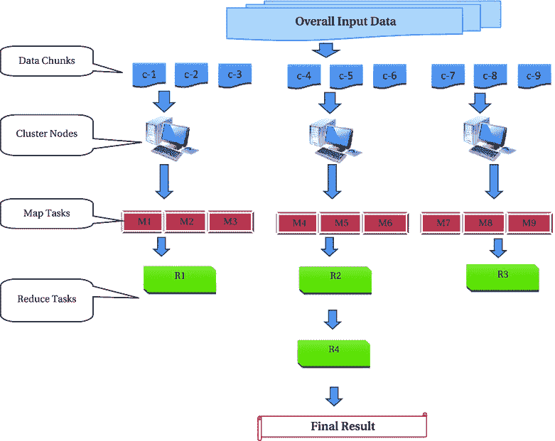

*图 13-1. `MapReduce` 如何处理大数据问题*

除了`MapReduce`编程模型，以下流程也需要你的关注：
- **集群搭建**：你通过创建一个由独立机器组成的网络来搭建一个集群。你可能需要系统管理员的帮助来搭建集群。
- **任务分配**：选择一些`节点`作为从`节点`，分配`map`任务，随后再分配`reduce`任务。你需要编写一个单独的函数来将工作分配给各个`节点`。
- **任务调度**：创建一个主`节点`，它将跟踪所有的`MapReduce`任务，即负责调度。你不能从`reduce`任务开始。但这并不意味着你需要等待所有`map`任务都完成。你可能需要编写一些单独的代码来进行任务调度。
- **负载均衡**：会有挑战，例如集群中某个系统很慢。集群中的某些`节点`配置可能很好。为了达到期望的效率，你需要根据`节点`的容量来分配任务。这也可能需要你编写负载均衡的函数。
- **容错性**：如果其中一个`节点`突然宕机怎么办？有没有办法恢复该`节点`中的数据？或许将那个特定的数据块复制到另一台机器上并用作备份是个好主意。因此，在分发数据时，你可能还需要考虑数据复制的问题。

看起来`MapReduce`是解决大数据问题的一个方案，但正如你所见，有太多复杂且相互关联的任务，使得普通程序员难以尝试。你需要多种技能才能使用`MapReduce`编程模型来解决大数据问题。如果能有一个现成的框架来处理搭建集群、添加和删除`节点`、分配工作、调度任务、负载均衡、容错等问题，那就太好了。Apache Hadoop 就是一个这样流行的框架。Hadoop 是开源的，对于那些想要专注于`MapReduce`的人来说，它是一笔意外之财。

## 什么是 Apache Hadoop？

Hadoop 框架正是为了解决使用 `MapReduce` 编程模型进行分布式计算时所遇到的诸多挑战而生的。Hadoop 框架是一个基于 Linux 操作系统构建的开源工具。

Hadoop 是一个框架。它是一个用于编写和执行 `MapReduce` 及其他大数据任务的简化平台。Hadoop 有两个主要组件：Hadoop 分布式文件系统（`HDFS`）和 `MapReduce`。我们将在以下章节详细探讨这两个组件。

让我们明确几个事实。

- Hadoop 不是数据库。
- Hadoop 不是大数据的同义词。
- Hadoop 不是一种编程语言。

### Hadoop 分布式文件系统

在分布式计算和 `MapReduce` 的世界中，不应存在异常大的文件。所有大文件都会被切分成小块。Hadoop 中的文件系统被称为 Hadoop 分布式文件系统（`HDFS`）。该系统中的每个文件大小不超过 64MB。当你将任何文件从外部传输到 `HDFS` 时，它会被分割成 64MB 的块。在集群环境下，`HDFS` 会将文件切分成块并分发到集群内的不同节点。你可以将 `HDFS` 想象成一个将数据切分成小块的切割器。有了它，开发者无需担心数据的划分和分发。你只需要将文件从本地文件系统复制到 `HDFS`。事实上，`HDFS` 甚至会处理诸如数据块位置等细节。数据块会有副本；如果一个系统宕机，则会使用副本数据块。图 13-2 展示了 `HDFS` 如何分发数据。

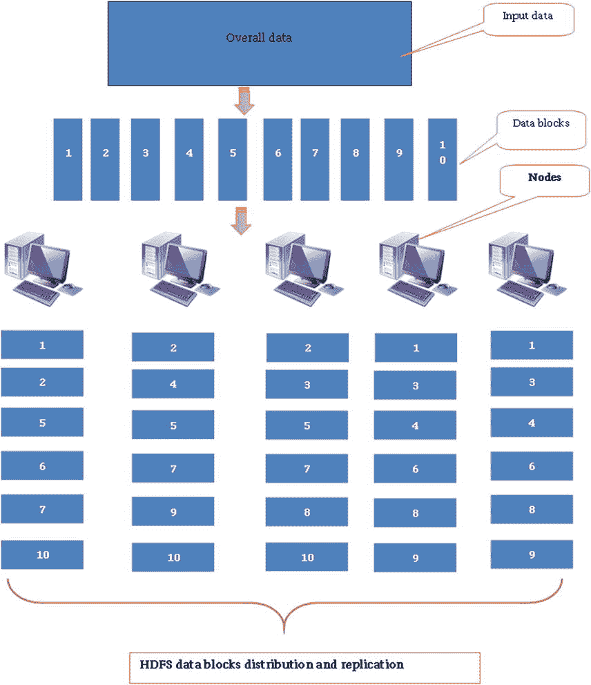

图 13-2. HDFS 如何分发数据

在图 13-2 中，每个块都被复制了三份。默认情况下，每个块大小为 64MB，并且在网络上会复制三份。

### MapReduce

`MapReduce` 是一种并行处理编程模型。与 `HDFS` 协同工作时，`MapReduce` 代码块在本地位置执行。`HDFS` 包含所有数据块及其相关信息。`MapReduce` 包含所有任务相关信息。`MapReduce` 和 `HDFS` 共同处理大数据，几乎毫不费力。Hadoop 框架负责协调 `MapReduce` 代码与 `HDFS` 数据块之间的协作。在 Hadoop 中，`MapReduce` 代码块需要用 `Java` 语言编写。它针对每个本地数据块执行 `map` 代码，并执行 `reduce` 代码进行整合。

除了这两个主要组件，Hadoop 框架在以下过程中也发挥着关键作用：

- **集群轻松构建**：Hadoop 允许用户快速设置集群网络。Hadoop 使得在不影响网络其他部分的情况下添加或移除节点变得极其简单。在 Hadoop 框架上，这就像添加或删除一个 IP 地址一样容易。没有 Hadoop，建立计算机集群并维护其进行一致性处理可能并不容易。

- **存储轻松实现**：Hadoop 选择一个节点作为主节点，称为名称节点（`NameNode`）。其余节点是从节点，称为数据节点（`DataNode`）。数据节点包含实际的数据块，而名称节点包含关于数据节点和数据块位置的信息（基本上是元数据）。Hadoop 提供了选择哪些机器作为主节点和从节点的选项。

- **作业调度轻松完成**：Hadoop 自动处理作业编排。`MapReduce` 会有多个需要在数据节点上执行的 `map` 和 `reduce` 任务。为了管理所有资源，Hadoop 有一个作业跟踪器（`JobTracker`）和任务跟踪器（`TaskTracker`）。作业跟踪器与主节点协同工作，其主要功能是将作业分配给多个任务跟踪器。任务跟踪器运行在不同的数据节点上。任务跟踪器将结果呈现给作业跟踪器并报告作业状态。

- **容错机制**：任务跟踪器定期向作业跟踪器发送一些心跳信号。这有助于作业跟踪器了解每个任务跟踪器的状态，即它是存活还是已宕机。如果作业跟踪器因故未收到某个任务跟踪器的心跳信号，它会迅速将任务分配给另一个运行在副本数据块上的任务跟踪器。

- **负载均衡**：Hadoop 会自动运行一些备份作业。如果一个节点很慢，并且拖慢了整个 `MapReduce` 进程，那么作业跟踪器会将那个特定任务分配给其他高速节点，从而减少分配给慢速机器的任务数量。

你可以看到，Hadoop 会自动处理许多与大数据处理相关的细节。所有这一切都以熟练的方式处理。开发者无需担心集群管理、可扩展性、容错、作业调度、负载均衡、数据分发等问题。此外，Hadoop 是免费且开源的。有关 Hadoop 的一些有用资源，请参考表 13-3。

**表 13-3. Hadoop 相关资源**

| Hadoop 徽标 |  |
| :--- | :--- |
| Hadoop 主页 | [`http://hadoop.apache.org/`](http://hadoop.apache.org/) |
| Hadoop 文档 | [`http://hadoop.apache.org/docs/current/`](http://hadoop.apache.org/docs/current/) |
| Hadoop 下载页面 | [`http://hadoop.apache.org/releases.html`](http://hadoop.apache.org/releases.html) |

Hadoop 框架简化了许多任务。它自动处理了分布式计算中的许多关键组件。即使对于专业程序员来说，编写、调试和维护关键代码组件也可能很困难。核心的 `MapReduce` 编程以及与其他 Hadoop 组件的交互使用 `Java` 编程语言；你需要对 `Java` 编程有一定程度的熟悉才能有效地使用 Hadoop。代码算法的逻辑需要针对 `MapReduce` 编程模型进行调整。传统的 `Java` 代码以传统方式产生结果，但可能与 `HDFS` 和 `MapReduce` 的方式不同。如果有一些工具能够自动将你的传统 `SQL` 脚本或命令转换为 `MapReduce` 所需的格式，那岂不是很好？幸运的是，Hadoop 生态系统中提供了一些工具，可以帮助你简化 `MapReduce` 编程。Apache 的 `Hive`、`Pig`、`Sqoop` 和 `Mahout` 是其中几个重要的工具。以下各节将详细介绍。

### Apache Hive

`Hive` 是数据仓库软件。你可以将其安装在 Hadoop 之上。`Hive` 会自动将传统的类 `SQL` 查询转换为 `MapReduce` 代码。查询使用 `Hive` 查询语言（`HiveQL`）编写。`HiveQL` 类似于 `SQL`，对于数据分析师基于大数据生成一些基本商业智能（`BI`）报告非常有用。`Hive` 不能脱离 `HDFS` 和 `MapReduce` 独立工作。`Hive` 最初由 Facebook 开发，后来公开发布。许多数据分析师使用 `Hive` 进行数据汇总、报告和分析。有关 `Hive` 的一些基本资源，请参考表 13-4。

**表 13-4. Hive 相关资源**

| Hive 徽标 |  |
| :--- | :--- |
| Hive 主页 | [`http://hive.apache.org/`](http://hive.apache.org/) |
| Hive 文档 | [`https://cwiki.apache.org/confluence/display/Hive/LanguageManual`](https://cwiki.apache.org/confluence/display/Hive/LanguageManual) |
| Hive 下载页面 | [`http://hive.apache.org/downloads.html`](http://hive.apache.org/downloads.html) |

### Apache Pig

`Pig` 是一种主要用于提取、转换和加载（`ETL`）操作的软件。`Pig` 提供了一个用于并行执行数据流的引擎。类似于 `Hive`，`Pig` 也运行在 Hadoop 之上。你需要编写 `Pig Latin` 脚本来与 `Pig` 工具进行交互。`Pig Latin` 脚本比 `Java MapReduce` 代码要简单得多。可以编写 `Pig Latin` 脚本来执行诸如 `join`、`sort`、`filter`、`load`、`transform` 等数据处理操作。`Pig` 更偏向于数据处理和操作工具，而非数据分析工具。`Pig Latin` 可以进行扩展，以使用自定义的用户定义函数。`Pig` 最初由 Yahoo 开发，后来对外开源。就像所有 `Hive` 查询在执行前会自动转换为 `MapReduce` 代码一样，`Pig Latin` 脚本在内部也会被转换为 `MapReduce`。`Pig` 大大简化了为 `ETL` 编写 `MapReduce` 代码块的任务。有关 `Pig` 的一些基本资源，请参考表 13-5。

**表 13-5. Pig 资源**

| Pig 标志 |  |
| --- | --- |
| Pig 主页 | [`https://pig.apache.org/`](https://pig.apache.org/) |
| Pig 文档 | [`http://pig.apache.org/docs/r0.12.1/index.html`](http://pig.apache.org/docs/r0.12.1/index.html) |
| Pig 下载页面 | [`http://pig.apache.org/`](http://pig.apache.org/) |

还有其他一些实用工具可帮助大数据开发人员。与`Hadoop`交互、编写`MapReduce`代码以及对大数据进行分析，随着这些工具的出现，每天都在变得更容易。以下是`Hadoop`生态系统中一些更有用的工具。

### Hadoop 生态系统中的其他工具

`Hadoop`生态系统就像智能手机上的应用商店。`Hadoop`生态系统中几乎拥有满足大数据处理所有需求的工具。更多详情请参考表 13-6。

**表 13-6.** Hadoop 生态系统中的其他工具

| 工具 | 标志 | 用途 |
| --- | --- | --- |
| `Apache Sqoop` |  | 用于在`Hadoop`与结构化数据存储（如关系数据库管理系统 (RDBMS)）之间高效传输批量数据。例如`Hadoop`和`MySQL`之间的数据传输。 |
| `Apache Flume` |  | 传输大量日志数据，即来自`Hadoop`的流数据。`Flume`用于加载实时流数据。 |
| `Apache Avro` |  | 一个序列化系统。用于建模和序列化。 |
| `Apache Mahout` |  | 大数据的高级分析。`Mahout`提供了对某些预测建模和机器学习算法的访问。 |
| `Apache ZooKeeper` |  | 协调服务。`ZooKeeper`用于管理大型集群。 |
| `Apache Oozie` |  | 用于管理`Hadoop`作业的工作流调度系统。 |
| `Apache HBase` |  | 提供了一种容错的方式来存储大量稀疏数据。它是一个 NoSQL 数据库，即针对`Hadoop`以非表格格式存储的数据库。 |

图 13-3 是`Hadoop`核心生态系统的简化版本。

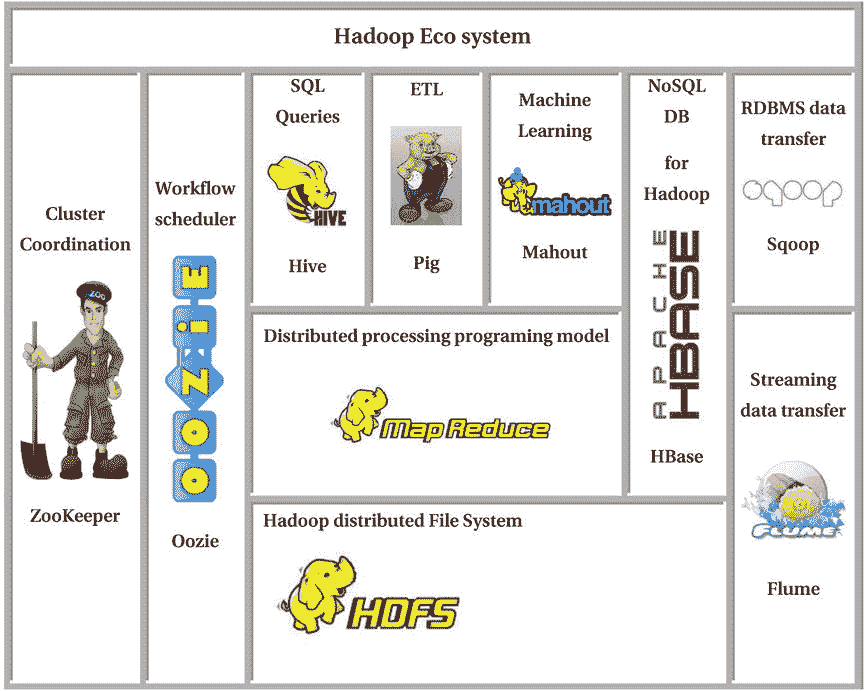

**图 13-3.** Hadoop 生态系统

### 使用 Hadoop 的公司

`Hadoop`是一种广泛使用的工具。以下是一些使用`Hadoop`的主要公司：

*   Facebook
*   Google
*   IBM
*   Yahoo
*   Amazon
*   AOL
*   Fox Interactive Media
*   New York Times
*   Adobe
*   eBay
*   LinkedIn
*   Ning

更完整的列表可在 [`http://wiki.apache.org/hadoop/PoweredBy`](http://wiki.apache.org/hadoop/PoweredBy) 上找到。

到目前为止，我们已经讨论了一些关于大数据的重要概念和工具。正如本书一贯的做法，我们将给出一个大数据分析的示例，以便您能实际了解大数据分析是如何进行的。

## 大数据分析示例

在此示例中，我们将使用来自 Stack Overflow 网站 ([`http://stackoverflow.com/`](http://stackoverflow.com/)) 的数据。Stack Overflow 是一个私有网站，由 Jeff Atwood 和 Joel Spolsky 于 2008 年创建。该网站作为用户就广泛的计算机编程主题提出和回答问题的平台。如果您对任何编程语言有特定问题，可以登录 Stack Overflow 并提交您的问题。您甚至可以使用诸如`C++`、`Java`、`database`、`SQL`、`PHP`等关键词为问题添加标签。Stack Overflow 有一个共享数据的门户。热衷于数据科学的科学家可以登录并从该门户下载数据。为了这个大数据示例，我们从这个网站下载了一个数据集。

本示例旨在理解与大数据的各种概念。在此示例中，我们使用了一个 7GB 的数据集。对于大数据来说，这个大小太小了，但出于实际考虑，我们在本例中将其限制在这个大小。以下是本示例中要遵循的步骤：

*   审视业务问题
*   获取数据集
*   启动 Hadoop
*   查看 Hadoop 组件
*   将数据从本地系统迁移到 Hadoop
*   在 HDFS 上查看数据
*   启动 Hive
*   使用 Hive 创建表
*   使用 Hive 执行程序
*   查看 MapReduce 状态
*   查看最终结果

让我们从业务问题开始。

### 审视业务问题

业务方希望从给定文件中提取一些基本的描述性统计数据，例如问题总数和排名前十的话题。此外，还需要诸如唯一的用户总数、排名前十的用户以及这些用户的提问数等数据。您甚至可以进一步构建一个模型，当用户在 Stack Overflow 网站上输入任何问题时，该模型能够自动检测并建议标签。出于演示目的，我们仅尝试找出输入文件中提到的问题总数。

### 获取数据集

该数据集来自 Stack Overflow。数据集的大小为 7GB，是一个文本文件。需要分析这个输入文件以找出基本的描述性统计数据。

### 启动 Hadoop

Hadoop 安装在 Linux 机器上。在本示例中，我们使用的是单节点（即伪集群）Hadoop 设置。基本上我们只在一台机器上工作。由于操作系统是 Linux，所有操作都将以在终端中执行的 Linux 命令形式进行。第一步是在 Linux 中打开一个终端。我们 Linux 机器的用户名是`Hadoop`。如果用户名是`neo`，那么你会看到`neo@local host home`。请参考图 13-4。

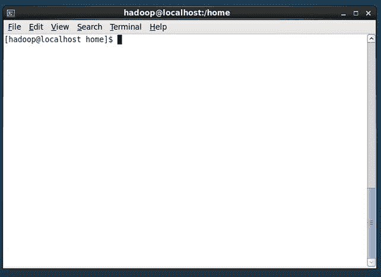

**图 13-4.** 在 Linux 中打开终端

要启动 Hadoop，你需要进入 Hadoop 文件夹。Hadoop 的路径可能因系统而异。请参考图 13-5。

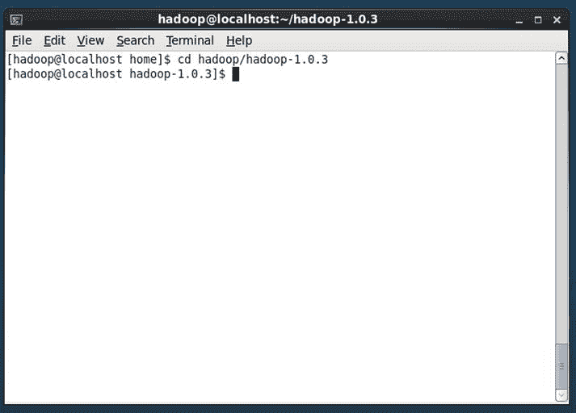

**图 13-5.** Hadoop 文件夹

现在，你已经进入 Hadoop 文件夹。你可以启动 Hadoop，这将启动生态系统中的不同组件，例如 HDFS、作业跟踪器、任务跟踪器等。请参考图 13-6。

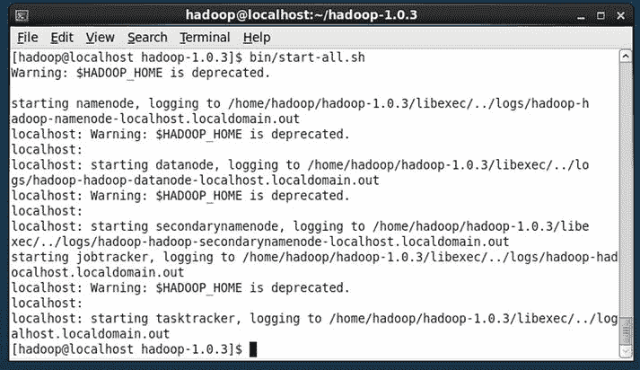

**图 13-6.** 启动 Hadoop

`start-all.sh`是用来启动 Hadoop 的 shell 脚本。如果你收到一个关于 Hadoop 已被弃用的警告，可以忽略它。如果你使用的是最新版本的 Hadoop，则该警告不会出现。以下是启动 Hadoop 时的一些重要消息。这些消息将给出 Hadoop 组件初始化状态。

### 查看 Hadoop 组件

现在你可以观察到所有 Hadoop 组件都已启动。你可以检查名称节点、数据节点和辅助名称节点（名称节点的备份）正在哪些端口上运行。请参考图 13-7。`Jps` 选项显示这些进程（如名称节点、作业跟踪器、任务跟踪器等）正在运行的端口。

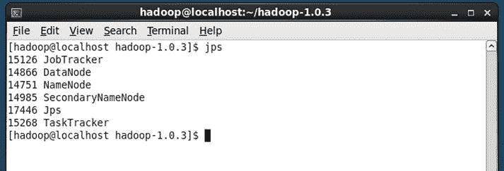
图 13-7. 用于查看进程的 Jps 选项

你还可以使用 Hadoop 管理 Web 界面来检查和管理 Hadoop。为此，你需要使用 Web 浏览器并访问 `http://localhost:50070/dfshealth.jsp`。请参考图 13-8。

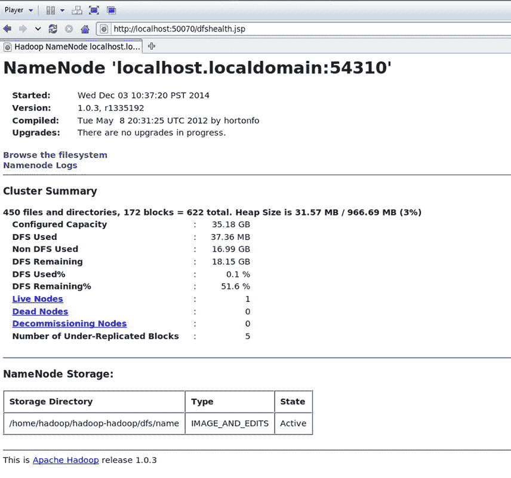
图 13-8. Hadoop 管理 Web 界面

通过点击图 13-8 中的“浏览文件系统”链接，你将获得图 13-9 所示的文件系统详细信息。

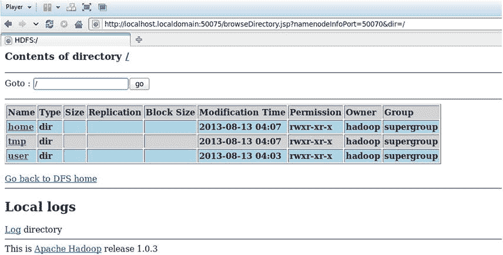
图 13-9. Hadoop 分布式文件系统

以下是你在获取 Hadoop 内部数据之前的集群摘要（图 13-8）：

*   450 个文件和目录，171 个块 = 总计 621
*   堆大小：31.57MB / 966.69MB（3%）
*   配置容量：35.18GB
*   分布式文件系统（DFS）已使用：37.36MB
*   非 DFS 已使用：21.33GB
*   DFS 剩余：13.81GB
*   DFS 已使用：0.1%
*   DFS 剩余：39.27%
*   存活节点：1
*   失效节点：0
*   退役节点：0
*   复制不足的块数：5

### 将数据从本地系统移动到 Hadoop

在 DFS 文件系统上，你需要将数据文件移动到 HDFS 位置。该命令很简单。

```
bin/hadoop fs -copyFromLocal /home/final_stack_data.txt stack_data
```

输入此命令并参考图 13-10。此单个命令会将数据切割成多个 64MB 的块并分布到 HDFS 上。

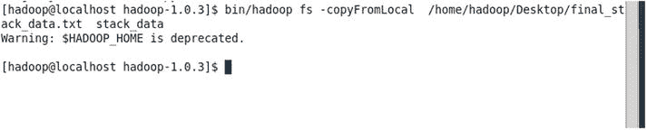
图 13-10. 将数据从本地文件系统复制到 Hadoop 分布式文件系统

### 查看 HDFS 上的数据

现在，如图 13-11 所示，数据已成功加载到 HDFS 上。

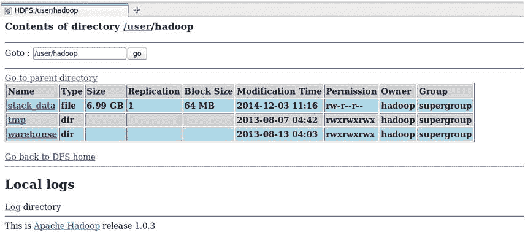
图 13-11. 数据传输到 HDFS

在图 13-11 中，你可以在 HDFS 中看到名为 `stack_data` 的新数据集。点击它，你可以看到该数据集中的内容。请参考图 13-12。

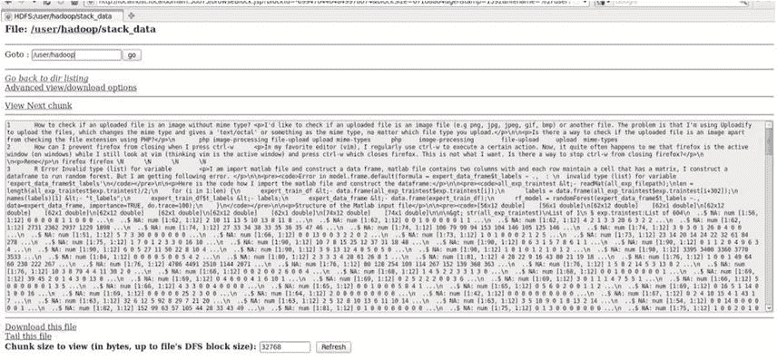
图 13-12. 数据块的快照

通过点击 `stack_data`，你可以看到第一个块中的数据，以及其他数据块的信息。请参考图 13-13。

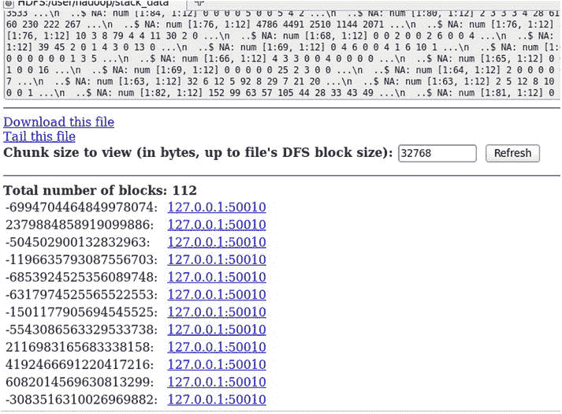
图 13-13. 每个数据块的确切位置及节点 IP 地址

图 13-13 显示了一条重要消息；因为数据集大小为 7GB，每个块大小为 64MB，所以你会得到总共 112 个块。给出了每个块的地址。请参考图 13-14。

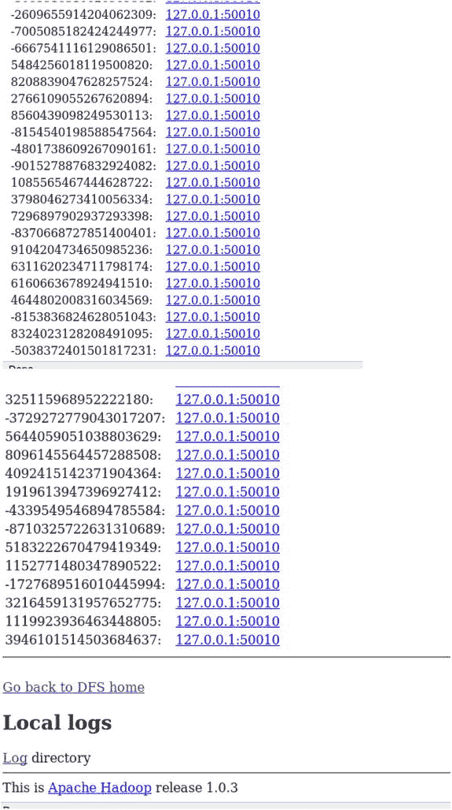
图 13-14. 块地址

回想一下，我们并未使用多节点集群。因此，所有数据块将只有一个机器 IP 地址。你可以看到所有块都存储在同一 IP 地址（图 13-14）。如果这些块存储在不同的节点上，那么每个块会显示不同的 IP 地址。如果你点击一个特定的数据块，你会看到其内容。请参考图 13-15。

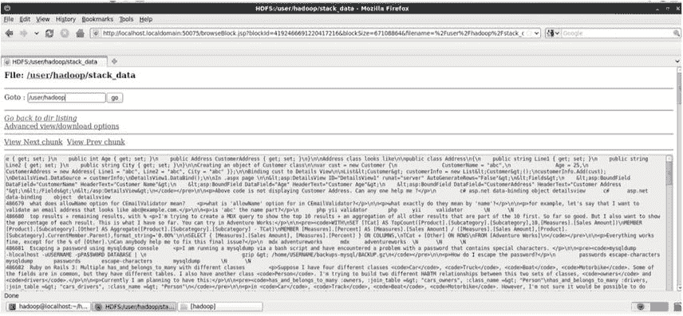
图 13-15. 块内的数据

既然数据已在分布式系统上，你就可以开始进行分析了。如前所述，此处的任务只是获取数据的一些基本描述性统计信息。我们使用 Hive 来执行操作。

### 启动 Hive

要启动 Hive，你只需输入命令 `hive`。请参考图 13-16。

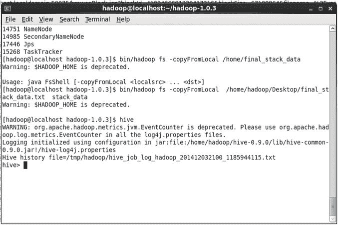
图 13-16. 启动 Hive

`show tables` 命令将显示 Hive 中现有的表。此命令将显示 Hive 中的默认表和之前表名。请参考图 13-17。

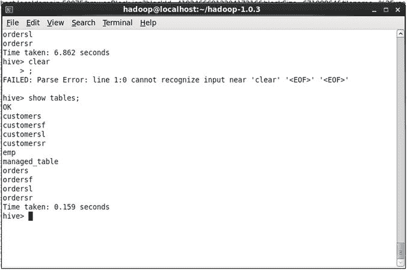
图 13-17. Hive 中的现有表

### 使用 Hive 创建表

至此，您已了解到 Hive 就像是 Hadoop 上的一个 SQL 引擎。接下来，如同在 SQL 中一样，您需要设计一个表并向其中填充数据。创建表所使用的代码请参考图 13-18。

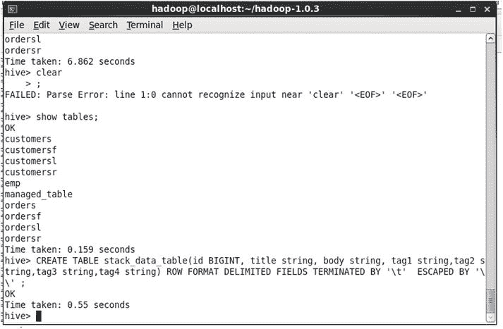
图 13-18. 在 Hive 中创建表

现在表已创建完成，以下是用 HDFS 上的数据填充表的命令。请参考图 13-19。

```
LOAD DATA INPATH '/user/hadoop/stack_over_data' INTO TABLE stack_data_table;
```

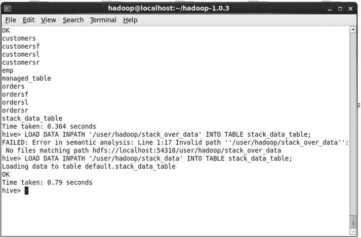
图 13-19. 将数据加载到 Hive 表中

### 使用 Hive 执行程序

您在 Hive 中已有包含数据的表。现在需要编写 HiveSQL 代码，代码将自动转换为 MapReduce 代码。请参考图 13-20。执行以下 HiveSQL 命令：

```
Select count(*) from stack_data_table ;
```

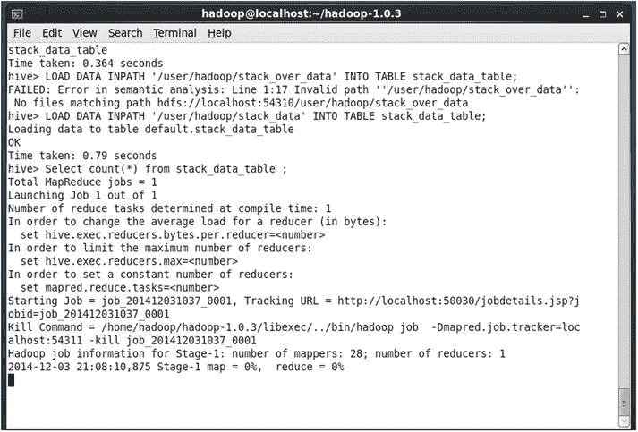
图 13-20. 执行 HiveSQL 命令

### 查看 MapReduce 状态

图 13-21 显示了 Map 和 Reduce 的状态。请注意，图中 Map 状态为 28%，Reduce 作业完成了 7%。

*   `starting namenode, logging to /home/hadoop/hadoop-1.0.3/libexec/../logs/hadoop-hadoop-namenode-localhost.localdomain.out`
*   `starting datanode, logging to /home/hadoop/hadoop-1.0.3/libexec/../logs/hadoop-hadoop-datanode-localhost.localdomain.out`
*   `starting secondarynamenode, logging to /home/hadoop/hadoop-1.0.3/libexec/../logs/hadoop-hadoop-secondarynamenode-localhost.localdomain.out`
*   `starting jobtracker, logging to /home/hadoop/hadoop-1.0.3/libexec/../logs/hadoop-hadoop-jobtracker-localhost.localdomain.out`
*   `localhost: starting tasktracker, logging to /home/hadoop/hadoop-1.0.3/libexec/../logs/hadoop-hadoop-tasktracker-localhost.localdomain.out`


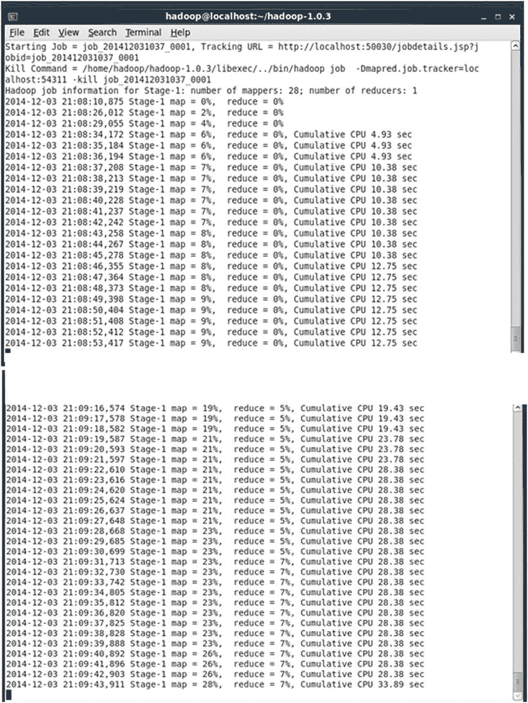

图 13-21. MapReduce 中间状态

MapReduce 完成后，您将获得结果。处理这些数据所花费的总时间约为五分钟。

此处我们只是想计算总行数，这是此演示选择的业务问题。当您执行 `HiveSQL` 命令时，您会看到 Map 和 Reduce 作业自动启动。Map 作业将统计每个数据块中的行数；Reduce 作业用于汇总总计结果。

### 最终结果

最终结果显示共有 6,034,195 条记录（图 13-22）。原始数据输入文件中包含了近 600 万个问题。

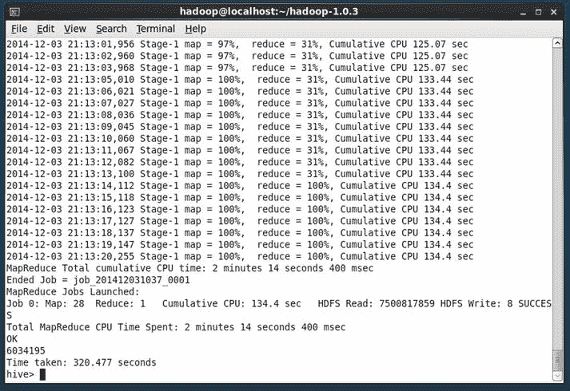

图 13-22. 最终的行计数；MapReduce 过程完成

一旦您理解了基础知识，并掌握了如何获取行计数这类基本统计信息，您就可以编写相应的 `HiveQL` 命令来获取其他结果，例如排名前十的话题、每个话题的频率等等。

## 结论

在本章中，您学习了如何处理一个基本的大数据问题。大数据分析是市场上最新的流行语。当今的大数据正处于其发展的初级阶段。该领域预计会有大量发展，特别是在预测建模、文本挖掘、视频分析和机器学习领域。目前，并非所有算法都被转换成 MapReduce 程序。但在不久的将来，我们可能会拥有一个能够在分布式平台上运行并为我们执行所有高级分析任务的工具。这是一个快速发展的领域，因此在不久的将来您可能会看到几种新工具。现在，作为练习，我们建议您对 Hadoop 生态系统中的其他组件做一些研究。


# 索引

## A

`ACF` 和 `PACF` 图 → 参见 `自相关函数 (ACF)`；参见 `R 方`

**赤池信息准则 (AIC)**

**Apache Hadoop** 分布式计算

- `HDFS`
- Linux 操作系统
- `MapReduce` → 参见 `MapReduce 编程模型`

**ARIMA 模型**

- `web_views` 序列上的 `ARIMA`

**自相关**

**自相关函数 (ACF)**

**自回归 (AR) 过程**

- ACF 和 PACF 图
- 定义

**自回归滑动平均过程 (ARMA)**

## B

**条形图和饼图**

**大数据分析**

- Apache Hadoop → 参见 *Apache Hadoop*
- 汽车工业
- 块地址
- 业务问题
- 计算机编程
- 传统数据
- 数据处理工具
- 数据集
- 困难数据
- 分布式计算
- 药物发明
- 电子商务零售商
- 快速增长
- `Hadoop` `hive` 命令
- `HiveSQL` 命令
- `jobtracker`
- Linux `localhost`
- `MapReduce` 编程模型
- 节点 IP 地址
- 在线娱乐行业
- 行数统计
- `secondarynamenode`
- `show tables` 命令
- 社交媒体行业
- `stack_data`
- `stack overflow`
- `start-all.sh`
- 超级计算机
- 电信行业
- 多样性
- 速度
- 体量

**Box–Jenkins 方法与视力测试**

- 增广 Dickey-Fuller 单位根检验
- DF 检验
- 整合分量，ARIMA 过程
- 非平稳时间序列
- SAS 代码
- 平稳性

**商业分析**

- 分析技能
- 大数据 vs. 传统数据
- `Amazon.com`
- 定义
- `eBay.com`
- 金融行业
- 零售连锁
- SAS
- 数据来源
- 集群沟通技巧
- 组成部分与要素
- 联合分析
- 对应分析
- 客户数据驱动决策
- 高级分析技术
- 应用
- 关联分析
- 商业智能与报表
- 分行/自动取款机
- 传统商业
- 数据仓库与数据挖掘
- 开发与实施
- 偏差分析
- 模型优化
- 预测分析
- 模拟
- 统计与量化技术
- 类型
- 决策技能
- 内部/外部来源
- 管理技能
- 模型构建过程
- 运营分析
- 问题解决技能
- 原材料
- 回归建模
- 细分
- 社交媒体
- 生存分析
- 技术技能
- 时间序列预测
- 类型

## C

**呼叫量数据**

- 联络中心
- 客户联系时长
- `PROC CONTENTS`
- `Proc means`
- SAS 代码
- 变量量
- `varnum` 选项

**中心极限定理**

- 算术平均值
- 钟形曲线
- 对应分布
- 均值
- 正态分布
- 样本均值与样本量

**字符函数，SAS**

**聚类分析**

**置信区间**

- 健康检查数据
- 健康计划限制
- 非拒绝域
- 原假设与检验统计量
- 总体均值与样本均值
- T 检验

**连续变量**

- `days past due (DPD)`
- `MonthlyIncome_ind`
- `MonthlyIncome_new`
- `NumberOfTime30_59DaysPastDue1`
- 异常值
- `proc univariate`
- `RevolvingUtilizationOfUnsecuredL`
- 独立插补
- `utilization_new`

**相关性**

- `add_budget`
- 数据集
- 广告牌
- 预算
- `call_center`
- `c_sat`
- 客户满意度调查
- 电子商务
- 国内生产总值
- `issue_resolution`
- 线性关联
- 矩阵
- 非线性函数
- 原假设
- 在线活动
- 异常值
- 皮尔逊相关系数
- `price_plans`
- `PROC CORR`
- 相关性的 `p-value`
- 样本量
- 散点图
- 服务质量评分
- 正弦曲线
- 电信数据集
- 变量
- 方差与协方差
- vs. 因果关系

## D

**数据分析工具特性**

- IBM SPSS 分析
- R
- SAS
- 优势组件
- 要素
- 软件
- Apache Mahout
- MATLAB
- minitab
- R
- RapidMiner
- SAP
- SAS
- SPSS
- Weka
- SPSS

**数据探索与验证**

- 实际分析
- 箱线图技术
- 商业直觉
- `call_volume`
- 呼叫量
- 数据清洗
- 数据
- 联络中心
- 异常值
- 真实世界数据
- 风险数据 → 参见 *风险数据*
- SAS
- 统计数据分析

**数据处理，SAS**

- `DATA` 和 `PROC` 步骤
- 数据操作 → 参见 *数据操作*
- 数据集
- 库 → 参见 *SAS 库*
- 阶段
- `sashelp.air` 数据集

**数据处理工具**

- Facebook 数据
- 大型强子对撞机
- 实时数据
- 沃尔玛客户数据

**数据操作**

- `drop` 和 `keep` 变量
- 通用代码
- 市场活动数据
- 创建新变量
- 通用样本
- `if-then-else`
- 日志文件，前述代码
- 多个变量
- `net_reach`
- 原始数据
- 同一数据集
- `sat_exam` 和 stores
- `SET` 语句
- 子集选择
- `where` 和 `if`

**数据合并**

- 追加数据
- 带条件混合
- 从 `SET` 到 `MERGE`
- 匹配合并

**数据集**

- 数据部分
- 描述部分

**数据快照**

- `cust_cred_raw` 数据集
- `cust_cred_raw_v1` 数据集
- 客户贷款数据
- `MonthlyIncome_new`
- `NumberOfDependents_new`
- `obs_type`
- `PROC CONTENTS`
- `PROC PRINT`
- `sr_num`

**日期函数，SAS**

**日期间隔**

## E

**编辑器窗口**

**假设检验中的错误**

- 平均重量
- 接受原假设
- 拒绝原假设
- 样本与决策

**资源管理器窗口**

**扩展样本自相关函数 (ESACF)**

**抽取、转换、加载 (ETL)**

**视力测试类比**

## F

**频率，风险数据**

- `cust_cred_raw_v1`
- 数据准备
- `days past due (DPD)`
- 离散变量
- `NumberOfDependents_new`
- `obs_type`
- `PROC FREQ`

**F 检验**

- 方差分析
- 解释力
- `mobiles` 数据集
- 原假设
- 价格 vs. 销量
- P 值
- 琐碎变量

## G

**图形用户界面 (GUI)**

- 活动库
- 无效名称
- 库名称
- 库测试
- 新菜单选项
- 打开资源管理器
- 物理路径
- 测试图标

**国内生产总值 (GDP)**

**GUI** → 参见 *图形用户界面 (GUI)*

## H

**Hadoop 组件**

- 管理 Web 界面
- DFS 文件系统
- 分布式文件系统
- `Jps` 选项

**Hadoop 分布式文件系统 (HDFS)**

- 数据传输
- 分布式计算
- `stack_data`

**HTML 输出**

**假设检验**

- 备择假设 (`H1`)
- 中心极限定理
- 置信区间
- 临界值与临界域
- 电子商务
- 错误
- 推断
- 均值
- 原假设
- 参数
- 总体
- 过程
- P 值
- 随机样本
- 现实生活
- 样本
- 抽样分布
- 单侧
- 统计量
- 检验统计量
- 双侧
- Z 检验与卡方检验

## I, J, K

**逆自相关函数**

## L

**大型强子对撞机 (LHC)**

**线性回归**

- ACF
- 贝塔系数
- 汉堡数据集
- 手机数据集
- CSV 文件
- 因变量
- 估计
- 同方差性
- 独立性违反
- 自变量
- 最小二乘法
- 建模过程
- 多元线性回归
- 正态性
- 皮尔逊相关
- 手机数据集
- 手机型号
- 预测值与实际值
- `PROC CONTENTS` 输出

# SAS 术语与过程索引

## M

### MapReduce 编程模型
- `集群设置`
- `公司`
- `生态系统`
- `ETL`
- `容错`
- `最终输出`
- `处理大数据`
- `HiveSQL` 命令
- `中间状态`
- `Java` 编程语言
- `作业调度`
- `负载均衡`
- `map` 函数
- `Pig Latin` 脚本
- `reduce` 函数
- `存储`
- `任务相关信息`
- `任务调度`

### 最大似然估计 (MLE)
- `自变量系数`
- `优化技术`

### 最大似然估计量技术

### 均值，假设检验
- `家庭样本`
- `proc t test`
- `P` 值
- `T 检验`

### 缺失值，风险数据
- `连续与离散变量`
- `客户`
- `插补`
- `指示变量`
- `非缺失记录`
- `异常值处理`
- `储蓄账户与信用卡`

### MLE
- 参见 `最大似然估计 (MLE)`

### 模型准确性测试

### 模型识别
- `模拟时间序列`
- `时间序列`
- `stock_price` 与 `diff_stock_price`

### 滑动平均 (MA) 过程
- `与 AR 过程`
- `描述`
- `时间序列销售数据`

### 多重共线性
- `贝塔系数`
- `相关技术`
- `识别`
- `补救`
- `sat_score` 数据集
- `方差膨胀因子`

### 多重共线性，逻辑回归
- `贝塔系数`
- `卡方检验`
- `检测与移除`
- `线性回归`
- `非线性回归`
- `VIF` 选项

### 多元线性回归
- `实际值`
- `拟合`
- `F 检验` → 参见 `F 检验`
- `拟合优度`
- `异方差性`
- `自变量与因变量`
- `多重共线性` → 参见 `多重共线性`
- `优化技术`
- `回归线`
- `回归输出`
- `R 方与调整 R 方` → 参见 `R 方`
- `SAS`
- `散点图`
- `智能手机销量`
- `Stock_market_ind`
- `T 检验` → 参见 `T 检验`
- `二维图`
- `方差膨胀因子`

## N

### 非线性回归
- `指数函数`
- `高斯函数`
- `虚数`
- `逻辑曲线`
- `Logit`
- `Log(x)`
- `数学变换`
- `非线性曲线`
- `二次函数`

### 正态性，线性回归
- `实际值与预测值`
- `数据探索`
- `正态分布`
- `异常值`
- `概率分布`
- `残差`
- `概率违反`

### 数值函数，SAS

## O

### 输出窗口

## P, Q

### 偏自相关函数
- `PROC CONTENTS`
- `PROC gplot` 与 `Gchart`
- `PROC SORT`
- `移除重复项`
- `选项`
- `处理重复项`
- `PROC SQL`

### P 值，假设检验
- `假设均值`
- `总体参数`
- `概率曲线`
- `抽样分布`
- `统计量值`
- `Z` 值

## R

### 现实世界数据
- `员工档案数据`
- `错误记录`
- `检查数据集`
- `缺失值`
- `异常值`

### 残差自相关检验

### 结果窗口

### 风险数据
- `实际分析过程`
- `连续变量` → 参见 `连续变量`
- `信用评分`
- `Customer_loan_data.csv`
- `数据导入`
- `数据快照`
- `离散变量`
- `频率`
- `插补`
- `缺失值`
- `PROC CONTENTS` 数据
- `Sr_num` 与 `obs_type`
- `单变量分析` → 参见 `单变量分析`
- `变量`

### R 方
- `垃圾变量`
- `回归输出`
- `样本回归数据`
- `SAT` 考试数据

### R 方，线性回归
- `方差分析`
- `汉堡数据集`
- `因变量`
- `拟合度/准确性`
- `PROC REG`
- `SAS`
- `方差`

## S

### 抽样分布，假设检验
- `频率分布`
- `多个随机样本`
- `有放回简单随机抽样`

### SAS
- `条形图和饼图`
- `函数` → 参见 `SAS 函数`
- `图形`
- `导入数据`
- `CSV` 文件
- `数据集创建`
- `文件位置`
- `最终选择屏幕`
- `GUI` 选项
- `导入向导`
- `Mydata` 库
- `sas` 文件语法
- `程序过程` → 参见 `SAS 过程`

### SAS 代码
- `CSV` 文件
- `Excel` 文件

### SAS 函数
- `字符函数`
- `日期函数`
- `数值函数`

### SAS 库
- `datalines` 关键字
- `Mydata` 库
- `永久与临时`
- `规则`
- `SAS` 代码
- `sashelp` 库
- `有效与无效虚拟文件夹`
- `窗口环境`
- `work`

### SAS 逻辑回归
- `贝塔系数与优势比`
- `buy_ind`
- `系数`
- `数据方程`
- `模型`
- `模型拟合`
- `PROC LOGISTIC`
- `响应变量`
- `验证统计量`

### SAS 过程
- `数据合并` → 参见 `数据合并`
- `PROC CONTENTS`
- `PROC SORT`
- `PROC SQL`
- `短选项`
- `varnum` 选项

### SAS 编程语言
- `代码中的注释`
- `在 Windows 中`
- `许可证过期错误`
- `日志文件`
- `菜单选项和图标`
- `打开屏幕`
- `运行菜单`
- `运行语句`
- `SAS` 脚本语言
- `快捷图标`
- `解决方案菜单`
- `查看选项`
- `Windows` 环境

### 窗口类型
- `描述`
- `编辑器窗口`
- `资源管理器窗口`
- `HTML` 输出
- `日志窗口`
- `非语法相关错误`
- `输出窗口`
- `结果窗口`
- `编写与执行 SAS 脚本语言`

### 施瓦茨贝叶斯准则 (SBC)

### 短选项

### 有放回简单随机抽样 (SRSWR)

### 单侧，假设检验
- `备择假设`
- `定向假设`
- `左侧检验`
- `原假设`
- `P` 值
- `右侧检验`

### SRSWR
- 参见 `有放回简单随机抽样 (SRSWR)`

### 平稳时间序列，Box–Jenkins 方法

### 统计分析
- `业务目标与规划`
- `数据准备`
- `描述`
- `实施`
- `推断性`
- `模型构建`
- `模型验证`
- `总体`
- `预测性`
- `预测建模`
- `样本`
- `验证`
- `可视化`
- `世界人口，电力使用`

### 统计数据分析
- `业务目标`
- `呼叫量数据`

### 统计分析
- `双变量分析`
- `箱线图`
- `创建`
- `定义`
- `定义`
- `离差`
- `计算`
- `医疗索赔`
- `月收入`
- `在线销售`
- `异常值影响`
- `总体`
- `打印选项`
- `分位数`
- `范围`
- `标准差`
- `股票价格`
- `集中趋势`
- `方差`

### 子串函数

### 误差平方和 (SSE)
- `汉堡数据集`
- `预测值与实际值`
- `PROC REG`

### 回归平方和 (SSR)

## T

### 时间序列分析与预测
- `适用 SAS 代码`
- `每日呼叫量，语音处理`
- `业务流程外包`
- `定义`
- `描述阶段`
- `diff_stock_price` 序列
- `最大似然估计`
- `建模技术`
- `模型类型`
- `月度笔记本电脑销售`
- `平稳性`
- `美国移动蜂窝用户数`
- `变量`
- `访客`

### 总平方和 (SST)

### T 检验
- `高影响变量`
- `market_promo_budget`
- `mobiles` 数据集
- `num_new_features`
- `P` 值
- `R 方` 值

### PROC CORR

### PROC REG

### R 方

### SAS 代码

### 简单线性回归

### 智能手机销量

### SSE

### SSR

### SST

### 强关联与弱关联

### 违反线性关系

### 访客 vs. 汉堡销量

### 逻辑回归
- `背景与问题陈述`
- `卡方检验`
- `系数`
- `冷呼叫`
- `一致性`
- `信用风险`
- `客户销售数据集`
- `数据验证与清洗`
- `违约者与非违约者`
- `导入`
- `proc contents`
- `proc print`
- `SAS 过程`
- `违约概率范围`
- `最终检查清单`
- `F 检验`
- `拟合优度`
- `自变量`
- `贷款申请`
- `对数`
- `对数几率`
- `概率`
- `最大似然估计模型构建`
- `适用性`
- `卡方检验`
- `一致性`
- `客户记录`
- `最终逻辑回归`
- `拟合优度`
- `单个变量影响`
- `逻辑过程`
- `多重共线性`
- `proc logistic`
- `loans_data`
- `SAS 输出`
- `SeriousDlqin2yrs`
- `变量系数`
- `方差膨胀因子`
- `多重共线性`
- `非线性回归`
- `目标优化技术`
- `P 与 R 方`
- `预测违约概率`
- `预测`
- `PROC LOGISTIC`
- `PROC REG` 输出
- `响应变量`
- `销售数据`
- `SAS`
- `散点图`
- `单个与多个自变量`
- `平方调查分析`
- `T 检验`
- `网络分析`

### 日志窗口

## 假设检验

智能手机销量

`Stock_market_ind`

**双侧，假设检验**

备择假设

临界值与临界域

性别比例

非定向假设

## U

**单变量分析**

集中趋势

连续变量

`cust_cred_raw_v1`

峰度

异常值

`PROC UNIVARIATE`

`RevolvingUtilizationOfUnsecuredL`

偏度

变量分布

美国移动蜂窝用户数

## V, W, X, Y, Z

**变量**

分类变量

连续变量

离散变量

均值与标准差

非数值变量

数值变量

参数

`prdsale` 数据

预测建模

`PROC CONTENTS`

`PROC PRINT`

统计量

`SURVEYSELECT`

**方差膨胀因子 (VIF)**

贝塔系数

相关矩阵

反直觉估计

F 统计量与 R 方值

逻辑回归

多重共线性

参数估计

容差

**Varnum 选项**

**VIF** → 参见 *方差膨胀因子 (VIF)*