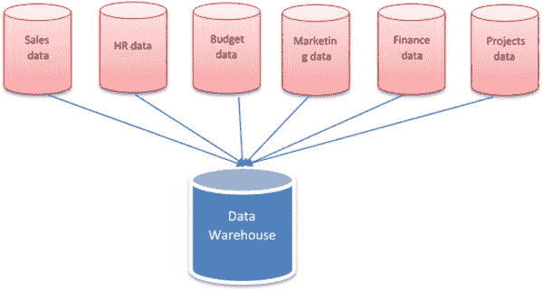
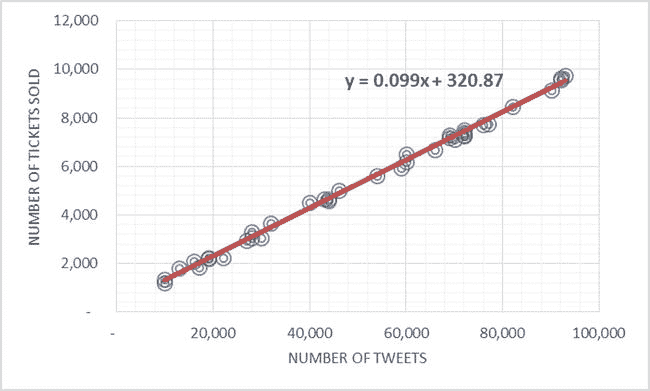
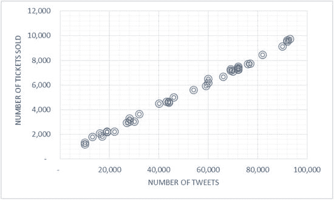
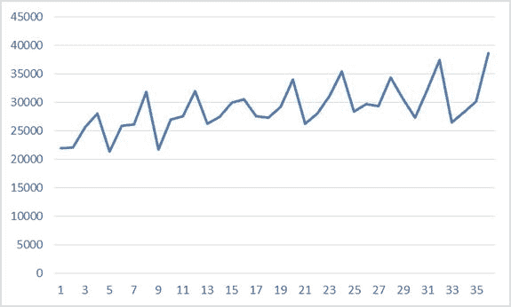
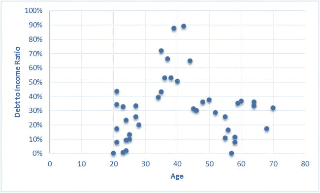
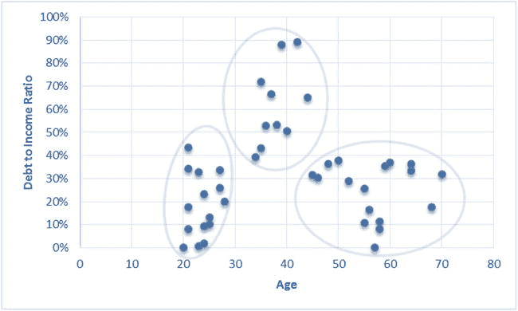

# 1. 商业分析与数据分析工具导论  

在当今激烈的全球竞争环境中，对先进信息和决策支持系统的需求与日俱增。借助预测工具（例如，哪怕只是近似地预测生产所用原材料的市场价格），企业可以更好地管理盈利能力和整体业务。商业分析涉及定量技术、统计学、信息技术、数据与分析工具以及计量经济学模型等多种方法。它能够积极地将业务绩效提升到超越高管经验或单纯直觉的水平。  

商业分析（或称高级分析）还可以包含非财务变量，而不仅仅是那些可能仅基于财务绩效的传统参数。例如，商业分析能有效帮助企业在检测信用卡欺诈、识别潜在客户、分析或预测每位客户的盈利能力、帮助电信公司推出最赚钱的手机套餐、以及推出针对特定客户群体的保险产品等方面。事实上，高级分析技术已经在所有这些领域及更多领域中得到有效应用。  

本章涵盖了理解本书中所有分析技术所需的基础知识。  

## 商业分析：数据驱动决策的科学  

许多分析技术都是数据密集型的，要求商业决策者理解统计学及其他各种分析工具。这些技术不可避免地需要一定程度的 IT 和数据库知识。在决策中使用商业分析技术的组织，也需要在日常运营、规划和战略制定中开发并实施数据驱动的方法。然而，在大量情况下，由于激烈的竞争和削减成本的压力，企业别无选择，只能实施数据驱动的决策方法。这使得商业分析成为一个有利可图且回报丰厚的职业选择。现在可能是你进入这个领域的合适时机，因为商业分析文化在全球大多数组织中仍处于萌芽阶段，并且即将随着不断增长的机遇而爆发式发展。  

### 商业分析的定义  

商业分析关乎获取新商业洞察和理解业务绩效所需的数据、方法论、信息技术、应用、数学与统计技术及技能。它利用对历史数据的迭代和系统化探索来支持商业决策。  

商业分析旨在提高盈利能力、降低保修支出、获取新客户、留住客户、进行追加销售或交叉销售、监控供应链、改善运营，或仅仅是缩短客户投诉的响应时间等。商业分析的应用跨越多行业，包括制造业、金融业、电信业和零售业。全球银行业和金融业历来是分析技术最活跃的用户之一。金融行业的典型应用包括检测信用卡欺诈、识别贷款违约者、获取新客户、识别电子邮件营销活动的响应者、预测客户的关系价值或盈利能力，以及设计新的金融和保险产品。所有这些流程都涉及大量数据和相当复杂的统计计算与解读。  

任何商业分析的应用都需要投入大量精力来定义问题及解决方法、进行数据收集、数据清洗、模型构建、模型验证以及结果解读。这是一个迭代过程，模型可能需要构建多次才能最终被接受。即使是一个已建立的模型，也需要根据输入数据的变化或原始模型构建时所依据的商业条件（及假设）的变化，定期进行重新审视/重建。  

因此，任何利用数据分析的有意义的决策支持系统，都需要在组织内部以及所有支持其的外部实体中开发和实施一种强大的数据驱动文化。  

让我们以一家旨在推广高端产品的热门零售网站为例。为了做到这一点，该零售网站想知道需要瞄准哪类客户群体，才能以最少的促销费用实现产品销量最大化。为此，网站需要收集和分析客户数据。网站可能还想知道有多少客户访问了它以及访问时间；他们的性别、收入阶层和人口统计数据；他们访问了网站的哪些部分以及访问频率；他们的购买和浏览模式；他们使用的网页浏览器；他们进入网站所使用的搜索字符串；以及其他此类信息。  

如果进行恰当的分析，这些数据就为获取有关客户的有用商业洞察提供了巨大机会，从而有机会削减促销成本并提高整体销售额。商业分析技术能够处理多种多样的数据源来构建模型，从而衍生出以前不可能获得的丰富商业洞察。这个衍生出的丰富事实基础可用于改善客户体验、简化运营，从而提高整体盈利能力。在前述例子中，通过应用商业分析技术，有可能将产品瞄准最有可能购买的客户群体，从而最小化促销成本。  

传统的业务绩效参数主要基于财务指标，例如营收总额和利润底线。但公司的绩效远不止财务参数。运营效率、员工积极性、员工平均薪资、工作条件等衡量指标可能同样重要。因此，这里用于衡量或预测公司绩效的参数数量有所增加。这些参数将增加数据量和分析的复杂性。这仅仅是一个例子。例如，为了分析社交媒体网站上的消费者行为，需要处理的数据量和变量数量是巨大的。在这种情况下，传统的智慧和报告工具可能会失效。高级分析的预测建模技术在这种情况下就能派上用场。  

本书后续章节将讨论数据分析。高级分析中使用的统计和定量技术，与信息技术相结合，在处理几年前还无法处理的海量数据的同时，提供商业洞察。当今强大的计算机和软件（例如`SAS`）负责处理分析算法编码所有繁琐的任务，使分析师得以专注于解读和应用结果以获取商业洞察这一重要工作。

### 高级分析能否成为你的解决方案？

任何身处竞争激烈的商业环境、面临以下挑战，或几乎任何存在相关数据的问题的人，都可能成为应用高级分析技术的潜在候选者：

- 消费者购买模式分析
- 提升整体客户满意度
- 预测供应链中的交付周期
- 保修成本优化
- 销售团队的合理规模设定或优化
- 定价与促销建模
- 预测客户对促销活动的反应
- 信用风险分析
- 欺诈识别
- 识别潜在贷款违约者
- 药物研发
- 临床数据分析
- 网站分析
- 文本分析（例如在推特上）
- 社交媒体分析
- 识别导致特定疾病的基因

正如之前所述，商业分析是一种文化，需要在任何组织中围绕决策制定进行开发、实施并最终整合为一种生活方式。全球许多组织已经体验并认识到这种文化的潜力，并且通过应用这些技术，成功优化了资源。

### 示例

诸如销量与价格点之间的权衡、库存持有成本与缺货风险之间的权衡，始终是管理者日常决策的一部分。许多此类商业决策高度主观，或者基于并不相关的现有数据。

在一个此类示例中，一家公司的分析发现，在主要社交媒体网站上，驱动客户情绪的主要因素并非其电视广告，而是与公司呼叫中心的互动。公司提供的服务质量以及呼叫中心互动的质量，在很大程度上影响着品牌影响力。基于这些洞察，该公司决定将部分电视广告支出转而用于提升呼叫中心满意度。结果显而易见：客户满意度调查结果显著改善，客户群和收入均大幅增长。

### 模拟、建模与优化

本节（以及整个章节）将解释相关术语和基础知识，为后续更聚焦、更具技术性的章节奠定基础。

#### 模拟

模拟有多种类型。在分析领域，一个常用的术语——计算机模拟——更具相关性。某些现实世界的系统或场景可能复杂且难以理解或预测。预测暴风雪或预测股票价格是经典例子。它们依赖于多个变量或因素，而这些因素实际上是不可预测的。例如，每日股票价格可能受到当前政治状况、当日重大事件、国际商业环境、美元价格或仅仅是市场整体情绪的影响。

模拟可以有不同层次，从只有几百行代码的简单程序到拥有数百万行代码的复杂系统。大气科学中使用的计算机模拟是另一个经典例子，其中复杂的计算机系统和软件被用于天气预报和预测。

计算机模拟在分析中会使用各种统计模型。

#### 建模

模型仅仅是构成计算机程序的数学逻辑和概念。这些模型连同相关数据，代表了现实世界的系统。这些模型可用于研究不同组件的影响并预测系统行为。如前所述，模型代表现实世界的准确度可能有所不同，并且取决于业务需求和可用资源。例如，在银行应用（如识别贷款违约者）中，90%的预测准确率或许可以接受，但在涉及人类生命的系统中——例如航空航天应用中的可靠性模型——则需要达到 100%或尽可能接近 100%的准确率。

#### 优化

优化是一个与计算机模拟相关的术语。某些计算机模拟的唯一目标可能仅仅是确保优化，简单来说，可以解释为在给定的一组约束条件下，最大化或最小化一个数学函数。在优化问题中，可能需要从一系列可用替代方案中选择一组变量，以便在满足约束的同时最小化或最大化一个数学函数。尽管此处以最简单的形式讨论优化，但它的内涵远不止于此。

一个简单的优化问题实例是：在将维护成本控制在某个水平以下的同时，最大化机器的工作时间。如果有足够的数据可用，这类问题可以使用高级分析技术来解决。另一个实际优化问题的例子是化工厂，工程师可能需要调整一组给定的工艺参数，以便在将成本控制在预算内的同时，最大化化学反应装置的产出。高级分析技术在这里也可以成为一种替代方案。

### 数据仓库与数据挖掘

创建数据仓库可以被视为最重要的基础工作之一。它可以为任何商业分析项目提供快速启动。考虑一个拥有遍布全国销售办事处和制造工厂的多地点商业组织的例子。如今，在几乎所有大型机构中，都期望使用内部开发或打包的应用（如 `SAP`）实现一定程度的业务流程自动化。某些流程可能是本地化的，它们的交易数据可能保存在分支级别。除非所有相关数据都能随时提供给报表引擎，否则可能无法向总部提供按产品和地点划分的季度销售报告。如果公司将其分支级别的数据源链接起来，并将它们整合到一个中央数据库中，这项任务就会更容易。在数据加载到中央数据库之前，可能需要进行数据清洗和转换。这样做是为了使原始数据对进一步分析和报告更有意义。这个中央数据库通常被称为数据仓库。

前面的例子只是数据仓库的一个实例。我们生活在一个数据时代。万维网、销售交易、产品描述文献、医院记录、人口调查、卫星遥感数据、工程分析结果、多媒体和视频、语音和数据通信网络正在持续生成数太字节和拍字节的数据。这样的例子不胜枚举。数据仓库中的数据来源可以是多个且异构的。通过分析这些海量可用数据，可以发现有趣的模式和有用的知识。这个知识发现的过程被称为数据挖掘（图 1-1）。一个数据挖掘项目的数据来源可能有多个，例如一个单一的、覆盖全公司的大型数据仓库，或者是数据仓库、平面文件、互联网、商业信息库、社交媒体网站以及许多其他类似来源的组合。

图 1-1.

数据挖掘

### 通过数据挖掘能发现什么？

数据挖掘中有几种定义明确的模式发现类型。以银行和信用卡的常见例子为例。银行管理层有时只对目标类别中少数几个通用特征的汇总感兴趣。例如，银行经理可能关注那些经常逾期 90 天或更久的信用卡违约者。这种抽象称为特征化描述。

在同一个信用卡例子中，银行经理可能想要对比按时还款的客户与经常逾期超过 90 天的客户的特征。这是对两个目标群体进行的比较研究，称为判别分析。

在另一种称为关联分析的抽象中，同一位银行经理可能想要了解有多少新信用卡客户同时也申请了个人贷款。银行可能还对构建一个模型感兴趣，该模型可作为接受或拒绝新信用卡申请的支持工具。为此，银行可能希望将客户分类为“非常安全”、“中等风险”和“高风险”，将之作为步骤之一。这可能会在大量客户属性经过彻底分析之后完成。

银行可能还希望根据一个已建立的模型来预测哪些客户可能成为潜在贷款违约者，该模型会消耗大量与客户相关的属性。这就是预测分析。

为了开设新的分行或自动取款机（ATM），银行可能希望了解客户按地理位置的集中程度。这种称为聚类分析的抽象与分类类似，但在分析开始时，类和子类的名称是未知的。类名（规模可观的地区名称）只有在分析完成后才会知晓。在对给定的客户属性进行聚类分析或分类时，可能会出现一些不符合任何类或聚类的值。这些例外或意外情况就是离群点。

在某些模型构建活动中，可能不允许出现离群值，因为它们容易使结果偏向某一特定方向，而这可能并非对给定数据集的真实解释。在处理数据集中的`$`数值时，这类离群点很常见。偏差分析旨在找出期望值与实际值之间的差异。

例如，了解模型预测信用卡贷款违约者的偏差可能很有意义。只有当模型预测值和实际值都存在时，才能进行这种分析。事实上，需要定期进行这种分析以确保模型的有效性。如果偏差不可接受，则可能需要重建模型。

偏差分析还试图找出预测值与实际值之间观察到的偏差的原因。这绝不是可以通过数据挖掘技术发现的全部模式。其范围要广泛得多。

### 商业智能、报告与业务分析

商业智能（BI）和业务分析是两种不同但又相互关联的技术。根据 SAS 公司的一篇博文报道，大多数商业智能系统旨在向目标用户群提供全面的报告功能和仪表盘。而业务分析工具除了能够提供报告和仪表盘外，还能进行统计分析，以提供预测、回归和建模。SAS 业务分析为用户提供了数据驱动决策所需的一切，包括信息与数据管理以及统计与演示工具。

## 行业中使用的分析技术

前几节介绍了数据挖掘或业务分析的用途。本节将详细探讨相关术语。这里仅讨论行业中频繁使用的术语。

然后，本章将介绍这些分析技术和应用中的许多内容并给出示例。其中一些更常用的技术将在后续章节中详细讨论。

### 回归建模与分析

为了理解回归与预测建模，让我们以一家银行试图积极扩大其信用卡产品客户群为例。信用卡经理希望吸引那些不会拖欠信用卡贷款的新客户。银行经理可能希望根据一组与目标客户群高度相似的过往客户数据来构建一个模型。该模型将用于为新客户分配信用评分，继而利用这个评分来决定是否向潜在客户发放信用卡。在最终决定是否发卡之前，除了计算出的信用评分之外，可能还有其他几个考虑因素。

银行经理可能希望查看并分析与每位潜在客户相关的多个变量，以便计算他们的信用评分，该评分取决于客户的年龄、收入阶层、职业、现有贷款数量等变量。这里的信用评分是因变量，而其他客户变量是自变量。借助过往客户数据和一套合适的统计技术，经理将尝试构建一个模型，建立因变量（在此例中为信用评分）与众多客户自变量（如月收入、房产和汽车拥有状况、教育程度、现有贷款、已有信用卡信息、信用评分以及来自联邦数据局的过往贷款违约记录等）之间的关系。可能有多达 500 个这样的自变量，它们来自信用卡申请表、联邦数据以及银行掌握的客户数据和信用记录等各种来源。并非所有这些变量都对构建模型有用。通过应用一些经验和科学的技术，自变量的数量可以减少到更容易管理的程度，例如 50 个或更少。一旦利用现有数据建立了自变量和因变量之间的关系，模型就需要在另一组不同但相似的客户数据上进行验证。之后，它就可以用于预测潜在客户的信用评分。在银行和金融应用中，90% 到 95% 的预测准确率可以被认为是良好的；75% 的准确率是必须达到的。这类预测模型需要定期验证，并且可能会被重建。一些金融机构强制要求至少每年在更新的条件和数据下重新验证一次该模型。

近年来，新电影的票房收入在很大程度上取决于电影上映首个周末在社交媒体上引起的热度。在一项实验中，收集了 37 部电影的数据。数据包括电影相关的推文数量以及对应的票房销售数量。图 1-2 的图表展示了某一特定电影的 X 轴（推文数量）和 Y 轴（票房数量）。要回答的问题是：如果一部新电影有 50,000 条推文（例如），那么预计第一周会售出多少张票？回归模型被用来根据推文数量（`x`）预测票数（`y`）（图 1-3）。

图 1-3.  
电影票销售数量与推文数量的回归模型——使用回归模型进行预测

图 1-2.  
电影票销售数量与推文数量——样本电影的数据收集

利用之前的回归预测模型方程，对于一部在发行首周有 50,000 条推文的电影，预测其票数为 5,271 张。

### 时间序列预测

时间序列预测是一种简单的预测技术形式，其中数据点按天、周或月的固定时间间隔可用。如果能在历史数据中识别出某些模式，就可以将这些模式外推至未来作为预测。销售预测是时间序列预测的一种常见用途。在图 1-3 中，一条直线显示了来自过去数据的趋势。可以轻松地将这条直线延伸到更多的未来时间段，以获得相当准确的预测。除了趋势，时间序列预测还可以显示季节性，这仅仅是在一年或更短时间内观察到的重复模式（例如，圣诞节或情人节等节日期间礼品销量增加）。图 1-4 显示了一个实际的销售预测、趋势以及需求的季节性。

图 1-4.  
显示需求季节性的时间序列预测

图 1-4 显示了一家服装展示厅三年的月平均销售额。每四个月会有一次清仓甩卖，所有品牌都提供大幅折扣。从图中可以明显看出每第四个月的销售高峰。

时间序列分析也可以用于银行和信用卡的例子中，例如，给定过去 24 个月的历史数据，来预测未来的损失或利润。时间序列预测也用于天气和股票市场分析。

时间序列数据的其他例子包括年度销售额的表示、抵押贷款利率随时间的变化，以及统计质量控制测量中的数据表示（例如，一台工业车床在一个月内的精度）。在这些表示中，时间成分放在 X 轴上，而变量（如销售额）放在 Y 轴上。其中一些趋势可能会在一段时间内呈稳定的直线增长或下降，另一些则可能是周期性的或随机的。在应用时间序列预测技术时，通常假设过去的趋势会在未来一段合理的时间内继续下去。这种对趋势的未来预测在许多商业场景中可能很有用，例如股票采购、现金流规划等等。

### 联合分析

联合分析是一种统计技术，主要用于市场调研，以确定哪些产品（或服务）特征及定价对大多数客户最具吸引力，从而积极影响他们的购买决策。

在联合分析研究中，目标受访者会看到具有不同特征和定价水平的产品。研究人员会记录他们对不同产品方案的偏好、好恶。随后，研究人员运用统计技术来确定每个产品特征对整体喜爱度或潜在购买决策的贡献。基于这些研究，可以建立营销模型来估算不同产品设计、定价或其组合所能带来的盈利能力、市场份额和潜在收入。

众所周知，有些手机之所以销量更高，是因为其易用性和其他用户友好功能。例如，在设计新手机的用户界面时，会向一组目标用户展示一系列经过精心控制的、不同的手机型号，每款手机都有一些不同的、独特的功能，但在整体功能上又非常接近。每个用户界面可能有一组不同的背景颜色；常用功能的放置位置也可能因手机而异。有些手机还可能提供诸如双卡双待之类的独特功能。然后，受访者需要对每款手机及其各版本中一系列受控功能进行评分。基于对这些数据的联合分析，有可能判断出哪些功能在市场上会广受欢迎。该分析还有助于确定新款手机在全球不同市场的价位。

### 聚类分析

任何聚类分析的目标都是将现有数据或观测值划分为相似且离散的群体。在分类类型问题中，每个观测值会根据分组进行划分；而在聚类分析中，目标是确定给定数据或观测值集合中可能存在的分组的数量和组成。

例如，可以将客户分成几个不同的群体，以便针对他们实施不同的定价策略以及定制化的产品和服务。这些不同的客户群体可能包括常客、偶发客户、高净值客户等。在分析开始时，这些分组的数量是未知的，但通过分析可以确定。

图 1-5. 聚类分析图

图 1-6 中的图表显示了债务收入比与年龄的关系。可以使用聚类分析识别出性质相似的客户细分群体。

图 1-6. 债务收入比 vs. 年龄

在图 1-6 中，20 至 30 岁年龄段的债务收入比较低。30 至 45 岁年龄段群体的债务收入比则较高。根据业务目标的不同，这三个群体需要区别对待，而不是视为单一的整体。

### 细分

细分类似于分类，需要找到将观测值划分为不同群体的标准。分组的数目在分析开始时可能就已经明确，而聚类分析的目的是识别出那些与其他群体集中度不同的区域。因此，聚类是发现不同群体之间的边界存在，而细分则是利用边界或某些特定标准来形成群体。

聚类是基于所有可用因素将总体划分为不同的群体。细分也是将总体划分为不同群体，但它是基于预定义的标准，例如最大化利润变量、最小化缺陷等。细分在营销中被广泛用于为能带来最多潜在客户的客户细分群体创建正确的营销活动。

### 主成分与因子分析

这些统计方法用于在模型构建过程中减少变量或维度的数量。这些通常是指自变量。主成分分析是一种将大量变量组合成少量子集的方法，而因子分析是一种通过计算决定变量关系的隐藏因子，来确定结构或潜在关系的方法。

有些分析研究可能从大量变量开始，但由于数据处理、数据收集时间、预算、可用计算资源等实际限制，可能有必要大幅减少最终数据模型中将出现的变量数量。只有那些对业务最有意义的自变量才需要保留。

变量之间也可能存在相互依赖关系。例如，在典型的分析中，个人的收入水平可能与其每月的消费金额密切相关。收入越高，月消费额越高。在这种情况下，最好在分析中只保留一个变量，并在最终分析中移除月消费额。

回归建模部分讨论了使用 500 个变量作为起点来确定潜在客户的信用评分。主成分分析可以作为将变量数量减少到可管理的 40 个水平的方法之一，这 40 个变量最终将出现在最终的数据模型中。

### 对应分析

对应分析与主成分分析类似，但适用于非定量或分类数据，如性别、通过/未通过状态、物体颜色和专业领域。它尤其适用于交叉制表。对应分析提供了一种以图形方式表示交叉制表结构的方法，其中每一行和每一列都表示为一个点。

### 生存分析

生存分析通常用于需要预测死亡时间、住院时长、完成博士论文所需时间等变量时。它主要处理的是“事件发生时间”数据。关于该主题更详细的处理，请参考 [www.amstat.org/chapters/northeasternillinois/pastevents/presentations/summer05_Ibrahim_J.pdf](http://www.amstat.org/chapters/northeasternillinois/pastevents/presentations/summer05_Ibrahim_J.pdf)。

## 商业分析的一些实际应用

以下几节将讨论商业分析在现实世界中的几个应用实例。预测客户对某些产品特征的行为，或在供应链中应用商业分析来预测约束条件（如原材料提前期），都是非常常见的例子。分析的应用在零售业以及预测社交媒体趋势方面也非常流行。

### 客户分析

预测消费者行为是所有营销活动的关键。如果能够以相当高的准确度预测消费者行为，市场细分、客户关系管理、定价、产品设计、促销以及直效营销活动都将极大受益。与客户有直接互动的公司会收集并分析大量与消费者相关的数据，以获取有助于积极影响销售和营销策略的宝贵商业洞察。像亚马逊和沃尔玛这样的零售商拥有大量可供其使用的交易数据，其中包含每天关于每种产品和每位客户的信息。这些公司运用商业分析技术，有效进行营销、制定定价策略和设计营销活动，从而能够用正确的产品触达正确的客户。他们通过分析技术更好地理解客户需求，并能用更畅销的产品替代效率较低的产品。许多公司也在利用社交媒体的力量获取有意义的数据，用于分析消费者行为。这些分析结果还可用于设计更具个性化的直效营销活动。

### 运营分析

一些公司使用运营分析来改进现有运营流程。通过使用企业资源规划（ERP）系统（如 SAP），公司现在可以实时查看任何指定时间段的业务流程，获得业务的集成运营视图。深入历史数据以重现事件也成为可能。借助合适的分析工具，这些数据可用于分析根本原因、发现趋势并预防灾难。运营分析可用于预测发货前置时间以及供应链中的其他约束。一些软件可以呈现供应链的图形化视图，该视图能够描绘诸如运输和生产延迟等事件中可能存在的任何约束。

### 社交媒体分析

成千上万的消费者在任何特定时间都在使用社交媒体。例如，每当新款手机或电影推向市场时，数百万人会几乎立即发布推文，在 Facebook 上写下他们的感受，并在万维网上的众多博客中发表意见。这些数据如果得到恰当利用，可能成为揭示用户态度、情感、观点和趋势的重要来源。通过对这些即时、海量且宝贵的数据源应用恰当的分析技术，可以确定品牌的在线声誉和未来收入预测、产品的表现以及广告活动的有效性。事实上，许多分析软件市场的参与者，如 IBM 和 SAS，都声称拥有实现这一目标的产品。

从某种意义上说，社交媒体分析就是文本挖掘或文本分析。社交媒体网站上存在非结构化的文本数据，使用传统的分析技术来分析这些数据颇具挑战性。（描述文本分析技术超出了本书的范围。）

一些公司现在正在对 Twitter 和 Facebook 等主要社交媒体网站进行消费者情感分析，以预测新电影上映或任何新产品上市带来的收入。

### 分析中使用的数据

分析中使用的数据大致可分为两类：定性数据和定量数据。定性数据、离散数据或分类数据以自然语言的形式表达。颜色、星期几、街道名称、城市名称等都属于此类数据。借助数字进行解释的度量是定量数据，或连续形式的数据。以英里表示的两个城市之间的距离、以英寸测量的人的身高等，都是连续数据的形式。

这些数据可以来自多种来源，可以是内部的，也可以是外部的。内部来源包括客户交易、公司数据库和数据仓库、电子邮件、产品数据库等。外部数据源可以是专业征信机构、联邦数据库以及其他可商用的数据库。在某些情况下，例如工程分析，公司可能希望自行开发数据来解决特殊问题。

为构建商业分析问题而选择数据，需要全面理解整体业务以及待解决的问题。前文讨论过，分析模型使用了数据，并结合了用于分析数据的统计技术。因此，任何模型的准确性在很大程度上都取决于基础数据的质量以及用于分析数据的统计方法。

以可用格式获取数据是任何模型构建过程中的第一步。你需要首先了解用于构建模型的原始数据的格式和内容。原始数据可能需要从其基础来源（如平面文件或数据仓库）中提取。它可能存在于多个来源并以多种格式呈现。原始数据的格式可能需要对所需字段值进行分离，因为在其原始形式下，这些值可能看起来是垃圾信息或几乎没有意义。在尝试进一步处理数据之前，数据可能还需要一个清洗步骤。例如，性别字段可能只有`male`和`female`两个值。该字段中的任何其他值都可能被视为垃圾信息。然而，这可能会根据具体应用而有所不同。同样，金额字段中的负值可能是不可接受的。

在某些情况下，可用数据量可能非常大，以至于可能需要抽样，将其缩减为便于分析的可管理形式。样本是可用数据的一个子集，出于所有实际目的，它代表了原始总体的所有特征。数据来源、提取、转换和清洗可能会消耗商业分析项目可用总工时的 70%。

## 大数据与传统商业分析

传统的分析工具和技术无法处理非结构化（如文本数据）、数据量过大或像社交媒体数据那样快速增长的数据。对包含 100 万条客户记录的 200MB 文件进行聚类分析是可行的，但如果使用传统工具和技术，对 1000GB 的 Facebook 客户资料信息进行同样的聚类分析，则将花费相当长的时间。Facebook 以及像 Google 和沃尔玛这样的实体每天都会生成 PB 级别的数据。可能需要使用分布式计算方法来执行此类分析。

### 大数据简介

SAS 网站对大数据的定义如下：

> 大数据是一个流行术语，用于描述数据（包括结构化数据和非结构化数据）呈指数级增长和可用性的现象。大数据对商业和社会的意义，可能与互联网一样重要。为什么？更多的数据可能带来更精确的分析。

它进一步指出：“更精确的分析可能带来更自信的决策。更好的决策意味着更高的运营效率、更低的成本和更小的风险。”

这一定义将大数据描述为一个流行术语，用于描述超出常用桌面端数据库与分析应用程序处理能力的大规模数据集。有时，即使是服务器级数据库和分析应用程序也无法管理此类数据集。

维基百科将大数据的数据量描述为一个不断变化的目标，单个数据集的大小范围从几十 TB 到几 PB（2012 年的水平）。大数据的大小因组织而异，这取决于其领域内常用于处理数据集的软件能力。对于一些组织而言，仅几百 GB 的数据就可能需要重新考虑其数据处理和分析系统；而对于另一些组织来说，即使处理数百 TB 的数据也游刃有余。

#### 举几个例子

欧洲核子研究中心（Cern）的大型强子对撞机实验每天处理 500 亿亿字节的数据，这比世界上所有其他数据源的总和还要多 200 倍。

##### 在商业领域

`eBay.com` 使用一个 40 PB 的 `Hadoop` 集群来支持其商品销售、搜索和消费者推荐。

`Amazon.com` 处理着世界上最大的几个 Linux 数据库，其规模高达 24 TB。

沃尔玛（Walmart）每小时处理 100 万笔日常消费者交易。其数据库大小估计为 2.5 PB。

当然，所有这些都属于极大规模的数据。传统数据库和商业应用程序几乎无法处理这些数据。

业界对于大数据还有另外两种定义。

- 大数据是指数据集规模庞大且复杂，以至于难以使用现有数据库管理工具或传统数据处理应用程序进行处理。
- 大数据是指其规模、多样性和复杂性需要新的架构、技术、算法和分析方法来进行管理，并从中提取价值和隐藏知识的数据。

简而言之，传统数据处理工具无法处理大数据，传统分析工具也无法执行大数据分析。需要使用基于分布式计算技术的大数据工具。

### 大数据不仅仅关乎规模

高德纳（Gartner）定义了大数据的三 V 特性：体量（Volume）、速度（Velocity）和多样性（Variety）。到目前为止，我们只讨论了大数据中“体量”这一方面。在此背景下，数据生成的速度同样重要。以我们熟悉的欧洲核子研究中心强子对撞机实验为例；它每年生成 1.5 亿 PB 的数据，大约相当于每天 1.36 EB（1 EB = 1073741824 GB）。沃尔玛每小时处理的交易量超过 100 万笔。

第三个 V 是多样性（Variety）。这一维度指的是数据生成时采用的格式类型。包括结构化、数值型或非数值型、文本、电子邮件、客户交易、音频和视频等等。

除了这三个 V 之外，有些人在定义大数据时还喜欢加入真实性（Veracity）。真实性包括大多数大数据集中固有的偏差、噪声和异常。这在社交媒体网站生成的数据中更为常见。SAS 网站也将数据复杂性视为定义大数据的因素之一。

在定义大数据时，高德纳（Gartner）提出的三 V 定义几乎已成为行业标准。

### 大数据的来源

前文已经讨论了一些大数据源。环境科学、基因组学、微生物学、量子物理等领域的尖端科学研究，是可能被归类为大数据的数据集来源。科学家们常常为他们研究工作所需分析的数据集的庞大体量所震撼。他们需要不断创新存储、处理和分析此类数据的方法与途径。

与亚马逊、沃尔玛和 eBay 等零售商的日常客户交易也会以惊人的速度生成大量数据。这类数据主要属于结构化数据范畴。同时，也涉及非结构化文本数据，如产品描述、书评等。医疗系统每年也会以患者记录和病例文档的形式向数据中心添加数百 TB 的数据。由维萨（Visa）、美国运通（American Express）和万事达（MasterCard）等信用卡公司处理的全球消费者日常交易，也可归类为大数据的来源。

美国政府和其他国家政府也是大数据的重要生成源。它们需要借助世界上一些最强大的超级计算机，才能在合理的时间范围内有意义地处理这些数据。世界银行、联合国和国际货币基金组织等开展的经济和人口研究项目，也会消耗大量数据。

最近，Facebook、Twitter 和 LinkedIn 等社交媒体网站为大数据分析领域带来了巨大机遇。这些网站如今已成为世界上一些最大的数据生成源。它们主要是非结构化数据的来源。这里包含的数据形式有文本数据，如客户反馈、对话、消息等。还包括许多其他数据源，如音频片段、大量视频和图片。它们的数据库规模达数百 PB。尽管这些数据难以分析，但为生成有用的见解和信息带来了巨大机遇，例如产品推广、趋势与情感分析、品牌管理、政治团体和个人的在线声誉管理等，不一而足。社交媒体分析是一个快速发展的领域，许多初创公司和成熟企业都在为此投入大量时间和精力。表 1-1 对大数据和传统数据进行了比较。

**表 1-1. 大数据与传统数据对比**

| 大数据 | 普通数据或传统数据 |
| --- | --- |
| 海量数据集。 | 数据集规模可控。 |
| 非结构化数据，例如文本、视频和音频。 | 通常为结构化数据，例如数字和类别，但也可以采用其他形式。 |
| 查询和分析困难。 | 查询和分析相对容易。 |
| 需要新的分析方法。 | 可使用传统方法进行数据分析。 |
| 需要诸如 `Hadoop`、`Hive`、`Hbase`、`Pig`、`Sqoop` 等工具。 | 仅使用 `SQL`、`SAS`、`R` 和 `Excel` 等工具可能就足够了。 |
| 原始交易数据。 | 聚合、抽样或过滤后的数据。 |
| 用于报告、基础分析和文本挖掘。高级分析在大数据领域尚处于起步阶段。 | 用于报告、高级分析和预测建模。 |
| 大数据分析需要同时具备编程技能（例如 `Java`）和分析技能。 | 对于传统数据，分析技能通常就足够了；高级分析工具不需要专业的编程技能。 |
| PB/EB 级数据。数百万/数十亿个账户。数十亿/万亿笔交易。 | MB/GB 级数据。数千/数百万个账户。数百万笔交易。 |
| 由大型金融机构、`Facebook`、`Google`、`Amazon`、`eBay`、`Walmart` 等生成。 | 由小型企业和小型银行生成。 |

### 大数据应用场景

如今“大数据”是个热门词汇。每个组织都希望将其应用于决策过程。以下仅列举几个例子，让您对其应用有所了解。

#### 零售业中的大数据

本案例以一个虚构的大型零售连锁企业为中心。该零售连锁企业决定利用大数据优势来预测趋势，并为未来需求做好准备。这项工作在假日购物季开始前几个月就启动了。其需求是预测重点领域，并确定当季的热门商品。为进行分析，企业数据与其他相关信息（如行业广告、网页浏览模式以及社交媒体情感）相结合。大数据分析利用预测模型，生成各类消费品的未来需求模式。同时还会进行按地域的需求预测。诸如实体店和在线网站等交付渠道也会被确定，各类商品的交付则根据预测值进行。大数据价格优化模型用于确定适当的价格水平。这可能因地点而异。

对客户需求数据（结合当前价格水平、库存和竞争数据）进行的大数据分析，有助于零售商根据需求和其他市场动态实时调整价格。预期的购买模式预测被用来精准定位那些可能在本季购买热门商品的客户。当客户身处零售店时，可以通过短信或电子邮件联系他们，并向他们展示实时促销优惠，这可能会促成购买决策。这种促销优惠可以是产品购买价格的折扣、一张礼品卡，或者例如，未来购物可享 10 美元的折扣。最后，零售商可能还想知道，哪些其他商品可以与客户感兴趣的商品捆绑销售，或者客户可能还想购买哪些其他商品与这件商品搭配。零售商正利用大数据分析来实现以下目标：

* 需求预测
* 确定适合促销的合适商品
* 预测不同商品的正确交付渠道
* 确定正确的地点以及在这些地点提供正确的商品
* 管理库存
* 了解目标客户
* 决定实时促销优惠
* 执行取决于最新市场动态的实时定价

> **注意：** 这里列出的技术在大数据和传统分析中可能很常见。唯一的区别是数据量。对于极其庞大的数据量，当你应用这些分析技术时，它们有时被称为大数据分析。

#### 金融行业的大数据应用案例

考虑一个来自银行业的趣味案例 [4]。这个案例与之前讨论的零售业案例类似。银行分析诸如客户消费模式、近期交易记录、信用信息和社交媒体等数据。近期交易记录显示，一位客户刚买了一辆新车。她的社交媒体分析表明她是一个冒险爱好者。银行现在可以考虑立即给她发一条短信——趁她还在汽车店时——为她提供在未来 24 小时内任何消费可免费获得 5,000 美元额度的优惠。数据分析已经向银行表明了客户的收入水平、可用信贷额度以及诸如雾灯等冒险装备的成本。基于大数据洞察，银行已经知晓发出此优惠所涉及的财务风险因素。如果这还不够，银行还可以根据她在社交媒体互动中的食物和餐厅选择，在她附近的一家她选择的中餐馆提供午餐消费 10%现金返还的优惠。这对客户来说难道不是一件令人愉悦的事，对银行来说不也是一种新的收入来源吗？

再考虑一个与手机运营商合作实时检测信用卡欺诈交易的简单案例 [5]。运营商始终了解客户的大致当前位置，如果这些数据显示客户在美国某地，而他的信用卡却在英国某地发生了一笔交易，则表明存在很高的欺诈交易可能性。鉴于信用卡公司和手机运营商都有数百万客户，而实时交易的数量可能更高，这个案例可归类于大数据分析。

