# 3. 使用 SAS 处理数据

在上一章学习了 SAS 工具的基础知识之后，现在你可以学习 SAS 中的数据处理，这也是本章的重点。在学习任何分析工具时，你应该了解三个主要阶段：工具基础、基本数据处理以及重要的函数和统计算法（图 3-1）。任何想要使用高级统计技术的分析师，都需要对像 SAS 这样的统计或分析工具的这三个领域有相当的了解。还有更高级的主题，例如使用宏和其他技巧来编写高效的代码，但随着你对工具熟悉程度的提高，你可以学习这些主题。

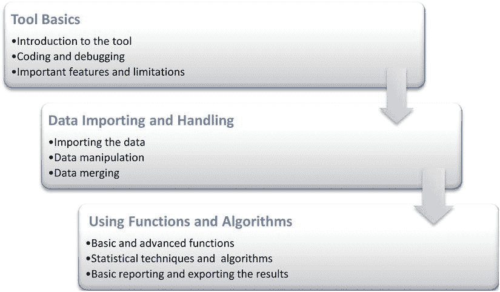

图 3-1. 学习 SAS 基础知识的三个阶段

本章将重点介绍 SAS 中的数据处理。你将学习 SAS 数据集、SAS 逻辑库、SAS 语句、数据导入，并且你将学习如何导入数据、使用 SAS 结构（例如 `if-then-else`）、创建新变量等。所有这些都是使用 SAS 的基础工具。

## SAS 数据集

一个 SAS 数据集包含两个主要部分。第一部分是数据的描述性部分，类似于典型数据集的元数据。另一部分是数据部分，包含二维表格中典型的数据行和列。在本书中，每当我们提到数据集时，都指的是数据部分。SAS 数据集具有 `.sas7bdat` 扩展名，并且可以在 SAS 环境中打开它们。

你可能已经熟悉了许多其他用于存储数据的格式。常见的存储格式示例包括文本文件（`.txt`）和逗号分隔文件（`.csv`）。除了处理 SAS 数据之外，你还将学习如何从外部文件读取数据，这将在本章后续部分介绍。

### SAS 数据集的描述性部分

数据集的描述性部分包含元数据，即关于数据的数据。这主要是对 SAS 数据集中包含的变量和数据集的描述。你可以使用 SAS 中的简单 `contents` 过程（`PROC CONTENTS`）来获取这些元数据。描述性部分包含诸如数据集创建时间、存储位置、包含的变量和观测数、变量的数据类型等详细信息。下面是一个示例，展示了与 `PROC CONTENTS` 相关的代码和输出（表 3-1）。它打印了来自 `sashelp` 逻辑库中 `air` 数据集的描述性部分。

```
proc contents data=sashelp.air;
run;
```

**表 3-1.** CONTENTS 过程

| 数据集名称 | `SASHELP.AIR` | 观测数 | 144 |
| :--- | :--- | :--- | :--- |
| 成员类型 | `DATA` | 变量数 | 2 |
| 引擎 | `V9` | 索引数 | 0 |
| 创建时间 | 2008 年 1 月 16 日，星期三，上午 09:37:31 | 观测长度 | 16 |
| 最后修改时间 | 2008 年 1 月 16 日，星期三，上午 09:37:31 | 已删除观测数 | 0 |
| 保护 | | 是否压缩 | `NO` |
| 数据集类型 | | 是否排序 | `NO` |
| 标签 | 航空数据（月度：1949 年 1 月-1960 年 12 月） | | |
| 数据表示 | `WINDOWS_32` | | |
| 编码 | `us-ascii ASCII (ANSI)` | | |
| 变量和属性的字母顺序列表 | | | |
| :--- | | | |
| # | 变量 | 类型 | 长度 | 格式 | 标签 |
| 2 | `AIR` | `Num` | 8 | | 国际航空旅行（千人次） |
| 1 | `DATE` | `Num` | 8 | `MONYY.` | |
| 引擎/主机相关信息 | | | |
| :--- | | | |
| 数据集页面大小 | 4096 | | |
| 数据集页面数 | 1 | | |
| 第一个数据页面 | 1 | | |
| 每页最大观测数 | 252 | | |
| 第一个数据页面中的观测数 | 144 | | |
| 数据集修复次数 | 0 | | |
| 文件名 | `C:\Program Files\SAS\SASFoundation\9.2(32-bit)\ets\sashelp\air.sas7bdat` | | |
| 创建时的版本 | 9.0201M0 | | |
| 创建时的主机 | `XP_PRO` | | |

### 数据集的数据部分

在 SAS 中处理数据集的数据部分，幸运的是相当简单。如前所述，SAS 数据集中的数据部分包含数据行（更恰当地说是观测值或记录）和数据行，以及列（称为变量）。您可以使用 SAS 的 `print` 过程 (`PROC PRINT`) 来查看数据集。以下是打印 `sashelp.air` 数据集前十个观测值的 SAS 代码：

```
proc print data=sashelp.air(obs=10);
run;
```

表 3-2 列出了此代码的输出。

**表 3-2.** `sashelp.air` 数据集上执行 `PROC PRINT` 的输出

| Obs | DATE | AIR |
| --- | --- | --- |
| 1 | JAN49 | 112 |
| 2 | FEB49 | 118 |
| 3 | MAR49 | 132 |
| 4 | APR49 | 129 |
| 5 | MAY49 | 121 |
| 6 | JUN49 | 135 |
| 7 | JUL49 | 148 |
| 8 | AUG49 | 148 |
| 9 | SEP49 | 136 |
| 10 | OCT49 | 119 |

作为快速回顾，表 3-3 列出了 SAS 环境中常用的文件图标和扩展名。

**表 3-3.** SAS 环境中常用的文件图标和扩展名

| 图标 | 文件类型 |
| --- | --- |
|  | `.sas` 是一个 SAS 代码文件，包含 SAS 脚本。可以执行脚本来执行操作并创建输出。 |
| 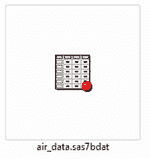 | `.sas7bdat` 是一个 SAS 数据文件；此文件包含数据。 |
| 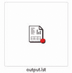 | SAS 输出的默认扩展名是 `.lst`。 |
|  | SAS 日志文件的扩展名是 `.log`。 |

## SAS 逻辑库

SAS 数据集存储在 SAS 逻辑库中。前面的示例使用了来自 `sashelp` 逻辑库的 `air` 数据集。每个数据集最好先存储在一个逻辑库中；否则，您将无法在 SAS 环境中使用它。简要总结一下：
- 一个 SAS 逻辑库是一组 SAS 数据集和其他 SAS 文件的集合。
- 例如，您可以从包含表的 Oracle 数据库创建一个 SAS 逻辑库。

您需要定义一个逻辑库才能存储任何数据集。SAS 逻辑库不是虚拟文件夹；它是 Windows 环境中的一个物理文件夹。您只需使用一个句柄（逻辑库名称）来引用逻辑库的物理路径和物理文件夹的名称。因此，在创建逻辑库时，您需要提供两个必需的参数：逻辑库名称和将存储文件的物理路径。接下来介绍创建新逻辑库的两种方法：使用图形用户界面 (GUI) 和使用 SAS 代码。

### 使用 GUI 创建逻辑库

SAS 提供了一个 GUI 来创建和使用逻辑库。以下是创建逻辑库的步骤：
1.  打开资源管理器（图 3-2）。
    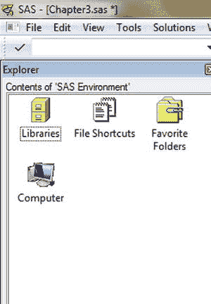
    **图 3-2.** 创建新逻辑库：打开资源管理器
2.  双击 `Libraries` 文件夹图标。此文件夹包含 SAS 中的所有默认逻辑库（图 3-3）。
    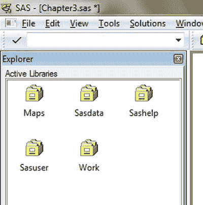
    **图 3-3.** 创建新逻辑库：活动的逻辑库
3.  在资源管理器窗口中右键单击，然后选择“新建”以创建新逻辑库（图 3-4）。
    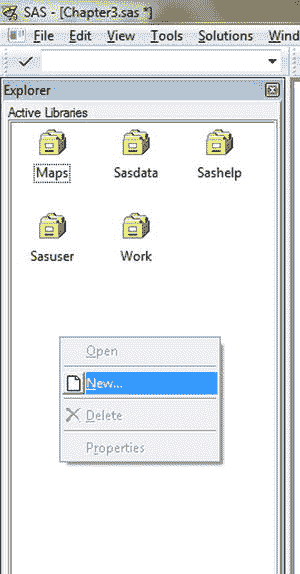
    **图 3-4.** 创建新逻辑库：右键单击并选择“新建”菜单选项
4.  为逻辑库命名（图 3-5）。

# 创建新逻辑库（续）

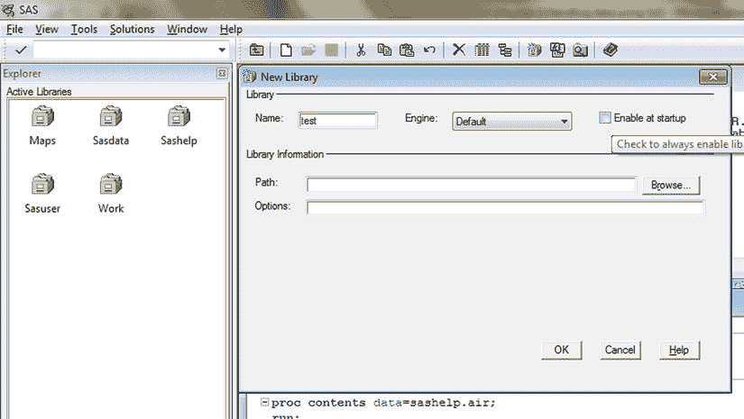

**图 3-5.** 创建新逻辑库：填写逻辑库名称

5. 提供逻辑库的物理路径（图 3-6）。存储在该逻辑库中的所有数据集都可以在该位置看到。

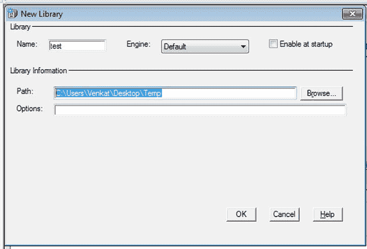

**图 3-6.** 创建新逻辑库：填写逻辑库的物理路径

6. 单击“确定”，新逻辑库将被创建（图 3-7）。

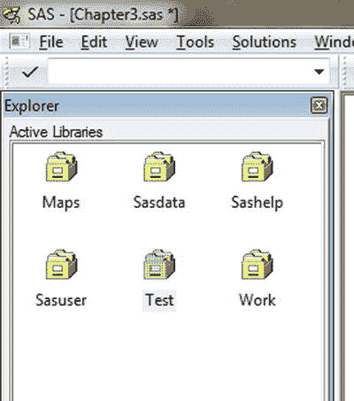

**图 3-7.** 创建新逻辑库：新逻辑库 Test 已创建

显然，新创建的逻辑库目前是空的。您可以通过双击 `Test` 图标来验证这一点（图 3-8）。

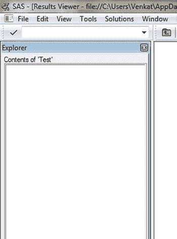

**图 3-8.** 创建新逻辑库：新逻辑库 Test

如果您按照相同的步骤创建一个名为 `1temp` 的新逻辑库会怎样（图 3-9）？

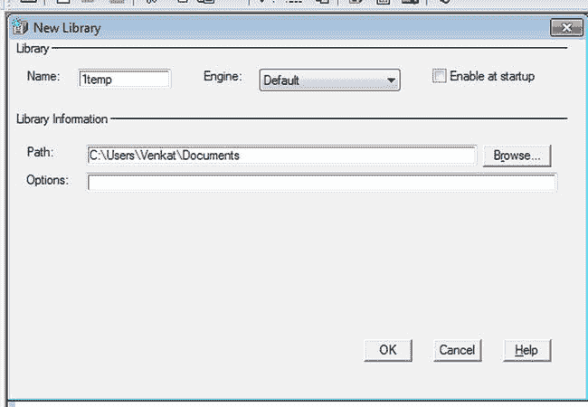

**图 3-9.** 创建新逻辑库：无效名称

该逻辑库将不会被创建，因为 `1temp` 是一个无效名称；您将收到图 3-10 中给出的错误。

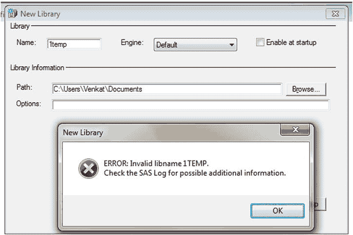

**图 3-10.** 创建新逻辑库：错误，显示无效名称

您不能使用任意字符串作为逻辑库名称。创建逻辑库时有某些命名规则，接下来将介绍。

## 逻辑库的分配规则

定义逻辑库名称的规则如下：

- 逻辑库名称的最大长度为八个字符。
- 逻辑库名称必须以字母或下划线开头。
- 逻辑库名称可以是字母、数字和下划线的组合。

表 3-4 列出了一些可以工作的示例逻辑库名称，以及一些会引发错误的逻辑库名称。

**表 3-4.** 有效和无效的 SAS 逻辑库名称

| 逻辑库名称 | 结果 | 说明 |
| --- | --- | --- |
| `Mylib` | 可以工作 | 逻辑库名称少于八个字符。 |
| `Mylib1` | 可以工作 | 逻辑库名称是字母和数字的组合。 |
| `$Mylib` | 引发错误 | 逻辑库名称不能以下划线 (`_`) 以外的特殊字符开头。 |
| `_Mylib` | 可以工作 | 逻辑库名称可以以下划线 (`_`) 开头。 |
| `Mylib$` | 引发错误 | 逻辑库名称不能包含除下划线 (`_`) 以外的任何特殊字符。 |
| `_mylib_` | 可以工作 | 逻辑库名称可以包含下划线 (`_`)。 |
| `2mylib` | 引发错误 | 逻辑库名称不能以数字开头。 |
| `Datalib2013Sales` | 引发错误 | 逻辑库名称太长。不能超过八个字符。 |

## 使用 SAS 代码创建新逻辑库

用于创建新逻辑库的 SAS 代码如下：

```
libname <逻辑库名称> '<逻辑库路径>';
libname mydata 'C:\Users\sales\Desktop\Data';
```

此代码将创建一个名为 `mydata` 的逻辑库，并将其关联到以下文件夹：

`C:\Users\sales\Desktop\Data`

以下是执行上述代码时的日志消息：

```
22   libname mydata 'C:\Users\sales\Desktop\Data';
NOTE: Libref MYDATA was successfully assigned as follows:
Engine:        V9
Physical Name: C:\Users\sales\Desktop\Data
```

## 永久逻辑库和临时逻辑库

SAS 中有两种类型的逻辑库：永久逻辑库和临时逻辑库。您通过使用 `libname` 语句和 GUI 创建的逻辑库是永久逻辑库。一旦在永久逻辑库中创建了数据集，您将来就可以使用它，并且即使系统重新启动后，该数据集也将可用。通过在永久逻辑库中创建或导入数据集，您实际上是在创建一个永久的数据集。

### 工作库

工作库是 SAS 中的一个临时库。在 `Work` 库中创建的数据集仅在当前 SAS 会话期间有效。一旦您关闭并重新打开 SAS，`Work` 库中的所有数据集都将丢失。如果您在创建数据集时未指定任何库名称，那么 SAS 默认会将其存储在 `Work` 库中。

接下来，我们通过一个练习来更深入地探讨这些概念。下面的代码创建了一个包含两列的数据集。您将使用此代码在 `Work` 库以及一个名为 `Mydata` 的永久库中创建数据集。然后，您关闭并重新打开 SAS，以查看数据集是否仍然存在。

以下代码在 `mydata` 库中创建了一个包含两个变量（`income` 和 `expense`）的 `Income` 数据集。您还使用 `datalines` 关键字向 `income` 数据集中输入了一些记录。

```
data mydata.income;
input income expense;
datalines;
4500 2000
5000 2300
7890 2810
8900 5400
2300 2000
;
run;
```

执行此代码时的日志消息如下所示：

```
NOTE: The data set MYDATA.INCOME has 5 observations and 2 variables.
NOTE: DATA statement used (Total process time):
real time           0.07 seconds
cpu time            0.01 seconds
```

图 3-11 展示了 `Mydata` 库的内容。您可以看到一个 `Income` 图标，这是刚刚创建的数据集。

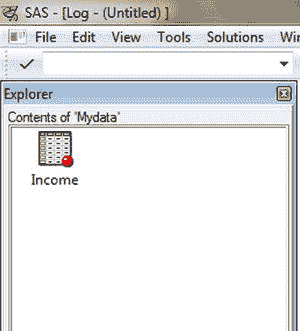

**图 3-11.** `Mydata` 库的内容

以下代码在 `Work` 库中创建了 `Income` 数据集，其详细信息与您在 `Mydata` 库中创建的一致：

```
data work.income;
input income expense;
datalines;
4500 2000
5000 2300
7890 2810
8900 5400
2300 2000
;
run;
```

执行此代码时的日志消息如下所示：

```
NOTE: The data set WORK.INCOME has 5 observations and 2 variables.
NOTE: DATA statement used (Total process time):
real time           0.01 seconds
cpu time            0.01 seconds
```

图 3-12 展示了 `Work` 库的内容。您可以看到 `Income` 图标，这是刚刚创建的数据集。

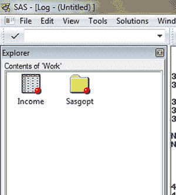

**图 3-12.** 创建 `Income` 数据集后 `Work` 库的内容

以下代码也在 `Work` 库中创建了 `Income` 数据集。如果您未提及任何库名称，数据集将默认在 `Work` 库中创建。

```
data income;
input income expense;
datalines;
4500 2000
5000 2300
7890 2810
8900 5400
2300 2000
;
run;
```

如果您关闭 SAS 然后重新打开，您将无法在 `Work` 库中看到 `Income` 数据集。相比之下，在 `Mydata` 库中，您会观察到 `Income` 数据集仍然存在。

> **注意：** 如果 `Mydata` 库从库列表中消失或被删除，不必担心。您需要做的只是重新运行以下代码来重新创建库名称并为其分配目录路径。之后，您将再次在 `Mydata` 库中看到 `Income` 数据集。您无需再次创建数据集。数据集 `Income` 已永久创建在给定的库文件夹路径中，文件扩展名为 `.sas7bdat`。
>
> ```
> libname mydata 'C:\Users\sales\Desktop\Data';
> ```

既然您已经学会了如何使用 SAS 库，那么接下来是时候学习 SAS 编码的基础知识了，这将使您能够处理数据并执行一些有意义的分析。下一节将向您介绍 SAS `PROC` 和 `DATA` 步骤，它们是编写 SAS 代码最基本的构建块。

## SAS 语句的两种主要类型

SAS 语句主要有两种类型（参见表 3-5）。一种以 `DATA` 开头，另一种以 `PROC` 开头。数据步骤主要用于变量创建、数据处理和其他与数据相关的操作。`PROC` 步骤用于（在 SAS 代码中）调用各种算法、特殊函数等。`PROC` 是 procedure（过程）这个词的缩写，意思是 SAS 中预编写的代码。

**表 3-5.** `DATA` 步骤和 `PROC` 步骤

| `DATA` 步骤 | `PROC` 步骤 |
| --- | --- |
| 以关键字 `DATA` 开头。用于数据处理。创建计算字段。主要用于报表。数据合并、连接、数据清洗操作。示例：从原始数据准备用于分析的数据需要大量数据操作。 | 以关键字 `PROC` 开头。用于分析和其他复杂操作。您可以通过获取 `PROC` 步骤的输出来创建数据集。示例：使用回归算法预测销售额需要 `PROC REG`。 |

## 将数据导入 SAS

在开始处理数据之前，您需要将其以 SAS 数据集的形式导入到 SAS 库中。数据可以从多种来源导入 SAS，例如 CSV 文件、Excel 文件、TXT 文件、数据库文件等。以下各节将解释一些导入和创建数据的方法。

### 使用 SAS 程序创建数据集

如果您必须根据提供的某些数据创建一个小型数据集，可以通过编写一个简短的 SAS 程序来完成。

这是一个创建数据集的示例程序：

```
data mydata.income;
input income expense;
datalines;
4500 2000
5000 2300
7890 2810
8900 5400
2300 2000
;
run;
```

表 3-6 解释了上述语法。

**表 3-6.** 程序语法解释

| SAS 语句 | 解释 |
| --- | --- |
| `data` | 这是一个用于在 SAS 中创建新数据集的关键字。 |
| `mydata.income;` | `Mydata` 是库名称，`income` 是新数据集的名称。 |
| `input` | 这是一个用于声明数据中变量的关键字。 |
| `income expense;` | 这是将在新数据集中创建的两个变量。 |
| `datalines;` | 这是一个用于向数据集中输入数据的关键字。 |
| `4500 2000` `5000 2300` `7890 2810` `8900 5400` `2300 2000` `;` | 这是实际数据。 |

以下是执行此程序时的日志文件：

```
NOTE: The data set MYDATA.INCOME has 5 observations and 2 variables.
NOTE: DATA statement used (Total process time):
real time           0.03 seconds
cpu time            0.03 seconds
```

图 3-13 展示了 `Mydata` 库中的 `Income` 数据集。

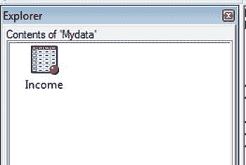

**图 3-13.** 创建 `Income` 数据集后 `Mydata` 库的内容

通常，当您想快速创建一个小型数据集用于分析时，数据集创建步骤非常有用。如果您要创建非常大的数据集，那么手动输入值显然不是理想的选择。您需要使用 SAS 的导入功能将大型数据文件导入到 SAS 环境中。

### 使用导入向导

你可以通过编写 SAS 代码从外部文件导入数据，也可以使用导入向导。我们先来看看如何使用导入向导将外部平面文件导入 SAS。以下是导入数据的步骤：

选择：文件 ➤ 导入数据（参见图 3-14）。

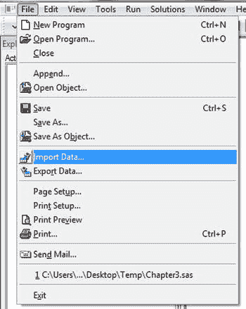

**图 3-14.** 导入数据：选择 `Import Data` 选项

选择文件类型。在此示例中，你将导入一个 CSV 文件；因此，你需要选择 CSV 格式（参见图 3-15 和图 3-16）。

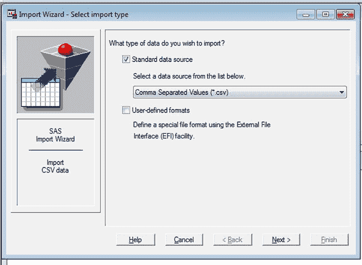

**图 3-16.** 导入数据：最终选择界面

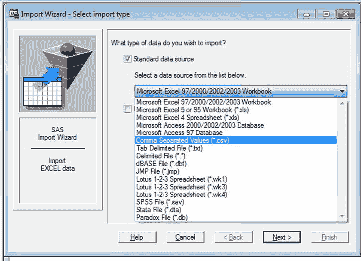

**图 3-15.** 导入数据：选择文件类型

点击“下一步”。使用“浏览”按钮定位输入文件（参见图 3-17）。

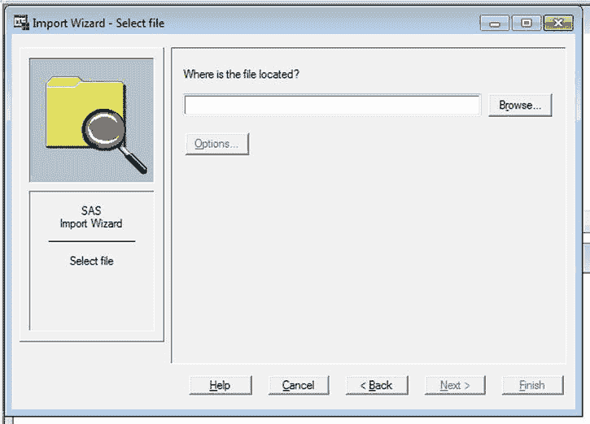

**图 3-17.** 导入数据：浏览到文件位置

图 3-18 显示了输入了正确文件路径的向导。

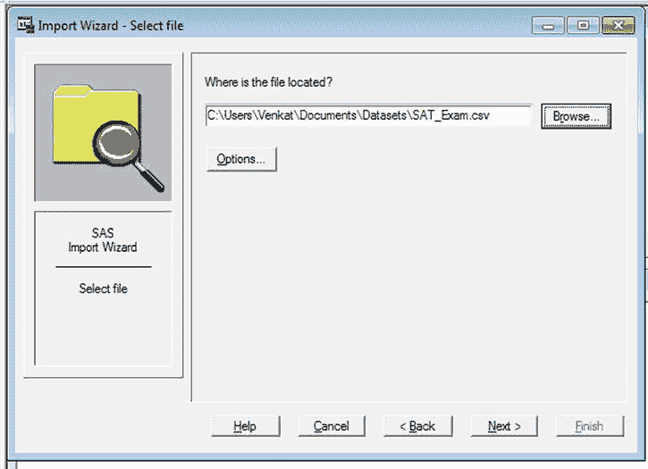

**图 3-18.** 导入数据：正在选择文件文件夹路径

选择文件并点击“下一步”。提供目标 SAS 数据集的详细信息（参见图 3-19）。

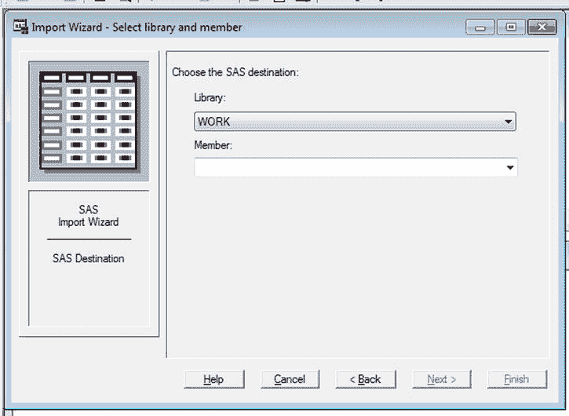

**图 3-19.** 导入数据：SAS 数据集目标详细信息

选择逻辑库（参见图 3-20）。

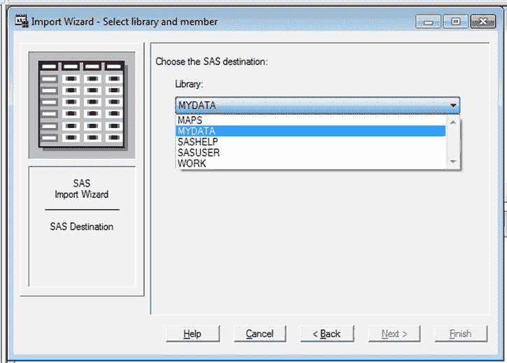

**图 3-20.** 导入数据：选择逻辑库

命名目标数据集（参见图 3-21）。

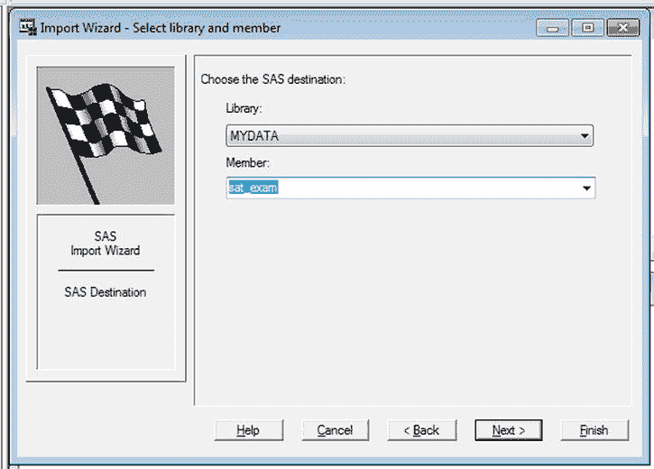

**图 3-21.** 导入数据：命名目标数据集

如果你认为将来可能需要再次导入这些数据，可以将导入步骤保存到一个 SAS 文件中（参见图 3-22）。此步骤是可选的。浏览到一个位置并保存 `.sas` 文件（参见图 3-23）。

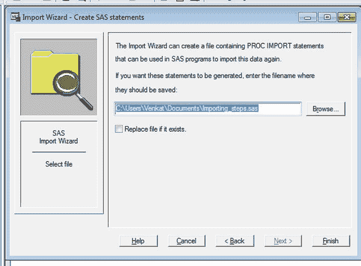

**图 3-23.** 导入数据：生成并保存导入 GUI 选项的代码至 `.sas` 文件

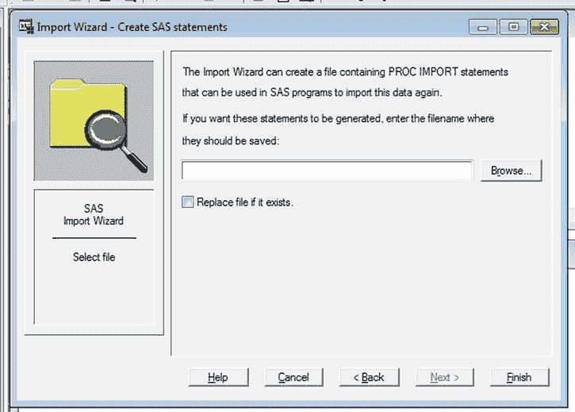

**图 3-22.** 导入数据：生成并保存导入 GUI 选项的代码的选项

点击“完成”结束此过程。

数据集将存放在逻辑库中，SAS 代码将在 `.sas` 文件中。图 3-24 显示了存储在 `Mydata` 逻辑库中的 `sat_exam` 数据集。

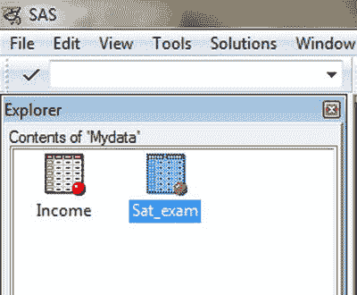

**图 3-24.** 导入数据：`Mydata` 逻辑库的内容

你保存的文件中的 SAS 代码如下：

```
PROC IMPORT OUT= MYDATA.sat_exam
DATAFILE= "C:\Users\Documents\Datasets\SAT_Exam.csv"
DBMS=CSV REPLACE;
GETNAMES=YES;
DATAROW= 2 ;
RUN ;
```

以同样的方式，你可以使用导入向导导入不同类型的文件，例如 TXT 文件、Excel 文件等。下一节将解释用于导入数据的 SAS 代码。

### 使用代码导入

在上一节中，你使用图形用户界面导入了数据。你也可以使用 SAS 代码导入数据。在分析数据时，数据导入后通常还需要一些数据操作代码，因此将数据导入代码写在同一个文件中会很方便。

#### 使用代码导入 CSV 文件

以下代码将一个简单的 CSV 文件导入 SAS：

```
PROC IMPORT OUT= MYDATA.sat_exam
DATAFILE= "C:\Users\Documents\Datasets\SAT_Exam.csv"
DBMS=CSV REPLACE;
GETNAMES=YES;
DATAROW= 2 ;
RUN ;
```

表 3-7 对此代码进行了解释。

**表 3-7.** 导入 `.csv` 文件的代码

| SAS 语句 | 说明 |
| --- | --- |
| `PROC IMPORT` | 这是一个用于从外部文件导入数据的 SAS 过程。 |
| `OUT= MYDATA.sat_exam` | 这指定了导入数据的目标位置。`MYDATA` 是逻辑库名称，`sat_exam` 是新数据集的名称。 |
| `DATAFILE= "C:\Users\Documents\Datasets\SAT_Exam.csv"` | 这指定了要导入的源数据文件的完整路径和文件名。 |
| `DBMS=CSV` | 这指定了要导入的数据文件格式为 CSV。 |
| `REPLACE` | 这表示如果目标数据集已经存在，则替换它。 |
| `GETNAMES=YES` | 这告诉 SAS 使用文件的第一行作为数据集变量的名称。 |
| `DATAROW= 2` | 这告诉 SAS 从文件的第二行开始读取数据（假设第一行是列名）。 |
| `RUN ;` | 这标志着 `PROC IMPORT` 步骤的结束。 |

# SAS 数据导入与操作

## PROC IMPORT 参数说明

`PROC IMPORT` 是将数据导入 SAS 的过程。以下是该过程的常用参数：

- `OUT= MYDATA.sat_exam`：`OUT` 关键字，用于指定 SAS 中的输出文件。这里，你将数据集导入并存储为 `Mydata` 逻辑库中的 `sat_exam`。
- `DATAFILE= "C:\Users\Documents\Datasets\SAT_Exam.csv"`：`DATAFILE` 关键字用于指定需要导入 SAS 的输入数据文件。你需要指定文件的完整文件夹路径及其扩展名。
- `DBMS=CSV`：`DBMS=CSV` 表示你要导入的文件类型。
- `REPLACE;`：如果已存在与 `MYDATA.sat_exam` 同名的文件，则此选项将替换该文件。请注意，第一个 SAS 语句在此结束，并且在此之前没有分号。
- `GETNAMES=YES;`：是否从导入文件中获取列名？是或否？
- `DATAROW=2;`：数据从哪一行开始？在本例中，第一行是列名，数据从第二行开始。

以下是导入包含汉堡销售数据的 CSV 文件的代码：

```
PROC IMPORT OUT= MYDATA.burger
DATAFILE= "C:\Users\Documents\Datasets\Burger_sales.csv"
DBMS=CSV REPLACE;
GETNAMES=YES;
DATAROW= 2 ;
RUN ;
```

执行此代码时，日志文件中的重要说明如下：

```
NOTE: The infile 'C:\Users\Documents\Datasets\Burger_sales.csv' is:
Filename=C:\Users\Documents\Datasets\Burger_sales.csv,
RECFM=V,LRECL=32767, File Size (bytes)=375,
Last Modified=10Jun2014:15:33:18,
Create Time=05Oct2014:17:02:57
NOTE: 35 records were read from the infile 'C:\Users\Documents\Datasets\Burger_sales.csv'.
The minimum record length was 8.
The maximum record length was 9.
NOTE: The data set MYDATA.BURGER has 35 observations and 2 variables.
NOTE: DATA statement used (Total process time):
real time           0.03 seconds
cpu time            0.03 seconds
35 rows created in MYDATA.BURGER                             from
C:\Users\Documents\Datasets\Burger_sales.csv.
NOTE: MYDATA.BURGER data set was successfully created.
NOTE: PROCEDURE IMPORT used (Total process time):
real time           0.10 seconds
cpu time            0.10 seconds
```

### 导入其他类型的文件

#### 导入 Excel 文件

以下 Excel 导入代码中有一个额外的参数 `RANGE`。这指的是 Excel 工作表中的工作表名称。通常一个 Excel 文件包含多个工作表，因此你需要指定需要导入的工作表。

```
PROC IMPORT OUT= MYDATA.BURGER_sales_from_excel
DATAFILE= "C:\Users\Documents\Datasets\Burger_sales.xls"
DBMS=EXCEL REPLACE;
RANGE="Burger_sales$";
GETNAMES=YES;
RUN ;
```

以下是执行此代码时的日志消息：

```
153  PROC IMPORT OUT= MYDATA.BURGER_sales_from_excel
154              DATAFILE= "C:\Users\Documents\Datasets\Burger_sales.xls"
155              DBMS=EXCEL REPLACE;
156       RANGE="Burger_sales$";
157       GETNAMES=YES;
158     RUN;
NOTE: MYDATA.BURGER_SALES_FROM_EXCEL data set was successfully created.
NOTE: PROCEDURE IMPORT used (Total process time):
real time           0.13 seconds
cpu time            0.06 seconds
```

#### 导入文本文件

类似地，以下代码导入一个文本文件：

```
PROC IMPORT OUT= MYDATA.SAT_EXAM_data_from_text_file
DATAFILE= "C:\Users\Documents\Datasets\SAT_Exam.txt"
DBMS=TAB REPLACE;
GETNAMES=YES;
DATAROW= 2 ;
RUN ;
```

你可以使用 `PROC IMPORT` 导入各种类型的文件；唯一的变化是导入代码中的一些参数。

## 数据操作

你可以使用导入代码导入原始数据。大多数情况下，你需要对原始数据进行操作，以便为分析做好准备。在此过程中，你可能需要对数据进行子集选择、与其他数据集合并、创建新的计算变量、从现有变量派生变量等等。接下来的章节将引导你了解一些重要的步骤，在几乎任何分析的数据操作过程中，你都需要用到这些步骤。

### 复制 SAS 数据集

假设你已经导入了一些数据，并且希望进一步准备数据以供分析。以下代码在 SAS 中创建了数据集的副本。为此，你可以在数据步骤中使用 `SET` 语句：

```
data MYDATA.sat_exam_copy;
set  MYDATA.sat_exam;
run;
```

上述代码简单地将数据从 `sat_exam` 复制到`MYDATA` 逻辑库中的 `sat_exam_copy`。以下是此代码的日志文件：

```
NOTE: MYDATA.SAT_EXAM_DATA_FROM_TEXT_FILE data set was successfully created.
NOTE: PROCEDURE IMPORT used (Total process time):
real time           0.60 seconds
cpu time            0.18 seconds

1761  data MYDATA.sat_exam_copy;
1762  set  MYDATA.sat_exam;
1763  run;

NOTE: There were 96 observations read from the data set MYDATA.SAT_EXAM.
NOTE: The data set MYDATA.SAT_EXAM_COPY has 96 observations and 5 variables.
NOTE: DATA statement used (Total process time):
real time           0.03 seconds
cpu time            0.01 seconds
```

类似地，如果你想要将数据集复制到另一个逻辑库，例如 `Work`，那么你可以使用以下代码：

```
data sat_exam_copy;
set  MYDATA.sat_exam;
run;
```

以下是此代码的日志文件：

```
NOTE: There were 96 observations read from the data set MYDATA.SAT_EXAM.
NOTE: The data set MYDATA.SAT_EXAM_COPY has 96 observations and 5 variables.
NOTE: DATA statement used (Total process time):
real time           0.03 seconds
cpu time            0.03 seconds
```

让我们使用一个市场活动数据的例子来更好地理解这个主题。以下代码导入了市场数据文件：

### 市场活动案例研究

```
PROC IMPORT OUT= MYDATA.market
DATAFILE= "C:\Users\Documents\Datasets\Market_campaign.csv"
DBMS=CSV REPLACE;
GETNAMES=YES;
DATAROW= 2;
RUN;
```
表 3-8 列出了市场活动数据的快照。

**表 3-8.** 市场活动数据快照

| 观测值 | Camp_ID | 名称 | start_date | end_date | 类别 | 覆盖率 | 预算 |
| --- | --- | --- | --- | --- | --- | --- | --- |
| 1 | 1 | Citrix WP_Q1_13 CPG | 10/25/2008 | 01/20/2010 | 技术 | 36.6 | 15396 |
| 2 | 2 | Evergreen WP27 CPG | 11/01/2008 | 09/03/2009 | 技术 | 36.6 | 9603 |
| 3 | 3 | Stratus WP CPG | 11/06/2008 | 02/23/2009 | 技术 | 36.6 | 19173 |
| 4 | 4 | Oco WP_PAN CPG | 11/06/2008 | 02/23/2009 | 技术 | 36.6 | 5305 |
| 5 | 5 | DTI wp CPG | 11/08/2008 | 11/16/2012 | 商业/金融 | 100 | 2735 |
| 6 | 6 | APSFC yourlessthan$2,Unlimiteddomains CPG | 11/09/2008 | 11/09/2008 | 技术 | 36.6 | 1937 |
| 7 | 7 | Hubspot WP CPG | 11/10/2008 | 01/11/2009 | 技术 | 36.6 | 2144 |
| 8 | 8 | Info WP CPG | 11/10/2008 | 11/14/2010 | 市场营销 | 69.2 | 6657 |
| 9 | 9 | Cognos WP CPG | 11/10/2008 | 11/12/2012 | 技术 | 38.5 | 8783 |
| 10 | 10 | HP WP CPG | 11/11/2008 | 11/06/2017 | 技术 | 29.4 | 1414 |

表 3-9 列出了变量及其描述。

**表 3-9.** 市场数据示例的变量及其描述

| 变量 | 描述 |
| --- | --- |
| `Camp_id` | 市场活动 ID |
| `name` | 市场活动的名称 |
| `start_date` | 活动开始日期 |
| `end_date` | 活动结束日期 |
| `Category` | 活动的类别或类型 |
| `reach` | 活动覆盖率（100% 覆盖率为目标） |
| `budget` | 市场活动预算 |

在下一节中，你将使用此市场活动案例研究，通过 SAS 尝试各种数据操作。

### 创建新变量

要创建一个新变量，你需要再次使用 `set` 语句以及新变量语句。以下是通用示例：

```sas
data new_data;
set old_data;
<新变量语句>;
run;
```

让我们尝试编写一些实际的 SAS 代码片段来详细说明之前的通用代码，以创建新变量。

通过增加 12% 的税费，创建一个新变量 `budget_new`。

```sas
data MYDATA.market_v1;
set MYDATA.market;
budget_new=budget* 1.12;
run;
```

上述代码的日志文件如下：

```
NOTE: There were 7843 observations read from the data set MYDATA.MARKET.
NOTE: The data set MYDATA.MARKET_V1 has 7843 observations and 8 variables.
NOTE: DATA statement used (Total process time):
real time           0.01 seconds
cpu time            0.01 seconds
```

请注意 SAS 日志文件的第一行。它的含义如下：每当某条记录的 `budget` 值为缺失值时，`budget_new` 变量也将是缺失值。这是在 SAS 中处理数据时需要记住的一个重要点。

表 3-10 列出了新数据集 `market_v1` 的快照。

**表 3-10.** 新数据集 `market_v1` 的快照

| Camp_ID | 名称 | start_date | end_date | 类别 | 覆盖率 | 预算 | budget_new |
| --- | --- | --- | --- | --- | --- | --- | --- |
| 1 | Citrix WP_Q1_13 CPG | 10/25/2008 | 01/20/2010 | 技术 | 36.6 | 15396 | 17243.52 |
| 2 | Evergreen WP27 CPG | 11/01/2008 | 09/03/2009 | 技术 | 36.6 | 9603 | 10755.36 |
| 3 | Stratus WP CPG | 11/06/2008 | 02/23/2009 | 技术 | 36.6 | 19173 | 21473.76 |
| 4 | Oco WP_PAN CPG | 11/06/2008 | 02/23/2009 | 技术 | 36.6 | 5305 | 5941.60 |
| 5 | DTI wp CPG | 11/08/2008 | 11/16/2012 | 商业/金融 | 100 | 2735 | 3063.20 |
| 6 | APSFC yourlessthan$2,Unlimiteddomains CPG | 11/09/2008 | 11/09/2008 | 技术 | 36.6 | 1937 | 2169.44 |
| 7 | Hubspot WP CPG | 11/10/2008 | 01/11/2009 | 技术 | 36.6 | 2144 | 2401.28 |
| 8 | Info WP CPG | 11/10/2008 | 11/14/2010 | 市场营销 | 69.2 | 6657 | 7455.84 |
| 9 | Cognos WP CPG | 11/10/2008 | 11/12/2012 | 技术 | 38.5 | 8783 | 9836.96 |
| 10 | HP WP CPG | 11/11/2008 | 11/06/2017 | 技术 | 29.4 | 1414 | 1583.68 |

假设覆盖率的值存在夸大。只取覆盖率的 80%，并将新变量命名为 `net_reach`，如下所示：

```sas
data MYDATA.market_v2;
set MYDATA.market_v1;
net_reach=reach* 0.8;
run;
```

以下是此代码的日志文件：

```
NOTE: There were 7843 observations read from the data set MYDATA.MARKET_V1.
NOTE: The data set MYDATA.MARKET_V2 has 7843 observations and 9 variables.
NOTE: DATA statement used (Total process time):
real time           0.01 seconds
cpu time            0.01 seconds
```

表 3-11 列出了新数据集 `market_v2` 的快照。

**表 3-11.** 新数据集 `market_v2` 的快照

| 活动编号 | 名称 | 开始日期 | 结束日期 | 类别 | 触达量 | 预算 | 新预算 | 净触达量 |
| --- | --- | --- | --- | --- | --- | --- | --- | --- |
| 1 | Citrix WP_Q1_13 CPG | 10/25/2008 | 01/20/2010 | 技术 | 36.6 | 15396 | 17243.52 | 29.28 |
| 2 | Evergreen WP27 CPG | 11/01/2008 | 09/03/2009 | 技术 | 36.6 | 9603 | 10755.36 | 29.28 |
| 3 | Stratus WP CPG | 11/06/2008 | 02/23/2009 | 技术 | 36.6 | 19173 | 21473.76 | 29.28 |
| 4 | Oco WP_PAN CPG | 11/06/2008 | 02/23/2009 | 技术 | 36.6 | 5305 | 5941.60 | 29.28 |

| 活动编号 | 名称 | 开始日期 | 结束日期 | 类别 | 触达量 | 预算 | 新预算 | 净触达量 |
| --- | --- | --- | --- | --- | --- | --- | --- | --- |
| 1 | Citrix WP_Q1_13 CPG | 10/25/2008 | 01/20/2010 | 技术 | 36.6 | 15396 | 17243.52 | 29.28 |
| 2 | Evergreen WP27 CPG | 11/01/2008 | 09/03/2009 | 技术 | 36.6 | 9603 | 10755.36 | 29.28 |
| 3 | Stratus WP CPG | 11/06/2008 | 02/23/2009 | 技术 | 36.6 | 19173 | 21473.76 | 29.28 |
| 4 | Oco WP_PAN CPG | 11/06/2008 | 02/23/2009 | 技术 | 36.6 | 5305 | 5941.60 | 29.28 |
| 5 | DTI wp CPG | 11/08/2008 | 11/16/2012 | 商业/金融 | 100 | 2735 | 3063.20 | 80.00 |
| 6 | APSFC yourlessthan$2,Unlimiteddomains CPG | 11/09/2008 | 11/09/2008 | 技术 | 36.6 | 1937 | 2169.44 | 29.28 |
| 7 | Hubspot WP CPG | 11/10/2008 | 01/11/2009 | 技术 | 36.6 | 2144 | 2401.28 | 29.28 |
| 8 | Info WP CPG | 11/10/2008 | 11/14/2010 | 营销 | 69.2 | 6657 | 7455.84 | 55.36 |
| 9 | Cognos WP CPG | 11/10/2008 | 11/12/2012 | 技术 | 38.5 | 8783 | 9836.96 | 30.80 |
| 10 | HP WP CPG | 11/11/2008 | 11/06/2017 | 技术 | 29.4 | 1414 | 1583.68 | 23.52 |

事实上，你可以在同一个数据步骤中执行这两个操作，如下所示：

```
Data MYDATA.market_v3;
set MYDATA.market;
budget_new=budget * 1.12;
net_reach=reach * 0.8;
run;
```

以下是此代码的日志文件：

```
NOTE: There were 7843 observations read from the data set MYDATA.MARKET.
NOTE: The data set MYDATA.MARKET_V3 has 7843 observations and 9 variables.
NOTE: DATA statement used (Total process time):
      real time           0.01 seconds
      cpu time            0.01 seconds
```

表 3-12 列出了新数据集 `market_v3` 的快照。

`表 3-12. 新数据集 market_v3 的快照`

| 活动编号 | 名称 | 开始日期 | 结束日期 | 类别 | 触达量 | 预算 | 新预算 | 净触达量 |
| --- | --- | --- | --- | --- | --- | --- | --- | --- |
| 1 | Citrix WP_Q1_13 CPG | 10/25/2008 | 01/20/2010 | 技术 | 36.6 | 15396 | 17243.52 | 29.28 |
| 2 | Evergreen WP27 CPG | 11/01/2008 | 09/03/2009 | 技术 | 36.6 | 9603 | 10755.36 | 29.28 |
| 3 | Stratus WP CPG | 11/06/2008 | 02/23/2009 | 技术 | 36.6 | 19173 | 21473.76 | 29.28 |
| 4 | Oco WP_PAN CPG | 11/06/2008 | 02/23/2009 | 技术 | 36.6 | 5305 | 5941.60 | 29.28 |
| 5 | DTI wp CPG | 11/08/2008 | 11/16/2012 | 商业/金融 | 100 | 2735 | 3063.20 | 80.00 |
| 6 | APSFC yourlessthan$2,Unlimiteddomains CPG | 11/09/2008 | 11/09/2008 | 技术 | 36.6 | 1937 | 2169.44 | 29.28 |
| 7 | Hubspot WP CPG | 11/10/2008 | 01/11/2009 | 技术 | 36.6 | 2144 | 2401.28 | 29.28 |
| 8 | Info WP CPG | 11/10/2008 | 11/14/2010 | 营销 | 69.2 | 6657 | 7455.84 | 55.36 |
| 9 | Cognos WP CPG | 11/10/2008 | 11/12/2012 | 技术 | 38.5 | 8783 | 9836.96 | 30.80 |
| 10 | HP WP CPG | 11/11/2008 | 11/06/2017 | 技术 | 29.4 | 1414 | 1583.68 | 23.52 |

## 使用多个变量创建新变量

在表中使用多个变量创建新字段的语法与你已经看到的创建单个变量的语法类似。以下是通用代码：

```
data new_data;
set old_data;
<新变量语句>;
run;
```

让我们看一个例子：一个市场活动的效果是通过其相对于预算的触达量来衡量的。`reach_per_dollar`（每美元触达量）是你想要创建的新变量，用以确定每个活动的效果。代码如下：

```
Data MYDATA.market_v4;
set  MYDATA.market;
reach_per_dollar=reach / budget;
run;
```

表 3-13 列出了新数据集 `market_v4` 的快照。

`表 3-13. 新数据集 market_v4 的快照`

| 活动编号 | 名称 | 开始日期 | 结束日期 | 类别 | 触达量 | 预算 | 每美元触达量 |
| --- | --- | --- | --- | --- | --- | --- | --- |
| 1 | Citrix WP_Q1_13 CPG | 10/25/2008 | 01/20/2010 | 技术 | 36.6 | 15396 | 0.002377 |
| 2 | Evergreen WP27 CPG | 11/01/2008 | 09/03/2009 | 技术 | 36.6 | 9603 | 0.003811 |
| 3 | Stratus WP CPG | 11/06/2008 | 02/23/2009 | 技术 | 36.6 | 19173 | 0.001909 |
| 4 | Oco WP_PAN CPG | 11/06/2008 | 02/23/2009 | 技术 | 36.6 | 5305 | 0.006899 |
| 5 | DTI wp CPG | 11/08/2008 | 11/16/2012 | 商业/金融 | 100 | 2735 | 0.036563 |
| 6 | APSFC yourlessthan$2,Unlimiteddomains CPG | 11/09/2008 | 11/09/2008 | 技术 | 36.6 | 1937 | 0.018895 |
| 7 | Hubspot WP CPG | 11/10/2008 | 01/11/2009 | 技术 | 36.6 | 2144 | 0.017071 |
| 8 | Info WP CPG | 11/10/2008 | 11/14/2010 | 营销 | 69.2 | 6657 | 0.010395 |
| 9 | Cognos WP CPG | 11/10/2008 | 11/12/2012 | 技术 | 38.5 | 8783 | 0.004383 |
| 10 | HP WP CPG | 11/11/2008 | 11/06/2017 | 技术 | 29.4 | 1414 | 0.020792 |

## 使用 if-then-else 创建新变量

你可能需要使用 `if-then-else` 结构来创建包含诸如“高”、“中”、“低”、“是”或“否”等值的新分类变量。以下是使用 `if-then-else` 结构创建变量的通用语法：

```
data new_data;
set old_data;
<if then else statements>;
run;
```

接下来，我们再看一个示例：创建一个名为 `reach_ind`（覆盖范围指标）的新变量，当覆盖范围大于 66% 时取值为“高”，在 33% 到 66% 之间时取值为“中”，低于 33% 时取值为“低”。

```
Data MYDATA.market_v5;
set  MYDATA.market;
if reach<33 then reach_ind='Low';
else if reach >=33 and reach <=66 then reach_ind='Med';
else reach_ind='High';
run;
```

表 3-14 列出了新数据集 `market_v5` 的快照。

`表 3-14. 新数据集 market_v5 的快照`

| Camp_ID | Name | start_date | end_date | Category | reach | budget | reach_ind |
| --- | --- | --- | --- | --- | --- | --- | --- |
| 1 | Citrix WP_Q1_13 CPG | 10/25/2008 | 01/20/2010 | 技术 | 36.6 | 15396 | Low |
| 2 | Evergreen WP27 CPG | 11/01/2008 | 09/03/2009 | 技术 | 36.6 | 9603 | Low |
| 3 | Stratus WP CPG | 11/06/2008 | 02/23/2009 | 技术 | 36.6 | 19173 | Low |
| 4 | Oco WP_PAN CPG | 11/06/2008 | 02/23/2009 | 技术 | 36.6 | 5305 | Low |
| 5 | DTI wp CPG | 11/08/2008 | 11/16/2012 | 商业/金融 | 100 | 2735 | High |
| 6 | APSFC yourlessthan$2,Unlimiteddomains CPG | 11/09/2008 | 11/09/2008 | 技术 | 36.6 | 1937 | Low |
| 7 | Hubspot WP CPG | 11/10/2008 | 01/11/2009 | 技术 | 36.6 | 2144 | Low |
| 8 | Info WP CPG | 11/10/2008 | 11/14/2010 | 营销 | 69.2 | 6657 | Med |
| 9 | Cognos WP CPG | 11/10/2008 | 11/12/2012 | 技术 | 38.5 | 8783 | Low |
| 10 | HP WP CPG | 11/11/2008 | 11/06/2017 | 技术 | 29.4 | 1414 | Low |

## 创建和更新数据集

以下是基于`MYDATA.market`原始数据集的前10行数据快照：

| 1 | Citrix WP_Q1_13 CPG | 10/25/2008 | 01/20/2010 | Technology | 36.6 | 15396 | Med |
|---|---|---|---|---|---|---|---|
| 2 | Evergreen WP27 CPG | 11/01/2008 | 09/03/2009 | Technology | 36.6 | 9603 | Med |
| 3 | Stratus WP CPG | 11/06/2008 | 02/23/2009 | Technology | 36.6 | 19173 | Med |
| 4 | Oco WP_PAN CPG | 11/06/2008 | 02/23/2009 | Technology | 36.6 | 5305 | Med |
| 5 | DTI wp CPG | 11/08/2008 | 11/16/2012 | Business/Finance | 100 | 2735 | Hig |
| 6 | APSFC yourlessthan$2,Unlimiteddomains CPG | 11/09/2008 | 11/09/2008 | Technology | 36.6 | 1937 | Med |
| 7 | Hubspot WP CPG | 11/10/2008 | 01/11/2009 | Technology | 36.6 | 2144 | Med |
| 8 | Info WP CPG | 11/10/2008 | 11/14/2010 | Marketing | 69.2 | 6657 | Hig |
| 9 | Cognos WP CPG | 11/10/2008 | 11/12/2012 | Technology | 38.5 | 8783 | Med |
| 10 | HP WP CPG | 11/11/2008 | 11/06/2017 | Technology | 29.4 | 1414 | Low |

### 创建新变量

这是另一个示例。创建一个名为`budget_ind`（预算指标）的新变量，当`budget`大于 75000 时取值为“高”，在 20000 到 75000 之间时取值为“中”，低于 20000 时取值为“低”。

```sas
Data MYDATA.market_v6;
set  MYDATA.market;
if budget<20000 then budget_ind='Low';
else if budget >=20000 and budget <=75000 then budget_ind='Med';
else budget_ind='High';
run;
```

表 3-15 列出了新数据集`market_v6`的快照。

**表 3-15.** 新数据集 `market_v6` 的快照

| Camp_ID | Name | start_date | end_date | Category | reach | budget | budget_ind |
|---|---|---|---|---|---|---|---|
| 1 | Citrix WP_Q1_13 CPG | 10/25/2008 | 01/20/2010 | Technology | 36.6 | 15396 | Low |
| 2 | Evergreen WP27 CPG | 11/01/2008 | 09/03/2009 | Technology | 36.6 | 9603 | Low |
| 3 | Stratus WP CPG | 11/06/2008 | 02/23/2009 | Technology | 36.6 | 19173 | Low |
| 4 | Oco WP_PAN CPG | 11/06/2008 | 02/23/2009 | Technology | 36.6 | 5305 | Low |
| 5 | DTI wp CPG | 11/08/2008 | 11/16/2012 | Business/Finance | 100 | 2735 | Low |
| 6 | APSFC yourlessthan$2,Unlimiteddomains CPG | 11/09/2008 | 11/09/2008 | Technology | 36.6 | 1937 | Low |
| 7 | Hubspot WP CPG | 11/10/2008 | 01/11/2009 | Technology | 36.6 | 2144 | Low |
| 8 | Info WP CPG | 11/10/2008 | 11/14/2010 | Marketing | 69.2 | 6657 | Low |
| 9 | Cognos WP CPG | 11/10/2008 | 11/12/2012 | Technology | 38.5 | 8783 | Low |
| 10 | HP WP CPG | 11/11/2008 | 11/06/2017 | Technology | 29.4 | 1414 | Low |

### 更新同一数据集

到目前为止，你已经了解了如何通过向原始数据集添加新变量来创建新数据集。如果情况需要，你也可以在同一数据集中添加新变量。以下是通用代码：

```sas
data old_data;
set old_data;
<New variable statements>;
run;
```

以下示例在创建`budget_new`和`net_reach`变量的同时，更新了`market`数据：

```sas
Data MYDATA.market;
set MYDATA.market;
budget_new=budget*1.12;
net_reach=reach*0.8;
run;
```

表 3-16 列出了更新后的数据集（`market`）的快照。

**表 3-16.** 更新后数据集 (`market`) 的快照

| Camp_ID | Name | start_date | end_date | Category | reach | budget | budget_new | net_reach |
|---|---|---|---|---|---|---|---|---|
| 1 | Citrix WP_Q1_13 CPG | 10/25/2008 | 01/20/2010 | Technology | 36.6 | 15396 | 17243.52 | 29.28 |
| 2 | Evergreen WP27 CPG | 11/01/2008 | 09/03/2009 | Technology | 36.6 | 9603 | 10755.36 | 29.28 |
| 3 | Stratus WP CPG | 11/06/2008 | 02/23/2009 | Technology | 36.6 | 19173 | 21473.76 | 29.28 |
| 4 | Oco WP_PAN CPG | 11/06/2008 | 02/23/2009 | Technology | 36.6 | 5305 | 5941.60 | 29.28 |
| 5 | DTI wp CPG | 11/08/2008 | 11/16/2012 | Business/Finance | 100 | 2735 | 3063.20 | 80.00 |
| 6 | APSFC yourlessthan$2,Unlimiteddomains CPG | 11/09/2008 | 11/09/2008 | Technology | 36.6 | 1937 | 2169.44 | 29.28 |
| 7 | Hubspot WP CPG | 11/10/2008 | 01/11/2009 | Technology | 36.6 | 2144 | 2401.28 | 29.28 |
| 8 | Info WP CPG | 11/10/2008 | 11/14/2010 | Marketing | 69.2 | 6657 | 7455.84 | 55.36 |
| 9 | Cognos WP CPG | 11/10/2008 | 11/12/2012 | Technology | 38.5 | 8783 | 9836.96 | 30.80 |
| 10 | HP WP CPG | 11/11/2008 | 11/06/2017 | Technology | 29.4 | 1414 | 1583.68 | 23.52 |

### 保留与删除变量

有时你可能不需要原始数据集中的所有变量。在少数情况下，你可能希望保留一些重要变量，并删除那些与分析无关的变量。例如，你可能只想从原始数据集的 200 个变量列表中保留 10 个重要变量。这个“保留与删除”的 SAS 结构语法如下：

**保留的语法**

```sas
data new_data;
set old_data(Keep=Var1 Var2 Var3);
<其他语句>
run;
```

**删除的语法**

# 数据操作示例

## 创建和修改数据集

在第一个示例中，你从市场数据中创建一个新数据集；只保留活动 ID、名称和预算。目的是仅对预算进行单变量分析。你将在后续章节中学习单变量分析。

```sas
Data MYDATA.market_v7;
set MYDATA.market(keep=camp_id name budget);
run;
```

表 3-17 列出了更新后的数据集（`market_v7`）的快照。

**表 3-17.** 更新后的数据集快照（`market_v7`）

| 观测 | Camp_ID | Name | budget |
| --- | --- | --- | --- |
| 1 | 1 | Citrix WP_Q1_13 CPG | 15396 |
| 2 | 2 | Evergreen WP27 CPG | 9603 |
| 3 | 3 | Stratus WP CPG | 19173 |
| 4 | 4 | Oco WP_PAN CPG | 5305 |
| 5 | 5 | DTI wp CPG | 2735 |
| 6 | 6 | APSFC yourlessthan$2,Unlimiteddomains CPG | 1937 |
| 7 | 7 | Hubspot WP CPG | 2144 |
| 8 | 8 | Info WP CPG | 6657 |
| 9 | 9 | Cognos WP CPG | 8783 |
| 10 | 10 | HP WP CPG | 1414 |

在第二个示例中，你从市场数据中创建一个新数据集，并删除开始日期和结束日期。它们在分析中不会被使用。

```sas
Data MYDATA.market_v8;
set MYDATA.market(Drop=start_date end_date);
run;
```

表 3-18 列出了更新后的数据集（`market_v8`）的快照。

**表 3-18.** 更新后的数据集快照（`market_v8`）

| 观测 | Camp_ID | Name | Category | reach | budget | budget_new | net_reach |
| --- | --- | --- | --- | --- | --- | --- | --- |
| 1 | 1 | Citrix WP_Q1_13 CPG | Technology | 36.6 | 15396 | 17243.52 | 29.28 |
| 2 | 2 | Evergreen WP27 CPG | Technology | 36.6 | 9603 | 10755.36 | 29.28 |
| 3 | 3 | Stratus WP CPG | Technology | 36.6 | 19173 | 21473.76 | 29.28 |
| 4 | 4 | Oco WP_PAN CPG | Technology | 36.6 | 5305 | 5941.60 | 29.28 |
| 5 | 5 | DTI wp CPG | Business/Finance | 100 | 2735 | 3063.20 | 80.00 |
| 6 | 6 | APSFC yourlessthan$2,Unlimiteddomains CPG | Technology | 36.6 | 1937 | 2169.44 | 29.28 |
| 7 | 7 | Hubspot WP CPG | Technology | 36.6 | 2144 | 2401.28 | 29.28 |
| 8 | 8 | Info WP CPG | Marketing | 69.2 | 6657 | 7455.84 | 55.36 |
| 9 | 9 | Cognos WP CPG | Technology | 38.5 | 8783 | 9836.96 | 30.80 |
| 10 | 10 | HP WP CPG | Technology | 29.4 | 1414 | 1583.68 | 23.52 |

这些是从数据中删除字段、列或变量的示例。现在你将看到如何对数据进行子集化或过滤，即根据条件使用某些特定的行。

### 数据子集化

子集化或过滤在数据处理过程中几乎是不可避免的操作。你可能不需要原始数据的所有行用于分析。你可能只想过滤掉不相关的数据，只考虑与进一步分析相关的数据。你将再次使用相同的 `set` 语句。以下是通用代码：

```sas
data new_data;
set old_data;
<Where 条件>;
run;
```

这是另一个示例：

```sas
data new_data;
set old_data;
<if 条件>;
run;
```

在此示例中，你从市场数据中提取一个子集。结果数据集应仅包含医疗保健类别的活动。以下代码满足此要求：

```sas
Data MYDATA.market_v9;
set MYDATA.market;
where category='Healthcare';
run;
```

或者

```sas
Data MYDATA.market_v10;
set MYDATA.market;
if category='Healthcare';
run;
```

表 3-19 列出了更新后的数据集（`market_v9`）的快照。

**表 3-19.** 更新后的数据集快照（`market_v9`）

| Camp_ID | Name | start_date | end_date | Category | reach | budget | budget_new | net_reach |
| --- | --- | --- | --- | --- | --- | --- | --- | --- |
| 4313 | test DisasterLeads91508 CPG | 12/22/2012 | . | Healthcare | 39.9 | 745 | 834.40 | 31.92 |
| 4316 | Test DirectUS20310 CPG | 12/23/2012 | . | Healthcare | 26.2 | 877 | 982.24 | 20.96 |
| 4317 | accel DirectionHLOTD CPG | 12/24/2012 | . | Healthcare | 100 | 806 | 902.72 | 80.00 |
| 4331 | N2WDMS,Compliance DirectGovernment CPG | 12/27/2012 | . | Healthcare | 100 | 641 | 717.92 | 80.00 |
| 4382 | test Dell CPG | 01/04/2013 | . | Healthcare | 100 | 665 | 744.80 | 80.00 |
| 4385 | Trizetto DellTrialDownload CPG | 01/04/2013 | 02/23/2013 | Healthcare | 1.5 | 673 | 753.76 | 1.20 |
| 4398 | Nuance Dec CPG | 01/05/2013 | 01/25/2013 | Healthcare | 0 | 792 | 887.04 | 0.00 |
| 4418 | Test DataITwhitepapersApril11 CPG | 01/11/2013 | . | Healthcare | 100 | 692 | 775.04 | 80.00 |
| 4446 | Trizetto Data CPG | 01/14/2013 | . | Healthcare | 100 | 187 | 209.44 | 80.00 |
| 4448 | Cisco Data CPG | 01/14/2013 | 01/25/2013 | Healthcare | 23.2 | 446 | 499.52 | 18.56 |

表 3-20 列出了更新后的数据集（`market_v10`）的快照。

**表 3-20.** 更新后的数据集快照（`market_v10`）

| Camp_ID | Name | start_date | end_date | Category | reach | budget | budget_new | net_reach |
| --- | --- | --- | --- | --- | --- | --- | --- | --- |
| 4313 | test DisasterLeads91508 CPG | 12/22/2012 | . | Healthcare | 39.9 | 745 | 834.40 | 31.92 |
| 4316 | Test DirectUS20310 CPG | 12/23/2012 | . | Healthcare | 26.2 | 877 | 982.24 | 20.96 |


## SAS 编程环境中的数据操作

| 4317 | accel DirectionHLOTD CPG | 12/24/2012 | . | Healthcare | 100 | 806 | 902.72 | 80.00 |
| 4331 | N2WDMS,Compliance DirectGovernment CPG | 12/27/2012 | . | Healthcare | 100 | 641 | 717.92 | 80.00 |
| 4382 | test Dell CPG | 01/04/2013 | . | Healthcare | 100 | 665 | 744.80 | 80.00 |
| 4385 | Trizetto DellTrialDownload CPG | 01/04/2013 | 02/23/2013 | Healthcare | 1.5 | 673 | 753.76 | 1.20 |
| 4398 | Nuance Dec CPG | 01/05/2013 | 01/25/2013 | Healthcare | 0 | 792 | 887.04 | 0.00 |
| 4418 | Test DataITwhitepapersApril11 CPG | 01/11/2013 | . | Healthcare | 100 | 692 | 775.04 | 80.00 |
| 4446 | Trizetto Data CPG | 01/14/2013 | . | Healthcare | 100 | 187 | 209.44 | 80.00 |
| 4448 | Cisco Data CPG | 01/14/2013 | 01/25/2013 | Healthcare | 23.2 | 446 | 499.52 | 18.56 |

要对数据进行子集化，你可以使用`where`或`if`条件。是的，使用这两个条件之间是有区别的，即使得到的数据集看起来相同。

### `where` 与 `if` 的区别

要理解其中的区别，你需要仔细查看日志消息（表 3-21）。

**表 3-21.** `where` 与 `if` 子句的区别

| `where` 条件 | `if` 条件 |
| --- | --- |
| `NOTE: There were 112 observations read from the data set MYDATA.MARKET.`<br>`WHERE category ='Healthcare';`<br>`NOTE: The data set MYDATA.MARKET_V9 has 112 observations and 7 variables.`<br>`NOTE: DATA statement used (Total process time):`<br>`real time           0.03 seconds`<br>`cpu time            0.01 seconds` | `NOTE: There were 7843 observations read from the data set MYDATA.MARKET.`<br>`NOTE: The data set MYDATA.MARKET_V10 has 112 observations and 7 variables.`<br>`NOTE: DATA statement used (Total process time):`<br>`real time           0.01 seconds`<br>`cpu time            0.00 seconds` |
| `where` 子句仅读取 112 条观测。 | `if` 子句将完整数据集读入 SAS。 |
| `where` 子句先应用筛选，再读取观测。 | `if` 子句读取所有记录，然后再应用筛选。 |
| 即使有 100,000,000 条观测（例如），`where` 条件也会先应用筛选，然后读取剩余记录，因此它比 `if` 条件快。 | 当有 100,000,000 条观测（例如）时，将它们全部读入 SAS 然后再开始应用筛选将耗费大量时间，因此它比 `where` 条件花费更多时间。 |
| `where` 子句不仅能在数据步中使用；它也可以在 `PROC` 步中使用。<br>`proc print`<br>`data= MYDATA.market;`<br>`where category='Healthcare';`<br>`run;`<br>以上代码成功打印了医疗数据。 | `if` 仅能在数据步中使用；它不能在 `PROC` 步中使用。<br>`proc print`<br>`data= MYDATA.market;`<br>`if category='Healthcare';`<br>`run;`<br>此代码会生成如下错误<br>`580  proc print data= MYDATA.market;`<br>`581  if category='Healthcare';`<br>`--`<br>`180`<br>`ERROR 180-322: Statement is not valid or it is used out of proper order.`<br>`582  run;` |

## 结论

在本章中，你学习了与 SAS 编程环境中数据操作相关的基本概念。本章重点介绍了如何在 SAS 中处理数据、如何将数据导入 SAS、如何创建派生变量以及如何创建数据子集。这些编码概念在准备分析数据时非常有用。

在下一章中，你将看到一些重要的 SAS 过程并开始使用它们。你还将学习如何连接多个数据集。
