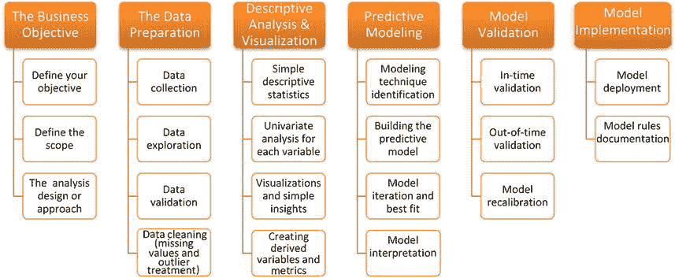

# 5. 统计分析简介

本章及后续章节将深入探讨商业分析技术的细节。前一章已经确定，统计学构成了这门艺术的主要部分。本章将从统计学的基本定义开始。它还将介绍一些用于获取数据集的网站，你可以在示例中使用这些数据。到本章末尾，你将能够理解以下对进行商业分析至关重要的概念：

- 总体与样本的区别
- 不同类型的抽样方法
- 变量与参数的区别
- 描述性统计、推断性统计和预测性统计之间的差异
- 解决商业分析问题所涉及的步骤
- 一个完整的商业分析示例

## 什么是统计学？

统计学可以简单地定义为收集、整理、总结和分析信息的科学。统计学是我们日常生活的重要组成部分。例如，电视上经常播放的运动员职业生涯总结，就是对该运动员职业生涯数据的统计概括。我们遇到的这类信息中有很大一部分以数字为主。以下是一些例子：

- 人口普查统计数据（`www.census.gov/`）
- 世界银行统计数据（`http://data.worldbank.org/`）
- 板球比赛统计数据（`www.espncricinfo.com/ci/content/stats/index.html`）
- 股市统计数据（`http://finance.yahoo.com/`）

表 5-1 显示了 2009 年和 2010 年全球人口中能够使用电力的百分比统计数据。这只是世界银行数据页面（`http://data.worldbank.org`）上完整表格的一个快照。

**表 5-1.** 能够使用电力的人口百分比统计数据

| 国家名称 | 国家代码 | 2009 年百分比 | 2010 年百分比 |
| --- | --- | --- | --- |
| 阿拉伯联合酋长国 | ARE | 100.0 | 100.0 |
| 科威特 | KWT | 100.0 | 100.0 |
| 新加坡 | SGP | 100.0 | 100.0 |
| 黎巴嫩 | LBN | 99.9 | 99.9 |
| 利比亚 | LBY | 99.8 | 99.8 |
| 文莱达鲁萨兰国 | BRN | 99.7 | 99.7 |
| 中国 | CHN | 99.4 | 99.7 |
| 以色列 | ISR | 99.7 | 99.7 |
| 阿拉伯埃及共和国 | EGY | 99.6 | 99.6 |
| 突尼斯 | TUN | 99.5 | 99.5 |
| 委内瑞拉玻利瓦尔共和国 | VEN | 99.0 | 99.5 |
| 巴林 | BHR | 99.4 | 99.4 |
| 智利 | CHL | 98.5 | 99.4 |
| 约旦 | JOR | 99.9 | 99.4 |
| 毛里求斯 | MUS | 99.4 | 99.4 |
| 马来西亚 | MYS | 99.4 | 99.4 |
| 阿尔及利亚 | DZA | 99.3 | 99.3 |
| 哥斯达黎加 | CRI | 99.3 | 99.2 |
| 沙特阿拉伯 | SAU | 99.0 | 99.0 |
| 特立尼达和多巴哥 | TTO | 99.0 | 99.0 |

仔细查看表 5-1 会发现，这只是原始数据，没有对其执行任何统计操作。但仍然可以从中得出关于所列国家电力供应情况的一些有用推论或见解。在这 20 个国家中，2009 年列中的最小值是 98.5，这意味着至少有这个比例的人口能够使用电力。98.5% 或更高的接入率说明了所列国家的发展状况。到了 2010 年，这一比例上升到了 99.3%，这无疑是生活水平提升的表现。对于像阿拉伯联合酋长国、科威特和新加坡这样的国家，这个比例是完美的 100%。

即使是原始数据也能讲述一个故事。使用常见工具可能无法打开那些占用千兆字节和拍字节的原始数据。在某些情况下，数据集的大小可能大到任何系统都无法处理。在这种情况下，可以应用可视化和高级分析技术来获取有用的商业见解。我们可能无法用肉眼获得洞察。我们需要一些统计技术和工具来发现数据中隐藏的模式。

## 商业分析中的基本统计概念

本节将讨论一些基本术语，如总体、样本、变量和参数，这些术语在你学习更多商业分析技术时会很有用。

### 总体

总体是指可用于分析项目或数据分析的完整对象集或数据记录集。例如，在一个全国性的营销活动中，经过筛选的全国公民名单将构成该分析问题的总体。通常，由于数据规模庞大、时间有限、资金不足或可用计算机的处理能力有限，可能无法分析整个总体。这些原因可能迫使你只考虑总体的一个子集。在统计术语中，这个子集通常被称为样本。如果选择得当，使用样本进行分析可以与分析整个总体一样好。

为了更清晰，这里有两个详细的例子：

-   示例 1：如果像沃尔玛这样的零售商决定分析其全球客户的购买模式，那么沃尔玛在全球的整个客户群就构成了总体。沃尔玛的商业分析团队可能会根据项目可用资源，决定对全体总体进行分析，或者仅对一个代表性样本进行分析。
-   示例 2：一家像沃达丰或 AT&T 这样规模的电信公司，拥有全国客户群，可能需要制定策略以减少客户转向竞争对手提供的看似更便宜的手机套餐。在这种情况下，沃达丰在全国范围内的所有移动网络用户将被视为总体。和以往一样，分析团队将决定使用整个总体还是仅使用一个代表性样本。如前所述，在大多数情况下，一个精心设计的样本就足以获得所需的商业见解。

### 样本

样本可以正式定义为从总体中选择出来用于分析的一个子集。创建或收集这个子集的过程称为抽样。有时，可能需要手动从整个总体中收集一些记录。抽样技术有几种类型。以下是商业分析项目中最常用的几种。

#### 简单随机抽样

简单随机抽样是最常用的抽样方法。从总体中随机选择一些记录（记为 n）称为简单随机抽样。有多种方法可以确定合适的样本量。有时，我们正在处理的业务问题会为我们提供样本量的思路。一旦根据其中一种方法确定了样本量（n），就会从总体中随机选择记录。SAS 为此提供了便捷的函数。

一个经典随机抽样的例子是，一个蒙着眼睛的人从装满苹果的篮子里拿起十个苹果。所有苹果被从篮子中选中的概率是相等的。


#### 分层抽样

考虑一个示例总体，其中包含大小相同或不同的预先存在的分段。这些分段是指已被划分为不同数量子群的总体记录。在这种情况下，最佳做法是从每个分段中进行随机抽样；这样，样本才能真实代表该总体的性质。  
每个分段的规模可以基于该分段在整个总体中所占的比例。这类分段通常被称为层。从每个层中进行简单随机抽样的过程称为分层抽样。可以手动创建分段，即使总体中没有明显的分段，也可以执行分层抽样。  
例如，如果要从全国范围内为一项体育赛事随机挑选 1000 名候选人，那么按比例从每个州进行挑选可能是个好主意。

#### 系统抽样

系统抽样基于固定规则，例如从给定总体中每隔第五个或第七个观测值抽取一个样本。这与随机抽样不同，后者是随机抽取任意值。这种抽样方式通常用于连续进行的测试过程。每 60 分钟记录一次室温，或每 10 分钟测量一次病人的血压，都是系统抽样的例子。  
*   示例：考虑一台批量生产简单螺栓的机器，这些螺栓用于化工厂安装项目。可以收集机器生产的每第 30 个螺栓作为样本。这看起来像是从整批产品中抽取的随机样本，但你实际上并没有等待整批产品形成；相反，你是在形成堆垛之前就收集了样本。

### 变量

简单来说，统计数据集中的变量就是表中的一列或一个字段，它是一个可能在不同记录间改变值的特征。它可以是数值型的，可以对每条记录进行测量；也可以是非数值型的，例如城市、性别，或包含“是/否”条目的状态字段。其他例子包括年龄、月收入、日销售额和成本数据。以下是总体或样本可能包含的主要变量类型。  
表 5-1 有四列：国家名称、国家代码、2009 年和 2010 年。这四列中的每一列都代表一个变量。因此，在这个数据集中，你总共有四个变量。变量“国家名称”从第 1 行到第 3 行分别取值阿拉伯联合酋长国、科威特和新加坡。  
这个数据集很小，因为它只有四个变量，但在诸如信用评分等银行应用中，可能会有数百个这样的变量，甚至高达 500 个。使用此类数据集进行建模可能是一项具有挑战性的任务，有时甚至难以管理。因此，在运用适当的统计技术时，可能需要将变量数量限制在，比如说，50 个，这对于所考虑的分析最有意义。

#### 数值型变量

数值型或定量变量是可测量、可比较且可排序的。身高、体重、开支和距离都是几个例子。数值型变量有两种类型。

##### 连续型

连续型变量可以在两个界限之间取任意值。  
例如，在大多数情况下，身高变量可以是 1 到 7 英尺之间的任何值。它可以取连续值，例如 5.1、5.12、5.6、5.6134 和 6.5 英尺。

##### 离散型

这些数值型变量仅以阶梯方式取值。它们只能在给定界限内取整数值或某些预定义值。  
例如，一个家庭的子女数只能是 1、2、3、4 等。它绝不可能是 1.5 或 2.34。

| 连续型变量就像模拟时钟的指针。它可以在两个给定时间点之间占据任何位置。 | 离散型变量就像数字时钟的显示。它只能显示某些预定义的数字。 |
| --- | --- |
| 在这个例子中，你可以让时钟停在 4:25:25.5。 | 在这里，你只能让钟停在 4:25:24 或 4:25:26。 |

#### 类别型或非数值型变量

非数值型、定性和类别型变量是指代表质量或特征字段的变量类型。  
例子包括用 S、M、L、XL 和 XXL 表示的衬衫尺码，或用近和远表示的距离。它也可以是布尔值，比如通过或未通过，或者是或否字段。

### 预测建模语境中的变量类型

任何数据科学家或分析专业人士的目标都是从给定的数据集中获取有用的商业洞察，这些数据可能本质上具有历史性。基于历史数据预测可预见的未来（或预测建模）是商业分析中许多数据建模练习的目的。诸如回归之类的预测建模技术有一个目标变量，它是整个数据建模练习的最终结果。换句话说，预测建模预测可以使用一些其他变量来预测目标变量，这些变量在建模时以历史数据的形式已知。这个目标变量被称为因变量；用于预测的其他变量被称为自变量。  
因变量的例子包括：月销售额、欺诈概率、学生的最终成绩以及肥料对作物的影响。  
以下是自变量和因变量的更多示例：预测支出时的客户收入（因变量）、预测成绩时的学习小时数（因变量）以及预测作物产量时的肥料浓度（因变量）。除了被标记为“因变量”之外的变量就是自变量。

### 参数

参数是基于整个总体计算得出的一个度量值。任何提供总体信息的汇总度量值都被称为参数。可以这样记忆：简单来说就是“P 对应 P”，意思是参数（Parameter）对应的是总体（Population）。  
例如，以整个加利福尼亚州的电费账单数据为例。无论以何种标准衡量，它都将十分庞大，因为它包含了该州所有家庭的姓名、地址、连接类型、月份、消耗单位数和账单金额等变量。现在，出于规划目的，即预测该州未来五年的电力需求，如果你针对全州所有家庭的某些变量（如消耗单位数和账单金额）计算平均值，那么这些平均值将被称为参数。因此，两个示例参数，即全州每个家庭的平均消耗单位数和平均账单金额，可能看起来分别是 650 单位和 100 美元。这些参数是基于整个总体计算的，而总体有时可能非常庞大。所以，不难预测，这可能需要大量的计算工作。


### 统计量

统计量是基于样本计算得出的度量值。根据这一定义，提供样本信息的汇总度量值被称为统计量。类似于“参数（Parameter）对应总体（Population）”，统计量（Statistic）对应样本（Sample），“S 代表 S”。

举个例子，考虑你在上一节中用来解释参数概念的同一数据集。对于参数而言，平均电力消耗和平均账单金额是基于加利福尼亚州整个总体计算的。如果无法对整个总体进行计算，你可能会选择抽取一个代表性样本，比如说，从全州随机抽取 10,000 户家庭。在这 10,000 户家庭的样本中，你计算平均电力消耗和每户平均账单金额。样本数据上的这两个平均值将被称作统计量。如果样本选择得当，它们就能很好地代表整个总体。在商业分析中，很多情况下你更倾向于只使用样本，而不是处理涉及整个总体的庞大计算量。

### 示例练习

考虑 `prdsale` 数据集。它位于 SAS 帮助库中。回答以下问题，以厘清本章目前已介绍的概念：

- 打印 `Prdsale` 数据的内容并写下你的观察。
- 打印 `Prdsale` 数据的前 20 条观测并写下你的观察。
- 总体的大小是多少？
- 筛选数据并抽取一个样本（其中 `country=Canada`）。
- 抽取一个大小为 30 的随机样本。
- 识别连续变量、离散变量和分类变量。
- 哪些是原因变量（自变量）？哪些是结果变量（因变量）？
- 计算一个参数（总体实际销售额的均值）。
- 计算一个统计量（样本实际销售额的均值）。
- 该统计量与参数有多接近？它是一个好的估计吗吗？

现在是进行一些动手练习的时候了。在下一节中，你将逐一处理前述十个练习，并使用 SAS 帮助库中提供的一个样本数据集来求解。你需要打开 SAS 环境来执行给出的代码。希望你已具备一些 SAS 如何工作的基础知识。

**打印 `prdsale` 数据的内容并写下你的观察。**

以下 SAS 代码打印 `prdsale` 数据集的元数据：

```
proc contents data=sashelp.prdsale varnum;
run;
```

表 5-2 是 SAS 的输出结果。

**表 5-2.**  
`prdsale` 数据集的 `PROC CONTENTS` 输出

| The CONTENTS Procedure |
| --- |
| 数据集名称 | `SASHELP.PRDSALE` | 观测数 | 1440 |
| 成员类型 | `DATA` | 变量数 | 10 |
| 引擎 | `V9` | 索引数 | 0 |
| 创建时间 | 2008 年 1 月 31 日，星期四，下午 09:40:56 | 观测长度 | 96 |
| 最后修改时间 | 2008 年 1 月 31 日，星期四，下午 09:40:56 | 已删除观测数 | 0 |
| 保护 |  | 是否压缩 | `NO` |
| 数据集类型 |  | 是否排序 | `NO` |
| 标签 | 家具销售数据 |  |  |
| 数据表示 | `WINDOWS_32` |  |  |
| 编码 | `us-ascii ASCII (ANSI)` |  |  |

| 引擎/宿主相关信息 |
| --- |
| 数据集页面大小 | 8192 |
| 数据集页面数 | 18 |
| 第一个数据页面 | 1 |
| 每页最大观测数 | 84 |
| 第一数据页面中的观测数 | 62 |
| 数据集修复次数 | 0 |
| 文件名 | `C:\Program Files\SAS\SASFoundation\9.2\core\sashelp\prdsale.sas7bdat` |
| 创建版本 | 9.0201M0 |
| 宿主系统 | `XP_PRO` |

| 变量及属性的字母顺序列表 |
| --- |
| # | 变量 | 类型 | 长度 | 格式 | 标签 |
| 1 | `ACTUAL` | 数值 | 8 | `DOLLAR12.2` | 实际销售额 |
| 2 | `PREDICT` | 数值 | 8 | `DOLLAR12.2` | 预测销售额 |
| 3 | `COUNTRY` | 字符 | 10 | `$CHAR10.` | 国家 |
| 4 | `REGION` | 字符 | 10 | `$CHAR10.` | 区域 |
| 5 | `DIVISION` | 字符 | 10 | `$CHAR10.` | 部门 |
| 6 | `PRODTYPE` | 字符 | 10 | `$CHAR10.` | 产品类型 |
| 7 | `PRODUCT` | 字符 | 10 | `$CHAR10.` | 产品 |
| 8 | `QUARTER` | 数值 | 8 | `8.` | 季度 |
| 9 | `YEAR` | 数值 | 8 | `4.` | 年份 |
| 10 | `MONTH` | 数值 | 8 | `MONNAME3.` | 月份 |

从表 5-2 得出的观察：

- `Prdsale` 数据有十个变量。
- 乍一看，这似乎是家具销售数据。
- 仔细查看标签后，你会发现这是月度产品销售数据。

**打印 `Prdsale` 数据的前 20 条观测并写下你的观察。**

```
proc print data = sashelp.prdsale(obs= 20 );
run ;
```

表 5-3 列出了此代码的输出结果。

**表 5-3.**  
`prdsale` 数据集 `PROC PRINT` 输出结果 – 前 20 条观测


| Obs（观测号） | ACTUAL（实际值） | PREDICT（预测值） | COUNTRY（国家） | REGION（地区） | DIVISION（部门） | PRODTYPE（产品类型） | PRODUCT（产品） | QUARTER（季度） | YEAR（年份） | MONTH（月份） |
| --- | --- | --- | --- | --- | --- | --- | --- | --- | --- | --- |
| 1 | $925.00 | $850.00 | CANADA（加拿大） | EAST（东） | EDUCATION（教育） | FURNITURE（家具） | SOFA（沙发） | 1 | 1993 | Jan（一月） |
| 2 | $999.00 | $297.00 | CANADA（加拿大） | EAST（东） | EDUCATION（教育） | FURNITURE（家具） | SOFA（沙发） | 1 | 1993 | Feb（二月） |
| 3 | $608.00 | $846.00 | CANADA（加拿大） | EAST（东） | EDUCATION（教育） | FURNITURE（家具） | SOFA（沙发） | 1 | 1993 | Mar（三月） |
| 4 | $642.00 | $533.00 | CANADA（加拿大） | EAST（东） | EDUCATION（教育） | FURNITURE（家具） | SOFA（沙发） | 2 | 1993 | Apr（四月） |
| 5 | $656.00 | $646.00 | CANADA（加拿大） | EAST（东） | EDUCATION（教育） | FURNITURE（家具） | SOFA（沙发） | 2 | 1993 | May（五月） |
| 6 | $948.00 | $486.00 | CANADA（加拿大） | EAST（东） | EDUCATION（教育） | FURNITURE（家具） | SOFA（沙发） | 2 | 1993 | Jun（六月） |
| 7 | $612.00 | $717.00 | CANADA（加拿大） | EAST（东） | EDUCATION（教育） | FURNITURE（家具） | SOFA（沙发） | 3 | 1993 | Jul（七月） |
| 8 | $114.00 | $564.00 | CANADA（加拿大） | EAST（东） | EDUCATION（教育） | FURNITURE（家具） | SOFA（沙发） | 3 | 1993 | Aug（八月） |
| 9 | $685.00 | $230.00 | CANADA（加拿大） | EAST（东） | EDUCATION（教育） | FURNITURE（家具） | SOFA（沙发） | 3 | 1993 | Sep（九月） |
| 10 | $657.00 | $494.00 | CANADA（加拿大） | EAST（东） | EDUCATION（教育） | FURNITURE（家具） | SOFA（沙发） | 4 | 1993 | Oct（十月） |
| 11 | $608.00 | $903.00 | CANADA（加拿大） | EAST（东） | EDUCATION（教育） | FURNITURE（家具） | SOFA（沙发） | 4 | 1993 | Nov（十一月） |
| 12 | $353.00 | $266.00 | CANADA（加拿大） | EAST（东） | EDUCATION（教育） | FURNITURE（家具） | SOFA（沙发） | 4 | 1993 | Dec（十二月） |
| 13 | $107.00 | $190.00 | CANADA（加拿大） | EAST（东） | EDUCATION（教育） | FURNITURE（家具） | SOFA（沙发） | 1 | 1994 | Jan（一月） |
| 14 | $354.00 | $139.00 | CANADA（加拿大） | EAST（东） | EDUCATION（教育） | FURNITURE（家具） | SOFA（沙发） | 1 | 1994 | Feb（二月） |
| 15 | $101.00 | $217.00 | CANADA（加拿大） | EAST（东） | EDUCATION（教育） | FURNITURE（家具） | SOFA（沙发） | 1 | 1994 | Mar（三月） |
| 16 | $553.00 | $560.00 | CANADA（加拿大） | EAST（东） | EDUCATION（教育） | FURNITURE（家具） | SOFA（沙发） | 2 | 1994 | Apr（四月） |
| 17 | $877.00 | $148.00 | CANADA（加拿大） | EAST（东） | EDUCATION（教育） | FURNITURE（家具） | SOFA（沙发） | 2 | 1994 | May（五月） |
| 18 | $431.00 | $762.00 | CANADA（加拿大） | EAST（东） | EDUCATION（教育） | FURNITURE（家具） | SOFA（沙发） | 2 | 1994 | Jun（六月） |
| 19 | $511.00 | $457.00 | CANADA（加拿大） | EAST（东） | EDUCATION（教育） | FURNITURE（家具） | SOFA（沙发） | 3 | 1994 | Jul（七月） |
| 20 | $157.00 | $532.00 | CANADA（加拿大） | EAST（东） | EDUCATION（教育） | FURNITURE（家具） | SOFA（沙发） | 3 | 1994 | Aug（八月） |

从表 5-3 中观察得到：

总体规模是多少？

- 该数据集包含月度实际和预测销售数据，以及产品类型和区域信息。
- 前 20 条记录的产品类型是家具（furniture），产品是沙发（sofa）。
- 看起来这些数据是从 1993 年开始的。

```
proc contents data=sashelp.prdsale varnum;
run;
```

该示例中，总体规模即记录的总数。`Proc contents` 显示共有 1,440 条记录。输出结果请参考表 5-4。

### 表 5-4. 对 prdsale 数据集使用 varnum 选项执行 PROC CONTENTS 的结果

| 数据集名称 | SASHELP.PRDSALE | 观测数 | 1440 |
| --- | --- | --- | --- |
| 成员类型 | DATA | 变量数 | 10 |
| 引擎 | V9 | 索引数 | 0 |
| 创建时间 | 2008 年 1 月 31 日，星期四，下午 09:40:56 | 观测长度 | 96 |
| 最后修改时间 | 2008 年 1 月 31 日，星期四，下午 09:40:56 | 已删除观测数 | 0 |
| 保护 |  | 是否压缩 | NO |
| 数据集类型 |  | 是否排序 | NO |
| 标签 | 家具销售数据 |  |  |
| 数据表示法 | WINDOWS_32 |  |  |
| 编码 | us-ascii ASCII (ANSI) |  |  |

筛选数据并抽取样本（其中 `country=Canada`）。

```
data prod_sample;
set sashelp.prdsale;
where country='CANADA';
run;
```

以下是上述代码的日志文件：

```
NOTE: 从数据集 SASHELP.PRDSALE 中读取了 480 个观测。
WHERE country='CANADA';
NOTE: 数据集 WORK.PROD_SAMPLE 包含 480 个观测和 10 个变量。
NOTE: DATA 语句使用情况（总处理时间）：
real time           0.67 seconds
cpu time            0.10 seconds
```

抽取一个大小为 30 的随机样本。

```
proc surveyselect data = sashelp.prdsale
method = SRS
rep = 1
sampsize = 30 seed = 12345 out = prod_sample_30;
id _all_;
run;
```

> **注意**  
> `SRS` 方法表示抽样类型。`SRS` 代表简单随机抽样（Simple random Sampling）。`Seed`（种子）将确保我们能够再次抽取到相同的随机样本。为了引用相同的样本，我们需要一个索引。`Seed` 将确保能够再次抽到相同的 30 个观测的样本。

表 5-5 列出了输出结果。

### 表 5-5. 对 prdsale 执行 PROC SURVEYSELECT 的结果

| SURVEYSELECT 过程 |
| --- |
| 选择方法 | 简单随机抽样 |
| 输入数据集 | PRDSALE |
| 随机数种子 | 12345 |
| 样本大小 | 30 |
| 选择概率 | 0.020833 |
| 抽样权重 | 48 |
| 输出数据集 | PROD_SAMPLE_30 |

以下 SAS 代码打印样本 `prod_sample_30`。

```
proc print data=prod_sample_30;
run;
```

表 5-6 列出了此代码的输出结果。

### 表 5-6. 对 `prod_sample_30` 数据集执行 PROC PRINT 的输出

| Obs（观测号） | ACTUAL（实际值） | PREDICT（预测值） | COUNTRY（国家） | REGION（地区） | DIVISION（部门） | PRODTYPE（产品类型） | PRODUCT（产品） | QUARTER（季度） | YEAR（年份） | MONTH（月份） |
| --- | --- | --- | --- | --- | --- | --- | --- | --- | --- | --- |
| 1 | $670.00 | $679.00 | CANADA（加拿大） | EAST（东） | EDUCATION（教育） | OFFICE（办公） | CHAIR（椅子） | 1 | 1993 | Mar（三月） |
| 2 | $768.00 | $948.00 | CANADA（加拿大） | EAST（东） | EDUCATION（教育） | OFFICE（办公） | DESK（桌子） | 1 | 1994 | Mar（三月） |
| 3 | $511.00 | $402.00 | CANADA（加拿大） | EAST（东） | CONSUMER（消费） | OFFICE（办公） | DESK（桌子） | 1 | 1993 | Feb（二月） |
| 4 | $379.00 | $819.00 | CANADA（加拿大） | EAST（东） | CONSUMER（消费） | OFFICE（办公） | DESK（桌子） | 2 | 1994 | Apr（四月） |
| 5 | $190.00 | $969.00 | CANADA（加拿大） | WEST（西） | EDUCATION（教育） | FURNITURE（家具） | SOFA（沙发） | 3 | 1994 | Jul（七月） |
| 6 | $112.00 | $263.00 | CANADA（加拿大） | WEST（西） | EDUCATION（教育） | FURNITURE（家具） | SOFA（沙发） | 3 | 1994 | Sep（九月） |
| 7 | $638.00 | $145.00 | CANADA（加拿大） | WEST（西） | EDUCATION（教育） | FURNITURE（家具） | BED（床） | 4 | 1994 | Dec（十二月） |
| 8 | $760.00 | $17.00 | CANADA（加拿大） | WEST（西） | EDUCATION（教育） | OFFICE（办公） | CHAIR（椅子） | 3 | 1994 | Aug（八月） |
| 9 | $586.00 | $363.00 | CANADA（加拿大） | WEST（西） | EDUCATION（教育） | OFFICE（办公） | DESK（桌子） | 1 | 1993 | Jan（一月） |
| 10 | $956.00 | $149.00 | CANADA（加拿大） | WEST（西） | CONSUMER（消费） | FURNITURE（家具） | BED（床） | 3 | 1993 | Jul（七月） |
| 11 | $911.00 | $318.00 | CANADA（加拿大） | WEST（西） | CONSUMER（消费） | FURNITURE（家具） | BED（床） | 2 | 1994 | May（五月） |
| 12 | $749.00 | $852.00 | GERMANY（德国） | EAST（东） | EDUCATION（教育） | FURNITURE（家具） | SOFA（沙发） | 4 | 1994 | Nov（十一月） |
| 13 | $394.00 | $262.00 | GERMANY（德国） | EAST（东） | EDUCATION（教育） | FURNITURE（家具） | BED（床） | 3 | 1993 | Sep（九月） |
| 14 | $104.00 | $68.00 | GERMANY（德国） | EAST（东） | EDUCATION（教育） | FURNITURE（家具） | BED（床） | 3 | 1994 | Aug（八月） |
| 15 | $798.00 | $215.00 | GERMANY（德国） | EAST（东） | EDUCATION（教育） | OFFICE（办公） | CHAIR（椅子） | 3 | 1993 | Sep（九月） |
| 16 | $33.00 | $901.00 | GERMANY（德国） | EAST（东） | CONSUMER（消费） | OFFICE（办公） | TABLE（桌子） | 3 | 1993 | Jul（七月） |
| 17 | $458.00 | $309.00 | GERMANY（德国） | EAST（东） | CONSUMER（消费） | OFFICE（办公） | CHAIR（椅子） | 4 | 1994 | Oct（十月） |
| 18 | $100.00 | $285.00 | GERMANY（德国） | WEST（西） | EDUCATION（教育） | OFFICE（办公） | DESK（桌子） | 1 | 1993 | Jan（一月） |
| 19 | $505.00 | $59.00 | GERMANY（德国） | WEST（西） | CONSUMER（消费） | OFFICE（办公） | TABLE（桌子） | 1 | 1993 | Jan（一月） |
| 20 | $58.00 | $998.00 | U.S.A.（美国） | EAST（东） | EDUCATION（教育） | FURNITURE（家具） | BED（床） | 3 | 1994 | Aug（八月） |
| 21 | $229.00 | $524.00 | U.S.A.（美国） | EAST（东） | EDUCATION（教育） | OFFICE（办公） | CHAIR（椅子） | 1 | 1993 | Jan（一月） |
| 22 | $390.00 | $617.00 | U.S.A.（美国） | EAST（东） | EDUCATION（教育） | OFFICE（办公） | CHAIR（椅子） | 4 | 1993 | Oct（十月） |
| 23 | $790.00 | $229.00 | U.S.A.（美国） | EAST（东） | EDUCATION（教育） | OFFICE（办公） | CHAIR（椅子） | 3 | 1994 | Sep（九月） |
| 24 | $119.00 | $427.00 | U.S.A.（美国） | EAST（东） | CONSUMER（消费） | FURNITURE（家具） | SOFA（沙发） | 2 | 1993 | May（五月） |
| 25 | $198.00 | $652.00 | U.S.A.（美国） | EAST（东） | CONSUMER（消费） | OFFICE（办公） | TABLE（桌子） | 3 | 1994 | Aug（八月） |
| 26 | $602.00 | $497.00 | U.S.A.（美国） | EAST（东） | CONSUMER（消费） | OFFICE（办公） | CHAIR（椅子） | 4 | 1994 | Nov（十一月） |
| 27 | $512.00 | $933.00 | U.S.A.（美国） | WEST（西） | EDUCATION（教育） | FURNITURE（家具） | BED（床） | 1 | 1993 | Feb（二月） |
| 28 | $208.00 | $382.00 | U.S.A.（美国） | WEST（西） | CONSUMER（消费） | OFFICE（办公） | CHAIR（椅子） | 1 | 1993 | Mar（三月） |
| 29 | $739.00 | $656.00 | U.S.A.（美国） | WEST（西） | CONSUMER（消费） | OFFICE（办公） | DESK（桌子） | 4 | 1993 | Nov（十一月） |
| 30 | $87.00 | $145.00 | U.S.A.（美国） | WEST（西） | CONSUMER（消费） | OFFICE（办公） | DESK（桌子） | 4 | 1993 | Dec（十二月） |

**观察结果：**

与仅打印前几个观测相比，这个样本数据输出显然能让我们更清晰地了解整个总体。我们可以看到各种产品类型、不同的国家等信息。

识别连续型、离散型和分类型变量。


### 连续变量

以下是连续变量：

- `Actual`（实际销售额）
- `Predicted`（预测销售额）

这两个变量是连续的，因为它们可以取任何实数值。例如，样本值可以是 200 美元、201 美元或 201.5 美元。

### 数值型离散变量

以下是数值型离散变量：

- `QUARTER`
- `YEAR`

这些变量只能取一组值。`Quarter`可以取 1 或 2；不能等于 1.5。因此它是一个离散变量。`Year`也是一个离散变量。

### 分类变量

以下是分类变量：

- `COUNTRY`
- `REGION`
- `DIVISION`
- `PRODTYPE`
- `PRODUCT`

这些是非数值型变量。

### 自变量与因变量

哪些是自变量？哪些是因变量？`Actual`和`Predicted`销售额是结果或因变量。自变量构成列表的其余部分。这里的销售额取决于国家、地区、产品、月份、年份、季度等。这些都是自变量。

### 计算参数（总体平均实际销售额）

```
proc means data=sashelp.prdsale ;
var actual;
run ;
```

`Means`是一个 SAS 过程名。在此示例中，我们指定变量名为`actual`。`PROC MEANS`过程将对该变量进行操作以计算平均值。

表 5-7 列出了此代码的输出。

**表 5-7. `PROC MEANS`在`prdsale`上的结果**

| 分析变量：ACTUAL 实际销售额 |
| --- |
| N | 均值 | 标准差 | 最小值 | 最大值 |
| 1440 | 507.1784722 | 287.0313065 | 3.0000000 | 1000.00 |

总体平均销售额为 507.17。有关平均值的详细信息将在本章后面介绍。

### 计算统计量（样本平均实际销售额）

```
proc means data=prod_sample_30 ;
var actual;
run ;
```

此代码的输出列在表 5-8 中。

**表 5-8. 在`prod_sample_30`上的均值和标准差；变量 = actual**

| MEANS 过程 |
| --- |
| 分析变量：ACTUAL 实际销售额 |
| N | 均值 | 标准差 | 最小值 | 最大值 |
| 30 | 451.8000000 | 286.8939970 | 33.0000000 | 956.0000000 |

样本平均销售额为 451.8。

### 统计量与参数的接近程度如何？这是否是一个好的估计？

- 统计量与参数并不非常接近。样本平均销售额并不能真正代表总体平均销售额。
- 参数与统计量之间几乎有 11%的差异。
- 增加样本量可能有助于获得良好的估计。将样本量增加到 100 可能是更好的选择。
- 以下 SAS 代码从`prdsale`数据集中抽取大小为 100 的样本，然后计算均值。

```
/* Simple Random Sample; Size is 100 */
proc surveyselect data = sashelp.prdsale
method = SRS
rep = 1
sampsize = 100 seed = 12345 out = prod_sample_100;
id _all_;
run ;

proc means data=prod_sample_100 ;
var actual;
run ;
```

表 5-9 列出了用于计算变量`actual`均值和标准差的 SAS 代码的输出。

**表 5-9. 在`prod_sample_100`上的均值和标准差；变量 = actual**

| 分析变量：实际销售额 |
| --- |
| N | 均值 | 标准差 | 最小值 | 最大值 |
| 100 | 527.7000000 | 297.0428837 | 25.0000000 | 988.0000000 |

平均销售额估计值（统计量）看起来更接近总体销售额。新差异小于 5%。

## 统计分析方法

统计分析方法有三种：描述性统计、推断性统计和预测性统计。在描述性统计方法中，只是使用统计集中趋势和变异对数据进行简单汇总。在推断性统计中，从总体中抽取样本以对整个数据集或总体进行推断。预测性统计，如预期那样，可以使用线性回归和逻辑回归等方法预测因变量。这些术语中的一些目前可能看起来陌生，但它们将在接下来的章节中详细解释。

### 描述性统计

描述性统计是呈现数据集总体概况的正确解决方案。这些方法表示汇总，提供了关于给定总体的合理画面。从数据分析中获得的业务洞察将以表格和图表的形式呈现。描述性统计的输出可能有助于得出有用的推断，但这种输出本身并不是推断。

这是一个销售示例。对一年的销售数据应用描述性统计，可能包括过去 12 个月的平均销售额、过去 12 个月的最高和最低销售额等。业务专家可以根据此分析推断其业务绩效。

以下是描述性统计的重要衡量指标或结果：

- 集中趋势度量：均值、中位数、众数和中点值
- 变异度量：极差、方差、标准差、z 分数

下一章将更详细地研究这些术语。

### 推断性统计

你现在知道，由于各种限制，每次分析整个总体并不总是容易的。因此，分析有代表性的样本并对整个总体进行推断是更好的选择。如果操作得当，这大多数时候是正确的决定。但由于只分析了部分数据，基于整个数据集进行推断时，样本量和误差等因素变得非常重要。

- 示例 1：一台装瓶机应在每个瓶子中灌装 300 毫升软饮料。每天的总量是几千瓶。你抽取了 400 个瓶子的代表性样本，发现样本均值为 300.5 毫升。这台机器运行正常吗？
- 示例 2：在 300 个笔记本购买者的样本中，有两人报告了屏幕问题。这是否值得关注？基于此，你能对至少大约 10,000 的总体屏幕质量得出结论吗？

### 预测性统计

预测性统计是基于历史事件预测未来结果的科学。预测建模或模型构建就像通过后视镜开车，期望前方的道路与已经走过的道路相同。预测性统计试图通过使用自变量或预测变量的组合来预测因变量或结果。需要将历史数据建立为`Y`（因变量）和`X_i`（自变量）之间的数学方程。

可以使用多种技术来构建预测模型。回归、逻辑回归和时间序列分析是很好的代表性示例。使用预测性统计的一个经典例子是银行构建信用风险模型，以决定是否向个人提供贷款。

## 使用统计分析解决问题

本节讨论统计数据分析（也称为业务分析问题解决）的主要步骤。

### 设定业务目标与规划

任何数据分析问题都始于业务目标。我为什么要做这个分析？哪些在范围内，哪些不在？我是否有足够的专业知识来执行分析？有哪些挑战？我如何实施结果？是否所有相关数据都可用？如果可用，数据是否可靠？存在许多此类问题。

范围和分析设计或方法此过程的主要成果。


### 数据准备  

确定目标和范围后，可以收集分析所需的数据。这些数据在格式、质量或完整性上可能并非完美无缺，适合直接分析。数据集中难免存在一些缺失值、异常值及其他噪音因素。开展基础数据探索、验证其准确性与一致性、并识别所有问题，是构建模型的重要任务。所有问题都必须在进行分析前解决。主要步骤如下：  

- 收集数据  
- 探索数据  
- 验证数据  
- 清洗数据  

### 描述性分析与可视化  

在构建模型之前，理解数据并获取洞察是至关重要的任务。同样需要理解每个变量及其相互关系。主要步骤如下：  

- 可视化数据并获得简单洞察  
- 执行简单的描述性统计  
- 对每个变量执行单变量分析  
- 必要时创建衍生变量和指标  
- 找出变量间的相关性  

### 预测建模  

此步骤涉及构建模型以实现预定目标。你需要确定最合适的分析技术，识别因变量，并删除任何冗余项。最后一步是构建最佳拟合模型。有时需要进行模型迭代。解释模型有助于识别影响最大的预测变量。以下几点总结了此步骤：  

- 确定建模技术  
- 构建预测模型  
- 迭代模型并找到最佳拟合  
- 解释模型  

### 模型验证  

在此步骤中需要回答以下问题：你刚刚构建的模型效果如何？它是否仅在使用来构建该模型的样本数据上表现良好？是否能获取一个相似但不同的样本来测试模型的准确性？模型在预测准确性方面的稳健性如何？请理解与此步骤相关的以下术语：  

- **及时验证**：这涉及从相似时间段内抽取一个与开发样本（development sample）外观相同的样本。有时，及时样本（in-time sample）占分析所考虑全部记录的 20%到 30%，其余部分用于模型构建。使用及时样本进行的验证称为及时验证。  
- **非及时验证**：此方法从不同时间段抽取样本用于模型验证。有时，模型仅在开发样本和及时验证样本上表现完美。使用来自不同时间段的样本进行交叉验证，有助于检验模型的真实稳健性。  

### 模型实施  

当模型通过所有验证测试后，它便准备就绪。现在可以将其用于其为之构建的业务目标。该模型可以实施并集成到生产系统中，在实际业务环境中进行试运行。最后，需要将其文档化并移交给最终用户。  

图 5-1 展示了模型构建中使用的所有步骤。本书将涉及其中大部分步骤。  

  

**图 5-1.** 模型构建中使用的步骤  

## 来自现实世界的示例：信用风险生命周期  

考虑一个信用风险模型构建的示例。每家银行都希望分析向申请人提供贷款或批准信用卡的风险有多大。批准或拒绝通常基于一个预测模型，该模型可能包含从 400 个自变量中筛选出的 15 到 20 个变量。以下是构建信用风险模型的基本步骤。  

### 业务目标与规划  

目标是预测每位潜在申请人的风险因素。确定投资组合规模、制定增长计划以及模拟竞争和商业环境可以是其他目标。此阶段也可以制定详细的项目管理计划。  

### 数据准备  

所需数据是从银行掌握的客户历史记录、内部应用程序、面向客户的零售应用程序或任何其他联合数据仓库中收集的。来自这些多个来源的数据可能具有异构的数据格式，因此数据清洗和转换是必不可少的。此阶段将执行异常值修正、缺失值处理以及其他数据清洗步骤。如果需要，还会创建虚拟变量或衍生变量。  

### 描述性分析与可视化  

确定表现窗口（performance window），该窗口指明应考虑多少历史数据用于分析。此类分析的常见表现窗口是 12 个月。在此阶段，需要定义将在后续模型构建中使用的“好账户”和“坏账户”。分析师必须决定是否需要对总体人群进行细分。如果需要，还需要识别出细分变量。  

此步骤将识别对违约概率影响最大的最关键因素。例如，比较当前贷款数量与年龄，确定这两个因素中哪一个将是决定信用风险的最关键因素。  

### 预测建模  

预测建模步骤涉及构建一个逻辑回归模型，该模型将使用最终确定的因变量列表给出违约概率。构建此模型将在后续章节中详细讨论。通常，此阶段会构建三到四个不同的模型，并选择误差最小的最佳模型。  

### 模型验证  

模型在使用构建样本之外的数据上表现如何？卡方统计量、KS 统计量和等级排序等统计指标用于验证模型性能。KS 值表示模型区分好账户与坏账户的能力，而 PSI 值则让你了解当前总体（实际生产数据）与开发样本之间的相似程度。  

- **KS 检验**：KS 代表 Kolmogorov-Smirnov（柯尔莫哥洛夫-斯米尔诺夫）。该检验用于确定模型是否能有效地区分好账户与坏账户。KS 值越高，模型越好。  
- **PSI**：PSI 代表群体稳定性指数。银行必须确保当前将要应用信用评分模型的群体与开发时的群体相同。如果群体发生剧烈变化，评分卡（模型）可能不再有效。  

### 模型实施  

最后一步是开始使用信用风险模型，该模型会将风险转化为分数。在此阶段，模型被移交给 IT 开发人员实施。每当提交新的信用卡申请时，配备此模型的系统将自动计算信用评分。银行前台工作人员将根据此信用评分批准或拒绝申请。  

## 结论  

本章定义了一些基本的统计术语，这些术语在所有后续章节中都很有用。它还介绍了解决商业分析问题所遵循的基本步骤，并通过一个真实的银行场景进行了说明。接下来的几章将讨论描述性统计，接着是数据准备和预测建模。**图 5-1**中提到的所有步骤将连同其术语一起讨论，这些术语在此阶段可能看起来有些陌生。


