# 6. SAS 中的基本描述性统计与报告

统计分析数据的第一步是定义业务目标，这决定了项目的需求。这一步需要进行一些初步规划。一旦以所需格式收集到数据，下一步就是探索数据。

在现阶段，原始数据集是唯一可用的资源。下一步是基本了解数据情况。如果数据集过大，可以仅打印前几条记录。随后，业务分析师必须将数据可视化，突出异常值，识别注意事项，在数据中发现有趣的模式，或构建能够帮助预测结果（该结果在现阶段仍未知）的预测模型。

本章将讨论基本描述性统计的步骤，这些步骤有助于数据探索和数据清洗操作（这是下一章的主题）。

如前所述，基本描述性统计能提供手头数据集的整体概况。这幅“概况图”的要素将在本章后续部分讨论。高级统计建模技术（即对数据的推断和预测）相关主题则会在后续几章中介绍。

## 数据分析的初级形式

为了对数据有一个直观感受，并不总是需要复杂的统计分析。有时，一些简单的技术，例如打印数据集的前几行或目视检查屏幕，就能达到目的。事实上，在对数据进行任何分析之前，我们强烈建议你先检查前几行，以便对数据有个初步印象。

### 直接打印数据

简单地目视检查手头的数据就能获得大量信息，帮助你理解数据。如果数据集较小，可以直接打印；但如果数据集很大，建议只打印少数几行（例如 1 到 100 行）。有时简单的排序会有所帮助。如果你有大量列或变量，则应只打印需要仔细检查的重要变量。

前一章的前几页展示了一个大数据集的快照，其中显示了 2009 年和 2010 年能用上电的人口比例统计数据。回想一下，我们讨论了该数据集上的一些简单观察结果，这些结果有助于你对整个数据集建立直观感受。

### SAS 中的打印功能及各种选项

SAS 为任何类型的数据集都提供了易于使用的打印选项。你可以打印所有变量，或选择打印几个重要的变量。我们将通过一个示例来讨论 SAS 的打印过程及其选项。

以下代码输出来自一个在线商店在一个月内产生的某些数据的快照：

```
Proc print data = online_sales (obs= 20 );
run;
```

表 6-1 列出了此代码的输出，以下是对 `online_sales` 数据集中所包含变量的解释：

- `brand`：品牌名称
- `listPrice`：网站上列出的商品价格
- `shippingPeriod`：运输天数
- `date`：订单日期
- `category`：商品类别

**表 6-1.** `online_sales` 数据集的 `proc print` 结果

| Obs | tr_id | Brand | listPrice | shippingPeriod | date | category |
| --- | --- | --- | --- | --- | --- | --- |
| 1 | 1 | Samsung | 39900 | 4 | 16OCT12:01:03:00 | Mobiles |
| 2 | 2 | Samsung | 16990 | 6 | 16OCT12:01:03:00 | Mobiles |
| 3 | 3 | Samsung | 7090 | 5 | 16OCT12:01:03:00 | Mobiles |
| 4 | 4 | AirTyme | 1549 | 3 | 16OCT12:01:04:00 | Mobiles |
| 5 | 5 | AirTyme | 1549 | 3 | 16OCT12:01:04:00 | Mobiles |
| 6 | 6 | Arise | 859 | 7 | 16OCT12:01:04:00 | Mobiles |
| 7 | 7 | Karbonn | 8399 | 6 | 16OCT12:01:04:00 | Mobiles |
| 8 | 8 | Motorola | 19999 | 4 | 16OCT12:01:04:00 | Mobiles |
| 9 | 9 | Samsung | 34900 | 4 | 16OCT12:01:04:00 | Mobiles |
| 10 | 10 | Airtyme | 2338 | 4 | 16OCT12:01:04:00 | Mobiles |
| 11 | 11 | HTC | 8049 | 6 | 16OCT12:01:04:00 | Mobiles |
| 12 | 12 | HTC | 8099 | 3 | 16OCT12:01:04:00 | Mobiles |
| 13 | 13 | HTC | 10399 | 6 | 16OCT12:01:04:00 | Mobiles |
| 14 | 14 | Micromax | 1584 | 4 | 16OCT12:01:04:00 | Mobiles |
| 15 | 15 | Micromax | 1584 | 4 | 16OCT12:01:04:00 | Mobiles |
| 16 | 16 | Micromax | 3449 | 7 | 16OCT12:01:04:00 | Mobiles |
| 17 | 17 | Motorola | 13199 | 3 | 16OCT12:01:04:00 | Mobiles |
| 18 | 18 | Motorola | 9729 | 6 | 16OCT12:01:04:00 | Mobiles |
| 19 | 19 | Nokia | 1559 | 6 | 16OCT12:01:04:00 | Mobiles |
| 20 | 20 | Samsung | 11400 | 3 | 16OCT12:01:04:00 | Mobiles |

表 6-1 中的数据仅属于客户下的少数手机订单。

现在我们讨论 SAS 打印过程中的一些有用选项。以下是通用代码及其解释：

```
proc print data=<<数据集>> label noobs heading=vertical;
var <<变量列表>>;
by var1; run ;
```

- `Label`：此选项将变量标签（而非变量名）打印为列标题。
- `Noobs`：此选项从输出中移除 `OBS` 列。
- `Heading=vertical`：此选项垂直打印列标题。当名称较长但变量值较短时，此选项很有用。
- `By`：`by` 语句按指定变量的值对输出进行分组。

我们来看一个示例。以下代码基于 `listPrice` 对数据进行排序：

```
Proc sort data=online_sales ;
by listPrice  ;
run;
```

你可以使用 `descending` 选项从高价到低价排序。SAS 默认按升序排序。

```
Proc sort data=online_sales ;
By descending listPrice  ;
run;
```

以下是上述代码的 SAS 日志：

```
There were 5129 observations read from the data set WORK.ONLINE_SALES.
The data set WORK.ONLINE_SALES has 5129 observations and 6 variables.
PROCEDURE SORT used (Total process time):
real time           0.04 seconds
cpu time            0.04 seconds
```

现在让我们尝试打印这个排序后的数据集。

```
proc print data =  online_sales (obs= 20 );
run;
```

此代码的输出请参考表 6-2。

**表 6-2.** 按 `listPrice` 排序后 `online_sales` 数据集的 `proc print` 结果

| Obs | tr_id | Brand | listPrice | shippingPeriod | date | category |
| --- | --- | --- | --- | --- | --- | --- |
| 1 | 156 | BlackBerr | 139990 | 3 | 16OCT12:12:56:00 | Mobiles |
| 2 | 2937 | Apple | 59500 | 4 | 30OCT12:07:02:00 | Mobiles |
| 3 | 3456 | Apple | 59500 | 4 | 31OCT12:07:02:00 | Mobiles |
| 4 | 3777 | Apple | 59500 | 5 | 01NOV12:07:02:00 | Mobiles |
| 5 | 4021 | Apple | 59500 | 6 | 02NOV12:07:02:00 | Mobiles |
| 6 | 4283 | Apple | 59500 | 6 | 03NOV12:07:02:00 | Mobiles |
| 7 | 4461 | Apple | 59500 | 7 | 04NOV12:07:02:00 | Mobiles |
| 8 | 4830 | Apple | 59500 | 5 | 05NOV12:07:02:00 | Mobiles |
| 9 | 157 | Apple | 57500 | 3 | 16OCT12:12:57:00 | Mobiles |
| 10 | 2936 | Apple | 52500 | 7 | 30OCT12:07:02:00 | Mobiles |
| 11 | 3455 | Apple | 52500 | 7 | 31OCT12:07:02:00 | Mobiles |
| 12 | 3776 | Apple | 52500 | 3 | 01NOV12:07:02:00 | Mobiles |
| 13 | 4020 | Apple | 52500 | 7 | 02NOV12:07:02:00 | Mobiles |
| 14 | 4282 | Apple | 52500 | 4 | 03NOV12:07:02:00 | Mobiles |
| 15 | 4337 | Apple | 52500 | 6 | 04NOV12:03:00:00 | Mobiles |
| 16 | 4460 | Apple | 52500 | 3 | 04NOV12:07:02:00 | Mobiles |
| 17 | 4552 | Apple | 52500 | 6 | 05NOV12:02:41:00 | Mobiles |
| 18 | 4561 | Apple | 52500 | 6 | 05NOV12:03:00:00 | Mobiles |
| 19 | 4637 | Apple | 52500 | 6 | 05NOV12:03:20:00 | Mobiles |
| 20 | 4829 | Apple | 52500 | 6 | 05NOV12:07:02:00 | Mobiles |

表 6-2 中的输出显示，苹果（Apple）拥有网站上大部分高价商品。有一款黑莓（BlackBerry）商品位居榜首。


## 汇总统计

当数据集规模较大时，应选用汇总或聚合指标来描述数据。以下是可应用于数据集中每个变量的一些汇总指标：

- 集中趋势：平均值是多少？
- 离散程度：特定变量的分布范围有多大？我们将在后续章节中详细讨论。
- 其他汇总统计量，如相关系数：这将在后续章节中介绍。

接下来，我们将分别介绍这些汇总统计量，并通过示例说明如何使用它们。

### 集中趋势

回答以下问题将有助于你理解如何使用聚合指标或汇总统计量来描述数据集：

- 去年的销售额是多少？
- 从迪拜到英国的机票价格是多少？
- 你每天睡多少小时？
- 到达办公室需要多长时间？

这些问题的答案通常是平均值而非确切数字。例如，答案可能是：年均销售额为 500 万美元；平均需要 30 分钟到达办公室，等等。这个平均值就是集中趋势的一种度量，它能反映包含多个数据点的变量的中间值。共有三种集中趋势度量。

- 均值
- 中位数
- 众数

> **注意：** 所有集中趋势都是平均值。

我们将分别讨论它们。

#### 均值

当变量为数值型时，均值就是简单的算术平均值。这是最常用的集中趋势度量。将数值的总和除以数值的个数，即可得到算术平均值。

例如，四个年龄分别为 24、24、27 和 25 岁的人的平均年龄是 25 岁。平均年龄是通过求和再除以个数得到的。

`平均年龄 = (24 + 24 + 27 + 25) / (4) = 25`

算术平均值是衡量集中趋势的一个良好指标，但它并非完美。如果数据中存在任何异常值，算术平均值可能无法指示变量的中间值。它会倾向于向异常值偏移。

##### 异常值效应

异常值是指某个集合或列中与其他值完全不同的值。与变量列中的其他条目相比，它可能是一个异常高或异常低的值。

例如，表 1 显示了 14 名个人的月收入。

**表 1.** 14 名个人的月收入

| 编号 | 月收入 |
| --- | --- |
| 1 | 7,400 |
| 2 | 9,800 |
| 3 | 6,500 |
| 4 | 9,100 |
| 5 | 9,000 |
| 6 | 718,900 |
| 7 | 9,400 |
| 8 | 9,300 |
| 9 | 7,800 |
| 10 | 8,900 |
| 11 | 8,600 |
| 12 | 9,600 |
| 13 | 10,000 |
| 14 | 6,800 |

在该数据集中，14 人中有 13 人的月收入小于或等于 10,000 美元。然而，有一个人的收入是 718,900 美元。这不明究竟是录入错误还是特意包含的数据。这个数值与其他数值完全不同，且高得多。月收入数据中的这个特定值就是异常值。本章后续部分将讨论如何识别异常值。

计算上述样本的均值时，结果为 59,364 美元；而 14 人中有 13 人的收入低于 59,364 美元。只有一个人的工资高于算术平均值。集中趋势应位于数据的中点附近，因此可以确定平均值，但此例中的均值因异常值而发生了显著变化。异常值通常会将均值拉向它们，无论是高侧异常值（如本例所示）还是低侧异常值。例如，在低侧，如果表 1 中的第 15 个条目为 1,000，那么平均值将降至 55,473 美元。图 1 显示了此示例的图表。

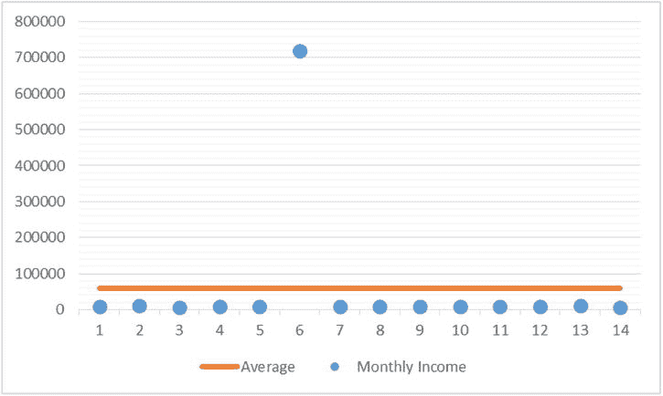

**图 1.** 包含异常值的个人月收入及计算出的平均值

在此，由于仅一个异常值，均值并未给出变量的真实集中趋势。当移除异常值后，会产生什么影响呢（图 2）？

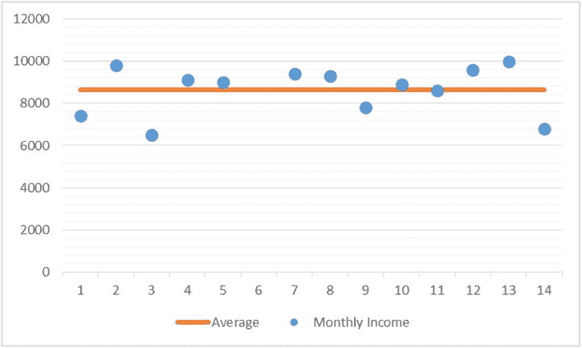

**图 2.** 移除异常值后的月收入

一旦移除异常值，新的均值，即 8,631 美元，就位于所有值的中间，代表了真正的集中趋势或平均值。这被称为截尾均值。要得到这个值，必须消除异常值，或用给定变量的第二高值替换后再进行计算。总的来说，随意改动原始数据可能并非一个明智之举。

现在可以得出结论，在存在异常值的情况下，均值不是一个良好的度量指标，可能需要一种不受异常值影响的不同的集中趋势度量。这种不同的集中趋势就是中位数，接下来讨论。

#### 中位数

如前所述，异常值会影响均值，并将均值拉向它们。在这种情况下，均值无法实现其原始目的，即给出真实的集中趋势度量。而中位数正好是任何数据集的精确中点。中位数之上和之下的数据点数量是相同的。

为了计算中位数，需要将字段按升序或降序排列。如果数据中有`N`个观测值，当`N`为奇数时，中位数是第`((N + 1) / 2)`个观测值；当`N`为偶数时，中位数是第`N / 2`个值与第`(N / 2 + 1)`个值的平均值。

例如，一家蛋糕店每天营业 9 小时。每小时的销售额如表 2 所示。

**表 2.** 蛋糕店每小时销售额

| 小时 | 1 | 2 | 3 | 4 | 5 | 6 | 7 | 8 | 9 |
| --- | --- | --- | --- | --- | --- | --- | --- | --- | --- |
| 销售额 | 100 美元 | 90 美元 | 250 美元 | 300 美元 | 120 美元 | 30 美元 | 700 美元 | 500 美元 | 100 美元 |

要找到中位数，只需将销售额按升序排列，并注意第五个值。此例中中位数为 120 美元（表 3）。它与排序顺序（升序或降序）无关。

**表 3.** 蛋糕店示例的中位数（奇数个观测值）

| 30 美元 | 90 美元 | 100 美元 | 100 美元 | 120 美元 | 250 美元 | 300 美元 | 500 美元 | 700 美元 |

如果同一家店每天营业 10 小时，并且某特定小时的最低销售额为 30 美元，那么中位数就是排序后第五和第六个记录的平均值。在此，它是 100 和 120 的平均值，即 110 美元（表 4）。

**表 4.** 蛋糕店示例的中位数（偶数个观测值）

| 30 美元 | 90 美元 | 90 美元 | 100 美元 | 100 美元 | 120 美元 | 250 美元 | 300 美元 | 500 美元 | 700 美元 |


###### 中位数不受离群值影响

中位数不受异常值存在的影响。无论异常值大小如何，中位数都保持不变。以蛋糕店为例，假设第 8 小时的销售额是 1,500 美元而非 500 美元（见表 6-7）。

表 6-7. 含异常值的蛋糕店小时销售额

| 小时 | 1 | 2 | 3 | 4 | 5 | 6 | 7 | 8 | 9 |
| --- | --- | --- | --- | --- | --- | --- | --- | --- | --- |
| 销售额 | 100 美元 | 90 美元 | 250 美元 | 300 美元 | 120 美元 | 30 美元 | 700 美元 | 1500 美元 | 100 美元 |

表 6-8 中的中位数依然相同。

表 6-8. 含异常值的蛋糕店示例中位数

| 30 美元 | 90 美元 | 100 美元 | 100 美元 | 120 美元 | 250 美元 | 300 美元 | 700 美元 | 1500 美元 |

中位数也不受低端异常值的影响。中位数的计算方式很简单：它选取的是记录的位置，而非实际考虑数值大小。无论数值大小如何，其位置从顶部或底部看都保持不变。

> **注意**  
> 当均值接近中位数时，能否断言数据中不存在异常值？  
> 可以。如果均值和中位数接近，可以得出结论：该变量中没有异常值。但如果中位数两侧存在相互平衡的异常值（同时有极端低值和极端高值），那么均值和中位数也可能接近。

#### 众数

众数是在数据集中出现频率最高的数值。有时计算均值或中位数可能意义不大，尤其当某个特定值在变量中多次出现时。在这种情况下，重复出现的值很可能被引用为平均值。

例如，考虑一个公寓楼中的十户家庭。家庭成员数分别为 3、4、4、4、4、4、4、4、2 和 4。该公寓的平均家庭规模是多少？答案很可能是 4，因为大多数家庭由 4 名成员组成，这就是本例中的众数。众数并不严格属于集中趋势，但它比均值（3.7）更有实际意义——家庭规模为 3.7 人是不现实的。在均值无意义的情况下，众数是一种良好的度量方式。例如城市的平均鞋码、平均贷款数、国家平均家庭规模等。正如你已经学到的，众数是给定数据集中某个变量的最频繁值。只需查看频率表，就能找到出现频率最高的众数值。

### 在 SAS 中计算集中趋势

以下代码将帮助找到在线销售示例中的平均标价：

```
Proc means data=online_sales;
var listPrice;
run;
```

该代码的输出结果见表 6-9。

表 6-9. 对`online_sales`数据库（`listPrice`）执行`proc means`的输出

| 分析变量：listPrice |
| --- |
| N | 均值 | 标准差 | 最小值 | 最大值 |
| 5129 | 11598.14 | 10583.31 | 849.0000000 | 139990.00 |

SAS 默认给出均值，同时提供最小值、最大值等其他度量值的信息。以下代码仅打印均值：

```
Proc means data=online_sales mean;
var listPrice;
run;
```

该代码的输出结果见表 6-10。

表 6-10. `listPrice`的均值

| 分析变量：listPrice |
| --- |
| 均值 |
| 11598.14 |

此代码计算各品牌的平均标价：

```
Proc means data=online_sales mean;
var listPrice;
class brand;
run;
```

该代码的输出结果见表 6-11。

表 6-11. 对`online_sales`执行`proc means`的输出（各品牌均值）

| 分析变量：listPrice |
| --- |
| 品牌 | N Obs | 均值 |
| Acer | 1 | 8499.00 |
| AirTyme | 90 | 1549.00 |
| Airtyme | 89 | 2551.10 |
| Apple | 146 | 42854.80 |
| Arise | 161 | 1215.92 |
| BlackBerr | 201 | 14374.20 |
| Blackberr | 18 | 21221.78 |
| Canon | 3 | 5964.67 |
| Fujifilm | 11 | 6512.09 |
| HTC | 469 | 16816.29 |
| HTC | 38 | 11511.00 |
| Huawei | 8 | 8780.25 |
| IBall | 108 | 5491.60 |
| Intel | 1 | 17500.00 |
| Intex | 26 | 887.30 |
| Karbonn | 299 | 7172.62 |
| LAVA | 4 | 2100.00 |
| LG | 361 | 13164.46 |
| Lava | 25 | 1289.12 |
| Lemon | 1 | 999.00 |
| MICROMAX | 19 | 4950.00 |
| MOTOROLA | 19 | 22368.00 |
| Micromax | 579 | 3550.90 |
| Motorola | 259 | 13035.01 |
| Nikon | 23 | 9319.78 |
| Nokia | 683 | 9919.18 |
| Olympus | 4 | 4399.00 |
| Samsung | 956 | 13313.62 |
| Sony | 355 | 17242.56 |
| Sony Eric | 62 | 16899.82 |
| Soyer | 7 | 1050.00 |
| Spice | 80 | 3967.20 |
| Videocon | 13 | 2840.92 |
| Xolo | 6 | 17937.50 |
| Zen | 4 | 1999.00 |

表 6-10 的输出显示了每个品牌的平均价格。我们将重点关注订单数超过 30 个（>30）的品牌。整体平均标价为 11,598 美元。苹果的标价远高于此，而 Micromax 的平均标价则远低于整体平均水平。

此代码帮助计算中位数：

```
Proc means data=online_sales median;
var listPrice;
run;
```

该代码的输出结果见表 6-12。

表 6-12. `listPrice`的中位数

| 分析变量：listPrice |
| --- |
| 中位数 |
| 8399.00 |

中位数远低于均值，这表明存在一些高端的异常值。数据显示，此例中的异常值是苹果和黑莓的标价。

以下是计算众数的代码：

```
Proc means data=online_sales mode;
var listPrice;
run;
```

该代码的输出结果见表 6-13。

表 6-13. `listPrice`的众数

| 分析变量：listPrice |
| --- |
| 众数 |
| 990.00 |

连续变量的众数值可能意义不大。让我们使用以下代码查找`shippingPeriod`（运输周期）的众数：

```
Proc means data=online_sales mode;
var shippingPeriod;
run;
```

该代码的输出结果见表 6-14。

表 6-14. `shippingPeriod`的众数

| 分析变量：shippingPeriod |
| --- |
| 众数 |
| 5 |

大多数物品的运输周期是 5。这仅仅是出现最频繁的值。运输周期为 5 天听起来比 4.98 天（均值）更合理。请看以下代码：

```
Proc means data=online_sales mean;
var shippingPeriod;
run;
```

该代码的输出结果见表 6-15。

表 6-15. `shippingPeriod`的均值

| 分析变量：shippingPeriod |
| --- |
| 均值 |
| 4.98 |

之前示例讨论了不同变量的集中趋势。集中趋势给出了代表该变量的唯一数值。但问题仍然存在：仅凭此是否足够，还是需要其他度量来更好地理解该变量？

**安德森想过河**

不会游泳的安德森先生想穿过一条小河。他询问邻居河的深度，邻居说平均深度是 4 英尺。安德森先生很高兴，开始过河。但他的高兴并未持续多久。原因在于，尽管平均深度是 4 英尺，但有些地方的深度可能达到了 7 英尺，超过了安德森先生的身高。如果他当初询问了与平均深度的偏差、各点深度的不一致性，或者至少是河流深度的范围（除了平均深度之外），就不会差点溺水了。

因此，在所有情况下，仅了解平均值或中心值可能并不足够。偏离中心（或离散程度）或变量的分布范围也同样重要。接下来介绍几种离散程度的度量方法。


### 什么是离散程度？

离散程度是指数据的变异性——即变量值中的异常或不一致性。离散程度的度量并不反映数据的中间值，而是体现了数据的分布广度。

接下来，我们将讨论几种量化离散程度的度量方法。

#### 极差

`范围`是一种基础度量，用于解释数据中的离散程度或分布广度。`范围`的计算很简单：它是指变量最大值与最小值之间的差值。

`范围 = 最大值 – 最小值`

在处理小数据集且需要快速估算范围时，`范围`是一种很好的离散度量方法。在引用范围时，最好同时给出最大值和最小值。

例如，你想寻找一款具备特定功能的智能手机。有九个品牌生产此类手机。表 6-16 列出了它们的售价。

表 6-16. 智能手机品牌与价格

| 编号 | 品牌-1 | 品牌-2 | 品牌-3 | 品牌-4 | 品牌-5 | 品牌-6 | 品牌-7 | 品牌-8 | 品牌-9 |
| --- | --- | --- | --- | --- | --- | --- | --- | --- | --- |
| 价格 | $4,700 | $4,800 | $8,900 | $6,000 | $2,900 | $7,400 | $3,300 | $7,800 | $3,900 |

最高价为 $8,900，最低价为 $2,900；该价格变量的范围为 $8,900 – $2,900 = $6,000。

尽管`范围`对于小样本来说是一种很好的度量，但需要一种更强大、更可靠的度量方法来量化数据中的实际离散程度。一种能考虑每条记录中分布情况（而非整体范围）的更细粒度的度量将满足这一需求。`方差`就是这样一种度量。

#### 方差

数据中的整体分布需要被量化。例如，考虑一家初创公司的股票收盘价（单位：美元）（表 6-17、图 6-3 和图 6-4）。

表 6-17. 一家初创公司的股票价格

| 日期 | 股票价格 |
| --- | --- |
| 1 | 66 |
| 2 | 55 |
| 3 | 60 |
| 4 | 60 |
| 5 | 77 |
| 6 | 70 |
| 7 | 79 |
| 8 | 82 |
| 9 | 77 |
| 10 | 72 |
| 11 | 75 |
| 12 | 67 |
| 均值 | 70 |

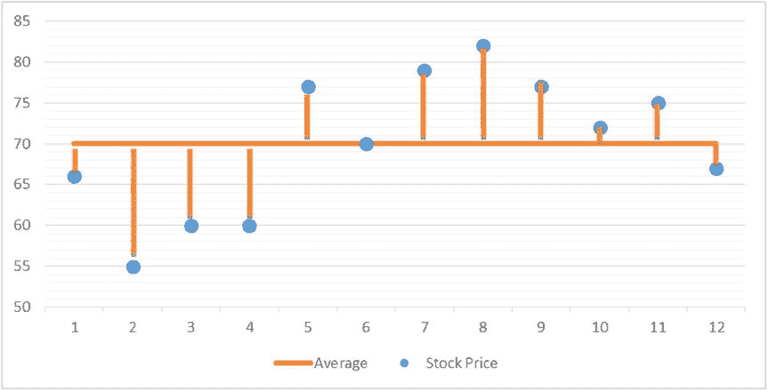

图 6-4. 相对于均值的偏差；一家初创公司的股票价格

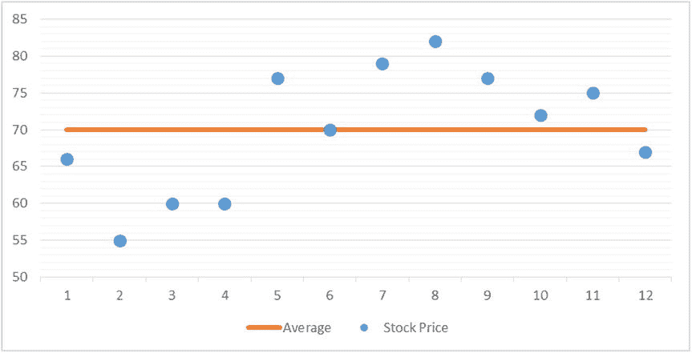

图 6-3. 一家初创公司的股票价格（表 6-17）

平均股价约为 $70。日期 1 与平均值的偏差为 4，日期 2 的偏差为 15。每个点相对于均值的这种偏差是离散程度的一个良好指标。有趣的是，所有这些偏差的总和始终为零。这一推论显而易见，因为均值位于中心，其他值分布在均值线的上下两侧。

平方偏差是次优选择。所有点的平方偏差平均值称为 `方差`，它能完美地量化离散程度。变量离散程度越小，意味着该变量在每个点上的取值几乎相同。这相当于偏差接近于零。平方偏差也将接近于零，因此可以得出结论：方差非常低。该特定股票过去 12 天的方差为 67（表 6-18）。

表 6-18. 股票价格的平方偏差

| 日期 | 股票价格 | 均值 | 偏差 | 平方偏差 |
| --- | --- | --- | --- | --- |
| 1 | 66 | 70 | -4 | 16 |
| 2 | 55 | 70 | -15 | 225 |
| 3 | 60 | 70 | -10 | 100 |
| 4 | 60 | 70 | -10 | 100 |
| 5 | 77 | 70 | 7 | 49 |
| 6 | 70 | 70 | 0 | 0 |
| 7 | 79 | 70 | 9 | 81 |
| 8 | 82 | 70 | 12 | 144 |
| 9 | 77 | 70 | 7 | 49 |
| 10 | 72 | 70 | 2 | 4 |
| 11 | 75 | 70 | 5 | 25 |
| 12 | 67 | 70 | -3 | 9 |
| 均值 | 70 | | 0 | 67 |

`方差` 是相对于均值的平方偏差的平均值。这种相对于均值的平均平方偏差是最广泛使用的离散程度度量。在计算方差时，我们考虑了每个点 `xi`，这就是它成为有效离散程度度量的原因。

在此公式中，

- `N` 是观测总数。
- `xi` 是 `x` 的第 i 个值。
- `μ` 是变量 `x` 的均值。

同样，另一支股票（表 6-19）的每日值方差为 413。

表 6-19. 一家初创公司的股票价格，另一个示例

| 日期 | 股票价格 | 平均值 | 偏差 | 平方偏差 |
| --- | --- | --- | --- | --- |
| 1 | 32 | 41 | -9 | 81 |
| 2 | 28 | 41 | -13 | 169 |
| 3 | 75 | 41 | 34 | 1156 |
| 4 | 22 | 41 | -19 | 361 |
| 5 | 41 | 41 | 0 | 0 |
| 6 | 75 | 41 | 34 | 1156 |
| 7 | 63 | 41 | 22 | 484 |
| 8 | 25 | 41 | -16 | 256 |
| 9 | 59 | 41 | 18 | 324 |
| 10 | 19 | 41 | -22 | 484 |
| 11 | 21 | 41 | -20 | 400 |
| 12 | 32 | 41 | -9 | 81 |
| 均值 | 41 | | 0 | 413 |

注意

尽管 `方差` 是量化离散程度的一种良好度量，但在将度量单位应用于计算出的数值时会面临挑战。

在表 6-18 的示例中，方差是 67。它是 67 平方美元吗？商人能理解吗？其他一些变量，如客户数量（平方客户）、年龄（年平方）等，也没有意义。在计算方差之后，必须将它们还原为原始的单位形式。由于方差是平均平方偏差，该值的平方根将与原始变量具有相同的单位。这被称为 `标准差`。

#### 标准差

`标准差` 是方差的平方根，由以下公式表示：`σ = √(Variance)`。这种度量也有助于比较，因为其单位与原始变量单位相同。股票价格示例中的标准差是 `√(67) = 8.2`。这意味着在平均股价 $70 的基础上存在 $8.2 的偏差。


### 使用 SAS 计算离散度

SAS 提供了便捷的过程来计算离散度的度量值。我们通过一些示例来帮助你理解。以下是计算标价方差的代码：

```
Proc means data=online_sales var;
var listPrice;
run;
```

关于此代码给出的方差，请参考表 6-20。

**表 6-20.** `online_sales` 的方差

| 分析变量 : listPrice |
| --- |
| Variance |
| 112006391 |

以下代码计算变量 `listPrice` 的标准差：

```
Proc means data=online_sales std ;
var listPrice;
run;
```

关于此代码给出的方差，请参考表 6-21。

**表 6-21.** `online_sales` 的方差

| 分析变量: listPrice |
| --- |
| StdDev |
| 10583.31 |

仅通过观察方差无法判断其高低。只有当与原始变量单位进行比较时，方差的大小才有意义。例如，如果平均变量值达到数百万，那么 1,000 的方差可能微不足道。以下代码计算每个品牌 `listPrice` 的标准差：

```
/* SD in list price for each brand */
Proc means data=online_sales std ;
var listPrice;
class brand;
run;
```

关于此代码的输出，请参考表 6-22。

**表 6-22.** `proc means` 对 `online_sales` 数据集的输出结果（按品牌计算的标准差）

| 分析变量 : listPrice |
| --- |
| 品牌 | N 个观测值 | StdDev |
| Acer | 1 | . |
| AirTyme | 90 | 0 |
| Airtyme | 89 | 133.04 |
| Apple | 146 | 7290.86 |
| Arise | 161 | 493.21 |
| BlackBerr | 201 | 10270.17 |
| Blackberr | 18 | 6220.25 |
| Canon | 3 | 351.48 |
| Fujifilm | 11 | 3579.65 |
| HTC | 469 | 9039.04 |
| Htc | 38 | 0.00 |
| Huawei | 8 | 2127.74 |
| IBall | 108 | 4485.59 |
| Intel | 1 | . |
| Intex | 26 | 0.74 |
| Karbonn | 299 | 1866.15 |
| LAVA | 4 | 52.00 |
| LG | 361 | 7024.66 |
| Lava | 25 | 198.36 |
| Lemon | 1 | . |
| MICROMAX | 19 | 0.00 |
| MOTOROLA | 19 | 0.00 |
| Micromax | 579 | 1919.67 |
| Motorola | 259 | 5992.82 |
| Nikon | 23 | 4891.98 |
| Nokia | 683 | 8026.02 |
| Olympus | 4 | 0.00 |
| Samsung | 956 | 11870.12 |
| Sony | 355 | 7297.27 |
| Sony Eric | 62 | 1909.80 |
| Soyer | 7 | 0.00 |
| Spice | 80 | 871.76 |
| Videocon | 13 | 786.43 |
| Xolo | 6 | 479.26 |
| Zen | 4 | 0.00 |

从表 6-22 可以推断出，三星销售的手机价格范围很广，因此该品牌的标准差很高。这部分原因是该品牌销售的商品数量较多。相比之下，Micromax 的标准差相对较低（实际上为零）。

### 医疗索赔示例

假设一家医疗保险公司收集了一段时间内的索赔数据。以下是变量：

*   `Patient_id`：患者 ID
*   `Patient_Age`：患者年龄
*   `Days_admitted_hosp`：住院天数
*   `Num_medical_bills_submitted`：提交的医疗账单数量
*   `Claim_amount`：索赔金额

以下是对 `Claim_amount` 进行集中趋势和离散度分析的 SAS 代码。输出结果请参考表 6-23。

```
Proc means data= health_claim  ;
var Claim_amount;
run;
```

**表 6-23.** `proc means` 对 `health_claim` 数据集的输出结果

| 分析变量 : Claim_amount |
| --- |
| N | 均值 | 标准差 | 最小值 | 最大值 |
| 50000 | 1537.48 | 3287.49 | 0 | 256058.00 |

平均索赔金额为 1,537 美元。最大索赔金额为 256,058 美元。索赔金额的标准差为 3,287.5 美元。

以下是计算均值和单位数的代码：

```
Proc means data= health_claim  meanmedian;
var  Claim_amount;
run;
```

关于此代码的输出，请参考表 6-24。

**表 6-24.** `claim_amount` 数据集的均值和单位数

| 分析变量 : Claim_amount |
| --- |
| 均值 | 单位数 |
| 1537.48 | 438.00 |

确实存在一些异常值。均值与单位数相差甚远。第 7 章将讨论如何处理异常值。

本章至此讨论了一些能够提供变量整体概况的度量指标。均值表示平均值，而方差和标准差表示离散度。还有一些额外的度量指标，例如分位数，有助于你全面理解变量。分位数能帮助你更好地理解变量的分布情况。在 SAS 中，你可以使用单变量分析获取分位数和箱线图，这些内容将在以下章节中介绍。


## 分位数

分位数即等分数据后的各个部分。分位数的例子包括百分位数、四分位数和十分位数，本节将讨论这些概念。百分位数是将变量值分成 100 等份后的结果。

例如，考虑 20 名学生的分数，按升序排列（表 6-25）。

**表 6-25.** 20 名学生的分数

| S1 | S2 | S3 | S4 | S5 | S6 | S7 | S8 | S9 | S10 | S11 | S12 | S13 | S14 | S15 | S16 | S17 | S18 | S19 | S20 |
| --- | --- | --- | --- | --- | --- | --- | --- | --- | --- | --- | --- | --- | --- | --- | --- | --- | --- | --- | --- |
| 37 | 58 | 40 | 55 | 67 | 75 | 35 | 40 | 56 | 37 | 60 | 52 | 57 | 66 | 43 | 74 | 75 | 63 | 72 | 54 |

此处，中位数为 56.5，接近平均值的学生是 S9。这意味着 S9 几乎位于总体数据的 50%标记处（表 6-26）。

**表 6-26.** 总体的中位数

| S7 | S1 | S10 | S3 | S8 | S15 | S12 | S20 | S4 | S9 | S13 | S2 | S11 | S18 | S14 | S5 | S19 | S16 | S6 | S17 |
| --- | --- | --- | --- | --- | --- | --- | --- | --- | --- | --- | --- | --- | --- | --- | --- | --- | --- | --- | --- |
| 35 | 37 | 37 | 40 | 40 | 43 | 52 | 54 | 55 | 56 | 57 | 58 | 60 | 63 | 66 | 67 | 72 | 74 | 75 | 75 |

- 哪个学生在 100%的位置？请记住，这里相关的是 100%位置上的值，而不是 100 分。整个变量被分成 100 份，每一份称为一个百分位数。现在，参考表 6-27 和表 6-28 以及下面的列表，来更好地理解百分位数，以及另外两个术语：十分位数和四分位数。
- 第 100 个百分位数的值是多少？它是不是最大值，即 75？
- 第 50 个百分位数的值是多少？它是不是中位数值 56？这意味着 50%的个案小于 56，其余 50%大于 56。
- 第 10 个百分位数的值是多少？由于这里有 20 个数据点，每个数据点占总体的 5%，所以第 10 个百分位数对应第二个值，即 37。这意味着 10%的个案小于 37，其余 90%大于 37。
- 第 70 个百分位数是第 14 个值，即 63。这意味着 70%的个案小于 63，其余 30%大于 63。

**表 6-27.** 总体中不同的百分位数值

| S7 | S1 | S10 | S3 | S8 | S15 | S12 | S20 | S4 | S9 | S13 | S2 | S11 | S18 | S14 | S5 | S19 | S16 | S6 | S17 |
| --- | --- | --- | --- | --- | --- | --- | --- | --- | --- | --- | --- | --- | --- | --- | --- | --- | --- | --- | --- |
| 35 | 37 | 37 | 40 | 40 | 43 | 52 | 54 | 55 | 56 | 57 | 58 | 60 | 63 | 66 | 67 | 72 | 74 | 75 | 75 |

- 一个十分位数是变量的 1/10。在本例中，第一个十分位数等于第 10 个百分位数（37），第二个十分位数等于第 20 个百分位数（40）。
- 一个四分位数是变量的 1/4。在本例中，第一个四分位数等于第 25 个百分位数（40）。第二个四分位数等于第 50 个百分位数，也就是中位数，它也等于第 5 个十分位数（56）。第三个四分位数等于第 75 个百分位数（66）。

**表 6-28.** 总体中不同的四分位数值

| S7 | S1 | S10 | S3 | S8 | S15 | S12 | S20 | S4 | S9 | S13 | S2 | S11 | S18 | S14 | S5 | S19 | S16 | S6 | S17 |
| --- | --- | --- | --- | --- | --- | --- | --- | --- | --- | --- | --- | --- | --- | --- | --- | --- | --- | --- | --- |
| 35 | 37 | 37 | 40 | 40 | 43 | 52 | 54 | 55 | 56 | 57 | 58 | 60 | 63 | 66 | 67 | 72 | 74 | 75 | 75 |

第一个和第三个四分位数也分别被称为下四分位数和上四分位数。下四分位数和上四分位数之间的差值称为四分位距（表 6-29）。它给出了中间 50%数值的分布范围。

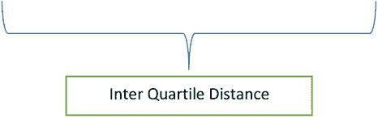

**表 6-29.** 四分位距

| S7 | S1 | S10 | S3 | S8 | S15 | S12 | S20 | S4 | S9 | S13 | S2 | S11 | S18 | S14 | S5 | S19 | S16 | S6 | S17 |
| --- | --- | --- | --- | --- | --- | --- | --- | --- | --- | --- | --- | --- | --- | --- | --- | --- | --- | --- | --- |
| 35 | 37 | 37 | 40 | 40 | 43 | 52 | 54 | 55 | 56 | 57 | 58 | 60 | 63 | 66 | 67 | 72 | 74 | 75 | 75 |

四分位距 = 66 – 40 = 26

这个四分位距在识别异常值方面是一个有用的度量。在表 6-29 的例子中，总体数据范围是 75 – 35 = 40，而四分位距，即中间 50%的范围，是 26，这看起来很合理。现在考虑表 6-30 中给出的例子。

**表 6-30.** 四分位距的另一个例子

| S7 | S1 | S10 | S3 | S8 | S15 | S12 | S20 | S4 | S9 | S13 | S2 | S11 | S18 | S14 | S5 | S19 | S16 | S6 | S17 |
| --- | --- | --- | --- | --- | --- | --- | --- | --- | --- | --- | --- | --- | --- | --- | --- | --- | --- | --- | --- |
| 35 | 37 | 37 | 45 | 46 | 48 | 52 | 50 | 52 | 55 | 57 | 58 | 58 | 59 | 59 | 66 | 67 | 69 | 96 | 99 |

四分位距 = 59 – 46 = 13

这表明中间 50%的数值分布在 13 的范围内。总体数据范围是 99 – 35 = 64。对于表 6-30，还可以得出以下推论：

- 最小的 25%数值分布在 11 的范围内（46 – 35）。
- 中间的 50%数值分布在 13 的范围内。
- 最高的 25%数值分布在 99 – 59 = 40 的范围内，这表明前 25%中存在一些异常高的值。

如果只有十名学生，情况会怎样（表 6-31）？以下是找到第一个四分位数的方法：第一个四分位数落在排名第二和第三的值之间。在这种情况下，通过求平均值来计算四分位数。第三个四分位数落在排名第七和第八的值之间。

**表 6-31.** 仅有十个观测值的四分位数

| S7 | S1 | S10 | S3 | S8 | S15 | S12 | S20 | S4 | S9 |
| --- | --- | --- | --- | --- | --- | --- | --- | --- | --- |
| 35 | 37 | 37 | 40 | 40 | 43 | 52 | 54 | 55 | 56 |

第一个四分位数 = (37 + 37) / 2 = 37

第三个四分位数 = (52 + 54) / 2 = 53


### 使用 SAS 计算分位数

以下代码可得出一些重要的分位数。下一节将讨论的箱线图，也可以使用单变量分析来绘制，你正是用这种分析来获取分位数。

以下是针对在线销售示例中获取列表价格分位数的代码：

```
Proc univariate data = online_sales ;
var listPrice ;
run ;
```

`Proc univariate` 提供了关于某个变量的其他几种度量。本节仅考虑输出中的分位数表（表 6-32）。

表 6-32. 对 `online_sales` 执行 `Proc univariate` 得到的分位数

| 分位数（定义 5） |
| --- |
| 分位数 | 估计值 |
| 100% 最大值 | 139990 |
| 99% | 44500 |
| 95% | 35198 |
| 90% | 28590 |
| 75% Q3 | 15302 |
| 50% 中位数 | 8399 |
| 25% Q1 | 4110 |
| 10% | 1559 |
| 5% | 999 |
| 1% | 849 |
| 0% 最小值 | 849 |

最低列表价格为 849 美元，最高为 139,990 美元。第 25 百分位数，即第一四分位数，为 4,110 美元。第三四分位数值为 15,302 美元。四分位距为 15,302 – 4,110 = 11,192。分位数还显示，99%的商品列表价格小于或等于 44,500 美元。139,990 美元的最大值看起来远大于 99%的值即 44,500 美元。这清晰表明了异常值的存在。在后面的章节中，我们将介绍一种识别异常值的方法。

### 健康索赔示例

表 6-33 给出了取自医疗保健数据集的一个输出。对健康索赔数据进行单变量分析的代码如下：

```
Proc univariate data = health_claim ;
var Claim_amount ;
run;
```

表 6-33. `health_claim` 示例的分位数

| 分位数（定义 5） |
| --- |
| 分位数 | 估计值 |
| 100% 最大值 | 256058 |
| 99% | 11428 |
| 95% | 6149 |
| 90% | 4368 |
| 75% Q3 | 2044 |
| 50% 中位数 | 438 |
| 25% Q1 | 0 |
| 10% | 0 |
| 5% | 0 |
| 1% | 0 |
| 0% 最小值 | 0 |

表 6-33 中的输出显示，25%的客户没有索赔，50%的客户索赔金额为 438 美元。95%的客户索赔金额为 6,149 美元或更少，因此其余 5%的客户似乎有异常的索赔金额。或许有必要对这 5%的客户进行过度的审查。可能需要检查他们的医疗账单数量、疾病类型等因素。

### 箱线图

箱线图可以显示变量中的异常值。箱线图是四分位数以及最小值和最大值的图形表示。箱线图使得解释变量的分布更容易。表 6-33 使用表 6-34 中给出的示例数据说明了箱线图。

箱线图显示以下值：

- 最小值
- 第一四分位数值
- 中位数值
- 第二四分位数值
- 最大值

表 6-34. 一个示例总体

| S7 | S1 | S10 | S3 | S8 | S15 | S12 | S20 | S4 | S9 | S13 | S2 | S11 | S18 | S14 | S5 | S19 | S16 | S6 | S17 |
| --- | --- | --- | --- | --- | --- | --- | --- | --- | --- | --- | --- | --- | --- | --- | --- | --- | --- | --- | --- |
| 35 | 37 | 37 | 40 | 40 | 43 | 52 | 54 | 55 | 56 | 57 | 58 | 60 | 63 | 66 | 67 | 72 | 74 | 75 | 75 |

图 6-5 展示了基于表 6-34 中数据的箱线图。

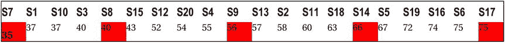

图 6-5. 表 6-34 的箱线图

如果变量中存在与其他值差异很大的稀有值，它们将出现在箱体的上端或下端。异常值在箱线图中一目了然。图 6-6 给出的图显示所有值都分布良好。该变量中没有异常值。

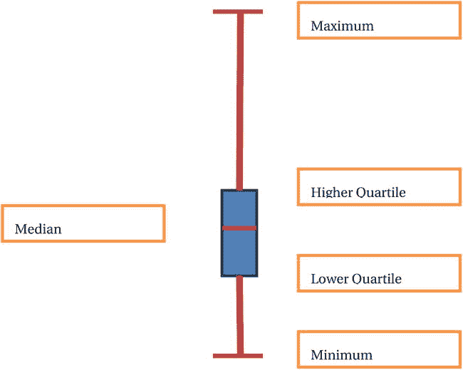

图 6-6. 无异常值的箱线图

例如，在表 6-35 中，有几个值远超中位数，且距离第三四分位数非常远。其箱线图如图 6-7 所示。

表 6-35. 包含异常值的示例总体

| S7 | S1 | S10 | S3 | S8 | S15 | S12 | S20 | S4 | S9 | S13 | S2 | S11 | S18 | S14 | S5 | S19 | S16 | S6 | S17 |
| --- | --- | --- | --- | --- | --- | --- | --- | --- | --- | --- | --- | --- | --- | --- | --- | --- | --- | --- | --- |
| 35 | 37 | 37 | 45 | 46 | 48 | 52 | 50 | 52 | 55 | 57 | 58 | 58 | 59 | 59 | 66 | 67 | 69 | 98 | 99 |

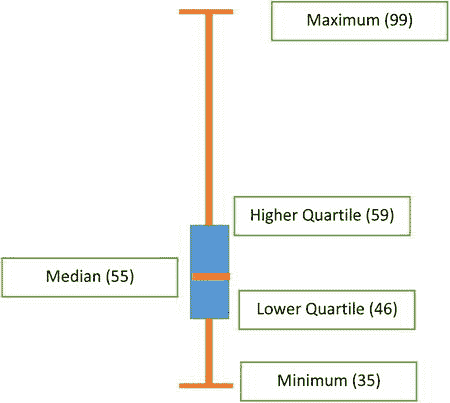

图 6-7. 表 6-35 的箱线图

识别异常值的一个简单方法是查看四分位距。如果存在超过三倍四分位距的值，它们可以被视为异常值（图 6-8）。在本例中，四分位距为 59 – 46 = 13，但存在超过 59 + 3 * (13) = 59 + 39 = 98 的值。因此，值 98 和 99 是数据中的异常值。

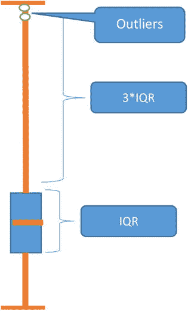

图 6-8. 使用箱线图识别异常值


### 使用 SAS 创建箱线图

如前所述，单变量分析会在输出中提供多个值。本节仅关注箱线图。只需在单变量代码中添加一个绘图选项即可。示例代码如下：

```
Proc univariate data=health_claim plot;
var Claim_amount;
run;
```

生成的分位数和箱线图分别如表 6-36 和图 6-9 所示。

**表 6-36.** 健康索赔示例的分位数表（`claim_amount`）

| 分位数（定义 5） | |
| --- | --- |
| 分位数 | 估计值 |
| 100% 最大值 | 256058 |
| 99% | 11428 |
| 95% | 6149 |
| 90% | 4368 |
| 75% Q3 | 2044 |
| 50% 中位数 | 438 |
| 25% Q1 | 0 |
| 10% | 0 |
| 5% | 0 |
| 1% | 0 |
| 0% 最小值 | 0 |

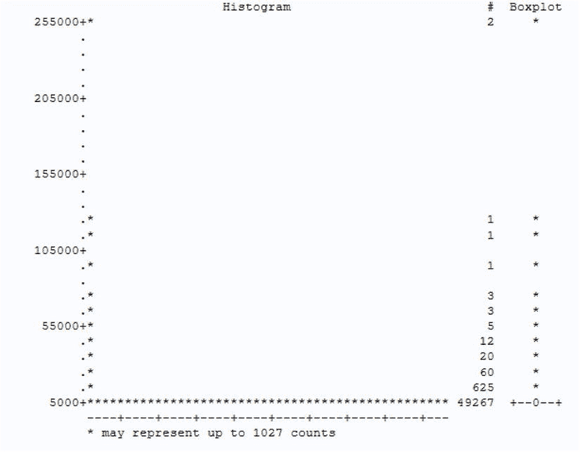

**图 6-9.** `health_claim` 数据集的箱线图（`claim_amount`）

图 6-9 中的图形显示，整个箱子（第一四分位数、中位数和第三四分位数）紧贴在底部。这是因为存在一些离群高值。第一步是移除所有离群高值并重新绘制箱线图。仅考虑总体的前 95%，也就是所有索赔金额低于 6,149 美元的客户。95% 这个值可以从分位数表（表 6-36）中找到。

以下代码对 `claim_amount` 施加了一个条件：

```
Proc univariate data=health_claim plot;
var Claim_amount;
where Claim_amount < 6149;
run;
```

忽略离群值后，现在可以看到箱子（图 6-10）。

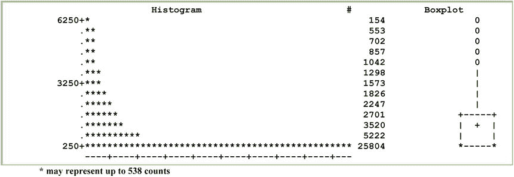

**图 6-10.** 忽略离群值后 `claim_amount` 的箱线图

以下代码为在线销售数据创建箱线图：

```
Proc univariate data=online_sales plot;
var listPrice;
run;
```

图 6-11 是生成的箱线图。

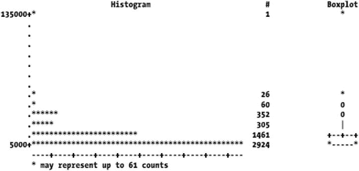

**图 6-11.** `listPrice` 的箱线图

再次出现了一些离群值（表 6-37）。

**表 6-37.** 健康索赔示例的分位数表（`listPrice`）

| 分位数（定义 5） | |
| --- | --- |
| 分位数 | 估计值 |
| 100% 最大值 | 139990 |
| 99% | 44500 |
| 95% | 35198 |
| 90% | 28590 |
| 75% Q3 | 15302 |
| 50% 中位数 | 8399 |
| 25% Q1 | 4110 |
| 10% | 1559 |
| 5% | 999 |
| 1% | 849 |
| 0% 最小值 | 849 |

考虑截至 99% 的值以观察箱子。离群值的剔除和处理将在第 7 章详细讨论。此示例简单地移除离群值并重新绘制箱线图（图 6-12），以清晰地显示箱子。参考以下代码：

```
Proc univariate data=online_sales plot;
var listPrice;
where listPrice < 44500;
run;
```

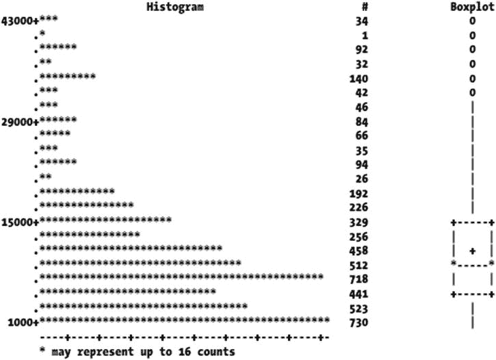

**图 6-12.** 移除离群值后 `listPrice` 的箱线图

移除离群值后，箱子现在看起来在总体中分布得更好。

## 双变量分析

到目前为止，您每次只考察了一个变量。双变量分析则是将两个变量放在一起分析。它回答了诸如两个变量之间的关联是什么、当一个变量增加时另一个变量会发生什么变化等问题。以下是一些示例：

- 如果学习小时数增加，考试成绩也会增加吗？
- 如果教堂建筑数量增加，犯罪率会下降吗？
- 如果汽车数量增加，平均年龄会下降吗？

相关性用于量化两个变量之间的关联。相关性是进行双变量分析最常用的方法之一。后续章节将讨论相关性。

## 结论

在本章中，您学习了如何使用一些非常基础的统计技术对数据进行基本报告和变量分析。您还看到了单变量分析在分析变量方面的用处。直到最近，即使是这种程度的统计分析也被认为是足够好的。但在过去几年中，情况发生了很大变化。现在，更先进和复杂的数据分析工具及技术被用作辅助高管决策的手段。在接下来的章节中，我们将带您了解一些经典和高级的数据分析技术。当您将 SAS 作为主要数据分析工具时，您将会体会到这些原本复杂的技术变得多么简单。

