# 8. 假设检验

您现在应该已经了解了 SAS 的基础知识和统计学的基本原理。您主要使用描述性统计来解释数据并获取一些快速见解，而无需应用任何高级技术。在本章中，您将学习如何应用一种高级技术：检验您的假设。学习如何检验假设对分析师来说很重要，因为他们会在许多场景中使用此过程，例如检验相关性、检验回归系数、检验时间序列分析中的参数估计、检验逻辑回归的拟合优度等。您将在接下来的章节中了解这些主题。

在本章中，重点在于假设检验及其涉及的重要概念。具体来说，您将学习零假设、备择假设、假设检验的过程、要使用的不同类型的检验，以及整个检验过程中可能出现的误差。

## 检验：一个日常生活中的类比

让我们用一个简单的现实生活示例来进行检验。假设您想为一个大型聚会购买一个 50 磅的蛋糕。您走进一家蛋糕店，要求购买一个。店长说蛋糕已经准备好了，并把它拿给您看。您可能会对其味道和质量产生怀疑。50 磅是一个巨大的蛋糕，显然您不想冒任何风险，即使店长向您保证它质量最好。事实上，您可能想要检验这个蛋糕。换句话说，您想检验店长所说的“蛋糕质量很好”这一陈述。显然，您不能吃掉整个蛋糕然后声称自己只是在检验。因此，您会请店长切一小块蛋糕给您品尝。您可能希望从蛋糕上随机切取这个测试样本。以下是您的测试可能产生的结果：

*   测试的那块蛋糕味道棒极了，是您吃过的最好吃的蛋糕。这可能会让您立即决定购买。
*   测试的那块蛋糕与您的期望相悖。在这种情况下，您肯定不会购买。
*   质量不是最好的，但仍然令人满意。如果没有更好的选择，您可能会购买。

您开始时有一个假设，然后抽取了一个样本进行测试，并基于一个简单的测试得出了结论。用统计学术语来说，您是基于对随机样本的测试对整个总体做出了推断。这个过程就是假设检验的本质，换句话说，就是验证性数据分析的科学。

让我们再考虑一个例子。一家大型电商公司声称其一半客户是男性，另一半是女性。为了检验这一说法，您随机抽取了 100 名客户，并统计其中有多少是男性。同样，可能会出现以下三种情况：

*   恰好 50%是男性，另外 50%是女性。
*   一种性别占主导地位。例如，几乎 90%是男性，只有 10%是女性。
*   一种性别接近 50%。例如，样本中 52%是男性。

在第一种情况下，您同意电商公司的说法，即男性和女性客户的数量相同。在第二种情况下，您直接拒绝了公司的声明。在第三种情况下，您可能倾向于同意该声明。再次强调，您是基于样本度量对整个总体做出了推断。

这些都是说明假设检验过程的相当好的例子。其过程总结如下：

您从一个假设开始。在第一个例子中，假设整个蛋糕是好的。在第二个例子中，假设总体性别比例是 50%。您抽取一个能代表总体的样本。在第一个例子中，您尝了一小块蛋糕。在第二个例子中，您观察了 100 名客户。您对步骤 2 中收集的样本进行某种检验。在第一个例子中，您通过将蛋糕放入口中来品尝它。在第二个例子中，您实际上统计了样本中男性和女性客户的数量。您根据对随机样本的检验做出最终的解释和推断。您做出关于蛋糕是好是坏的决定。您做出关于性别比例是否真的是 50%的推断。


## 什么是假设检验的过程？

假设检验的过程与前一节讨论的示例类似。通过这一过程，你可以对样本进行一些统计检验，从而推断出总体的情况。你利用样本中的某些检验统计量值，对总体参数进行统计推断。关于总体、参数、样本和统计量的更多内容，可参考第 5 章，但这里先做一个快速回顾（另见图 8-1）：

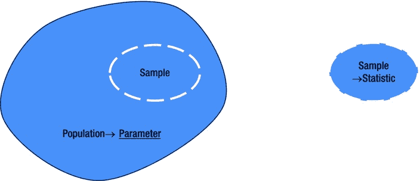

图 8-1 参数与统计量

- **总体（Population）**：总体是研究对象的全部，即所有观测值的完整列表或全部数据。例如，所有的信用卡用户或一家公司的所有员工。
- **样本（Sample）**：样本是从总体中抽取的一个子集或一小部分。例如，年龄在 20 到 30 岁之间的信用卡用户，或属于人力资源团队的员工。
- **参数（Parameter）**：基于总体计算出的任何度量值称为参数。例如，所有信用卡用户的平均收入，或你公司所有员工的平均收入。
- **统计量（Statistic）**：基于样本计算出的任何度量值称为统计量。例如，从信用卡用户中抽取的样本（20 至 30 岁用户）的平均收入，以及人力资源团队员工的平均收入。

在推断性统计中，你会对总体做出一个假设。这个假设被称为**假设**（准确地说，是**零假设**）。你抽取一个样本并计算检验统计量，如果零假设为真，你预期该检验统计量会落在某个范围内。

表 8-1 包含了一些涉及假设检验过程的更多示例。

表 8-1. 假设检验示例

| 场景 | 零假设 | 样本 | 样本统计量 | 推断 |
| --- | --- | --- | --- | --- |
| 银行客户薪资 | 平均收入为 35,000 美元。 | 你抽取一个包含 300 名客户的简单随机样本。 | 样本统计量是 300 名抽样客户的平均薪资。 | 如果样本薪资接近 35,000 美元，则接受零假设；否则拒绝零假设。 |
| 药物检测 | 该药物含 1.5%的酒精。 | 你随机抽取 100 毫升样本。 | 样本统计量是样本中测得的酒精百分比。 | 如果样本检测值接近 1.5%，则接受零假设。 |
| 产品反馈 | 我们产品的客户满意度为 80%。 | 你抽取一个简单随机或分层样本，涵盖不同用户群体。 | 你进行一项调查，得到样本的客户满意度评分（正式的客户满意度分数）。 | 如果样本客户满意度评分接近 80%，则接受零假设。 |
| 学生培训 | 培训对学生没有显著影响。 | 你抽取一组参加过培训的学生样本。 | 学生在培训前和培训后各参加一次测试。 | 如果成绩有显著提高，则接受零假设。 |
| 吸烟导致癌症 | 吸烟不会导致癌症（吸烟与癌症相互独立）。 | 你从总体中抽取一个随机样本（包含吸烟者和非吸烟者）。 | 样本统计量是吸烟者和非吸烟者中患癌症的比例。 | 如果吸烟者中患癌症的比例与非吸烟者没有显著差异，则接受零假设。 |

到目前为止，我们已经讨论了如何构建零假设、抽取随机样本、对分布进行抽样、计算概率，并最终对总体做出推断。图 8-2 展示了假设检验过程中涉及的主要步骤。

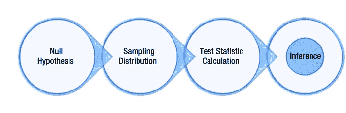

图 8-2. 假设检验步骤概览

以下是具体的步骤：

1.  陈述关于总体的零假设。从一个假设或假定开始。
2.  选择样本和抽样分布。
3.  计算检验统计量值。
4.  根据检验统计量的结果做出最终推断。

下面是一个简短的商业案例研究，帮助你理解假设检验的过程。一家肥皂生产公司声称，肥皂的平均重量为 250 克，且总体的标准差为 5 克。你想通过抽取 50 块肥皂的样本来检验这一说法。需要注意的是，肥皂的定价基于假设其重量为 250 克。任何超过 250 克的重量对公司来说都是损失。如果平均重量显著小于 250 克，公司会失去客户；如果大于 250 克，则公司定价过低。在这个案例中，你可以通过假设检验来验证肥皂的平均重量是否为 250 克。假设你抽取了 50 块肥皂样本，样本平均重量为 260 克。那么问题来了：你应该接受还是拒绝零假设？

图 8-3 中的流程图展示了检验该示例假设的方法。

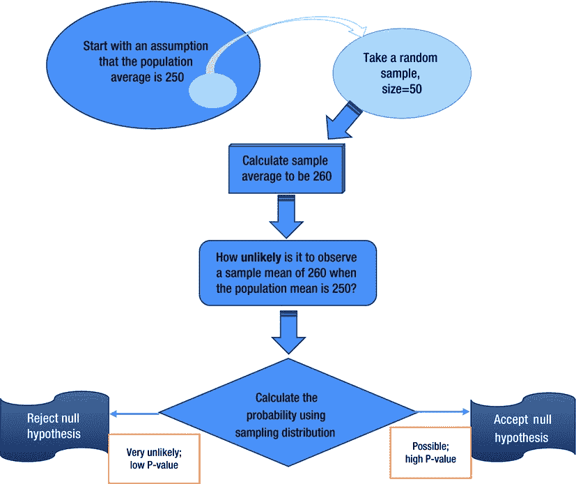

图 8-3. 肥皂示例的假设检验

图 8-4 展示了假设检验过程中的所有步骤。

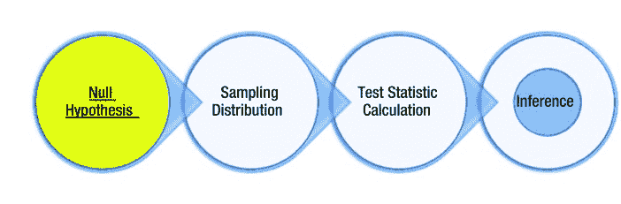

图 8-4. 建立零假设，第一步

### 陈述关于总体的零假设：零假设（H[0]）

零假设是一个关于总体的陈述、初始假设或主张。零假设通常用 `H[0]`（读作“H 零”）表示。在陈述零假设时需要谨慎，因为后续的检验都将基于零假设为真的假定来进行。换句话说，你根据零假设的初始假定来考虑所有场景和度量。零假设是假设的最简单形式。除非获得充分证据反对，否则你倾向于同意零假设中的所有陈述。

零假设 `H[0]` 描述了一个理论，该理论之所以被提出，要么是因为被认为正确，要么是作为后续论证的基础，但到目前为止尚未被证明。

以下是一些零假设的示例：

- `H[0]`：我们的客户群中有 50%为男性。
- `H[0]`：该国女性人口的平均身高为 5.5 英尺。
- `H[0]`：疫苗接种与流感相互独立。
- `H[0]`：该药物没有显著的副作用。
- `H[0]`：这枚硬币是无偏的或公平的（正面概率等于反面概率，均为 0.5）。


#### 备择假设（H[1]）

备择假设是除零假设之外的另一种假设。在检验之后，如果你拒绝零假设，那么你可以考虑接受备择假设。在大多数推断中（并非所有情况），备择假设与零假设相反。大多数时候，你要么接受要么拒绝零假设，而备择假设可能根本不会出现。为了便于理解，人们将"拒绝零假设"等同于"接受备择假设"。简而言之，并非所有类型的检验都需要备择假设。上一节示例（针对零假设）的备择假设如下所示：

*   H[1]：男性顾客的比例不等于 50%。
*   H[1]：该国女性人口的平均身高不等于 5.5 英尺。
*   H[1]：疫苗接种与流感相互依赖。
*   H[1]：该药物具有显著的副作用。
*   H[1]：这枚硬币有偏差（正面和反面的概率不等于 0.5）。

关于肥皂示例的零假设和备择假设如下所示：

*   H[0]：肥皂的平均重量为 250 克。
*   H[1]：肥皂的平均重量不等于 250 克。

### 抽样分布

一旦定义了零假设，你需要抽取一个样本并计算一个统计量。即使在计算统计量之前，你也应该对样本统计量的分布有一个清晰的概念。这也被称为抽样分布（图 8-5）。

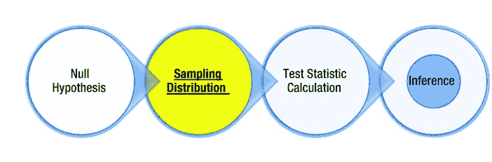

图 8-5. 样本分布，第二步

抽样分布是指在使用简单随机放回抽样（SRSWR）方法时，统计量的分布。在肥皂示例中，想象总体中有一百万块肥皂。当你从多个样本中获取平均重量时，平均重量的抽样分布会是什么样？你只需抽取一个包含 50 块肥皂的样本，求出平均重量；假设是 260 克。如果你重复这个抽样过程，平均重量的值的分布会是什么样？

注意

在使用 SRSWR 方法处理多个样本时，你抽取一个样本，然后在抽取其他样本之前将其放回总体中。

图 8-6 显示总体规模为 1,000,000，总体平均值为 250 克。现在你随机抽取一个包含 50 块肥皂的样本，求出平均重量，然后将它们放回总体。你再随机抽取另一个包含 50 块肥皂的样本，再次计算平均重量。如果你重复这个简单随机放回抽样的过程，并为每个样本求出平均重量，那么重量的分布会是什么样？请继续阅读以获取答案！

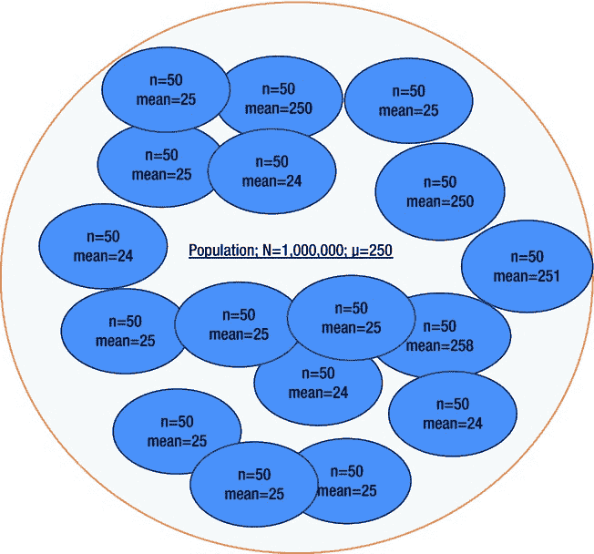

图 8-6. 肥皂示例中的多个随机样本

如果你无限次重复这个抽样过程，并求出每个样本的平均重量，那么平均重量的概率分布就被称为抽样分布。图 8-7 显示了此示例的一个虚拟频数分布，其中你抽取了 3,000 个简单随机放回样本。从这个频数分布中，你可以了解概率分布的大致形态。如前所述，概率分布需要抽取无限数量的样本才能确定。

图 8-7 或许回答了之前的所有问题。随着你在下一节阅读中心极限定理，你的理解将进一步加深。

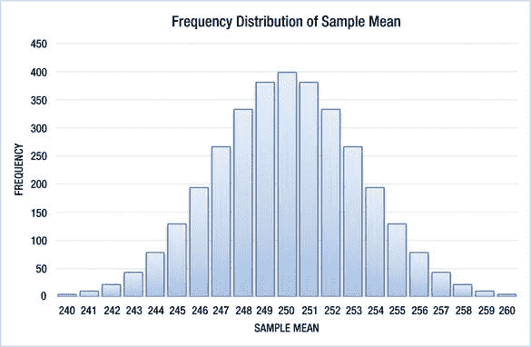

图 8-7. 肥皂示例中样本均值的频数分布

从频数分布中你可以看到，对于大多数样本，你得到的样本均值是 250 或接近该值。极少数情况下，你会得到一个与总体均值偏差很大的样本。

图 8-7 中讨论的示例仍然不足以让你理解样本均值的精确抽样分布（样本均值的概率分布）。3,000 个测试用例的频数分布是不够的；你希望获得当无限次重复简单随机放回抽样过程时的抽样分布。接下来讨论的中心极限定理将帮助你理解样本均值的分布。

#### 中心极限定理

要理解假设检验过程背后的原理，你需要理解中心极限定理。以下陈述是中心极限定理的简化形式：

大样本均值的分布趋向于正态分布，无论其母总体的分布如何。

我们现在将详细阐述这一定理。想象一下，从总体中抽取大量随机观察值，并计算这些观察值的算术平均值。如果你多次重复这一过程，得到大量此类计算出的算术平均值，中心极限定理指出，这些计算出的均值将近似服从正态分布（钟形曲线），无论其底层母总体的分布如何。

中心极限定理包含三个子定理：

*   随着样本量 `n` 的增加，样本均值的分布将越来越接近正态分布。
*   样本均值分布的标准差始终等于母总体的标准差除以样本大小的平方根。
*   样本均值分布的均值始终等于母总体的均值。


##### 使用中心极限定理检验假设

你可以使用中心极限定理来检验总体均值是否等于`μ`（总体算术平均数）。为了检验总体均值，你需要获取样本均值。中心极限定理指出，样本均值服从正态分布。你需要量化获取样本均值等于或大于`x̄`的概率。如果该概率非常小，则拒绝原假设。

在图 8-8 中，你可以看到样本均值的抽样分布。

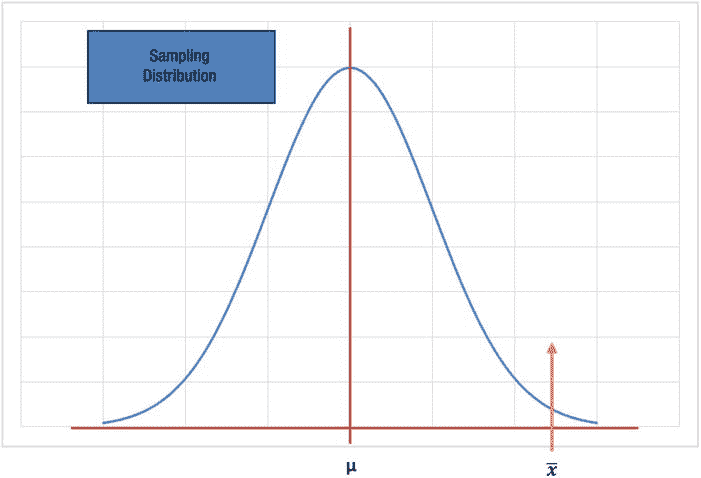

图 8-8. 样本均值的抽样分布

样本均值分布的均值与总体均值相同；这符合中心极限定理。在此，你试图找出，如果样本确实来自均值为`μ`的总体，那么获得样本均值等于或大于`x̄`的概率。你根据得出的概率来接受或拒绝原假设。如果得出的概率非常小，则拒绝原假设。这里的核心是检验样本是否确实来自均值为`μ`的总体。

简单来说，如果你的计算表明，获得特定样本均值（或更极端值）的概率非常小，而你却从样本中得到了该均值，那么这就说明有问题。这基本上意味着，可以相当精确地判断，该样本并非来自其所声称的总体。在香皂的例子中，总体均值声称是 250 克，而样本均值是 260 克。现在你计算当样本取自均值为 250 的总体时，得到样本均值 260 克（或更大）的概率。如果这个概率非常小（小于预设的阈值），那么你就可以有合理置信度拒绝“总体均值为 250”的原假设。

样本均值的抽样分布遵循正态分布。样本均值服从正态分布，但不能对所有的样本统计量都使用这一定理。样本方差就不服从正态分布。如果样本量小于 30，则其抽样分布不是正态分布。表 8-2 包含了更多关于假设、样本及其对应分布的示例。

表 8-2. 示例：样本及其对应分布

| 场景 | 原假设 | 样本 | 抽样分布 |
| --- | --- | --- | --- |
| 银行客户薪资 | 平均收入为 35,000 美元。 | 300 名客户的简单随机样本。 | 正态分布 |
| 产品反馈 | 我们产品的客户满意度为 80%。 | 跨不同细分市场的 25 名用户的简单随机或分层样本。 | T 分布 |
| 学生培训 | 培训对学生没有显著影响。 | 参加培训的学生样本。 | T 分布 |
| 吸烟导致癌症 | 吸烟不会导致癌症（吸烟与癌症相互独立）。 | 总体随机样本（包含吸烟者和非吸烟者）。 | 卡方分布 |
| 两只股票的价格方差 | 两只股票的方差相同。 | 取自股票 1 和股票 2 的两个随机样本。 | F 分布 |

在香皂的例子中，你同样只是检验总体均值，因此可以应用中心极限定理。香皂例子的抽样分布如图 8-9 所示。

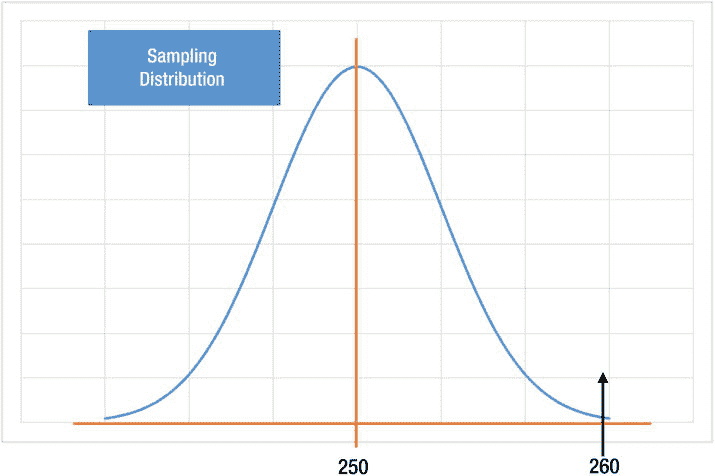

图 8-9. 香皂例子的抽样分布

现在你需要决定，260 的样本均值与 250 的总体均值相比，是远还是近。多远才算真的远？你需要回答这个问题：当样本取自均值为 250 的总体时，得到 260 的样本均值的可能性有多大？你需要衡量，当样本的总体均值为 250 时，获得样本均值 260（或更大）的概率。你需要计算并转换统计量来找到概率，然后接受或拒绝假设。

### 检验统计量

检验统计量（图 8-10

图 8-10. 检验统计量，第三步

检验统计量的选择取决于假定的概率分布和原假设。大多数情况下，它直接就是样本统计量的值。在香皂的例子中，样本均值就是检验统计量的值。样本均值服从正态分布。有时，为了求取正态分布概率，你需要将正态分布转换为标准正态变量。表 8-3 展示了一些检验统计量的示例。这里，检验统计量是根据问题类型选择的。

表 8-3. 检验统计量示例

| 场景 | 原假设 | 样本 | 检验统计量 |
| --- | --- | --- | --- |
| 银行客户薪资 | 平均收入为 35,000 美元。 | 300 名客户的简单随机样本。 | `z = 平均收入` 或 `z` |
| 药物测试 | 该药物含有 1.5%的酒精。 | 100 毫升随机样本。 | `p = 每 100 毫升的酒精百分比` |
| 产品反馈 | 我们产品的客户满意度为 80%。 | 跨不同细分市场的用户的简单随机或分层样本。 | `P = 满意客户数 / 客户总数` |
| 学生培训 | 培训对学生没有显著影响。 | 参加培训的学生样本。 | `t` |
| 吸烟导致癌症 | 吸烟不会导致癌症（吸烟与癌症相互独立）。 | 总体随机样本（包含吸烟者和非吸烟者）。 | `χ²` |

注：表 8-3 中有一些未知的检验统计量值。

在香皂的例子中，检验统计量是样本的均值，即 260 克。为了求取概率，你需要将其转换为标准正态分布。相比于直接从给定的抽样正态分布中计算概率，你需要将统计量转换为标准正态分布。这样更容易计算概率，而且许多文档和工具中都有标准正态概率表。样本均值服从均值为 250 的正态分布，总体标准差给定为 5 克。以下公式是样本均值的检验统计量（当样本量大于 30 时）：

```
z = (x̄ - μ) / (S / √N)
```

该公式将使用以下值：

- `x̄ = 260` 是样本均值。
- `μ = 250` 是总体均值，即原假设。
- `S = 5` 是总体标准差。
- `N = 50` 是样本量。

现在检验统计量已经就绪，你需要给出推断；也就是说，你需要接受或拒绝原假设。

现在你知道了确切的检验统计量值。它是接近原假设？还是远离原假设参数？你可以基于该检验统计量点及其与原假设参数的距离，来接受或拒绝原假设。接受或拒绝假设的过程称为推断。


### 推断

推断是检验假设过程中的最后一步（图 8-11）。

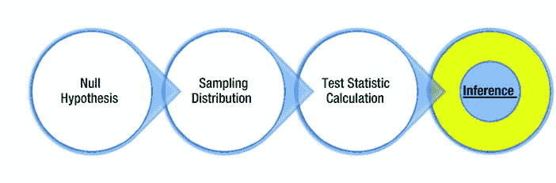

图 8-11. 推断，即第四步

在这一步中，你需要决定接受还是拒绝零假设。如果检验统计量在允许范围内，则接受零假设；如果超出允许范围，则拒绝零假设。你可以通过查看`P 值`（即概率值）来决定。

#### P 值

`P 值`是检验假设时最重要的衡量指标。如上所述，你需考虑一个样本，然后计算检验统计量。例如，如果你正在检验总体均值，且样本均值远离假设均值，则拒绝零假设。但究竟多远才算远？如果零假设称均值为 250，而你的样本给出的值为 260，它真的离 250 很远吗？你能接受 251 作为样本均值吗？252 可以吗？实际边界应该是什么？要确定这些边界，你需要了解抽样分布。

在检验样本时，你得到了一个 260 的样本均值。现在，当样本来自均值为 250 的总体时，你可以实际求出得到 260 或更高样本均值的概率。这被称为`P 值`。

- `P 值`告诉你，当样本来自符合零假设的总体时，观察到当前检验统计量值或更极端情况的概率是多少。
- 假设你的零假设为真（总体均值等于 250）。你不能期望每个样本统计量（样本均值）都与总体参数具有相同的值。它可能高于或低于总体参数。幸运的是，`P 值`给出了此类事件发生的概率。例如，你从一个均值确实为 250 的总体中抽取样本。显然，你不能期望每个样本均值都正好是 250。如果偶然得到均值 260，`P 值`会告诉你，当样本来自均值为 250 的总体时，得到 260 或更高样本均值的概率是多少。
- 观察到当前统计量或极端值的概率是多少？`P 值`正是这个问题的答案。
- `P 值`是在`H[0]`为真时，获得（同等或更极端）检验统计量的可能性的度量。

图 8-12 说明了`P 值`的定义。

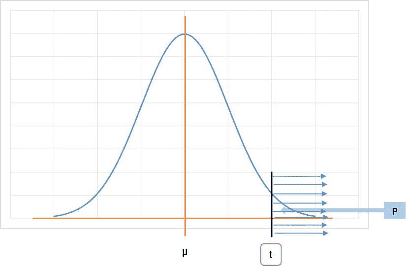

图 8-12. P 值详解

在图 8-12 中，假设零假设声明总体均值为`μ`，而观察到的样本均值为`t`。`P 值`是概率曲线下从`t`开始往右的面积`P(x>=t)`。借助抽样分布的性质，可以轻松计算出该概率。以下是`P 值`的总结：

你从一个零假设开始。你抽取一个样本并计算一个统计量来检验零假设。如果零假设为真，则该统计量预期遵循一定的概率分布。如果它遵循特定的概率分布，那么你可以求出得到该检验统计量或更极端值的概率。这就是`P 值`。

理解了`P 值`之后，理解其实际应用就不那么困难了。如果`P 值`较高，那么`t`非常接近`μ`，这意味着你可能接受零假设。如果`P 值`较低，那么`t`远离`μ`，这意味着你可能需要拒绝零假设。通常，5%被行业视为`P 值`的标准。如果`P 值`（概率）大于 5%，则接受零假设。对于小于 5%的`P 值`，则拒绝零假设。如果`P 值`小于 5%，则称样本统计量`t`与总体参数存在显著差异。

图 8-13 显示了一个较高的`P 值`，约为 25%。样本统计量也接近总体参数。

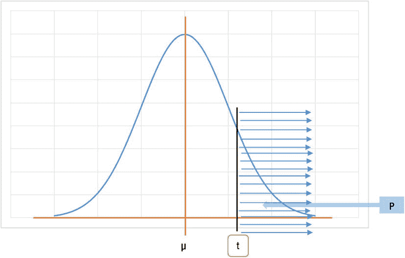

图 8-13. P 值接近 25%

图 8-14 中的图表显示了一个较低的`P 值`，约为 1%。

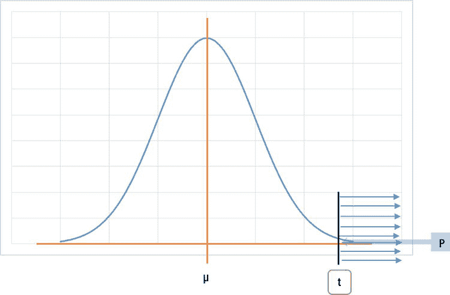

图 8-14. P 值接近 1%

样本统计量远离总体参数，这意味着该统计量的值与总体参数存在显著差异。如果样本确实来自均值为`μ`的总体，它不应有显著差异。换句话说，样本值应接近`μ`，但这里并非如此，因此你拒绝零假设。

在肥皂的例子中，当总体均值为 250 时，你得到了 260 的样本均值。为了得到 260 或更高样本均值的概率（`P 值`），你使用了标准`Z 值`正态概率曲线，该曲线给出了`P 值`。

在本章前面的“检验统计量”部分，我们已经计算了这个例子的`z`值。现在，得到大于或等于 14.14 的`Z 值`的概率是多少？

`P(z>=14.14)=?`

根据标准正态分布表，你可以找到`Z>=14.14`的先前概率值，

`P(z>=14.14)=1.54*(10 ^(-44))`

这意味着`P(z>=14.14) < 0.000000000000000000000000000000001`。

图 8-15 显示了肥皂例子的`P 值`。

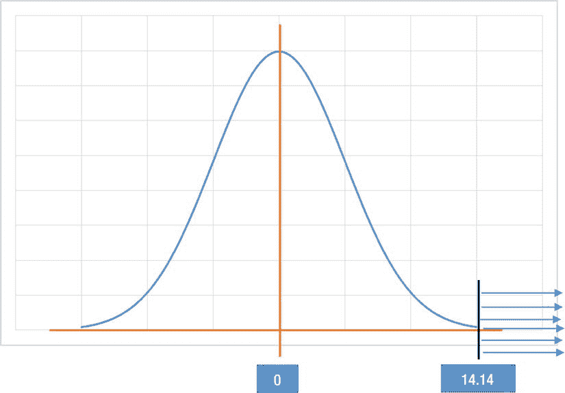

图 8-15. 肥皂例子的 P 值

通常，如果`P 值`小于 5%，则拒绝零假设。这里，`P 值`不仅小于 0.05，甚至小于 0.0000000000000001。因此，你拒绝零假设。以下是看待这个`P 值`的另一种方式：

- 零假设声明总体均值为 250。如果样本来自均值为 250 的总体，则其样本均值应接近 250。在本练习中，你求出了得到 260 的概率。该样本似乎并非来自均值为 250 的母体总体。你得到的是 260 的样本均值。这种偶发事件的概率小于 0.000000000000001。因此，你拒绝零假设。如果概率大于 5%（每侧 2.5%），你就会接受零假设。
- 零假设声明总体均值为 250，而你得到了 260 的样本均值。它距离假设均值 250 有多远？从`P 值`来看，它看起来非常远。如果样本统计量接近总体参数 250，那么`P 值`应该是 20%、25%、30%，或至少 5%（最小可接受值）。但在本例中，`P 值`小于 0.0000000000000001。
- 基于`P 值`，可以得出结论：零假设不正确，你应该拒绝它。让我们考虑另一个例子。一支足球队（与实力相当对手比赛）连续赢得 144 场比赛的概率是多少？你会发现，这几乎等于当样本来自总体均值 250 时得到 260 样本均值的概率。以下要点量化了这两个概率：
- 一支足球队连续赢得 144 场比赛的概率 = `4.48*(10-44)`
- 当总体均值为 250 时，得到 260 样本均值的概率 = `1.48*(10-44)`

这两个概率都极低。事实上，这两个事件几乎都不可能发生；因此，你拒绝零假设。


### 临界值与拒绝域

临界值是接受域与拒绝域之间的分界线。拒绝域就是这些临界值之外的区域（图 8-16）。你有一个 5% 的概率区域，在这个区域内拒绝原假设，这个区域就是拒绝域。在检验开始之前，你就需要确定这个拒绝域，它可以是 5%、10% 或 1%。

如果某个检验统计量的值落在拒绝域内，那么原假设将被拒绝。

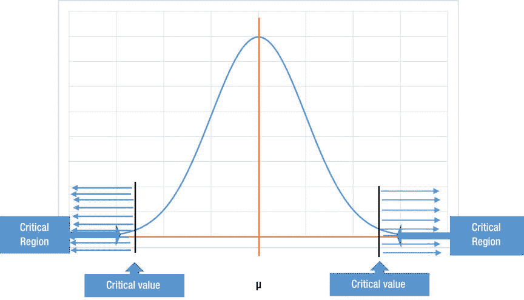

图 8-16.

临界值与拒绝域

5% 的容差意味着在原假设值两侧各占 2.5%。类似地，10% 意味着两侧各占 5%，依此类推。通常，`P` 值足以用来决定接受还是拒绝原假设。

在肥皂的例子中，你得到的 `Z` 统计量值为 14.14。它落在了拒绝域或临界域内。对于一个 5% 的拒绝域，在原假设均值的两侧，临界值（基于标准正态概率表）分别是 -1.96 和 1.96（图 8-17）。

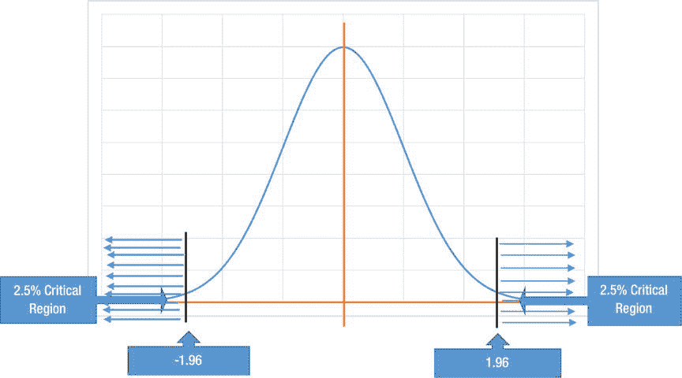

图 8-17.

临界值与拒绝域 – 实际数值

检验统计量的值位于拒绝域内，它超过了 1.96。因此，原假设被拒绝。

### 置信区间

置信区间给出了总体参数可能落入的区间范围的一个估计值。置信区间的下限和上限被称为置信限。置信区间让你了解基于检验统计量可接受的原假设范围。如果你将显著性水平设定为 5%（换句话说，如果 5% 是拒绝域），那么剩余的 95% 就是非拒绝域。在这种情况下，这 95% 将被计算为置信区间。

在处理置信限或置信区间时，你需要暂时搁置原始的原假设，因为置信区间完全是基于检验统计量计算得出的，与原始原假设无关。

在图 8-18 中，你可以看到基于原假设的原始分布（实线）。

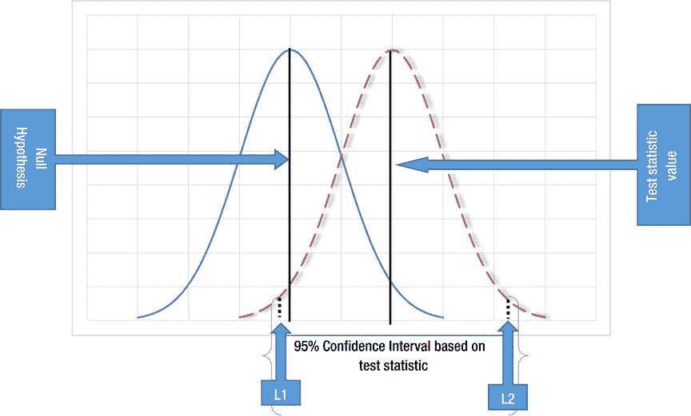

图 8-18.

置信区间

虚线表示基于计算出的样本统计量的分布。在这个例子中，置信区间包含了原假设。因此，接受原假设的可能性更大。

如果你得到一个检验统计量 `Z`，那么置信区间将由 `Z-l` 和 `Z+l` 这两个界限给出。数字 `l` 表示 `Z` 两侧的置信限。任何原假设只要落在这两个界限之内，就会被接受。

让我们再看一个处理置信区间的例子。假设一个学前教育项目需要检查所有学生的体重。该学校声称学生的平均体重是 30 磅。你需要检验这个说法，并将使用以下假设：

- 原假设：`H[0] = 30`（学生的平均体重是 30 磅）
- 备择假设 `H[1] ≠ 30`（学生的平均体重不是 30 磅）

由于你不知道总体标准差，并且你正在检验样本均值，你将使用 `T` 检验。（有关更多细节，请参见本章后面的表 8-8 。）检验的选择取决于原假设和检验统计量的抽样分布。

我们将在本章后面解释 SAS 代码和检验过程的细节。现在，只考虑输出的置信区间（表 8-4）。

表 8-4.

学校健康检查数据的置信区间

| 均值 | 95% 置信区间均值的下限 | 95% 置信区间均值的上限 |
| --- | --- | --- |
| 40.3796 | 38.9624 | 41.7967 |

表 8-4 显示样本均值为 40.37。均值周围的 95% 置信限为 38.96 和 41.79。这个均值是基于样本统计量得出的。

图 8-19 说明了这种情况。

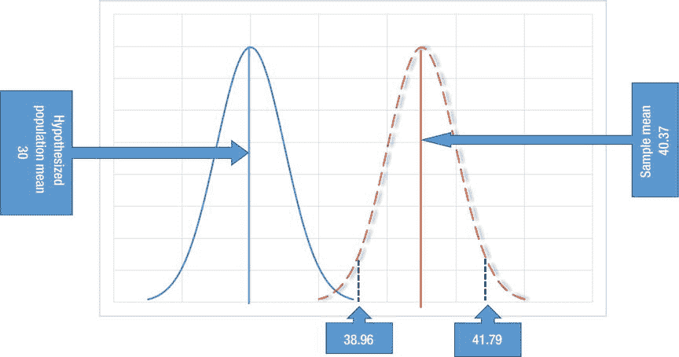

图 8-19.

学校健康检查数据的总体均值和样本均值

你可以预期总体均值在 95% 的时间里会落在 38.96 和 41.76 之间。如果原假设超出了这些界限或这个区间，你就可以拒绝它。因此，在这种情况下，原假设 `H[0] = 30` 将被拒绝。

表 8-5 总结了假设检验过程中的一些要点。我们使用前面讨论过的例子，即一家公司声称其客户群体中有 50% 是男性。

表 8-5.

使用示例总结假设检验过程的要点

| 序号 | 假设检验要点 | 示例声明：客户群中 50% 为男性 |
| --- | --- | --- |
| 1 | 如果原假设为真，那么你期望样本统计量落在某个特定范围内。 | 如果总体性别比例为 50%，那么你期望样本的性别比例也是 50%。 |
| 2 | 如果样本统计量偶然落在预期范围之外，那么你需要计算这种偶然发生的概率或该事件的可能性，这被称为 `P` 值。 | 如果样本中的比例不是 50%，比如你偶然在样本中得到了 70% 的男性，那么你需要使用抽样分布来计算观察到 70% 或更极端情况的概率。 |
| 3 | 如果在样本中观察到的情况极不可能发生，那么你就拒绝原假设；或者，如果这个罕见事件的概率小于预定义的阈值，那么你就拒绝原假设。 | 如果你有一个样本，其中男性比例为 70%（该事件），而该样本取自一个男女各占 50% 的总体，并且你发现这种事件的概率极低，比如低于 5%，那么你就拒绝原假设。 |

### 检验

检验的类型取决于样本统计量及其分布。如果你的样本统计量是大样本的样本均值，那么你使用 `Z` 检验。如果你处理的是小样本的样本均值，或者你不知道总体的标准差，那么你使用 `T` 检验。让我们来看一个关于均值的 `T` 检验以及其他一些检验示例。


## 均值的 t 检验

您使用均值的 t 检验来检验零假设，例如总体均值等于某个特定值。当样本量较小时，您使用 t 检验。当样本量较大时，抽样分布服从正态分布。但当样本量较小时，样本均值不服从正态分布。小样本（小于 30）的样本均值服从自由度为 `n-1` 的 t 分布（其中 `n` 是样本量）。t 分布与正态分布相似。随着样本量的增加，t 分布趋近于正态分布。当样本量较小或总体标准差未知时，您使用 t 检验。

**注意**

简单来说，自由度是指可以独立选择以形成特定 t 分布的观测值数量。在接下来的案例研究中，您将进一步处理自由度。t 检验的检验统计量与 Z 检验的检验统计量相同，区别在于 t 检验中您不知道总体的标准差。

让我们通过一个简短的案例研究来应用迄今为止讨论的概念。

### 案例研究：在 SAS 中检验均值

设想一个商业场景：一家智能电视公司的城市营销经理想要为其新型电视型号制定营销策略。她希望制定一个有效的策略来触达客户。为此，她需要了解所在城市客户家庭的平均月支出。当地一家市场研究公司给出的平均支出估算是 4,500 美元。经理对这个数字的准确性并不十分确信。她希望在将这一数字用于制定营销策略之前对其进行验证。她建议她的一名团队成员收集一些随机选择的家庭支出的样本数据。表 8-6 包含了 27 个家庭的样本数据。

**表 8-6.** 家庭样本的月支出数据

| 序号 | 支出 |
| --- | --- |
| 1 | 4650 |
| 2 | 4248 |
| 3 | 4961 |
| 4 | 3200 |
| 5 | 4438 |
| 6 | 4993 |
| 7 | 4620 |
| 8 | 1100 |
| 9 | 4237 |
| 10 | 4991 |
| 11 | 4533 |
| 12 | 4457 |
| 13 | 4663 |
| 14 | 4613 |
| 15 | 4484 |
| 16 | 4997 |
| 17 | 5027 |
| 18 | 4807 |
| 19 | 4435 |
| 20 | 4503 |
| 21 | 9000 |
| 22 | 3950 |
| 23 | 4972 |
| 24 | 4983 |
| 25 | 8300 |
| 26 | 4516 |
| 27 | 4426 |

您正在尝试检验总体的平均月支出是否确实为 4,500 美元。您正在检验总体均值，并且样本量较小，因此您使用 t 检验。以下是您遵循的步骤：

**陈述零假设。**

零假设（`H[0]`）：平均支出等于 4,500 美元。

备择假设（`H[1]`）：平均支出不等于 4,500 美元。

**确定抽样分布和显著性水平。**

您正在检验小样本的样本均值；因此，您将使用 t 分布。显著性水平与行业标准相同，即 5%。因此，抽样分布是自由度为 26 的 t 分布。t 分布并非对所有样本量都相同。提及 t 分布时需要同时说明其自由度，自由度等于样本量减 1（`n-1`）。再次强调，t 分布的自由度是指可以独立选择以形成特定 t 分布的观测值数量。

**做出推断。检验统计量。**

要对整个总体做出推断，您需要使用自由度为 26 的 t 分布计算 P 值。

`P = (t > 0.93) 的概率`

您可以使用分布表或任何工具中的 t 分布概率值来获得上述概率。P 值如下：

`P = 0.361`

最终推断是 P 值远大于 0.05；因此，您没有足够证据拒绝零假设。换言之，您同意零假设，即市场研究团队给出的平均支出值是正确的，或者没有足够证据证明市场研究团队给出的值是错误的。

您还可以使用以下 SAS 代码执行相同的检验：

```
proc ttest data =Expenses H0 = 4500 ;
var expense;
run ;
```

-   SAS 代码中的 `H0` 选项指总体假设均值。
-   数据集中的变量名是 `expense`。
-   数据集名称是 `Expenses`。

表 8-7 显示了此代码的输出。

**表 8-7.** `proc ttest (Data = Expenses)` 的输出（t 检验过程；变量：`expense`）

| N | 均值 | 标准差 | 标准误差 | 最小值 | 最大值 |
| --- | --- | --- | --- | --- | --- |
| 27 | 4744.6 | 1367.5 | 263.2 | 1100.0 | 9000.0 |

| 均值 | 95% 置信区间均值 | 标准差 | 95% 置信区间标准差 |
| --- | --- | --- | --- |
| 4744.6 | 4203.6 | 5285.6 | 1367.5 | 1077.0 | 1874.1 |

| DF | t 值 | Pr > &#124;t&#124; |
| --- | --- | --- |
| 26 | 0.93 | 0.3613 |

输出给出了样本量、样本均值、样本标准差以及变量 `expenses` 的最小值和最大值。

表 8-7 中的第三个表格对推断最为重要。它显示了 t 统计量值。t 统计量值由检验统计量方程计算得出。上述检验的 P 值为 0.3613。基于 P 值，您接受零假设。

在表 8-7 输出表的第二个表格中，给出了均值的 95% 置信限。区间 (4203.6 到 5285.6) 有 95% 的概率包含总体均值。

### 其他检验示例

表 8-8 包含其他类型检验的示例，包括 Z 检验、卡方检验等。

**表 8-8.** 更多检验示例

| 场景 | 零假设 | 检验 |
| --- | --- | --- |
| 检验大样本的样本均值 | 总体均值 = X1。 | Z 检验 |
| 检验小样本的样本均值 | 总体均值 = X2。 | t 检验 |
| 检验两个变量的独立性 | 两个变量相互独立。 | 卡方检验 |
| 检验两个变量间的相关性 | 两个变量间的相关性为零。 | 皮尔逊相关性检验 |
| 检验自变量对因变量的显著性 | 回归模型中自变量的系数为零。 | 贝塔检验 |
| 检验两个总体方差的差异 | 两个总体的方差无差异。 | F 检验 |
| 检验总体中变量某个类别的比例 | 总体比例 = P1。 | 比例 Z 检验 |

### 双尾检验与单尾检验

在某些假设检验案例中，在临界区域内，与零假设相反的定义了备择假设，这被称为非方向性备择假设。到目前为止，我们仅讨论了非方向性备择假设。还存在方向性备择假设。让我们更深入地了解细节。


#### 双尾检验

使用非定向假设进行的检验类型被称为双尾检验，因为决策关键区域位于分布的两个极端尾部。在非定向备择假设的情况下，关键区域可以在集中趋势的任意一侧（如图 8-20 所示）。例如，在肥皂重量的例子中，原假设是肥皂平均重量为 250 克；备择假设则认为肥皂重量不等于 250 克。你抽取了 50 块肥皂的样本以检验这一假设。如果样本平均值远高于 250 克或远低于 250 克，你可能想要拒绝原假设。你的决策与数值的方向无关。图 8-20 是非定向备择假设的一个示例。

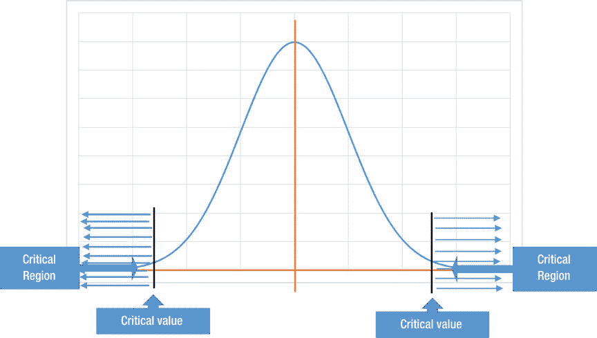

图 8-20. 非定向备择假设示例

以下是一些熟悉的非定向假设实例：

* 一般假设
  * 原假设 `H[0]`：总体均值 = μ
  * 备择假设 `H[1]`：总体均值 ≠ μ
* 肥皂重量示例
  * 原假设 `H[0]`：肥皂平均重量 = 250 克
  * 备择假设 `H[1]`：肥皂平均重量 ≠ 250 克
* 性别比例示例
  * 原假设 `H[0]`：男性比例 = 50%
  * 备择假设 `H[1]`：男性比例 ≠ 50%

在原假设的两侧将有两个临界值；关键区域将被分成两部分。如果检验统计量落入这两个关键区域中的任意一个，你将拒绝原假设。如果你决定接受原假设的最小显著性水平为 5%，那么它将被分成两个 2.5%的部分，分别位于原假设的两侧。

#### 单尾检验

在单尾检验中，备择假设仅位于原假设的一侧。如果备择假设是在特定方向上定义的，那么你可能只能基于一个方向做出接受或拒绝的决定。在肥皂重量示例中，如果你将备择假设定义为定向的，那么它将如下所示：

* 原假设 `H[0]`：肥皂平均重量 = 250 克
* 备择假设 `H[1]`：肥皂平均重量 > 250 克

与定向假设相关的检验将只有一个临界值和一个关键区域，并且仅在一侧。关键区域如图 8-21 所示。

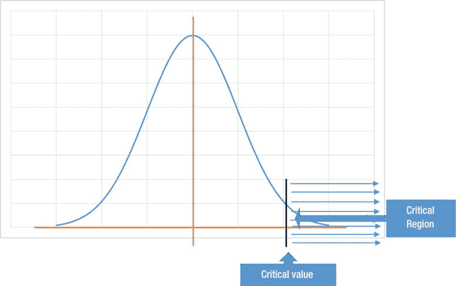

图 8-21. 定向备择假设（右尾检验）的临界值和关键区域

最小显著性水平概率（通常接受值为 5%）将只考虑在分布的一侧。如果检验统计量落入那个 5%的关键区域，你将拒绝原假设。图 8-21 中描绘的单尾检验是一个右尾检验，因为关键区域位于右侧。类似地，你也可以有单尾检验，其中关键区域位于左侧（图 8-22）。在同一个肥皂示例中，以下备择假设将导致左尾检验：

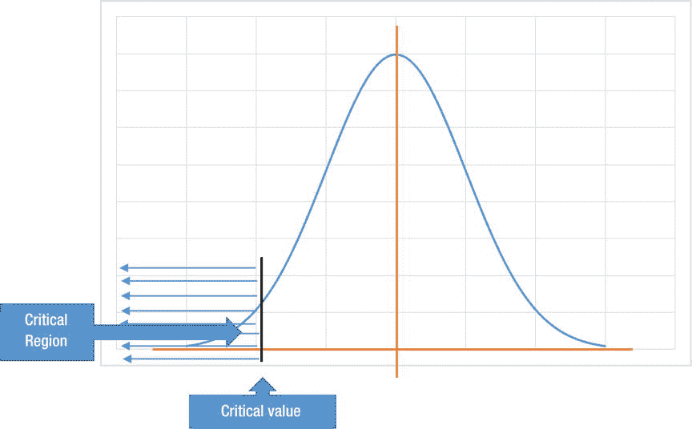

图 8-22. 定向备择假设（左尾检验）的临界值和关键区域

* 原假设 `H[0]`：肥皂平均重量 = 250 克
* 备择假设 `H[1]`：肥皂平均重量 < 250 克

以下是定向假设的更多示例：

* 一般假设（右尾检验）
  * 原假设 `H[0]`：总体均值 = μ
  * 备择假设 `H[1]`：总体均值 > μ
* 一般假设（左尾检验）
  * 原假设 `H[0]`：总体均值 = μ
  * 备择假设 `H[1]`：总体均值 < μ
* 性别比例示例（右尾检验）
  * 原假设 `H[0]`：男性比例 = 50%
  * 备择假设 `H[1]`：男性比例 > 50%
* 性别比例示例（左尾检验）
  * 原假设 `H[0]`：男性比例 = 50%
  * 备择假设 `H[1]`：男性比例 < 50%

定义备择假设将取决于你正在处理的业务目标和问题类型。例如，考虑一台将螺栓精确切割成 50mm 的机器。将螺栓切割得明显小于 50mm 或明显大于 50mm 都是不合适的。因此，你可以采用非定向的备择假设。

与双尾检验相比，单尾检验的唯一变化发生在做决策时。考虑表 8-9 中给出的示例。

表 8-9. 基于 P 值进行单尾和双尾检验的决策

| 原假设与备择假设 | 检验类型 | 示例 P 值 | 推断 |
| --- | --- | --- | --- |
| `H[0]`：总体均值 = μ；`H[1]`：总体均值 ≠ μ | 双尾检验 | `P=0.04` | 接受原假设 |
| 在上例中，关键区域在原假设的两侧。因此，每一侧的阈值将为 0.025（2.5%）。`P`值为 0.04 大于 0.025；因此，接受原假设。 |
| `H[0]`：总体均值 = μ；`H[1]`：总体均值 > μ | 右尾检验 | `P=0.04` | 拒绝原假设 |
| 在上例中，关键区域在原假设的单侧。因此，阈值将为 0.05（5%）。`P`值为 0.04 小于 0.05；因此，拒绝原假设。 |

**注意**
你不能将“总体均值大于μ”作为原假设，因为当原假设是“总体均值大于μ”时，你无法知道样本均值的分布会是什么。中心极限定理仅适用于原假设——总体均值等于μ。


#### 测试中的误差

在检验假设时，你总是通过抽取样本并对总体进行推断。在这个过程中，总会存在误差因素。如果总体规模非常大，那么可能无法获得 100%准确的结果。换言之，仅通过抽取样本很难总是轻松地对庞大总体做出推断。请考虑以下两个示例：

-   在蛋糕示例中，你通过品尝一小块样本对整个蛋糕做出判断。可能发生的情况是，只有你尝到的那块不好，而其余部分都很好。在这种情况下，你会对整个蛋糕做出错误推断。或者也可能出现相反情况：只有样本那块蛋糕是好的，但其余部分不好。你可能会继续购买该蛋糕，这无论如何都是个错误决定。
-   在肥皂重量示例中，可能发生的情况是，总体平均重量并不等于 250，但如果你的样本恰好显示平均重量为 250，你最终可能会接受原假设。也可能出现相反情况：如果你得到的一个样本的平均重量与原假设中的假设值相差甚远，你最终可能会拒绝原假设。

是的，存在错误拒绝原假设的可能，也存在错误接受原假设的可能。详情请参考表 8-10。

**表 8-10.** 接受或拒绝原假设时的误差

|  | 原假设为真 | 原假设为假 |
| --- | --- | --- |
| 拒绝原假设 | 第一类错误 | 正确推断 |
| 接受原假设 | 正确推断 | 第二类错误 |

##### 第一类错误：原假设为真时拒绝它

有时你的样本可能会欺骗你。通过观察从样本计算出的检验统计量，你最终可能错误地拒绝原假设。如果你在需要接受原假设时却拒绝了它，则称为第一类错误。正如你将在下文中了解到的，第一类错误由分析师在测试开始前就已确定。

你希望拒绝的`P`值最大值是多少？第一类错误的概率，也称为显著性水平，用`α`表示。是的！你确实可能错误地拒绝原假设，实际上，通常有 5%的概率会发生这种情况。这类似于彩票的例子。连续四年赢得全国性彩票的概率是存在的，但该概率非常小，可能小于`0.00000000000000000001`；因此，你拒绝原假设。所以，如果你看不到至少 5%的显著性，你就不会购买彩票。因此，对于所有测试，显著性水平在开始时固定为 5%。有时也可能是 1%或 10%，具体取决于变量类型。

图 8-23 显示了检验统计量的分布。该分布表明，可能存在超过`C`的值，但得到`C`或更大值的概率小于 5%。因此，如果某个值落在`C`之外，即使原假设为真，你也会拒绝原假设。

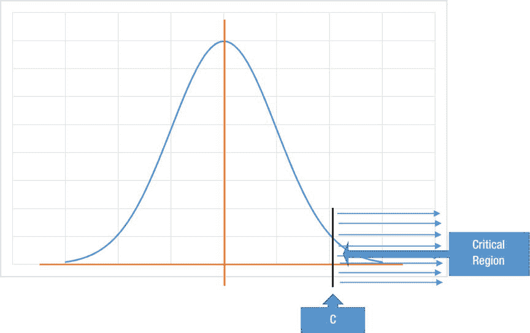

**图 8-23.** 第一类错误的临界区域

以下要点进一步阐明了显著性水平。显著性水平是：

-   第一类错误的概率。
-   也称为拒绝误差的概率。
-   也称为检验的规模。
-   预先设定的错误拒绝原假设的概率。
-   接受原假设所需的最小`P`值。

每个检验都会从一个显著性水平开始，通常固定为 5%、10%或 1%。

##### 第二类错误：原假设为假时接受它

第二类错误是指你错误地接受了原假设。它也称为接受误差。第二类错误的概率用`β`表示。例如，陷入典型的销售陷阱就是第二类错误的一个例子。假设一个销售员试图向你推销一个有缺陷的产品。他说该产品非常好（设为原假设）。如果你继续购买了该物品，那么你就是在接受一个错误的原假设。这就是第二类错误。第二类错误的概率，即`β`，用于计算检验的功效。

以下要点进一步阐明了检验的功效：

- `1 - β`
- `1 - P`（错误接受`H[0]`）
- `1 - P`（当`H[0]`为假时接受`H[0]`）
- `P`（当`H[0]`为假时拒绝`H[0]`）

##### 哪种错误更严重：第一类还是第二类？

我们通常不能简单地说哪种错误更严重。这取决于原假设以及所考虑的问题。考虑表 8-11 中演示的两种场景。在第一种场景中，第一类错误很危险；在第二种场景中，第二类错误很危险。

**表 8-11.** 哪种错误更严重？示例场景

| 场景与原假设 | 第一类错误 | 第二类错误 |
| --- | --- | --- |
| 测试某种药物是否有毒 `H[0]:` 药物有毒 | 第一类错误是拒绝原假设（说该药物无毒），而实际上它有毒。声称该药物安全可能会产生严重后果。 | 第二类错误是接受原假设（说该药物有毒），而实际上它无毒。声称好的药物不安全可能不会造成重大损害。 |
| 在发放大额个人贷款前测试客户资质好坏 `H[0]:` 客户资质好 | 第一类错误是拒绝原假设（说客户资质差），而实际上客户资质好。你可能会失去一位好客户及其带来的利润。 | 第二类错误是接受原假设（说客户资质好），而实际上客户资质差。如果你批准了一笔坏账，这一个坏客户可能会通过卷款潜逃而吞噬掉 100 位好客户带来的利润。 |

**注意**

尽管我们使用了“接受原假设”这一说法，但在实际检验中，你并非真正接受原假设。你要么拒绝原假设，要么无法拒绝原假设。我们使用“接受原假设”是为了便于理解。

## 结论

本章讨论了统计学中最实用的概念之一——假设检验。这一概念甚至用于法庭审判中。中心极限定理及类似解释抽样统计量抽样分布的定理是假设检验的关键。`P`值有助于最终推断。显著性检验还用于许多其他统计概念，如回归、相关、独立性检验、自变量对因变量影响检验等。

到目前为止，你已经阅读了关于基础描述性统计、数据清洗技术以及检验统计显著性的章节。在接下来的章节中，你将学习一些预测建模技术，如线性回归、逻辑回归、时间序列预测等。

