# 9. 相关性与线性回归

在上一章中，我们介绍了如何为模型构建准备数据。在本章中，我们将讨论模型构建，这可能是数据分析项目中最重要的一步。我们将讨论最流行的模型构建技术——线性回归。我们将首先详细讨论相关性，然后讨论相关与回归之间的差异。最后，我们将展示一个使用线性回归进行建模的详细示例。我们将尽可能使用真实场景来解释这些概念。

## 什么是相关性？

以下问题是否让你感到熟悉？

-   学习时长与成绩之间是否存在关联？
-   城市中教堂的数量与谋杀案的数量之间是否存在关联？
-   随着气温升高，毛衣的销量会发生什么变化？两者关系非常密切吗？
-   天气变热时，冰淇淋的销量会发生什么变化？
-   健康与国家的国内生产总值（GDP）之间是否存在关联？
-   你能量化一个城市的哮喘病例数量与空气污染水平之间的关联吗？
-   平均收入与燃料消耗之间是否存在关联？

在所有这些场景中，问题都围绕着两个因素是否相关。如果它们存在关联，其关联强度又如何？你可能知道哮喘病例与空气污染之间存在关联；你也知道学习时长与成绩之间存在关联。但这些关联的强度有多大？如何量化这种关联？是否存在衡量两个变量之间关联的度量标准？答案是肯定的。**相关性**就是一种量化两个变量之间关联的度量标准。

例如，假设一家新开的电商网站在广告牌和在线广告上投入了大量资金。它分两个阶段进行了一场声势浩大的广告宣传。第一阶段是广告牌广告，第二阶段是在线广告。广告牌和在线广告都获得了极佳的反响。现在的问题是，广告投入与响应数量之间是否存在关联？如果存在关联，关联强度如何？这种关联在在线营销和广告牌营销中是否有所不同？

下面的两个散点图展示了两种营销活动的预算与响应数量之间的关联。图 9-1 显示了在线业务中预算与响应数量之间的关联。你可以看到一条清晰且强烈的关联趋势，因为随着预算的增加，响应数量也在增加。图 9-2 展示了广告牌宣传活动，其中没有如此清晰的趋势。

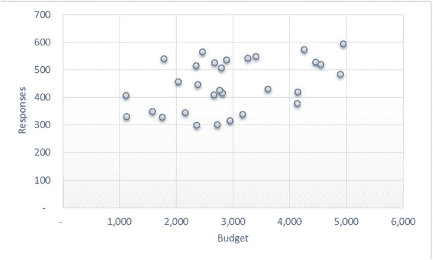
图 9-2. 广告牌：按预算划分的响应数量

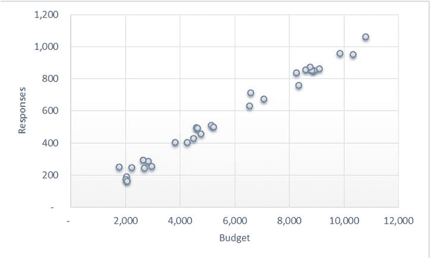
图 9-1. 在线宣传活动：按预算划分的响应数量

如上所述，相关性是一种可用于量化关联的技术。它为关联分配一个数值，告诉你给定变量之间相互依赖的程度。相关性技术会转化成一个度量指标，称为**相关系数**。相关系数用`r`表示。

### 皮尔逊相关系数（`r`）

皮尔逊相关系数是基于方差的概念定义的。它是衡量两个变量`x`和`y`之间线性关系或依赖程度的指标。其值在`+1`和`-1`之间（含两端）。值为`1`表示完全正相关，`0`表示不存在相关性，`-1`表示完全负相关。该系数在统计学和分析学中被广泛用作衡量两个变量之间线性相关程度的指标。

### 方差与协方差

正如第6章所讨论的，方差让你了解给定变量内部的离散程度。如果有两个变量`x`和`y`，那么`x`内部的离散程度和`y`内部的离散程度分别用它们的方差来表示。

`x`的方差如下：

`y`的方差如下：

如果你想观察`y`相对于`x`的离散程度，那么可以使用**协方差**。因此，协方差总是涉及两个因子，可以将其理解为联合方差或平行方差。

`x`和`y`之间的协方差如下：

如你所见，协方差的公式看起来与相关性的公式相似，只是它考虑了`x`和`y`两者差分的计算。

因此，皮尔逊相关性本质上就是协方差在两个个体方差乘积中所占的比例。如果两个变量彼此独立（即`y`的偏差不依赖于`x`的相应偏差），那么它们的协方差将接近于零，从而导致相关性为零。

### 相关矩阵

如果你有多个变量，例如`x1`、`x2`、`x3`……`xn`，并且你对所有两两组合的相关性感兴趣，例如`x1`与`x3`、`x2`与`x4`、`x1`与`x4`等等，那么你可以将所有相关性组合表示为以下矩阵的形式。相关性只能在两个变量之间找到。相关性并不能告诉你`x1`同时与`x2`和`x3`的关联情况。

| | `X[1]` | `X[2]` | `X[3]` |
|---|---|---|---|
| `X[1]` | `r[11]` | `r[12]` | `r[13]` |
| `X[2]` | `r[21]` | `r[22]` | `r[23]` |
| `X[3]` | `r[31]` | `r[21]` | `r[33]` |

| | `X[1]` | `X[2]` | `X[3]` |
|---|---|---|---|
| `X[1]` | `x[1]`与`x[1]`的相关性 | `x[1]`与`x[2]`的相关性 | `x[1]`与`x[3]`的相关性 |
| `X[2]` | `x[2]`与`x[1]`的相关性 | `x[2]`与`x[2]`的相关性 | `x[2]`与`x[3]`的相关性 |
| `X[3]` | `x[3]`与`x[1]`的相关性 | `x[3]`与`x[2]`的相关性 | `x[2]`与`x[3]`的相关性 |

## 使用SAS计算相关系数

在前面的电商示例中，假设你将所需数据加载到SAS中，并找出在线营销和广告牌营销两种情况下预算与响应之间的相关性。代码如下：

```
PROC IMPORT OUT= WORK.add_budget
DATAFILE= "C:\Users\VENKAT\Google Drive\Training\Books\Content\Regression Analysis\Add_budget_data.xls"
DBMS=EXCEL REPLACE;
RANGE="budget$";
GETNAMES=YES;
MIXED=NO;
SCANTEXT=YES;
USEDATE=YES;
SCANTIME=YES;
RUN;
```

```
proc contents data= add_budget varnum;
run ;
```

表9-1显示了上述代码的输出结果。

**表9-1.** 数据集合`add_budget`上`PROC CONTENTS`过程的输出结果

| 按创建顺序排列的变量 |
|---|
| # | 变量 | 类型 | 长度 | 标签 |
| 1 | `Day` | Num | 8 | 日期 |
| 2 | `Online_Budget` | Num | 8 | 在线预算 |
| 3 | `Responses_online` | Num | 8 | `Responses_online` |
| 4 | `Live_Budget` | Num | 8 | 线下预算 |
| 5 | `Responses_live` | Num | 8 | `Responses_live` |

用于寻找相关性的过程是`PROC CORR`。在代码中，我们需要指定数据集名称以及想要用于寻找相关性的变量名称。以下是使用`PROC CORR`的SAS代码：

```
proc corr data=add_budget ;
var Online_Budget Responses_online ;
run ;
```

上述代码生成的结果如表9-2所示。

**表9-2.** 数据集合`add_budget`上`PROC CORR`过程的输出结果

| CORR过程 |
|---|
| 2个变量： | `Online_Budget` `Responses_online` |
| 简单统计量 |
|---|
| 变量 | N | 均值 | 标准差 | 总和 | 最小值 | 最大值 | 标签 |
| `Online_Budget` | 30 | 5672 | 2894 | 170156 | 1773 | 10801 | 在线预算 |
| `Responses_online` | 30 | 556.13333 | 278.06384 | 16684 | 163.00000 | 1063 | `Responses_online` |
| 皮尔逊相关系数，N = 30 在 H0: Rho=0 下 Prob > &#124;r&#124; |
|---|
| | `Online_Budget` | `Responses_online` |
| `Online_Budget` | 1.00000 | 0.99337 |
| 在线预算 | | <.0001 |
| `Responses_online` | 0.99337 | 1.00000 |
| `Responses_online` | <.0001 | |

皮尔逊相关系数表中的相关矩阵显示了相关系数及其 `p` 值。预算与响应之间的相关性为 99.3%（.99337），表明关联性很强。任何接近 1（或-1）的数字都表示强关联。

**注意：** 同一表中的 `p` 值显示为<.0001。该 `p` 值是对零假设进行检验的结果，即当前样本的相关系数不显著。如果 `p` 值小于 5%，我们拒绝该零假设，这意味着相关系数是显著的。

类似地，你可以使用以下代码找到广告牌广告预算与相应响应之间的相关性：

```sas
proc corr data=add_budget ;
var Live_Budget Responses_live ;
run ;
```

上述代码生成的输出结果如表 9-3 所示。

**表 9-3.** 数据集合`add_budget`上`PROC CORR`过程的输出结果

| CORR 过程 |

| --- |

| 2 个变量： | `Live_Budget` `Responses_live` |

| 简单统计量 |

| --- |

| 变量 | N | 均值 | 标准差 | 总和 | 最小值 | 最大值 | 标签 |

| --- | --- | --- | --- | --- | --- | --- | --- |

| `Live_Budget` | 30 | 2940 | 1056 | 88205 | 1118 | 4946 | 线下预算 |

| `Responses_live` | 30 | 446.16667 | 92.03900 | 13385 | 300.00000 | 594.00000 | `Responses_live` |

| 皮尔逊相关系数，N = 30 在 H0: Rho=0 下 Prob > &#124;r&#124; |

| --- |

| | `Live_Budget` | `Responses_live` |

| --- | --- | --- |

| `Live_Budget` | 1.00000 | 0.43573 |

| 线下预算 | | 0.0161 |

| `Responses_live` | 0.43573 | 1.00000 |

| `Responses_live` | 0.0161 | |

预算与响应之间的相关性为 43.6%，表明关联性较弱。

从之前进行的相关性分析可以得出结论：增加在线营销活动的预算可能是个好主意，因为它们能带来更多的响应。在线营销活动中，响应与广告支出之间存在很强的相关性。而在广告牌营销活动中，预算支出与响应之间呈现弱相关性，因此在此类活动中增加额外支出可能并不可取。

### 相关性的界限与关联强度

`x`与`x`之间的相关性是多少？你可以使用之前讨论过的相关性公式来求解。

因此，`x`与`x`之间的相关性，或者说相关性的最大值，是 1。类似地，你可以证明`x`与`-x`（`x`的相反数）之间的相关性是-1。综上所述，相关性的极端值为-1 和+1。

两个变量之间的完全正相关性将达到+1，而完全负相关性的相关系数值则为-1。

以下可作为经验法则：

- 如果相关性为 0，则两个变量之间不存在线性关联。
- 如果相关性在 0 到 0.25 之间，则存在可忽略的正关联。
- 如果相关性在 0.25 到 0.5 之间，则存在弱的正关联。
- 如果相关性在 0.5 到 0.75 之间，则存在中等程度的正关联。
- 如果相关性在 0.75 到 1 之间，则存在强的正关联。

图 9-3 展示了两个变量之间的散点图示例。

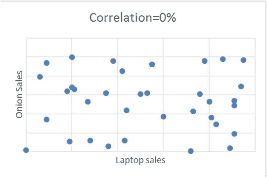
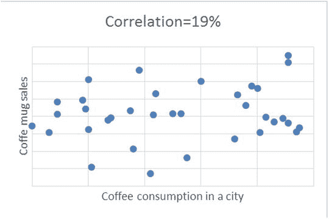
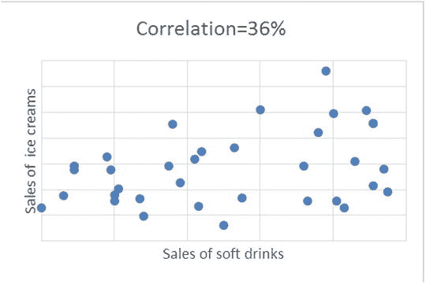
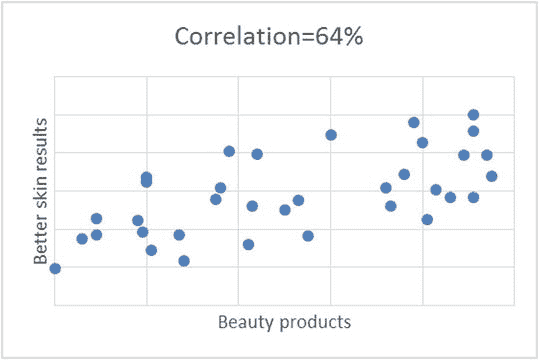
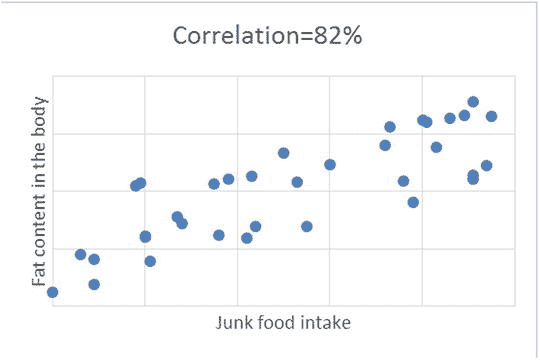
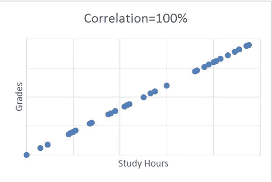

**图 9-3.** 不同相关系数值对应的散点图示例

以下是针对负相关系数值的经验法则：

- 如果相关性为 0，则两个变量之间不存在线性关联。
- 如果相关性在 0 到-0.25 之间，则存在不显著的负关联。
- 如果相关性在-0.25 到-0.5 之间，则存在弱的负关联。
- 如果相关性在-0.5 到-0.75 之间，则存在中等程度的负关联。
- 如果相关性在-0.75 到-1 之间，则存在强的负关联。

图 9-4 展示了两个变量之间的散点图。

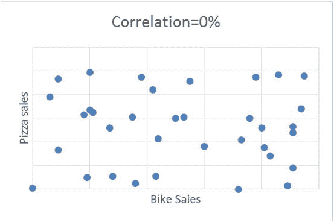
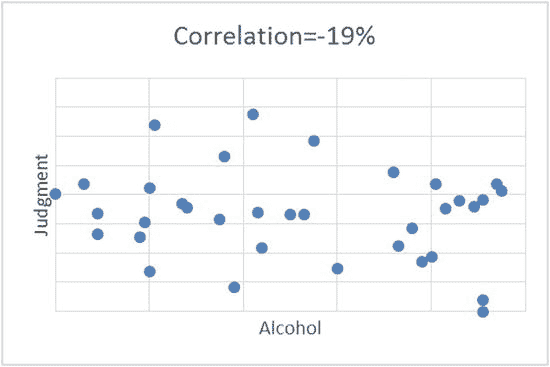
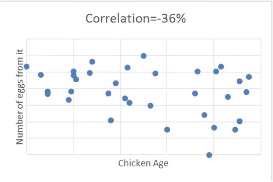
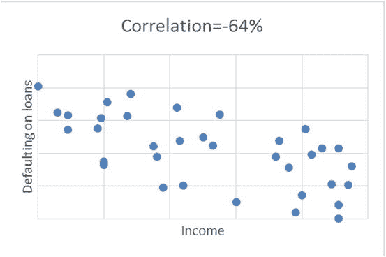
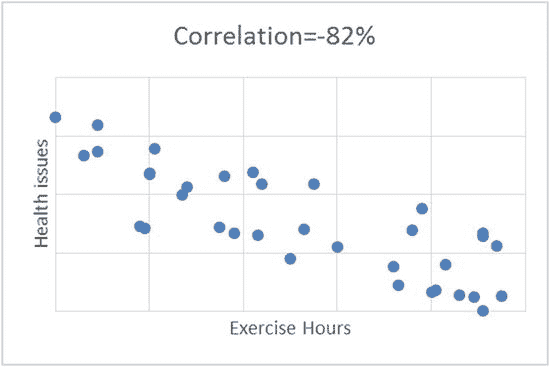
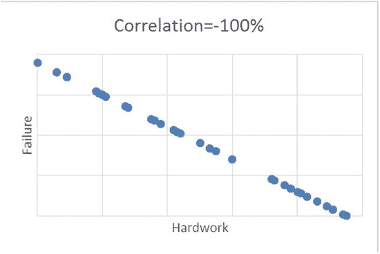

**图 9-4.** 针对不同变量组，不同相关系数值对应的散点图示例

### 相关系数 (`r`) 的性质与局限性

相关系数存在一些局限性。以下是相关系数的一些有趣的性质和局限性。

- 相关系数介于 -1 和 +1 之间；`-1 ≤ r ≤ +1`。
  - 当变量 `x` 和 `y` 之间存在完全正相关关系时，相关系数的最大值为 1；类似地，当存在完全负相关关系时，最小值为 -1。
- 相关系数没有单位。
  - 相关系数是一个系数，一个没有单位的数字。它的方差除以方差，单位相互抵消了。所以说相关系数是 0.75 米或 0.23 公斤是错误的。
- `r = 0` 表示不存在线性关联。
  - 如果相关系数为零，则表示所研究的两个变量之间不存在线性关联。但它并不说明是否存在任何非线性关联。可能存在也可能不存在非线性关联。
- 相关系数不受原点和尺度变化的影响。
  - 相关系数纯粹基于方差。它是分子上的协方差与分母上方差乘积的比值。方差不依赖于原点的变化。尺度的变化也不会影响相关系数。假设你将其中一个变量乘以 10（尺度变化），相关系数将保持不变。因为相关系数是两个方差的比值，尺度的变化最终会相互抵消。
- 如果两个变量是独立的，那么相关系数为零，但反之则不一定成立。如果相关系数为零，并不一定意味着两个变量是独立的。它们之间可能存在多项式（非线性）依赖关系。

### 相关系数局限性的一些示例

在上节了解了相关系数的有趣特性之后，了解一下它的一些局限性也会有帮助。

`r` 是线性关联的度量：虽然 `r` 衡量两个变量近似于一条直线的程度，但它并不能真正衡量非线性关系的强度。

例如，表 9-4 列出了两个变量 `x` 和 `y` 的表格。

**表 9-4.** `x` 和 `y` 的表格

| `x` | `y` |
| --- | --- |
| -31 | 900 |
| -25 | 625 |
| -24 | 576 |
| -19 | 361 |
| -13 | 169 |
| -6 | 36 |
| -1 | 1 |
| 3 | 9 |
| 10 | 100 |
| 11 | 121 |
| 14 | 196 |
| 15 | 225 |
| 24 | 576 |
| 24 | 576 |
| 29 | 841 |

本例的相关系数为 -0.12，可以忽略不计。但简单浏览表格就会发现，`x` 和 `y` 通过方程 `y = x²`（一个非线性方程）直接相关。

图 9-5 至 9-9 展示了一些表示两个变量之间非线性关系的示例图。在所有这些情况下，仅测量相关系数并不足以预测关联的存在。

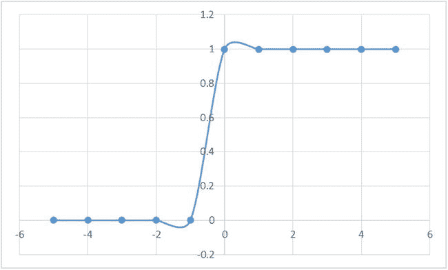

# 非线性函数与相关性分析

**图 9-8.** 非线性函数 `y = 0 if x < 0; y = 1 if x > 0` 的绘图
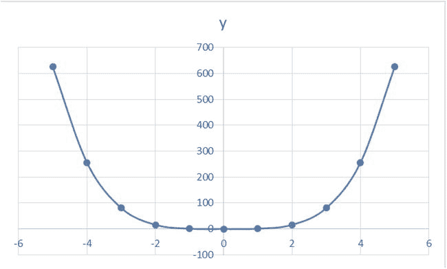

**图 9-7.** `y = X⁴` 曲线
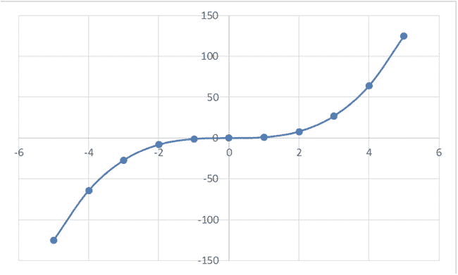

**图 9-6.** `y = x³` 曲线
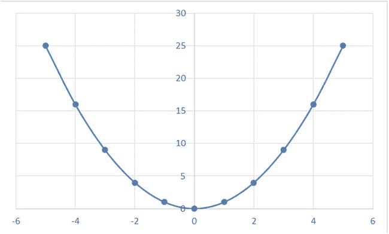

**图 9-5.** `y = x²` 曲线

另一个非线性正弦波看起来如图 9-9 所示。

| `x` | `y` |
| --- | --- |
| 1 | 2 |
| 2 | 2.9 |
| 3 | 3 |

足够的样本量：另一个例子是，当样本量 `n` 很小时，你需要谨慎对待相关系数的可靠性。以下是一个样本量仅为三条记录的示例：
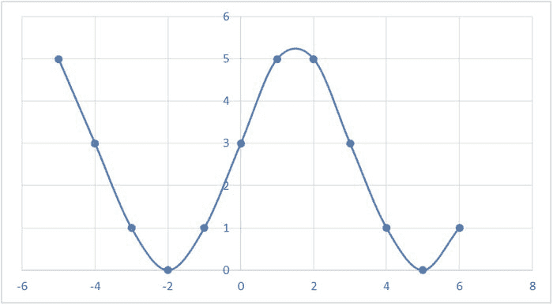

**图 9-9.** 正弦曲线

上表的 `r` 为 0.9，表明 `x` 和 `y` 之间存在强相关关系。

现在，你对第二条记录做一个小的改动，将 `y` 的值从 2.9 改为 4。

| `x` | `y` |
| --- | --- |
| 1 | 2 |
| 2 | 4 |
| 3 | 3 |

新表的 `r` 突然变为 0.5，与之前的 0.9 相比发生了巨大变化。事实上，样本量或数据量需要足够大，才能使用任何统计技术得出有意义的见解。

**表 9-5.** 包含一个异常值的 `x`-`y` 表格

| `x` | `y` |
| --- | --- |
| 10 | 14 |
| 17 | 25 |
| 22 | 23 |
| 21 | 31 |
| 24 | 29 |
| 34 | 60 |
| 25 | 19 |
| 31 | 35 |
| 45 | 45 |
| 33 | 38 |
| 60 | 50 |
| 46 | 56 |
| 47 | 45 |
| 48 | 70 |
| 50 | 750 |

异常值对 `r` 有显著影响：我们在数据探索章节（第 7 章）中已经看到了异常值的影响。相关系数也会受到数据中异常值的影响。在表 9-5 所示的 `x` 和 `y` 表格中，最后一条记录存在一个异常值 (750)。所有其他的 `y` 值都远低于这个孤立的异常值。

`x` 和 `y` 之间关系的相关系数 (`r`) 为 0.36，显示出弱的正相关关系。移除异常值记录后，`r` 突然变为 0.81，这是一个强的正相关关系。与之前的值相比，这是一个显著的变化！

以下是此示例的两个图（见图 9-10 和 9-11）。一张是包含 `y` 异常值的图，另一张是不包含它的图。可以很容易地注意到巨大的差异。从分析人员的角度来看，没有异常值的第二张图显然更有意义。
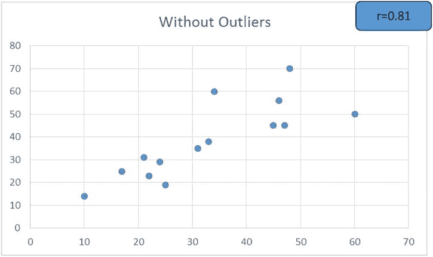

**图 9-11.** 不包含异常值的 `x`-`y` 图
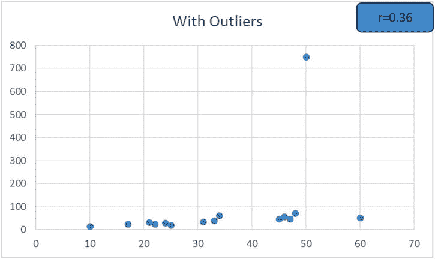

**图 9-10.** 包含异常值的 `x`-`y` 图

#### 相关性 vs 因果关系

你可以通过应用数学公式来计算相关系数（`r`）。仅通过查看 `r`（一个数值），你就能判断两个变量之间关联的强度。然而，即使 `r` 显示出强关联，你也不能得出其中一个导致另一个的结论。考虑一个例子，两个任意变量：道路上的红色公交车数量与股票市场指数。你用这些变量绘制一张图，纯属巧合，这张图可能呈现出一条直线，显示出强烈的正相关。但常识方法会揭示，仅仅通过增加道路上的红色公交车，你无法预期股价会上升。尽管 `r` 显示出强烈的正相关，但实际上这两个变量并无关系。

有些相关性只是偶然的，但在实践中可能毫无意义。分析师或用户必须首先建立逻辑关系。换句话说，需要先建立逻辑联系（因果关系），然后才应该尝试量化这种关联，以使整个分析有意义。换言之，简单的相关性并不自动意味着现实世界中的因果关系。

有时，两个变量之间的正相关可能由第三个变量引起。例如，假设在现实世界数据中发现，城市中的火灾事故数量与冰淇淋销量之间通常存在高度相关性。显然，两者在逻辑上并无关联。但这种现象通常在夏季气温高时被观察到。正是温度这个第三个变量，推动了该城市的火灾事故和冰淇淋销售。

通常存在的关系类型如下：

- 直接的因果关系；即，`x` 导致 `y`。例如，吸烟导致癌症。

- 互为因果。有时 `x` 导致 `y`，同时 `y` 也可能导致 `x`。例如，想象肯德基和麦当劳位于同一条街区。肯德基销售额的增加导致麦当劳销售额的减少，而麦当劳销售额的增加导致肯德基销售额的减少。

- 由第三个变量引起的 `y` 与 `x` 之间的关系；前面讨论的火灾事故与冰淇淋销售案例就是这种情况的一个好例子。

- 巧合关系或虚假相关性。牙刷销量与犯罪率之间的相关性可能只是偶然存在。如果碰巧，你得到城市每日牛奶销量与每日智能手机销量之间的 `r` 值为 0.95（95%的相关性），这也只能出于偶然。

总结来说，相关性的存在并不能确保任意两个变量之间存在任何因果关系或逻辑关系。相关性只是量化了由分析师定义或建立的因果关系。

#### 相关性示例

现在我们将讨论一个电信服务提供商进行客户满意度调查的案例。客户的满意度（`c_sat`）取决于许多因素。主要因素包括服务质量、问题解决能力、呼叫中心响应和资费方案。该调查从超过 1000 名随机选择的客户中收集数据。公司希望研究客户满意度与所有其他变量的关联，以便优化其未来的投资计划，这些计划旨在进一步提高客户满意度水平。

以下是调查数据的快照：

```
PROC IMPORT OUT= WORK.telecom
DATAFILE= "C:\Users\VENKAT\Google Drive\Training\Books\Content\Regression Analysis\Telecom_Csat_correlation.csv"
DBMS=CSV REPLACE;
GETNAMES=YES;
DATAROW= 2 ;
RUN ;
proc print data=telecom(obs= 10 );
run ;
```

表 9-6 展示了这段代码的输出结果。

**表 9-6.** 电信数据集上 `PROC PRINT` 的输出（`obs=10`）

| Obs | `C_sat` | `service` | `issue_resolution` | `call_center` | `price_plans` |
| --- | --- | --- | --- | --- | --- |
| 1 | 24 | 37 | 31 | 51 | 34 |
| 2 | 38 | 20 | 36 | 0 | 0 |
| 3 | 10 | 10 | 16 | 24 | 1 |
| 4 | 51 | 24 | 49 | 0 | 0 |
| 5 | 20 | 35 | 32 | 0 | 0 |
| 6 | 52 | 52 | 51 | 15 | 11 |
| 7 | 30 | 25 | 44 | 20 | 1 |
| 8 | 26 | 40 | 36 | 55 | 41 |
| 9 | 22 | 25 | 31 | 21 | 16 |
| 10 | 44 | 33 | 57 | 31 | 19 |

总共包含五个变量：`c_sat`，总体客户满意度得分；服务得分；问题解决得分；呼叫中心质量得分；以及资费方案得分。公司试图确定 `c_sat` 与其余四个变量之间的相关系数（`r`）。首先绘制了四张散点图，以可视化 `c_sat` 与其他变量之间的关系。

```
/*Scatterplots between c_sat and other variables*/
proc gplot data= telecom;
plot c_sat*service;
run ;
proc gplot data= telecom;
plot c_sat*issue_resolution;
run ;
proc gplot data= telecom;
plot c_sat*call_center;
run ;
proc gplot data= telecom;
plot c_sat*price_plans;
run ;
```

上述代码行生成了图 9-12 至图 9-15 的输出结果。
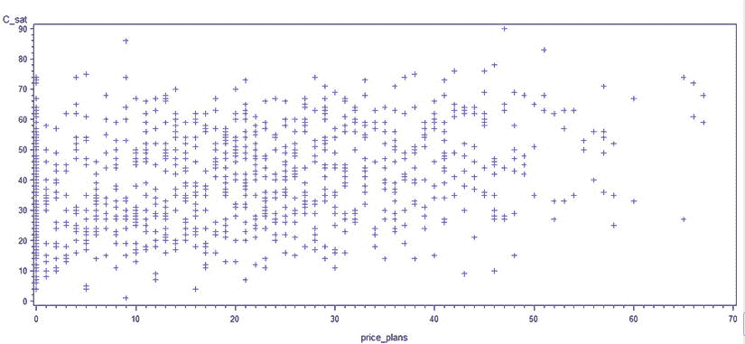

**图 9-15.** `c_sat*price_plans` 散点图

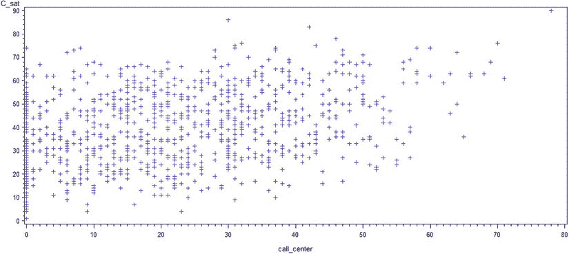
**图 9-14.** `c_sat*call_center`散点图

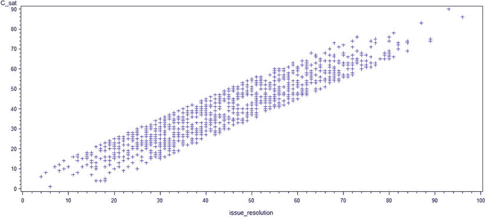
**图 9-13.** `c_sat*issue_resolution`散点图

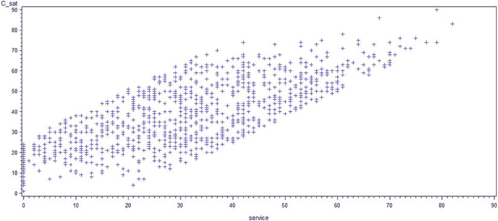
**图 9-12.** `c_sat*service`散点图

通过观察这些散点图，你可以推断出以下几点：
- 如果`y`和`x`之间的关系看起来是线性的，你可以计算这些变量的相关系数，并且这将是有意义的。
- 通过观察这些图，你可以得出结论：问题解决能力与客户满意度得分之间存在强关联。
- 呼叫中心响应和资费方案得分似乎对`c_sat`得分没有太大影响。

以下是计算相关系数的代码：
```sas
/* Correlation between the variables*/
proc corr data=    telecom;
var  c_sat service issue_resolution call_center price_plans ;
run ;
```

表 9-7 展示了这段代码的输出结果。
**表 9-7.** 包含五个变量的电信数据集上 `PROC CORR` 的输出

| 5 个变量： | `c_sat` `service` `issue_resolution` `call_center` `price_plans` |
| --- |
| **简单统计量** |
| **变量** | **样本量** | **均值** | **标准差** | **总和** | **最小值** | **最大值** |
| --- | --- | --- | --- | --- | --- | --- |
| `c_sat` | 1009 | 39.42121 | 16.11116 | 39776 | 1.00000 | 90.00000 |
| `service` | 1009 | 31.81863 | 17.22263 | 32105 | 0 | 82.00000 |
| `issue_resolution` | 1009 | 44.37958 | 17.27128 | 44779 | 4.00000 | 96.00000 |
| `call_center` | 1009 | 21.15659 | 16.61155 | 21347 | 0 | 78.00000 |
| `price_plans` | 1009 | 18.46184 | 15.89009 | 18628 | 0 | 67.00000 |
| **皮尔逊相关系数，N = 1009，在 H0: Rho=0 下 Prob > &#124;r&#124;** |
| **  ** | **`c_sat`** | **`service`** | **`issue_resolution`** | **`call_center`** | **`price_plans`** |
| --- | --- | --- | --- | --- | --- |
| `c_sat` | 1.00000 | 0.73398 | 0.93624 | 0.38258 | 0.33521 |
|  | <.0001 | <.0001 | <.0001 | <.0001 | <.0001 |
| `service` | 0.73398 | 1.00000 | 0.68022 | 0.57126 | 0.46948 |
| <.0001 |  | <.0001 | <.0001 | <.0001 | <.0001 |
| `issue_resolution` | 0.93624 | 0.68022 | 1.00000 | 0.34705 | 0.30864 |
| <.0001 | <.0001 |  | <.0001 | <.0001 | <.0001 |
| `call_center` | 0.38258 | 0.57126 | 0.34705 | 1.00000 | 0.76341 |
| <.0001 | <.0001 | <.0001 |  | <.0001 | <.0001 |
| `price_plans` | 0.33521 | 0.46948 | 0.30864 | 0.76341 | 1.00000 |
| <.0001 | <.0001 | <.0001 | <.0001 |  | <.0001 |

正如所料，输出结果（表 9-7）显示，问题解决评分与客户满意度之间存在高度相关性（93.6%），其次是服务质量评分与`c_sat`（73.4%）。呼叫中心评分与`c_sat`之间，以及资费方案与`c_sat`之间，均存在弱相关性。为便于阅读，下表单独列出了相关性部分。它是表 9-7 的一部分。

|  | **`c_sat`** |
| --- | --- |
| `c_sat` | 1.00000 |
| `service` | 0.73398 |
| <.0001 |  |
| `issue_resolution` | 0.93624 |
| <.0001 |  |
| `call_center` | 0.38258 |
| <.0001 |  |
| `price_plans` | 0.33521 |
| <.0001 |  |

有了这些结果，如果公司希望提高客户满意度水平，其客户服务主管就可以向管理层提出有力论证，以增加对问题解决能力的投入，并提升整体服务质量。

## 相关性总结

我们已经讨论了相关系数、其推导过程及其性质。你了解了关系类型，并量化了关联强度。你研究了相关性与因果关系之间的区别。你还学习了如何使用 SAS 创建相关性矩阵。你需要牢记，相关性仅是线性关系的度量。还有一些其他的关联度量，例如优势比、Kruskal Lambda、卡方等。它们旨在量化变量之间的某种特定类型的关联。在接下来的章节中，我们将进一步介绍变量间关系的量化方法。

# 线性回归

回归是研究变量间关系最常用的分析技术之一。在此阶段，理解相关与回归之间的区别至关重要，尤其是当相关也用于研究两个变量之间的关系时。我们将通过一个智能手机销售示例来展示这种区别。

智能手机的销售取决于许多因素，例如成本、提供的功能、评论家和用户的评分等级。当前的股票市场指标也会影响销售，因为它们反映了经济的整体状况，并表明人们可支配的闲置资金量。如果股市表现良好，人们手中可能有闲置资金，这些资金可能会用于购买新智能手机。新手机型号的销售还取决于手机制造商投入的营销费用。

表 9-8 展示了一些手机型号的销售数据以及影响销售的部分变量。

**表 9-8.** 手机型号销售数据及影响销售的变量

| `Model_Id` | `Ratings` | `Price` | `Num_new_features` | `Stock_market_ind` | `Market_promo_budget` | `Sales` |
| --- | --- | --- | --- | --- | --- | --- |
| M001 | 5 | 80 | 4 | 14077 | 96943 | 12737092 |
| M002 | 2 | 412 | 3 | 13441 | 68123 | 6895692 |
| M003 | 6 | 397 | 9 | 13540 | 15208 | 9747432 |
| M004 | 3 | 781 | 6 | 9102 | 54911 | 7460614 |
| M005 | 6 | 72 | 2 | 12898 | 8767 | 3670827 |
| M006 | 6 | 55 | 6 | 9945 | 35473 | 9292936 |
| M007 | 6 | 949 | 4 | 11315 | 74243 | 12614243 |
| M008 | 6 | 376 | 4 | 9734 | 11592 | 3742912 |
| M009 | 4 | 138 | 8 | 9270 | 6833 | 5700263 |
| M010 | 2 | 667 | 7 | 8810 | 100020 | 11990734 |

以下是用于从 CSV 文件导入数据的 SAS 代码：
```sas
/* Importing the data into SAS*/
PROC IMPORT OUT= WORK.mobiles
DATAFILE= "C:\Users\VENKAT\Google Drive\Training\Books\Content\Regression Analysis\Regression_mobile_phones.csv"
DBMS=CSV REPLACE;
GETNAMES=YES;
DATAROW= 2;
RUN;

/*Printing the contents of the data*/
proc contents data=    mobiles varnum;
run;
```

表 9-9 显示了上述代码的输出结果。

# PROC CONTENTS输出

## 表 9-9. 手机数据集上 `PROC CONTENTS` 的输出

| 数据集名称 | `WORK.MOBILES` | 观测数 | 58 |
| :--- | :--- | :--- | :--- |
| 成员类型 | `DATA` | 变量数 | 7 |
| 引擎 | `V9` | 索引数 | 0 |
| 创建时间 | Tuesday, July 01, 2008 12:04:33 AM | 观测长度 | 56 |
| 最后修改时间 | Tuesday, July 01, 2008 12:04:33 AM | 删除的观测数 | 0 |
| 保护 |  | 是否压缩 | NO |
| 数据集类型 |  | 是否排序 | NO |
| 标签 |  |  |  |
| 数据表示 | `WINDOWS_32` |  |  |
| 编码 | `wlatin1 Western (Windows)` |  |  |

**引擎/主机相关信息**

| 数据集页面大小 | 8192 |
| :--- | :--- |
| 数据集页数 | 1 |
| 第一数据页 | 1 |
| 每页最大观测数 | 145 |
| 第一页中的观测数 | 58 |
| 数据集修复次数 | 0 |
| 文件名 | `C:\Users\VENKAT\AppData\Local\Temp\SAS Temporary Files\_TD7248\mobiles.sas7bdat` |
| 创建版本 | 9.0201M0 |
| 主机版本 | `W32_VSPRO` |

**按创建顺序排列的变量**

| # | 变量 | 类型 | 长度 | 格式 | 输入格式 |
| :--- | :--- | :--- | :--- | :--- | :--- |
| 1 | `Model_Id` | 字符 | 4 | `$4.` | `$4.` |
| 2 | `Ratings` | 数值 | 8 | `BEST12.` | `BEST32.` |
| 3 | `Price` | 数值 | 8 | `BEST12.` | `BEST32.` |
| 4 | `Num_new_features` | 数值 | 8 | `BEST12.` | `BEST32.` |
| 5 | `Stock_market_ind` | 数值 | 8 | `BEST12.` | `BEST32.` |
| 6 | `Market_promo_budget` | 数值 | 8 | `BEST12.` | `BEST32.` |
| 7 | `Sales` | 数值 | 8 | `BEST12.` | `BEST32.` |

可以看出，这里有 58 个智能手机型号的数据。该数据来自输出的第一个表格，其中观测数显示为 58。第 4 章详细解释了 `PROC CONTENTS` 输出的解读。

### 相关性与回归

如前所述，相关性量化了两个变量之间的关系。它可以告诉我们两个变量之间的相关程度，通常用强关联、弱关联或无关联来判定。如果变量 A 和变量 B 之间存在强关联，那么给定 B 的值，就有可能准确预测 A 的值。同理，如果知道 B 的变化，也可以准确预测 A 的变化。在之前讨论的智能手机例子中，很自然会得出智能手机销量取决于价格的结论。为了量化这种关联，即判断这两个变量之间的紧密或强弱程度，可以使用相关性分析。以下是用于确定该关系的 SAS 代码：

```sas
/* 相关性分析 */
proc corr data=mobiles;
var price sales;
run;
```

表 9-10 显示了上述代码的输出结果。

### 表 9-10. 手机数据集上 `PROC CORR` 的输出结果

| 2 个变量： | 价格 销量 |
| :--- | :--- |
| **简单统计量** |  |
| 变量 | N | 均值 | 标准差 | 总和 | 最小值 | 最大值 |
| 价格 | 58 | 2121 | 2806 | 123030 | 51.00000 | 9840 |
| 销量 | 58 | 9394688 | 3930243 | 544891907 | 777363 | 18414201 |
| **皮尔逊相关系数，N = 58 在 H0: Rho=0 下 Prob > \|r\|** |  |
|  | 价格 | 销量 |
| 价格 | 1.00000 | -0.21985 |
|  |  | 0.0973 |
| 销量 | -0.21985 | 1.00000 |
|  | 0.0973 |  |

结果表明，价格与手机销量之间存在微弱的负相关关系（`r = -0.219885`）。鉴于这种弱关系，分析师可能进一步有兴趣量化：当价格为 800 美元或 1500 美元时，会产生多少销售额。仅靠相关性在这里是不够的；分析师需要一个模型或方程式，当输入价格时，能够给出销售额。这就是回归分析发挥作用的地方。回归模型（`图 9-16`）有助于在给定自变量（如价格）的值时，确定因变量（此处为销量）的值。

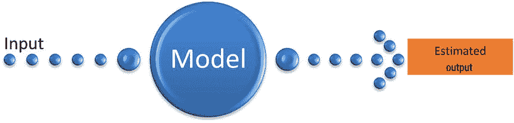

前面的例子表明，相关性只是一个系数，它指示变量之间的关系是弱还是强。而回归则是一种建模技术，它以方程的形式给出两个变量之间的实际关系。给定自变量的值，该方程可用于获得因变量的估计值或预测值。因变量用 `Y` 表示，自变量（可以不止一个）用 `Xi`（`i=1,2,3,4...`）表示。

表 9-11 列出了因变量和自变量的不同称呼。

### 表 9-11. 回归建模中 x 和 y 的不同称呼

| x | y |
| :--- | :--- |
| 自变量 | 因变量 |
| 输入 | 输出 |
| 预测变量 | 响应变量 |
| 输入读数 | 标签 |
| 原因 | 结果 |
| 解释变量 | 被解释变量 |
| 回归变量 | 被回归变量 |
| 控制变量 | 测量变量 |
| 操纵变量 | 准则变量 |
| 特征 | 实验变量 |
| 暴露变量 | 结果变量 |
| 右侧变量 | 左侧变量 |

### 估计示例

以一家位于繁忙市区的快餐店为例。过去 30 天的数据显示，任意一天售出的汉堡数量与进店顾客数量成正比。店长想要预测当给定数量的顾客（比如 4500 人）进店时，会售出多少个汉堡。

以下是用于读取该店历史数据并找出顾客数量与汉堡销量之间相关性的 SAS 代码片段：

```sas
/* 导入汉堡销售数据 */
PROC IMPORT OUT=WORK.burgers
DATAFILE="C:\Users\VENKAT\Google Drive\Training\Books\Content\Regression Analysis\Burger_sales.csv"
DBMS=CSV REPLACE;
GETNAMES=YES;
DATAROW=2;
RUN;

/* 顾客数量与汉堡销量之间的相关性 */
proc corr data=burgers;
var visitors burgers;
run;
```

表 9-12 显示了相关性分析的结果。

### 表 9-12. 汉堡数据集上 `PROC CORR` 的输出结果

| 2 个变量： | 顾客数量 汉堡销量 |
| :--- | :--- |
| **简单统计量** |  |
| 变量 | N | 均值 | 标准差 | 总和 | 最小值 | 最大值 |
| 顾客数量 | 35 | 3630 | 1405 | 127066 | 1645 | 6664 |
| 汉堡销量 | 35 | 723.45714 | 298.45931 | 25321 | 293.00000 | 1455 |
| **皮尔逊相关系数，N = 35 在 H0: Rho=0 下 Prob > \|r\|** |  |
|  | 顾客数量 | 汉堡销量 |
| 顾客数量 | 1.00000 | 0.87226 |
|  |  | <.0001 |
| 汉堡销量 | 0.87226 | 1.00000 |
|  | <.0001 |  |

表 9-12 中的皮尔逊相关系数表显示，汉堡销量与顾客数量的相关系数约为 `0.87`。这表明存在强相关性。但是，如何根据顾客数量来估计汉堡销量呢？你可以根据历史数据绘制 `图 9-17` 所示的图表。

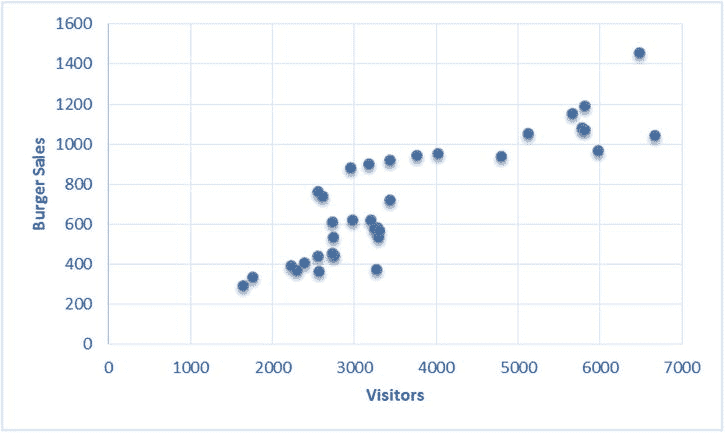

该图显示了汉堡销量与进店顾客数量之间存在强关系。汉堡销量随着顾客数量的增加而明显增长。要知道当天顾客数量为 4500 人时的汉堡销量，这个工作很简单。粗略估计结果为 800 个（图 9-18）。

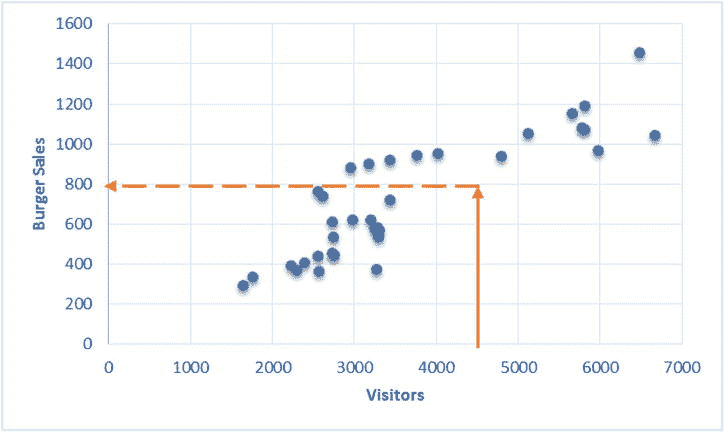

**图 9-18.** 顾客数量为 4500 时的汉堡销量

想象一条穿过核心数据的直线，并取 x 轴值为 4500 时对应的 y 轴值（图 9-19）。

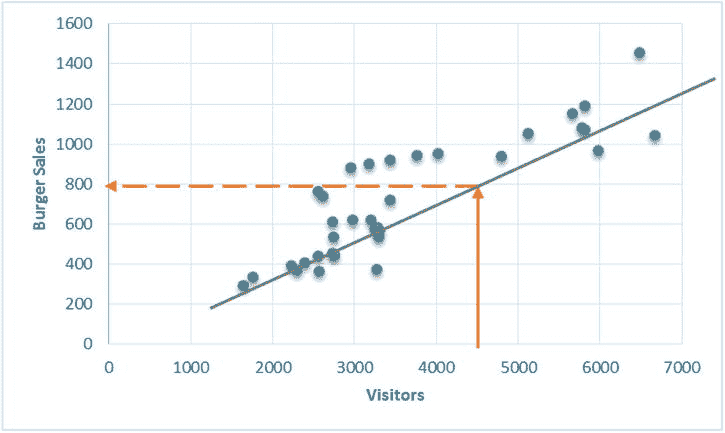

**图 9-19.** 汉堡案例的直线拟合

这里的技巧是拟合出最佳曲线，它能够最好地代表历史数据。这是为了将估计或预测误差降至最低所必需的。这条曲线（本例中是一条直线）可以延伸，以获得超出历史数据范围的估计值。回归分析也遵循这一步骤。

## 简单线性回归

根据因变量 `y` 与自变量 `x` 之间的关系，你需要估算出最佳拟合。它可以是一条简单的直线，也可以是曲线，具体取决于哪种线最贴合数据。在上一节给出的汉堡示例中，简单的直线拟合就解决了问题，因为该直线似乎能以相当高的准确度来定义二者之间的关系。

这种在估算时仅使用一个自变量的线性回归，被称为简单线性回归。

正如高中数学中通常定义的那样，直线方程为，其中 `m` 是斜率，`c` 是截距。回归分析中使用的符号略有不同，其中：
- `β[1]` 是斜率。
- `β[0]` 是截距。
- `x` = 自变量（我们提供此值）
- `y` = 因变量（我们估算此值）

要将一条直线拟合到数据上，只需找到 `β[0]` 和 `β[1]` 的值即可。一旦有了这些值，就可以简单地根据给定的 `x` 值来估算 `y` 的值。例如，考虑以下回归线：当 `x` 为 10 时，`y` 的值是多少？很简单！这个方程被称为线性回归模型。对于汉堡示例，你也可以有一个类似的回归模型。

### 使用最小二乘法拟合回归线

在回归分析中，你会尝试拟合一条最能代表数据的直线。为此，需要确定 `β[0]` 和 `β[1]` 的值，以使表示中的误差最小。截距 `β[0]` 和斜率 `β[1]` 也被称为回归系数。

以下是求回归系数的步骤：

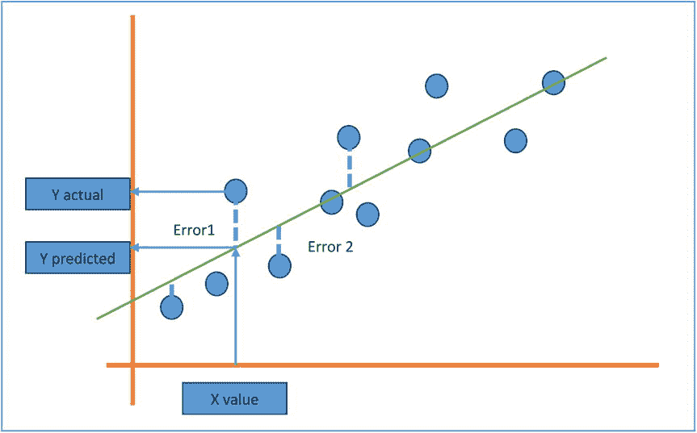

图 9-20. 实际值、预测值和误差

你可以使用微积分来找到能使上述误差函数最小的斜率 `β[1]` 和截距 `β[0]` 的值。这种方法被称为最小二乘估计法，原因显而易见。无需担心，因为像 SAS 这样的软件通常会为你完成这一估算工作。想象一条穿过数据点的直线。由于它无法穿过所有点，你需要确保它几乎接近所有的点。在图 9-20 中，你可以看到实际值（用圆圈表示）和沿着直线的预测值。误差用虚线表示。最佳拟合线将是总体误差最小的那条线。一些误差为正，一些则为负，因此将误差平方后再求和以得出总误差可能是个好主意。最佳拟合线将具有最小的总值。你需要以最小化误差平方和的方式求出回归系数。

### Beta 系数：示例 1

对于汉堡示例，自变量是访客人数，因变量是售出的汉堡数量。因此，为这些数据拟合一条直线只需要在以下直线中求出回归系数即可：

给定数据集，你需要运行最小二乘算法并获得回归系数值。SAS 内置了可运行该算法并给出结果的库。代码如下：

```
/*Fitting a regression line*/
proc reg data= burgers;
model burgers=visitors;
run ;
```

以下是其含义：
- `proc reg` 用于调用回归过程。
- 数据集名称是 `burgers`。
- 你需要在模型语句中提及因变量和自变量。例如，`model y=x`。

表 9-13 显示了此代码的输出。

表 9-13. 对汉堡数据集执行 `PROC REG` 的输出

| 读取的观测数 | 35 |
| --- | --- |
| 使用的观测数 | 35 |
| **方差分析** | |
| --- | --- |
| 来源 | 自由度 | 平方和 | 均方 | F 值 | Pr > F |
| --- | --- | --- | --- | --- | --- |
| 模型 | 1 | 2304330 | 2304330 | 104.99 | <.0001 |
| 误差 | 33 | 724321 | 21949 | | |
| 校正合计 | 34 | 3028651 | | | |
| 均方根误差 | 148.15238 | R 方 | 0.7608 |
| 因变量均值 | 723.45714 | 调整后 R 方 | 0.7536 |
| 变异系数 | 20.47839 | | |
| **参数估计** | |
| --- | --- |
| 变量 | 自由度 | 参数估计 | 标准误差 | t 值 | Pr > &#124;t&#124; |
| --- | --- | --- | --- | --- | --- |
| 截距 | 1 | 50.85364 | 70.25853 | 0.72 | 0.4743 |
| 访客数 | 1 | 0.18527 | 0.01808 | 10.25 | <.0001 |

表 9-13 中有如此多的度量值和数值，我们将重点关注最重要的数字。你需要寻找截距 `β[0]` 和斜率 `β[1]` 的估计值。从最后的参数估计表中，你得到的回归参数如下：
- 截距 `β[0]`：50.854
- 斜率，即 `x` 的系数（也就是模型方程 `β[1]` 中访客数的系数）：0.185

`汉堡 = 50.8534 + 0.185 * 访客数`

你只需要寻找回归方程或回归线。因此，对于访客数为 4,500 的一天，汉堡数量可以估算如下：

`汉堡 = 50.854 + 0.185 * 4500`

`汉堡 = 883.35`

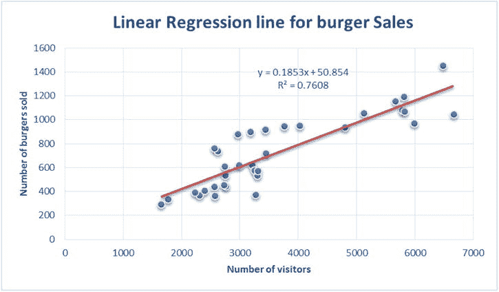

图 9-21. 汉堡销售示例的回归线

我们构建了一条回归线，并利用该模型给出了预测。但是，我们如何确保我们的回归模型是正确的且估计值是可信的呢？我们如何定义模型拟合优度？下一节将回答这个问题。

## 我的模型有多好？

你刚刚为汉堡示例构建的回归线，在给定访客数的情况下，能给出相当不错的汉堡销量估计值。但它仍然可能受到质疑。也许有人会提出另一个模型，并声称他们的估计值更好。她可能会提出一条截距为 23、斜率为 0.5 的新直线。在这种情况下，应该如何为当前模型辩护？换句话说，如何量化给定模型的准确度？如何计算估计中的误差？我们将通过一个示例来解释这一点。

表 9-14 显示了数据中的一些观测值。

表 9-14. 实际访客数与售出汉堡数对比快照

| 访客数 | 汉堡数 |
| --- | --- |
| 3268 | 373 |
| 2299 | 371 |
| 2566 | 363 |
| 1759 | 335 |
| 3440 | 720 |

表 9-14 中的汉堡数是基于历史数据的实际售出汉堡数。现在，你使用上一节构建的回归模型计算相同的值，并将这些值列在“汉堡数（预测）”列中。一个好的模型应该给出接近实际值的估计值（见表 9-15）。

表 9-15. 售出汉堡数的预测值与实际值

| 访客数 | 汉堡数（实际值） | 汉堡数（预测值） |
| --- | --- | --- |
| 3268 | 373 | 656 |
| 2299 | 371 | 477 |
| 2566 | 363 | 526 |
| 1759 | 335 | 377 |
| 3440 | 720 | 688 |

在接下来的章节中，你将着手估算预测值与实际值之间的误差。

### 误差平方和 (SSE)

一个完美的模型能确保估计值或预测值与实际值几乎一致。即便不完全相同，至少也应非常接近。因此，实际值（记为 `y`）与预测值（记为 `ŷ`）之间的差异在任何数据点上都应微不足道。由于这些误差在本质上可能为正或为负，你可以通过平方并求和来得到一个汇总值。对于一个模型来说，这个汇总值（换句话说，就是实际值与预测值之间偏差的平方和）应尽可能小，才能被归类为优秀模型。`y[i]` 是 `y` 的实际值，而 `ŷ[i]` 是 `y` 的预测值或估计值。

如果你想比较两个基于同一数据集构建的模型，那么 SSE 较小的那个模型显然会被认为更好。

没有专门的代码来生成 SSE 值；默认情况下，回归代码会在输出中显示 SSE。

```
/*拟合回归线*/
proc reg data= burgers;
model  burgers=visitors;
run;
```

在输出结果（如表 9-16 所示）中，你可以在分析方差表时读取误差平方和。

**表 9-16.** 汉堡数据集上 `PROC REG` 的输出结果

| 读取的观测数 | 35 |
| --- | --- |
| 使用的观测数 | 35 |
| **方差分析** | |
| --- | --- |
| 来源 | 自由度 | 平方和 | 均方 | F 值 | Pr > F |
| --- | --- | --- | --- | --- | --- |
| 模型 | 1 | 2304330 | 2304330 | 104.99 | <.0001 |

# 参数估计

| 变量 | 自由度 | 参数估计值 | 标准误差 | t 值 | Pr > |t| |
| --- | --- | --- | --- | --- | --- |
| 截距 | 1 | 50.85364 | 70.25853 | 0.72 | 0.4743 |
| 访客数 | 1 | 0.18527 | 0.01808 | 10.25 | <.0001 |

对于你构建的模型，误差平方和为 724,321。

## 总平方和

仅凭误差平方和不足以判断模型的拟合优度。孤立地观察 SSE 存在一个小挑战。SSE 的局限性是什么？你知道它应该接近于零。但如果 SSE 大于零呢？多大才算太大？如果模型中因变量的值达到数千，SSE 甚至可能达到数万。如果因变量的值是小数值（小于 1），那么 SSE 自然会较小。在这些条件下，如何基于 SSE 来解释模型的拟合度？你需要结合`y`的总变异来考虑 SSE，以确定确切的误差百分比。衡量`y`的方差或`y`的总平方和的方法如下：

其中`ȳ`是`y`的均值，`y`的方差（SST）无非就是`y`与其均值之差的平方。因此，`SSE / SST`是衡量模型精度的良好指标。我们可以称之为`y`中未解释方差的比例。那么，`y`中被解释的方差比例又是多少呢？这将在下一节中解释。

## 回归平方和

所以，我们试图用自变量来解释因变量（`y`）的总方差。由于我们无法拟合完美的模型，或者说数据没有完美的拟合，我们选择了一条带有一些误差的直线。因此，能最佳拟合给定信息的最佳模型会拥有很小的误差百分比。本节提供了另一种看待这个问题的方式。

`y`的总方差是误差平方和（即未解释的方差）与回归模型平方和（即成功解释的方差）之和。

总平方和 = 误差平方和 + 回归平方和

`SST = SSE + SSR`

总方差 = 未解释的方差 + 已解释的方差

SST、SSE 和 SSR 如图 9-22 所示。

因此，要获得更高的估计精度，你需要更小的误差，或者需要更大的回归平方和，或者你需要误差平方和接近于零，而回归平方和接近于总平方和。

所以，对于最佳模型而言，`SSE / SST`的值应接近于零，而`SSR / SST`的值应接近于 1。比率`SSR / SST`被称为决定系数或 R 平方，记为`R²`。

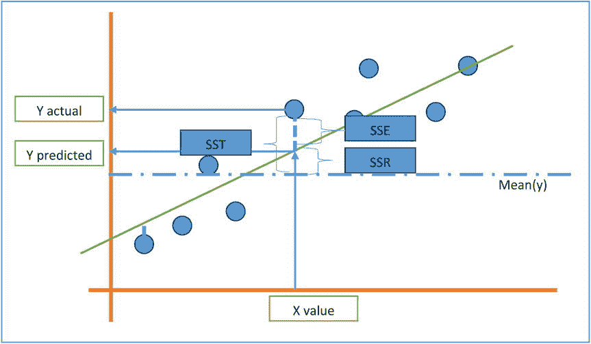

**图 9-22.** 表示 SSE、SST 和 SSR 的图

### 决定系数 R 平方

R 平方是一种拟合优度或精度度量。R 平方越高，模型越好。因此，决定系数无非就是已解释变异与（因变量的）总变异之比。

#### R 平方的限制

如果你不完全理解之前解释的误差方程，不必过于担心。所有这些计算都由软件完成。如果你理解了下面给出的 R 平方的意义，对于实际应用来说可能就足够了。

你可以从 R 平方的定义中看出，当模型完全不能解释因变量的任何变异时，R 平方的值最小可以为 0，而最大值可以如下：

R 平方值为 0.8 表明，使用该模型，我们可以解释因变量（`y`）80%的方差。因此，一个模型要成为优秀模型，就需要尽可能多地解释`y`的方差。如果你在比较两个模型并想决定哪个是最好的模型，那么 R 平方值较高的那个是更好的模型。一般的行业规范是要求 R 平方至少达到 80%，但这可能因数据的可用性和模型的复杂度而异。较低的 R 平方值表明`y`中的部分（而非全部）变异得到了解释。如果 R 平方接近于 1，那么你可以看到`y`中的大部分变异都是由`x`解释的。接下来给出的三个图（图 9-23、9-24 和 9-25）展示了三种不同实际场景下的 R 平方值。

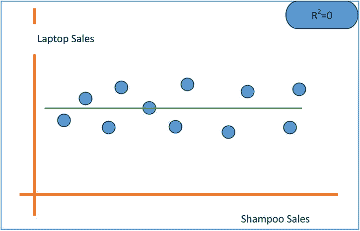

**图 9-25.** 笔记本电脑销量对洗发水销量回归线的 R 平方

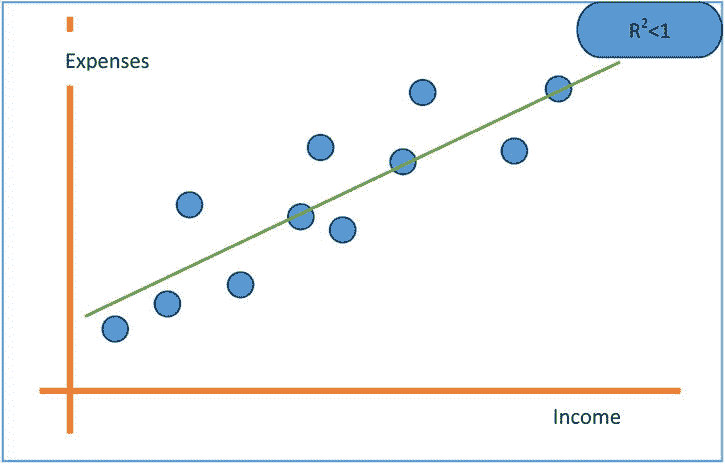

**图 9-24.** 支出对收入回归线的 R 平方

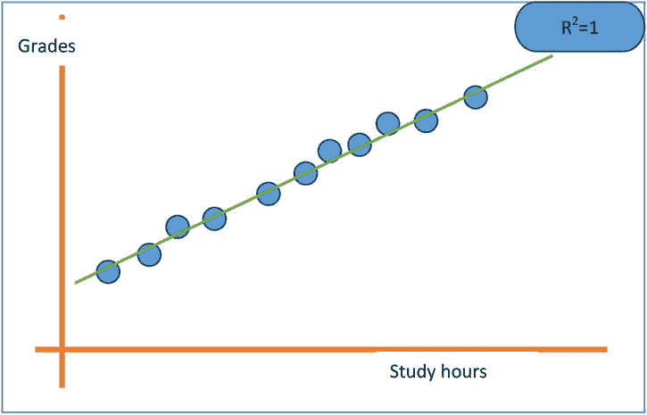

**图 9-23.** 成绩对学习时长回归模型的 R 平方

## SAS 中的 R 平方

在 SAS 中没有用于计算 R 平方的特殊代码。回归代码默认会给出平方和与 R 平方值。

```
proc reg data=burgers;
model burgers=visitors;
run;
```

SAS 输出在方差分析表中提到了回归模型的平方和与 R 平方。表 9-17 显示了汉堡销售示例的 SAS 输出。

**表 9-17.** 汉堡数据集上 `PROC REG` 的输出

| 读取的观测数 | 35 |
| --- | --- |
| 使用的观测数 | 35 |

**方差分析**

| 来源 | 自由度 | 平方和 | 均方 | F 值 | Pr > F |
| --- | --- | --- | --- | --- | --- |
| 模型 | 1 | 2304330 | 2304330 | 104.99 | <.0001 |
| 误差 | 33 | 724321 | 21949 | | |
| 校正合计 | 34 | 3028651 | | | |

| 根均方误差 | 148.15238 | R 方 | 0.7608 |
| --- | --- | --- | --- |
| 因变量均值 | 723.45714 | 调整 R 方 | 0.7536 |
| 变异系数 | 20.47839 | | |

**参数估计**

| 变量 | 自由度 | 参数估计 | 标准误差 | t 值 | Pr > |t| |
| --- | --- | --- | --- | --- | --- |
| 截距 | 1 | 50.85364 | 70.25853 | 0.72 | 0.4743 |
| 访客数 | 1 | 0.18527 | 0.01808 | 10.25 | <.0001 |

以下是来自输出表 9-17 的 ANOVA 表（方差分析）中的平方和：

- 回归模型平方和（`SSR`）= 2,304,330
- 误差平方和（`SSE`）= 724,321
- 总平方和（`SST`）= 3,028,651
- R 平方 = 0.7608，这可以通过 R 平方的实际公式来验证。

R 平方值表明模型的准确率仅为 76.08%；换句话说，基于输入值 `x`（访客数）对 `y`（售出的汉堡数）的预测，其准确率仅为 76.08%。这足够好吗？也许不够，因为分析师通常寻找大于或等于 80% 的 R 平方值。

## 回归假设

在汉堡示例中，您假设售出的汉堡数量与店内访客数量之间存在线性关系。但在实际应用中，情况可能并非如此。如果关系在真正意义上不是线性的，则不应尝试使用线性回归模型。还有其他可用的非线性技术来完成这项工作。以下是 R 平方值有效的一些假设。在某些情况下，本文还提供了测试这些假设的技术。

### 线性假设

R 平方值的计算基于一个假设，即自变量（`x`）和因变量（`y`）之间的关系是线性的。

考虑图 9-26 所示的图形。它或多或少地代表了 `y = e^x` 的关系。如果假设这里的拟合是一条直线，它将永远无法穿过大多数数据点。在这种情况下，R 平方没有意义。

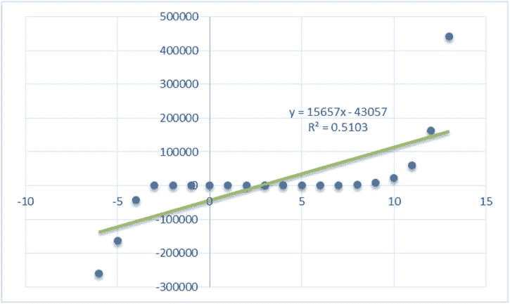

**图 9-26.** `y` 和 `x` 之间的指数关系。在这里 R 平方没有意义。

#### 线性关系的检测与违反线性假设的修正

检测线性关系相当简单。在大多数情况下，从散点图中可以清晰地看出线性关系。因此，要找到线性拟合，您可以使用像 SAS 这样的分析软件为 `x` 和 `y` 绘制散点图。如果 `x` 和 `y` 之间的关系不是线性的，可以尝试进行变换，例如 `x` 的平方、`log(x)`、`e^x`、`sqrt(x)` 等。数据的变换可以在任何标准统计学书籍中找到。

我们之前讨论过如何在相关性分析中创建散点图。以下是在 SAS 中创建散点图的代码。以下代码是电信数据中客户满意度与服务得分的示例散点图。

```
/* CSAT 与服务得分之间的散点图 */
proc gplot data=telecom;
plot C_sat*service;
run;
```

### 正态性

R 平方的计算基于一个假设，即对于自变量 `x` 的每个值，因变量 `y` 都呈正态分布。

理解这个假设的一个简单方法是看它的反面。换句话说，如果对于 `x` 的每个点，`y` 不是正态分布会怎样？如果对于 `x` 的某些观测值，`y` 是常数，而对于其余数据点，`y` 呈正态分布会怎样？这种情况下的图形可能类似于图 9-27。

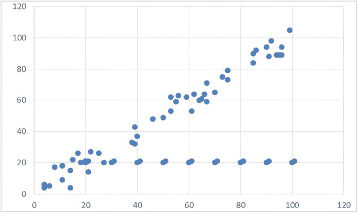
**图 9-27.** `y` 对 `x` 的散点图，显示了两种趋势。

图 9-27 中的图表显示，当 `x` 接近 10 的倍数时，`y` 的表现不同（假设所有其他值都表现正常）。您可以清楚地看到数据中的两种趋势。你不可能拟合出一条能穿过大多数数据点的直线。假设您拟合了一条线性回归线，那么误差（实际值与预测值之间的偏差）应该遵循均值为零的正态分布。正态性是计算回归系数时的一个基本假设。通常，异常值是违反此假设的主要原因。

图 9-28 中的图表显示了一些异常值；在此数据上拟合的模型将产生非正态的误差。如果尝试在此数据上拟合回归线，结果将是无效的。

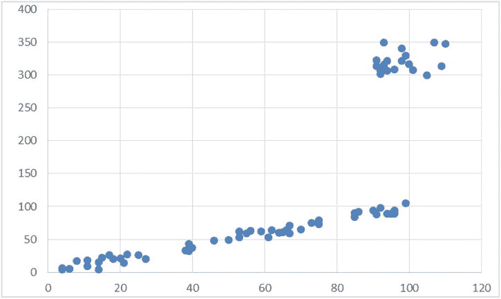
**图 9-28.** 带有异常值的 `y` 对 `x` 的散点图。

#### 检测正态性关系并修正非正态性

异常值检测及其处理已在第 7 章的数据探索中讨论过。你需要遵循相同的流程来处理此处的异常值。缺失值和默认值是导致违反正态性假设的主要原因。

正态性也可以通过两种图形来检测。

标准化残差的直方图应类似于均值为零的标准正态分布。

图 9-29 中的图形显示残差大致遵循正态分布，而图 9-30 和图 9-31 中的图形是残差不遵循正态分布的示例。

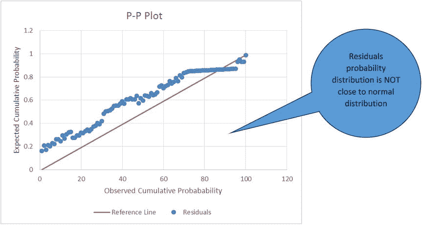
图 9-33. 残差概率分布不遵循正态分布

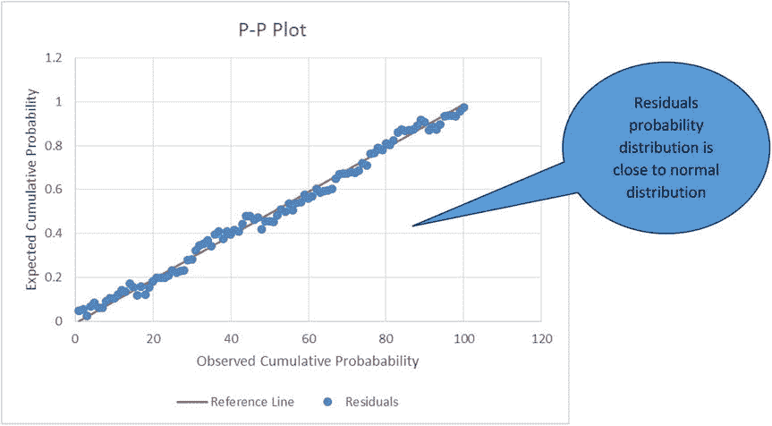
图 9-32. 接近正态的残差概率分布

正态概率与残差概率分布图也称为`P-P`图。该图试图绘制一个完美的正态概率分布（`P`），并将其与残差概率分布（`P`）进行比较。正态概率与残差分布图（`P-P`图）包含两个部分：一条直线和多个点。如果分布是正态的，则`P-P`图中的所有点都应落在一对角线附近，表明残差概率分布（图中的点）与标准正态概率分布（线）几乎相同。如果该图看起来像字母`D`或其镜像，则表明存在异常值，或误差在均值的一侧过于集中。图 9-32 和 9-33 给出了两种图形形状：一种可接受，另一种则指示异常值。

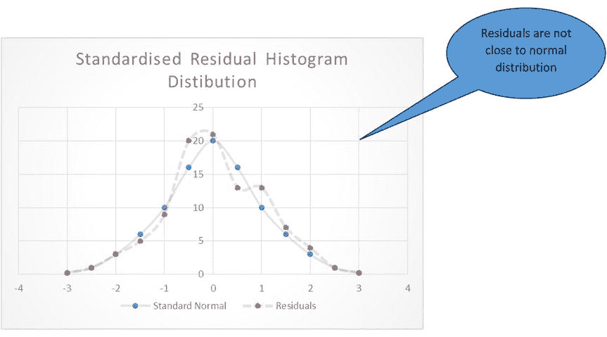
图 9-31. 残差不遵循正态分布的另一个示例

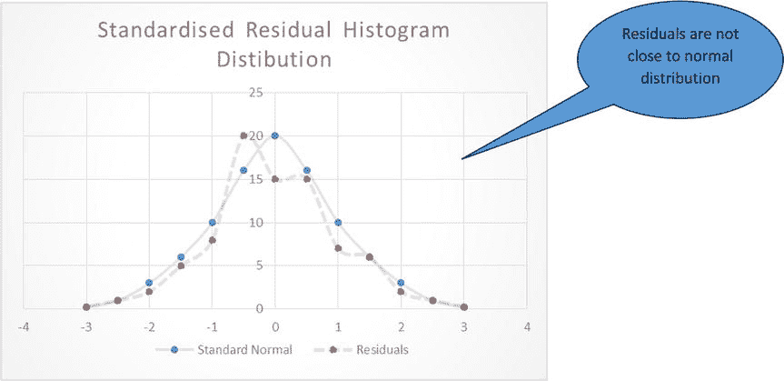
图 9-30. 残差不遵循正态分布

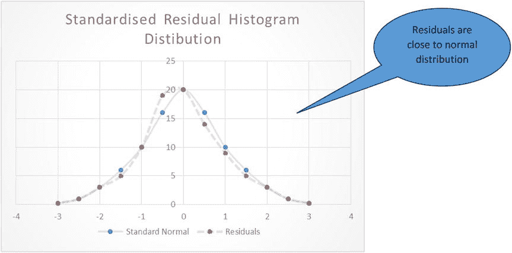
图 9-29. 残差遵循正态分布

要修正这种正态性违背，你需要应用异常值处理或对变量进行变换。异常值处理和缺失值处理在数据探索章节中已讨论。

### 独立性假设：观测值是独立的

`y`的独立性是尝试拟合线性回归时最常见的假设之一。你可以预期`y`的值依赖于自变量，但不依赖于其自身之前的值。例如，在分析一年的销售数据时，如果当前月份的销售额依赖于前一个月的销售额，那么`R-squared`就没有任何意义。

我们试图用`x`来预测`y`。如果`y`依赖于其自身的先前值，那么我们构建的模型就不稳健。变量`x`将永远无法解释`y`变量的自相关性。

#### 检测和修正独立性违背

该假设的违背主要发生在时间序列数据中。自相关函数（`ACF`）图可以清晰地显示依赖关系。`ACF`图在时间序列分析章节中有说明。如果存在季节性依赖，则可能会得到季节性指数，并且可以相应地对数据进行调整。如果数据显示出明显的趋势，则可以使用某些平滑技术来修正或调整数据。在这种情况下，甚至可以考虑使用各种数学函数进行变量变换。

### 同方差性假设：在每个`X`值处`Y`的方差相同

我们还假设`y`的方差在`x`的每个阶段是相同的，并且在`X`中没有特殊的区间使得`Y`的离散度不同。观察图 9-34 中的图形，该图显示了在`x`的某些点上`y`的不同方差模式。在`x`的不同区间内具有不同方差称为异方差性。它与同方差性相反，同方差性意味着因变量在自变量的所有点上具有相同的方差。

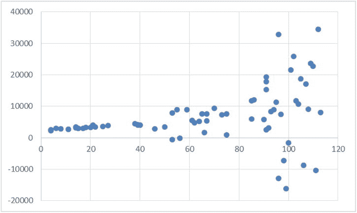
图 9-34. 注意`y`在不同`x`区间内的不同方差模式

在此图中，当`x`小于 40 时，`y`的方差似乎略小。在`x`介于 40 到 80 之间时，您会看到一个略有不同的方差模式。同样，在`x`超过 80 之后，模式又不同了。在这种情况下，很难拟合一条回归线并期望它穿过数据的大多数点。如图 9-35 中的图形所示，直线拟合不能被视为整个数据集的最佳拟合。

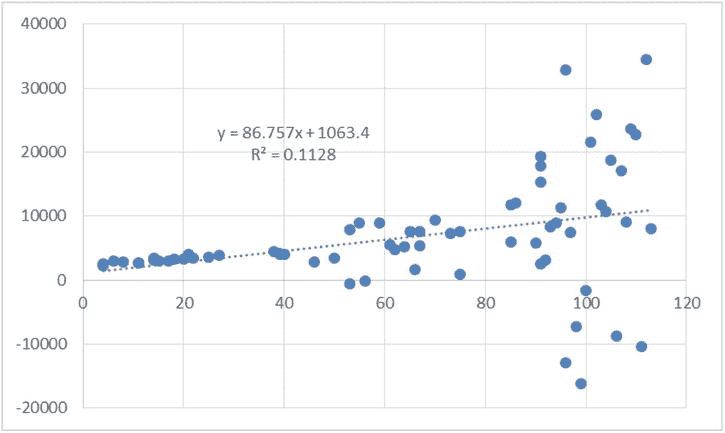
图 9-35. 尝试在`y`和`x`之间拟合一条直线失败

#### 检测同方差性违背并修正

同样，`x`与`y`之间的散点图可以让你对同方差性有一个初步了解。一个更巧妙的方法是绘制残差与预测值（而非实际值）的图形。这可以让你了解`y`是增大还是减小、残差变异是增大还是减小，或者它是否在预测线周围随机分布。

图 9-36 和 9-37 中的图形展示了同方差性和异方差性的一些示例。

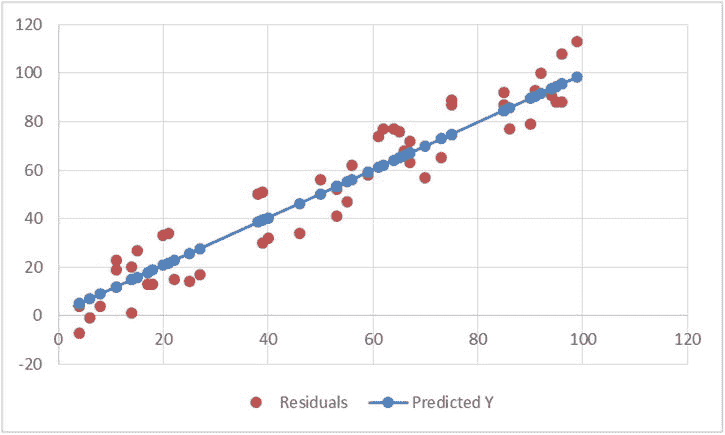
图 9-36. 显示同方差性的图形

残差或误差是实际值与预测值之间的差值。

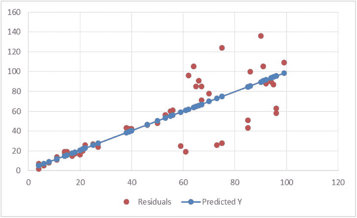
图 9-37. 显示异方差性的图形

处理此问题的简单方法是对数据进行分段，并为不同区间构建不同的回归线。一般来说，如果前三个假设得到满足，那么异方差性可能根本不存在。作为经验法则，在尝试修正异方差性之前，需要先解决前三个假设的问题。

## 线性回归不适用的情况

在前几节中，我们讨论了回归分析的四个主要假设。如果其中任何一个假设不成立，则不应应用线性回归建模。

总结一下，这四个假设如下：

- 当 X 与 Y 之间的关系是非线性时，线性回归模型就不适用。其估计值将毫无意义。
- 当误差不服从正态分布时，回归系数及其标准差可能不正确。如果误差分布是偏态的，系数估计背后的基本理论将不成立。在这种情况下，线性回归模型的作用不大。
- 当因变量的值之间存在依赖关系时，你在构建回归模型时就总是忽略了一个趋势。你试图捕捉的是 X 与 Y 之间的趋势。但如果 Y 与 Y 之间的关系仍未得到解释（Y 可能依赖于其先前的值），你就无法拟合一条回归线。
- 当 Y 的方差模式在整个 X 范围内不一致时，单一的整合线永远无法解释 Y 在 X 不同区间内的行为。在这种情况下，应用线性回归同样不是一个好主意。

## 简单回归：示例

在回归主题的开头，我们讨论过手机销售数据。我们将使用回归技术来回答诸如：

- 当价格上涨或下跌时，手机销量会发生什么变化？
- 在给定的价格水平下，某款手机型号的预计销量是多少？

以下是通过价格预测销量的代码。

```sas
proc reg data= mobiles;
model sales=price;
run;
```

表 9-18 展示了此代码的结果。

**表 9-18.** 手机数据集的 PROC REG 输出（模型 `sales=price`）

| 读取的观测数 | 58 |
| :--- | :--- |
| **使用的观测数** | **58** |

**方差分析**

| 源 | 自由度 | 平方和 | 均方 | F 值 | Pr > F |
| :--- | :--- | :--- | :--- | :--- | :--- |
| 模型 | 1 | 4.255764E13 | 4.255764E13 | 2.84 | 0.0973 |
| 误差 | 56 | 8.379103E14 | 1.496268E13 | | |
| 校正总计 | 57 | 8.80468E14 | | | |

# 简单线性回归分析示例

## 价格模型

**方差分析**

| 源 | 自由度 | 平方和 | 均方 | F 值 | Pr > F |
| --- | --- | --- | --- | --- | --- |
| 模型 | 1 | 1.493236E13 | 1.493236E13 | 2.86 | 0.0973 |
| 误差 | 56 | 2.910060E14 | 5.196536E12 | | |
| 校正总计 | 57 | 3.059384E14 | | | |

| 均方根误差 | 3868163 | R 方 | 0.0483 |
| 因变量均值 | 9394688 | 调整 R 方 | 0.0313 |
| 变异系数 | 41.17394 | | |

**参数估计值**

| 变量 | 自由度 | 参数估计值 | 标准误差 | t 值 | Pr > `|t|` |
| --- | --- | --- | --- | --- | --- |
| 截距 | 1 | 10047931 | 638755 | 15.73 | <.0001 |
| 价格 | 1 | -307.95807 | 182.60286 | -1.69 | 0.0973 |

查看 R 方值，可以看出智能手机的销售额仅有 4.8% 的变异是由价格决定的。因此，该模型不足以用于预估。

现在，你尝试逐个使用其余变量，看看它们是否能产生良好的回归线。以下是第一个示例：

以下是通过评分预测销量的代码。

```sas
proc reg data= mobiles;
model sales=Ratings;
run;
```

表 9-19 展示了此代码的结果。

## 评分模型

**表 9-19. 手机数据集的 PROC REG 输出（模型 `sales=Ratings`）**

**方差分析**

| 源 | 自由度 | 平方和 | 均方 | F 值 | Pr > F |
| --- | --- | --- | --- | --- | --- |
| 模型 | 1 | 7.974544E13 | 7.974544E13 | 5.58 | 0.0217 |
| 误差 | 56 | 8.007225E14 | 1.429862E13 | | |
| 校正总计 | 57 | 8.80468E14 | | | |

| 均方根误差 | 3781351 | R 方 | 0.0906 |
| 因变量均值 | 9394688 | 调整 R 方 | 0.0743 |
| 变异系数 | 40.24989 | | |

**参数估计值**

| 变量 | 自由度 | 参数估计值 | 标准误差 | t 值 | Pr > `|t|` |
| --- | --- | --- | --- | --- | --- |
| 截距 | 1 | 6850723 | 1186143 | 5.78 | <.0001 |
| `Ratings` | 1 | 441766 | 187063 | 2.36 | 0.0217 |

这次的 R 方仅为 9.06%。因此，该模型同样不适合用于预测销量。

以下是通过新功能数量预测销量的代码。

```sas
proc reg data= mobiles;
model sales= Num_new_features;
run;
```

表 9-20 展示了此代码的结果。

## 新功能数量模型

**表 9-20. 手机数据集的 PROC REG 输出（模型 `sales=Num_new_features`）**

**方差分析**

| 源 | 自由度 | 平方和 | 均方 | F 值 | Pr > F |
| --- | --- | --- | --- | --- | --- |
| 模型 | 1 | 1.835206E13 | 1.835206E13 | 1.19 | 0.2796 |
| 误差 | 56 | 8.621159E14 | 1.539493E13 | | |
| 校正总计 | 57 | 8.80468E14 | | | |

| 均方根误差 | 3923637 | R 方 | 0.0208 |
| 因变量均值 | 9394688 | 调整 R 方 | 0.0034 |
| 变异系数 | 41.76442 | | |

**参数估计值**

| 变量 | 自由度 | 参数估计值 | 标准误差 | t 值 | Pr > `|t|` |
| --- | --- | --- | --- | --- | --- |
| 截距 | 1 | 8163039 | 1240143 | 6.58 | <.0001 |
| `Num_new_features` | 1 | 182234 | 166907 | 1.09 | 0.2796 |

这次的 R 方仅为 2.08%。同样，这个模型也不理想。

以下是通过股市指数预测销量的代码。

```sas
proc reg data= mobiles;
model sales= Stock_market_ind;
run;
```

表 9-21 展示了此代码的输出结果。

## 股市指数模型

**表 9-21. 手机数据集 PROC REG 输出结果（模型 `sales=Stock_market_ind`）**

**方差分析**

| 来源 | 自由度 | 平方和 | 均方 | F 值 | Pr > F |
| --- | --- | --- | --- | --- | --- |
| 模型 | 1 | 4.726778E13 | 4.726778E13 | 3.18 | 0.0801 |
| 误差 | 56 | 8.332002E14 | 1.487857E13 | | |
| 校正总和 | 57 | 8.80468E14 | | | |

| 均方根误差 | 3857276 | R 方 | 0.0537 |
| 因变量均值 | 9394688 | 调整后 R 方 | 0.0368 |
| 变异系数 | 41.05805 | | |

**参数估计**

| 变量 | 自由度 | 参数估计 | 标准误差 | t 值 | Pr > `|t|` |
| --- | --- | --- | --- | --- | --- |
| 截距 | 1 | 14382036 | 2843599 | 5.06 | <.0001 |
| `Stock_market_ind` | 1 | -428.98038 | 240.67750 | -1.78 | 0.0801 |

此处的 R 方仅为 5.3%。这再次说明拟合效果不佳。

以下是使用营销预算预测销售量的代码：

```sas
proc reg data= mobiles;
model sales= Market_promo_budget;
run;
```

表 9-22 展示了此代码的输出结果。

## 营销预算模型

**表 9-22. 手机数据集 PROC REG 输出结果（模型 `sales=Market_promo_budget`）**

**方差分析**

| 来源 | 自由度 | 平方和 | 均方 | F 值 | Pr > F |
| --- | --- | --- | --- | --- | --- |
| 模型 | 1 | 1.167034E14 | 1.167034E14 | 8.56 | 0.0050 |
| 误差 | 56 | 7.637646E14 | 1.363865E13 | | |
| 校正总和 | 57 | 8.80468E14 | | | |

| 均方根误差 | 3693055 | R 方 | 0.1325 |
| 因变量均值 | 9394688 | 调整后 R 方 | 0.1171 |
| 变异系数 | 39.31003 | | |

**参数估计**

| 变量 | 自由度 | 参数估计 | 标准误差 | t 值 | Pr > `|t|` |
| --- | --- | --- | --- | --- | --- |
| 截距 | 1 | 6866361 | 991064 | 6.93 | <.0001 |
| `Market_promo_budget` | 1 | 38.86021 | 13.28462 | 2.93 | 0.0050 |

此处的 R 方仅为 13.25%。这稍好一些，但同样不足以用于预测。

## R 方值汇总

表 9-23 展示了 R 方值的汇总表。

**表 9-23. 各独立变量的 R 方值表**

| 独立变量 | R 方 | 已解释方差 | 未解释方差 |
| --- | --- | --- | --- |
| 价格 | 0.0483 | 5% | 95% |
| 评分 | 0.0906 | 9% | 91% |
| 新功能数量 | 0.0208 | 2% | 98% |
| 股票市场指数 | 0.0537 | 5% | 95% |
| 市场促销预算 | 0.1325 | 13% | 87% |

从表 9-23 可以明显看出，没有一个变量能够解释 `y` 的大部分变异。这些模型都不足以获得对销售量的良好估计。那么，还有别的估计销售量的方法吗？有的，除了单独使用这些变量，您或许可以尝试将它们一起使用。所有这些自变量共同作用可能会解释 `y` 的变异。您可能想尝试使用多个自变量的回归线。当只有一个自变量时，回归称为简单回归；但如果有多个自变量，则称为多元线性回归，这是下一章的主题。

## 本章小结

在本章中，您学习了一些相对复杂的分析措施和技术。到目前为止，我们只使用了简单的描述性统计量，例如均值、方差等。您了解到变量之间的关联是通过相关性来量化的。您还了解到，利用相关变量预测目标变量是通过使用简单线性回归完成的。在“简单线性回归”这一节中，我们详细阐述了其概念部分。

现实场景并非如此简单。多个预测变量会影响一个目标变量，因此我们需要在此处使用多元线性回归。下一章将介绍多元线性回归。在接下来的章节中，您将看到其他一些非线性回归分析技术，例如逻辑回归。