# 10. 多元回归分析

在第 9 章中，我们讨论了相关性，它用于量化一对变量之间的关系。我们还讨论了简单回归，它有助于在给定自变量的情况下预测因变量。在简单回归中，您使用单个自变量来预测因变量。这是一种简单化的方法，在实践中，某些因变量可能需要多个自变量才能进行准确预测。例如，仅通过观察出口额，您能预测一个国家的国内生产总值（GDP）吗？显然不能。预测 GDP 可能需要其他几个变量，例如人均收入、自然资源价值、国家债务等。同样，一个人的健康状况取决于许多变量，例如吸烟或饮酒习惯、饮食习惯、工作压力、每日锻炼、遗传、睡眠习惯等等。

在现实场景中，您不能指望单个变量能解释因变量的所有变异；在现实生活中，预测大多数因变量需要多个自变量。这就是多元线性回归分析发挥作用的地方。多元线性回归的另一个经典例子是银行进行的信用风险分析，我们一直在本书中讨论这一点。

## 多元线性回归

如前所述，现实世界的问题是多元的；换句话说，现实生活中的大多数目标变量都依赖于多个自变量。员工的总薪酬可能取决于其教育背景、工作年限、工作类型和复杂性、公司政策等等。图 10-1 还展示了一些其他示例。

公司在预测其产品销售量时应考虑哪些因素？

银行在预测其客户的贷款偿还能力时应考虑哪些因素？

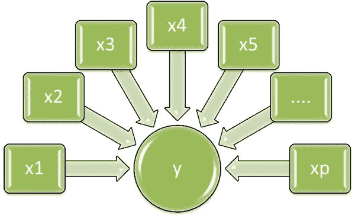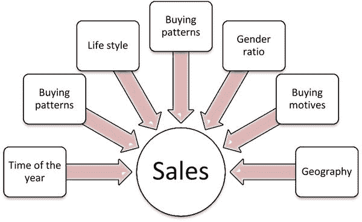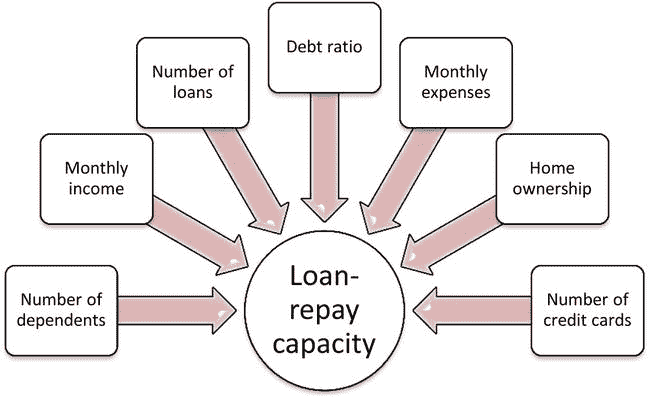

图 10-1. 现实生活中的多元线性回归示例

大多数用于预测利润、投资回报等的经济模型都涉及多个变量。多元回归技术与简单回归模型并没有太大区别，只是涉及多个变量。基本假设、回归系数的解释和 R 方保持不变。


### 多元回归线

简单回归线方程为 `y = β0 + β1x`。多元回归线方程如下所示：`y = β0 + β1x1 + β2x2 + ... + βpxp`，其中

* `β[1], β[2]…….. β[p]` 是 `x[1]`, `x[2]`, …….`x[p]` 的系数。
* `β[0]` 是截距。

在多元回归中，你的目标是拟合一条连接所有自变量和因变量的回归线。以智能手机销售为例。假设你想使用手机评分、手机价格区间、市场推广等自变量来预测智能手机的销量。

在简单回归中，你尝试在 `y` 和 `x` 之间拟合一条回归线。由于过程中只涉及两个变量，回归线在二维图上就是一条简单的直线。而形如 `y = β0 + β1x1 + β2x2` 的回归方程所对应的直线将是三维的，如 10-2 所示。显然，这比简单线性回归中涉及的二维直线更难想象。

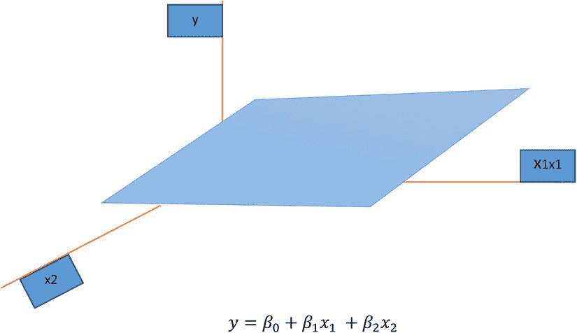

**图 10-2.** 具有两个自变量的多元回归图

在智能手机销售示例中，回归线将如下所示：`sales = β0 + β1 * ratings + β2 * price + β3 * num_new_features + ...`。一旦有了 Beta 系数的值，你就可以创建回归线方程并用它来预测销量。寻找这些 Beta 系数是后续章节的主题。

### 使用最小二乘法拟合多元回归线

拟合多元回归线的过程与你在简单回归章节中学到的过程相同。唯一的区别在于自变量及其系数的数量。这里你有许多额外的自变量（`x[1]`, `x[2]`, …….`x[p]`），并且你试图找到多个系数（`β[1], β[2]…….. β[p]`）。

以下是你试图完成的任务：

- 拟合一个最能代表数据的平面（多维线）
- 拟合一条穿过数据中大多数点的回归线
- 以误差最小的多维线形式表示散点数据

在方程 `y = β0 + β1x1 + β2x2 + ... + βpxp` 中，找到 `β[1], β[2]…….. β[p]` 和截距 `β[0]` 的值。请参考图 10-3。

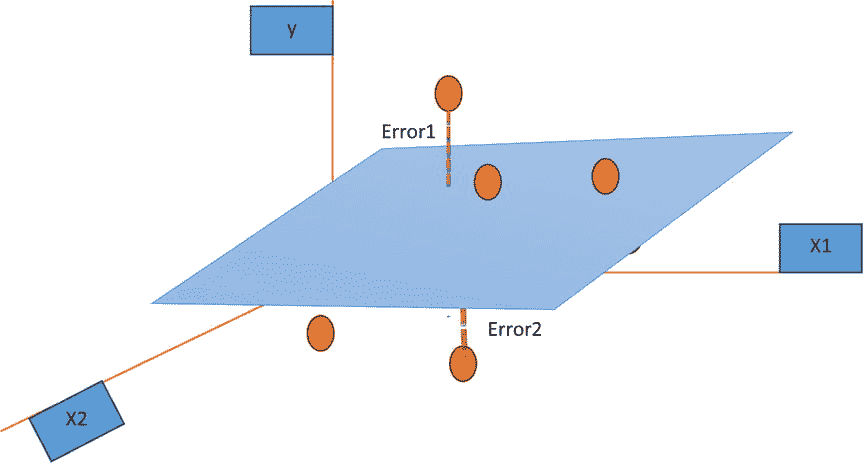

**图 10-3.** 回归分析中的估计值与实际值

图 10-3 展示了在三维空间中看到的估计回归线和实际值。误差就是两点之间的距离。回归平面上的估计点和实际点用圆圈表示。虚线表示误差。正如预期，你总是希望实际值与估计值之间的差异为零。

尝试最小化误差的平方，以找到 Beta 系数。需要最小化的函数是：`minimize Σ(y_i - (β0 + β1*x1_i + β2*x2_i + ... + βp*xp_i))²`。

现在，你可以使用优化技术来找到能够最小化上述函数的 `β[1], β[2]…….. β[p]` 和 `β[0]` 的值。此过程得出的线将是该数据的最佳回归线。这是因为它确保了在优化过程中，误差平方和保持尽可能小的值。

### SAS 中的多元线性回归

在 SAS 中，你需要在 `model` 语句中指定数据集名称以及因变量和自变量的列表。SAS 会执行最小二乘优化，并输出 Beta 系数作为结果。

### 示例：智能手机销量估算

在之前简单回归章节中讨论的智能手机销售示例中，你使用 `Price`（价格）、`Ratings`（评分）、`Num_new_features`（新功能数量）、`Stock_market_ind`（股市指标）和 `Market_promo_budget`（市场推广预算）等自变量来估算销量。当逐个使用变量时，你无法得到一个好的模型。下表（表 10-1）是 R 方表，展示了各个变量及其解释的因变量变异。请参考上一章中关于手机销售的简单回归示例。

**表 10-1.** R 方表

| 自变量 | R 方 | 已解释的变异 | 未解释的变异 |
| --- | --- | --- | --- |
| Price | 0.0483 | 5% | 95% |
| Ratings | 0.0906 | 9% | 91% |
| Num_new_features | 0.0208 | 2% | 98% |
| Stock_market_ind | 0.0537 | 5% | 95% |
| Market_promo_budget | 0.1325 | 13% | 87% |

现在，你为这个问题拟合一个多元回归线。以下是执行此操作的 SAS 代码：

```
/* 智能手机销售示例的多元回归线 */
proc reg data= mobiles;
model sales= Ratings Price Num_new_features Stock_market_ind Market_promo_budget;
run;
```

以下是代码说明：

- `PROC REG` 用于调用回归过程。
- 数据集名称是 `mobiles`。
- 你需要在 `model` 语句中指定因变量和自变量；`sales` 是因变量。

表 10-2 展示了这段代码的 SAS 输出结果。

**表 10-2.** 在 Mobiles 数据集上执行 `PROC REG` 的输出

| 读取的观测数 | 58 |
| --- | --- |
| 使用的观测数 | 58 |

| 方差分析 | | | | | |
| --- | --- | --- | --- | --- | --- |
| 来源 | 自由度 | 平方和 | 均方 | F 值 | Pr > F |
| 模型 | 5 | 7.408043E14 | 1.481609E14 | 55.16 | <.0001 |
| 误差 | 52 | 1.396636E14 | 2.685839E12 | | |
| 校正合计 | 57 | 8.80468E14 | | | |

| 均方根误差 | 1638853 | R 方 | 0.8414 |
| --- | --- | --- | --- |
| 因变量均值 | 9394688 | 调整后 R 方 | 0.8261 |
| 变异系数 | 17.44446 | | |

| 参数估计 | | | | | |
| --- | --- | --- | --- | --- | --- |
| 变量 | 自由度 | 参数估计值 | 标准误差 | t 值 | Pr > &#124;t&#124; |
| 截距 | 1 | 493778 | 1520007 | 0.32 | 0.7466 |
| Ratings | 1 | 651375 | 90775 | 7.18 | <.0001 |
| Price | 1 | -1833.67081 | 127.24677 | -14.41 | <.0001 |
| Num_new_features | 1 | 547167 | 85234 | 6.42 | <.0001 |
| Stock_market_ind | 1 | -105.38867 | 106.01603 | -0.99 | 0.3248 |
| Market_promo_budget | 1 | 100.92891 | 8.38744 | 12.03 | <.0001 |

输出包含了所有回归系数的估计值。所有自变量的系数都在最终的参数估计表中列出。截距为 493,778。评分的回归系数为 651,375。价格的回归系数为 -1,833.67，新功能数量的回归系数为 547,167。

最终的多元回归线方程如下：`sales = 493 778 + 651 375 * ratings - 1 833.67 * price + 547 167 * num_new_features - 105.39 * stock_market_ind + 100.93 * market_promo_budget`。从上述系数及其符号，你可以推断出手机销量与客户评分、新增功能数量和市场推广力度成正比。你还可以观察到，销量与价格区间和股市指标成反比（回归方程中的负系数）。股市指数与销量的关系似乎有些违背直觉，但这正是历史上一直发生的情况。股市指数对智能手机销量有负面影响。如果股市上涨，智能手机销量会下降；反之，在熊市中则相反。

有了这个方程，如果你有样本的评分、价格区间、新功能数量、股市指标和产品的预估推广水平等数值，你就可以大致了解销量。但不幸的是，这还不是全部。还有一些问题需要回答。预测销量值的准确性如何？这条线是否很好地拟合了这些数据？你能用这条回归线进行预测吗？使用这条回归线，你能保证的误差或准确度是多少？所有变量解释了销量变异的多少？如何衡量拟合优度？这里也能使用 R 方吗？


### 拟合优度

这里的拟合优度，或称为验证指标，是 `R-squared`（R 方）。`R-square` 值就是所有变量共同解释的因变量方差。多元回归的方差分析（ANOVA）表给出了误差平方和的值。

为了方便你查阅，我们在表 10-3 中重现了手机销售示例的方差分析表。

**表 10-3. 手机销售示例的方差分析表**

| 方差分析 (ANOVA) | | | | | |
| :--- | :--- | :--- | :--- | :--- | :--- |
| **变异来源** | **自由度** | **平方和** | **均方** | **F 值** | **Pr > F** |
| 模型 | 5 | 7.408043E14 | 1.481609E14 | 55.16 | \<.0001 |
| 误差 | 52 | 1.396636E14 | 2.685839E12 | | |
| 校正总和 | 57 | 8.80468E14 | | | |

| **根均方误差** | 1638853 | **R 方** | 0.8414 |
| :--- | :--- | :--- | :--- |
| **因变量均值** | 9394688 | **调整 R 方** | 0.8261 |
| **变异系数** | 17.44446 | | |

由于销售数字以百万计，方差（平方和）也是百万的倍数。由于所有数值都在同一量级上，解读 ANOVA 表就很容易。`Y` 的总方差（总平方和）约为 8.8 个单位，而误差平方和为 1.4 个单位。剩下的部分就是模型平方和，为 7.4 个单位。`R-squared` 值为 84.14%。

请参考第 9 章关于简单回归的内容，以了解更多关于 `R-square` 和平方和的知识。

这条回归线看起来是一个相当准确的模型。所有变量共同解释了 `y` 中近 84%的变异（图 10-4），尽管单独来看，没有任何一个变量能解释 `y` 中超过 10%的变异。你可以放心地使用这个模型进行预测。

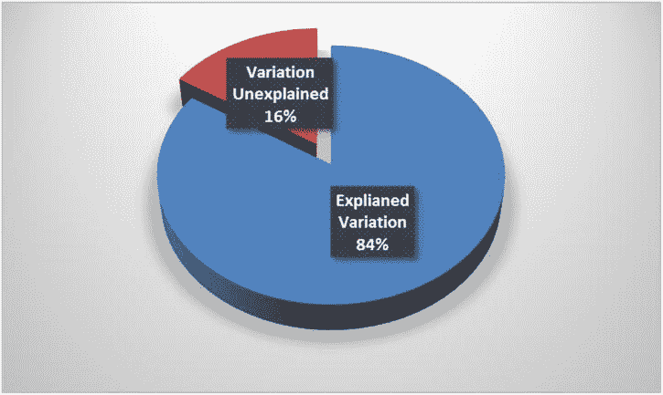

**图 10-4. 手机示例中可解释与不可解释的变异**

### 回归输出的三个主要衡量指标

在 SAS 输出中，除了回归系数、ANOVA 表和 `R-square` 之外，还提到了一些其他指标。你可能不需要全部了解，但以下是必须知道的统计指标：

-   F 检验、F 值、F 检验的 P 值
-   T 检验、T 值、T 检验的 P 值
-   R 方和调整 R 方

#### F 检验、F 值、F 检验的 P 值

执行 F 检验是为了查看模型在当前背景下是否足够相关。这是检验模型整体拟合度的测试。该检验回答了以下问题：

-   模型到底有没有用？
-   是否至少有一个变量能解释因变量 (`y`) 的某些变异？

举例来说，考虑构建一个智能手机销售的分析模型。一些无关紧要的自变量，如城市中的公交车数量、平均披萨订购量、平均燃料消耗量，肯定无法帮助预测智能手机的销售额。如果你使用越来越多这样的变量，整个模型将变得毫无意义。显而易见的原因是，模型中的自变量无法解释因变量 `y` 的变异。F 检验就是用来确定这一点的。它判断模型中是否至少有一个变量对因变量有显著影响。

在本章前面讨论多元回归线时，我们谈到了 beta 系数。F 检验利用这些系数来检验模型的解释力或预测力。如果至少有一个 beta 系数不等于零，就可以推断模型中存在一个对因变量 `y` 的变异有显著影响的自变量。如果有多个 beta 值不为零，则表明存在多个可以解释 `y` 变异的自变量。

- H[0]：`β1 = β2 = ... = βk = 0`，这等同于说所有 beta 值都为零。
    - 如果所有 beta 值都为零，意味着模型不显著，没有解释预测能力。
- H[1]：`至少有一个 βj != 0`，这等同于说至少有一个 beta 值不为零。

关于 H[0]和 H[1]的解释，请参考第 8 章的假设检验。

如前所述，即使只有一个 beta 值为正，你也可以推断该模型具有一定的解释能力。

为了检验上述假设，你需要依赖 F 统计量，并计算 `F 值` 和相应的 `P 值`。根据 F 检验的 `P 值`，你接受或拒绝原假设。F 检验的 `P 值` 将最终决定你是否应该采纳或拒绝该模型。`F 值` 是通过解释平方和与回归平方和计算得出的。有关 `P 值` 和 F 检验的更多信息，请参考第 8 章的假设检验。

如果 F 检验的 `P 值` 小于 5%，则拒绝原假设 H[0]。换句话说，你拒绝“该模型没有解释力”的假设，这意味着该模型可用于有用的预测。如果 F 检验的 `P 值` 大于 5%，那么你没有足够的证据拒绝 H[0]，这可能会迫使你接受原假设。简单来说，查看 F 检验的 `P 值`。如果它大于 5%，那么你的模型就有麻烦了；否则，无需担心。

##### 示例：用于整体模型检验的 F 检验

在智能手机销售示例中，如果你想查看整体模型的拟合情况，就必须查看输出中 F 检验的 `P 值`。

以下代码保持不变：

```sas
/* 智能手机销售示例的多元回归线 */
proc reg data= mobiles;
model sales= Ratings Price Num_new_features Stock_market_ind Market_promo_budget;
run;
```

表 10-4 给出了这段代码的输出结果。在 ANOVA 表中，你可以看到 F 检验的 `F 值` 和 `P 值`。

**表 10-4. 对 Mobiles 数据集执行 PROC REG 的输出**

| 读取的观测数 | 58 |
| :--- | :--- |
| 使用的观测数 | 58 |

| 方差分析 | | | | | |
| :--- | :--- | :--- | :--- | :--- | :--- |
| **变异来源** | **自由度** | **平方和** | **均方** | **F 值** | **Pr > F** |
| 模型 | 5 | 7.408043E14 | 1.481609E14 | 55.16 | \<.0001 |
| 误差 | 52 | 1.396636E14 | 2.685839E12 | | |
| 校正总和 | 57 | 8.80468E14 | | | |

| **根均方误差** | 1638853 | **R 方** | 0.8414 |
| :--- | :--- | :--- | :--- |
| **因变量均值** | 9394688 | **调整 R 方** | 0.8261 |
| **变异系数** | 17.44446 | | |

| 参数估计 | | | | | |
| :--- | :--- | :--- | :--- | :--- | :--- |
| **变量** | **自由度** | **参数估计值** | **标准误差** | **t 值** | **Pr > \|t\|** |
| 截距 | 1 | 493778 | 1520007 | 0.32 | 0.7466 |
| 评分 | 1 | 651375 | 90775 | 7.18 | \<.0001 |
| 价格 | 1 | -1833.67081 | 127.24677 | -14.41 | \<.0001 |
| 新功能数量 | 1 | 547167 | 85234 | 6.42 | \<.0001 |
| 股票市场指数 | 1 | -105.38867 | 106.01603 | -0.99 | 0.3248 |
| 市场推广预算 | 1 | 100.92891 | 8.38744 | 12.03 | \<.0001 |

从方差分析表中可以看出，`F 值` 为 55.16，且 F 检验的 `P 值` 小于 0.0001，远低于 5%的临界值。因此，你可以拒绝原假设。现在可以放心地说，该模型对于任何进一步的分析都是有意义的。通常，当 `R-squared` 很高时，你会看到模型是显著的。在某些情况下，如果模型中有太多无用的或不显著的变量，`R-squared` 和 F 检验的表现会有所不同。请参考本章后面的“R 方和调整 R 方（Adj R-sq）”部分。


#### F 检验：补充示例

我们来看一个简单回归示例，即价格与销售额的回归线。

```
proc reg data= mobiles;
model sales=price;
run;
```

表 10-5 展示了上述代码的结果。

**表 10-5.** `PROC REG` 对 `Mobiles` 数据集的输出结果（`model sales=price`）

| 读取的观测数 | 58 |
| --- | --- |
| 使用的观测数 | 58 |

| 方差分析 |
| --- |
| 来源 | 自由度 | 平方和 | 均方 | F 值 | Pr > F |
| 模型 | 1 | 4.255764E13 | 4.255764E13 | 2.84 | 0.0973 |
| 误差 | 56 | 8.379103E14 | 1.496268E13 | | |
| 校正合计 | 57 | 8.80468E14 | | | |

| 均方根误差 | 3868163 | R 方 | 0.0483 |
| 因变量均值 | 9394688 | 调整 R 方 | 0.0313 |
| 变异系数 | 41.17394 | | |

| 参数估计 |
| --- |
| 变量 | 自由度 | 参数估计 | 标准误差 | t 值 | Pr > &#124;t&#124; |
| 截距 | 1 | 10047931 | 638755 | 15.73 | <.0001 |
| 价格 | 1 | -307.95807 | 182.60286 | -1.69 | 0.0973 |

`F`值为 2.84，`F`检验的`P`值为 9.73%（0.0973）。由于`P`值大于 5%，你没有足够的证据拒绝`H[0]`，需要接受该模型不显著的结论。在这种情况下，进一步查看`R`方值（即模型解释了`y`中的多少变异）就没有意义了。

#### T 检验、T 值和 T 检验的 P 值

回归中的`T`检验用于检验各个变量的影响。如前所述，`F`检验用于确定模型的整体显著性。例如，在一个包含十个自变量的回归模型中，并非所有变量都显著。即使移除一些不显著的自变量，也不会对模型的预测能力产生实质性影响。在移除影响较小的变量后，模型的解释力基本保持不变。用数学术语来说，不显著自变量的 beta 系数可以视为零。

例如，以预测智能手机销量的模型为例。你是否需要保留所有自变量？它们都相关或显著吗？如果模型中包含了一个垃圾变量（例如电影票销量），情况会怎样？这个包含垃圾变量的模型可能会通过`F`检验，因为模型中至少有一个变量是显著的。请思考以下问题，这是每位分析师在构建回归模型时都会遇到的：

-   如何识别对模型结果（因变量）没有影响的变量？
-   如何检验每个单独变量的影响？
-   如何在模型中检验剔除或添加一个变量的效果？
-   有没有办法筛选出所有不显著的变量，使模型中只保留显著变量？

对回归系数进行的`T`检验将回答所有这些问题。

回归系数`T`检验的原假设如下：

`H[0]`： ，这相当于说自变量（`x[i]`）的系数等于零。这也意味着变量`x[i]`对因变量`y`没有影响，你可以将其从模型中剔除。统计上的推论是，剔除`x[i]`不会影响`R`方值，并且`x[i]`每变化一个单位，`y`不会发生相应的变化。

`H[1]`： ，这意味着变量`x[i]`对因变量有显著影响，剔除`x[i]`会严重影响你的模型。从统计角度来看，剔除`x[i]`会导致`R`方值显著下降，并且`x[i]`每变化一个单位，`y`都会发生相应的变化。

为了检验上述假设，你需要计算`T`统计量，也称为`T`值。根据`T`值，你接受或拒绝原假设。换句话说，`T`值最终决定了你应在模型中保留还是剔除某个变量。`T`值是基于 beta 系数在均值为零的正态分布下计算得出的。与`F`检验类似，这里你也需要查看`T`统计量的`P`值来确定一个变量对模型的影响。

如果`T`检验的`P`值小于 5%，则拒绝原假设`H[0]`。换句话说，你拒绝了“该变量没有影响”的前提假设。这意味着该变量是有用的，它对因变量具有一定的解释力或最小影响。如果`T`检验的`P`值大于 5%，则你没有充分的证据拒绝`H[0]`，这可能迫使你接受原假设（并最终将该变量从模型中移除）。简而言之，查看`T`检验的`P`值；如果大于 5%，那么你的变量就存在问题，可能需要剔除它。如果`P`值小于 5%，则无需担心，可以在模型中保留该变量并继续进行分析。

##### 示例：用 T 检验确定自变量的影响

在智能手机销量示例中，如果你想确定每个自变量的影响，需要查看输出结果中`T`检验的`P`值。因为有五个自变量，你将得到五个`T`检验、五个`T`值和五个`P`值。在`参数估计`表中，还会有一个针对截距的`P`值，但这个值不太重要。

以下代码不会发生变化：

```
/* 智能手机销量示例的多元回归线 */
proc reg data= mobiles;
model sales= Ratings Price Num_new_features Stock_market_ind Market_promo_budget;
run;
```

表 10-6 展示了这段代码的输出结果。

**表 10-6.** `PROC REG` 对 `Mobiles` 数据集的输出结果

| 读取的观测数 | 58 |
| --- | --- |
| 使用的观测数 | 58 |

| 方差分析 |
| --- |
| 来源 | 自由度 | 平方和 | 均方 | F 值 | Pr > F |
| 模型 | 5 | 7.408043E14 | 1.481609E14 | 55.16 | <.0001 |
| 误差 | 52 | 1.396636E14 | 2.685839E12 | | |
| 校正合计 | 57 | 8.80468E14 | | | |

| 均方根误差 | 1638853 | R 方 | 0.8414 |
| 因变量均值 | 9394688 | 调整 R 方 | 0.8261 |
| 变异系数 | 17.44446 | | |

| 参数估计 |
| --- |
| 变量 | 自由度 | 参数估计 | 标准误差 | t 值 | Pr > &#124;t&#124; |
| 截距 | 1 | 493778 | 1520007 | 0.32 | 0.7466 |
| 评分 | 1 | 651375 | 90775 | 7.18 | <.0001 |
| 价格 | 1 | -1833.67081 | 127.24677 | -14.41 | <.0001 |
| 新功能数量 | 1 | 547167 | 85234 | 6.42 | <.0001 |
| 股市指数 | 1 | -105.38867 | 106.01603 | -0.99 | 0.3248 |
| 市场推广预算 | 1 | 100.92891 | 8.38744 | 12.03 | <.0001 |

除了`股市指数`，所有自变量的`T`检验`P`值都小于 5%。因此，对于`评分`、`价格`、`新功能数量`和`市场推广预算`这些变量，原假设将被拒绝。这意味着这些变量对因变量（即智能手机销量）有一定影响，而`股市指数`（`Stock_market_ind`）对智能手机销量没有影响。得出这个结论的依据是，`股市指数`变量的`T`检验`P`值大于 5%（0.05），没有足够的证据拒绝`H[0]`。你可能不得不接受“股市指数指标对销量没有影响”这个假设。


###### 验证单个变量的影响

在前面的例子中，你基于 T 检验得出了两个推论。

-   股票市场对因变量（`y`，即智能手机销量）没有影响。该变量无法解释 `y` 的显著变异。
-   其余自变量，即 `Ratings`（评分）、`Price`（价格）、`Num_new_features`（新功能数量）和 `Market_promo_budget`（市场推广预算），对智能手机的销量有显著影响。

我们来验证第一个推论。你将剔除变量 `Stock_market_ind` 并重建模型。包含该变量时的 R 方值为 84.14%。让我们看看剔除该变量后模型的 R 方值。

```
/* 不含 Stock_market_ind 的多元回归模型 */
proc reg data= mobiles;
model sales= Ratings Price Num_new_features Market_promo_budget;
run;
```

表 10-7 显示了此代码的输出。

| 表 10-7. 针对 Mobiles 数据集执行 PROC REG 的输出（不含 stock_market_ind 变量） | |
| --- | --- |
| 读取的观测数 | 58 |
| 使用的观测数 | 58 |

| 方差分析 | | | | |
| --- | --- | --- | --- | --- |
| 来源 | 自由度 | 平方和 | 均方 | F 值 | Pr > F |
| 模型 | 4 | 7.381502E14 | 1.845375E14 | 68.72 | <.0001 |
| 误差 | 53 | 1.423178E14 | 2.685241E12 | | |
| 校正合计 | 57 | 8.80468E14 | | | |

| 均方根误差 | 1638671 | R 方 | 0.8384 |
| 因变量均值 | 9394688 | 调整 R 方 | 0.8262 |
| 变异系数 | 17.44252 | | |

| 参数估计 | | | | |
| --- | --- | --- | --- | --- |
| 变量 | 自由度 | 参数估计 | 标准误差 | t 值 | Pr > &#124;t&#124; |
| 截距 | 1 | -804177 | 778126 | -1.03 | 0.3061 |
| 评分 | 1 | 648559 | 90721 | 7.15 | <.0001 |
| 价格 | 1 | -1855.97681 | 125.23876 | -14.82 | <.0001 |
| 新功能数量 | 1 | 546713 | 85224 | 6.42 | <.0001 |
| 市场推广预算 | 1 | 103.06985 | 8.10532 | 12.72 | <.0001 |

这里需要注意的重要指标是 R 方值，为 83.84%。R 方的变化不显著（之前是 84.14%）。现在你可以有把握地得出结论：股市指数与智能手机销量无关。

我们来验证第二个推论。你将剔除变量 `ratings` 并重建模型。包含该变量时的 R 方值为 83.84%。让我们看看剔除该变量后的 R 方值。

```
/* 不含 Ratings 的多元回归模型 */
proc reg data= mobiles;
model sales= Price Num_new_features Market_promo_budget ;
run;
```

表 10-8 显示了此代码的输出。

| 表 10-8. 针对 mobiles 变量（包含 Price、Num_new_features 和 Market_promo_budget）执行 PROC REG 的输出 | |
| --- | --- |
| 读取的观测数 | 58 |
| 使用的观测数 | 58 |

| 方差分析 | | | | |
| --- | --- | --- | --- | --- |
| 来源 | 自由度 | 平方和 | 均方 | F 值 | Pr > F |
| 模型 | 3 | 6.009139E14 | 2.003046E14 | 38.69 | <.0001 |
| 误差 | 54 | 2.795541E14 | 5.176928E12 | | |
| 校正合计 | 57 | 8.80468E14 | | | |

| 均方根误差 | 2275286 | R 方 | 0.6825 |
| 因变量均值 | 9394688 | 调整 R 方 | 0.6649 |
| 变异系数 | 24.21886 | | |

| 参数估计 | | | | |
| --- | --- | --- | --- | --- |
| 变量 | 自由度 | 参数估计 | 标准误差 | t 值 | Pr > &#124;t&#124; |
| 截距 | 1 | 2072232 | 924776 | 2.24 | 0.0292 |
| 价格 | 1 | -1623.99248 | 167.95479 | -9.67 | <.0001 |
| 新功能数量 | 1 | 570435 | 118243 | 4.82 | <.0001 |
| 市场推广预算 | 1 | 106.23586 | 11.23739 | 9.45 | <.0001 |

新的 R 方值是 68.25%，从 83.84% 显著下降。这迫使你接受一个事实：`ratings` 变量对模型结果有显著影响。剔除该变量后，模型失去了相当多的解释力。

事实上，对于所有其他高影响变量，R 方值也会发生显著变化。在下面的文本中，我们使用不同的自变量组合重复了回归模型。表 10-9 至 10-11 列出了这些模型的 R 方值。

以下是构建回归模型的 SAS 代码，其中因变量为 `sales`，自变量为 `ratings`、`num_new_features` 和 `market_promo_budget`。

```
proc reg data= mobiles;
model sales= Ratings Num_new_features Market_promo_budget ;
run;
```

表 10-9 列出了此代码的输出。

| 表 10-9. 包含 Ratings、Num_new_features 和 Market_promo_budget 的 R 方值 | |
| --- | --- |
| 均方根误差 | 3681899 | R 方 | 0.1686 |
| 因变量均值 | 9394688 | 调整 R 方 | 0.1224 |
| 变异系数 | 39.19129 | | |

以下是构建回归模型的 SAS 代码，其中因变量为 `sales`，自变量为 `ratings`、`price` 和 `market_promo_budget`。

```
proc reg data= mobiles;
model sales= Ratings Price Market_promo_budget ;
run;
```

表 10-10 列出了此代码的输出。

| 表 10-10. 包含 Ratings、Price 和 Market_promo_budget 的 R 方值 | |
| --- | --- |
| 均方根误差 | 2163769 | R 方 | 0.7129 |
| 因变量均值 | 9394688 | 调整 R 方 | 0.6969 |
| 变异系数 | 23.03184 | | |

以下是构建回归模型的 SAS 代码，其中因变量为 `sales`，自变量为 `ratings`、`price` 和 `num_new_features`。

```
proc reg data= mobiles;
model sales= Ratings Price Num_new_features ;
run;
```

表 10-11 列出了此代码的输出。

| 表 10-11. 包含 Ratings、Price 和 Num_new_features 的 R 方值 | |
| --- | --- |
| 均方根误差 | 3267501 | R 方 | 0.3452 |
| 因变量均值 | 9394688 | 调整 R 方 | 0.3088 |
| 变异系数 | 34.78030 | | |

图 10-5 展示了变量包含在模型中时的 R 方值与变量从模型中剔除时的 R 方值之间的变化。

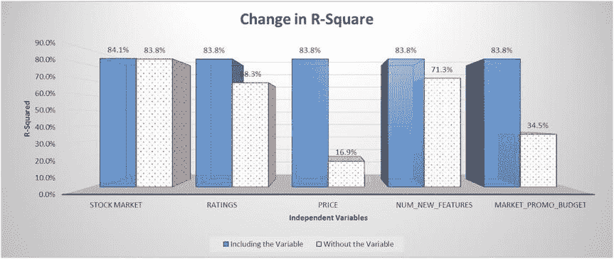

**图 10-5.** R 方值的变化

查看上述结果后，你应该毫不犹豫地相信关于自变量影响的 T 检验结果。

#### R 方与调整 R 方

在回归输出中，你可能已经观察到 R 方附近有调整 R 方值。它被称为调整 R 方。为了理解调整 R 方的重要性，我们来看一个例子。

导入样本回归数据（`sample_regression.csv`）；这是一个简单的模拟数据集，包含一些自变量和一个因变量。在此数据上构建三个模型，并记录这三个模型的 R 方和调整 R 方值。以下是构建模型的规范：

-   第一个模型的自变量：`x1`、`x2`、`x3`
-   第二个模型的自变量：`x1`、`x2`……`x6`
-   第三个模型的自变量：所有变量：`x1`、`x2`……`x8`

```
/* 导入样本回归数据集 */
PROC IMPORT OUT= WORK.sample_regression
DATAFILE= "C:\Users\VENKAT\Google Drive\Training\Books\Content\
Multiple and Logistic Regression\sample_regression.csv"
DBMS=CSV REPLACE;
GETNAMES=YES;
DATAROW=2;
RUN;
```


### 模型 1：Y 与 x[1]、x[2]、x[3] 的关系

```sas
/* 对样本回归数据集进行回归分析 */
proc reg data=sample_regression;
model y=x1 x2 x3;
run;
```

表 10-12 显示了这段代码的结果。请注意其中的 `R-squared`（R 方）和调整后的 `R-squared`（调整 R 方）值。

**表 10-12.** 对 `simple_regression` 数据集执行 `PROC REG` 的输出（模型：`y=x1 x2 x3`）

| 已读取的观测数 | 13 |
| --- | --- |
| 已使用的观测数 | 13 |

| 方差分析 |
| --- |
| 来源 | 自由度 | 平方和 | 均方 | F 值 | Pr > F |
| 模型 | 3 | 10.81884 | 3.60628 | 9.02 | 0.0045 |
| 误差 | 9 | 3.59765 | 0.39974 |   |   |
| 校正合计 | 12 | 14.41649 |   |   |   |

| 均方根误差 | 0.63225 | R 方 | 0.7504 |
| 因变量均值 | 1.90077 | 调整 R 方 | 0.6673 |
| 变异系数 | 33.26281 |   |   |

| 参数估计 |
| --- |
| 变量 | 自由度 | 参数估计值 | 标准误差 | t 值 | Pr > &#124;t&#124; |
| 截距 | 1 | -2.28399 | 0.94357 | -2.42 | 0.0386 |
| x1 | 1 | -0.20151 | 0.31685 | -0.64 | 0.5406 |
| x2 | 1 | 0.00276 | 0.00094042 | 2.93 | 0.0167 |
| x3 | 1 | 0.37819 | 0.15635 | 2.42 | 0.0387 |

### 模型 2：Y 与 x[1]、x[2]、……x[6] 的关系

```sas
proc reg data=sample_regression;
model y=x1 x2 x3 x4 x5 x6;
run;
```

表 10-13 显示了这段代码的结果。请注意其中的 `R-squared`（R 方）和调整后的 `R-squared`（调整 R 方）值。

**表 10-13.** 对 `simple_regression` 数据集执行 `PROC REG` 的输出（模型：`y=x1 x2 x3 x4 x5 x6`）

| 已读取的观测数 | 13 |
| 已使用的观测数 | 13 |

| 方差分析 |
| --- |
| 来源 | 自由度 | 平方和 | 均方 | F 值 | Pr > F |
| 模型 | 6 | 10.97854 | 1.82976 | 3.19 | 0.0917 |
| 误差 | 6 | 3.43796 | 0.57299 |   |   |
| 校正合计 | 12 | 14.41649 |   |   |   |

| 均方根误差 | 0.75696 | R 方 | 0.7615 |
| 因变量均值 | 1.90077 | 调整 R 方 | 0.5231 |
| 变异系数 | 39.82402 |   |   |

| 参数估计 |
| --- |
| 变量 | 自由度 | 参数估计值 | 标准误差 | t 值 | Pr > &#124;t&#124; |
| 截距 | 1 | -3.75324 | 3.13791 | -1.20 | 0.2768 |
| x1 | 1 | -0.25185 | 0.40396 | -0.62 | 0.5559 |
| x2 | 1 | 0.00277 | 0.00114 | 2.42 | 0.0521 |
| x3 | 1 | 0.39208 | 0.20288 | 1.93 | 0.1015 |
| x4 | 1 | 0.01814 | 0.06899 | 0.26 | 0.8013 |
| x5 | 1 | 0.03867 | 0.12932 | 0.30 | 0.7750 |
| x6 | 1 | 0.02680 | 0.07431 | 0.36 | 0.7307 |

### 模型 3：Y 与 x[1]、x[2]、……x[8] 的关系

```sas
proc reg data=sample_regression;
model y=x1 x2 x3 x4 x5 x6 x7 x8;
run;
```

表 10-14 显示了上述代码的结果。请注意其中的 `R-squared`（R 方）和调整后的 `R-squared`（调整 R 方）值。

**表 10-14.** 对 `simple_regression` 数据集执行 `PROC REG` 的输出（模型：`y=x1 x2 x3 x4 x5 x6 x7 x8`）

| 已读取的观测数 | 13 |
| 已使用的观测数 | 13 |

| 方差分析 |
| --- |
| 来源 | 自由度 | 平方和 | 均方 | F 值 | Pr > F |
| 模型 | 8 | 11.78372 | 1.47296 | 2.24 | 0.2276 |
| 误差 | 4 | 2.63278 | 0.65819 |   |   |
| 校正合计 | 12 | 14.41649 |   |   |   |

| 均方根误差 | 0.81129 | R 方 | 0.8174 |
| 因变量均值 | 1.90077 | 调整 R 方 | 0.4521 |
| 变异系数 | 42.68228 |   |   |

| 参数估计 |
| --- |
| 变量 | 自由度 | 参数估计值 | 标准误差 | t 值 | Pr > &#124;t&#124; |
| 截距 | 1 | 12.10783 | 15.28092 | 0.79 | 0.4725 |
| x1 | 1 | 0.09820 | 0.54286 | 0.18 | 0.8652 |
| x2 | 1 | 0.00138 | 0.00185 | 0.75 | 0.4975 |
| x3 | 1 | 0.39448 | 0.24749 | 1.59 | 0.1862 |
| x4 | 1 | 0.05691 | 0.09191 | 0.62 | 0.5693 |
| x5 | 1 | 0.12081 | 0.15736 | 0.77 | 0.4855 |
| x6 | 1 | -0.11731 | 0.17154 | -0.68 | 0.5316 |
| x7 | 1 | -0.06604 | 0.12435 | -0.53 | 0.6235 |
| x8 | 1 | -0.16166 | 0.17645 | -0.92 | 0.4114 |

### 三个模型的分析

图 10-6 展示了前三个模型的 `R-squared`（R 方）和调整后的 `R-squared`（调整 R 方）结果。

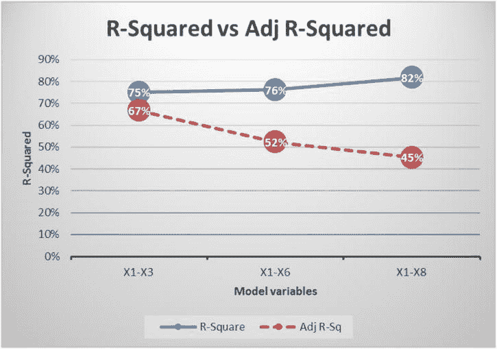

**图 10-6.** 三个模型的 `R-squared`（R 方）和调整后的 `R-squared`（调整 R 方）值

当你仅使用 `x1`、`x2` 和 `x3` 这三个变量构建模型时，`R-square`（R 方）和调整后的 `R-squared`（调整 R 方）值非常接近。当你不断添加越来越多的变量时，`R-square`（R 方）与调整后的 `R-squared`（调整 R 方）值之间的差距会逐渐增大。尽管 `R-square`（R 方）是衡量 `y` 变异性解释程度的良好指标，但其公式仍存在一个小挑战。


### R 平方的局限性

以下列出了 R 平方的局限性：

-   当向模型添加一个新的自变量时，`R-squared` 值要么增加，要么保持不变。除非你移除一个变量，否则它永远不会减少。
-   一旦 `R-square` 值随着一组变量达到最大值，那么即使再向该组添加另一个自变量，该值也绝不会下降。`R-square` 值可能会出现微小的向上增长。即使新添加的变量对模型结果没有影响，`R-squared` 值也可能会有一些微小的提升。
-   这里有一个简单的方法来理解这个特性：`R-squared` 是模型中自变量列表所解释的总变异量。如果你添加了任何新的无关自变量，即一个与因变量无关或没有影响的变量，`R-square` 值可能仍会略有增加，但绝不会减少。

当一个变量对因变量有不错或很强的影响时，`R-squared` 值增加，这对（分析师来说）是有利的。但是，如果一个无关紧要或微不足道的变量被添加到模型中，`R-squared` 值会发生什么变化呢？当你添加无关变量时，`R-squared` 值不会显示出显著的增长。但仍旧会有一个小的正增量。我们假设每添加这样一个无关变量，`R-squared` 值只增加 0.5%。如果你添加了 50 个这样的无关变量，你可能会看到 `R-square` 值惊人地增长了 25%。无论如何衡量，这都不是一个可以忽略不计的增长。当数据中的观测值（记录或行）较少时，这种情况尤其容易发生。添加一个新变量会迅速产生影响，并观察到的 `R-squared` 值会增加。

在前面的例子中，让我们分析最终模型（即表 10-15 中给出的模型 3）的输出结果。

**表 10-15. 模型 3 的输出结果**

| 读取的观测数 | 13 |
| 使用的观测数 | 13 |

**方差分析**

| 来源           | 自由度 | 平方和    | 均方      | F 值  | Pr > F |
|------------------|----|----------------|-------------|---------|--------|
| 模型            | 8  | 11.78372       | 1.47296     | 2.24    | 0.2276 |
| 误差            | 4  | 2.63278        | 0.65819     |         |        |
| 校正总和        | 12 | 14.41649       |             |         |        |

| 根均方误差      | 0.81129 | R 平方 | 0.8174 |
|---------------|---------|----------|--------|
| 因变量均值| 1.90077 | 调整后 R 平方 | 0.4521 |
| 变异系数     | 42.68228|          |        |

**参数估计值**

| 变量   | 自由度 | 参数估计值 | 标准误差 | t 值  | Pr > &#124;t&#124; |
|------------|----|-------------------|----------------|---------|--------------------|
| 截距  | 1  | 12.10783          | 15.28092       | 0.79    | 0.4725             |
| x1        | 1  | 0.09820           | 0.54286        | 0.18    | 0.8652             |
| x2        | 1  | 0.00138           | 0.00185        | 0.75    | 0.4975             |
| x3        | 1  | 0.39448           | 0.24749        | 1.59    | 0.1862             |
| x4        | 1  | 0.05691           | 0.09191        | 0.62    | 0.5693             |
| x5        | 1  | 0.12081           | 0.15736        | 0.77    | 0.4855             |
| x6        | 1  | -0.11731          | 0.17154        | -0.68   | 0.5316             |
| x7        | 1  | -0.06604          | 0.12435        | -0.53   | 0.6235             |
| x8        | 1  | -0.16166          | 0.17645        | -0.92   | 0.4114             |

从上述结果中可以得出以下几点观察：

-   数据中只有 13 条记录。这是一个小样本，因此可用于分析的观测值很少。
-   根据 T 检验，大多数变量对因变量完全没有影响。T 检验中所有变量的 P 值都大于 5%。
-   即使是 F 检验也告诉你，整体模型是不显著的，因为 F 检验的 P 值为 22.76%，大于神奇的 0.5% 阈值。
-   但 `R-square` 值仍然是 81.74%。

这就是我们想指出的关键点。`R-square` 值从模型 1 到模型 2 从 75% 跃升到 76%，然后最终模型 3 达到了 82%。如果你向模型 3 添加更多变量，`R-squared` 值还会进一步增加。因此，在根据 `R-squared` 值推断任何结论时，你需要谨慎。

在回归分析中，观测值少而自变量多是一种非常脆弱的情况。这就好比添加无关的自变量并因 `R-square` 值的增加而兴奋，是在欺骗自己。但实际上，整个模型本身可能毫无价值。

`R-squared` 的这种行为表明，我们需要一种不同的度量标准，能够为任何给定模型的预测能力提供可靠的度量。调整后的 `R-squared` 正是为此而生。

#### 调整后的 R 平方

调整后的 `R-squared` 也是从 `R-squared` 推导出来的。我们对这个新的度量标准有何期望？调整后的 `R-squared` 预期应满足以下要求：

-   一种能够反映模型中解释变异情况的度量。
-   一种能在添加无关变量时惩罚模型的度量。
-   一种能同时考虑模型中观测值数量和自变量数量的度量。
-   一种只有在添加了显著或影响大的自变量时才会增加的度量。当向模型添加任何无关紧要或微不足道的变量时，它会减少。

调整后的 `R-squared` 满足了所有这些期望。以下是调整后的 `R-squared` 的公式：

```
调整后 R² = 1 - ((1 - R²) * (n - 1) / (n - k - 1))
```

其中：

-   `R²` 是通常的 `R-squared`。
-   `n` 是记录数。
-   `k` 是自变量的数量。

调整后的 `R-squared` 为每添加一个新的无关变量向 `R-squared` 增加一个惩罚项。只有在向模型添加有意义或影响大的变量时，它才会显示出增加。

让我们重新审视一下 `R-squared` 和调整后的 `R-squared` 的对比图；参见图 10-7。

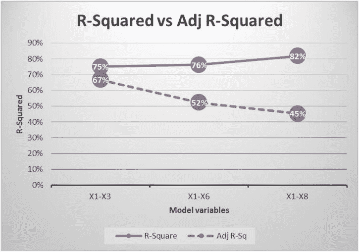

**图 10-7. 三个模型的 `R-squared` 和调整后的 `R-squared`**

观察调整后的 `R-squared` 值，你可以得出结论：模型只需三个变量（`x1` 到 `x3`）就能发挥其最大潜力。随着你继续添加新变量（`x4` 到 `x8`），调整后的 `R-squared` 显示出下降趋势。这表明从 `x4` 到 `x8` 的所有后续变量都是无关变量，它们对 `y` 没有影响。


### 调整 R 方：附加示例

对于智能手机销售示例，你将首先观察完整模型的结果；换句话说，回归模型将使用所有五个自变量。

```
/* Smartphone sales R-Squared and Adj-R Squared*/
proc reg data= mobiles;
model sales= Ratings Price Num_new_features Stock_market_ind Market_promo_budget;
run;
```

表 10-16 给出了此代码的结果。

**表 10-16.** 针对 Mobiles 数据集的 PROC REG 输出

| 读取的观测数量 | 58 |
| :--- | :--- |
| 使用的观测数量 | 58 |

| 方差分析 |
| :--- |
| 来源 | 自由度 | 平方和 | 均方 | F 值 | Pr > F |
| :--- | :--- | :--- | :--- | :--- | :--- |
| 模型 | 5 | 7.408043E14 | 1.481609E14 | 55.16 | <.0001 |
| 误差 | 52 | 1.396636E14 | 2.685839E12 |  |  |
| 校正总和 | 57 | 8.80468E14 |  |  |  |

| 均方根误差 | 1638853 | R 方 | 0.8414 |
| :--- | :--- | :--- | :--- |
| 因变量均值 | 9394688 | 调整 R 方 | 0.8261 |
| 变异系数 | 17.44446 |  |  |

| 参数估计 |
| :--- |
| 变量 | 自由度 | 参数估计 | 标准误差 | t 值 | Pr > &#124;t&#124; |
| :--- | :--- | :--- | :--- | :--- | :--- |
| 截距 | 1 | 493778 | 1520007 | 0.32 | 0.7466 |
| 评分 | 1 | 651375 | 90775 | 7.18 | <.0001 |
| 价格 | 1 | -1833.67081 | 127.24677 | -14.41 | <.0001 |
| 新功能数量 | 1 | 547167 | 85234 | 6.42 | <.0001 |
| 股市指数 | 1 | -105.38867 | 106.01603 | -0.99 | 0.3248 |
| 市场推广预算 | 1 | 100.92891 | 8.38744 | 12.03 | <.0001 |

R 方和调整 R 方的值非常接近但不相同，如下所示：

| R 方 | 0.8414 |
| :--- | :--- |
| 调整 R 方 | 0.8261 |

R 方和调整 R 方的值之间存在微小差异。这是为什么？在之前的章节中，使用 t 检验，你发现股市对智能手机的销售没有显著影响。也许正是这个变量导致了 R 方和调整 R 方值之间的微小差异。你将移除股市指标变量并重建模型。你会观察到 R 方和调整 R 方值变得更接近。

```
proc reg data= mobiles;
model sales= Ratings Price Num_new_features Market_promo_budget;
run;
```

表 10-17 显示了此代码的输出。

**表 10-17.** 针对 Mobiles 数据集的 PROC REG 输出

| 读取的观测数量 | 58 |
| :--- | :--- |
| 使用的观测数量 | 58 |

| 方差分析 |
| :--- |
| 来源 | 自由度 | 平方和 | 均方 | F 值 | Pr > F |
| :--- | :--- | :--- | :--- | :--- | :--- |
| 模型 | 4 | 7.381502E14 | 1.845375E14 | 68.72 | <.0001 |
| 误差 | 53 | 1.423178E14 | 2.685241E12 |  |  |
| 校正总和 | 57 | 8.80468E14 |  |  |  |

| 均方根误差 | 1638671 | R 方 | 0.8384 |
| :--- | :--- | :--- | :--- |
| 因变量均值 | 9394688 | 调整 R 方 | 0.8262 |
| 变异系数 | 17.44252 |  |  |

| 参数估计 |
| :--- |
| 变量 | 自由度 | 参数估计 | 标准误差 | t 值 | Pr > &#124;t&#124; |
| :--- | :--- | :--- | :--- | :--- | :--- |
| 截距 | 1 | -804177 | 778126 | -1.03 | 0.3061 |
| 评分 | 1 | 648559 | 90721 | 7.15 | <.0001 |
| 价格 | 1 | -1855.97681 | 125.23876 | -14.82 | <.0001 |
| 新功能数量 | 1 | 546713 | 85224 | 6.42 | <.0001 |
| 市场推广预算 | 1 | 103.06985 | 8.10532 | 12.72 | <.0001 |

R 方和调整 R 方变得略微接近。但在模型中没有任何不显著变量的情况下，仍然存在差异。这是因为记录数量较少。如果记录数量大且没有无关变量，R 方和调整 R 方的值可以相同。

#### 何时可以只依赖 R 方？

你可以在以下情况下使用 R 方：

*   一直考虑调整 R 方是安全的。事实上，这是推荐的做法。
*   如果样本量相对于自变量的数量足够大，并且所有自变量都具有显著影响，那么你可以考虑将 R 方值作为拟合优度度量。否则，调整 R 方才是正确的度量。

### 多元回归：附加示例

SAT 是美国大学入学考试中广泛使用的一项标准化测试。让我们构建一个回归模型，根据学生的高中成绩来预测 SAT 分数。学生可能需要在高中阶段对数学、常识（GK）、科学和一般能力等科目有较高的熟练度，才能在 SAT 中取得高分。在收集了近 100 名学生的历史数据后，假设你试图构建一个模型，根据高中考试的成绩来预测 SAT 分数。

以下是导入数据的代码：

```
/* importing SAT exam Data */
PROC IMPORT OUT= WORK.sat_score
DATAFILE= "C:\Users\VENKAT\Google Drive\Training\Books\Content\
Multiple and Logistic Regression\SAT_Exam.csv"
DBMS=CSV REPLACE;
GETNAMES=YES;
DATAROW=2;
RUN;
```

以下是打印数据文件快照的代码。数据文件包含一些关于高中考试实际成绩的历史数据。

```
proc print data= sat_score(obs=10) ;
run;
```

在表 10-18 中，你可以看到有四个自变量，分别是常识（`General_knowledge`）、能力（`Aptitude`）、数学（`Mathematics`）和科学（`Science`），以及一个因变量 `SAT`。其思想是使用这四个自变量拟合一个模型来预测 SAT 分数。

**表 10-18.** 用于预测 SAT 分数的四个自变量

| 观测 | 常识 | 能力 | 数学 | 科学 | SAT |
| :--- | :--- | :--- | :--- | :--- | :--- |
| 1 | 73 | 71 | 74 | 73 | 144 |
| 2 | 93 | 90 | 102 | 97 | 186 |
| 3 | 89 | 94 | 97 | 98 | 182 |
| 4 | 96 | 93 | 115 | 110 | 208 |
| 5 | 73 | 68 | 87 | 83 | 157 |
| 6 | 53 | 49 | 36 | 38 | 89 |
| 7 | 69 | 73 | 71 | 67 | 131 |
| 8 | 47 | 48 | 55 | 55 | 101 |
| 9 | 87 | 89 | 66 | 66 | 155 |
| 10 | 79 | 76 | 83 | 78 | 158 |

```
/* Predicting SAT score using rest of the Variables*/
proc reg data=sat_score;
model SAT=General_knowledge Aptitude Mathematics Science;
run;
```

表 10-19 是此代码的输出。

**表 10-19.** 针对 sat_score 数据集的 PROC REG 输出

| 读取的观测数量 | 96 |
| :--- | :--- |
| 使用的观测数量 | 96 |

| 方差分析 |
| :--- |
| 来源 | 自由度 | 平方和 | 均方 | F 值 | Pr > F |
| :--- | :--- | :--- | :--- | :--- | :--- |
| 模型 | 4 | 99039 | 24760 | 2621.54 | <.0001 |
| 误差 | 91 | 859.47379 | 9.44477 |  |  |
| 校正总和 | 95 | 99899 |  |  |  |

| 均方根误差 | 3.07323 | R 方 | 0.9914 |
| :--- | :--- | :--- | :--- |
| 因变量均值 | 155.96875 | 调整 R 方 | 0.9910 |
| 变异系数 | 1.97042 |  |  |

| 参数估计 |
| :--- |
| 变量 | 自由度 | 参数估计 | 标准误差 | t 值 | Pr > &#124;t&#124; |
| :--- | :--- | :--- | :--- | :--- | :--- |
| 截距 | 1 | -2.07199 | 2.13436 | -0.97 | 0.3342 |
| 常识 | 1 | 1.16697 | 0.10003 | 11.67 | <.0001 |
| 能力 | 1 | -0.13479 | 0.09683 | -1.39 | 0.1673 |
| 数学 | 1 | -0.11081 | 0.09887 | -1.12 | 0.2653 |
| 科学 | 1 | 1.09532 | 0.09689 | 11.30 | <.0001 |

以下是前一个输出的观察结果：

**表 10-20.** 来自 sat_score 数据集 PROC REG 输出的参数估计表

| 参数估计 |
| :--- |
| 变量 | 自由度 | 参数估计 | 标准误差 | t 值 | Pr > &#124;t&#124; |
| :--- | :--- | :--- | :--- | :--- | :--- |
| 截距 | 1 | -2.07199 | 2.13436 | -0.97 | 0.3342 |
| 常识 | 1 | 1.16697 | 0.10003 | 11.67 | <.0001 |
| 能力 | 1 | -0.13479 | 0.09683 | -1.39 | 0.1673 |
| 数学 | 1 | -0.11081 | 0.09887 | -1.12 | 0.2653 |
| 科学 | 1 | 1.09532 | 0.09689 | 11.30 | <.0001 |


作为一名高级文档工程师，我已按照您的格式要求对原文进行了排版。以下是处理后的内容：

分析师自然会好奇地查看`R-squared`值，以判断模型是否拟合良好。换句话说，目标变量（SAT 分数）的变异有多少被自变量（四门高中科目的成绩）所解释？然而，你首先应该查看`F-value`或`F-test`的`P-value`，它告诉我们模型是否显著。如果`P-value`大于 5%，则无需继续向下查看输出。在这种情况下，你应在`F-test`处停止，并声明模型不显著。如果`F-test`的`P-value`小于 5%，则至少有一个变量是显著的，这意味着模型可能具有一定影响。在此模型中，`F-test`的`P-value`小于 5%；事实上，从输出（方差分析表）可以看出，它小于`0.0001`。该模型看起来是显著的，你可以进一步查看其他指标，如`R-squared`和`T-test`。

`R-squared`和调整后的`R-squared`值几乎相同，约为 99%，这是一个非常好的迹象。因此，整体模型解释了大`约 99%`的`Y`变异。换句话说，如果你知道一名学生在能力、常识、科学和数学方面的成绩，你就可以精确预测她的 SAT 分数。

现在，让我们看看每个变量的影响（表 10-20）。

从参数估计表（表 10-20）中，你可以观察到数学和能力对因变量（SAT 分数）没有显著影响。你将移除这两个变量，并仅用两个变量（科学和常识（`GK`））重建模型。

```
/* 仅使用两个变量预测 SAT 分数 */
proc reg data=sat_score;
model SAT=General_knowledge Science ;
run;
```

表 10-21 显示了此代码的输出。

**表 10-21. 对 `sat_score` 数据集执行 `PROC REG` 的输出**

| 读取的观测数 | 96 |
| --- | --- |
| 使用的观测数 | 96 |

| 方差分析 |
| --- |
| 来源 | 自由度 | 平方和 | 均方 | F 值 | Pr > F |
| 模型 | 2 | 99012 | 49506 | 5190.20 | <.0001 |
| 误差 | 93 | 887.06581 | 9.53834 |   |   |
| 校正总和 | 95 | 99899 |   |   |   |

| 均方根误差 | 3.08842 | R 方 | 0.9911 |
| 因变量均值 | 155.96875 | 调整 R 方 | 0.9909 |
| 变异系数 | 1.98015 |   |   |

| 参数估计 |
| --- |
| 变量 | 自由度 | 参数估计值 | 标准误差 | t 值 | Pr > &#124;t&#124; |
| 截距 | 1 | -2.58369 | 2.12087 | -1.22 | 0.2262 |
| 常识 | 1 | 1.03366 | 0.03375 | 30.63 | <.0001 |
| 科学 | 1 | 0.98970 | 0.01800 | 54.97 | <.0001 |

从之前的输出中，你可以观察到以下几点：

- `F-test`的`p-value`小于`0.0001`，远低于所需的 5%的显著性水平，因此模型是显著的。
- `R-squared`和调整后的`R-squared`值接近 100%。
- `T-tests`的`P-values`表明所有变量对`y`都有显著影响。对于常识和科学，`P-values`均小于`0.0001`，这再次远优于`P-value`小于 5%的必要条件。
- 你可以继续使用该模型进行预测。

###### 前一模型的一些令人惊讶的结果

在同一个 SAT 分数示例中，当你咨询领域专家时，你会得知数学和能力是通过 SAT 考试取得好成绩所需的两项重要“必备”技能。领域专家根据她的经验告诉你，学生的 SAT 分数取决于他们在高中阶段的数学和能力成绩。但模型却讲述了相反的故事。

让我们仅用数学和能力成绩建立一个模型。如果它们确实不影响 SAT 分数，那么你应该会在`F-test`、`R-squared`值和`T-test`中看到所有负面的结果。

```
proc reg data=sat_score;
model SAT=Mathematics Aptitude ;
run;
```

表 10-22 显示了此代码的输出。

**表 10-22. 对 `sat_score` 数据集执行 `PROC REG` 的输出**

| 读取的观测数 | 96 |
| --- | --- |
| 使用的观测数 | 96 |

| 方差分析 |
| --- |
| 来源 | 自由度 | 平方和 | 均方 | F 值 | Pr > F |
| 模型 | 2 | 96693 | 48347 | 1402.62 | <.0001 |
| 误差 | 93 | 3205.59628 | 34.46878 |   |   |
| 校正总和 | 95 | 99899 |   |   |   |

| 均方根误差 | 5.87101 | R 方 | 0.9679 |
| 因变量均值 | 155.96875 | 调整 R 方 | 0.9672 |
| 变异系数 | 3.76422 |   |   |

| 参数估计 |
| --- |
| 变量 | 自由度 | 参数估计值 | 标准误差 | t 值 | Pr > &#124;t&#124; |
| 截距 | 1 | -0.45932 | 4.01646 | -0.11 | 0.9092 |
| 数学 | 1 | 1.04297 | 0.03360 | 31.04 | <.0001 |
| 能力 | 1 | 0.95657 | 0.06204 | 15.42 | <.0001 |

以下是来自前一个输出的一些观察结果：

- `F-test`：`P-values`小于 5%，因此模型是显著的。这奇怪且令人惊讶。
- `R-squared`和调整后的`R-squared`：这是 96%，完全出乎意料且与预期相反。
- `T-tests`：两个变量的`P-values`都小于 5%；这又是一个令人震惊的结果。
- 之前的数学和能力有负的系数；现在它们对相同的历史数据文件有正的系数。这次的结果与领域专家的建议非常一致。

一个基于所有四个科目（`xi`）的相同历史数据的模型显示，数学和能力成绩根本没有影响。另一个基于相同数据但只有两个科目的模型却显示了完全相反的结果。为什么数学和能力在科学和常识存在的情况下变得不显著了？

- 为什么从模型中移除科学和常识会影响数学和能力的影响？用更通用的术语来说，为什么移除某些变量会影响其他变量的影响，而不影响整体模型的预测能力？
- 这些自变量之间是否存在某种关系？这些自变量之间是否存在某种相互关联，从而导致了`T-test`结果的这些变化？

让我们暂时忘记因变量，观察自变量之间的相互关联。代码如下：

```
proc corr data=sat_score;
var General_knowledge Aptitude Mathematics Science ;
run;
```

表 10-23 显示了此代码的输出。

**表 10-23. 对 `sat_score` 数据集执行 `PROC REG` 的输出**

| 变量： | 常识 能力 数学 科学 |

| 简单统计 |
| --- |
| 变量 | N | 均值 | 标准差 | 总和 | 最小值 | 最大值 |
| 常识 | 96 | 79.85417 | 12.23023 | 7666 | 46.00000 | 97.00000 |
| 能力 | 96 | 79.91667 | 12.18944 | 7672 | 46.00000 | 101.00000 |
| 数学 | 96 | 76.68750 | 22.50488 | 7362 | 6.00000 | 125.00000 |
| 科学 | 96 | 76.80208 | 22.92579 | 7373 | 3.00000 | 124.00000 |


| 皮尔逊相关系数，N = 96 原假设 H0: Rho = 0 下 Prob > |r| |
| --- | --- | --- | --- | --- |
|  | 常识 | 能力倾向 | 数学 | 科学 |
| 常识 | 1.00000 | 0.96323 | 0.64142 | 0.64078 |
|  | <.0001 | <.0001 | <.0001 |
| 能力倾向 | 0.96323 | 1.00000 | 0.60461 | 0.60748 |
| <.0001 |  | <.0001 | <.0001 |
| 数学 | 0.64142 | 0.60461 | 1.00000 | 0.98977 |
| <.0001 | <.0001 |  | <.0001 |
| 科学 | 0.64078 | 0.60748 | 0.98977 | 1.00000 |
| <.0001 | <.0001 | <.0001 |  |

为了提升可读性，我们将相同的相关系数表进行了格式化（表 10-24）。

**表 10-24.** SAT 分数示例的相关系数表

| 皮尔逊相关系数，N = 96 |
| --- |
| 原假设 H0: Rho = 0 下 Prob > |r| |
|  | 常识 | 能力倾向 | 数学 | 科学 |
| 常识 |  | 96% | 64% | 64% |
| 能力倾向 |  |  | 60% | 61% |
| 数学 |  |  |  | 99% |
| 科学 |  |  |  |  |

常识与能力倾向之间的相关系数为 96%；数学与科学之间的相关系数为 99%。这应该是当科学和常识变量存在时，数学和能力倾向变量变得不显著，而移除它们后却影响显著的原因。这种相互依赖的现象称为多重共线性。它不仅仅指两个变量之间的成对相关，更可能是一个自变量依赖于任意数量的其他自变量。这种多重共线性可能导致许多错误的推论和荒谬的结果。分析人员需要严肃对待多重共线性这一挑战。

### 多重共线性定义

多重共线性是指自变量之间存在高度相互依赖关系的一种现象。当我们谈论多重共线性时，我们只针对自变量（`xi`）进行讨论。因变量 `y` 完全不在考虑范畴内。多重共线性不仅仅指一对变量与给定的自变量集合之间的关系。有时多个自变量组合起来可能与另一个自变量相关。因此，自变量集合中的任何显著关系或关联都被视为多重共线性（图 10-8）。

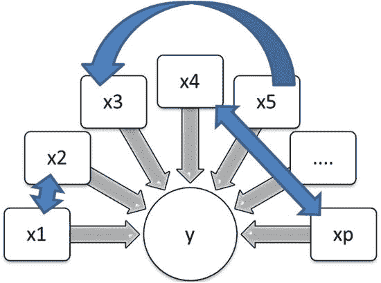

**图 10-8.** 多重共线性

#### 为什么多重共线性是个问题？多重共线性的影响

在前面讨论的 SAT 分数示例中，你已经看到了多重共线性可能导致的一些迹象。以下是多重共线性可能带来的一系列挑战：

-   我们来讨论一下 beta 系数的显著性。在一个像 `y = 3X1 + 6.5X2 - 0.3X3` 这样的模型中，每个系数代表什么？beta 系数就是在保持所有其他自变量不变的情况下，自变量每变化一个单位时因变量（`y`）的增量。在这个回归线中，`x1` 的系数是 3；它表示在保持 `x2` 和 `x3` 不变的情况下，`x1` 每变化一个单位，`y` 增加 3 个单位。但如果存在多重共线性呢？如果 `x2` 依赖于 `x1` 呢？在这种情况下，回归系数就失去了意义。在保持 `x2` 和 `x3` 不变的情况下，`x1` 每变化一个单位，`y` 增加 3。但如果 `x2` 依赖于 `x1`，那么保持 `x2` 和 `x3` 不变这个条件就无法成立。换句话说，`x2` 也会因为 `x1` 的变化而变化。这就是多重共线性的影响。
-   在存在多重共线性的情况下，回归模型得出的系数是不稳定的。有时系数，甚至它们的符号都可能具有误导性。在多重共线性情况下，回归系数会有很高的标准差，这意味着即使数据（观测值）发生微小变化，回归系数的变化也可能异常巨大。有时随着数据的微小变化，系数的符号可能会改变。换句话说，如果一个变量对一组数据显示出正向影响，那么随着数据的微小变化，它可能会显示出负向影响。
-   当存在多重共线性时，T 检验的结果是不可信的。你不能仅仅依据 T 检验的 P 值就决定某个自变量的影响力。

让我们再次审视一下 SAT 考试的回归模型。

```
/* 使用其余四个变量预测 SAT 分数：常识、能力倾向、数学和科学 */
proc reg data=sat_score;
model SAT=General_knowledge Aptitude Mathematics Science;
run;
```

表 10-25 显示了这段代码的输出。

**表 10-25.** 对 sat_score 数据集执行 PROC REG 的输出

| 读取的观测数 | 96 |
| --- | --- |
| 使用的观测数 | 96 |

| 方差分析 |
| 来源 | 自由度 | 平方和 | 均方 | F 值 | Pr > F |
| --- | --- | --- | --- | --- | --- |
| 模型 | 4 | 99039 | 24760 | 2621.54 | <.0001 |
| 误差 | 91 | 859.47379 | 9.44477 |  |  |
| 校正总计 | 95 | 99899 |  |  |  |

| 根均方误差 | 3.07323 | R 方 | 0.9914 |
| --- | --- | --- | --- |
| 因变量均值 | 155.96875 | 调整后 R 方 | 0.9910 |
| 变异系数 | 1.97042 |  |  |

| 参数估计 |
| 变量 | 自由度 | 参数估计 | 标准误差 | t 值 | Pr > |t| |
| --- | --- | --- | --- | --- | --- |
| 截距 | 1 | -2.07199 | 2.13436 | -0.97 | 0.3342 |
| 常识 | 1 | 1.16697 | 0.10003 | 11.67 | <.0001 |
| 能力倾向 | 1 | -0.13479 | 0.09683 | -1.39 | 0.1673 |
| 数学 | 1 | -0.11081 | 0.09887 | -1.12 | 0.2653 |
| 科学 | 1 | 1.09532 | 0.09689 | 11.30 | <.0001 |

在这个例子中，由于多重共线性导致了以下错误推断：

-   可以看到数学和能力倾向对 SAT 分数有负向影响。换句话说，如果数学分数增加，SAT 分数会降低；如果能力倾向分数增加，SAT 分数也会降低。
-   数学和能力倾向对 SAT 分数没有影响。
-   常识的影响大于能力倾向和数学。

让我们对数据文件做一个小的改动，并观察 beta 系数相应的变化。理想情况下，如果模型稳定，所有系数估计值的变化应该极小。如表 10-26 所示，我们将第二行的数学分数从 102 改为 60。

**表 10-26.**


### 凸显 `sat_score` 数据集中数学成绩的变化

| 变量 | 常识 | 能力倾向 | 数学 | 科学 | SAT |
| --- | --- | --- | --- | --- | --- |
| 旧数据记录 | 93 | 90 | 102 | 97 | 186 |
| 更新后记录 | 93 | 90 | 60 | 97 | 186 |

表 10-27 显示了根据数据文件中的此更新所构建新模型的结果。

**表 10-27.** 数学成绩更改后 `sat_score` 数据集的 `PROC REG` 输出

| 读取的观测数 | 96 |
| --- | --- |
| 使用的观测数 | 96 |

| 方差分析 |
| 来源 | 自由度 | 平方和 | 均方 | F 值 | Pr > F |
| 模型 | 4 | 99029 | 24757 | 2589.59 | <.0001 |
| 误差 | 91 | 869.98577 | 9.56028 | | |
| 校正合计 | 95 | 99899 | | | |

| 均方根误差 | 3.09197 | R 方 | 0.9913 |
| 因变量均值 | 155.96875 | 调整 R 方 | 0.9909 |
| 变异系数 | 1.98243 | | |

| 参数估计 |
| 变量 | 自由度 | 参数估计 | 标准误差 | t 值 | Pr > &#124;t&#124; |
| 截距 | 1 | -2.28287 | 2.15568 | -1.06 | 0.2924 |
| 常识 | 1 | 1.15481 | 0.10001 | 11.55 | <.0001 |
| 能力倾向 | 1 | -0.12461 | 0.09698 | -1.28 | 0.2021 |
| 数学 | 1 | 0.02462 | 0.06545 | 0.38 | 0.7077 |
| 科学 | 1 | 0.96503 | 0.06522 | 14.80 | <.0001 |

输出现在出现了一个重要且巨大的变化。数学的贝塔系数如今为正。仅仅将一个数值从 102 改为 60，数学系数就完全颠倒了过来。这正是我们试图强调的多重共线性所带来的不利影响。

以下是在存在多重共线性的情况下，观察高标准差或系数变化的另一种方式：

- 我们来构建一个新模型：`Y` 对 `X1`、`X2` 和 `X3`。这里 `X2` 和 `X3` 之间存在显著的多重共线性关系。
- 假设 `X3` 与 `X2` 几乎呈线性关系。且 `X3` 约等于两倍的 `X2`，可表示为 `X3 ∼ 2X2`。
- 假设最终模型方程为 `Y = X1 + 20X2 - 2X2`。请注意，`X2` 的系数为负（-2）。

现在你将尝试证明，在存在多重共线性的情况下，系数极其不稳定，以至于它们甚至可能改变符号，而不会影响整个模型的预测能力（整体 R 方保持不变）。

模型 `Y = X1 + 20X2 - 2X3`

多重共线性 `X3 ∼ 2X2`

重写模型 `Y = X1 + 14X2 + 6X2 - 2X3`

重写模型 `Y ∼ X1 + 14X2 + 3X3 - 2X3` （代入 `X2 = X3/2`）

重写模型 `Y ∼ X1 + 14X2 + X3`

因此，由于多重共线性，原始模型 `Y = X1 + 20X2 - 2X3` 最终变成了 `Y ∼ X1 + 14X2 + X3`。`X3` 的系数从负变为正。类似地，你可以在这个模型上做文章，使系数几乎变为任何值。这正是我们讨论的问题——回归系数的不稳定性以及贝塔系数估计值的高标准差。

简而言之，如果模型中存在多重共线性，则回归系数不可用于任何有意义的分析。

多重共线性的挑战引出了三个问题：

- 多重共线性的成因是什么？
- 如何在模型中识别多重共线性的存在？
- 一旦识别出多重共线性，解决之道是什么？如何将其影响降至最低？

### 多重共线性的成因是什么？

多重共线性本身并非分析中的任何错误所致。如果自变量之间存在一些相互依赖关系，分析方并无过错。分析者需要意识到这一点，并在构建精确回归模型时加以处理。以下是多重共线性的一些成因：

- 数据的收集方式可能导致多重共线性。收集数据时，你是否选择了所有独立且不相关的变量？
- 解释同一信息的变量过多，可能是多重共线性的成因之一。例如，年均收入、平均纳税额和年净储蓄等变量在大多数情况下可能彼此相关。所有这些变量都在解释一个人的财务状况。
- 模型变量指定不准确可能是另一个原因。例如，变量 `X` 及其倍数同时出现在模型中。另一个例子是 `X` 和与 `X` 相关的多项式项同时出现在模型中。
- 拥有过多的自变量也可能导致多重共线性。在回归建模中，拥有过多自变量而记录过少从来都不是一个好主意。有时别无选择，只能继续。在这种情况下，分析者需要应对多重共线性的挑战。


### 多重共线性的识别

正如你所见，多重共线性对分析人员来说是一个严峻的挑战。它由一些已知或未知的原因（有时是变量间未知的关系）引起。现在，你每时每刻都需要能够解释为什么两个变量是相关的。分析人员需要在模型构建阶段保持警惕并识别出多重共线性；否则，可能会导致不合理的推断。

多重共线性可以通过相关分析技术来识别。通过寻找相关性，你可以看到两个变量之间关联的强度。如果存在高度相关性，则表明模型存在多重共线性。存在相关性就足以说明存在多重共线性。但是，即使模型存在多重共线性，相关性也不一定总是很高。简单的相关性不足以识别所有类型的多重共线性。相关性仅仅是一种成对的关联度量，因此，如果一个自变量与两个或更多自变量关联较弱，你将无法量化这种关联。（如果成对关联很弱，多重共线性在相关性中就不会显现，你需要采用不同的度量标准。）所有这些关联的变量共同作用，可以有力地解释那个特定自变量中的变异。让我们举一个例子，其中`x2`、`x3`和`x5`与`x4`相关（图 10-9）。

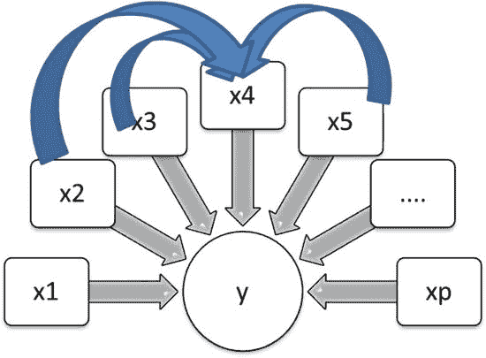

**图 10-9.** 多重共线性：`x2`、`x3` 和 `x5` 与 `x4` 相关

暂时忘记`Y`，看看这三个变量`x2`、`x3`和`x5`是否真的影响了`x4`的变化。你需要一个能够量化多个变量之间关系的度量标准。如何了解多个自变量对一个因变量的综合影响呢？在此上下文中，`x2`、`X3`、`X5`是自变量，而`x4`是因变量。请参考图 10-10。

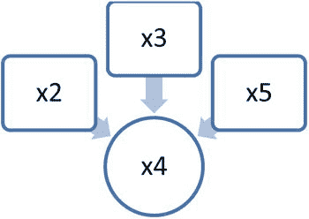

**图 10-10.** `X4` 被视为因变量，而 `x2`、`x3` 和 `x5` 与 `x4` 相关

我们使用这些自变量构建一个回归模型，并观察其`R 平方`的值。如果对于模型`x4`与`x2`、`x3`和`x5`的`R 平方`值很高，那么变量`x4`就可以被其他三个变量所解释。这将表明存在相互依赖性或多重共线性。

为了检测一组自变量内部的多重共线性，你首先需要选择该组中的不同子集。为这些子集构建回归线，并检查每条回归线的`R 平方`值。

以下是整体模型：

`y vs. y1, y2, y3………….yp`

以下是用于检测多重共线性的模型：

`x1 vs. x2, x3…….xp` → R 平方值 (`R²1`)

`x2 vs. x1, x3…….xp` → R 平方值 (`R²2`)

…

`xp vs. x1, x2, x3…….xp-1` → R 平方值 (`R²p`)

最后，记录`R²1`、`R²2` …………`R²p`的值来检测多重共线性。

如果`R 平方`值很高，则是多重共线性的一个迹象。`R 平方`值超过 80% 通常被视为存在多重共线性的良好指标。

### 方差膨胀因子 (VIF)

`VIF` 是专门定义用来衡量多重共线性的指标。

因此，`R 平方`值越高，`VIF`值就越高。实际上，`VIF`会放大`R 平方`值。如果`R 平方`值为 80%，那么`VIF`值将为 5。请参考表 10-28。

**表 10-28.** R 平方和 VIF 值

| R 平方 | 40% | 50% | 60% | 70% | 80% | 90% | 95% | 98% | 99% |
| --- | --- | --- | --- | --- | --- | --- | --- | --- | --- |
| VIF | 1.7 | 2.0 | 2.5 | 3.3 | 5.0 | 10.0 | 20.0 | 50.0 | 100.0 |

**注意：** 不要将此处的`R 平方`与整体模型的`R 平方`值混淆。这个`R 平方`是通过在自变量之间构建模型计算得出的。

如果某个变量的`VIF`值大于 5，则表明存在强多重共线性，并且该变量可被视为冗余。这是因为该变量 80% 或更多的变异可以由其余的自变量解释。因此，在构建多元回归线时，查看`VIF`值是强制性的。

我们再以 SAT 分数为例，计算`VIF`值以检查是否存在任何多重共线性。在这个模型中，你已经了解了一些情况，但我们将使用`VIF`值来确认这一点。SAS 中的`PROC REG`有一个`VIF`选项，它可以计算每个变量的`VIF`值。你无需担心为自变量的不同组合分别计算每个`VIF`值。

以下是在输出中显示`VIF`值的代码；你需要在模型语句中添加关键字`VIF`：

```
proc reg data=sat_score;
model SAT=General_knowledge Aptitude Mathematics Science/VIF;
run;
```

表 10-29 显示了此代码的输出结果。

**表 10-29.** `PROC REG` 在 `sat_score` 上的输出

| 读取的观测数 | 96 |
| --- | --- |
| 使用的观测数 | 96 |

| 方差分析 |
| 来源 | 自由度 | 平方和 | 均方 | F 值 | Pr > F |
| 模型 | 4 | 99039 | 24760 | 2621.54 | <.0001 |
| 误差 | 91 | 859.47379 | 9.44477 |   |   |
| 校正总和 | 95 | 99899 |   |   |   |

| 均方根误差 | 3.07323 | R-Square | 0.9914 |
| 因变量均值 | 155.96875 | 调整后 R-Sq | 0.9910 |
| 变异系数 | 1.97042 |   |   |

| 参数估计 |
| 变量 | 自由度 | 参数估计值 | 标准误差 | t 值 | Pr > &#124;t&#124; | 方差膨胀 |
| 截距 | 1 | -2.07199 | 2.13436 | -0.97 | 0.3342 | 0 |
| General_knowledge | 1 | 1.16697 | 0.10003 | 11.67 | <.0001 | 15.05316 |
| Aptitude | 1 | -0.13479 | 0.09683 | -1.39 | 0.1673 | 14.01316 |
| Mathematics | 1 | -0.11081 | 0.09887 | -1.12 | 0.2653 | 49.79461 |
| Science | 1 | 1.09532 | 0.09689 | 11.30 | <.0001 | 49.63107 |

虽然输出结果看起来与其他任何多元回归输出相同，但在`参数估计`表中增加了一个新列：`方差膨胀`。这正是`VIF`值。所以，你查看该列并检查是否有任何变量的`VIF`值超过 5。

在此输出中，所有变量的`VIF`值都大于 5，但这并不意味着所有四个变量都相互关联。通常，`VIF`值是成对出现的。如果你从一对中移除一个变量，另一个变量会自动得到修正。例如，让我们从模型中移除`Science`，再次检查多重共线性。

```
proc reg data=sat_score;
model SAT=General_knowledge Aptitude Mathematics /VIF ;
run;
```

请参考表 10-30 的输出结果。

**表 10-30.** `PROC REG` 在 `sat_score` 上的输出

| 读取的观测数 | 96 |
| --- | --- |
| 使用的观测数 | 96 |

| 方差分析 |
| 来源 | 自由度 | 平方和 | 均方 | F 值 | Pr > F |
| 模型 | 3 | 97832 | 32611 | 1451.85 | <.0001 |
| 误差 | 92 | 2066.46278 | 22.46155 |   |   |
| 校正总和 | 95 | 99899 |   |   |   |


好的，作为一名高级文档工程师和翻译员，我将严格按照您提供的注意事项和示例，将给定的英文文本翻译成中文。


| 均方根误差 | 4.73936 | R 方 | 0.9793 |
| 因变量均值 | 155.96875 | 调整 R 方 | 0.9786 |
| 变异系数 | 3.03866 | | |

| 参数估计 |
| 变量 | 自由度 | 参数估计 | 标准误差 | t 值 | Pr > \|t\| | 方差膨胀因子 |
| 截距 | 1 | -4.02414 | 3.28069 | -1.23 | 0.2231 | 0 |
| 常识 | 1 | 1.09637 | 0.15395 | 7.12 | <.0001 | 14.99448 |
| 能力倾向 | 1 | -0.04114 | 0.14878 | -0.28 | 0.7828 | 13.91059 |
| 数学 | 1 | 0.98752 | 0.02822 | 34.99 | <.0001 | 1.70601 |

你可以看到，`mathematics` 的 `VIF` 值发生了巨大变化。同样地，如果你移除 `mathematics`，你会看到 `science` 变量的 `VIF` 变为 1.7。

在面对多重共线性时，以下几点值得注意：

-   `VIF` 是一种有助于检测多重共线性的度量。相关矩阵有时也会有所帮助，但 `VIF` 能处理所有变量的情况。
-   F 检验和 T 检验的表现相悖也是多重共线性的一个迹象。高 F 统计量和 R 方值会让你相信整个模型拟合得很好。而另一方面，T 检验可能表明大多数变量对 `y` 没有显著影响。这种情况是由多重共线性引起的。
-   系数的符号错误或已知变量的反直觉估计是多重共线性的另一个迹象。
-   你可以对样本或输入数据进行微小更改，并观察回归系数的变化。如果这些变化异常大，那么这就是多重共线性的一个迹象。
-   条件数是识别 beta 系数中高标准差的另一种方法。条件数不直接寻找自变量之间的关联，而是关注 beta 系数的预期方差。如果条件数很大，则表明存在多重共线性。根据经验，如果条件数大于 30，就是多重共线性的一个信号。对这个话题更详细的讨论超出了本书的范围。
-   容忍度是另一种用作多重共线性指标的度量。容忍度本质上就是 `VIF` 的倒数。因此，它并没有什么新意。

到目前为止，我们已经讨论了由多重共线性引起的挑战，也讨论了检测它的方法。在接下来的部分中，我们将讨论在构建回归模型时如何处理多重共线性。

### 多重共线性的补救（处理多重共线性）

多重共线性在大多数情况下被视为一种冗余现象。这意味着模型中不需要所有涉及多重共线性的变量。模型中其他真正独立的变量足以解释最终因变量的变化。考虑使用 `X1`、`X2`、`X3`、`X4` 和 `X5` 为 `Y` 构建一个模型。如果 `X2`、`X3` 和 `X5` 解释了 `X4` 中超过 80% 的变化，那么就没有必要在模型中保留 `X4`。你可以很顺利地从模型设定中删除 `X4`，然后仅使用 `X1`、`X2`、`X3` 和 `X5` 为 `Y` 重新构建一个足够精确的模型。

#### 剔除问题变量

在大多数情况下，你会继续从自变量列表中剔除有问题的变量。但你需要小心。你不能简单地删除所有 `VIF` 值大于 5 的变量。如前所述，`VIF` 值是成对出现的。如果你删除一个变量，另一个变量会自动调整。

让我们来看一下 SAT 考试数据的 `VIF` 值（表 [10-31]）。

表 10-31.
SAT 考试数据的 VIF 值

| 参数估计 |
| --- |
| 变量 | 自由度 | 参数估计 | 标准误差 | t 值 | Pr > \|t\| | 方差膨胀因子 |
| 截距 | 1 | -2.07199 | 2.13436 | -0.97 | 0.3342 | 0 |
| 常识 | 1 | 1.16697 | 0.10003 | 11.67 | <.0001 | 15.05316 |
| 能力倾向 | 1 | -0.13479 | 0.09683 | -1.39 | 0.1673 | 14.01316 |
| 数学 | 1 | -0.11081 | 0.09887 | -1.12 | 0.2653 | 49.79461 |
| 科学 | 1 | 1.09532 | 0.09689 | 11.30 | <.0001 | 49.63107 |

所有变量的 `VIF` 值都大于 5。但正如所料，它们都是成对出现的（两个值彼此接近）。你取最高的一对，并从那里删除一个变量。在这里，`mathematics` 的 `VIF` 略高，你可以删除它。这里 `math` 和 `science` 的 `VIF` 值几乎相同，所以你保留最重要的变量（在业务问题的背景下）。否则，你可以继续删除 `VIF` 最高的变量。

以下是剔除 `mathematics` 后的模型构建代码：

```
proc reg data=sat_score;
model SAT=General_knowledge Aptitude Science/VIF;
run;
```

输出结果请参考表 [10-32]。

表 10-32.
剔除数学后 SAT 考试数据的 VIF 值

| 参数估计 |
| --- |
| 变量 | 自由度 | 参数估计 | 标准误差 | t 值 | Pr > \|t\| | 方差膨胀因子 |
| 截距 | 1 | -2.19969 | 2.13428 | -1.03 | 0.3054 | 0 |
| 常识 | 1 | 1.15437 | 0.09953 | 11.60 | <.0001 | 14.86326 |
| 能力倾向 | 1 | -0.12438 | 0.09652 | -1.29 | 0.2008 | 13.88427 |
| 科学 | 1 | 0.98860 | 0.01796 | 55.05 | <.0001 | 1.70041 |

变量 `science` 现在看起来没问题了。`GK` 和 `aptitude` 的 `VIF` 仍然很高。让我们删除 `GK` 并重建模型。代码如下：

```
proc reg data=sat_score;
model SAT= Aptitude Science/VIF;
run;
```

输出结果请参考表 [10-33]。

表 10-33.
仅包含能力倾向和科学的 `sat_score` 的 `PROC REG` 输出

| 读取的观测数 | 96 |
| --- | --- |
| 使用的观测数 | 96 |

| 方差分析 |
| 来源 | 自由度 | 平方和 | 均方 | F 值 | Pr > F |
| 模型 | 2 | 97754 | 48877 | 2118.79 | <.0001 |
| 误差 | 93 | 2145.34522 | 23.06823 | | |
| 校正合计 | 95 | 99899 | | | |

| 均方根误差 | 4.80294 | R 方 | 0.9785 |
| 因变量均值 | 155.96875 | 调整 R 方 | 0.9781 |
| 变异系数 | 3.07942 | | |

| 参数估计 |
| 变量 | 自由度 | 参数估计 | 标准误差 | t 值 | Pr > \|t\| | 方差膨胀因子 |
| 截距 | 1 | 1.61044 | 3.29119 | 0.49 | 0.6258 | 0 |
| 能力倾向 | 1 | 0.92924 | 0.05089 | 18.26 | <.0001 | 1.58487 |
| 科学 | 1 | 1.04290 | 0.02706 | 38.54 | <.0001 | 1.58487 |

这个模型看起来一切都很完美。没有多重共线性，因此你可以相信这些系数。两个变量的系数符号也直观上是正确的（从业务知识的角度来看）。


##### 处理多重共线性的其他方法

尽管剔除问题变量是最常用的方法，但还有一些其他方式可以处理多重共线性。

- 你可以使用主成分代替变量。主成分是变量的线性组合，能够解释数据中的最大方差。如果某些变量存在相互关联，你可以使用不相关的变量线性组合，而不是直接使用这些变量。
- 在充分理解多重共线性成因的基础上，分析师可以通过收集更多数据和更优的无偏样本来减少共线性。
- 如果预测是唯一目标，且不关心`Y`与`xi`之间的关系，那么可以使用带有相互依赖自变量的同一模型。如果包含相关`Xi`的模型仍然具有较高的`R-squared`值，那么该模型可能足以满足预测需求。只有当需要分析自变量与因变量之间的一对一关系时，挑战才会出现。
- `岭回归`是另一种处理多重共线性的方法。`岭回归`背后的主要理念是：与其获得高标准差的无偏`beta`估计，不如获得标准差较小的有偏`beta`估计。因此，`岭回归`在寻找回归系数的最小二乘估计时，会对优化矩阵进行一些调整。具体细节超出了本书的讨论范围。
- 数据转换有时也能产生良好的结果。

### 如何分析输出结果：线性回归最终检查清单

在本章中，你学习了若干需要谨慎处理的评估指标和挑战。以下检查清单能为你提供帮助；你可以用缩写`FRAVT`来记住它，它代表`F 检验`、`R 平方`、`调整后的 R 平方`、`VIF`和`T 检验`。

#### 双重检查线性回归的假设

在尝试构建模型之前，你必须确保数据（观测值）严格遵循所有回归假设。通常，这一过程会花费大量时间。许多分析师倾向于忽略这一步，想当然地认为所有回归假设都已满足。通常，会绘制`Xi`与`Y`变量之间的散点图来验证线性假设。通过这一步，你几乎能掌握 90%关于异常值、非线性、异方差性等问题的信息。只有当所有回归假设都得到满足时，你才能进入下一个检查点——`F 检验`。大多数情况下，分析师是在分析进行到中途、出现问题时，才意识到可能存在假设违背的情况。

#### F 检验

在此顺序中，首先需要关注的指标是`F 检验`。它能让你了解模型的整体显著性。如果`F 检验`显示模型不显著，则无需继续进行模型构建过程。你可以直接停止模型构建，并寻找其他影响变量来预测`y`。你可以搜索更多数据或进行更多研究，以检查整个模型构建过程中任何阶段是否存在重大错误。如果`F 检验`通过，换句话说，模型被确定为显著，那么你可以进入下一个检查点——`R 平方`值。

#### R 平方

在确认模型显著之后，接下来看`R 平方`值。`R 平方`会告诉你模型显著的程度。较高的`R 平方`值（大于 80%）表明模型解释了因变量中的最大变异。

#### 调整后的 R 平方

由于在使用多元回归方法时`R 平方`存在一些缺点，你还必须查看`调整后的 R 平方`值，并确保没有冗余变量，或者模型没有因自变量过多而被过度设定。

#### VIF

下一步是确保自变量之间不存在多重共线性。你可以通过每个变量的`VIF`值来检查。如果检测到多重共线性，则需要对自变量进行适当处理，以准备一组独立的预测变量。

#### 每个变量的 T 检验

清单中的最后一项是`T 检验`。`T 检验`的结果告诉你哪些变量影响最大。你可以安全地剔除所有不重要的变量，只保留影响最大的那些。有时，需要多次迭代模型才能识别并保留少数几个影响最大的变量。这可能需要在`R 平方`值上做出一点妥协，以减少变量数量。


#### 分析回归输出：最终检查表示例

让我们再次观察智能手机销售数据的输出。假设分析师已经根据线性回归的所有假设对数据进行了验证。以下是代码、SAS 输出（表 10-34）以及最终检查表步骤：

```
proc reg data= mobiles;
model sales= Ratings Price Num_new_features Stock_market_ind Market_promo_budget/vif;
run;
```

请参考表 10-34 查看输出结果。

表 10-34. `PROC REG` 在手机数据集上的输出

| 读取的观测数 | 58 |
| --- | --- |
| 使用的观测数 | 58 |

| 方差分析 |  |  |  |  |  |
| --- | --- | --- | --- | --- | --- |
| 来源 | 自由度 | 平方和 | 均方 | F 值 | Pr > F |
| 模型 | 5 | 7.408043E14 | 1.481609E14 | 55.16 | <.0001 |
| 误差 | 52 | 1.396636E14 | 2.685839E12 |  |  |
| 校正总计 | 57 | 8.80468E14 |  |  |  |

| 根均方误差 | 1638853 | R 方 | 0.8414 |
| 因变量均值 | 9394688 | 调整 R 方 | 0.8261 |
| 变异系数 | 17.44446 |  |  |

| 参数估计 |  |  |  |  |  |
| --- | --- | --- | --- | --- | --- |
| 变量 | 自由度 | 参数估计 | 标准误差 | t 值 | Pr > &#124;t&#124; | 方差膨胀因子 |
| 截距 | 1 | 493778 | 1520007 | 0.32 | 0.7466 | 0 |
| 评分 | 1 | 651375 | 90775 | 7.18 | <.0001 | 1.25364 |
| 价格 | 1 | -1833.67081 | 127.24677 | -14.41 | <.0001 | 2.70525 |
| 新功能数量 | 1 | 547167 | 85234 | 6.42 | <.0001 | 1.49478 |
| 股市指标 | 1 | -105.38867 | 106.01603 | -0.99 | 0.3248 | 1.07486 |
| 市场推广预算 | 1 | 100.92891 | 8.38744 | 12.03 | <.0001 | 2.02419 |

以下是检查表：

- **回归假设**：你已经检验过数据没有违反任何线性回归假设。
- **F 检验**：结果良好；模型是显著的。
- **R 方**：y 中超过 80% 的方差可由 xi 解释。因此，模型拟合效果良好。
- **调整 R 方**：略低于 R 方，表明数据中存在某个无关变量。是否存在不显著的变量？是的，股市指标不显著；你可以删除它并重建模型。

```
proc reg data= mobiles;
model sales= Ratings Price Num_new_features Market_promo_budget/vif;
run;
```

请参考表 10-35 查看输出结果。

表 10-35. 删除 `Stock_market_ind` 后回归模型在手机数据集上的输出

| 读取的观测数 | 58 |
| --- | --- |
| 使用的观测数 | 58 |

| 方差分析 |  |  |  |  |  |
| --- | --- | --- | --- | --- | --- |
| 来源 | 自由度 | 平方和 | 均方 | F 值 | Pr > F |
| 模型 | 4 | 7.381502E14 | 1.845375E14 | 68.72 | <.0001 |
| 误差 | 53 | 1.423178E14 | 2.685241E12 |  |  |
| 校正总计 | 57 | 8.80468E14 |  |  |  |

| 根均方误差 | 1638671 | R 方 | 0.8384 |
| 因变量均值 | 9394688 | 调整 R 方 | 0.8262 |
| 变异系数 | 17.44252 |  |  |

| 参数估计 |  |  |  |  |  |
| --- | --- | --- | --- | --- | --- |
| 变量 | 自由度 | 参数估计 | 标准误差 | t 值 | Pr > &#124;t&#124; | 方差膨胀因子 |
| 截距 | 1 | -804177 | 778126 | -1.03 | 0.3061 | 0 |
| 评分 | 1 | 648559 | 90721 | 7.15 | <.0001 | 1.25242 |
| 价格 | 1 | -1855.97681 | 125.23876 | -14.82 | <.0001 | 2.62113 |
| 新功能数量 | 1 | 546713 | 85224 | 6.42 | <.0001 | 1.49474 |
| 市场推广预算 | 1 | 103.06985 | 8.10532 | 12.72 | <.0001 | 1.89073 |

以下是检查表：

- **回归假设**：已知数据未违反回归假设。
- **F 检验**：结果良好；模型是显著的。
- **R 方**：超过 80% 的方差解释率表明拟合效果良好。
- **调整 R 方**：与 R 方非常接近，因此模型中不存在无关值。
- 所有 VIF 值均在限值内；不存在多重共线性威胁。
- 所有变量均通过 T 检验，表明它们对销售额都有显著影响。

该模型已准备好用于智能手机销售预测。在给定 `评分`、`价格`、`新功能数量` 和 `市场推广预算` 的值时，准确率将超过 80%。以下是用于预测的最终模型方程：

## 结论

在本章中，你从多元线性回归开始，以处理使用多个自变量的预测问题。你还学习了多元回归的拟合优度度量方法。多元回归有多个自变量，它们之间的相互依赖可能导致荒谬的结果。你学习了如何处理多重共线性问题。最后，你看到了一个在分析多元回归输出时可以使用的检查表。本章以基础水平简化并处理了几个概念。你可能需要参考专门的回归教科书来深入了解这些概念背后的理论。

我们讨论了线性回归。显然，你不能期望这个世界上的所有关系都是线性的。如果你遇到了因变量（y）和自变量（xi）之间的非线性关系，该怎么办？如何构建非线性回归线？假设条件有哪些变化？拟合优度度量方法是什么？该过程中还涉及哪些其他挑战？非线性回归是下一章的主题。敬请期待！

