# 11. 逻辑回归

在前面的章节中，我们详细介绍了相关性和线性回归建模。如果你想要量化两个变量之间的关系，可以使用相关系数。例如，你可以使用相关性来量化薪资与支出之间的关系。如果你需要根据其他变量来预测一个响应变量，只要关系是线性的，你就可以使用线性回归建模。例如，如果你想精确预测当某人薪资为 10000 美元时他的支出是多少，只要支出和薪资符合直线图形，你就可以使用线性回归建模。在某些情况下，这种关系实际上并非线性，但你可以通过应用一些简单的数学变换使其变为线性；即便如此，你仍然可以使用线性回归建模。

线性回归建模是所有现实预测问题的解决方案吗？或者在某些情况下你需要应用不同的技术？让我们通过一个简单的例子来探讨这些问题。

## 预测冰淇淋销售：示例

表 11-1 展示了一个包含冰淇淋店销售数据的表格快照。目前，你只记录了两个变量：顾客的年龄以及她是否购买冰淇淋。该数据集有一个名为 `buy_ind` 的指示变量，如果顾客购买冰淇淋，该变量取值为 0，如果不购买，则取值为 1。你的任务是使用年龄作为自变量来预测冰淇淋销售情况（即 `buy_ind` 变量）。

表 11-1. 冰淇淋销售数据

| 年龄 | buy_ind |
| --- | --- |
| 6 | 0 |
| 25 | 0 |
| 32 | 1 |
| 44 | 1 |
| 34 | 1 |
| 43 | 1 |
| 72 | 1 |
| 67 | 0 |
| 58 | 1 |
| ... | ... |
| ... | ... |
| 58 | 1 |

该数据集只有两个变量：`buy_ind` 和 `Age`。以下是用于导入数据并为响应变量构建简单线性回归线的 SAS 代码：

```
/* 导入冰淇淋销售数据 */
PROC IMPORT OUT= WORK.ice_cream_sales
DATAFILE= "C:\Users\VENKAT\Google Drive\Training\Books\Content\8.
Logistic Regression\Data Logistic Regression\IceCream_sales.csv"
DBMS=CSV REPLACE;
GETNAMES=YES;
DATAROW= 2;
RUN;

/* 拟合简单回归线以预测 buy_ind */
proc reg data=ice_cream_sales;
model buy_ind=age;
run;
```

表 11-2 显示了上述代码的输出结果。

表 11-2. 冰淇淋销售数据的 `PROC REG` 输出

| 读取的观测数 | 50 |
| --- | --- |
| 使用的观测数 | 50 |
| 方差分析 |
| 来源 | 自由度 | 平方和 | 均方 | F 值 | Pr > F |
| 模型 | 1 | 4.69353 | 4.69353 | 38.80 | <.0001 |
| 误差 | 48 | 5.80647 | 0.12097 | | |
| 修正合计 | 49 | 10.50000 | | | |
| 均方根误差 | 0.34780 | R 方 | 0.4470 |
| 因变量均值 | 0.70000 | 调整 R 方 | 0.4355 |
| 变异系数 | 49.68641 | | |
| 参数估计 |
| 变量 | 自由度 | 参数估计 | 标准误差 | t 值 | Pr > &#124;t&#124; |
| 截距 | 1 | 0.05851 | 0.11413 | 0.51 | 0.6105 |
| 年龄 | 1 | 0.01489 | 0.00239 | 6.23 | <.0001 |

以下是针对表 11-2 中输出的观察结果与推断：
- 共有 50 个观测值用于构建此模型。
- F 检验的 P 值小于 5%，这表明整体模型是显著的。
- R 方值偏低，表明模型拟合度不佳。换句话说，不能期望它做出令人满意的预测。
- `Age` 变量似乎对购买行为有显著影响。`Age` 的 T 检验 P 值已表明了这一点。
- 总之，你不能将此模型用于你的预测。其拟合度不佳。

到目前为止，你已经学习了大量关于回归的知识，对冰淇淋销售数据进行模型拟合可能看起来是一项常规练习。你可以很容易地得出结论，该模型对数据的拟合度不佳。变量 `Age` 无法解释购买行为中的大部分变异，这意味着顾客是否购买冰淇淋并不能仅通过变量 `Age` 来估计。换句话说，仅仅知道顾客的具体年龄，你无法得出关于冰淇淋销售的任何信息。

再想想，当你仔细查看数据时，可以很容易地观察到其中的一个模式。你可以看到，当`顾客`年龄较小时，`buy_ind` 变量大多数时候为 0；当`顾客`年龄较大时，`buy_ind` 大多数时候为 1。这表明年纪较大的人不购买冰淇淋。两个变量之间的散点图也印证了这一点（图 11-1）。

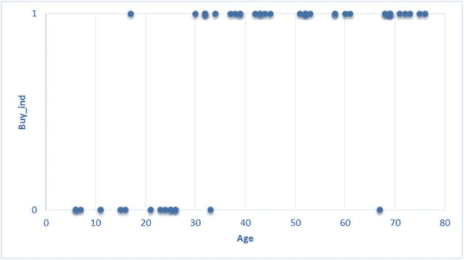

图 11-1. 冰淇淋销售数据散点图

图 11-1 显示，几乎所有 30 岁以下的顾客都购买了冰淇淋，而几乎所有 30 岁以上的顾客都没有购买。数据呈现某种明显的模式，但你却无法使用线性回归模型捕捉到它。也许线性回归线并不适合这些数据。请参见图 11-2 和图 11-3。

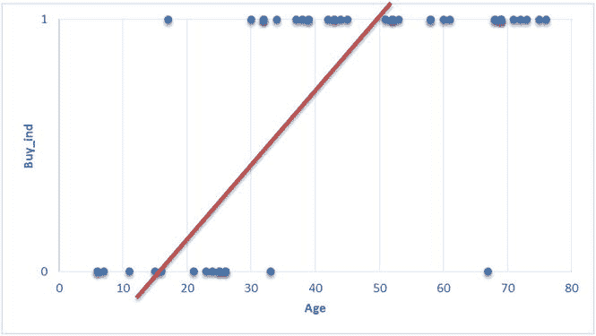

图 11-2. 直线并不适合冰淇淋销售数据

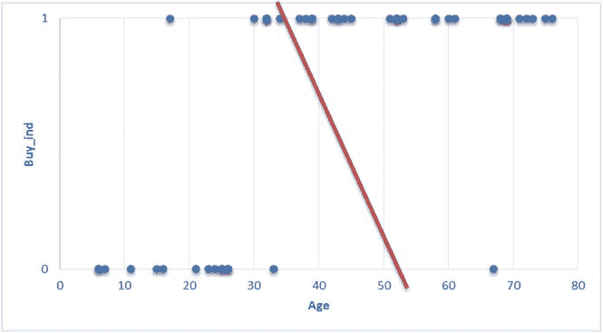

图 11-3. 直线并不适合冰淇淋销售数据

无论你应用何种优化技术，都无法得到一条能穿过数据核心的直线。如果你回顾一下第 9 章中的回归假设，你会意识到，当因变量（`buy_ind`）和自变量（`Age`）之间的关系不是线性时，你就不能应用线性回归模型。这里正是这种情况。

## 非线性回归

如果 x 和 y 之间的关系是非线性的，并且无法通过数学变换将其转化为线性关系，那么你就需要拟合最佳适用的非线性曲线。任何非直线关系都被称为非线性。由于你无法为冰淇淋销售数据拟合线性回归线，让我们看看是否能拟合一条非线性曲线。图 11-4 至图 11-8 是一些非线性表达式的示例。

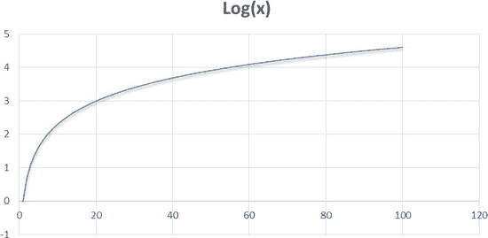

图 11-4. `Log(x)`

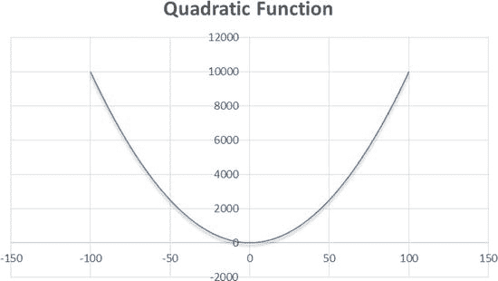

图 11-5. 二次函数

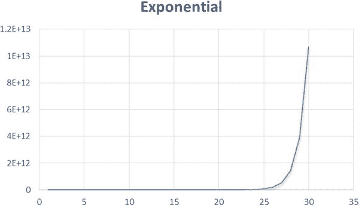

图 11-6. 指数函数

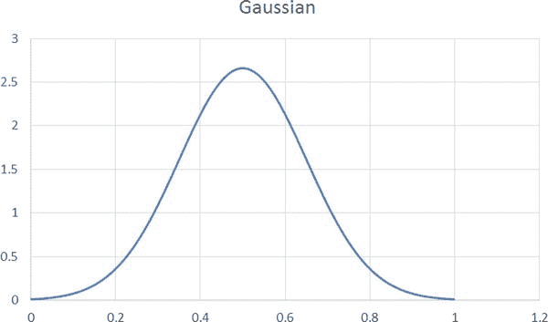

图 11-7. 高斯函数

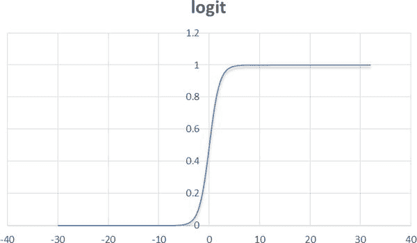

图 11-8. Logit 函数

在给出的所有非线性函数中，你可以看到逻辑曲线看起来非常适合这些数据，其中所有 Y 值要么为 0，要么为 1。逻辑曲线在 0 和 1 附近有非常长的尾部，而除 0 和 1 之外的其他值则微乎其微。因此，对于只有两种结果（0 和 1）的数据类型，你可以选择逻辑回归。请注意，选择逻辑回归线背后的理论有些复杂，此处给出的逻辑仅为简化版本。

由于冰淇淋销售数据全部由 0 和 1 组成，让我们尝试拟合一条逻辑回归曲线。图 11-9 是该数据的一条假设的逻辑曲线。

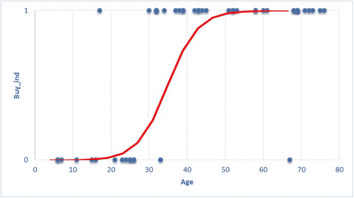

图 11-9. 穿过冰淇淋销售数据的一条假设的逻辑曲线

线性回归有其直线方程。类似地，逻辑回归线也有其方程。由之前方程解释的逻辑函数，其值永远不会小于 0，也永远不会大于 1。最大值是 1；当分子趋向于极大值时，分母也趋向于无穷大。例如，如果分子是 1,000,000，那么分母将为 1,000,001。在这种情况下，概率几乎为 1。下限是 0；假设分子为 0.0000000001，分母为 1.0000000001，那么概率值几乎为 0。

请注意，你并不是要预测 Y，而是要预测 Y=0 或 Y=1 的概率。由于 Y 仅取两个值，Y 本身几乎没有任何变异。因此，预测概率而非直接预测数值更有意义。

## 逻辑回归

# 逻辑回归与SAS实现

当你的响应变量只有两种结果时，逻辑回归可能是完美的选择。你在许多情况下都会遇到只有两种结果的情形，例如：回答问题时的是与否、游戏中的输与赢、客户销售中的买与不买、电话推销中的回应与无回应、网络分析中的点击与不点击、信用风险分析中的违约与不违约、调查分析中的满意与不满意等。使用线性回归无法预测这些分类结果，因为它需要数值型的因变量。

以下是上一节讨论的逻辑回归线方程，它适用于单个自变量。以下是适用于多个自变量的逻辑回归线方程：之前的方程可以用对数形式写成如下形式。`log odds probability` 被称为对数几率概率。在这里，你试图拟合一条预测 Y 的对数几率而非其直接数值的直线。就像使用最小二乘法来拟合线性回归系数一样（请参阅第 9 章），如果你有一条逻辑回归线，将使用最大似然估计（MLE）方法来寻找贝塔系数。我们不会深入探讨 MLE 方法的细节，但你可以将其视为一种用于寻找逻辑回归线系数的优化技术。

分析师必须首先通过观察因变量来判断逻辑回归的适用性，然后在 SAS 中应用逻辑回归过程，而不是通常的线性回归。你之前使用了 `PROC REG` 过程进行线性回归。为了在逻辑回归的情况下找出贝塔系数，你将使用 SAS 的 `PROC LOGISTIC` 过程。

## 使用 SAS 进行逻辑回归

你已发现线性回归并不适合拟合冰淇淋销售案例的回归线。你还发现逻辑回归线会是更好的拟合。现在，你将使用 SAS 创建一个逻辑回归模型。

以下是拟合所需逻辑回归线的 SAS 代码：

```sas
Proc logistic data=ice_cream_sales;
model buy_ind=age;
run;
```

以下是对代码的解释：

*   `PROC LOGISTIC`：这会调用 SAS 中的逻辑回归线过程。
*   `Data`：这指定了 `ice_cream_sales` 数据集。
*   `Model`：这类似于线性回归线。等号左边是因变量，右边是自变量列表。多个自变量（如果有）之间用一个空格分隔。

上述代码试图对冰淇淋销售数据拟合一条逻辑回归线，这意味着你正在尝试估计逻辑回归方程中的贝塔系数，如下所示：此代码生成的输出如表 11-3 所示。

**表 11-3. 对冰淇淋销售数据执行 `PROC LOGISTIC` 的输出**

| SAS 系统 |
| --- |
| LOGISTIC 过程 |
| 模型信息 |
| 数据集 | WORK.ICE_CREAM_SALES |
| 响应变量 | buy_ind |
| 响应水平数 | 2 |
| 模型 | 二元 logit |
| 优化技术 | Fisher 得分法 |
| 读取的观测数 | 50 |
| 使用的观测数 | 50 |
| 响应概况 |
| 排序值 | buy_ind | 总频数 |
| 1 | 0 | 15 |
| 2 | 1 | 35 |
| 建模的概率为 `buy_ind=‘0’`。 |
| 模型收敛状态 |
| 收敛准则（`GCONV=1E-8`）满足。 |
| 模型拟合统计量 |
| 准则 | 仅截距 | 截距和协变量 |
| AIC | 63.086 | 36.114 |
| SC | 64.998 | 39.938 |
| -2 对数似然 | 61.086 | 32.114 |
| 全局零假设检验：`BETA=0` |
| 检验 | 卡方 | 自由度 | Pr > 卡方 |
| 似然比 | 28.9720 | 1 | <.0001 |
| 得分 | 22.3501 | 1 | <.0001 |
| Wald | 10.8989 | 1 | 0.0010 |
| 最大似然估计分析 |
| 参数 | 自由度 | 估计值 | 标准误差 | Wald 卡方 | Pr > 卡方 |
| 截距 | 1 | 3.8982 | 1.3446 | 8.4044 | 0.0037 |
| 年龄 | 1 | -0.1353 | 0.0410 | 10.8989 | 0.0010 |
| 优势比估计 |
| 效应 | 点估计 | 95% Wald 置信限 |
| 年龄 | 0.873 | 0.806 | 0.947 |
| 预测概率与观测响应的关联性 |
| 一致百分比 | 92.0 | Somers’ D | 0.851 |
| 不一致百分比 | 6.9 | Gamma | 0.861 |
| 结百分比 | 1.1 | Tau-a | 0.365 |
| 对子数 | 525 | C | 0.926 |

### SAS 逻辑回归输出解释

该输出包含若干度量指标和表格。以下各节将进行解释。

#### 输出第 1 部分：响应变量摘要

表 11-4 展示了 `LOGISTIC` 过程。

**表 11-4. 模型信息，`PROC LOGISTIC` 的输出**

| 模型信息 |
| --- |
| 数据集 | WORK.ICE_CREAM_SALES |
| 响应变量 | buy_ind |
| 响应水平数 | 2 |
| 模型 | 二元 logit |
| 优化技术 | Fisher 得分法 |

以下是对表 11-4 的解释：

*   `数据集`：这是数据来源。
*   `响应变量`：这是因变量或 Y 变量，在此示例中是购买指标。
*   `响应水平数`：这是因变量的水平数量（通常为是/否）；在此示例中为 1 或 0。
*   `模型`：这是二元逻辑回归；等同于二元 logit。
*   `优化技术`：使用哪种优化技术来寻找回归系数？SAS 会选择最合适的技术。

现在考虑表 11-5 中输出的更多表格。

**表 11-5. `PROC LOGISTIC` 的输出表格**

| 读取的观测数 | 50 |
| --- | --- |
| 使用的观测数 | 50 |
| 响应概况 |
| 排序值 | buy_ind | 总频数 |
| 1 | 0 | 15 |
| 2 | 1 | 35 |
| 建模的概率为 `buy_ind=‘0’`。 |

以下是对表 11-5 的解释：

*   `读取的观测数`：这是从数据集中读取的观测计数。
*   `使用的观测数`：这是用于创建模型的观测数量。数据中没有缺失值或默认值。如果有缺失值，SAS 将单独给出这些缺失值的计数。
*   `响应概况排序值`：这是 SAS 对你提供的值进行排序的方式。它将 0 类别视为第一水平，将 1 类别视为第二水平。
*   `建模的概率为 buy_ind=‘0’`：逻辑回归最终会给出 Y 的概率，Y 可以取 0 或 1。在此输出中，SAS 告知你模型是为 0 构建的；换句话说，输出的概率将针对 Y 为 0 的情况给出。默认情况下，SAS 为较小的值构建模型。当你只有两个水平时，关系不大。如果 0 的概率是 65%，那么 1 的概率显然将是 35%。你可以使用 `descending` 选项（请参阅本章后面的案例研究，其中使用了带有此选项的 SAS 代码）来直接为较高顺序的值建模。根据输出，在冰淇淋销售示例中，模型是为 Y 为 0 的概率构建的，这意味着做出了购买决定。
*   `总频数`：这是因变量中每个类别的频数。

#### 输出第 2 部分：模型拟合摘要

在输出第 2 部分中，我们讨论模型的收敛状态和模型拟合统计量。请参考表 11-6。

**表 11-6.** 模型拟合摘要，`PROC LOGISTIC` 的输出表

| 模型收敛状态 |
| --- |
| 收敛准则 (`GCONV=1E-8`) 已满足。 |
| 模型拟合统计量 |
| --- |
| 准则 | 仅截距 | 截距和协变量 |
| `AIC` | 63.086 | 36.114 |
| `SC` | 64.998 | 39.938 |
| -2 对数似然 | 61.086 | 32.114 |

以下是关于表 11-6 的说明：

*   **模型收敛状态**：这与模型优化的收敛性和精度有关。关于此点的详细说明超出了本书的范围。
*   **模型拟合统计量**：
    *   `AIC`：赤池信息准则是一种用于比较两个模型以选出最佳模型的度量标准。通常，我们期望一个具有更小 `AIC` 值的模型。单独的 `AIC` 值意义不大，因此目前可以忽略。
    *   `SC`：施瓦茨准则与 `AIC` 类似，用于比较两个模型。对于预测变量数量较少且线性拟合精度高的模型，其 `AIC` 和 `SC` 值会更小。例如，如果你正在比较两个模型以找出哪一个更好，你应该选择具有最小 `AIC` 和 `SBC` 值的模型。通常，`AIC` 和 `SC` 对于使用较少预测变量且精度高的模型来说会更小。

#### 输出第 3 部分：回归系数检验

在第 3 部分中，你正在检验全局零假设 `beta = 0`。表 11-7 展示了零假设（即所有自变量的系数都等于零）与备择假设（即至少有一个系数不为零）的检验结果。换句话说，你正在检验是否所有自变量（`X`）都不显著，而备择假设是至少有一个自变量是显著的。

`H[0]:`

vs

`H[1]:`

**表 11-7.** 检验全局零假设，`PROC LOGISTIC` 的输出表

| 检验全局零假设：`BETA = 0` |
| --- |
| 检验 | 卡方 | 自由度 | Pr > 卡方 |

| 似然比 | 28.9720 | 1 | <.0001 |
| --- | --- | --- | --- |
| 得分 | 22.3501 | 1 | <.0001 |
| Wald | 10.8989 | 1 | 0.0010 |

所有这三个检验（`似然比`、`得分`和`Wald`）都只检验前述假设。如果所有检验都显示`P`值（`Pr > 卡方`）大于 5%，那么就没有足够的证据拒绝零假设。这意味着没有任何一个变量（对`Y`）有显著影响。如果在任何一个检验中`P`值小于 5%，那么至少有一个变量对因变量有显著影响。大多数情况下，这三个检验会显示相同的结果。在此例中，卡方检验表明零假设被拒绝。这意味着至少有一个自变量的系数不等于零。

### 输出第 4 部分：Beta 系数和优势比

自变量的系数、回归参数或 beta 值在表 11-8 中给出。

**表 11-8.** 最大似然估计分析，`PROC LOGISTIC` 的输出表

| 最大似然估计分析 |
| --- |
| 参数 | 自由度 | 估计值 | 标准误差 | Wald 卡方 | Pr > 卡方 |
| 截距 | 1 | 3.8982 | 1.3446 | 8.4044 | 0.0037 |
| 年龄 | 1 | -0.1353 | 0.0410 | 10.8989 | 0.0010 |

该表（最大似然估计分析）显示了自变量系数的 MLE 估计值，由以下等式给出：`β[0]` 的值为 3.8982，`β[1]` 的值为 -0.1353。

以下是由 SAS 给出的估计值所确定的逻辑回归线方程：你可以将年龄的值代入此方程，以计算每个客户购买的概率。

优势比估计值（表 11-9）与之前的估计值略有不同。这些估计值用于观察每个单独变量对模型正向结果优势比的确切影响。例如，在本例中，你正在预测购买冰淇淋的概率。优势比估计值告诉你年龄对购买的优势比（换句话说，即购买机会）有何影响。自变量每变化一个单位，优势比如何变化？在该模型中，年龄每变化一个单位，优势比的变化量为 0.873。

**表 11-9.** 优势比估计值，`PROC LOGISTIC` 的输出表

| 优势比估计值 |
| --- |
| 效应 | 点估计 | 95% Wald 置信限 |
| 年龄 | 0.873 | 0.806 | 0.947 |

以下是冰淇淋销售数据的回归线；代入年龄以求得预测购买概率：例如，当年龄为 6 岁时，购买概率为 95.6%，不购买概率为 4.3%。购买相对于不购买的优势比为 95% / 5%，即 21.8981。

当年龄增加一个单位，例如从 6 岁增加到 7 岁，购买概率为 95.03%，不购买概率为 4.968%。购买相对于不购买的优势比为 95.03% / 4.968%，即 19.12698。

当你将年龄改变一个单位（从 6 岁到 7 岁）时，优势比也从 21.8981 变为 19.12698。优势比为 0.8734（[年龄=7]时购买相对于不购买的优势比 / [年龄=6]时购买相对于不购买的优势比），这与 SAS 优势比估计表中给出的值相同。优势比估计值给出了自变量每变化一个单位时优势比的确切变化估计。表 11-10 对此进行了说明。

**表 11-10.** 年龄每单位变化带来的优势比变化

| 年龄 | 预测购买概率(A) | 预测不购买概率(B) | 购买相对于不购买的优势比(A/B) | 年龄每单位变化带来的优势比变化 |
| --- | --- | --- | --- | --- |
| 6 | 96% | 4% | 21.89810 | NA |
| 7 | 95% | 5% | 19.12698 | 0.873454 |
| 8 | 94% | 6% | 16.70654 | 0.873454 |
| 9 | 94% | 6% | 14.59239 | 0.873454 |
| 10 | 93% | 7% | 12.74578 | 0.873454 |
| 11 | 92% | 8% | 11.13285 | 0.873454 |
| 12 | 91% | 9% | 9.72403 | 0.873454 |
| 13 | 89% | 11% | 8.49349 | 0.873454 |
| 14 | 88% | 12% | 7.41867 | 0.873454 |
| 15 | 87% | 13% | 6.47987 | 0.873454 |
| 16 | 85% | 15% | 5.65986 | 0.873454 |
| 17 | 83% | 17% | 4.94363 | 0.873454 |
| 18 | 81% | 19% | 4.31803 | 0.873454 |
| 19 | 79% | 21% | 3.77160 | 0.873454 |
| 20 | 77% | 23% | 3.29432 | 0.873454 |
| 21 | 74% | 26% | 2.87744 | 0.873454 |
| 22 | 72% | 28% | 2.51331 | 0.873454 |
| 23 | 69% | 31% | 2.19526 | 0.873454 |
| 24 | 66% | 34% | 1.91746 | 0.873454 |
| 25 | 63% | 37% | 1.67481 | 0.873454 |
| 26 | 59% | 41% | 1.46287 | 0.873454 |
| 27 | 56% | 44% | 1.27775 | 0.873454 |
| 28 | 53% | 47% | 1.11605 | 0.873454 |

从表 11-10 中可以看出，当自变量（例如年龄）每变化一个单位时，优势比正好是 0.8734。

### 输出第 5 部分：验证统计量

表 11-11 是一个重要的表格，因为你可以利用它来验证模型。它能让你了解错误分类的情况以及模型的有效性。较高的`一致百分比`始终是理想目标。`Somers' D`、`Gamma`、`Tau-a` 和 `C` 这些统计量均仅来源于对错误分类与正确分类的对比。

将实际因变量值为 `0` 的样本分类为 `0`，或赋予其较高概率，属于正确分类（无误差）。如果模型将实际值为 `0` 的样本分类为 `1`，或将实际值为 `1` 的样本分类为 `0`，或者当实际因变量值为 `1` 时却赋予 `0` 较高概率（反之亦然），则属于错误分类。我们将在“逻辑回归的拟合优度”一节中详细解释正确分类与错误分类。

**表 11-11.** 预测概率与观测响应的关联性，`PROC LOGISTIC` 的输出表

| 预测概率与观测响应的关联性 | | |
| --- | --- | --- |
| 一致百分比 | 92.0 | `Somers' D` | 0.851 |
| 不一致百分比 | 6.9 | `Gamma` | 0.861 |
| 结百分比 | 1.1 | `Tau-a` | 0.365 |
| 对子数 | 525 | `C` | 0.926 |

### 自变量的个体影响

在线性回归模型中，你使用 P 值来检验自变量对因变量是否有显著影响。线性回归中的 beta 系数服从 T 分布，因此你通过 T 检验来查看每个变量的影响。而在逻辑回归中，beta 系数服从卡方分布。因此，卡方检验的概率值（P 值）告诉你自变量在逻辑回归模型中的影响程度。

逻辑回归中的卡方检验用于检验以下假设：

`H[0]`：自变量对因变量没有显著影响。

`H[1]`：自变量对因变量有显著影响。

你将查看卡方检验的 P 值来决定接受还是拒绝该假设。

- 如果卡方检验的 P 值小于 5%，则拒绝原假设；你拒绝“该变量对因变量没有显著影响”的原假设。这意味着该变量有显著影响；因此，你将其保留在模型中。

- 如果卡方检验的 P 值大于 5%，则没有足够证据拒绝原假设。因此，你接受“该变量对因变量无显著影响”的原假设；于是，你将其从模型中剔除。从模型中剔除这些不显著的变量不会影响模型精度。

当你比较两个自变量以决定哪个变量影响更大时，可以查看 `Wald 卡方` 值。如果 `Wald 卡方` 值高，则 P 值低。例如，如果你正在比较收入与受抚养人数这两个自变量对响应变量的影响，那么 `Wald 卡方` 值较高的变量将被选中，因为它对因变量（或响应变量）的影响更大。

表 11-12 是来自冰淇淋销售示例的卡方检验表。

- `H[0]`：年龄对冰淇淋购买行为没有显著影响。

- `H[1]`：年龄对冰淇淋购买行为有显著影响。

**表 11-12.** 卡方检验，`PROC LOGISTIC` 的输出表

| 最大似然估计分析 | | | | |
| --- | --- | --- | --- | --- |
| 参数 | 自由度 | 估计值 | 标准误差 | Wald 卡方 | Pr > 卡方 |
| 截距 | 1 | 3.8982 | 1.3446 | 8.4044 | 0.0037 |
| 年龄 | 1 | -0.1353 | 0.0410 | 10.8989 | 0.0010 |

`年龄` 变量的 P 值为 0.0010，小于 0.05（5%）。因此，你可以拒绝原假设，这意味着年龄对冰淇淋购买行为有显著影响。

### 逻辑回归的拟合优度

## 卡方检验

卡方值及其相关的卡方检验是逻辑回归中拟合优度的基本衡量指标。卡方检验用于检验原假设：所有自变量的回归系数均为零，与备择假设：至少有一个自变量是显著的。卡方检验类似于线性回归中的 F 检验。

H[0]：
*   β₁ = β₂ = ... = βₙ = 0。
*   这等同于。
*   这意味着整个模型不显著，或者说它没有解释力。

H[1]：
*   这等同于至少有一个 βᵢ ≠ 0。
*   这意味着至少有一个变量是显著的，或者说模型具有一定的解释力。

如果卡方检验的 P 值大于 5%，则模型面临风险。如果 P 值大于 5%，则你必须接受原假设，这意味着整体模型不显著。继续前进没有意义，并且没有一个自变量对因变量有显著影响。这会促使你收集更多数据，寻找更具影响力的自变量。在 SAS 输出中，你会看到三个卡方检验——似然比、得分和 Wald——它们都服务于同一目的。通常，所有这些检验会显示相同的结果。

## 一致性

如前所述，一致性度量可以评估逻辑回归模型的准确度或拟合优度。本节将通过一个例子来帮助理解一致性和不一致性。

设想一个简单的数据集，其中只有 10 个观测值。因变量有 5 条记录取值为 1，另外 5 条取值为 0。构建模型后，你将确定每个记录因变量的预测概率。结果如表 11-13 所示。

表 11-13. 因变量的预测概率

| 因变量 | 预测概率 |
| --- | --- |
| 0 | `P1` |
| 0 | `P2` |
| 0 | `P3` |
| 0 | `P4` |
| 0 | `P5` |
| 1 | `P6` |
| 1 | `P7` |
| 1 | `P8` |
| 1 | `P9` |
| 1 | `P10` |

利用 5 个 0 和 5 个 1 以及它们对应的概率，你可以组成 25 对组合。
(0 `P1` – 1 `P6`), (0 `P1` – 1 `P7`), (0 `P1` – 1 `P8`), (0 `P1` – 1 `P9`), (0 `P1` – 1 `P10`)
(0 `P2` – 1 `P6`), (0 `P2` – 1 `P7`), (0 `P2` – 1 `P8`), (0 `P2` – 1 `P9`), (0 `P2` – 1 `P10`)
(0 `P3` – 1 `P6`), (0 `P3` – 1 `P7`), (0 `P3` – 1 `P8`), (0 `P3` – 1 `P9`), (0 `P3` – 1 `P10`)
(0 `P4` – 1 `P6`), (0 `P4` – 1 `P7`), (0 `P4` – 1 `P8`), (0 `P4` – 1 `P9`), (0 `P4` – 1 `P10`)
(0 `P5` – 1 `P6`), (0 `P5` – 1 `P7`), (0 `P5` – 1 `P8`), (0 `P5` – 1 `P9`), (0 `P5` – 1 `P10`)

以第一对组合(0 `P1` – 1 `P6`)为例。如果你构建的模型是用于预测值为 0 的情况，那么`P1`应该高于`P6`。一个好的模型应该赋予 0 更高的概率，而赋予 1 更低的概率。因此，在第一对中，`P1`应大于`P6`；在第二对中，`P1`应大于`P7`；在最后一对中，`P5`应大于`P10`。这种准确的分类被称为**一致性**。一致性百分比是指在所有可能的配对中，属于一致性案例的百分比。一致性百分比越高，模型的准确度就越高。

如果在第一对组合(0 `P1` – 1 `P6`)中，`P1`小于`P6`，那么这就不妙了。你构建模型是为了预测 0，但模型最终却为 1 赋予了更高的概率，为 0 赋予了更低的概率。这种错误分类被称为**不一致性**。不一致配对占所有配对（所有可能的配对）的百分比被称为不一致性百分比。

例如，从冰淇淋销售数据中取一对数据。
| 年龄 | 购买 |
| --- | --- |
| 6 | 0 |
| 45 | 1 |

这对数据是(0 `P1` – 1 `P2`)。如果你将年龄值代入模型，得到`p1 = 95%`，`p2 = 0.6%`。因此，你正确预测了：如果一个人是 6 岁，他购买冰淇淋的概率更高（`p1 = 95%`），而 45 岁的人购买的概率几乎为零（`p2 = 0.6%`）。这些预测实际上与表中的原始观测值相符。

这就是我们对一个好模型的期望：当你观测到 0（实际值）并尝试预测它时，模型概率应给出相同的结论。同样，当你取值为 1 并用模型进行预测时，模型也应给出相应的预测。当你取一对数据(0, 1)且概率为(0 `P1` – 1 `P2`)时，你至少期望模型给出的预测`P1`和`P2`满足`P1 > P2`。这就是一致性。反之则为不一致性。

**结**（Tied）的情况是指我们的模型对 0 和 1 给出了相同的概率，例如对 0 和 1 都为 0.5。

表 11-14 是冰淇淋销售示例的输出结果。

表 11-14. 预测概率与观测响应的关联性，`PROC LOGISTIC` 对冰淇淋销售数据的输出表

| 预测概率与观测响应的关联性 |
| --- |
| 一致百分比 | 92.0 | Somers’ D | 0.851 |
| 不一致百分比 | 6.9 | Gamma | 0.861 |
| 结百分比 | 1.1 | Tau-a | 0.365 |
| 总配对 | 525 | c | 0.926 |

总配对 = 15 * 35 = 525 (15 个 0, 35 个 1)
- 一致百分比 = 正确分类的百分比 = 92.0
- 不一致百分比 = 错误分类的百分比 = 6.9
- 结百分比 = 1.1 (100 – (92.0 + 6.9))

你构建的冰淇淋销售模型是一个良好的预测模型，因为它的一致性百分比达到了 92%。任何大于 70%的一致性都是好的；大于 80%则是理想的。

## 使用逻辑回归进行预测

逻辑回归直线可以通过将贝塔（beta）系数代入以下方程来表示：在冰淇淋销售示例中，你可以手动代入年龄值，计算出购买的概率，即`y=0`的概率。SAS 输出中有一条注释写道：“被建模的概率是`buy_ind=‘0’`。”这意味着概率值是针对`buy_ind=0`的，或者换种说法，当你代入`Age`值时，你得到的是 0 的概率。例如，假设你想找到一个 12 岁的人购买冰淇淋的概率。代入过程如下：0.907（几乎为 91%）

## 逻辑回归中的多重共线性

如果你有多个自变量，那么不出意外地，你会得到多个贝塔系数。我们在第 10 章中讨论过回归中的多重共线性。这是自变量之间的相互依赖关系，它会通过增加贝塔系数的标准差来影响模型准确度。我们在线性回归中讨论了多重共线性的影响以及如何检测和消除它。那么，多重共线性在多元逻辑回归中是否也是一个问题呢？逻辑回归中的多重共线性有何不同？

图 11-10 展示了线性回归中的多重共线性。`X1`、`X2`、`X3`、`X4`、`X5`…`Xp`是自变量，`Y`是与所有这些变量线性相关的因变量。

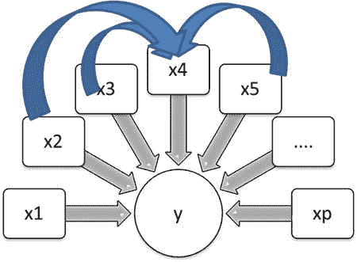
图 11-10. 线性回归中的多重共线性

这里需要注意一个事实：多重共线性与自变量相关，而它们与因变量的关系与此无关。无论是线性回归还是非线性回归，都可能出现自变量相互依赖的情况（图 11-11）。

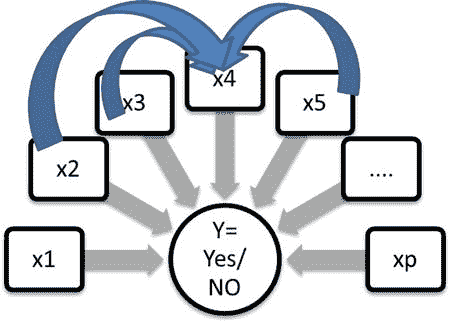
图 11-11. 非线性回归中的多重共线性

简单来说，多重共线性同样是逻辑回归中的一个问题。当你处理多重共线性时，因变量并不参与其中。因此，无论你构建的是线性还是非线性回归模型，这都无关紧要。多重共线性同样会影响逻辑回归模型的准确性。在拟合多元逻辑回归直线时，你必须警惕多重共线性。其处理步骤与线性回归中讨论的多重共线性相同，如下所示：
-   使用方差膨胀因子（VIF）值检测或确认多重共线性。如果 VIF 大于 5，则表示自变量之间存在某种多重共线性。
-   一旦发现存在多重共线性，你可以通过查看各个变量的 Wald 卡方值，剔除其中一个有问题的变量。保留那些 Wald 卡方值较高的变量。

### `PROC LOGISTIC` 中无 VIF 选项

多重共线性与逻辑回归或线性回归无关。这种现象完全集中在自变量上。因此，SAS 在逻辑回归中没有单独的 `VIF` 选项。就多重共线性的检测而言，您必须遵循与线性回归相同的步骤。对于变量选择或剔除，可以使用逻辑回归。简单来说，`PROC LOGISTIC` 没有 `VIF` 选项；只有 `PROC REG` 有该选项。

如果您在逻辑回归中写入 `VIF` 选项，SAS 会报错。以下是一个示例：

```
NOTE: SAS 系统因错误而停止处理此步骤。
```

# 逻辑回归

```
704 proc logistic data=loans_data;
705 model SeriousDlqin2yrs = utilization Age Num_loans Num_dependents MonthlyIncome
705! Num_Savings_Acccts DebtRatio/vif;
---
22
202
ERROR 22-322: 语法错误，期望以下之一：;, ABSFCONV, AGGREGATE, ALPHA,
BACKWARD, BEST, BINWIDTH, BUILDRULE, CL, CLODDS, CLPARM, CODING, CONVERGE,
CORRB, COVB, CT, CTABLE, DETAILS, DSCALE, EXPB, FAST, FCONV, FIRTH, GCONV,
HIERARCHY, INCLUDE, INFLUENCE, IPLOTS, ITPRINT, L, LACKFIT, LINK, MAXITER,
MAXSTEP, NOCHECK, NODUMMYPRINT, NOFIT, NOINT, NOLOGSCALE, OFFSET, OUTROC,
PARMLABEL, PEVENT, PL, PLCL, PLCONV, PLRL, PPROB, PSCALE, RIDGING, RISKLIMITS,
ROCEPS, RSQUARE, SCALE, SELECTION, SEQUENTIAL, SINGULAR, SLE, SLENTRY, SLS,
SLSTAY, START, STB, STEPWISE, STOP, STOPRES, TECHNIQUE, WALDCL, WALDRL, XCONV.
ERROR 202-322: 无法识别该选项或参数，将被忽略。
706 run;
```

因此，在逻辑回归的情况下，您必须使用 `PROC REG` 并遵循第 10 章中说明的流程。

## 逻辑回归最终检查清单

到目前为止，我们已经讨论了与回归分析相关的所有重要概念。逻辑回归只是另一种类型的回归。它是众多行业垂直领域中使用最广泛的非线性回归模型之一。以下是构建逻辑回归模型时要使用的检查清单：

- **适用性**：查看数据和因变量。它是否是分类变量？是/否、0/1、赢/输等，这些都是可以应用逻辑回归的响应变量结果类型。
- **卡方值**：查看整体卡方值以判断模型是否显著。如果卡方检验失败，则立即停止；整体模型本身并不显著。卡方检验不会告诉我们关于模型精确准确性的任何信息。
- **VIF**：多重共线性问题需要以与线性回归模型相同的方式解决（使用带有 `VIF` 选项的 `PROC REG`）。通过剔除有问题的变量或使用 PCA 或 FA 来识别并解决此问题，如第 10 章的回归分析中所述。
- **整体准确度/一致性**：通过查看模型的一致性和 C 值来确定模型的准确性。值越高，模型越好。如果一致性和 C 值不令人满意，则可以考虑收集更多数据或添加更好、更具影响力的自变量，这将提高整体模型性能。
- **个体影响/瓦尔德卡方值**：通过查看瓦尔德卡方值来查看每个变量的个体影响。剔除不显著的变量。

## 贷款违约预测案例研究

正如我们在本书中所做的那样，我们将通过一个真实案例研究来复习本章学到的概念。

### 背景与问题陈述

ABC 银行有一个个人贷款产品。在批准贷款之前，它需要非常确定客户的还款能力。该银行从潜在客户那里收到数千份贷款申请，它需要有一种无懈可击的科学方法来批准或拒绝贷款申请。该银行决定使用数据分析来判断与每位客户相关的风险。

ABC 银行拥有大量关于客户档案、他们以前的贷款、他们的信用卡支出、他们的银行账户等方面的历史数据。该银行拥有信用良好和信用不良客户的历史数据。在批准贷款之前识别出信用不良的申请人为银行节省了数百万美元。因此，在批准贷款时量化与每位客户相关的风险非常重要。

### 目标

分析历史贷款数据并构建一个模型，该模型将帮助银行在批准贷款时，根据相关风险对客户进行区分。

### 数据集

该银行的历史数据包含违约者和非违约者的记录。数据收集时间跨度为两年。该数据集有 150,000 名客户的记录。它还有一个响应/因变量，用于指示每位客户的信用度。每条记录中还有一些预测变量/自变量，用于指示客户的财务健康状况。这里给出的数据集对于模型构建练习来说是相当干净的。数据验证和清理工作已经完成。此外，变量中没有异常值或缺失值。

表 11-15 包含了数据集的详细信息（数据字典）。

**表 11-15.** ABC 银行示例中使用的数据集详情

| 变量名 | 描述 | 类型 |
| --- | --- | --- |
| `Cust_id` | 客户 ID；每个客户唯一。 | 数字 |
| `SeriousDlqin2yrs` | 人员经历过破产/注销。破产：债务人意识到自己无法支付账单。当任何个人或企业无法偿还债权人时，破产是一种法律选择，可以帮助他们从应付的款项和债务中获得减免。注销：客户连续六个月或更长时间未能支付最低应付款项。1 – 是，破产或注销：不良客户。0 – 否，破产或注销：优质客户。 | 1/0 |
| `Utilization` | 信贷额度的平均月使用率。 | 百分比 |
| `Age` | 客户年龄。 | 数字 |
| `Num_loans` | 贷款数量，包括抵押贷款、车辆贷款和个人贷款。 | 数字 |
| `Num_dependents` | 受抚养人数。 | 数字 |
| `MonthlyIncome` | 客户的平均月收入。 | 数字 |
| `Num_Savings_Acccts` | 客户拥有的储蓄账户数量。 | 数字 |
| `DebtRatio` | 每月债务支付、赡养费、生活费用除以每月总收入。 | 百分比 |

### 数据导入

第一步，您将导入数据，并快速检查记录数、变量、格式等信息。

以下是导入数据集 `Customer_Loans.csv` 的代码：

```
PROC IMPORT OUT= WORK.loans_data
DATAFILE= "C:\Users\VENKAT\Google Drive\Training\Books\Content\11.
Logistic Regression\Data Logistic Regression\Customer_Loans.csv"
DBMS=CSV REPLACE;
GETNAMES=YES;
DATAROW= 2 ;
RUN ;
```

以下是上述代码的日志文件注释：

```
NOTE: The infile 'C:\Users\VENKAT\Google Drive\Training\Books\Content\11\. Logistic
Regression\Data Logistic Regression\Customer_Loans.csv' is:
Filename=C:\Users\VENKAT\Google Drive\Training\Books\Content\11\. Logistic
Regression\Data Logistic Regression\Customer_Loans.csv,
RECFM=V,LRECL=32767,File Size (bytes)=6918139,
Last Modified=28Aug2014:11:52:33,
Create Time=28Aug2014:11:12:22
NOTE: 150000 records were read from the infile 'C:\Users\VENKAT\Google
Drive\Training\Books\Content\11\. Logistic Regression\Data Logistic
Regression\Customer_Loans.csv'.
The minimum record length was 26.
The maximum record length was 48.
NOTE: The data set WORK.LOANS_DATA has 150000 observations and 9 variables.
NOTE: DATA statement used (Total process time):
real time           1.23 seconds
cpu time            1.24 seconds
150000 rows created in WORK.LOANS_DATA from C:\Users\VENKAT\Google
Drive\Training\Books\Content\11\. Logistic Regression\Data Logistic
Regression\Customer_Loans.csv.
NOTE: WORK.LOANS_DATA data set was successfully created.
NOTE: PROCEDURE IMPORT used (Total process time):
real time           1.49 seconds
cpu time            1.51 seconds
```

以下是SAS数据分析代码与数据查看说明。

以下是 `PROC CONTENTS` 和打印数据的代码，用于查看变量及数据快照：

```sas
proc contents data=loans_data varnum;
run ;
proc print data=loans_data(obs= 20 );
run ;
```

表 11-16 和 11-17 列出了这些代码片段的输出结果。

**表 11-16.** `proc contents` 过程在 `loans_data` 数据集上的输出

| SAS 系统 |

| --- |

| CONTENTS 过程 |

| 数据集名称 | WORK.LOANS_DATA | 观测数 | 150000 |

| 成员类型 | DATA | 变量数 | 9 |

| 引擎 | V9 | 索引数 | 0 |

| 创建时间 | 2008 年 7 月 1 日 星期二 00:00:00 | 观测长度 | 72 |

| 最后修改时间 | 2008 年 7 月 1 日 星期二 00:00:00 | 删除观测数 | 0 |

| 保护 |   | 压缩 | 否 |

| 数据集类型 |   | 排序 | 否 |

| 标签 |   |   |   |

| 数据表示 | WINDOWS_32 |   |   |

| 编码 | wlatin1 西欧 (Windows) |   |   |

| 引擎/主机依赖信息 |

| 数据集页面大小 | 8192 |

| 数据集页数 | 1328 |

| 第一数据页 | 1 |

| 每页最大观测数 | 113 |

| 第一数据页中的观测数 | 85 |

| 数据集修复次数 | 0 |

| 文件名 | C:\Users\VENKAT\AppData\Local\Temp\SAS Temporary Files\_TD4892\loans_data.sas7bdat |

| 创建版本 | 9.0201M0 |

| 创建主机 | W32_VSPRO |

**表 11-17.** `proc print` 过程在 `loans_data` 数据集上的输出 (obs=20)

| 观测 | 客户 ID | 两年内严重逾期 | 利用率 | 年龄 | 贷款笔数 | 家属人数 | 月收入 | 储蓄账户数 | 负债率 |

| --- | --- | --- | --- | --- | --- | --- | --- | --- | --- |

| 1 | 100001 | 1 | 0.766126609 | 45 | 6 | 2 | 9120 | 2 | 0.852982129 |

| 2 | 100002 | 0 | 0.957151019 | 40 | 0 | 1 | 4600 | 2 | 0.121876201 |

| 3 | 100003 | 0 | 0.65818014 | 38 | 0 | 0 | 5042 | 2 | 0.085113375 |

| 4 | 100004 | 0 | 0.233809776 | 30 | 0 | 0 | 5300 | 2 | 0.036049682 |

| 5 | 100005 | 0 | 0.9072394 | 49 | 1 | 0 | 6357 | 2 | 0.024925695 |

| 6 | 100006 | 0 | 0.213178682 | 74 | 1 | 1 | 5500 | 2 | 0.375606969 |

| 7 | 100007 | 0 | 0.305682465 | 57 | 3 | 0 | 6357 | 2 | 0.274502 |

| 8 | 100008 | 0 | 0.754463648 | 39 | 0 | 0 | 5500 | 2 | 0.209940017 |

| 9 | 100009 | 0 | 0.116950644 | 27 | 0 | 0 | 6357 | 2 | 0.274502 |

| 10 | 100010 | 0 | 0.189169052 | 57 | 4 | 2 | 6357 | 2 | 0.606290901 |

| 11 | 100011 | 0 | 0.644225962 | 30 | 0 | 0 | 4500 | 2 | 0.30947621 |

| 12 | 100012 | 0 | 0.01879812 | 51 | 2 | 2 | 8501 | 2 | 0.53152876 |

| 13 | 100013 | 0 | 0.010351857 | 46 | 2 | 2 | 14454 | 2 | 0.298354075 |

| 14 | 100014 | 1 | 0.964672555 | 40 | 1 | 2 | 13700 | 2 | 0.432964747 |

| 15 | 100015 | 0 | 0.019656581 | 76 | 1 | 0 | 6357 | 2 | 0.274502 |

| 16 | 100016 | 0 | 0.548458062 | 64 | 1 | 2 | 13362 | 2 | 0.209891754 |

| 17 | 100017 | 0 | 0.061086118 | 78 | 2 | 0 | 6357 | 2 | 0.274502 |

| 18 | 100018 | 0 | 0.166284079 | 53 | 0 | 0 | 10800 | 1 | 0.18827406 |

| 19 | 100019 | 0 | 0.221812771 | 43 | 1 | 2 | 5280 | 2 | 0.527887839 |

| 20 | 100020 | 0 | 0.602794411 | 25 | 0 | 0 | 2333 | 2 | 0.065868263 |

| 按创建顺序排列的变量 |

| # | 变量 | 类型 | 长度 | 格式 | 输入格式 |

| 1 | Cust_id | 数值 | 8 | BEST12. | BEST32. |

| 2 | SeriousDlqin2yrs | 数值 | 8 | BEST12. | BEST32. |

| 3 | Utilization | 数值 | 8 | BEST12. | BEST32. |

| 4 | Age | 数值 | 8 | BEST12. | BEST32. |

| 5 | Num_loans | 数值 | 8 | BEST12. | BEST32. |

| 6 | Num_dependents | 数值 | 8 | BEST12. | BEST32. |

| 7 | MonthlyIncome | 数值 | 8 | BEST12. | BEST32. |

| 8 | Num_Savings_Acccts | 数值 | 8 | BEST12. | BEST32. |

| 9 | DebtRatio | 数值 | 8 | BEST12. | BEST32. |

您已经获得了数据中的所有变量，并且所有变量似乎都有值。数据看起来是干净的。如果不是，您需要先探索数据，验证其准确性，最后通过处理数据中的缺失值和异常值来清理数据。您需要使用 SAS 过程，例如 `PROC CONTENTS`、`PROC FREQ` 和 `PROC UNIVARIATE`，这些已在第 7 章的数据探索中进行了详细讨论。

## 模型构建

数据集中的响应变量是二元的。`SeriousDlqin2yrs` 是您打算预测的因变量。它取两个值：

- 1，是，破产或冲销：坏客户
- 0，否，破产或冲销：好客户

逻辑回归是根据贷款数量、负债比率、月收入等特征预测客户违约概率的一个好选择。

以下是构建逻辑回归模型的代码：

```sas
proc logistic data=loans_data;
model SeriousDlqin2yrs = utilization Age Num_loans Num_dependents MonthlyIncome Num_Savings_Acccts DebtRatio;
run;
```

以下是执行先前代码时来自日志文件的信息：

## SAS 代码示例

```
701  proc logistic data=loans_data;
702  model SeriousDlqin2yrs = utilization Age Num_loans Num_dependents MonthlyIncome
702! Num_Savings_Acccts DebtRatio;
703  run;
NOTE: Writing HTML Body file: sashtml44.htm
NOTE: PROC LOGISTIC is modeling the probability that SeriousDlqin2yrs='0'. One way to change
this to model the probability that SeriousDlqin2yrs='1' is to specify the response
variable option EVENT='1'.
NOTE: Convergence criterion (GCONV=1E-8) satisfied.
NOTE: There were 150000 observations read from the data set WORK.LOANS_DATA.
NOTE: PROCEDURE LOGISTIC used (Total process time):
real time           4.92 seconds
cpu time            3.58 seconds
```

## 输出结果分析

表 11-18 显示了此代码的 SAS 输出。

**表 11-18.** `proc logistic` 在 `loans_data` 上的输出

| The SAS System |
| --- |
| The LOGISTIC Procedure |
| Model Information |
| Data Set | WORK.LOANS_DATA |
| Response Variable | SeriousDlqin2yrs |
| Number of Response Levels | 2 |
| Model | binary logit |
| Optimization Technique | Fisher’s scoring |
| Number of Observations Read | 150000 |
| Number of Observations Used | 150000 |
| Response Profile |
| Ordered Value | SeriousDlqin2yrs | Total Frequency |
| 1 | 0 | 139974 |
| 2 | 1 | 10026 |
| Probability modeled is SeriousDlqin2yrs=‘0’. |
| Model Convergence Status |
| Convergence criterion (GCONV=1E-8) satisfied. |
| Model Fit Statistics |
| Criterion | Intercept Only | Intercept and Covariates |
| AIC | 73618.167 | 57641.254 |
| SC | 73628.085 | 57720.601 |
| -2 Log L | 73616.167 | 57625.254 |
| Testing Global Null Hypothesis: BETA=0 |
| Test | Chi-Square | DF | Pr > ChiSq |
| Likelihood Ratio | 15990.9128 | 7 | <.0001 |
| Score | 14078.3178 | 7 | <.0001 |
| Wald | 11514.4825 | 7 | <.0001 |
| Analysis of Maximum Likelihood Estimates |
| Parameter | DF | Estimate | Standard Error | Wald Chi-Square | Pr > ChiSq |
| Intercept | 1 | 1.1431 | 0.0622 | 337.3241 | <.0001 |
| utilization | 1 | -1.9713 | 0.0312 | 3999.3621 | <.0001 |
| Age | 1 | 0.0108 | 0.000832 | 167.2586 | <.0001 |
| Num_loans | 1 | -0.2464 | 0.0106 | 538.4191 | <.0001 |
| Num_dependents | 1 | -0.1941 | 0.00960 | 408.6747 | <.0001 |
| MonthlyIncome | 1 | 0.000426 | 5.983E-6 | 5078.5897 | <.0001 |
| Num_Savings_Acccts | 1 | -0.00945 | 0.00517 | 3.3408 | 0.0676 |
| DebtRatio | 1 | -1.1702 | 0.0510 | 526.4205 | <.0001 |
| Odds Ratio Estimates |
| Effect | Point Estimate | 95% Wald Confidence Limits |
| Utilization | 0.139 | 0.131 | 0.148 |
| Age | 1.011 | 1.009 | 1.012 |
| Num_loans | 0.782 | 0.766 | 0.798 |
| Num_dependents | 0.824 | 0.808 | 0.839 |
| MonthlyIncome | 1.000 | 1.000 | 1.000 |
| Num_Savings_Acccts | 0.991 | 0.981 | 1.001 |
| DebtRatio | 0.310 | 0.281 | 0.343 |
| Association of Predicted Probabilities and Observed Responses |
| Percent Concordant | 82.8 | Somers’ D | 0.664 |
| Percent Discordant | 16.5 | Gamma | 0.668 |
| Percent Tied | 0.7 | Tau-a | 0.083 |
| Pairs | 1403379324 | c | 0.832 |

现在我们将详细讨论输出结果。

从数据集中读取了大约 150,000 条客户记录（表 11-19）并用于本次分析。其中有 139,974 个好账户和 10,026 个坏账户（表 11-20）。在现实生活中的银行贷款组合中，您会预期超过 90% 的客户是好的。

您可能会想，如果好坏账户已经给出，我们试图预测什么？为什么不直接使用它们？记住，这是历史数据，您已经知道谁好谁坏。您正尝试使用这些数据来拟合一个模型，该模型将根据给定的自变量（如收入、贷款、借记和利用率）预测（新客户的）违约概率。您可以将此模型用于未来新客户的贷款审批，即使他们不在历史数据中。对于所有未来客户，您将在贷款申请时收集自变量的数据，这些数据将用于评估每个客户的相关风险。

在以下表格中，表 11-21 讨论了模型收敛性，表 11-22 给出了卡方检验结果。

**表 11-21.** 模型收敛状态

| Model Convergence Status |
| --- |
| Convergence criterion (GCONV=1E-8) satisfied. |

**表 11-20.** `SeriousDlqin2yr` 变量中 0 和 1 的频率

| Response Profile |
| --- |
| Ordered Value | SeriousDlqin2yrs | Total Frequency |
| 1 | 0 | 139974 |
| 2 | 1 | 10026 |
| Probability modeled is SeriousDlqin2yrs=‘0’ |

**表 11-19.** `loans_data` 中的观测数量

| Number of Observations Read | 150000 |
| --- | --- |
| Number of Observations Used | 150000 |

查看输出的卡方检验结果（表 11-22），您可以确认模型是显著的。所有卡方检验的 P 值都小于 5%（0.05）。因此，可以稳妥地得出结论，模型是显著的。换句话说，自变量列表中的至少一个变量对响应/因变量（`SeriousDlqin2yrs`）有显著影响。请查阅本章前面讨论的拟合优度，以清楚了解如何解释表 11-22。

**表 11-22.** 模型的卡方检验结果

# Testing Global Null Hypothesis: BETA=0

| Test | Chi-Square | DF | Pr > ChiSq |
| --- | --- | --- | --- |
| Likelihood Ratio | 15990.9128 | 7 | <.0001 |
| Score | 14078.3178 | 7 | <.0001 |
| Wald | 11514.4825 | 7 | <.0001 |

表 11-23 是关于变量系数估计值的。变量的符号表明其中一些对因变量有正向影响，而另一些则有负向影响。

在查看系数的符号及其值，或试图写出模型方程之前，您需要确保自变量之间不存在相互依赖关系。您很清楚，多重共线性在逻辑回归中也是一个问题。除非您确保模型中不存在多重共线性，否则您不能相信这些系数。

## 表 11-23. 变量系数估计值

| Parameter | DF | Estimate | Standard Error | Wald Chi-Square | Pr > ChiSq |
| --- | --- | --- | --- | --- | --- |
| Intercept | 1 | 1.1431 | 0.0622 | 337.3241 | <.0001 |
| utilization | 1 | -1.9713 | 0.0312 | 3999.3621 | <.0001 |
| Age | 1 | 0.0108 | 0.000832 | 167.2586 | <.0001 |
| Num_loans | 1 | -0.2464 | 0.0106 | 538.4191 | <.0001 |
| Num_dependents | 1 | -0.1941 | 0.00960 | 408.6747 | <.0001 |
| MonthlyIncome | 1 | 0.000426 | 5.983E-6 | 5078.5897 | <.0001 |
| Num_Savings_Acccts | 1 | -0.00945 | 0.00517 | 3.3408 | 0.0676 |
| DebtRatio | 1 | -1.1702 | 0.0510 | 526.4205 | <.0001 |

### 处理多重共线性

再次强调，多重共线性仅受自变量列表影响的问题，与自变量和因变量之间的关系无关。无论你构建的是线性回归还是逻辑回归，多重共线性的处理方法都相同。

以下是使用 `VIF` 选项检测多重共线性的代码：

```sas
proc logistic data=loans_data;
model SeriousDlqin2yrs = utilization Age Num_loans Num_dependents MonthlyIncome Num_Savings_Acccts DebtRatio/vif;
run;
```

请记住，`PROC LOGISTIC` 没有 `VIF` 选项。如果使用了 `VIF` 选项，该过程代码会抛出错误，如下所示：

```
NOTE: The SAS System stopped processing this step because of errors.
704  proc logistic data=loans_data;
705  model SeriousDlqin2yrs = utilization Age Num_loans Num_dependents MonthlyIncome
705! Num_Savings_Acccts DebtRatio/vif;
---
22
202
ERROR 22-322: Syntax error, expecting one of the following: ;, ABSFCONV, AGGREGATE, ALPHA,
BACKWARD, BEST, BINWIDTH, BUILDRULE, CL, CLODDS, CLPARM, CODING, CONVERGE,
CORRB, COVB, CT, CTABLE, DETAILS, DSCALE, EXPB, FAST, FCONV, FIRTH, GCONV,
HIERARCHY, INCLUDE, INFLUENCE, IPLOTS, ITPRINT, L, LACKFIT, LINK, MAXITER,
MAXSTEP, NOCHECK, NODUMMYPRINT, NOFIT, NOINT, NOLOGSCALE, OFFSET, OUTROC,
PARMLABEL, PEVENT, PL, PLCL, PLCONV, PLRL, PPROB, PSCALE, RIDGING, RISKLIMITS,
ROCEPS, RSQUARE, SCALE, SELECTION, SEQUENTIAL, SINGULAR, SLE, SLENTRY, SLS,
SLSTAY, START, STB, STEPWISE, STOP, STOPRES, TECHNIQUE, WALDCL, WALDRL, XCONV.
ERROR 202-322: The option or parameter is not recognized and will be ignored.
706 run;
```

因此，这里你也需要使用 `PROC REG` 来处理多重共线性。

```sas
proc reg data=loans_data;
model SeriousDlqin2yrs = utilization Age Num_loans Num_dependents MonthlyIncome Num_Savings_Acccts DebtRatio/vif;
run;
```

表 11-24 显示了上述代码的输出结果。

### 表 11-24. `PROC REG` 在 `loans_data` 上的输出

| 项目 | 值 |
|---|---|
| 模型 | MODEL1 |
| 因变量 | `SeriousDlqin2yrs` |
| 读取的观测数量 | 150000 |
| 使用的观测数量 | 150000 |

**方差分析**

| 来源 | 自由度 | 平方和 | 均方 | F 值 | Pr > F |
|---|---|---|---|---|---|
| 模型 | 7 | 87809867 | 125.44267 | 2219.38 | <.0001 |
| 误差 | 149992 | 8477.76349 | 0.05652 | | |
| 校正合计 | 149999 | 9355.86216 | | | |

| 统计量 | 值 | 统计量 | 值 |
|---|---|---|---|
| 均方根误差 | 0.23774 | R 方 | 0.0939 |
| 因变量均值 | 0.06684 | 调整 R 方 | 0.0938 |
| 变异系数 | 355.68877 | | |

**参数估计**

| 变量 | 自由度 | 参数估计值 | 标准误差 | t 值 | Pr > &#124;t&#124; | 方差膨胀因子 |
|---|---|---|---|---|---|---|
| 截距 | 1 | 0.11651 | 0.00342 | 34.11 | <.0001 | 0 |
| `utilization` | 1 | 0.14700 | 0.00194 | 75.88 | <.0001 | 1.11193 |
| `Age` | 1 | -0.00057428 | 0.00004428 | -12.97 | <.0001 | 1.13520 |
| `Num_loans` | 1 | 0.00849 | 0.00067032 | 12.67 | <.0001 | 1.45625 |
| `Num_dependents` | 1 | 0.01100 | 0.00058660 | 18.75 | <.0001 | 1.11697 |
| `MonthlyIncome` | 1 | -0.00001339 | 1.931776E-7 | -69.33 | <.0001 | 1.22390 |
| `Num_Savings_Acccts` | 1 | 0.00050943 | 0.00028330 | 1.80 | 0.0722 | 1.00006 |
| `DebtRatio` | 1 | 0.06312 | 0.00356 | 17.74 | <.0001 | 1.33570 |

在这种情况下，你实际上并不关心 `R` 方或调整后的 `R` 方。在这个输出中，你唯一需要关注的是参数估计表。特别地，你只对 `VIF` 值感兴趣，因为它能指示多重共线性。所有变量的 `VIF` 值均未超过 5，这表明自变量之间不存在相互依赖关系。因此，在构建逻辑回归模型时，你可以保留所有自变量。

### 预测拖欠行为

你可以在输出中看到一条注释："Probability modeled is `SeriousDlqin2yrs`='0'"，这意味着模型得出的概率是“好客户”的概率。也就是说，概率越高，客户越好。如果你想预测“坏客户”的概率而不是“好客户”的概率，则必须在 `PROC LOGISTIC` 代码中使用 `descending` 选项。大多数情况下，我们尝试预测违约概率而不是非违约概率。以下是最终模型的代码。请注意，这会改变系数。

```sas
proc logistic data=loans_data descending;
model SeriousDlqin2yrs = utilization Age Num_loans Num_dependents MonthlyIncome Num_Savings_Acccts DebtRatio;
run;
```

表 11-25 显示了这段代码的输出。

**表 11-25.** `proc logistic` 在 `loans_data` 上的输出

| SAS 系统 |
|---|
| LOGISTIC 过程 |
| **模型信息** |
| 数据集 | WORK.LOANS_DATA |
| 响应变量 | `SeriousDlqin2yrs` |
| 响应水平数量 | 2 |
| 模型 | 二项逻辑回归 |
| 优化技术 | Fisher 评分法 |
| 读取的观测数量 | 150000 |
| 使用的观测数量 | 150000 |
| **响应概况** |
| 有序值 | `SeriousDlqin2yrs` | 总频数 |
| 1 | 1 | 10026 |
| 2 | 0 | 139974 |
| 建模的概率为 `SeriousDlqin2yrs`=‘1’. |
| **模型收敛状态** |
| 收敛准则 (GCONV=1E-8) 已满足。 |
| **模型拟合统计量** |
| 准则 | 仅截距 | 截距和协变量 |
| AIC | 73618.167 | 57641.254 |
| SC | 73628.085 | 57720.601 |
| -2 Log L | 73616.167 | 57625.254 |
| **检验全局零假设: BETA=0** |
| 检验 | 卡方 | 自由度 | Pr > 卡方 |
| 似然比 | 15990.9128 | 7 | <.0001 |
| 得分 | 14078.3178 | 7 | <.0001 |
| Wald | 11514.4825 | 7 | <.0001 |
| **最大似然估计分析** |
| 参数 | 自由度 | 估计值 | 标准误差 | Wald 卡方 | Pr > 卡方 |
| 截距 | 1 | -1.1431 | 0.0622 | 337.3241 | <.0001 |
| 利用率 | 1 | 1.9713 | 0.0312 | 3999.3621 | <.0001 |
| 年龄 | 1 | -0.0108 | 0.000832 | 167.2586 | <.0001 |
| 贷款笔数 | 1 | 0.2464 | 0.0106 | 538.4191 | <.0001 |
| 家属数量 | 1 | 0.1941 | 0.00960 | 408.6747 | <.0001 |
| 月收入 | 1 | -0.00043 | 5.983E-6 | 5078.5897 | <.0001 |
| 储蓄账户数 | 1 | 0.00945 | 0.00517 | 3.3408 | 0.0676 |
| 负债比率 | 1 | 1.1702 | 0.0510 | 526.4205 | <.0001 |
| **优势比估计** |
| 效应 | 点估计 | 95% Wald 置信限 |
| 利用率 | 7.180 | 6.755 | 7.633 |
| 年龄 | 0.989 | 0.988 | 0.991 |
| 贷款笔数 | 1.279 | 1.253 | 1.306 |
| 家属数量 | 1.214 | 1.192 | 1.237 |
| 月收入 | 1.000 | 1.000 | 1.000 |
| 储蓄账户数 | 1.009 | 0.999 | 1.020 |
| 负债比率 | 3.223 | 2.916 | 3.561 |
| **预测概率与观测响应的关联性** |
| 一致百分比 | 82.8 | Somers’ D | 0.664 |
| 不一致百分比 | 16.5 | Gamma | 0.668 |
| 持平百分比 | 0.7 | Tau-a | 0.083 |
| 配对数量 | 1403379324 | c | 0.832 |

现在你可以观察到 SAS 输出中的注释已经改变。如果客户在此模型中得分高，则她拖欠贷款还款的概率更高。以下是从表 11-25 的 SAS 输出中摘录的注释。

`Probability modeled is SeriousDlqin2yrs=‘1’.`

### 拟合优度统计量

一致性为 82.8%，不一致性为 16.5%，这对于任何逻辑回归模型来说都是非常好的表现。在实际业务问题中，通常期望一致性达到 75% 或更高。你可以放心地使用这个模型进行预测。

### 非显著变量

在使用此模型进行预测之前，您需要检查是否存在对因变量没有显著影响的自变量。您可以查看各个自变量的 p 值（表 11-26），以了解它们在模型中的重要性。任何在卡方检验中 p 值超过 5% 的变量，在模型中都是不显著的。保留或移除这些变量完全不会影响使用该模型进行的预测。

**表 11-26.** 变量系数估计值

| **最大似然估计分析** |
| --- |
| 参数 | 自由度 | 估计值 | 标准误差 | Wald 卡方 | Pr > 卡方 |
| 截距 | 1 | -1.1431 | 0.0622 | 337.3241 | <.0001 |
| 使用率 | 1 | 1.9713 | 0.0312 | 3999.3621 | <.0001 |
| 年龄 | 1 | -0.0108 | 0.000832 | 167.2586 | <.0001 |
| 贷款数量 | 1 | 0.2464 | 0.0106 | 538.4191 | <.0001 |
| 家属数量 | 1 | 0.1941 | 0.00960 | 408.6747 | <.0001 |
| 月收入 | 1 | -0.00043 | 5.983E-6 | 5078.5897 | <.0001 |
| 储蓄账户数量 | 1 | 0.00945 | 0.00517 | 3.3408 | 0.0676 |
| 债务比率 | 1 | 1.1702 | 0.0510 | 526.4205 | <.0001 |

在此数据集中，`储蓄账户数量`对客户违约没有显著影响（`P-value = 0.0676`）。表 11-27 显示了在模型中保留储蓄账户数量变量时的拟合优度统计量。

**表 11-27.** 拟合优度统计量

| 一致百分比 | 82.8 |
| --- | --- |
| 不一致百分比 | 16.5 |

让我们看看如果从最终模型中剔除这个变量，准确率会如何变化。理想情况下，准确率应不受影响，因为该变量不显著。

```sas
/* 剔除 Num_Savings_Acccts 后的最终模型 */
proc logistic data=loans_data descending;
model SeriousDlqin2yrs = utilization Age Num_loans Num_dependents MonthlyIncome DebtRatio;
run;
```

以下是输出结果，表明即使在剔除储蓄账户数量变量后，准确率也完全没有变化。

| 一致百分比 | 82.8 |
| 不一致百分比 | 16.5 |

### 最终模型

以下是创建最终逻辑回归模型的代码：

```sas
proc logistic data=loans_data descending;
model SeriousDlqin2yrs = utilization Age Num_loans Num_dependents MonthlyIncome DebtRatio;
run;
```

表 11-28 是上述代码的输出结果。

**表 11-28.** 剔除 `Num_Savings_Acccts` 后 `proc logistic` 的输出

| SAS 系统 |
| --- |
| LOGISTIC 过程 |
| **模型信息** |   |   |   |
| 数据集 | WORK.LOANS_DATA | 响应变量 | `SeriousDlqin2yrs` |
| 响应水平数 | 2 |   |   |
| 模型 | 二元逻辑回归 |   |   |
| 优化技术 | Fisher 评分法 |   |   |
| 读取的观测数 | 150000 |
| 使用的观测数 | 150000 |
| **响应概况** |
| 排序值 | `SeriousDlqin2yrs` | 总频率 |
| 1 | 1 | 10026 |
| 2 | 0 | 139974 |

## 最终模型方程与使用模型进行预测

以下是代入所有系数后的最终模型：

### 使用模型进行预测

银行可使用最终模型在审批贷款时量化每位客户的风险。该模型会给出违约概率，因此银行可以设定一个最低阈值——例如，如果模型显示某客户的违约概率超过 50%，则拒绝其贷款申请。

举例来说，考虑表 11-29 中列出的三位客户，以及他们贷款申请中提供的详细信息。

**表 11-29.** 示例客户的贷款申请详情

|       | 汤姆  | 大卫  | 汉克斯 |
|-------|--------|--------|--------|
| 利用率 | 30%    | 70%    | 70%    |
| 年龄   | 34     | 40     | 50     |
| 贷款笔数 | 2      | 5      | 5      |
| 家属人数 | 3      | 4      | 4      |
| 月收入 | 8000   | 5000   | 2500   |
| 负债率 | 20%    | 45%    | 55%    |

将这些值代入逻辑回归方程，即可得到计算出的概率值（表 11-30）：

**表 11-30.** 预测的违约概率

| 客户   | 预测违约概率 | 决策              |
|----------|-----------------|-----------------------|
| 汤姆     | 0.0047 (5%)     | 批准贷款              |
| 大卫     | 0.56 (56%)      | 拒绝贷款申请          |
| 汉克斯   | 0.79 (79%)      | 拒绝贷款申请          |

因此，只有汤姆获得了贷款。通常，银行可能不会拒绝所有概率超过 50%的客户。他们可能会为高风险客户批准较低额度的贷款，或者收取更高的利率并降低贷款金额。表 11-31 可能是最终违约模型的一种适度实施示例。

**表 11-31.** 使用违约概率范围进行决策

| 违约概率范围 | 决策                      |
|-----------------|-----------------------------|
| 0%-45%          | 批准贷款申请                |
| 45%-65%         | 批准贷款申请，但降低贷款额度 |
| 65%             | 拒绝贷款申请                |

银行会将此模型及决策表发送给一线团队，或者将模型安装在集中式系统中，供贷款处理团队访问。该模型将作为评估任何贷款申请的主要工具。这一决策方法科学合理，准确性较高，并基于对相关客户数据的分析。

## 结论

本章我们讨论了线性回归不适用于二分因变量。逻辑曲线最适合此类因变量。如果因变量只有两个等级，则需要使用逻辑回归，也称为二项逻辑回归。如果响应变量有两个以上的等级，例如好/坏/不确定、赢/输/平局或满意/不满意/中性，则需要使用多项逻辑回归。

您学习了如何使用 `SAS` 拟合逻辑回归线，并观察了其输出（与线性回归相比）的一些异同。逻辑回归线也存在多重共线性问题；然而，处理多重共线性的过程与线性回归相同。此外还有其他非线性回归。逻辑回归并非唯一的非线性回归。完成本章后，您就结束了与回归相关的主题，接下来将在后续章节中学习其他建模方法，例如 `ARIMA`。