# 12. 时间序列分析与预测

在本章中，我们将直接通过几个示例介绍时间序列预测的概念。我们将讨论一家广受欢迎的银行，该银行已向客户提供信用卡服务超过十年。每个月，该银行都有一些客户申请破产。一些客户逾期超过六个月仍未偿还贷款，最终需要将其核销。显然，这对银行而言，无论是金额还是账户数量都是一种损失。银行能否主动预测其各个投资组合的这些损失？银行能否主动采取必要措施来控制损失，并判断未来损失是否会激增？银行如何根据历史数据预测此类损失？

让我们考虑另一个示例。一个联络中心或业务流程外包（BPO）流程每月接收并处理数千个电话。每天的来电数量并不相同。通话量因周末或工作日、早晨或傍晚而异。BPO 中心能否预测通话量，以便更好地管理资源和员工排班？同样，一个问题随之而来：如何预测未来的通话量？

另一个示例是一家笔记本电脑制造公司，其业务已开展了三十年。该公司有数款新机型将在未来几个月内推出。公司能否确定总体目标市场？能否根据历史数据预估未来两个季度的销售额？

许多公司跟踪与经济相关的变量，例如国内生产总值（GDP）、增长率指数、失业率等。基于历史数值，能否预测这些变量的未来值？如果可以，每个人都希望获得这些数据。

同样，能否根据过去几年的数据预测股票价格？能否预测网站的访问者数量？如何预测电视节目的观众人数？

有许多这样的业务场景涉及预测随时间变化的变量。这些变量的预测时间线可以是天、月、季度、年，甚至秒和毫秒。基本上，任何代表时间线的单位都可以。对于大多数此类业务场景，您都可以使用时间序列分析和预测技术。这些技术是本章讨论的主题。

## 什么是时间序列过程？

任何一个随时间变化的、且间隔固定的过程，都是时间序列过程。如果你谈论的是月度数据，且两个月之间的间隔是一个月，那么你每月都应该有一个变量值，才能将其定义为时间序列过程。

时间序列数据是从一个过程收集到的、具有相同时间间隔的观测值序列。简单来说，任何随时间测量的指标，只要任意两个连续时间点之间的时间间隔相同，就是一个时间序列过程。下文将展示一些时间序列图作为示例。

我们用 `Y[t]` 表示一个时间序列，其中 `Y` 是时间点 `t` 上的指标值。请参考表 12-1，该表以图 12-1 的形式呈现。这是一个语音处理业务流程外包公司过去两年的每日通话量示例。

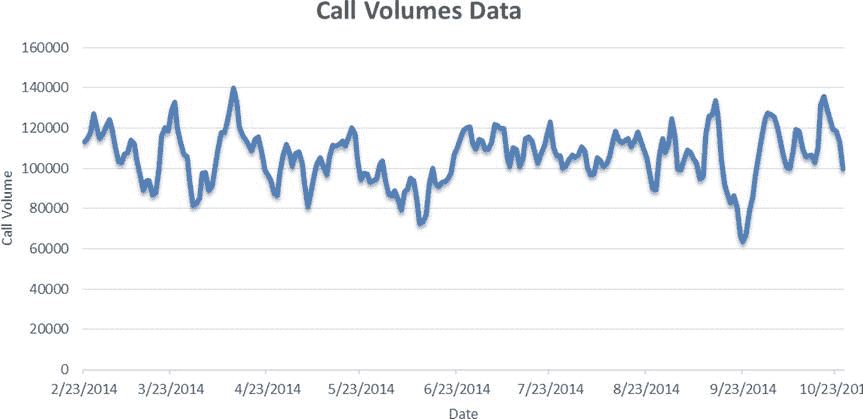
**图 12-1.** 语音处理业务流程外包公司的每日通话量

**表 12-1.** 语音处理业务流程外包公司每日通话量
| 日期 | 表示符号 | 通话量 |
| --- | --- | --- |
| 2014/10/25 | `Y[t]` | 99,552 |
| 2014/10/24 | `Y[t-1]` | 113,014 |
| 2014/10/23 | `Y[t-2]` | 118,502 |
| 2014/10/22 | `Y[t-3]` | 119,437 |
| 2014/10/21 | | 123,410 |
| 2014/10/20 | | 129,368 |
| 2014/10/19 | | 135,961 |
| 2014/10/18 | | 131,698 |
| ... | ... | ... |
| ... | ... | ... |
| 2014/2/23 | `Y[t-p]` | 113,214 |

图 12-2 展示了笔记本电脑月度销售数据的时间序列示例。

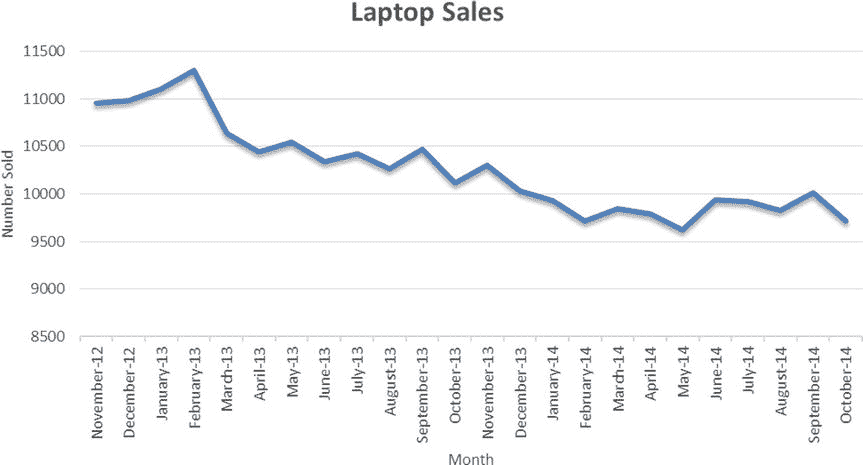
**图 12-2.** 笔记本电脑月度销售的时间序列数据

图 12-3 展示了美国过去 50 年的国内生产总值时间序列图。该 GDP 按购买者价格计算，是经济体内所有常驻生产者创造的总附加值之和。在计算产品价值时，已适当考虑了产品税和补贴。没有必要深入了解 GDP 的具体计算方式。

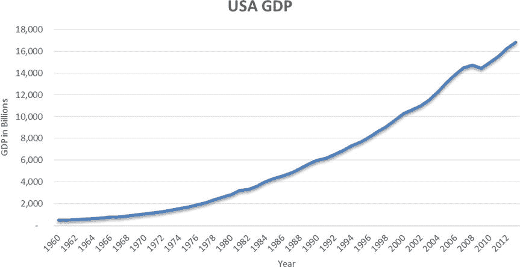
**图 12-3.** 美国 GDP 的时间序列数据（来源：世界银行，[`http://data.worldbank.org/country?display=graph`](http://data.worldbank.org/country?display=graph)）

图 12-4 展示了美国移动蜂窝网络订阅数（每百人）的时间序列图。

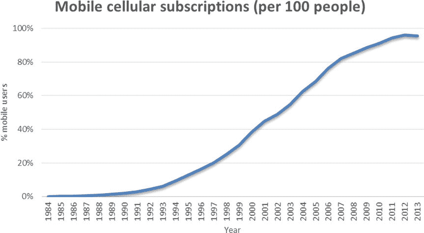
**图 12-4.** 美国移动蜂窝网络订阅数，每百人（来源：世界银行，[`http://data.worldbank.org/indicator/IT.CEL.SETS.P2`](http://data.worldbank.org/indicator/IT.CEL.SETS.P2)）

## 时间序列分析的主要阶段

在本章中，你已经看到了几个时间序列数据的示例。时间序列分析的目的是理解数据的历史时间线，通过分析揭示隐藏的模式，并最终对这些模式进行建模以用于预测。时间序列分析主要分为三个阶段（图 12-5）。


**图 12-5.** 时间序列分析的主要阶段：描述性分析 → 建模 → 预测未来值

在描述性阶段，你试图理解时间序列的本质。你要尝试回答诸如趋势是上升还是下降、过程中是否存在季节性趋势等问题。在数据中寻找模式是至关重要的一步。在建模或模式发现阶段，你对时间序列数据的内在特性进行建模。在时间序列分析过程中，有几种寻找模式的方法。

一旦识别出模式，预测就相对容易了。利用模型预测未来值是很简单的。在下一节中，你将看到一些建模技术。在应用这些技术之前，先使用描述性统计方法对数据有一个基本的了解会有所帮助。在前面几章中，你已经学习了预测建模。通常，在预测建模中，你使用一组 `X` 变量值来预测因变量 `Y`。在时间序列分析中，情况则不同。这里，你使用 `Y` 的先前值来预测 `Y`。以下数学表示有助于进一步阐明这一区别：

| 预测建模 | `Y` 与 `X[1,] X[2,] ... X[p]` 的关系 |
| --- | --- |
| 时间序列分析 | `Y` 与 `Y` 的关系（`Y[t]` 与 `Y[t-1]` 的关系） |

## 建模方法论

对时间序列进行建模有几种技术，既有简单的，也有启发式的。所有这些建模技术主要可以分为两类：启发式方法和正规的统计方法。简单的启发式或直觉性方法存在一些主要缺陷。几乎没有什么统计检验来支持这些过于简化的启发式方法。因此，本书的讨论仅限于更科学的统计方法。主要焦点将放在 Box–Jenkins 方法（或 ARIMA 技术）上，这可能是时间序列领域最常用的技术之一。

## Box–Jenkins 方法

George Box 和 Gwilym Jenkins 推广了用于时间序列建模的自回归积分滑动平均（`ARIMA`）技术。`ARIMA` 方法实际上并非由 Box 和 Jenkins 发明，但他们在简化该技术方面做出了重要贡献。为了理解使用 Box–Jenkins 方法进行模型构建，你首先需要理解诸如 `ARIMA`、`AR`、`MA` 和 `ARMA` 过程等术语。

### 什么是 ARIMA？

如果一个时间序列模型遵循某些规则，则被称为 `ARIMA` 模型。其中一个规则是时间序列的值应落在特定范围内。本章后面的章节会再回到 `ARIMA` 的讨论。

#### AR 过程

自回归（`AR`）过程是指序列的当前值依赖于其先前值的过程。自回归也是一个形象化的名称，表明它是对自身进行的回归。自回归过程用`AR(p)`表示，其中`p`是自回归过程的阶数。在 `AR` 过程中，序列的当前值是先前值的因子。`p`决定了序列当前值依赖于多少个先前值。

例如，考虑`Y[t]`、`Y[t-1]`、`Y[t-2]`、`Y[t-3]`、`Y[t-4]`、`Y[t-5]`、`Y[t-6]`、……、`Y[t-k]`，这些构成了一个时间序列。如果该序列是`AR(1)`序列，那么在给定时间`t`的`Y`值将是其在时间`t-1`时值的因子。

```
Y[t] = a[1]*Y[t-1] + ε[t]
```

`a[1]`是`Y[t-1]`对`Y[t]`影响的因子或量化影响，而`ε[t]`是在时间`t`的随机误差。`ε[t]`也被称为白噪声。当我说在任何给定时间`t`的`Y`值是其时间`t-1`时值的因子时，它可能并不完全等于`a[1]*Y[t-1]`。它可能略高于或略低于`a[1]*Y[t-1]`。但你无法精确说出`ε[t]`的值会是多少。它只是时间`t`上一个微小的随机值，可能为正也可能为负。这一项（`ε[t]`）在实际的时间序列模型中无法具体量化，因为它在不同的时间点取值不同。

对于一个`AR(2)`序列，时间`t`的`Y`值将是时间`t-1`和`t-2`时值的因子。

# 时间序列分析中的自回归与移动平均过程

```
Y[t] = a[1]*Y[t-1] + a[2]*Y[t-2] + ε[t]
```

`a[1]`是`Y[t-1]`对`Y[t]`影响的因子或量化影响，而`a[2]`是`Y[t-2]`对`Y[t]`的量化影响。

同样地，对于一个`AR(p)`序列，`Y`将依赖于直到时间点`t-p`的先前`Y`值。

```
Y[t] = a[1]*Y[t-1] + a[2]*Y[t-2] + a[3]*Y[t-3] + ... + a[p]*Y[t-p] + ε[t]
```

`a[1]`、`a[2]`、`a[3]`、……、`a[p]`分别是`Y[t-1]`、`Y[t-2]`、……、`Y[t-p]`对`Y[t]`的量化影响。

让我们看一个销售领域的例子。如果你遇到一个销售序列，其中当前月的销售额依赖于前一个月的销售额，那么你将称其为`AR(1)`序列。

下面的等式和图 12-6 展示了一个针对时间序列销售数据的`AR(1)`过程：

```
Y[t] = 0.76*Y[t-1] + ε[t]
```

``

图 12-6. 典型的 AR(1)时间序列方程图（产品销售额随时间变化）

下面的等式和图 12-7 展示了一个针对不同产品的时间序列销售数据的`AR(2)`过程：

```
Y[t] = 0.45*Y[t-1] + 0.48*Y[t-2] + ε[t]
```

``

图 12-7. 典型的 AR(2)时间序列方程图（产品销售额随时间变化）

请注意，图 12-6 和图 12-7 是典型示例，但并非每个`AR(1)`或`AR(2)`图形都会看起来像这样。即使在相同阶数的`AR(p)`过程中，时间序列图的形状也会因方程的不同而不同。仅通过观察时间序列曲线的形状来确定 AR 过程的阶数并不容易。

## MA 过程

移动平均（MA）过程是一种时间序列过程，其中序列的当前值和先前值几乎相同。但序列的当前偏差依赖于之前的白噪声或误差或冲击（即`ε[t]`、`ε[t-1]`等）。通常，`ε[t]`被视为一个不可观测项。它可能是由于某些未知原因导致的当前序列微小的随机变化；也可能源于某些外部效应。例如，在研究销售趋势时，销售中观察到的微小随机变化可能是由外部因素如偶然的降雨、降雪或异常炎热天气造成的。在 AR 过程中，`Y[t]`依赖于`Y`的先前值，而在 MA 过程中，`Y[t-1]`完全不会出现。它关注的是序列中的短期冲击；MA 与长期趋势无关，不像 AR 过程那样。在 MA 过程中，序列的当前值是先前误差的因子。就 MA 过程的表示法而言，`MA(q)`是`AR(p)`的对应物。这里`q`决定了有多少个先前的误差值会影响 MA 序列的当前值。`ε[t]`、`ε[t-1]`、`ε[t-3]`、……、`ε[t-k]`表示在时间`t`、`t-1`、……、`t-k`处的误差、冲击或白噪声。

如果一个序列是`MA(1)`，那么时间`t`的偏差将是时间`t`和`t-1`处误差的因子。

```
Y[t] - μ = ε[t] + b[1]*ε[t-1]
```

在上面的等式中：

- `b[1]`是`ε[t-1]`对当前偏差影响的因子或量化影响。
- `μ`是整个序列的均值。
- `Y[t] - μ`是时间`t`的偏差。

注意，此等式中没有`Y[t-1]`项。当前误差和先前误差仅构成等式的右侧部分。

如果一个序列是`MA(2)`，那么时间`t`的偏差将是时间`t`、`t-1`和`t-2`处误差的因子。

```
Y[t] - μ = ε[t] + b[1]*ε[t-1] + b[2]*ε[t-2]
```

在上面的等式中：

- `b[1]`和`b[2]`分别是`ε[t-1]`和`ε[t-2]`对当前偏差影响的因子或量化影响。
- `μ`是整个序列的均值。
- `Y[t] - μ`是时间`t`的偏差。

类似地，对于一个`MA(q)`序列，时间`t`的偏差将是时间`t`、`t-1`、……、`t-q`处误差的因子。

```
Y[t] - μ = ε[t] + b[1]*ε[t-1] + b[2]*ε[t-2] + ... + b[q]*ε[t-q]
```

你可能会注意到，AR 分量是一个长期趋势分量，而 MA 分量则是一个短期分量。

下面的等式和图 12-8 展示了一个针对时间序列销售数据的`MA(1)`过程：

```
Y[t] = ε[t] + 0.3*ε[t-1]
```

``

图 12-8. 典型的 MA(1)时间序列方程图（产品销售额随时间变化）

下面的等式和图 12-9 展示了一个针对时间序列销售数据的`MA(2)`过程：

```
Y[t] = ε[t] + 0.1*ε[t-1] + 0.3*ε[t-2]
```

``

图 12-9. 典型的 MA(2)时间序列方程图（产品销售额随时间变化）

正如对`AR(p)`序列所讨论的，任何`MA(q)`序列曲线的形状也取决于实际参数。即使两个`MA(q)`序列的阶数相同，它们的图形形状也可能根据各自方程中的实际参数值而有所不同。

## ARMA 过程

如果一个过程同时具备自回归过程和移动平均过程的特性，则称其为 ARMA 过程。在 ARMA 时间序列过程中，序列的当前值取决于其先前值。ARMA 过程中与均值的微小偏差是先前误差的一个因素。你可以将 ARMA 过程视为一个同时具有长期趋势和短期季节性的序列。`ARMA(p,q)` 是 ARMA 过程的一般表示法，其中 `p` 是 AR 过程的阶数，`q` 是 MA 过程的阶数。

例如，如果 `Y[t]`, `Y[t-1]`, `Y[t-2]`, `Y[t-3]`, `Y[t-4]`, `Y[t-5]`, `Y[t-6]`, ..., `Y[t-k]` 是时间序列中的值，而 `ε[t]`, `ε[t-1]`, `ε[t-2]`, ..., `ε[t-k]` 分别是时刻 `t`, `t-1`, `t-2`, ..., `t-k` 的误差，那么一个 `ARMA(1,1)` 过程可以写成如下形式：

```
Yt = a1*Yt-1 + εt + b1*εt-1
```

`a[1]` 是 `Y[t-1]` 对 `Y[t]` 的影响因子或量化影响，`ε[t]` 是时刻 `t` 的随机误差。`b[1]` 是 `ε[t-1]` 对当前值的影响因子或量化影响。

一个 `ARMA(2,1)` 过程可以写成如下形式：

```
Yt = a1*Yt-1 + a2*Yt-2 + εt + b1*εt-1
```

`a[1]` 和 `a[2]` 是 `Y[t-1]` 和 `Y[t-2]` 对 `Y[t]` 的量化影响，`ε[t]` 是时刻 `t` 的随机误差。`b[1]` 是 `ε[t-1]` 对当前值的影响因子或量化影响。

类似地，通用的 `ARMA(p,q)` 过程可以写成如下形式：

```
Y[t] = a[1]*Y[t-1] + a[2]*Y[t-2] + a[3]*Y[t-3] + ... + a[p]*Y[t-p] + ε[t] + b[1]*ε[t-1] + b[2]*ε[t-2] + ... + b[q]*ε[t-q]
```

`a[1]`, `a[2]`, `a[3]`, ..., `a[p]` 是 `Y[t-1]`, `Y[t-2]`, ..., `Y[t-p]` 对 `Y[t]` 的量化影响，`b[1]`, `b[2]`, ..., `b[q]` 是 `ε[t-1]`, `ε[t-2]`, ..., `ε[t-q]` 对 `Y[t]` 的影响因子或量化影响。

图 12-10 中的方程和图形表示一个典型销售时间序列数据的 `ARMA(1,1)` 过程：

```
Y[t] = 0.75*Y[t-1] + ε[t] + 0.2*ε[t-1]
```

``

`图 12-10.` 一个典型的 `ARMA(1,1)` 时间序列方程图（产品销量随时间变化）

图 12-11 中的以下方程和图形表示时间序列销售数据的 `ARMA(2,1)` 过程：

```
Y[t] = 0.35*Y[t-1] + 0.45*Y[t-2] + ε[t] + 0.1*ε[t-1]
```

``

`图 12-11.` 一个典型的 `ARMA(2,1)` 时间序列方程图（产品销量随时间变化）

# 现在你知道了什么是 ARMA 过程

并且你也能够构想一个通用 `ARMA(p,q)` 过程的方程。现在，你已经准备好学习用于时间序列建模的 Box–Jenkins ARIMA 方法。

## 通过视力测量类比理解 ARIMA

我将使用一个与视力测量和配镜处方相关的类比作为例子来解释一个严肃的概念。如今有很多复杂的设备用于测量人类视力。准确测量视力并获得正确的眼镜处方相对容易。但在几十年前，在今天这些精密且计算机化的视力测试仪器出现之前，医生是手动完成这项任务的。今天，几乎每个看过眼科医生的人都可能很容易认出图 12-12 中展示的图片。它被称为斯内伦视力表（尽管这个名字不如视力表本身那样常见）。

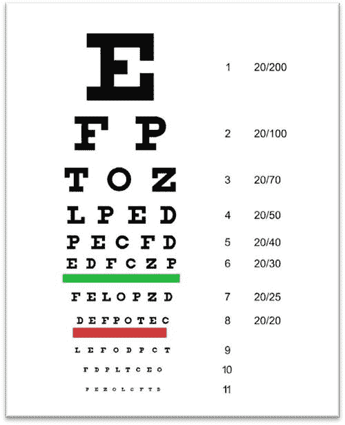

**图 12-12.** 一张斯内伦视力表（来源：维基百科）

为了测试视力并开具眼镜处方，医生会进行一个小测试。过去，医生不使用特殊设备，而是有一个装满各种镜片（不同度数）的盒子。患者被要求坐在椅子上，并戴上空的镜架。医生会依次将不同度数的镜片放入镜架，并让患者阅读斯内伦视力表。例如，有些患者能读出最上面的七行，但在下面几行感到困难。然后医生移除第一个镜片，换上另一个。经过多次这样的反复，医生最终根据患者眼镜所需的精确镜片做出决定。有些患者被诊断为近视，有些则为远视。这个过程的基本假设是所有患者都是有读写能力的。但如果患者是文盲，一个字母都认不出来怎么办？

因此，视力测定和处方开具过程中的主要步骤可以列举如下：

1. 假设患者有读写能力。

2. 根据一些测试，确定是近视还是远视，并粗略估计视力状况。

3. 通过尝试各种镜片来精确估计视力。

4. 使用测试结果开具处方。

类似的类比可以应用于 Box–Jenkins 方法。假设你手头有一个时间序列，并且你想预测该序列中的一些未来值。你首先需要识别该时间序列过程是 AR 过程、MA 过程还是 ARMA 过程。你还需要识别 `AR(p)`、`MA(q)` 或 `ARMA(p,q)` 过程（视情况而定）的阶数 `p` 和 `q`。一旦你确定了序列的类型和阶数，就可以尝试写出序列方程。你已经熟悉了 `AR(p)`、`MA(q)` 和 `ARMA(p,q)` 方程。下一步是找到相应的参数，如 `a[1]`、`a[2]`、...、`a[p]` 以及 `b[1]`、`b[2]`、...、`b[q]`。在你开始识别模型之前，需要做一个假设：序列必须是平稳的（在接下来的章节中，我会详细解释平稳时间序列）。这是为了简化整个模型识别过程。表 12-2 使用配镜处方的类似来说明 Box–Jenkins 方法。之后我将讨论 Box–Jenkins 方法中涉及的各个步骤。

**表 12-2.** 视力测试与 Box–Jenkins 方法之间的类比

| 视力测试 | Box–Jenkins 方法 |
| --- | --- |
| 假设患者有读写能力。 | 假设时间序列是平稳的；否则，使其平稳化。 |
| 根据一些测试，确定是近视还是远视，并粗略估计视力状况。 | 根据图形（ACF 和 PACF 函数，本章稍后会解释），确定模型是 AR、MA 还是 ARMA 过程。 |
| 通过尝试各种镜片来精确估计视力。 | 估计参数，如 `a[1]`、`a[2]`、...、`a[p]` 以及 `b[1]`、`b[2]`、...、`b[q]`。 |
| 使用测试结果开具处方。 | 使用最终模型进行预测。 |

## Box–Jenkins 方法的步骤

我将再次展示一个时间序列预测问题。考虑某只优质股票在一段时间内的一些时间序列数据。假设你有过去一年的股价数据。再假设你想预测接下来一周的股价。你将使用 Box–Jenkins 方法进行此预测。首先，你需要确保股价时间序列过程是平稳的。然后，你需要确定过程的类型，即哪种过程最接近股价数据遵循的模式。它是 AR 过程、MA 过程还是 ARMA 过程？一旦你有了基本的模型方程，你就可以估计参数。成功完成所有这些步骤即完成了模型构建过程。现在你有了最终的方程，可用于预测所考虑股票的未来价值。在继续进行最终预测和模型部署之前，你还需要查看模型的准确性或误差率。接下来是对每一步的详细解释。

### 步骤 1：检验时间序列是否平稳

如果一个时间序列过程是平稳的，那么使用 Box–Jenkins 方法构建模型就会容易得多。

#### 什么是平稳时间序列？

克里斯·查特菲尔德博士在《时间序列分析：导论》（Chapman and Hall，2003）中指出：“如果时间序列的均值不存在系统性变化（无趋势），方差不存在系统性变化，且严格周期性变动已被移除，则该时间序列可称为平稳的。”平稳时间序列处于统计均衡状态。如果序列在特定范围内波动，且该序列均值和方差的历史或未来值不会异常偏高，那么该序列可被理解为平稳序列。在平稳时间序列过程中，均值和方差围绕单一数值波动。随着序列的增长，如果序列的均值和方差也趋于极度增大，则该序列被视为非平稳的。在非平稳时间序列中识别模式较为困难，模型构建也可能颇具挑战。非常数均值或非常数方差是非平稳时间序列过程的标志（图 12-13）。这些过程也称为爆炸性过程。

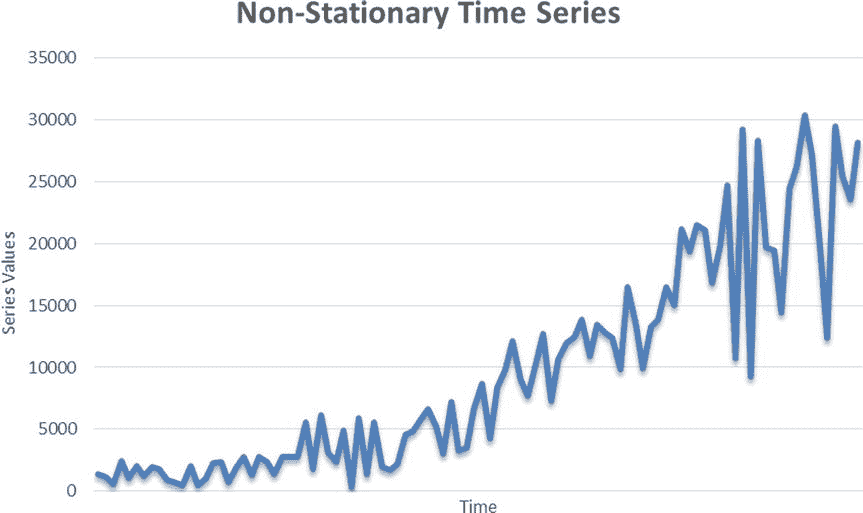

图 12-13. 非平稳时间序列示例

在某些情况下，识别非平稳时间序列较为容易。你需要问两个问题：

*   在时间无穷大时，序列的均值会是多少？

*   在时间无穷大时，序列的方差会是多少？

如果这两个问题中任一问题的答案是无穷大，那么你可以稳妥地得出结论：所考察的序列是非平稳的。随着非平稳序列的增长，你可以看到序列数值开始过度膨胀；事实上，它们很快就会趋于失控。在这种情况下，使用 Box-Jenkins 方法预测序列数值变得极为困难。现实场景中可能会遇到许多非平稳序列。你可能需要对其进行变换或差分以使其平稳。后续章节将详细介绍序列变换和差分的细节。

图 12-14 展示了一个平稳时间序列的示例图。

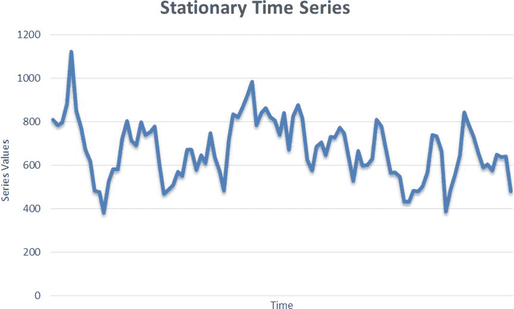

图 12-14. 平稳时间序列示例

在图 12-14 中，序列图呈现出一定的稳定性。它并未从其均值线过度膨胀。在这种情况下，方差或均值的数值也将表现出稳定性或均衡状态。到目前为止，我已多次强调，仅凭曲线形状得出结论并非好方法。你需要一种经过科学验证的统计方法来判断序列是否平稳。事实上，曲线形状有时可能具有误导性，并导致错误结论。例如，让我们看看图 12-15 所示的序列，该图展示了微软股票价格的每周波动。图中数据显示的是 2010 年 1 月至 2014 年 9 月微软的股票价格（来源：[`http://finance.yahoo.com/echarts?s=MSFT`](http://finance.yahoo.com/echarts?s=MSFT)）。仅凭曲线形状，你无法明确判断它是平稳序列还是非平稳序列。你需要一个可靠的检验来测试平稳性。

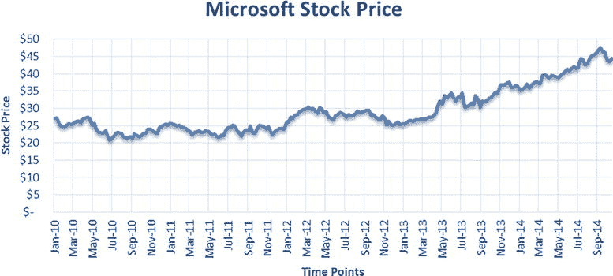

图 12-15. 某上市公司每周股票价格的时间序列数据

#### 使用 DF 检验测试平稳性

要测试序列的平稳性，可以使用迪基-富勒检验。DF 检验和增广迪基-富勒检验背后的实际理论较为复杂，超出了本书的讨论范围。以下是对 DF 检验的简化实用说明，可能足以满足实际应用需求。

DF 检验的零假设和备择假设如下：

*   `H[0]`：序列不是平稳的。

*   `H[1]`：序列是平稳的。

因此，你执行 DF 检验并记录`P 值`。观察 DF 检验的`P 值`，如果`P 值`小于 5%（0.05），则拒绝零假设，这相当于拒绝“序列不是平稳的”这一假设。因此，当 DF 检验的`P 值`小于 0.05 时，可得出序列平稳的结论。另一方面，如果`P 值`大于 0.05，则继续接受零假设，这意味着序列不是平稳的。

好的，作为高级文档工程师和翻译员，我将严格按照您的要求，将以下英文文本翻译成中文。

##### 用于检验平稳性的 SAS 代码

以下是用于检验序列平稳性的 SAS 代码。假设微软股票价格数据已导入 SAS 环境，并存储在名为 `ms` 的数据集中。

```
proc arima data= ms;
identify var= stock_price stationarity=(DICKEY);
run;
```

以下是对这段代码的解释：

- `proc arima`：`arima` 是用于拟合 ARIMA 模型的过程。

- `data= ms;`：数据集名称为 `ms`。

- `identify var= stock_price`：这指定了时间序列变量，在此例中为 `Adj_close`。

- `stationarity=(DICKEY)`：这是 DF 检验的关键字。

表 12-3 展示了这段代码的输出结果。

# 表 12-3. 数据集 `ms` 上的 `PROC ARIMA` 输出结果（DF 检验）

## ARIMA 过程

| 变量名称 = stock_price |
| --- |
| 工作序列均值 | 29.20438 |
| 标准差 | 6.539502 |
| 观测数量 | 251 |

## 自相关

| 滞后 | 协方差 | 相关性 | -1 9 8 7 6 5 4 3 2 1 0 1 2 3 4 5 6 7 8 9 1 | 标准误差 |
| --- | --- | --- | --- | --- |
| 0 | 42.765085 | 1.00000 | &#124;                    &#124;********************&#124; | 0 |
| 1 | 41.916461 | 0.98016 | &#124;                 .  &#124;********************&#124; | 0.063119 |
| 2 | 41.181417 | 0.96297 | &#124;                .   &#124;******************* &#124; | 0.107885 |
| 3 | 40.429605 | 0.94539 | &#124;              .     &#124;******************* &#124; | 0.137942 |
| 4 | 39.522281 | 0.92417 | &#124;              .     &#124;******************  &#124; | 0.161708 |
| 5 | 38.561047 | 0.90169 | &#124;             .      &#124;******************  &#124; | 0.181535 |
| 6 | 37.544646 | 0.87793 | &#124;            .       &#124;******************  &#124; | 0.198579 |
| 7 | 36.563693 | 0.85499 | &#124;           .        &#124;*****************   &#124; | 0.213483 |
| 8 | 35.643849 | 0.83348 | &#124;           .        &#124;*****************   &#124; | 0.226715 |
| 9 | 34.680732 | 0.81096 | &#124;          .         &#124;****************    &#124; | 0.238611 |
| 10 | 33.800014 | 0.79036 | &#124;          .         &#124;****************    &#124; | 0.249350 |
| 11 | 33.004501 | 0.77176 | &#124;          .         &#124;***************     &#124; | 0.259139 |
| 12 | 32.306690 | 0.75545 | &#124;         .          &#124;***************     &#124; | 0.268140 |
| 13 | 31.663022 | 0.74039 | &#124;         .          &#124;***************     &#124; | 0.276489 |
| 14 | 30.943593 | 0.72357 | &#124;         .          &#124;**************      &#124; | 0.284279 |
| 15 | 30.128160 | 0.70450 | &#124;        .           &#124;**************      &#124; | 0.291524 |
| 16 | 29.475695 | 0.68925 | &#124;        .           &#124;**************      &#124; | 0.298230 |
| 17 | 28.873215 | 0.67516 | &#124;        .           &#124;**************      &#124; | 0.304510 |
| 18 | 28.196376 | 0.65933 | &#124;        .           &#124;*************       &#124; | 0.310417 |
| 19 | 27.582788 | 0.64498 | &#124;       .            &#124;*************       &#124; | 0.315947 |
| 20 | 27.015599 | 0.63172 | &#124;       .            &#124;*************       &#124; | 0.321150 |
| 21 | 26.431044 | 0.61805 | &#124;       .            &#124;************.       &#124; | 0.326063 |
| 22 | 25.838137 | 0.60419 | &#124;       .            &#124;************.       &#124; | 0.330697 |
| 23 | 25.265838 | 0.59081 | &#124;       .            &#124;************.       &#124; | 0.335066 |
| 24 | 24.735666 | 0.57841 | &#124;      .             &#124;************ .      &#124; | 0.339191 |

`.` 标记表示两倍标准误差

## 逆自相关

| 滞后 | 相关性 | -1 9 8 7 6 5 4 3 2 1 0 1 2 3 4 5 6 7 8 9 1 |
| --- | --- | --- |
| 1 | -0.43201 | &#124;           *********&#124;  .                  &#124; |
| 2 | -0.03023 | &#124;                 . *&#124;  .                  &#124; |
| 3 | -0.06586 | &#124;                 . *&#124;  .                  &#124; |
| 4 | 0.01759 | &#124;                 .  &#124;  .                  &#124; |
| 5 | -0.02020 | &#124;                 .  &#124;  .                  &#124; |
| 6 | 0.02871 | &#124;                 .  &#124;* .                  &#124; |
| 7 | 0.02352 | &#124;                 .  &#124;  .                  &#124; |
| 8 | -0.06275 | &#124;                 . *&#124;  .                  &#124; |
| 9 | 0.03719 | &#124;                 .  &#124;* .                  &#124; |
| 10 | 0.00328 | &#124;                 .  &#124;  .                  &#124; |
| 11 | 0.03405 | &#124;                 .  &#124;* .                  &#124; |
| 12 | 0.01159 | &#124;                 .  &#124;  .                  &#124; |
| 13 | -0.04483 | &#124;                 . *&#124;  .                  &#124; |

| 14 | -0.07979 | &#124; .** &#124; . &#124; |
| 15 | 0.09398 | &#124; . &#124;**. &#124; |
| 16 | 0.01896 | &#124; . &#124; . &#124; |
| 17 | -0.05763 | &#124; . *&#124; . &#124; |
| 18 | 0.03131 | &#124; . &#124;* . &#124; |
| 19 | 0.01035 | &#124; . &#124; . &#124; |
| 20 | -0.02261 | &#124; . &#124; . &#124; |
| 21 | -0.00559 | &#124; . &#124; . &#124; |
| 22 | 0.01411 | &#124; . &#124; . &#124; |
| 23 | -0.00034 | &#124; . &#124; . &#124; |
| 24 | -0.00268 | &#124; . &#124; . &#124; |

### 偏自相关

| 滞后 | 相关性 | -1 9 8 7 6 5 4 3 2 1 0 1 2 3 4 5 6 7 8 9 1 |
|------|--------|--------------------------------------------------|
| 1 | 0.98016 | &#124; . &#124;******************** |
| 2 | 0.05757 | &#124; . &#124;* . &#124; |
| 3 | -0.01432 | &#124; . &#124; . &#124; |
| 4 | -0.10292 | &#124; .** &#124; . &#124; |
| 5 | -0.05609 | &#124; . *&#124; . &#124; |
| 6 | -0.04894 | &#124; . *&#124; . &#124; |
| 7 | 0.01308 | &#124; . &#124; . &#124; |
| 8 | 0.03603 | &#124; . &#124;* . &#124; |
| 9 | -0.02412 | &#124; . &#124; . &#124; |
| 10 | 0.03221 | &#124; . &#124;* . &#124; |
| 11 | 0.03873 | &#124; . &#124;* . &#124; |
| 12 | 0.05418 | &#124; . &#124;* . &#124; |
| 13 | 0.02240 | &#124; . &#124; . &#124; |
| 14 | -0.06212 | &#124; . *&#124; . &#124; |
| 15 | -0.09624 | &#124; .** &#124; . &#124; |
| 16 | 0.06381 | &#124; . &#124;* . &#124; |
| 17 | 0.04601 | &#124; . &#124;* . &#124; |
| 18 | -0.02960 | &#124; . *&#124; . &#124; |
| 19 | 0.02061 | &#124; . &#124; . &#124; |
| 20 | 0.01711 | &#124; . &#124; . &#124; |
| 21 | -0.01757 | &#124; . &#124; . &#124; |
| 22 | -0.01194 | &#124; . &#124; . &#124; |
| 23 | 0.00998 | &#124; . &#124; . &#124; |
| 24 | 0.00511 | &#124; . &#124; . &#124; |

### 白噪声自相关检验

| 至滞后阶数 | 卡方值 | 自由度 | Pr > 卡方值 | 自相关系数 | | | | | | |
|------------|--------|--------|-------------|------------|---|---|---|---|---|---|
| 6 | 1338.63 | 6 | <.0001 | 0.980 | 0.963 | 0.945 | 0.924 | 0.902 | 0.878 |
| 12 | 2356.83 | 12 | <.0001 | 0.855 | 0.833 | 0.811 | 0.790 | 0.772 | 0.755 |
| 18 | 3147.49 | 18 | <.0001 | 0.740 | 0.724 | 0.705 | 0.689 | 0.675 | 0.659 |
| 24 | 3768.57 | 24 | <.0001 | 0.645 | 0.632 | 0.618 | 0.604 | 0.591 | 0.578 |

### 增广迪基-富勒单位根检验

| 类型 | 滞后阶数 | Rho | Pr < Rho | Tau | Pr < Tau | F | Pr > F |
|------|----------|-----|----------|-----|----------|---|--------|
| **零均值** | 0 | 0.5872 | 0.8278 | 1.27 | 0.9484 | | |
| | 1 | 0.5975 | 0.8302 | 1.41 | 0.9610 | | |
| | 2 | 0.6488 | 0.8424 | 1.61 | 0.9740 | | |
| **单均值** | 0 | 0.4367 | 0.9749 | 0.20 | 0.9725 | 0.81 | 0.8654 |
| | 1 | 0.8208 | 0.9852 | 0.42 | 0.9835 | 1.00 | 0.8151 |
| | 2 | 0.9180 | 0.9872 | 0.49 | 0.9862 | 1.30 | 0.7389 |
| **趋势** | 0 | -9.5408 | 0.4616 | -2.35 | 0.4071 | 4.13 | 0.3520 |
| | 1 | -8.4784 | 0.5410 | -2.25 | 0.4603 | 4.23 | 0.3321 |
| | 2 | -7.0116 | 0.6587 | -1.93 | 0.6390 | 3.34 | 0.5093 |

# 表 12-3 的输出包含多个表格，但此处关键的是最后一个名为“增广迪基-富勒单位根检验”的表格。在该表格中，您需要关注“单均值”部分。表格中的“零均值”部分假设序列均值为零进行计算。“趋势”部分则假设 DF 检验的原假设成立，即序列具有某些趋势成分且是平稳的。在您的推断中，可以安全地忽略这两部分输出。因此，为简单起见，我们只关注表 12-4，该表取自完整表格“增广迪基-富勒单位根检验”。

## 表 12-4. 增广迪基-富勒单位根检验中的单均值部分

| 类型 | 滞后阶数 | Rho | Pr < Rho | Tau | Pr < Tau | F | Pr > F |
| --- | --- | --- | --- | --- | --- | --- | --- |
| 单均值 | 0 | 0.4367 | 0.9749 | 0.20 | 0.9725 | 0.81 | 0.8654 |
| | 1 | 0.8208 | 0.9852 | 0.42 | 0.9835 | 1.00 | 0.8151 |
| | 2 | 0.9180 | 0.9872 | 0.49 | 0.9862 | 1.30 | 0.7389 |

您需要查看增广迪基-富勒检验中单均值的 P 值。

- 对于滞后 0、1 和 2 阶，`Pr<Rho`的值均大于 5%。

- 类似地，对于滞后 0、1 和 2 阶，`Pr<Tau`的值均大于 5%。

因此，您可以安全地得出结论：所考虑的序列是非平稳的。

> **注意：** 如前所述，DF 检验的精确解释较为复杂，超出了本书的讨论范围。以下是为统计学爱好者提供的一些注释。
>
> DF 检验有两组 P 值：
>
> - 第一组 P 值（`Pr<Rho`）用于直接检验单位根。查看这些 P 值（表 12-4），您可以得出结论：该序列是非平稳的。
> - 第二组 P 值（`Pr<Tau`）用于检验差分后的`Y[t]`对常数、时间`t`、`Y[t-1]`以及差分后的`Y[t-1]`的回归。

## 实现平稳性

如果序列像前一个案例（图 12-15）那样是非平稳的，您可以对其进行差分以使其平稳。如果`Y[t]`是原始序列，则`∆Y[t] = Y[t] - Y[t-1]`。您不再使用原始序列值，而是考虑差分后的序列，如表 12-5 所示。

### 表 12-5. 差分后的序列数据

| 时间 | `Y[t]` (原始序列) | `Y[t-1]` (原始序列的滞后值) | `∆Y[t] = Y[t] - Y[t-1]` (差分后的序列) |
| --- | --- | --- | --- |
| 一月 | 200 | - | - |
| 二月 | 250 | 200 | 50 |
| 三月 | 230 | 250 | -20 |
| 四月 | 245 | 230 | 15 |
| 五月 | 280 | 245 | 35 |
| 六月 | 256 | 280 | -24 |

在前面的 Microsoft 示例中，股票价格时间序列是非平稳的。让我们使用以下 SAS 代码创建一个差分后的时间序列。这相当直接。

```
data ms1;
set ms;
diff_stock_price=stock_price-lag1(stock_price);
run;
```

`ms1`是新的数据集，`Lag1`表示`Y[t-1]`的值，`diff_stock_price`是新的差分序列。表 12-6 是差分序列的快照。

### 表 12-6. 差分后的股票价格时间序列快照

| 观测值 | `stock_price` | `diff_stock_price` |
| --- | --- | --- |
| 1 | 27.05 | . |
| 2 | 27.23 | 0.18 |
| 3 | 25.55 | -1.68 |
| 4 | 24.86 | -0.69 |
| 5 | 24.72 | -0.14 |
| 6 | 24.64 | -0.08 |
| 7 | 25.5 | 0.86 |
| 8 | 25.41 | -0.09 |
| 9 | 25.34 | -0.07 |
| 10 | 25.94 | 0.60 |

请注意，有些序列即使经过一次差分后可能仍不平稳。这时您需要进行二次差分。如果二次差分也不起作用，您可能需要尝试其他变换，例如对数变换。

现在，不再考虑原始序列（即股票价格`Y[t]`），而是考虑差分后的股票价格并检验其平稳性。以下是执行此检验的代码：

```
proc arima data= ms1;
identify var=diff_stock_price stationarity=(DICKEY);
run;
```

表 12-7 展示了此代码的输出。同样，您只需关注输出中的“增广迪基-富勒单位根检验”表格，并将重点放在“单均值”部分。

### 表 12-7. 对`ms1`执行`PROC ARIMA`的输出（DF 检验）

| 类型 | 滞后阶数 | Rho | Pr < Rho | Tau | Pr < Tau | F | Pr > F |
| --- | --- | --- | --- | --- | --- | --- | --- |
| 零均值 | 0 | -270.879 | 0.0001 | -17.17 | <.0001 | | |
| | 1 | -289.824 | 0.0001 | -12.06 | <.0001 | | |
| | 2 | -265.730 | 0.0001 | -9.31 | <.0001 | | |
| 单均值 | 0 | -272.508 | 0.0001 | -17.26 | <.0001 | 148.89 | 0.0010 |
| | 1 | -296.605 | 0.0001 | -12.19 | <.0001 | 74.30 | 0.0010 |
| | 2 | -280.934 | 0.0001 | -9.46 | <.0001 | 44.80 | 0.0010 |
| 趋势 | 0 | -275.376 | 0.0001 | -17.43 | <.0001 | 151.98 | 0.0010 |
| | 1 | -306.994 | 0.0001 | -12.36 | <.0001 | 76.36 | 0.0010 |
| | 2 | -303.187 | 0.0001 | -9.62 | <.0001 | 46.34 | 0.0010 |

关于 Rho 和 Tau 的两组 P 值均远低于 5%。因此，您得出结论：序列`diff_stock_price`是平稳的。

## ARIMA 过程中的积分分量

在上一节中，你了解了如何通过差分使非平稳过程变得平稳。原始微软股票价格是几十美元的量级，而差分后的值（新的平稳序列）则是分数（小数）量级。请参考表 12-6。

差分后的序列是平稳的，可以使用 Box-Jenkins 方法进行分析。这个新序列可以是任意 `ARMA(p,q)` 过程。但是，该序列的预测值将只是分数形式。事实上，你对预测差分后的时间序列并不感兴趣。我们的主要兴趣在于预测实际的微软股票价格，显然不是差分后的序列。你仍然可以从差分序列中推导出原始序列的值。你需要对差分序列执行一个积分操作，这是差分的数学逆运算。你通过差分使序列变得平稳。现在，你对变换后的序列进行积分，使其恢复到原始形态。这里的差分阶数 (`d`) 为 1。你对股票价格序列进行的差分阶数也是 1。带有积分的 ARMA 序列也称为 ARIMA 序列。它表示为 `ARIMA(p,d,q)`，其中 `p` 是自回归（AR）分量的阶数，`d` 是积分的阶数，最后 `q` 是移动平均（MA）分量的阶数。

在当前示例过程中所需的积分阶数是 1。这仅仅是因为为了使其平稳，你进行了一次差分。有些序列无需任何差分就是平稳的。对于这些时间序列，积分的阶数为 0。以下是一些 ARIMA 过程的示例：

`ARIMA(1,1,0)` 序列写为：

```
∆Y[t] = a[1]*∆Y[t-1] + ε[t]
```

`a[1]` 是 `∆Y[t-1]` 对 `∆Y[t]` 影响的因子或量化值，`ε[t]` 是时间 `t` 的随机误差，换句话说，`∆Y[t]=Y[t]-Y[t-1]`。

`ARIMA(2,1,0)` 序列写为：

```
∆Y[t] = a[1]*∆Y[t-1]+ a[2]*∆Y[t-2] + ε[t]
```

`a[1]` 和 `a[2]` 是 `∆Y[t-1]` 和 `∆Y[t-2]` 对 `∆Y[t]` 影响的因子或量化值，`ε[t]` 是时间 `t` 的随机误差，换句话说，`∆Y[t]=Y[t]-Y[t-1]`。

`ARIMA(1,1,1)` 序列写为：

```
∆Y[t] = a[1]*∆Y[t-1]+ ε[t] + b[1]*ε[t-1]
```

`a[1]` 是 `∆Y[t-1]` 对 `∆Y[t]` 影响的因子或量化值，`ε[t]` 和 `ε[t-1]` 分别是时间 `t` 和 `t-1` 的随机误差，换句话说，`∆Y[t] = Y[t]-Y[t-1]`。

## 预测后的积分

你可能想知道如何在预测后进行积分。表 12-6 显示了在微软股票价格示例中对原始序列差分后序列的形式。在这个例子中，你发现股票价格不是平稳的，但 `diff_stock_price` 是平稳的。

现在假设你已经对 `diff_stock_price` 序列进行了分析并产生了三个预测值。请参考表 12-8 中的观测值 11、12 和 13。

**表 12-8.** 时间序列 `diff_stock_price` 中的预测值

| 观测序号 | `stock_price` | `diff_stock_price` |
| --- | --- | --- |
| 1 | 27.05 | . |
| 2 | 27.23 | 0.18 |
| 3 | 25.55 | -1.68 |
| 4 | 24.86 | -0.69 |
| 5 | 24.72 | -0.14 |
| 6 | 24.64 | -0.08 |
| 7 | 25.5 | 0.86 |
| 8 | 25.41 | -0.09 |
| 9 | 25.34 | -0.07 |
| 10 | 25.94 | 0.60 |
| 11 |  | -0.10 |
| 12 |  | 0.21 |
| 13 |  | -0.11 |

完成这一步后，你如何知道观测值 11、12 和 13 的股票价格呢？换句话说，这里的问题是如何将预测出的序列恢复到其原始单位？

你知道，在任何给定时间 `t` 的差分股票价格可以通过以下公式计算：
- 时间 `t` 的 `Diff_stock_price` = (时间 `t` 的股票价格) - (时间 `t-1` 的股票价格)

在预测之前：
- 时间 10 的 `Diff_stock_price` = (时间 10 的股票价格) - (时间 9 的股票价格)
- 时间 10 的 `Diff_stock_price` = 25.94 – 25.34
- 时间 10 的 `Diff_stock_price` = 0.60

在预测之后：
- 时间 11 的 `Diff_stock_price` = (时间 11 的股票价格) - (时间 10 的股票价格)
- 将此方程中的值代入（来自表 12-8），你得到：
- `-0.10 = 时间 11 的股票价格 - 25.94`
- `时间 11 的股票价格 = 25.94 - 0.10`
- `时间 11 的股票价格 = 25.84`

类似地：
- 时间 12 的 `Diff_stock_price` = (时间 12 的股票价格) - (时间 11 的股票价格)
- `0.21 = 时间 12 的股票价格 - 25.84`
- `时间 12 的股票价格 = 25.84 + 0.21`
- `时间 12 的股票价格 = 26.05`

重复同样的计算，你会得到时间点 13 的股票价格为 25.94 (表 12-9)。

**表 12-9.** 时间序列 `stock_price` 和 `diff_stock_price` 中的预测值（积分后）

| 观测序号 | `stock_price` | `diff_stock_price` |
| --- | --- | --- |
| 1 | 27.05 | . |
| 2 | 27.23 | 0.18 |
| 3 | 25.55 | -1.68 |
| 4 | 24.86 | -0.69 |
| 5 | 24.72 | -0.14 |
| 6 | 24.64 | -0.08 |
| 7 | 25.5 | 0.86 |
| 8 | 25.41 | -0.09 |
| 9 | 25.34 | -0.07 |
| 10 | 25.94 | 0.60 |
| 11 | 25.84 | -0.10 |
| 12 | 26.05 | 0.21 |
| 13 | 25.94 | -0.11 |

经验法则是：在差分时减去前一个滞后值；在积分时加上前一个滞后值。一旦序列变得平稳，就可以进行分析，而预测也变得相对容易。下一步是确定序列的类型。它是 `AR`、`MA` 还是 `ARMA`？

对于当前的示例序列，你已经确定了积分的阶数。现在你需要识别 `p` 和 `q`。这是下一步。

### 步骤 2：识别模型

模型识别是使用 `Box-Jenkins` 方法进行时间序列建模的重要步骤之一。最终的预测精度将取决于你识别模型的准确程度。模型识别包括找出时间序列过程的类型，即你处理的是 `AR(1)` 还是 `AR(2)`，或是 `MA(1)` 还是 `MA(2)`，或是 `ARMA(1,1)` 还是 `ARMA(2,1)` 等。通过识别序列的类型，你将对数据有一个基本了解。如果是 `AR`，那么你就知道当前序列的值依赖于之前的值。`AR` 序列具有长期趋势。如果是 `MA`，那么误差会产生一些影响。`MA` 序列有一些短期的季节性效应。实际上，你可以将 `ARMA(p,q)` 序列的基本形式写成：

```
Y[t] = a[1]*Y[t-1] + a[2]*Y[t-2] + a[3]*Y[t-3] + ... + a[p]*Y[t-p] + ε[t] + b[1]*ε[t-1] + b[2]*ε[t-2] + ... + b[q]*ε[t-q]
```

识别模型绝非易事。仅凭观察序列图来断定序列的类型和阶数是不够的。你需要一些具体的指标来识别序列的类型和阶数。你需要使用自相关函数（`ACF`）和偏自相关函数（`PACF`）及其图来识别序列的类型。我将在接下来的章节中详细阐述这一点。首先，为了更好理解，让我们看一些时间序列方程及其图形。

#### 时间序列示例

为了理解序列的识别方法，你将观察一些模拟的时间序列。你将看到大约 15 张带有对应方程的图表（图 12-16 至 12-30）。以下是一些时间序列图。让我们试着猜测它们的序列类型。

**时间序列图 – 1**（图 12-16）：`y[t] = 0.66y[t-1] + ε[t]`
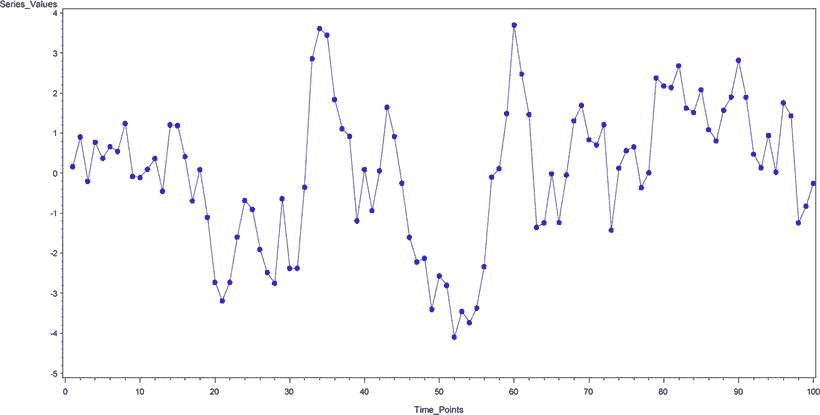
*图 12-16.* 对应于`y[t] = 0.66y[t-1] + ε[t]`的时间序列图

**时间序列图 – 2**（图 12-17）：`y[t] = 0.83y[t-1] + ε[t]`
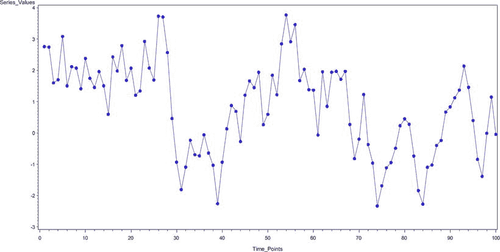
*图 12-17.* 对应于`y[t] = 0.83y[t-1] + ε[t]`的时间序列图

**时间序列图 – 3**（图 12-18）：`y[t] = -0.95y[t-1] + ε[t]`
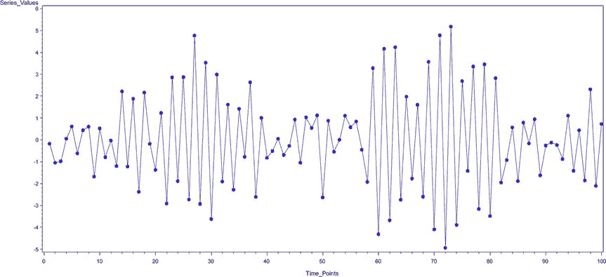
*图 12-18.* 对应于`y[t] = -0.95y[t-1] + ε[t]`的时间序列图

**时间序列图 – 4**（图 12-19）：`y[t] = 0.4y[t-1] + 0.48y[t-2] + ε[t]`
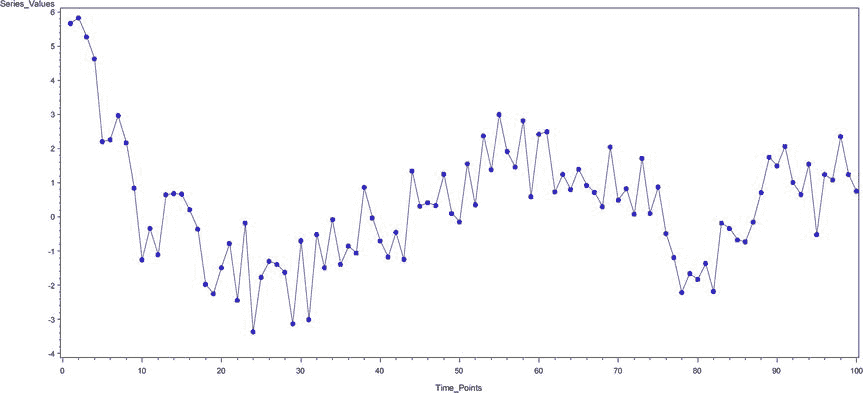
*图 12-19.* 对应于`y[t] = 0.4y[t-1] + 0.48y[t-2] + ε[t]`的时间序列图

**时间序列图 – 5**（图 12-20）：`y[t] = 0.5y[t-1] + 0.4y[t-2] + ε[t]`
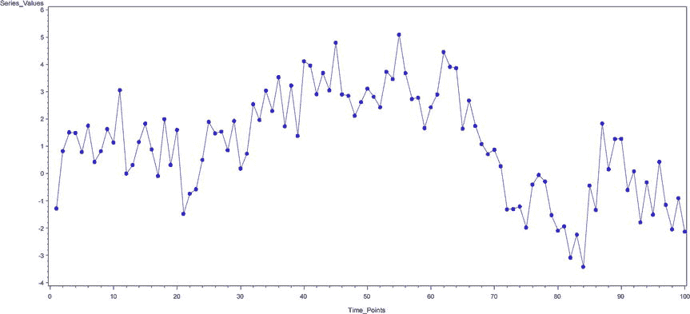
*图 12-20.* 对应于`y[t] = 0.5y[t-1] + 0.4y[t-2] + ε[t]`的时间序列图

**时间序列图 – 6**（图 12-21）：`y[t] = 0.3y[t-1] + 0.33y[t-2] + 0.26y[t-3] + ε[t]`
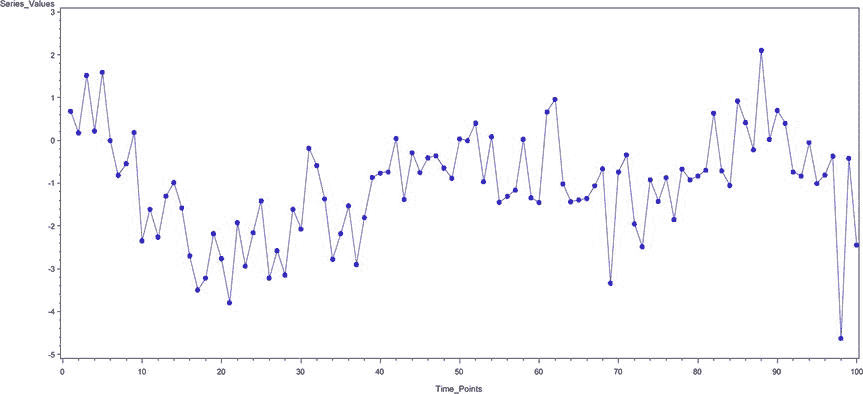
*图 12-21.* 对应于`y[t] = 0.3y[t-1] + 0.33y[t-2] + 0.26y[t-3] + ε[t]`的时间序列图

**时间序列图 – 7**（图 12-22）：`y[t] = ε[t] -0.8 ε[t-1]`
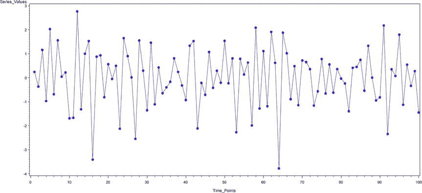

## 时间序列图

**时间序列图 – 8**（图 12-23）：`y[t] = ε[t] +0.66 ε[t-1]`

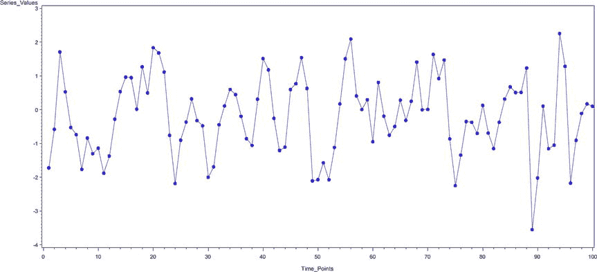

*图 12-23.* 对应于`y[t] = ε[t] +0.66 ε[t-1]`的时间序列图

**时间序列图 – 9**（图 12-24）：`y[t] = ε[t] +0.95 ε[t-1]`

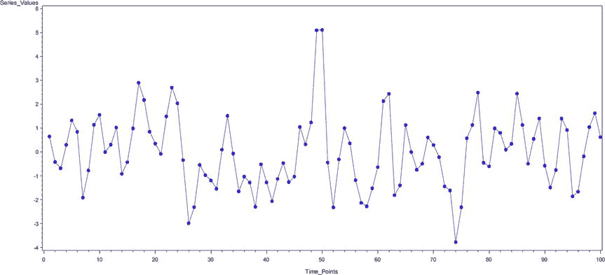

*图 12-24.* 对应于`y[t] = ε[t] +0.95 ε[t-1]`的时间序列图

**时间序列图 – 10**（图 12-25）：`y[t] = ε[t] -0.4 ε[t-1] -0.38 ε[t-2]`

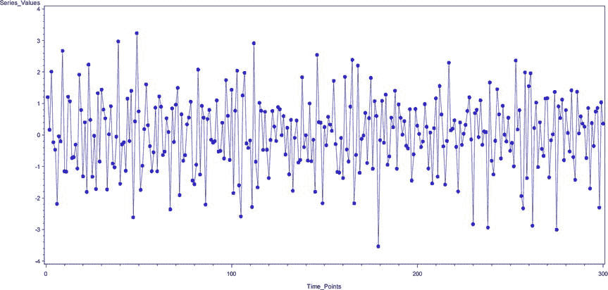

*图 12-25.* 对应于`y[t] = ε[t] -0.4 ε[t-1] -0.38 ε[t-2]`的时间序列图

**时间序列图 – 11**（图 12-26）：`y[t] = ε[t] -0.6 ε[t-1] -0.3 ε[t-2]`

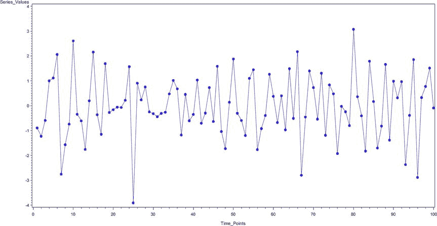

*图 12-26.* 对应于`y[t] = ε[t] -0.6 ε[t-1] -0.3 ε[t-2]`的时间序列图

**时间序列图 – 12**（图 12-27）：`y[t] = ε[t] -0.55 ε[t-1] -0.35 ε[t-2] -0.15 ε[t-3]`

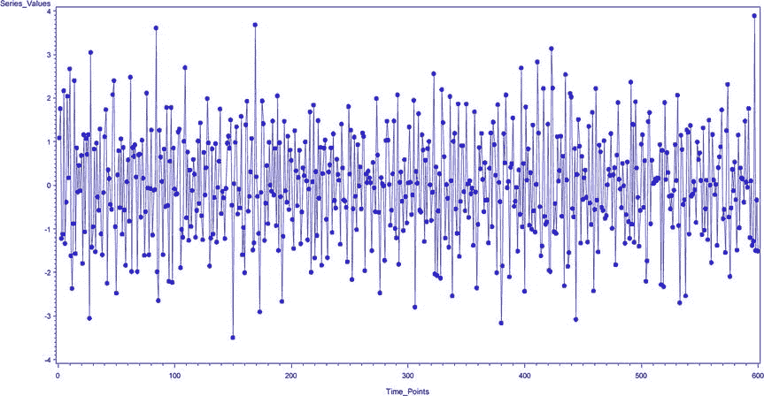

*图 12-27.* 对应于`y[t] = ε[t] -0.55 ε[t-1] -0.35 ε[t-2] -0.15 ε[t-3]`的时间序列图

**时间序列图 – 13**（图 12-28）：`y[t] = -0.95 y[t-1] + ε[t] -0.8 ε[t-1]`

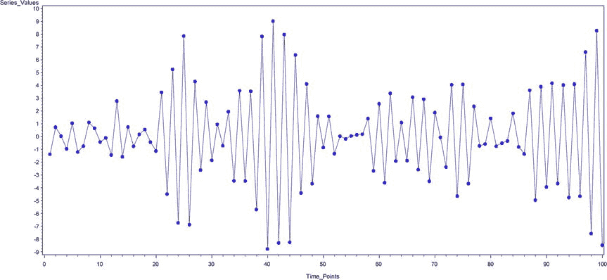

*图 12-28.* 对应于`y[t] = -0.95 y[t-1] + ε[t] -0.8 ε[t-1]`的时间序列图

**时间序列图 – 14**（图 12-29）：`y[t] = 0.77 y[t-1] + ε[t] +0.6 ε[t-1]`

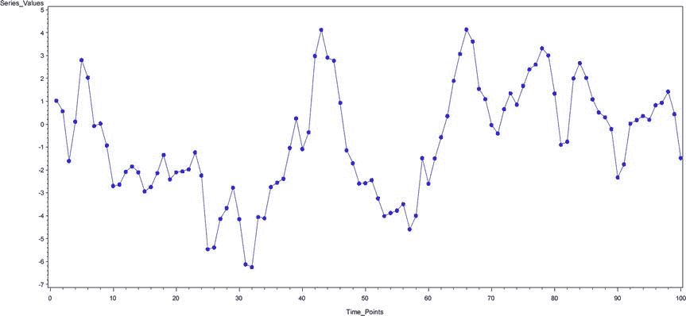

*图 12-29.* 对应于`y[t] = 0.77 y[t-1] + ε[t] +0.6 ε[t-1]`的时间序列图

**时间序列图 – 15**（图 12-30）：`y[t] = 0.55y[t-1] + 0.35y[t-2] + ε[t] -0.5 ε[t-1]`

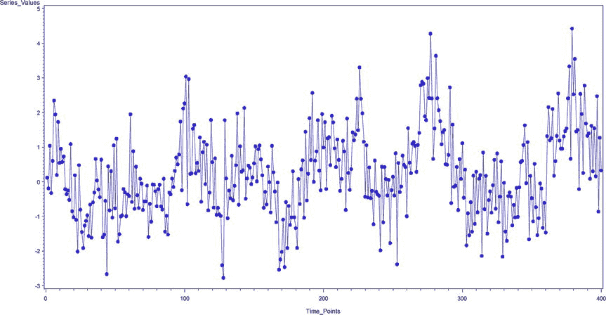

*图 12-30.* 对应于`y[t] = 0.55y[t-1] + 0.35y[t-2] + ε[t] -0.5 ε[t-1]`的时间序列图

仅凭简单观察就足以判断序列类型了吗？在图 12-16 到 12-30 的时间序列图中，其中一些是 `AR` 过程。这里有 `AR(1)`、`AR(2)`、`AR(3)` 的例子。一些是纯 `MA` 过程。这里有 `MA(1)`、`MA(2)` 和 `MA(3)` 的例子。还有一些序列是 `ARMA` 过程。

在前面的例子中，我模拟了数据；因此，我可以写出方程。但在实际场景中，你并不会拥有模型方程。你只会拥有序列值和序列图。你知道，仅通过观察序列值，很难将这些序列归类为 `AR`、`MA` 或 `ARMA`。你需要一些具体的指标来识别序列的类型。你需要使用 `ACF` 和 `PACF` 函数及图形来识别序列的类型。我将在以下部分讨论这些主题。下面将 15 个时间序列方程集中放在一起，以便你进行比较：

```text
TS - 1: y[t] = 0.66 y[t-1] + ε[t]
TS - 2: y[t] = 0.83 y[t-1] + ε[t]
TS - 3: y[t] = -0.95 y[t-1] + ε[t]
TS - 4: y[t] = 0.4 y[t-1] + 0.48 y[t-2] + ε[t]
TS - 5: y[t] = 0.5 y[t-1] + 0.4 y[t-2] + ε[t]
TS - 6: y[t] = 0.3 y[t-1] + 0.33 y[t-2] + 0.26 y[t-3] + ε[t]
TS - 7: y[t] = ε[t] - 0.8 ε[t-1]
TS - 8: y[t] = ε[t] + 0.66 ε[t-1]
TS - 9: y[t] = ε[t] + 0.95 ε[t-1]
TS - 10: y[t] = ε[t] - 0.4 ε[t-1] - 0.38 ε[t-2]
TS - 11: y[t] = ε[t] - 0.6 ε[t-1] - 0.3 ε[t-2]
TS - 12: y[t] = ε[t] - 0.55 ε[t-1] - 0.35 ε[t-2] - 0.15 ε[t-3]
TS - 13: y[t] = -0.95 y[t-1] + ε[t] - 0.8 ε[t-1]
TS - 14: y[t] = 0.77 y[t-1] + ε[t] + 0.6 ε[t-1]
TS - 15: y[t] = 0.55 y[t-1] + 0.35 y[t-2] + ε[t] - 0.5 ε[t-1]
```

## 自相关函数

自相关是指 `Y[t]` 与 `Y[t-1]` 之间的相关性。通常，你会找出两个变量之间的相关性，但这里，你是在寻找 `Y` 与其自身先前值之间的相关性。自相关函数是这些在不同滞后阶数上的所有相关性的函数。`ACF` 用 `ρh` 表示，其中 `h` 表示滞后阶数。

- `ACF(0)`：滞后 0 阶的相关性 (`ρ[0]`) = `Y[t]` 与 `Y[t]` 的相关性 = 1
- `ACF(1)`：滞后 1 阶的相关性 (`ρ[1]`) = `Y[t]` 与 `Y[t-1]` 之间的相关性
- `ACF(2)`：滞后 2 阶的相关性 (`ρ[2]`) = `Y[t]` 与 `Y[t-2]` 之间的相关性
- `ACF(3)`：滞后 3 阶的相关性 (`ρ[3]`) = `Y[t]` 与 `Y[t-3]` 之间的相关性

使用自相关值绘制的图形被称为自相关图。图 12-31 展示了一个此类图的例子。x 轴是滞后阶数值，y 轴是自相关值。该图形可能因序列的类型而异。

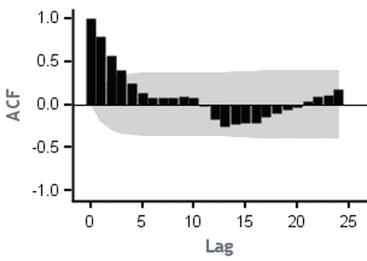

*图 12-31.* 一个自相关图的示例

在 `AR` 模型中，序列的当前值依赖于其先前值。你可以预期自相关会在 `AR` 模型中描绘出某种模式。

## 偏自相关函数

偏自相关函数是 `Y` 与其不同滞后阶数的先前取值之间的偏相关系数。偏相关系数是剔除其他变量影响后的相关系数。你可以将偏相关理解为排除了其他自变量影响后的相关系数，也可以将其视为排他性相关。

我们来看一个例子。你可以预期，信用评分会依赖于现有贷款数量、收入、逾期还款、信用历史长度以及受抚养人数。试图找出贷款数量与信用评分之间的简单相关性，会得到这两个变量之间的关联，但这也将包含所有其他变量对信用评分的影响。要找出偏相关，你需要先消除其他影响变量的效应。在实际应用中，你可以将偏相关系数视为回归系数。

对于信用评分的例子，方程如下：

`信用评分 = β[0] + β[1] (贷款数量) + β[2] (逾期还款) + β[3] (信用历史长度) + β[4] (受抚养人数)`

假设不存在多重共线性，贷款数量与信用评分之间的偏相关系数为 `β[1]`。`β[1]` 是变量“贷款数量”对信用评分的排他性影响。现在你可以理解，偏相关系数是两个变量之间的量化关联，这种关联无法通过它们与任何其他变量的共同关联来解释。

在时间序列分析的语境中，偏自相关是通过将 `Y` 的过去值对当前值进行回归得到的。`PACF` 用 `θ[h]` 表示，其中 `h` 代表滞后阶数。

- `PACF(0)`：`lag0`（`θ[0]`）处的偏相关 = `Y[t]` 和 `Y[t]` 自身 = 1

### 偏自相关函数（PACF）

- `PACF(1)`：`lag1`（`θ[1]`）处的偏相关 = 当 `Y[t-1]` 对 `Y[t]` 进行回归时，`Y[t-1]` 的回归系数
- `PACF(2)`：`lag2`（`θ[2]`）处的偏相关 = 当 `Y[t-1]` 和 `Y[t-2]` 对 `Y[t]` 进行回归时，`Y[t-2]` 的回归系数
- `PACF(3)`：`lag3`（`θ[3]`）处的偏相关 = 当 `Y[t-1]`、`Y[t-2]` 和 `Y[t-3]` 对 `Y[t]` 进行回归时，`Y[t-3]` 的回归系数

使用偏自相关值绘制的图形称为偏自相关图。图 12-32 显示了这样一个图的示例。x 轴表示滞后值，y 轴表示偏自相关值。与 ACF 一样，PACF 图也可能因序列类型而异。

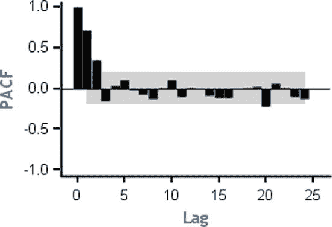

图 12-32. 偏自相关图示例

在 MA 模型中，序列当前的误差依赖于其之前的误差值。你可以预期，在 MA 模型中偏自相关会遵循某种模式。

#### 在 SAS 中创建 ACF 和 PACF 图

使用 ACF 和 PACF 图，你可以了解序列的类型。这是时间序列分析过程中的第二步。你首先必须确保时间序列是平稳的。你可能需要不时地对序列进行差分以使其平稳；平稳后的序列即可用于分析。一旦序列准备就绪，你需要对其类型进行分类。简要回顾一下，为了识别序列的类型，你需要研究为该序列生成的 ACF 和 PACF 图。

接下来是在 SAS 中创建 ACF 和 PACF 图的代码：

```
proc arima data=ts15 plots=all;
identify var=Series_Values ;
run ;
```

你需要使用 `plots=all` 选项来生成 ACF 和 PACF 图。SAS 输出会给出四个图：

- 原始序列图
- ACF 图
- PACF 图
- IACF 图

注意：IACF 代表逆自相关。这将在后续章节讨论。

#### 识别 AR 过程的经验法则

AR 过程的 ACF 呈现拖尾或衰减至零。一旦你看到 ACF 图显示出向零递减的趋势，你就可以稳妥地得出结论：该过程类型是 AR。图 12-33 展示了一些示例。

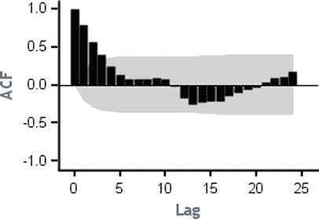

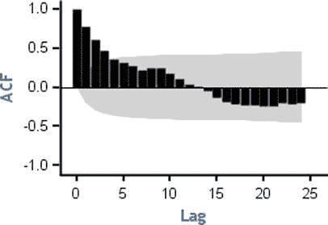

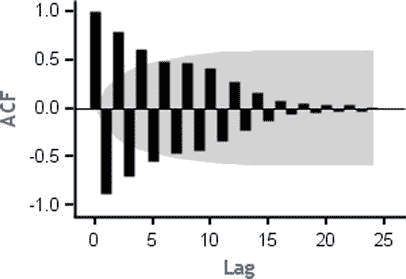

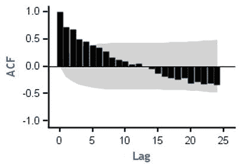

图 12-33. 显示向零递减趋势的 ACF 图示例

如果你在序列中观察到任何此类行为，那么你的序列中肯定存在 AR 成分。这意味着序列的当前值依赖于该序列的某些过去值。这就是为什么 ACF 函数会显示出相关性向零衰减或缓慢衰减的原因之一。`Y[t]` 依赖于 `Y[t-1]`，而 `Y[t-1]` 依赖于 `Y[t-2]`；因此，`Y[t]` 间接依赖于 `Y[t-2]`。所以，`lag2` 处的相关略低于 `lag1` 处的相关。`lag3` 处的相关略低于 `lag2` 处的相关。因此，AR 过程的 ACF 显示出向零缓慢递减的这种行为。

但这只是故事的第一部分。AR 过程的阶数呢？你如何识别一个序列是 `AR(1)`、`AR(2)` 还是 `AR(p)`？你如何找到 `p` 的值？一旦你从 ACF 图中确认该过程是 AR，就需要查看 PACF 以确定序列的阶数。对于 AR 过程，PACF 会截尾。在几个滞后之后，将不再有显著的偏自相关值。滞后期数即指示了序列的阶数。例如，如果 ACF 缓慢衰减至零，且 PACF 函数在 `lag1` 处截尾，那么该 AR 过程的阶数为 1。如果 ACF 缓慢衰减至零，且 PACF 函数在 `lag2` 处截尾，那么该 AR 过程的阶数为 2。图 12-34 展示了 AR 过程的一些 PACF 图示例。

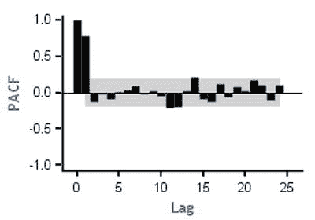

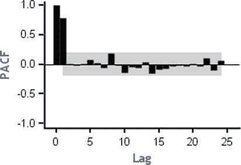

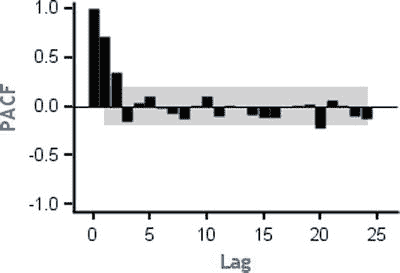

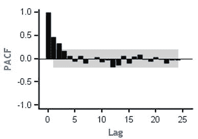

图 12-34. AR 过程的 PACF 图示例

从左上角顺时针计数，在图 1 中，你看到 PACF 在 `lag1` 处截尾。因此，该 AR 过程的阶数为 1。`lag0` 处的偏相关值始终为 1。在图 2（右上角）中，PACF 也在 `lag1` 处截尾。在图 3（左下角）中，PACF 在 `lag2` 处截尾，因此该 AR 过程的阶数为 2。在最后一个图（右下角）中，PACF 在 `lag3` 处截尾；因此，该 AR 过程的阶数为 3。灰色带表示显著性界限。任何超出该带界限的滞后都是显著的。最后一个图看起来似乎是在 `lag4` 处截尾，但第四个 PACF 值不够显著，因为它位于灰色带的界限之内。

以下是 AR 过程 PACF 图中截断点的理由。假设有一个 1 阶 AR 过程；`Y[t-1]` 对 `Y[t]` 有最大影响。如果你从 `Y[t-1]` 和 `Y[t]` 中移除先前的影响并计算相关性，那么你只会得到 `lag1` 的高相关性，而对于 `AR(1)` 过程，其余滞后项的影响可以忽略不计。类似地，对于一个 `AR(2)` 过程，`Y[t-1]` 和 `Y[t-2]` 对 `Y[t]` 有最大影响。如果你从 `Y[t-1]`、`Y[t-2]` 和 `Y[t]` 中移除所有先前的影响，那么只有 `lag1` 和 `lag2` 的相关性会很高。对于 `AR(2)` 过程，超过 `lag 2` 的其余所有相关性都可以忽略不计。请参考表 12-10 的总结。

表 12-10. 识别 `AR(p)` 过程的经验法则

| AR 过程 | 行为 |
| --- | --- |
| ACF | 缓慢衰减或逐渐消失至零。要么沿一个方向减小，要么以正弦波的形式减小。 |
| PACF | 截断。截断的滞后阶数表示 AR 过程的阶数。 |

在图 12-16 到图 12-30 的模拟时间序列列表中，前六个图属于 AR 序列。让我们看看它们的 ACF 和 PACF 图（图 12-35 到图 12-40）。再次提醒，对于实际业务场景中的任何新序列，序列方程通常是未知的。这只是一个获取序列方程的练习。

时间序列图 1 (图 12-16): `y[t] = 0.66y[t-1] + ε[t]`

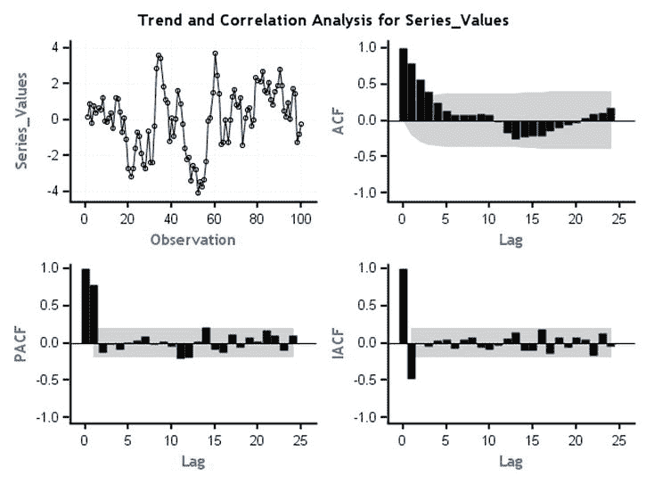

图 12-35. 时间序列图 1 的 ACF 和 PACF 图 (图 12-16)

注意，在图 12-35 中，ACF 逐渐衰减至零，而 PACF 在 `lag1` 处截断。TS 1 是一个 1 阶 AR 过程。

时间序列图 2 (图 12-17): `y[t] = 0.83y[t-1] + ε[t]`

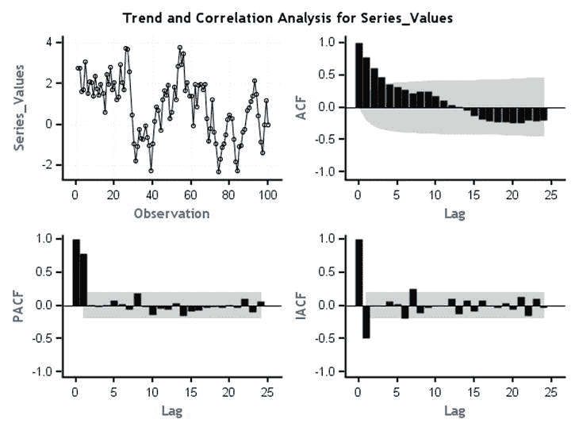

图 12-36. 时间序列图 2 的 ACF 和 PACF 图 (图 12-17)

注意，在图 12-36 中，ACF 逐渐衰减至零，而 PACF 在 `lag 1` 处截断。TS 2 是一个 1 阶 AR 过程。

时间序列图 3 (图 12-18): `y[t] = -0.95y[t-1] + ε[t]`

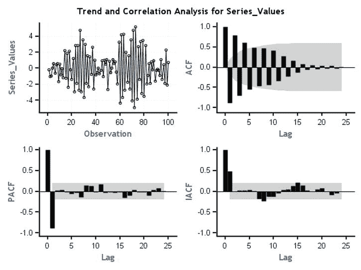

图 12-37. 时间序列图 3 的 ACF 和 PACF 图 (图 12-18)

注意，在图 12-37 中，ACF 逐渐衰减至零，而 PACF 在 `lag 1` 处截断。TS 3 是一个 1 阶 AR 过程。

时间序列图 4 (图 12-19): `y[t] = 0.4y[t-1] + 0.48y[t-2] + ε[t]`

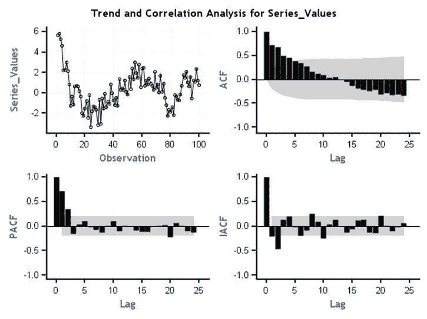

图 12-38. 时间序列图 4 的 ACF 和 PACF 图 (图 12-19)

注意，在图 12-38 中，ACF 逐渐衰减至零，而 PACF 在`lag 2`处截断。TS 4 是一个 2 阶 AR 过程。

时间序列图 5 (图 12-20): `y[t] = 0.5y[t-1] + 0.4y[t-2] + ε[t]`

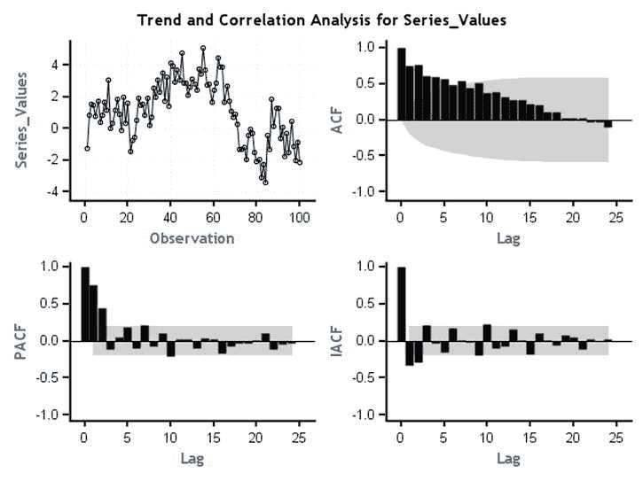

图 12-39. 时间序列图 5 的 ACF 和 PACF 图 (图 12-20)

注意，在图 12-39 中，ACF 逐渐衰减至零，而 PACF 在`lag 2`处截断。TS 5 是一个 2 阶 AR 过程。

时间序列图 6 (图 12-21): `y[t] = 0.3y[t-1] + 0.33y[t-2] + 0.26y[t-3] + ε[t]`

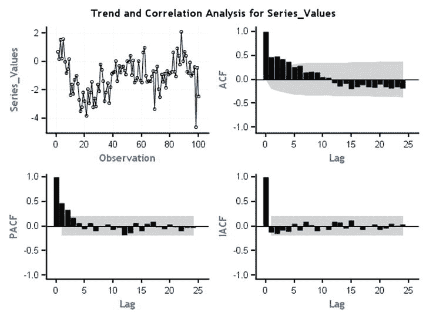

图 12-40. 时间序列图 6 的 ACF 和 PACF 图 (图 12-21)

注意，在图 12-40 中，ACF 逐渐衰减至零，而 PACF 在`lag 3`处截断。TS 6 是一个 3 阶 AR 过程。

## 识别 MA 过程的经验法则

识别 MA 过程的方法与识别 AR 过程几乎相同。对于 MA 过程，PACF 缓慢衰减，而 ACF 截断。由于在 MA 过程中，序列的当前值不直接依赖于过去的值，因此 ACF 会截断。序列的误差依赖于先前的误差。这是导致 PACF 缓慢衰减的原因。表 12-11 列出了识别 MA 过程的经验法则。

表 12-11. 识别 MA 过程的经验法则

| MA 过程 | 行为 |
| --- | --- |
| ACF | 截断。截断的滞后阶数表示 MA 过程的阶数。 |
| PACF | 缓慢衰减或逐渐消失至零。要么沿一个方向减小，要么以正弦波的形式减小。 |

PACF 图有一个小问题。由于处理的是误差，其量级通常很小，因此 PACF 图不清晰，难以解释。你可以使用逆自相关函数（`IACF`）图作为 PACF 图的替代。

## 逆自相关函数

逆自相关函数是一种自相关函数，其中误差和实际序列值的作用相互交换。`ARMA(2,0)` 的 `ACF` 图与 `ARMA(0,2)` 的 `IACF` 图看起来相同。你可以在分析中使用 `IACF` 作为 `PACF` 的替代品。对于某些模型，`IACF` 图会显示出清晰的趋势，因此易于解读。你可以将 `IACF` 理解为在误差之间计算的自相关函数。表 12-12 列出了用于识别 `MA` 过程的修改后的最终经验法则。

表 12-12. 使用 IACF 识别 MA 过程的经验法则

| MA 过程 | 行为 |
| --- | --- |
| `ACF` | 截尾。截尾的滞后阶数指示了 `MA` 过程的阶数。 |
| `PACF/IACF` | 缓慢拖尾或衰减至零。要么单向递减，要么以正弦波或正弦模式递减 |

图 12-41 至 12-46 展示了早期示例中一些 `MA` 序列及其 `ACF`、`PACF` 和 `IACF` 图。

时间序列图 7 (图 12-22): `y[t] = ε[t] - 0.8 ε[t-1]`

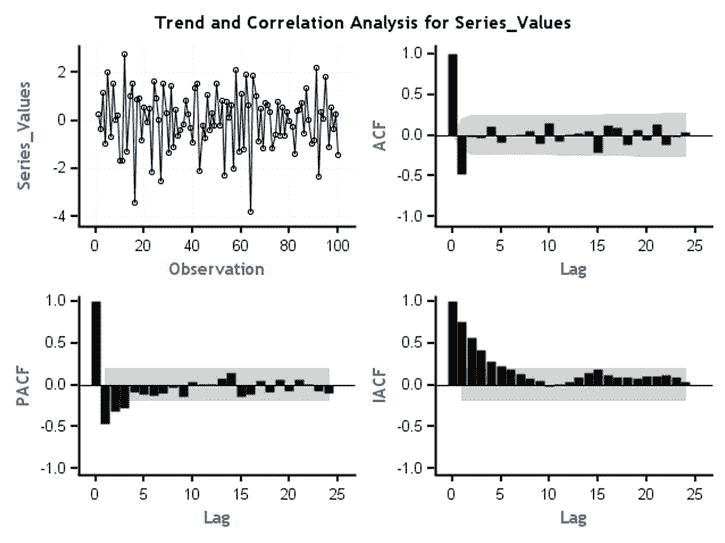

图 12-41. 时间序列图 7 (图 12-22) 的 `ACF` 和 `PACF` 图

注意，在图 12-41 中，`IACF` 显示出向零衰减的趋势，而 `ACF` 在滞后 1 处截尾。TS 7 是一个 1 阶 `MA` 过程。

时间序列图 8 (图 12-23): `y[t] = ε[t] + 0.66 ε[t-1]`

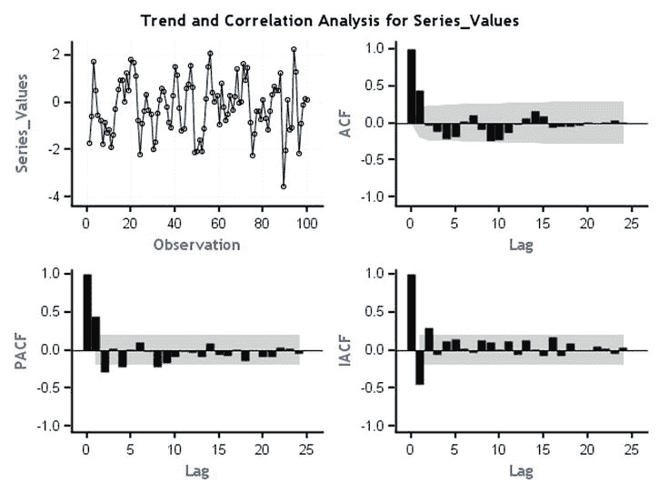

图 12-42. 时间序列图 8 (图 12-23) 的 `ACF` 和 `PACF` 图

注意，在图 12-42 中，`IACF` 显示出向零衰减的正弦波，而 `ACF` 在滞后 1 处截尾。TS 8 是一个 1 阶 `MA` 过程。由于 `IACF` 不清晰，你可以预期先前误差的系数较低。

时间序列图 9 (图 12-24): `y[t] = ε[t] + 0.95 ε[t-1]`

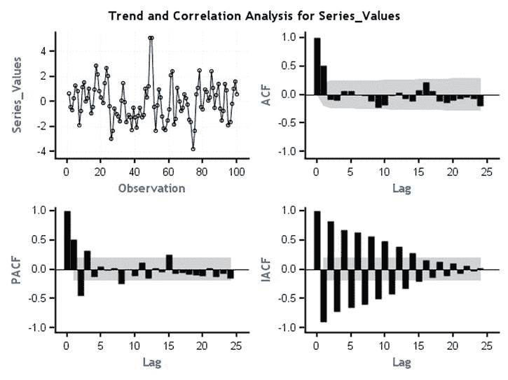

图 12-43. 时间序列图 9 (图 12-24) 的 `ACF` 和 `PACF` 图

注意，在图 12-43 中，`IACF` 显示出向零衰减，而 `ACF` 在滞后 1 处截尾。TS 9 是一个 1 阶 `MA` 过程。

时间序列图 10 (图 12-25): `y[t] = ε[t] - 0.4 ε[t-1] - 0.38 ε[t-2]`

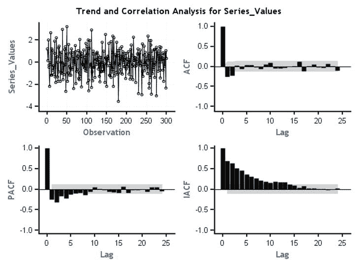

图 12-44. 时间序列图 10 (图 12-25) 的 `ACF` 和 `PACF` 图

注意，在图 12-44 中，`IACF` 显示出向零衰减，而 `ACF` 在滞后 2 处截尾。TS 10 是一个 2 阶 `MA` 过程。

时间序列图 11 (图 12-26): `y[t] = ε[t] - 0.6 ε[t-1] - 0.3 ε[t-2]`

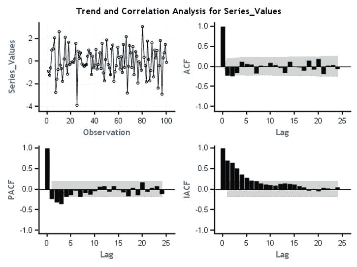

图 12-45. 时间序列图 11 (图 12-26) 的 `ACF` 和 `PACF` 图

注意，在图 12-45 中，`IACF` 显示出向零衰减，而 `ACF` 在滞后 2 处截尾。TS 11 是一个 2 阶 `MA` 过程。

时间序列图 12 (图 12-27): `y[t] = ε[t] - 0.55 ε[t-1] - 0.35 ε[t-2] - 0.15 ε[t-3]`

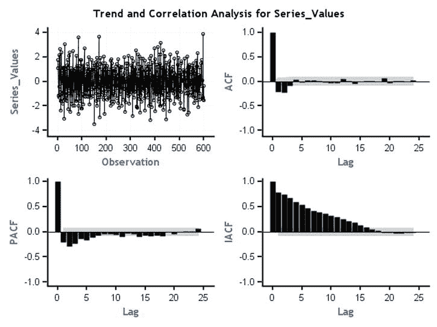

图 12-46. 时间序列图 12 (图 12-27) 的 `ACF` 和 `PACF` 图

注意，在图 12-46 中，`IACF` 显示出向零衰减，而 `ACF` 在滞后 3 处截尾。TS 12 是一个 3 阶 `MA` 过程。

## 识别 ARMA 过程的经验法则

与纯 `AR` 和纯 `MA` 过程相比，识别 `ARMA` 过程的阶数较为困难。如果 `ACF` 衰减至零，则为 `AR` 过程，并且 `PACF` 给出了 `AR` 过程的阶数。如果 `IACF` 衰减至零，则为 `MA` 过程，其阶数通过查看 `ACF` 图来确定。但对于 `ARMA` 过程，`ACF`、`PACF` 和 `IACF` 的行为均相同。虽然你可以快速识别出该过程是 `ARMA` 过程，但无法确定其阶数。因此，当序列是 `ARMA` 过程时，你无法通过查看 `ACF`、`PACF` 和 `IACF` 图来确定其阶数。表 12-13 总结了经验法则。图 12-47 至图 12-49 给出了前面章节讨论的 `ARMA` 过程的 `ACF`、`PACF` 和 `IACF` 的示例图。

表 12-13. 识别 ARMA 过程的经验法则

| ARMA 过程 | 行为 |
| --- | --- |
| `ACF/PACF/IACF` | 三者均衰减至零。 |

时间序列图 13 (图 12-28): `y[t] = -0.95 y[t-1] + ε[t] - 0.8 ε[t-1]`

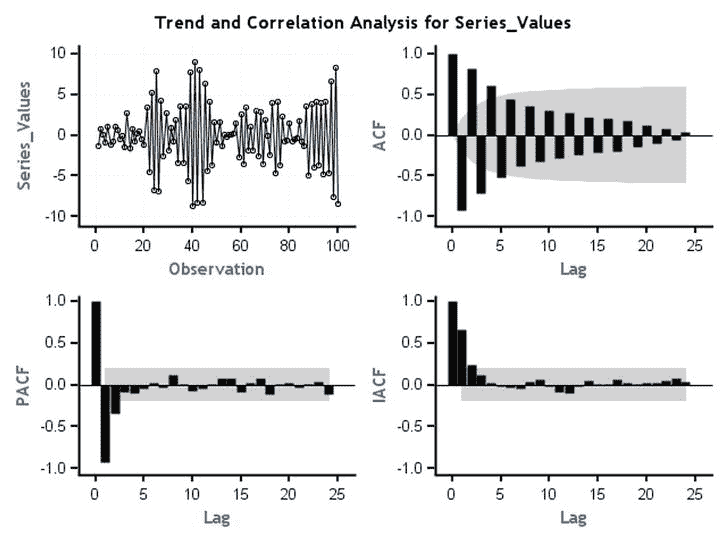

图 12-47. 时间序列图 13 (图 12-28) 的 `ACF` 和 `PACF` 图

注意，在图 12-47 中，`ACF`、`PACF` 和 `IACF` 均衰减至零。TS 13 是一个 `ARMA` 过程。

时间序列图 14 (图 12-29): `y[t] = 0.77 y[t-1] + ε[t] + 0.6 ε[t-1]`

# 时间序列分析与ARIMA模型识别

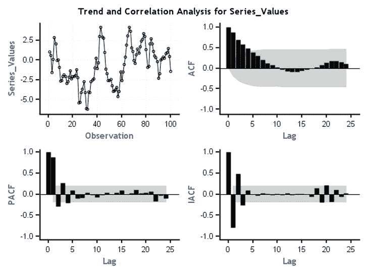

**图 12-48.** 时间序列图 14 (图 12-29) 的 `ACF` 和 `PACF` 图

注意，在图 12-48 中，`ACF`、`PACF` 和 `IACF` 均衰减至零。TS 14 是一个 `ARMA` 过程。

**时间序列图 15 (图 12-30):** `y[t] = 0.55 y[t-1] + 0.35 y[t-2] + ε[t] - 0.5 ε[t-1]`

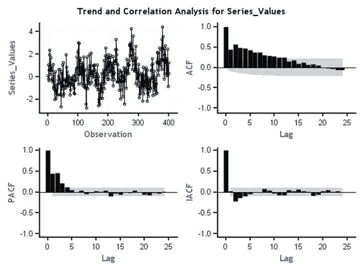

**图 12-49.** 时间序列图 15 (图 12-30) 的 `ACF` 和 `PACF` 图

注意，在图 12-49 中，`ACF`、`PACF` 和 `IACF` 均衰减至零。TS 15 是一个 `ARMA` 过程。

## 使用 SCAN 和 ESACF 确定 ARMA 阶数 (`p`,`q`)

你已了解，仅通过观察 `ACF`、`PACF` 和 `IACF` 图形，无法识别 `ARMA` 过程中的阶数 `p` 和 `q`。幸运的是，有一些高级技术可用于确定 `ARMA` 模型的阶数。要确定阶数，你需要计算另外两个函数：最小典型相关 (`SCAN`) 和扩展样本自相关函数 (`ESACF`)。它们由 Ruey Tsay 和 George Tiao 开发。根据他们的研究，如果一个序列是 `ARMA(p,q)` 过程，那么 `ESACF` 图是一个以 (`p`,`q`) 为顶点的三角形，而 `SCAN` 图是一个以 (`p`,`q`) 为顶点的矩形。该理论的细节超出了本书的范围；不过，和往常一样，你可以使用 SAS 计算 `ESACF` 和 `SCAN` 函数值，并得出 `p` 和 `q` 的值。以下是计算 `ESACF` 和 `SCAN` 函数值的 SAS 代码：

```sas
proc arima data= TS13 plots=all;
identify var=x    SCAN ESACF ;
run ;
```

你只需添加两个选项：`SCAN` 和 `ESACF`。这段代码会给出更详细的输出。你可以直接查看由 `SCAN` 和 `ESACF` 给出的最终综合建议（表 12-14）。

**表 12-14. 使用 `SCAN` 和 `ESACF` 确定 `ARMA` 过程阶数的 SAS 输出**

| ARMA(p+d,q) 暂定阶数选择检验 |
| --- |
| SCAN | ESACF |
| --- | --- |
| p+d | q | p+d | q |
| 1 | 1 | 1 | 1 |
| 4 | 0 | 5 | 4 |
| 0 | 5 | 0 | 5 |

由于你在此阶段之前已经检验了平稳性，这里可以简单地将 `d` 视为零。换句话说，在表 12-14 中，你可以将 `p+d` 视为 `p`。`SCAN` 函数的第一个建议是 `ARMA(1,1)`。`ESACF` 也建议将 `ARMA(1,1)` 作为首选。因此，所讨论的序列是 1,3。`SCAN` 和 `ESACF` 都给出了一些 `p` 和 `q` 的其他选项。通常，应选择参数较少的、较简单的模型，而非更复杂的模型。简单的模型能产生更好的预测。

如果你采用 `p=5` 且 `q=5` 的模型，那么模型方程中将有太多需要估计的参数。模型 (`p=5`,`q=5`) 将包含 `a1`、`a2`、`a3`、`a4`、`a5` 以及 `b1`、`b2`、`b3`、`b4`、`b5` 作为参数。通常，参数过多的模型不够稳健，无法给出准确的预测。因此，更倾向于选择 `p<=2` 且 `q<=2` 的较简单模型。如果 `SCAN` 和 `ESACF` 建议了多个选项，那么最好选择 `p` 和 `q` 值最小的模型。

类似地，你可以为 TS 14 和 TS 15 寻找 `SCAN` 和 `ESACF`。输出结果请参考表 12-15 和 12-16。

```sas
proc arima data = TS14 plots = all;
identify var = x SCAN ESACF ;
run ;
```

**表 12-15. 使用 `SCAN` 和 `ESACF` 确定 `ARMA` 过程阶数的 SAS 输出**

| ARMA(p+d,q) 暂定阶数选择检验 |
| --- |
| SCAN | ESACF |
| --- | --- |
| p+d | q | p+d | q |
| 1 | 1 | 1 | 1 |
| 3 | 0 | 2 | 1 |
| 0 | 4 | 3 | 1 |
|   |   | 5 | 1 |
|   |   | 0 | 4 |

同样，`SCAN` 和 `ESACF` 给出的首选都是 `ARMA(1,1)`。因此，TS 14 是一个 `ARMA(1,1)` 过程。

```sas
proc arima data= TS15 plots=all;
identify var=x    SCAN ESACF ;
run ;
```

**表 12-16. 使用 `SCAN` 和 `ESACF` 确定 `ARMA` 过程阶数的 SAS 输出**

| ARMA(p+d,q) 暂定阶数选择检验 |
| --- |
| SCAN | ESACF |
| --- | --- |
| p+d | q | p+d | q |
| 2 | 1 | 2 | 1 |
| 1 | 2 | 1 | 2 |
| 4 | 0 |   |   |

你已拥有一个平稳序列，无需进一步差分。这意味着 `d` 可以取 `d=0`。`SCAN` 和 `ESACF` 都将 `ARMA(2,1)` 过程作为首选。因此，时间序列 TS 15 是一个 `ARMA(2,1)` 过程。

让我们回顾一下目前所完成的工作。你希望预测未来的值。你需要使用 `ARIMA` 技术进行模型构建和预测。要使用 Box-Jenkins 方法构建模型，需要序列是平稳的。作为步骤 1 的一部分，你检验了平稳性。如果序列不平稳，你通过差分使其平稳。正是在这一步，确定了 `ARIMA(p, d, q)` 中 `d` 的值。然后在步骤 2 中，你识别 `p` 和 `q` 的阶数。一旦确定了 `p` 和 `q`，你就可以写出模型的框架方程。例如，你将一个模型识别为 `AR(1)`，然后可以写出如下框架方程：

`Y[t]= a[1]*Y[t-1]+ ε[t-1]`

下一步，你需要找到 `a[1]` 的估计值。根据序列的类型——`AR(p)`、`MA(q)` 或 `ARMA(p,q)`——你需要估计相应数量的参数。如果序列是 `AR(2)`，你需要估计两个参数。

## 识别 SAS 示例

一个电子商务网站希望跟踪每日独立访客数量，并收集了近一年的数据。现在公司希望预测下一周的访客数量。在进行预测之前，你需要识别这是哪种类型的序列。

以下是识别每日独立访客数量的代码。输出结果请参考表 12-17 和图 12-50。

```sas
ods graphics on; /* 显示图形的选项 */
proc arima data = web_views plots = all;
identify var = Visitors stationarity = (DICKEY) ;
run ;
```

**表 12-17. `web_views` 序列上 `PROC ARIMA` 的输出**

| 变量名称 = Visitors |
| --- |
| 工作序列均值 | 8946.432 |
| 标准差 | 1215.248 |
| 观测数量 | 340 |
| 白噪声自相关检验 |
| --- |
| 至滞后阶数 | 卡方 | 自由度 | Pr > 卡方 | 自相关系数 |
| --- | --- | --- | --- | --- |
| 6 | 379.84 | 6 | <.0001 | 0.687 | 0.542 | 0.406 | 0.310 | 0.204 | 0.184 |
| 12 | 395.13 | 12 | <.0001 | 0.159 | 0.106 | 0.069 | 0.039 | 0.025 | 0.010 |
| 18 | 410.19 | 18 | <.0001 | 0.040 | 0.025 | 0.064 | 0.089 | 0.112 | 0.122 |
| 24 | 421.77 | 24 | <.0001 | 0.135 | 0.089 | 0.062 | 0.018 | 0.031 | 0.024 |
| 增广迪基-富勒单位根检验 |
| --- |
| 类型 | 滞后阶数 | Rho | Pr < Rho | Tau | Pr < Tau | F | Pr > F |
| --- | --- | --- | --- | --- | --- | --- | --- |
| 零均值 | 0 | -2.0950 | 0.3195 | -1.07 | 0.2567 |   |   |
|   | 1 | -1.2110 | 0.4378 | -0.81 | 0.3664 |   |   |

## 第三步：估计参数

至此，你已得到模型方程。你也已将时间序列识别为 `AR(p)`、`MA(q)` 或 `ARMA(p,q)`。现在你需要找到模型参数。这个模型方程与第 10 章中关于多元线性回归讨论的回归模型类似。简要回顾一下，请参考以下的方程类比。

回归方程：`y = b0 + b1x1 + b2x2 + b3x3 + b4x4 + b5x5 + b6x6 . . . . . . . . + bpxp`

时间序列方程：`Y[t] = a[1]*Y[t-1] + a[2]*Y[t-2] + a[3]*Y[t-3] + . . . . .+ a[p]*Y[t-p] + ε[t] + b[1]*ε[t-1]+ b[2]*ε[t-2]. . . . . . . .+ b[q]*ε[t-q]`

如同寻找回归系数的方式，现在你需要使用某种优化技术来找到时间序列方程的参数。你可以使用最大似然估计技术来猜测模型参数。这一步相对容易。你只需在 SAS 代码中使用 `estimate` 选项。你需要通过指定阶数来明确模型方程。

以下是用于估计参数的代码：

```sas
proc arima data=web_views;
identify var=Visitors ;
estimate p=1 q=0 method=ML;
run;
```

之前你已经得出结论：独立访客时间序列是一个 `AR(1)` 过程。因此，`p=1` 且 `q=0`。`method=ML` 选项表示最大似然方法。

表 12-18 是这段代码生成的最大似然表。

| **表 12-18.** `PROC ARIMA` 对 `web_views` 序列的输出：估计参数 |
| --- |
| **最大似然估计** |
| 参数 | 估计值 | 标准误差 | t 值 | 近似 Pr > &#124;t&#124; | 滞后 |
| --- | --- | --- | --- | --- | --- |
| `MU` | 8942.4 | 152.37003 | 58.69 | <.0001 | 0 |
| `AR1,1` | 0.68773 | 0.03945 | 17.43 | <.0001 | 1 |

`MU` 是截距，即序列的均值。`AR(1,1)` 的估计值（即 `a[1]`）为 0.68773。现在你可以写出更完整的模型方程，如下所示：

`Y[t] = (0.68773)*Y[t-1] + ε[t]`

你可以用这个方程预测未来值。除了参数估计，SAS 还会生成详细的输出。以下是一些关于如何解读输出中不常见但重要的表格的注释。请参考表 12-19。

| **表 12-19.** `PROC ARIMA` 对 `web_views` 序列的重要输出表：估计参数 |
| --- |
| 常数估计值 | 2792.49 |
| 方差估计值 | 781147.7 |
| 标准误差估计值 | 883.8256 |
| `AIC` | 5580.809 |
| `SBC` | 5588.467 |
| 残差数量 | 340 |

`AIC` 和 `SBC` 值能帮助你比较两个模型。通常倾向于选择 `AIC` 和 `SBC` 值较低的模型。较低的 Akaike 信息准则（`AIC`）和 Schwarz 贝叶斯准则（`SBC`）值表明，使用当前估计值的模型是数据的正确拟合。这在尝试处理不同阶数时很有帮助，比如在 `AR(1)`、`AR(2)` 或 `ARMA(1,1)` 等之间进行选择。请参考表 12-20 和图 12-51。图 12-51 之后提供了说明。

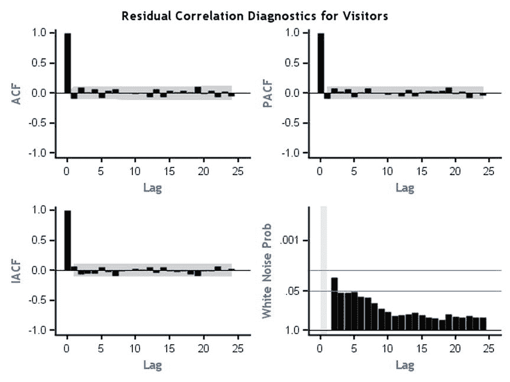
*图 12-51. 残差自相关检查，`PROC ARIMA` 对 `web_views` 序列的输出表；估计参数*

| **表 12-20.** 残差的自相关检查，`PROC ARIMA` 对 `web_views` 序列的输出表：估计参数 |
| --- |
| **残差的自相关检查** |
| 至滞后阶 | 卡方 | 自由度 | Pr > ChiSq | 自相关 |
| --- | --- | --- | --- | --- |
| 6 | 9.97 | 5 | 0.0761 | -0.088 | 0.094 | 0.019 | 0.070 | -0.075 | 0.038 |
| 12 | 12.67 | 11 | 0.3153 | 0.063 | -0.002 | 0.004 | -0.015 | 0.004 | -0.059 |
| 18 | 17.03 | 17 | 0.4521 | 0.063 | -0.069 | 0.035 | 0.016 | 0.041 | 0.018 |
| 24 | 24.50 | 23 | 0.3765 | 0.103 | -0.015 | 0.037 | -0.069 | 0.032 | -0.051 |
| 30 | 28.42 | 29 | 0.4954 | 0.044 | 0.078 | -0.045 | -0.022 | 0.007 | 0.001 |
| 36 | 34.61 | 35 | 0.4869 | 0.026 | 0.051 | 0.110 | 0.002 | -0.031 | 0.008 |
| 42 | 40.64 | 41 | 0.4865 | 0.056 | -0.075 | -0.003 | 0.061 | -0.015 | 0.053 |
| 48 | 50.06 | 47 | 0.3529 | -0.062 | 0.131 | 0.029 | 0.040 | -0.018 | 0.016 |

残差自相关检查有助于你识别在构建模型后数据中是否还留有信息。模型应该足够好，能够提取数据中所有隐藏的模式。如果仍有一些趋势残留，那么你会在残差图中观察到它们。这些残差图显示在 `ACF`、`PACF` 和 `IACF` 中没有趋势。你还会观察到白噪声概率（图 12-51，右下角）可以忽略不计。

例如，如果你尝试错误地拟合模型——换句话说，本应是 `AR(1)` 模型，你却尝试拟合了 `ARMA(0,0)` 模型——那么残差图会显示出趋势（图 12-52）。为了更好地理解，你可以将以下代码与之前的代码进行比较。除了 `p` 和 `q` 的值外，两者完全相同。

```sas
proc arima data=web_views;
identify var=Visitors ;
estimate p=0 q=0 method=ML;
run;
```

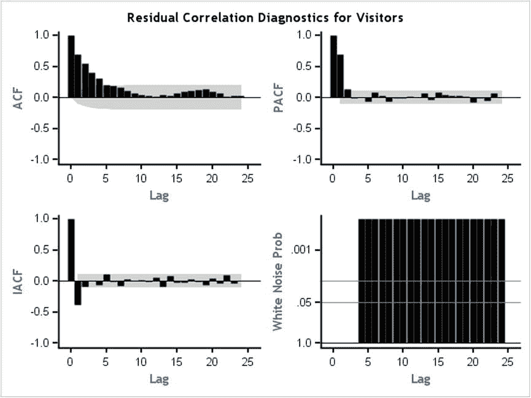
*图 12-52. 残差自相关检查，选择错误模型*

你无法通过 `AR(0,0)` 模型提取所有信息。你会在残差的 `ACF` 图中看到一个趋势。白噪声概率也显著偏高。这表明模型中仍然残留了一些信息。这些残差信息需要被提取出来。

一旦完成模型参数的估计，剩下的就只有预测了。这是模型构建的最后一步。

## 第 4 步：利用模型进行预测

到目前为止，你已经付出了大量努力来确定模型类型、估计参数并创建最终的模型方程。一旦你得到了最终方程，剩下的工作就是将历史值代入以获得预测值。像往常一样，SAS 为你提供了帮助。你只需在代码中使用 `forecast` 选项即可。

```markdown
### 预测模型构建与案例分析

以下是用于预测的SAS代码：
```sas
proc arima data=web_views;
identify var=Visitors;
estimate p=1 q=0 method=ml;
forecast lead=7;
run;
```

`lead=7` 表示接下来的七个预测值，在本例中，这些值是指未来七天内可能访问的唯一访客数量。此代码还会向输出结果中追加两个新组件（预测表和预测图）。表 12-21 是预测表，图 12-53 绘制了来自SAS输出的预测图。


**图 12-53.** 访客的预测结果，SAS输出

**表 12-21.** 变量`Visitors`的未来七天预测，SAS输出

| 变量`Visitors`的预测值 | | | |
| --- | --- | --- | --- |
| 观测值 | 预测值 | 标准误差 | 95% 置信限 |
| --- | --- | --- | --- |
| 341 | 8139.5548 | 883.8256 | 6407.2885 | 9871.8211 |
| 342 | 8390.2684 | 1072.6622 | 6287.8892 | 10492.6476 |
| 343 | 8562.6905 | 1151.2361 | 6306.3092 | 10819.0718 |
| 344 | 8681.2696 | 1186.5879 | 6355.6000 | 11006.9391 |
| 345 | 8762.8194 | 1202.9463 | 6405.0880 | 11120.5508 |
| 346 | 8818.9033 | 1210.6063 | 6446.1586 | 11191.6480 |
| 347 | 8857.4736 | 1214.2123 | 6477.6612 | 11237.2861 |

数据截止到观测值 340。从 341 到 347 的值是预测值，并附有 95% 的置信限一起显示。预计网站访客数量将稳步增长。如果看到急剧下降，则可以将其作为警报信号。如果预测值出现大幅增长，则可能需要加强网站的基础设施，包括服务器数量、网络带宽等。此外，还需要确保没有技术故障。在当前情况下，一切似乎都正常；预测的访客流量呈现可控的、稳定的增长。

至此，使用Box-Jenkins ARIMA方法进行时间序列分析和预测的流程就逻辑结束了。每位分析师都希望通过为现有的历史数据构建最佳模型来准确预测未来值。使用Box-Jenkins方法绝对可以实现这一目标。以下是构建时间序列模型时的一些建议：

-   拥有足够的历史数据，至少 30 个数据点。确保不要涉及过多历史数据。只应考虑会对未来预测产生影响的历史值。

-   不要预测太远的未来。用一年的数据预测未来两年不是一个好主意。建议预测的未来数据点不要超过历史数据点的 10%。

-   在构建模型之前移除异常值。

#### 案例研究：使用SAS示例进行时间序列预测

Air Voice是一家拥有超过 7000 万客户的移动网络公司。该公司的客户服务中心每天处理数百万通电话。公司希望通过在约定的服务水平协议（SLA）内解决大部分客户查询来提高客户满意度。这可以通过每周预测呼叫次数来进行更好的资源规划来实现。以下是一个典型的呼叫量预测练习。

提供了过去 300 天的每日呼叫量数据。该数量以千为单位。以下是分析和预测未来呼叫量数值的步骤。

#### 第 1 步：测试平稳性

以下是用于测试平稳性的SAS代码。前面的章节已经对此进行了解释。请参考表 12-22 查看与此任务相关的SAS输出。

```sas
proc arima data=call_volume;
identify var=call_volume stationarity=(DICKEY);
run;
```

**表 12-22.** 测试`call_volume`时间序列的平稳性，SAS输出

| 增广迪基-富勒单位根检验 | | | | | | |
| --- | --- | --- | --- | --- | --- | --- |
| 类型 | 滞后期 | Rho | Pr < Rho | Tau | Pr < Tau | F | Pr > F |
| --- | --- | --- | --- | --- | --- | --- | --- |
| 零均值 | 0 | -0.3118 | 0.6116 | -0.75 | 0.3904 | | |
| | 1 | -0.4327 | 0.5844 | -0.70 | 0.4139 | | |
| | 2 | -0.3451 | 0.6040 | -0.74 | 0.3964 | | |
| 单均值 | 0 | -17.2064 | 0.0217 | -3.26 | 0.0181 | 5.44 | 0.0242 |
| | 1 | -39.0108 | 0.0016 | -4.71 | 0.0002 | 11.14 | 0.0010 |
| | 2 | -25.7633 | 0.0026 | -3.87 | 0.0027 | 7.59 | 0.0010 |
| 趋势 | 0 | -17.4227 | 0.1110 | -3.18 | 0.0899 | 5.31 | 0.1108 |
| | 1 | -40.4434 | 0.0007 | -4.70 | 0.0009 | 11.22 | 0.0010 |
| | 2 | -26.2061 | 0.0169 | -3.79 | 0.0183 | 7.48 | 0.0191 |

基于增广迪基-富勒检验中的单均值P值，该过程是平稳的。

#### 第 2 步：使用ACF和PACF图确定模型类型

以下代码创建了ACF和PACF图，以便于确定模型类型。请参考图 12-54 查看与此任务相关的SAS输出。

```sas
ods graphics on;
proc arima data=call_volume plots=all;
identify var=call_volume stationarity=(DICKEY);
run;
```


**图 12-54.** 用于确定模型类型的ACF和PACF图，SAS输出

ACF呈衰减趋势。PACF和IACF也趋近于零。这应该是一个ARMA过程。你将使用`SCAN`和`ESACF`选项来确定阶数。请参考以下SAS代码以及表 12-23 中的相关输出。

```sas
proc arima data=call_volume plots=all;
identify var=call_volume SCAN ESACF;
run;
```

**表 12-23.** 用于查找ARMA过程阶数`p`和`q`的`SCAN`和`ESACF`表，SAS输出

| ARMA(p+d,q) 暂定阶数选择检验 | |
| --- | --- |
| `SCAN` | `ESACF` |
| --- | --- |
| p+d | q |
| 1 | 1 |
| 5 | 0 |
| p+d | q |
| --- | --- |
| 1 | 1 |
| | |

`SCAN`和`ESACF`给出的第一个选项都是ARMA(1,1)。你将尝试估计参数`a[1]`和`b[1]`。

#### 第 3 步：估计参数

请参考以下SAS代码以及表 12-24 中的相关SAS输出，以找出模型方程参数。

```sas
proc arima data=call_volume plots=all;
identify var=call_volume SCAN ESACF;
estimate p=1 q=1 method=ML;
run;
```

**表 12-24.** 参数估计，来自SAS输出的最大似然估计表

| 最大似然估计 | | | | |
| --- | --- | --- | --- | --- |
| 参数 | 估计值 | 标准误差 | t 值 | 近似 Pr > \|t\| | 滞后期 |
| --- | --- | --- | --- | --- | --- |
| MU | 9825.6 | 201.76908 | 48.70 | <.0001 | 0 |
| MA1,1 | -0.68286 | 0.04442 | -15.37 | <.0001 | 1 |
| AR1,1 | 0.90783 | 0.02424 | 37.46 | <.0001 | 1 |

AR和MA参数值现已估计完成。模型方程如下：

`y[t] = 9825.6 + 0.90783 * y[t-1] + ε[t] - 0.68286 * ε[t-1]`

#### 步骤 4：预测
```

现在你可以预测下周的通话量。相应的 SAS 代码及其解读留作练习，供你自行完成。在前面的章节中，我已针对其他案例详细讨论过这一过程。可参考表 12-25 查看 SAS 输出的相关部分。

**表 12-25.** 通话量预测数据，SAS 输出

| 变量 `Call_volume` 的预测值 |
| :--- |
| 观测值 | 预测值 | 标准误差 | 95% 置信区间 |
| 301 | 9876.9777 | 198.7791 | 9487.3779 | 10266.5776 |
| 302 | 9872.2397 | 373.4869 | 9140.2188 | 10604.2607 |
| 303 | 9867.9384 | 471.0529 | 8944.6917 | 10791.1852 |
| 304 | 9864.0336 | 538.3305 | 8808.9252 | 10919.1420 |
| 305 | 9860.4887 | 588.0196 | 8707.9914 | 11012.9860 |
| 306 | 9857.2705 | 626.0134 | 8630.3068 | 11084.2342 |
| 307 | 9854.3489 | 655.6732 | 8569.2530 | 11139.4449 |

如表 12-25 所示，下周预计不会有大幅下降或增长。资源规划无需进行重大调整！

### 检验模型精度

在任何模型构建工作中，检验模型精度都至关重要。残差图以及 AIC 和 SBC 值能告诉你模型的构建质量如何。为了检验预测精度，一个不错的做法是预留部分数据用于测试，之后再用它来检验模型精度。例如，在通话量预测数据中，你拥有 300 天的数据。在这 300 天数据中，假设实际可用的只有 295 天，然后用接下来的 5 天数据来检验预测的精度。你利用模型预测这 5 天的数值。期望一个良好的模型能给出接近实际值的预测结果。请参考表 12-26。

**表 12-26.** 先前通话量示例中的预测值与误差

| 天数 | 观测值 | 预测值 | 绝对误差 | 百分比误差 | 平方偏差 |
| :--- | :--- | :--- | :--- | :--- | :--- |
| 296 | 9345.557 | 9407.4053 | 61.84803 | 0.7% | 3825.179 |
| 297 | 9275.306 | 9444.8852 | 169.5787 | 1.8% | 28756.94 |
| 298 | 9396.698 | 9478.9372 | 82.23937 | 0.9% | 6763.314 |
| 299 | 9217.704 | 9509.8748 | 292.171 | 3.2% | 85363.87 |
| 300 | 9533.522 | 9537.9828 | 4.461153 | 0.0% | 19.90189 |
| **总计** | | | **122.1** | **1.3%** | **24945.8** |

理想情况下，你希望误差为零或小于 5%。下面是一些衡量误差或精度的指标。在以下文本中，`Y[i]` 是实际值，`Ŷ[i]` 是预期值。

- **平均绝对偏差 (MAD)：** 绝对偏差的平均值。
- **平均绝对百分比误差 (MAPE)：** 这是使用最广泛的指标。百分比偏差的平均值。
- **均方误差 (MSE)：** 平方偏差的平均值。
- **均方根误差 (RMSE)：** 另一个相关指标，即 `sqrt(MSE)`。

在上面的例子中，相关数值如下：

- `MAD` = 122.1
- `MAPE` = 1.3%
- `MSE` = 24,945.8
- `RMSE` = 157.9

通常，好的做法是保留 5% 到 10% 的样本数据用于验证。具体的百分比取决于数据集的大小。

## 结论

在本章中，你了解了什么是时间序列过程。我讨论了应用最广泛的时间序列技术之一，即 Box–Jenkins ARIMA 技术。我还讨论了 ARIMA 模型构建的四大步骤。ARIMA 模型是众多模型类型之一。还有季节性 ARIMA 模型；有 ARIMAX 模型，它会使用一个自变量 `X` 以及 `Y` 的历史值；还有启发式 TSI 模型。我建议你在对 ARIMA 模型构建基础有扎实理解之后，再去研究其他时间序列技术。本章末尾讨论的模型精度检验方法应予以认真对待。对于分析师来说，在提供预测值时附上误差率是一个很好的实践。