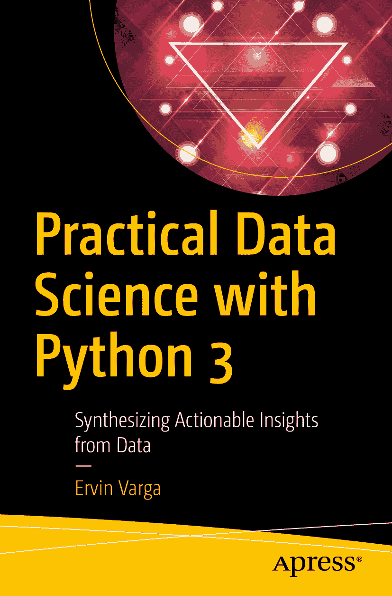

ISBN 978-1-4842-4858-4 e-ISBN 978-1-4842-4859-1 [`doi.org/10.1007/978-1-4842-4859-1`](https://doi.org/10.1007/978-1-4842-4859-1)

© 2019 年，埃尔文·瓦尔加（Ervin Varga），由 Apress 出版

标准商标名称、徽标和图片可能出现在本书中。为避免在每次出现商标名称、徽标或图片时均使用商标符号，我们仅在编辑风格下使用这些名称、徽标和图片，以利于商标所有者，且无意侵犯商标权。本出版物中对商品名称、商标、服务标志及类似术语的使用，即使未明确标识，也不应被视作对其是否受专有权利保护的评论。尽管本书中的建议和信息在出版时被认为是真实准确的，但作者、编辑和出版商均不对可能出现的任何错误或疏漏承担法律责任。出版商对本书所含材料不作任何明示或暗示的保证。本书通过 Springer Science+Business Media New York 在全球图书贸易中发行，地址：233 Spring Street, 6th Floor, New York, NY 10013。电话：1-800-SPRINGER，传真：(201) 348-4505，电子邮件：orders-ny@springer-sbm.com，或访问 www.springeronline.com。Apress Media, LLC 是加利福尼亚州的有限责任公司，其唯一成员（所有者）是 Springer Science + Business Media Finance Inc（SSBM Finance Inc）。SSBM Finance Inc 是特拉华州的一家公司。

`就像旅行一样，有家人陪伴时写书会更有乐趣。我感谢我的妻子佐里卡（Zorica）以及儿子安德烈（Andrej）和斯特凡（Stefan）给予我的巨大支持。`

## 引言

本书以务实的方式融合了数据科学与软件工程。它引导读者了解这两个领域中的主题，并通过软件实例阐述概念。作为读者，您将深入了解教科书很少涉及的内容，因为这些内容难以解释和阐明。您将通过示例看到 Cynefin 框架的实际应用，这些示例为您的数据科学工作提供了全局背景和系统化方法。

本书还向您介绍了最实用的 Python 3 数据科学框架和工具：`Numpy`、`Pandas`、`scikit-learn`、`matplotlib`、`Seaborn`、`Dask`、`Apache Spark`、`PyTorch` 以及其他辅助框架。所有示例都是独立的，允许您重现书中的每一部分内容，包括图表。每章末尾的练习会指导您如何进一步加深理解。

最后，本书再次通过大量示例，解释了数据科学生命周期模型的所有阶段：从项目启动到数据探索和回顾。其目的是让您掌握数据科学主要领域的必要知识，以便您能够`见树又见林`。

## 致谢

我要感谢 Apress 给予我机会和全力支持来撰写这本关于数据科学的书。詹姆斯·马卡姆（James Markham）、阿迪特·米拉希（Aditee Mirashi）和塞莱斯廷·苏雷什·约翰（Celestin Suresh John）的评论和帮助是无价的。

我也非常感谢本书的技术审阅者乔乔·约翰·穆拉伊尔（Jojo John Moolayil）提出的宝贵意见。

### 关于作者与关于技术审阅者

### 关于作者

### 关于技术审阅者

