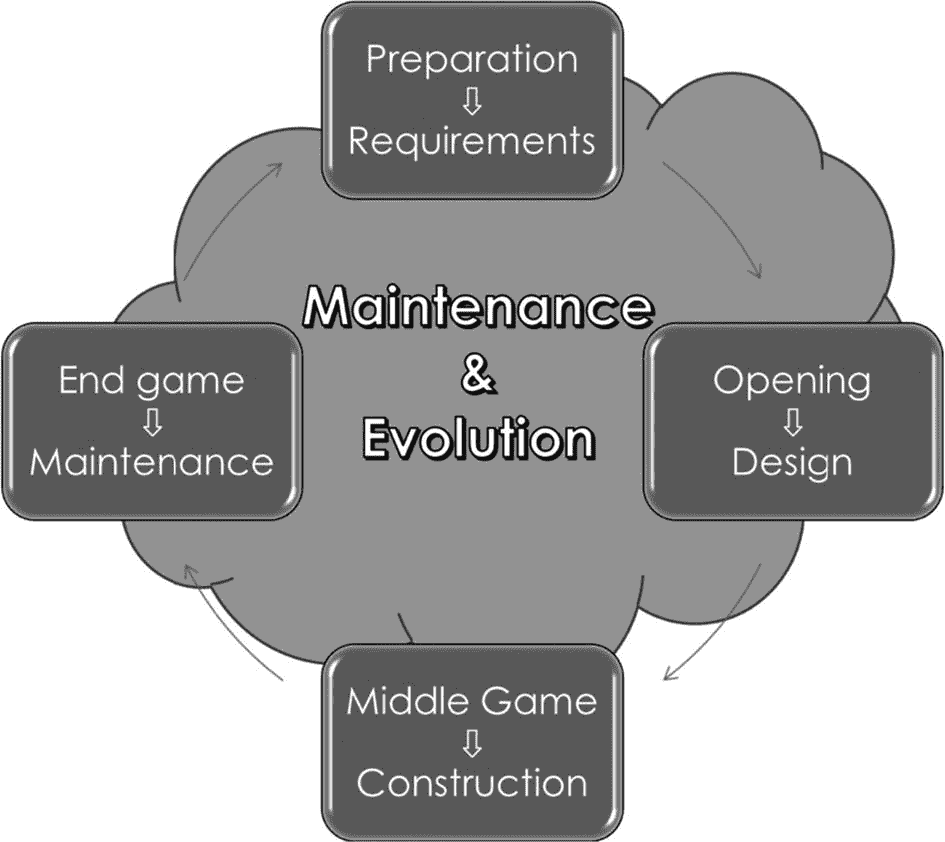
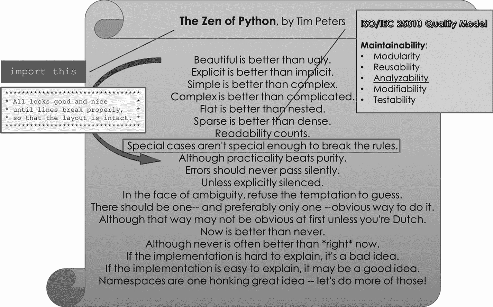
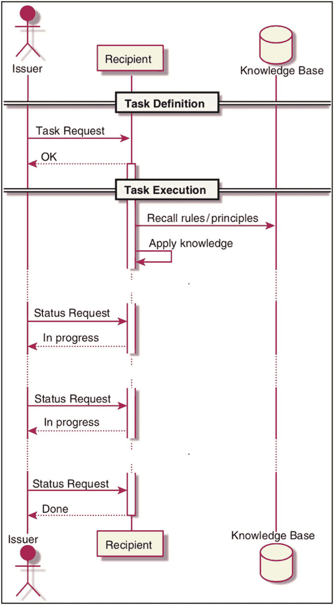
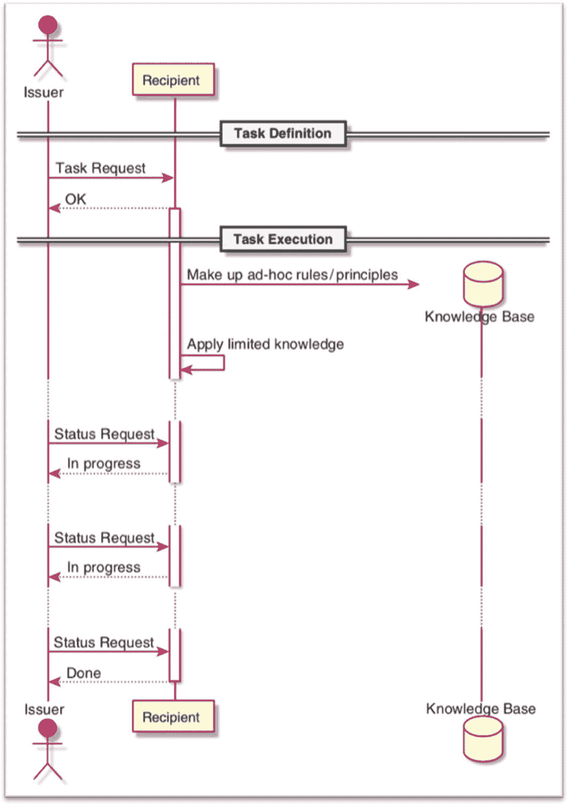
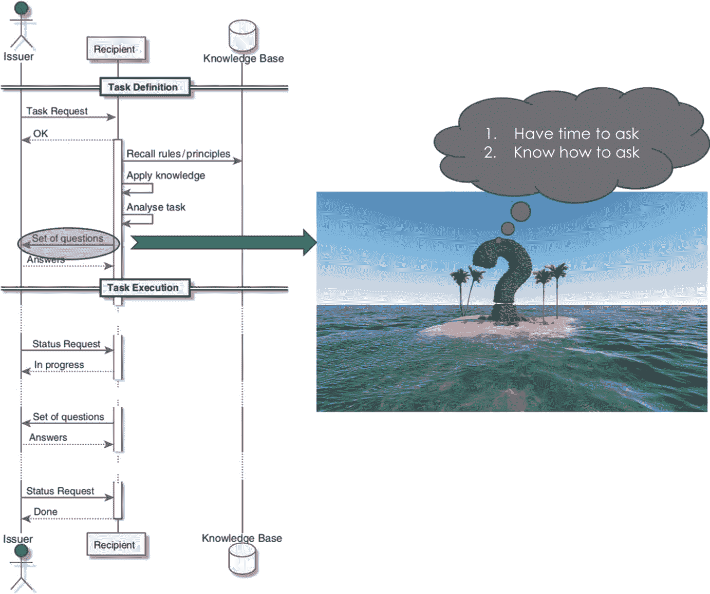
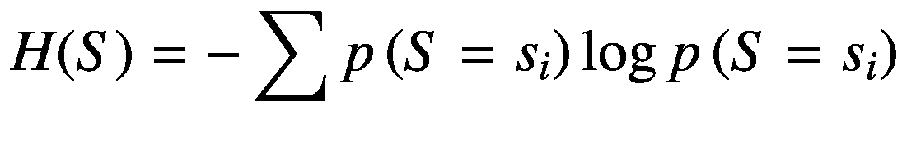
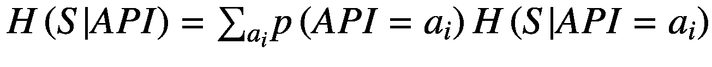
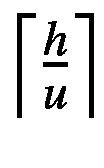

# 3. 软件工程

数据科学的一个核心组成部分是在大型数据集上执行高效计算。这些计算由计算机程序驱动，随着问题规模和复杂性的增加，相应的软件解决方案也往往变得更大、更复杂。这类软件由以团队形式组织起来的机构构建。数据科学也是一项团队工作，因此有效的沟通与协作在软件工程和数据科学中都极为重要。一个团队开发的软件必须能被其他团队理解，以促进其使用、复用和演进。这正是可维护性作为一项关键质量属性发挥作用的地方。本章将在数据科学的背景下，介绍来自软件工程领域的重要经验教训，旨在教导数据科学从业者如何编写可演进的程序并提高生产力。

本章将阐述：何为正确修复现有代码、如何设计良好的应用程序编程接口（API）、为什么显式化有助于避免生产环境中的危险缺陷等。内容围绕代码片段展开，并辅以简短的理论解释。重点在于采用务实的方法来实现高质量，并减少浪费在纠正错误上的时间。对于所有技能水平的数据产品开发者而言，这将是一个观察规则实际应用的机会，而管理者也能从中获得关键洞见，理解为何前期在质量上投资是正确的做法。你将学习到，在《Python 之禅》的语境下，软件工程的原则如何以及为何能在实践中具体体现。

根据 2018 年一篇描述 Stripe 公司调查的文章（参见本章末尾“参考文献”中的 [1]）所述：“全球各地的公司因将开发者资源浪费在修复维护问题上，每年总计损失约 3000 亿美元……”这无疑也影响着那些专注于数据科学导向的大型 Python 软件系统的公司。下面这句话很好地强调了这一老生常谈的道理：

> *毕竟，随着所研究的系统变得越来越大，软件工程和人工智能的关键编程问题往往会融合在一起。*
> 
> ——艾伦·J·珀利斯，为《计算机程序的构造和解释（第二版）》（MIT 出版社，1996 年）所作序言

通常，数据科学被描述为一门融合了数学技能、计算机科学技能和领域专业知识的学科。这里所欠缺的是工程和经济学的概念（选择的科学）。软件工程方面对于创建可维护、可扩展且可靠的解决方案至关重要。ISO/IEC/IEEE 系统和软件工程词汇表（SEVOCAB；参见 [`https://pascal.computer.org`](https://pascal.computer.org)）将*软件工程*定义为“将系统的、规范的、可量化的方法应用于软件的开发、运行和维护；即，将工程学应用于软件。”本章试图填补这一空白，并解释工程和经济学在数据科学中的作用。

为应对大规模软件开发挑战而进行的编程语言变革已迫在眉睫；Python 内部的变化也已在进行中。在这方面，Python 将与其他许多企业级语言共享同一命运（回顾 Java 在过去二十年中的演变是很有启发性的）。本章提及了一些关键的质量保证工具，这些工具增强了 Python 的表现力，使其更适合企业级软件系统。

无论如何，复述已知事实或仅仅空谈理论都是没有意义的。因此，本章的内容相当非典型，而是聚焦于软件行业中那些隐藏却至关重要的方面。

## 大规模软件系统的特征

大规模软件系统与小型软件系统之间最大的区别在于软件的生命周期模型。它指的是软件产品的所有阶段，从最初的开发，到使用、维护、演进，直至退役。为简化讨论，我们对*大规模*的定义是：一个无法由小型团队实现的软件系统；它是一个复杂的社会技术密集型软件系统的一部分；并且其退役将产生巨大的业务影响。软件维护和演进通常是大规模软件系统生命周期中最长的阶段；对于某些安全关键的软件系统，这个阶段可能跨越几十年。这意味着大部分活动都将在第一个生产版本部署后发生。

用锦标赛级别的国际象棋比赛来类比软件生命周期模型是很有启发性的。与软件开发一样，这样的棋局之前需要一个初始的准备和规划阶段（例如，分析对手的棋风和开局库，回忆过去与对手对弈的经验，比较当前的排名，决定是要激进地争取胜利等）。你不能像业余爱好者那样，仅仅根据棋子的当前位置来走棋。在比赛过程中，你需要平衡资源（子力、时间、局面等），运用理论，利用经验，并通过各个阶段（开局、中局和残局）推进。棋局的阶段与软件生命周期模型的阶段映射关系参见图 3-1。

为了保持这个循环的持续运转，需要采用一种整体性的软件工程方法。你必须评估广泛的可能性，以正确判断潜在变更的向量。这些向量决定了你的软件在哪些方面必须足够灵活，以便容纳未来的增加和改进。在每一轮中，你还必须应对一波又一波的变更请求；这与国际象棋类似，你必须持续监控对手的动向并相应调整策略。最后，就像下棋一样，如果你搞砸了需求或设计了错误的架构，那么后期进行纠正将非常困难。在国际象棋中，一个糟糕的开局会让你的比赛变成一场争取平局的苦战。

虽然在国际象棋中一切在最后阶段结束，但在大规模软件系统的开发中则完全不同。这些周期是连锁的，并包含新功能的开发。甚至有一种观点认为，软件维护和演进是开发阶段的延续，在这方面，我们称之为永续演进（对产品进行成功的改进和扩展）。从某种意义上说，开发一个小型软件产品就像下一盘棋，而开发一个大规模软件系统则类似于一场非常漫长的锦标赛。

除了为现有软件添加新功能外，还存在维护的需求。修复错误是这项活动的一个主要例子。为了经济高效地进行维护和演进，软件必须是*可维护的*。根据 ISO/IEC 25010 标准，可维护性作为一项质量属性（其子属性是可测试性）代表了将变更高效地集成到代码库中的能力。根据 IEEE 14764，我们可以区分以下四类维护活动，它们可归类为两种主要类型（纠正或增强）：

- **纠正性维护（纠正）**：与修复故障（在生产环境中造成损害的可观察问题）相关，通常由客户报告。

- **适应性维护（增强）**：涉及因环境变化（例如，业务流程、外部法律法规、平台、技术等）而进行的修改。目标是主动保持软件的可用性。




图 3-1

棋局阶段到软件生命周期模型的映射

- **预防性维护（纠错）**：涉及在故障转化为失败之前修复缺陷。假设你的代码中有一个函数接受一个数值参数作为除数。如果不对零值进行检查，可能会引发异常。然而，如果该参数永远不会接收到零值，那么这一潜在缺陷就不会演变为失败（运行故障）。这需要深入理解客户将如何使用产品，因为某些缺陷在特定情况下可能永远不会引发失败。

- **完善性维护（增强）**：处理所有旨在提升软件质量（包括可维护性）的主动变更。这项活动对于对抗维护和演进过程中代码库持续变更带来的负面影响至关重要。随着新功能的增加，复杂度上升，现有代码结构会劣化。这一现象在*莱曼软件演化定律*中得到了很好的阐述。

所有前述的维护活动和类别都必须根据目标软件系统的类型进行评估。共存在三种类型：

- **S 型系统**：具有有限可枚举的问题空间和固定的环境。一旦初始需求确定，未来不会发生任何变化（这里我们不将潜在的用户界面增强视为重大变更）。例如，流行的井字棋游戏就是 S 型系统。

- **P 型系统**：具有复杂的问题空间和固定的环境。运用各种启发式方法来搜索问题空间。对抽象模型的改进会引发系统的重大变更。例如，国际象棋和围棋等流行的棋盘游戏属于 P 型系统。

- **E 型系统**：由于环境高度动态，是最复杂的系统类型。无法 100% 准确地预测环境未来会如何波动。不幸的是，没有人能保证新法规不会破坏系统的原有架构。最近一个典型的例子是欧盟《通用数据保护条例》（GDPR；参见 [`https://gdpr-info.eu`](https://gdpr-info.eu)）的颁布，为遵守该条例，许多组织在软件系统更新上投入了大量资金。总而言之，大规模数据科学产品属于此类。

软件系统的总拥有成本（TCO）由以下要素构成：

- 新产品的初始开发
- 完善性维护类活动
- 纠错性维护类活动
- 客户支持

显然，维护与初始开发之间的比例是 3:1。因此，我们应当警惕为了追求速度而牺牲质量。许多不成熟的公司怀有一种错误信念，认为工具是银弹，既能加快速度，又能弥补人的不足（缺乏知识与经验、疏忽大意等）。正如你之后会看到的，唯一的解决方案是优先投资于人。

### 软件工程知识领域

软件工程由 15 个主要知识领域组成（另见“参考文献”部分的 [3]）：

- 软件需求
- 软件设计
- 软件构造
- 软件测试
- 软件维护
- 软件配置管理
- 软件工程管理
- 软件工程过程
- 软件工程模型与方法
- 软件质量
- 软件工程专业实践
- 软件工程经济学
- 计算基础
- 数学基础
- 工程基础

为了全面界定软件工程的范畴，我们还需包含以下七个相关学科：

- 计算机工程
- 计算机科学
- 通用管理
- 数学
- 项目管理
- 质量管理
- 系统工程

计算机科学和数学是显而易见的基础，但人们往往难以理解系统工程（请阅读边栏“成功与否？”）。系统工程是一个更为广泛的学科，它将软件产品置于社会技术背景中，赋予其意义。

### 成功与否？

我敢肯定到目前为止你收到过许多自动生成的生日祝福邮件。假设生成这些邮件的软件完美无缺。它每天搜索用户数据库，筛选出所有当天过生日的用户。然后使用通用模板生成消息并发送出去。当你收到这样的消息时开心吗？就我个人而言，我觉得它们非常烦人。你很可能乐意收到来自配偶、孩子、亲戚、朋友或同事的消息，但大概不想收到由机械发送问候的程序发出的消息。

从软件工程的角度来看，公司可能会说这个软件取得了完全成功。然而，如果没有人愿意收到自动生成的问候，那么从系统工程的角度来看，它就是一个彻底的失败。尽管软件运行得完美无缺，但它毫无用处。


## 规则、原则、约定与标准

本节标题中的术语相互关联，主要区别在于严格程度。约定是各方之间的协议，而标准是由相应标准化机构管理的正式规范（例如，*IEEE 754-2019 - IEEE 浮点运算标准*；参见 [`https://standards.ieee.org/standard/754-2008.html`](https://standards.ieee.org/standard/754-2008.html)）。与物理学不同，软件工程学科通常没有定律，尽管存在例外。规则和原则介于约定和标准之间。它们都旨在对系统设计施加约束，以促进互操作性、集成性和生产力。这听起来或许有些奇怪，但有节制地限制选择反而能激发创造力；其目标是避免始终重复发明轮子。此外，规则和原则以一种直接的方式综合了某个领域的知识，有助于实现一致性和质量。Python 还附带了一套名为 **Python 之禅** 的规则，如图 3-2 所示。标准质量模型也被附在列表中，以提醒您这些项的重要性。



图 3-2

在 Python 控制台中执行 `import this` 后得到的一套规则

如您所见，根据 **Python 之禅**，避免将规则和原则视为教条的诱惑至关重要。通过对比第一条和第九条规则（我用曲线箭头连接了它们），这一点得到了极好的说明。因此，即便是 **Python 之禅** 也警告了我们这个问题。我在左侧框内的评论提供了一个示例，说明为何强行满足某条规则可能会引发问题。另一方面，有一条重要的元规则（带边框显示的第八条规则）提醒我们，公然无视规则同样是错误的。在偏离任何类型的指令之前，您必须清楚自己在做什么。“可读性很重要” 处于中心位置，这是有充分理由的。软件工程师在维护和演进过程中，大部分时间都花在理解代码上。

本章隐含地遵循了图 3-2 中列出的规则；主题阐述依赖于简单的示例（**Python 之禅** 提及的是实现细节而非叙述）。缺乏此类示例可能表明主题模糊、讲师能力不足，或两者兼有。接下来的图示尽可能简单，以便您将注意力集中在核心主题上。关于简洁性，有一条关键的敏捷原则（参见 [`https://agilemanifesto.org/principles`](https://agilemanifesto.org/principles)）指出：“简洁——即最大化未完成工作的艺术——至关重要。” 具有讽刺意味的是，这是被误用最严重的一条原则。要意识到哪些工作应该被排除，这项工作本身绝非简单。

软件工程师利用质量保证工具来轻松应用规则（它们也可以强制执行规则，尤其是在与构建服务器结合使用时）。Python 生态系统拥有丰富的此类工具。以下列表仅是可用工具的一部分示例：

- **Pylint** ( [`https://www.pylint.org`](https://www.pylint.org) ) 提供以下功能：
    - 代码风格检查（访问 [`https://www.python.org/dev/peps/pep-0008`](https://www.python.org/dev/peps/pep-0008)）
    - 逆向工程支持（与 `Pyreverse` 集成，从代码生成 UML 图）
    - 重构帮助（例如检测重复代码）
    - IDE 集成（例如，它是 `Spyder` 的组成部分）
    - 错误检测（可自定义的检查器）
- **Codacy** ( [`https://www.codacy.com`](https://www.codacy.com) ) 提供自动化代码审查。
- **CodeFactor** ( [`https://www.codefactor.io`](https://www.codefactor.io) ) 也提供自动化代码审查。
- **Radon** ( [`https://pypi.org/project/radon`](https://pypi.org/project/radon) ) 提供以下功能：
    - McCabe 圈复杂度（本章稍后解释）
    - 原始度量，包括源代码行数（SLOC）、注释行数、空白行数等
    - Halstead 度量
    - 可维护性指数
- **Mypy** ( [`https://mypy-lang.org`](https://mypy-lang.org) ) 是 Python 的一个实验性的、可选的静态类型检查器。已知静态类型语言对于大型代码库具有优于动态类型语言的优势。编译器能够及早检测到与类型相关的疏漏，这往往是救星。因此，在这个列表中看到这个工具并不意外。

上述工具为代码库的定性方面计算了定量代理指标。因此，它们只能报告并作用于可有效测量的指标。通常，软件开发工作中最重要的特质是难以甚至无法衡量的。与人相关的要素就属于这一类。下一节将更详细地解释这一现象。

## 上下文意识与沟通能力

总的来说，我们可以识别出软件工程师中的三种主要人格类型^(⁷)：



图 3-4

最终的“完成”消息并不意味着业务目标已达成（经许可改编自 [2]）。结果的质量可能是合适的。



图 3-3

最终的“完成”消息并不意味着业务目标已达成（经许可改编自参考文献 [2]）。结果的质量也存疑。

- **缺乏上下文与知识**  
  接收者将盲目遵循指令，不会寻求进一步的澄清。这类人将凭猜测行事，而非基于事实做出决定。此外，由于缺乏知识，他们会根据自认为合适的方式，临时编造规则/原则。您或许会尝试过度的微观管理，这同样会给双方带来麻烦。这种行为如图 3-3 所示。

- **具备知识**  
  这类人与前一类非常相似，唯一区别在于这类人拥有适当的知识，因此会遵守该学科的主要规则和原则。这种行为如图 3-4 所示。

- **具备上下文意识与知识**  
  这类人通过根据需要主动提问，力求维持一个持续的反馈循环。这种行为如图 3-5 所示。

软件工程师必须意识到业务的语言，并以资金流动的方式与管理层沟通。否则，就有可能破坏开发与管理之间宝贵的反馈循环，导致形成两个孤立的派系（这在组织中经常发生）。这种分离会对业务成功产生不利影响。

提出正确的问题（问题本身就像图 3-5 中岛上的宝藏），恰当地阐述问题，并以业务的语言表达选择方案，对于维持宝贵的反馈循环至关重要。通过反馈循环实现质量有两个先决条件：有时间提问并创建替代设计方案，以及知道如何与业务（管理层）沟通。这两个条件通常被软件专业人士所忽视。



图 3-5

这类人试图以高质量解决正确的问题（经许可改编自 [2]）


### 降低圈复杂度

`圈复杂度` 是一种度量指标，它会随着程序中备选执行流程数量的增加而升高。例如，每个条件语句都会提高该数值。复杂度较低的代码会拥有更低的圈复杂度数值。假设管理层决定通过允许开发者寻找简化当前代码的机会来降低代码库的圈复杂度。

很快，一位*对上下文和知识一无所知*的开发者偶然发现了对数组进行排序的函数，如代码清单 3-1 所示（参见 `cyclomatic_complexity` 文件夹中的 `sort_original.py`）。目前，假设此功能是独一无二的，并且没有内置函数可以替代。

```
def sort(data):
    for i in range(len(data)):
        for j in range(len(data)):
            if data[i] > data[j]:
                data[i], data[j] = (data[j], data[i])
    return data
代码清单 3-1
将输入数组按升序排序的函数
```

执行 `sort([-2, -4, 100, 3, 4.1])` 后，该函数返回 `[100, 4.1, 3, -2, -4]`。当然，它也会改变输入的数组，因为它是就地排序。

这位热心的开发者还在 Spyder 中运行了静态分析（本质上是运行 Pylint 工具）。报告如下：

```
************* Module sort_original
C0304:  8,0: : Final newline missing
C0111:  1,0: : Missing module docstring
C0111:  3,0: sort: Missing function docstring
C0200:  4,4: sort: Consider using enumerate instead of iterating with range and len
C0200:  5,8: sort: Consider using enumerate instead of iterating with range and len

Your code has been rated at 1.67/10
```

过了一段时间，他发现了一种“绝妙”的方法来降低圈复杂度，即消除内部的 `if` 语句（分数肯定会降低）。代码清单 3-2 展示了排序例程的“改进”版本。

```
def sort(data):
    for i in range(len(data)):
        for j in range(len(data)):
            avg = (data[i] + data[j]) / 2.0
            diff = abs(data[i] - avg)
            data[i] = avg - diff
            data[j] = avg + diff
    return data
代码清单 3-2
圈复杂度更低的排序函数版本
```

执行 `sort([-2, -4, 100, 3, 4.1])` 后，该函数现在返回 `[100.0, 4.100000000000001, 3.0, -2.0, -4.0]`（所以，它并不完全正确，但相当“接近”）。静态分析报告进一步有力地支持了开发者认为这是一项伟大成就的结论（他还很精明地修复了之前报告的新行结尾问题）：

```
************* Module sort_new
C0111:  1,0: : Missing module docstring
C0111:  3,0: sort: Missing function docstring
C0200:  4,4: sort: Consider using enumerate instead of iterating with range and len
C0200:  5,8: sort: Consider using enumerate instead of iterating with range and len

Your code has been rated at 5.00/10
```

总而言之，除了降低圈复杂度外，整体评估分数从 1.67 分飙升至惊人的 5 分！到底发生了什么？Pylint 失效了吗？显然，最终结果与管理层的预期相去甚远。这段代码甚至无法正常工作了。

##### 警告

当基本的数学逻辑失效时，其他任何东西都无关紧要。在这个案例中，开发者认为蕴含关系等同于其逆否命题。这是错误的；也就是说，φ ⇒ ψ ⇎ ψ ⇒ φ！较低的圈复杂度并不意味着代码的复杂度更低。其推论是，仅靠工具是不够的！人应该驱动工具，而不是工具驱动人。

### 不确定性锥与提出问题的时机

*不确定性锥*表示在项目生命周期内最佳情况下估算误差减少的图形化模型（参见练习 3-1 并访问 [`https://www.construx.com/software-thought-leadership/books/the-cone-of-uncertainty`](https://www.construx.com/software-thought-leadership/books/the-cone-of-uncertainty)）。不确定性锥告诉我们，在一个管理良好的项目中，随着项目逐渐接近尾声，我们可以预期项目范围（规模、成本或功能）的变动性会降低。变动性降低意味着估算的可预测性和准确性更高。在项目开始时，变动性非常大（范围在 [0.25×, 4×] 之间）。任何 <1× 的值都表示低估，而任何 >1× 的值都表示高估。显然，1× 代表完全可预测。不确定性锥偏向于下限；换句话说，低估的倾向更高。

其理念是首先消除导致这种不可预测性的关键原因，从而尽可能快速地缩小锥体。以下事件是降低变动性的主要里程碑（我们从已经制定初步项目愿景开始列表）：

*   初始概念
*   已批准的产品定义
*   市场要求完成
*   详细技术要求完成且用户界面设计完成（预期变动性约为 [0.8×, 1.25×]）
*   详细设计完成

项目负责人和软件工程师都必须区分*估算*和*承诺*。后者只有在锥体足够狭窄时（当变动性在 [0.8×, 1.25×] 范围内时）才被允许。过早做出承诺只会消耗您专注于质量的时间，因为不切实际的期望会导致压力和仓促的工作。此外，项目中的所有参与者都必须努力使锥体不断缩小。否则，它看起来更像是一片云，在项目整个过程中都保持同样高的变动性。锥体不会随着时间的推移而自行缩小。

根据做出承诺的时间点，存在三种可能的情况：

*   **危险区域**：变动性在 [1.25×, 4×] 范围内，具有线性惩罚（根据帕金森定律，该定律指出人们总是会用一些工作来填满他们的时间）：
    高估 ➟ 承诺不足 ➟ 低压 ➟ 中等质量

*   **危险区域**：变动性在 [0.25×, 0.8×] 范围内，具有指数级惩罚：
    低估 ➟ 过度承诺 ➟ 极端压力 ➟ 低质量

*   **允许区域**：变动性在 [0.8×, 1.25×] 范围内，无惩罚：
    良好估算 ➟ 良好承诺 ➟ 最佳压力 ➟ 高质量

不确定性锥以及围绕估算和承诺的启发式方法，对于数据科学项目与任何其他软件项目同等重要。两者都是由利益相关者资助的，而这些利益相关者是根据项目计划做出决策的。


### 修复 Bug 与懂得如何提问

本节将呈现一系列与企业环境中修复 Bug 相关的场景。假设在这些场景中，公司遵循现代敏捷方法所要求的实践。更具体地说，任何已报告的问题都会经历以下状态：

1.  在 Bug 跟踪系统中发现并报告问题。
2.  评估工作量。
3.  分配问题并设定优先级。
4.  编写适当的单元测试。
5.  修复 Bug，所有测试通过。
6.  设置状态并部署热修复。

假设前三项已经完成，因此我们只需处理剩余的三项。针对清单 3-3（保存在 `bug_fixing` 文件夹下的 `double_preceding1.py` 中）所示的代码报告了该 Bug。这段代码并不优美，其实现也没有反映出嵌入文档中强调的意图。

```python
from array import array
def double_preceding(x: array) -> None:
"""通过设置 x[i] = 2 * x[i-1] 和 x[0] = 0 来转换数组。
>>> x = array('i', [5, 10, 15])
>>> double_preceding(x)
>>> x
array('i', [0, 10, 20])
"""
if x:
temp = x[0]; x[0] = 0
for i in range(1, len(x)):
x[i] = 2 * temp; temp = x[i]
```

清单 3-3 客户报告的包含缺陷的代码

首要任务是编写单元测试，其中要包括能暴露该 Bug 的测试，如清单 3-4（保存在 `test_double_preceding.py`）所示。这是一种避免后期回归的好做法。

```python
from array import array
import unittest
from double_preceding1 import double_preceding
class TestDoublePreceding(unittest.TestCase):
"""double_preceding 函数的测试。"""
def test_already_arranged(self):
"""使用已排列好的值进行测试。"""
argument = array('i', [5, 10, 15])
expected = array('i', [0, 10, 20])
double_preceding(argument)
self.assertEqual(expected, argument)
def test_identical(self):
"""使用多个相同值进行测试。"""
argument = array('i', [0, 1, 1])
expected = array('i', [0, 0, 2])
double_preceding(argument)
self.assertEqual(expected, argument)
def test_empty(self):
"""使用空数组进行测试。"""
argument = []
expected = []
double_preceding(argument)
self.assertEqual(expected, argument)
if __name__ == "__main__":
unittest.main()
```

清单 3-4 针对清单 3-3 中函数的单元测试

运行此测试套件会产生以下错误报告，因此 Bug 得以重现：

```
..F
===============================================================
FAIL: test_identical (__main__.TestDoublePreceding)
使用多个相同值进行测试。

Traceback (most recent call last):
File "/Users/evarga/Projects/pdsp_book/src/ch3/bug_fixing/test_double_preceding.py", line 22, in test_identical
self.assertEqual(expected, argument)
AssertionError: array('i', [0, 0, 2]) != array('i', [0, 0, 0])

Ran 3 tests in 0.009s
FAILED (failures=1)
```

现在，任务就是进行修复并重新运行测试，以查看它们是否全部通过。很容易注意到，原始代码忽略了数组除第一个元素外的所有元素。清单 3-5（保存在 `double_preceding2.py` 下）展示了正确版本。

```python
from array import array
def double_preceding(x: array) -> None:
"""通过设置 x[i] = 2 * x[i-1] 和 x[0] = 0 来转换数组。
>>> x = array('i', [5, 10, 15])
>>> double_preceding(x)
>>> x
array('i', [0, 10, 20])
"""
if x:
temp = x[0]; x[0] = 0
for i in range(1, len(x)):
temp_2x = 2 * temp; temp = x[i]; x[i] = temp_2x
```

清单 3-5 代码的“正确”版本

现在所有测试都通过了，因此开发人员宣布工作已完成。至少，从我们虚构公司的工具和既定流程的角度来看，情况确实如此。你认为呢？这个方案使用了两个丑陋的临时变量，是代码简单却无谓复杂的绝佳示例（请查阅《Python 之禅》中关于此点的规则）。在那些只注重数量（例如某个时间段内的修复次数）的公司里，这种维护工作时有发生。随着时间的推移，代码库会陷入混乱、难以阅读且脆弱的境地。

#### 更好的修复方案

这位开发人员不想走同样的老路，决定花更多时间重构代码以提高可维护性。他想出了如清单 3-6（保存在 `double_preceding3.py` 下）所示的修复方案。

```python
from array import array
def double_preceding(x: array) -> None:
"""通过设置 x[i] = 2 * x[i-1] 和 x[0] = 0 来转换数组。
>>> x = array('i', [5, 10, 15])
>>> double_preceding(x)
>>> x
array('i', [0, 10, 20])
"""
if x:
for i in range(-1, -len(x), -1):
x[i] = 2 * x[i - 1]
x[0] = 0
```

清单 3-6 一个旨在清理原始代码混乱的改进修复方案

注意，这段代码完全遵循了嵌入文档中的公式。当然，它也修复了原来的 Bug。这位开发人员决定退一步思考，防止自己被当前的解决方案所束缚。阿尔伯特·爱因斯坦的以下名言支撑了这种思维方式：“问题无法在制造问题的同一意识层面上得到解决。”

尽管如此，还是有一个问题！额外的时间意味着公司要付出金钱成本，因此管理层会想知道这种意外开支背后的原因。这正是开发人员陷入困境并破坏未来类似改进机会的地方。

##### 场景 1：开发人员不懂商业语言

不懂商业语言的开发人员通常会提出以下典型论点（他通常从最令人兴奋的技术细节开始，而不考虑更广泛的背景）：

*   我消除了两个临时变量。
*   代码现在很优美，并且完全符合嵌入文档。
*   它更快了。
*   它使用了更少的内存。
*   它的源代码行数（SLOC）更少。
*   我将全局评估分数从 4.44 提高到了 5。

说实话，这些对经理来说都难以理解；他们听到的只是技术上的胡言乱语。他们的反应通常类似于“钱都白花了！没人批准你干这个！”

##### 场景 2：开发人员懂得商业语言

懂得商业语言的开发人员了解软件工程经济学，这是一门为了确保选项与关键业务驱动力产生共鸣而用现金流表达选项的选择科学。这类开发人员提出的论点与场景 1 中列出的完全不同：

*   我花了 *T*[1] 时间理解原始代码。
*   我额外花了 *T*[2] 时间重构它以改善可维护性；没有引入新的风险。
*   这段代码是我们系统核心功能的关键。
*   其他开发人员只需花费 *T*[3] 时间就能理解它，其中 *T*[3] 是 *T*[1] 的 20%。
*   投资回报率 = 维护节省 / 重构成本 = (0.8 * T[1]) / (T[1] + T[2])。

这位开发人员非常清楚自己在公司中的角色，并知道她修改的软件如何为业务做出贡献。她很可能在季度公司会议中仔细倾听 CEO 的讲话，以便更好地使自己的工作与公司的使命和战略目标保持一致。此外，她明白管理层想了解风险，而普通开发人员通常意识不到这一点，这对自己不利（他们通常缺乏风险管理技能）。

这种情况下，管理层的反应很可能与之前的情况完全不同，并会完全批准开发人员的工作。这就是开发人员如何为后续改进获得支持的方式。


#### 更高级的修复方案

在这种情况下，除了要考虑原始代码版本的古怪之处，开发人员还设法提升了性能。他提供的修复方案如代码清单 3-7 所示（保存为 `double_preceding4.py`）。

```python
import numpy as np
def double_preceding(x: np.ndarray) -> None:
"""将数组变换为 x[i] = 2 * x[i-1] 且 x[0] = 0。
>>> x = np.array([5, 10, 15])
>>> double_preceding(x)
>>> x
array([ 0, 10, 20])
"""
if x.size != 0:
x[:-x.size:-1] = 2 * x[-2::-1]
x[0] = 0
代码清单 3-7
一个快速的向量化版本
```

显然，这个变体比之前的版本稍微复杂一些。这应该不会让你感到意外，因为性能优化会损害可维护性是一个众所周知的事实。在数据科学项目中，一些与性能相关的决策被视为常态，比如从一开始就使用 `NumPy` 框架。

##### 场景一：开发人员不懂业务语言

在这种情况下，典型的争论可能会沿着以下思路展开：

-   我用 `NumPy` 解决了问题，这个框架现在人人都在用。
-   我消除了 `for` 循环并减少了代码行数。
-   由于向量化操作，代码现在运行快得多。
-   这个函数将为其他开发人员提供一个 `NumPy` 的使用范例。

同样，管理层会认为这纯粹是技术上的说辞。随之而来的管理层的反应很可能是负面的，比如“所以，这种疯狂行为不会就此打住？没有人可以未经授权就随便用 `NumPy` 胡搞！”

##### 场景二：开发人员懂业务语言

以下是恰当地与业务相关的论点：

-   经过 *T* 时间，我基于性能分析，改进了我们产品中一个关键部分的性能。这创造了一个以前不存在的性能预算。
-   该函数更快的速度提高了处理客户端请求的吞吐量。这降低了在高峰时段失去客户的风险，并可能对转化率产生积极影响。
-   引入 `NumPy`（一个新框架）的风险极小：
    -   它是一个流行的开源 `Python` 框架，拥有庞大且活跃的社区。
    -   它维护良好且文档齐全。
    -   我是这个框架的经验丰富的用户。无需立即产生额外成本（培训时间、顾问等）。

这位开发人员熟悉架构，因此他知道在何处以及为何要改进性能预算。此外，他注意解释如何通过引入新框架来降低风险。开发人员常常仅仅因为在框架中看到了很酷的功能就轻率地导入包。如果这种趋势在公司内不加控制，可能会引发各种问题（更不用说令人讨厌的安全问题了）。总而言之，前面的论点很可能再次获得管理层的批准。

## 处理遗留代码

一个软件系统可能因多种原因而变成遗留代码：它使用过时的技术；由于其质量下降而完全无法演进；它被新的业务解决方案所取代；等等。然而，有时你需要处理此类代码。最大的难题是进行逆向工程，试图恢复必要的信息以理解其设计和实现。别忘了，遗留代码很少被自动化测试覆盖，也没有适当的文档。你所有的只是原始的源代码。本节强调文档（测试用例是文档的一种形式）的重要性，以避免开发出在首次发布后本质上就是遗留代码的代码。下一章将专门介绍 `JupyterLab`，这正是关于这个问题的。

### 理解无缺陷代码

源代码实际上是一个快照，它保留了做出所有设计决策时的结果。这样一个快照缺失了多少信息与源代码的质量密切相关。认为即使从低质量的源代码中也能恢复一切，这是一个纯粹的神话。假设你偶然遇到了代码清单 3-8 中所示的函数（保存在 `puzzles` 文件夹下的 `puzzle1.py` 中）。

```python
def puzzle1(n):
p = 0; w = 1; s = n
while w >= 2
f = p + w
p >>= 1
if s >= f:
p += w
s -= f
return p
代码清单 3-8
我们的第一个无缺陷遗留代码示例
```

理解该函数的一个有效方法是观察其外部行为。在循环中运行它会生成以下输出（第一列是输入，第二列是输出）：

```
0,0
1,1
2,1
3,1
4,2
5,2
...
8,2
9,3
10,3
...
15,3
16,4
17,4
...
23,4
24,4
25,5
26,5
...
```

不难弄清楚 `puzzle1` 的功能。表面上看，它可以被以下替代方案替换：

```python
def isqrt(n):
from math import sqrt
return int(sqrt(n))
```

我们已经完全恢复了它的行为。^(⁸) 但行为就是一切吗？原始版本不依赖 `math` 包，并且只使用整数运算。这个事实重要吗？嗯，这些可能是非常重要的细节。如果代码必须可移植，并且能够在不支持浮点运算的受限设备上运行呢？我们需要更多信息。

### 理解有缺陷的代码

现在我们的工作要困难得多，因为代码的当前行为与预期行为之间存在差异。记住，即使是这个细节对我们来说也是隐藏的；也就是说，我们事先不知道对于我们不熟悉的代码，它是正确的还是错误的。总而言之，我们必须逆向工程出实际行为和预期行为。代码清单 3-9 包含了这段代码（保存为 `puzzle2.py`）。

```python
def puzzle2(bytes):
f = [0] * 255
s = k = 0
for b in bytes:
f[b] += 1
s += f[k]
k += 1
while s < len(bytes) / 2:
s += f[k]
k += 1
return k
代码清单 3-9
包含一个我们需要发现的缺陷的神秘代码
```

`bytes` 参数是一个命名奇怪的列表，而 `f` 是一个计数器列表。以下是一些示例运行（`b` 表示 `bytes` 的元素）：

```
b1, b2, b3, b4, b5, b6, 输出
2   2   3   3   3   3   4
2   2   2   2   3   3   3
2   2   2   4   4   4   3
1   2   2   2   3   14  3
```

看起来输出是一个中间元素，但两个加粗的输出值明显很奇怪。我们的下一个策略是利用我们关于预期行为的假设来尝试修复代码（另请参见关于 API 类似谜题的参考文献[5]）。代码清单 3-10 显示了修改后的版本（保存为 `puzzle2b.py`）。

```python
def puzzle2(bytes):
f = [0] * 255
s = k = 0
for b in bytes:
f[b] += 1
k += 1
s += f[k]
while s < len(bytes) / 2:
k += 1
s += f[k]
return k
代码清单 3-10
我们通过交换代码清单 3-9 中加粗行来生成无缺陷版本的尝试
```

新版本对与之前相同的输入生成以下输出：

```
b1, b2, b3, b4, b5, b6, 输出
2   2   3   3   3   3   3
2   2   2   2   3   3   2
2   2   2   4   4   4   2
1   2   2   2   3   14  2
```

除了加粗的输出值之外，一切似乎都正常。不幸的是，我们无法在以下两个选项中猜出正确答案：

1.  输出是最近的现有数字 `k`，使得小于 `k` 的数字数量最接近大于或等于 `k` 的数字数量。
2.  输出是最近的现有数字 `k`，使得小于或等于 `k` 的数字数量最接近大于 `k` 的数字数量。

对于有缺陷的代码，我们甚至无法完全恢复其行为。


## API 的重要性

API 在系统中扮演着以下主要角色：

- 保护客户端免受内部系统变更的影响
- 保护系统免受不当使用的危害
- 允许管理技术债务
- 防止熵从一侧流向另一侧

API 必须有效传达系统某部分的预期用途和行为。此外，它应能让客户端根据需要逐步理解目标系统。如果一个 API 在你能够与系统交互之前就强迫你理解所有内容，那它就是失败的。同样糟糕的是，你必须查看源代码才能理解某个函数或类的作用。API 的结构应围绕匹配系统的熵模型来设计。

假设你对系统 *S* 一无所知。因此，你的困惑和不确定性是最大的。熵的级别可表示为



(1)

其中 *s*[*i*] 是系统的假设状态。

API 是一组工件（通常是抽象）；换句话说，*API* = {*a*[1], *a*[2], …, *a*[*m*]}。了解 API 的某个元素应产生信息增益，公式如下

IG(S, API) = H(S) – H(S|API) (2)

 (3)

一个好的 API 应根据**收益递减规律**来组织其元素。这意味着，例如，包名对你信息增益的影响（根据 (2) 和 (3)）应该比偶然发现深层隐藏类的内部方法参数更大。此外，在查看某个函数名并对其行为建立了合理的理解后，它的任何参数都不应迫使你重新评估你最初的概念。下一小节将阐明这个问题。

系统中总会出现一些未在 API 中指定的涌现属性和经验可观察行为。这些“漏洞”可以通过消费者驱动契约来掩盖。这些是客户端创建的 API 增强（它们可以形式化为一组测试用例）。一旦这些契约附加到 API 上，由于 CDC 带来的累积信息增益定义为

IG(S, CDC) = IG(S, API U CDC) (4)

所有这些半形式化的推理意味着你必须仔细地为抽象命名。名称不能与抽象本身相矛盾。下一节将给出一个具体示例。

### 狂热的灵活性会损害你的 API

假设你发布了一个包含各种数学序列的初始版本的包。其中包含生成包含 `n` 个元素的斐波那契数列的函数，如清单 3-11 所示。

```
def fibonacci(n):
    sequence = []
    current, next = 0, 1
    for _ in range(n):
        current, next = next, current + next
        sequence.append(current)
    return sequence
```

如果执行 `fibonacci(10)`，你将得到 `[1, 1, 2, 3, 5, 8, 13, 21, 34, 55]`。清单 3-11 中的粗体部分构成了名为**斐波那契数列**的抽象的契约。函数名告诉我们，给定输入 `n`，我们应该期望的返回值是什么。到目前为止，一切似乎都一致。

在下一次发布中，你决定让函数更灵活，允许客户端通过改变起始条件来生成类斐波那契数列。清单 3-12 展示了 `fibonacci` 函数的新版本。

```
def fibonacci(n, f0=0, f1=1):
    sequence = []
    current, next = f0, f1
    for _ in range(n):
        current, next = next, current + next
        sequence.append(current)
    return sequence
```

如果执行 `fibonacci(10)`，你仍然会得到 `[1, 1, 2, 3, 5, 8, 13, 21, 34, 55]`，因此兼容性得以保留。但是，如果运行 `fibonacci(10, 5, 12)`，你将收到 `[12, 17, 29, 46, 75, 121, 196, 317, 513, 830]`。这个序列由代码正确构建，但毫无意义，与斐波那契数列无关。函数名 `fibonacci` 与其行为不一致。此外，在看到了那些奇怪的参数 `f0` 和 `f1` 之后，你必须重新评估对该函数的印象。

这个问题在流行的框架中也普遍存在。例如，以下是 NumPy 中声称用于生成直方图的函数签名：`histogram(a, bins=10, range=None, normed=None, weights=None, density=None)`。如果它们未设置为 `True`，则输出根本就不是直方图（`normed` 参数已被弃用，因此只有 `density` 有效）。

如果仍然需要提供一个通用的序列生成函数，清单 3-13 展示了一个更好的设计。

```
def simple_recurrent_sequence(n, first, second, combine_fun):
    sequence = []
    current, next = first, second
    for _ in range(n):
        current, next = next, combine_fun(current, next)
        sequence.append(current)
    return sequence

def fibonacci(n):
    return simple_recurrent_sequence(n, 0, 1, lambda x, y: x + y)
```

现在，任何客户端都可以直接使用 `fibonacci`，或者利用这个新的实用函数设计自己的序列。更正确的设计甚至会将这些函数分布到不同的模块中。它们并不处于相同的抽象级别。将熟悉的抽象分组到同一层是分层设计的宗旨。API 应遵循这一策略。

## 软件生产的社会因素

本节从另一个角度展示了软件开发忽视软件的社会技术和社会经济方面时会发生什么。以下摘录很好地表达了核心问题：

> *那些受过软件开发和经验训练的人，通常没有受过运行大规模软件开发所需的那种社会经济组织技能的训练。软件生产工作的社会技术和社会经济需求仍然研究不足且难以捉摸。*

这个难题与数据科学紧密相关。数据科学是一项团队运动，依赖于软件解决方案，并在更广泛的社会学背景下执行（这也是系统工程的主要焦点）。因此，以下示例同样适用于系统工程、软件工程和数据科学。其目标是揭穿纯粹以数据驱动既是成功的必要条件也是充分条件这一迷思。

软件的社会因素主要有两部分：社会经济和社会技术。它们必须保持平衡。社会经济组件确保业务健康，而社会技术方面则让人们保持愉快。以数据驱动方法的关键问题在于，它们适用于可衡量的事物（最好有工具支持），但不适用于许多同样重要但难以量化的特性。


### 趣味电梯案例分析

假设你有一部趣味电梯，它在白天上升 `U` 米，而在夜间下降 `D` 米。它必须到达某个总高度 `H` 米。你需要实现函数 `num_days(h, u, d)` 来计算达到目标高度所需的天数。你可以假定 0 ≤ *D* < *U* < *H* < 10³⁰。例如，调用 `num_days(6, 5, 1)` 应该返回 2。清单 3-14 展示了初始版本（参见 `optimization` 文件夹中的 `elevator0.py` 文件）。其运行时间为 `O(h / (u – d))`（如需复习大 O 表示法，请访问 [`http://bigocheatsheet.com`](http://bigocheatsheet.com)）。

```
def num_days(h, u, d):
total_days = 1
curr_height = 0
while h - curr_height > u:
curr_height += u - d
total_days += 1
return total_days
清单 3-14
我们函数的第一个未经优化的版本
```

上述代码实际上是通过一个条件循环来模拟攀爬过程。以下是一些执行时间的测量结果（请注意粗体行，你不应尝试运行它们）：

```
>> %timeit num_days(6, 5, 1)
301 ns ± 7.52 ns per loop (mean ± std. dev. of 7 runs, 1000000 loops each)
>> %timeit num_days(1000000000, 4, 2)
>> %timeit num_days(998998998, 123461, 123460)
>> %timeit num_days(1000000000, 2314601, 2314600)
```

显然，性能是不可接受的，软件必须进行增强。在进行任何优化工作之前，你必须明确界定“*足够快*”的含义。为了辅助测试，你必须指定三个值：

*   **最低性能**：低于此阈值的产品是不可接受的。在本例中，该值针对所有测试用例为 5 秒（即最坏情况下的运行时间）。
*   **目标性能**：这是你的目标。在本例中，为 1 秒。
*   **最高性能**：高于此阈值，从经济角度看，投入资源进行进一步改进是有价值的。在本例中，为 0.1 秒。

如果没有这个范围，测试人员可能会仅仅因为执行时间略低于目标而拒绝你的工作。大多数情况下，即使没有精确达到目标，产品也运行良好。当然，你必须建立基准（我们的初始代码）并随时间跟踪进展。

#### 首次优化尝试

通过观察，我们可以发现总天数至少为 。我们只需要考虑夜间的下坠即可。清单 3-15 展示了我们代码的更快版本。

```
def num_days(h, u, d):
total_days = 1
height_left = h
while u < height_left:
days = height_left // u
total_days += days
height_left -= days * (u - d)
return total_days
清单 3-15
我们软件的下一版本
```

以下是新的执行时间（粗体行仍然超出了该程序的能力范围）：

```
>> %timeit num_days(6, 5, 1)
321 ns ± 10.4 ns per loop (mean ± std. dev. of 7 runs, 1000000 loops each)
>> %timeit num_days(1000000000, 4, 2)
6.96 μs ± 438 ns per loop (mean ± std. dev. of 7 runs, 100000 loops each)
>> %timeit num_days(998998998, 123461, 123460)
235 ms ± 2.49 ms per loop (mean ± std. dev. of 7 runs, 1 loop each)
>> %timeit num_days(1000000000, 2314601, 2314600)
3.18 s ± 104 ms per loop (mean ± std. dev. of 7 runs, 1 loop each)
>> %timeit num_days(10 ** 20, 2314601, 2314600)
```

与原始版本相比，这是显著的改进。毕竟，前四个测试用例都在可接受的范围内。数据（运行时间）应该让我们确信，我们正走在正确的轨道上。注意，代码稍微复杂了一些，这是性能优化的自然结果。

### 注意

我们现在正进入社会经济方面的领域，因为我们正在尝试优化代码库中一个业务关键的部分。我们衡量改进，让数据驱动我们走向更好的版本。这是成熟软件公司的典型路径。你应该避免仅凭猜测问题进行更改的诱惑。

#### 第二次优化尝试

应用*分治*范式是可能的，因为我们可以合并两个规模为 *H*/2 的子问题的结果来处理规模 *H*。只要我们找到一种高效合并子情况的方法，这可能会引导我们得到一个对数级算法。清单 3-16 展示了此方法的实际应用；它应用了多种软件工程技术：分治范式、记忆化和混合方法。

```
from functools import lru_cache
@lru_cache(maxsize=32)
def _partial_num_days(height_left, u, d):
total_days = 1
while u < height_left:
days = height_left // u
total_days += days
height_left -= days * (u - d)
return total_days

def num_days(h, u, d):
H_LIMIT = 10 ** 6
if h > H_LIMIT:
days = 2 * (num_days(h // 2, u, d) - 1)
height_left = h - days * (u - d)
return days + _partial_num_days(height_left, u, d)
else:
return _partial_num_days(h, u, d)
清单 3-16
我们代码的极快版本
```

注意，`_partial_num_days` 函数本质上是我们之前的 `num_days` 函数。它涵盖了低维度的案例。阈值 `H_LIMIT` 控制何时应发生递归。这种根据某些条件选择算法的安排是混合方法的标志。以下是执行时间：

```
>> %timeit num_days(6, 5, 1)
298 ns ± 14 ns per loop (mean ± std. dev. of 7 runs, 1000000 loops each)
>> %timeit num_days(1000000000, 4, 2)
5.6 μs ± 155 ns per loop (mean ± std. dev. of 7 runs, 100000 loops each)
>> %timeit num_days(998998998, 123461, 123460)
6.01 μs ± 56.9 ns per loop (mean ± std. dev. of 7 runs, 100000 loops each)
>> %timeit num_days(1000000000, 2314601, 2314600)
6.38 μs ± 998 ns per loop (mean ± std. dev. of 7 runs, 1 loop each)
>> %timeit num_days(10 ** 20, 2314601, 2314600)
29.9 μs ± 1.19 μs per loop (mean ± std. dev. of 7 runs, 1 loop each)
```

所有运行时间都远远低于我们假想的 0.1 秒。有人会质疑这一成就吗？仅从社会经济角度来看，这个版本是完美的。它是一个业务推动者，因为所有用例都在可接受的性能限制内运行。那么社会技术方面呢？这正是许多组织因盲目追求数据驱动而忽略的地方。*从社会技术角度来看，这个版本是个糟粕。它简直太糟糕了！*

#### 对队友和业务友好的版本

清单 3-17 展示了最终版本，它平衡了解决方案的社会经济和社会技术两方面。这是一个直接、超快且简短的程序（额外的变量进一步澄清了部分表达式）。

```
def num_days(h, u, d):
import math
height_left_until_last_day = h - u
daily_progress = u - d
return 1 + math.ceil(height_left_until_last_day / daily_progress)
清单 3-17
我们代码的总体最佳版本，运行时间为 O(1)
```

在发布了之前那个难以理解的版本之后，有可能最终达到这个版本吗？嗯，这是一个棘手的问题。你需要说服管理层，那个曾推动业务上线的东西现在必须重写。你唯一的机会是应用软件经济学，并通过说明通过这种可维护的软件业务将节省多少成本来证明你的意图。用金钱术语来解释优美代码对团队士气和幸福感的积极影响将非常困难。为此，你必须是一个幸运的人，被无私的管理层所包围。


### 练习 3-1. 绘制不确定性锥

查阅 `https://www.construx.com/books/the-cone-of-uncertainty` 上关于不确定性锥的资料，并尝试使用`matplotlib`框架（将在第 6 章介绍）复现它。这种可视化的结果将是一个概念图。它不包含实际数值，而是仅用一些假设数值来展示这一现象。

提示：你可能想阅读 `https://realpython.com/python-matplotlib-guide` 上关于`matplotlib`的精彩教程，其中包含概念图表的示例。

## 本章小结

本章试图阐明上下文感知（context aware）以及了解软件生产社会学方面的重要性。在大规模软件开发和数据科学中，这两者都是不可或缺的属性。一旦你认识到计算是扩展至大数据问题的核心，就不能将它们分开对待。本章讨论的大多数主题在经典课程中几乎从未涉及，因此实践者通常需要经历一番艰苦才能掌握。

Python 是最流行的数据科学语言，这要归功于其强大的框架，例如 SciPy 生态系统中的那些。熟悉基于复用的软件工程对于正确应用这些框架至关重要。这项工作的一部分围绕本章涉及的主题（API、可读的代码库、充分的文档、明智地使用抽象、工具的使用等）展开。

作为一名数据科学家，你肯定会在严格的截止日期压力下工作。这是在软件公司作为专业人员工作与在开源项目中做志愿者之间的主要区别。本章的目标是让你为在大型企业工作做好准备。

