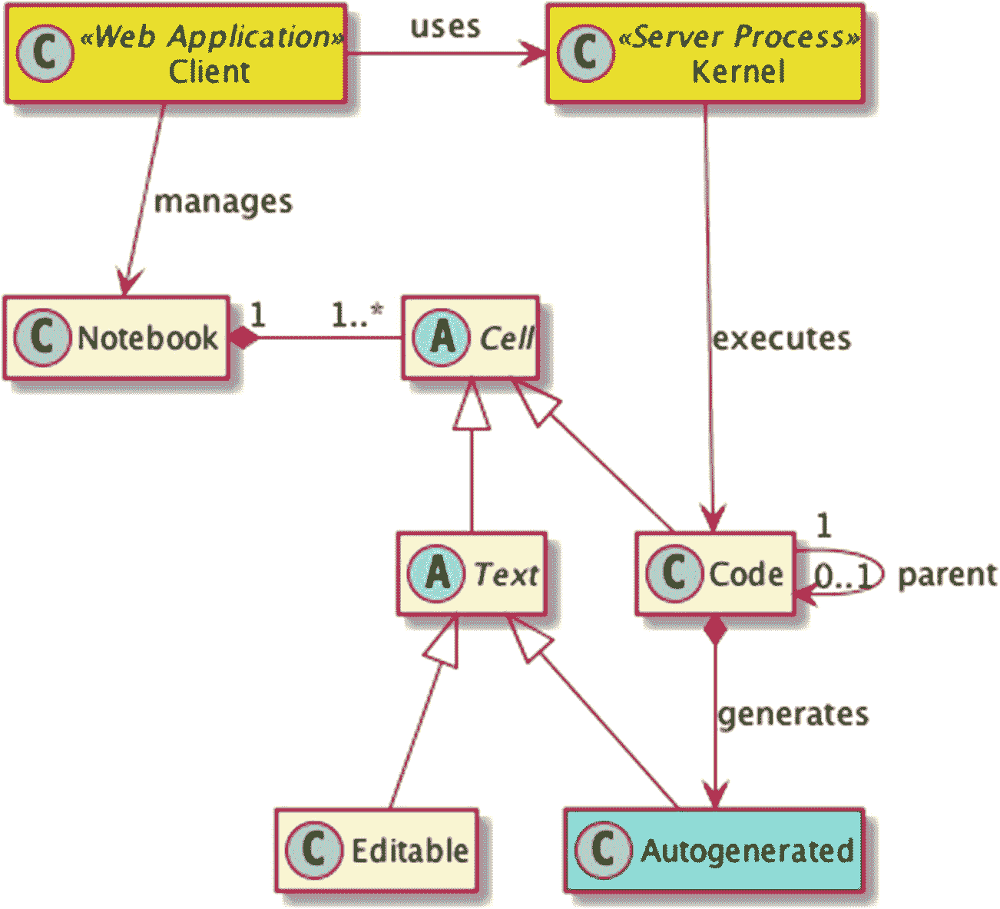
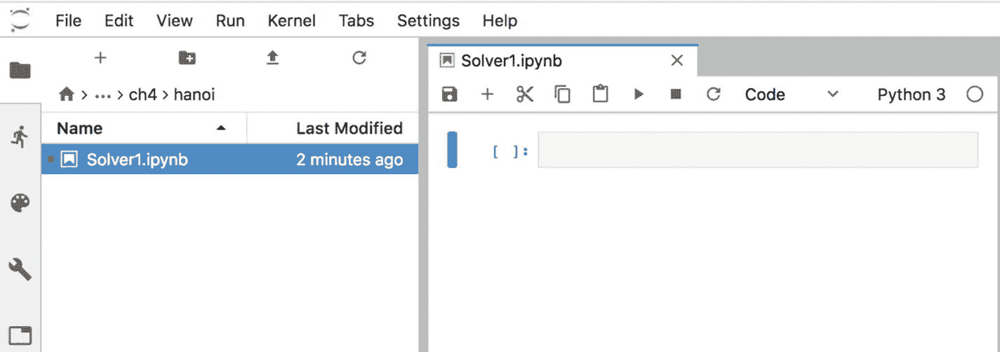
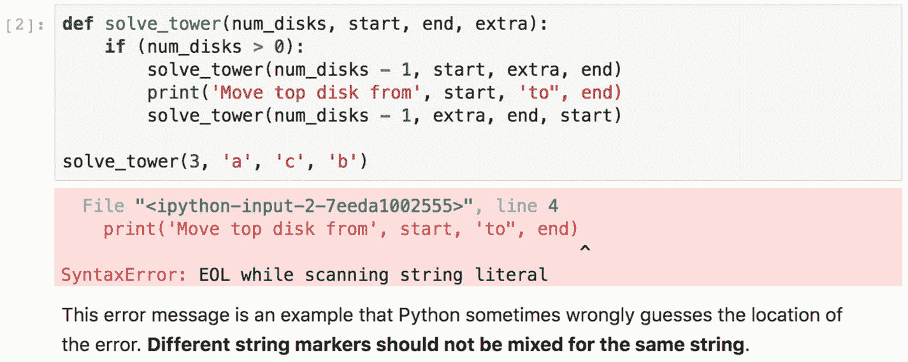
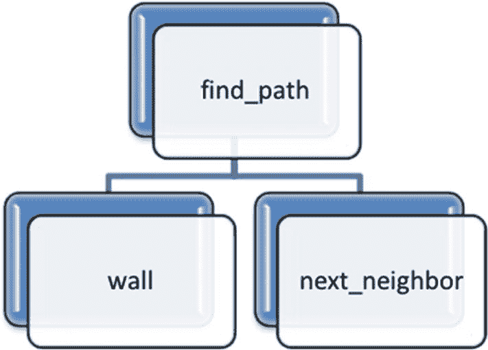
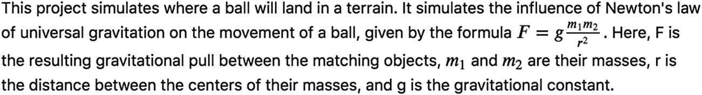

# 4. 记录你的工作

数据科学和科学计算是以人为中心的协作性工作，它们汇聚了涵盖多个领域的专家团队。你几乎不会独自完成任何重要的数据分析任务。因此，需要高效的团队内部沟通，以确保团队内部信息的适当交流。同时，也有必要将所有分析细节传达给相关的外部方。你的团队是更广泛的科学社区的一部分，因此其他人必须能够轻松验证和核实你团队的发现。分析的可复现性与结果本身同等重要。实现这一要求——将数据、程序和相关叙述作为一个交互式捆绑包有效交付——并非易事。你不能假设每个想查看你分析的人都是一位经验丰富的软件工程师。另一方面，所有利益相关者都希望基于可用数据做出决策。幸运的是，有一个强大的开源解决方案可以协调个人技能集之间的差异。本章介绍 *Jupyter* 项目（参见 `https://jupyter.org`），这是用于记录和共享数据科学工作的最流行的生态系统。

理解 Jupyter 项目的关键在于掌握 *Jupyter Notebook* 架构（参见参考文献 [1–3]）。Jupyter 中的*笔记本*（notebook）是一个可交互、可执行的叙事文档，由浏览器内运行的 Web 应用程序支撑。该 Web 平台为进行各种数据科学工作（如数据预处理、数据清洗、探索性分析、报告等）提供了一个便捷的环境。它也可以作为一个全功能的开发环境，并支持多种编程语言，包括 **Ju**lia、**Pyt**hon、**R** 和 Scala。正如 Jupyter 主页所强调的，该项目“旨在开发用于跨数十种编程语言进行交互式计算的开源软件、开放标准和服务。”该项目提供了制作各种自定义交互式计算环境的构建模块。以下是 Jupyter 架构的三个主要组成部分：

- **笔记本文档格式**：一种 JSON 文档格式，用于存储所有类型的内容（代码、图像、视频、HTML、Markdown、LaTeX 方程等）。该格式的扩展名为 `.ipynb`。参见 `https://github.com/jupyter/nbformat`。
- **消息传递协议**：一种基于 JSON 有效负载的网络消息传递协议，用于 Web 客户端（如 Jupyter Notebook）与编程语言内核（kernel）进行通信。*内核*是在笔记本内执行实时代码的引擎。该协议指定 ZeroMQ 或 WebSockets 作为传输机制。参见 `https://github.com/jupyter/jupyter_client`。
- **笔记本服务器**：一种向客户端公开 WebSocket 和 HTTP 资源 API 的服务器，用于远程访问文件系统、终端和内核。参见 `https://github.com/jupyter/jupyter_server`。

这些元素如图 4-1 所示。Web 应用程序可以是原始的 Jupyter Notebook，也可以是其他兼容的 Web 用户界面提供程序。服务器进程与许多不同的内核通信。每个笔记本实例都与匹配的内核进程相关联。一个笔记本由许多单元（cell）组成，每个单元可以是文本也可以是实时代码。代码由相应的语言依赖内核执行。笔记本中的代码可能引用先前定义的代码块。通常，实时代码会产生一些只读内容，这些内容成为笔记本的组成部分。这些自动生成的内容稍后可以在不启动任何计算的情况下浏览。



图 4-1


## Jupyter 架构与 Notebook 结构

Jupyter 架构的主要组件以及 Notebook 的结构分解。每个 Notebook 在任意给定时间点都与专属的内核关联。

Jupyter 生态系统包含的各种工具如下：

- **Jupyter Notebook**：该架构的第一个客户端/服务器栈，在撰写本文时仍被广泛使用。
- **JupyterLab**：用于处理 Notebook 的下一代 Web 客户端应用程序。^(¹²) 我们将在本章实现它。使用`JupyterLab`创建的`Notebook`与`Jupyter Notebook`完全兼容，反之亦然。
- **JupyterHub**：基于云的 Notebook 托管解决方案。对于大型组织以安全方式扩展其 Jupyter 部署尤为重要。优秀的示例包括 edX 平台上加州大学伯克利分校的“数据科学基础”和加州大学圣地亚哥分校的“数据科学微硕士”MOOC 课程。
- **IPython**：Python 内核，使用户能够在 Notebook 中使用 IPython 控制台的所有扩展。这包括调用以`!`为前缀的 shell 命令。还有一些用于执行 shell 操作的魔法命令（例如用于更改当前工作目录的`%cd`）。您可能想探索[`https://github.com/ipython/ipython-in-depth`](https://github.com/ipython/ipython-in-depth)上的许多 IPython 相关教程。
- **Jupyter widgets 和 notebook extensions**：各种用于增强 Notebook 交互性的 Web 小部件以及用于提升笔记本功能的扩展。我们将在本章演示其中一些。要获取扩展的合集，请访问[`https://github.com/ipython-contrib/jupyter_contrib_nbextensions`](https://github.com/ipython-contrib/jupyter_contrib_nbextensions)。
- **nbconvert**：将 Notebook 转换为其他富内容格式（例如 Markdown、HTML、LaTeX、PDF 等）。请参阅[`https://github.com/jupyter/nbconvert`](https://github.com/jupyter/nbconvert)。
- **nbviewer**：用于共享 Notebook 的系统。您可以提供指向 Notebook 的 URL，该工具将生成一个带有稳定链接的静态 HTML 网页。之后您可以与同事共享此链接。请参阅[`https://github.com/jupyter/nbviewer`](https://github.com/jupyter/nbviewer)。

### JupyterLab 实战

您应该根据您的操作系统启动 Anaconda Navigator。第 1 章提供了在您的操作系统上安装它的说明（您也可以通过访问[`https://jupyter.org/try`](https://jupyter.org/try)立即尝试各种 Jupyter 应用程序），图 1-4 显示了 Anaconda Navigator 的主屏幕，左上角有`JupyterLab`。单击 JupyterLab 的启动按钮以启动该工具。`JupyterLab`将在您的 Web 浏览器中显示其主页面（仪表板）。屏幕分为三个区域：

- 顶部菜单栏包括用于创建、加载、保存和关闭 Notebook，创建、删除和更改单元格，运行单元格，控制内核，更改视图，读取和更新设置以及访问各种帮助文档的命令。
- 左侧窗格具有用于浏览文件系统、监督正在运行的 Notebook、访问所有可用命令、设置单元格属性以及查看右侧窗格中哪些选项卡打开的选项卡。默认选择文件浏览器的选项卡，它允许您在 Notebook 服务器上处理目录和文件（这是逻辑根目录）。如果您在本地运行所有内容（您的服务器 URL 将类似于`http://localhost:88xx/lab`），那么这将是您的主文件夹。
- 右侧窗格具有用于活动组件的选项卡。Launcher（默认显示）包含用于启动新 Notebook、打开 IPython 控制台、打开终端窗口和打开文本编辑器的按钮。新打开的组件将平铺在此区域中。

#### 代码执行实验

本着数据科学的精神，让我们首先进行一些代码执行实验。目的是了解当出现问题时会发生什么，因为能够快速调试问题可以提高生产力。在文件浏览器内部，单击工具栏按钮创建一个新文件夹（标准文件夹按钮上带有一个加号）。右键单击新创建的文件夹并将其重命名为`hanoi`。双击它以切换到该目录。现在，在右侧窗格中单击 Launcher 中的按钮以打开一个 Notebook。在文件浏览器中右键单击新 Notebook 文件并将其重命名为`Solver1.ipubn`。如果您正确完成了所有操作，那么您应该会看到类似于图 4-2 所示的屏幕。


#### 提示

如果出现错误，不必担心。你可以随时通过右键菜单和/或拖放操作来删除或移动项目。此外，你在 JupyterLab 中所做的所有操作，在你常用的文件管理器中都是可见的，因此你也可以在那里进行修复。我建议你始终为项目创建一个指定的目录。这样可以避免混乱并帮助你整理工作成果。你将需要在笔记本中引用许多其他项目（例如，图片、视频、数据文件等）。将这些文件放在一起是最佳实践。

在代码单元格中输入存在错误的汉诺塔问题求解函数，如代码 4-1 所示。你能在不运行的情况下找出问题吗？点击工具栏上的`运行`按钮（绿色大箭头）（或直接按`Shift+Enter`）来运行该单元格。请留意，以这种方式运行单元格后，JupyterLab 会自动在其下方创建一个新的单元格。当你持续向文档添加内容时，这个功能非常实用。

```
def solve_tower(num_disks, start, end, extra):
if (num_disks > 0):
solve_tower(num_disks - 1, start, extra, end)
print('Move top disk from', start, 'to", end)
solve_tower(num_disks - 1, extra, end, start)
solve_tower(3, 'a', 'c', 'b')
代码 4-1
含有语法错误的汉诺塔求解器
```

输出将显示以下错误信息：



图 4-2

在右侧窗格中打开的新创建的笔记本

```
File "", line 4
print('Move top disk from', start, 'to", end)
^
SyntaxError: EOL while scanning string literal
```

第一个单元格是空的，你可以开始在其中输入代码。注意其类型为`代码`，这会在下拉列表中显示。每个单元格都有一个矩形框作为边界，当前活动单元格的左侧有一条粗条。方括号内的区域是单元格编号的占位符。单元格每次运行后都会获得一个新的标识符。有两种类型的编号单元格（见图 4-1）：可编辑的代码单元格（其内容保存在`In`集合中）和自动生成的单元格（其内容保存在`Out`集合中）。例如，你可以通过输入`Out[X]`来引用单元格的输出，其中`X`是单元格的标识符。直接父级单元格的输出可以通过`_`来引用，例如`_X`表示`X`的父级单元格。最后，历史记录是可搜索的，你可以按`向上`和`向下`键来查找所需的语句。

代码 4-1 输出中的错误信息正确地指出了遇到了语法错误。然而，其解释并无太大帮助，甚至具有误导性。请留意错误报告中的粗体字符。脱字符`^`是 Python 对错误位置的猜测，而真正的错误出现在更前面的位置。它是由不匹配的字符串标记引起的。在 Python 中，你可以使用`"`或`'`来界定字符串，但不要为同一个字符串混合使用它们。

为了使这个笔记本成为一个好的备忘和有价值的教育材料，将以下 Markdown 内容放入错误输出下方的单元格中（别忘了在下拉列表中将该单元格的类型改为`Markdown`）：

```
这个错误信息是一个例子，说明 Python 有时会错误地猜测错误的位置。**同一个字符串不应混合使用不同的字符串标记**。
```

如果你运行这个单元格（这次选择`运行` ➤ `运行所选单元格且不添加新行`以避免创建新单元格），你将得到呈现良好的 HTML 内容。你的屏幕应该与图 4-3 类似。



图 4-3

你完成的第一个笔记本，展示了 Python 错误报告的一个特殊情况。请注意，任何人无需运行代码即可查看所有细节。


现在，通过点击工具栏中的磁盘图标按钮保存你的笔记本。之后，关闭笔记本的窗口并将其关闭（在左侧窗格中选择带有跑步者符号的选项卡，然后在你笔记本旁边选择 `SHUTDOWN`）。仅仅关闭 UI 页面并不会终止专用的后台进程，因此你的笔记本将继续运行。

重复之前的步骤创建一个新的笔记本，并将其命名为 `Solver2.ipubn`。将清单 4-2 中所示的汉诺塔求解器版本输入到一个代码单元格中并运行它。

```
def solve_tower(num_disks, start, end, extra):
if (num_disks > 0):
solve_tower(num_disks - 1, start, extra, end)
print('Move top disk from', start, 'to', end)
solve_tower(num_disks, extra, end, start)
solve_tower(3, 'a', 'c', 'b')
Listing 4-2
Hanoi Tower Solver with Infinite Recursion
```

你会注意到一个非常奇怪的行为。它会打印出一串无穷无尽的消息来移动圆盘，最后报告一个关于达到最大递归深度的错误。与其等待你的代码撑爆栈，你可能想要停止它。如果你的代码进入了一个无限循环，这种突然停止是唯一的选择。你可以通过调用 `Kernel ➤ Interrupt Kernel` 来中断代码的执行（注意内核菜单中提供的许多其他与内核相关的命令）。此操作的效果在以下删节的输出中可见：

```
...
Move top disk from b to c
Move top disk from a to c
Move top disk from b to c
Move top disk from a to c
Move top disk from b to

KeyboardInterrupt                         Traceback (most recent call last)
 in ()
5         solve_tower(num_disks, extra, end, start)

----> 7 solve_tower(3, 'a', 'c', 'b')
 in solve_tower(num_disks, start, end, extra)
1 def solve_tower(num_disks, start, end, extra):
2     if (num_disks > 0):
----> 3         solve_tower(num_disks - 1, start, extra, end)
4         print('Move top disk from', start, 'to', end)
5         solve_tower(num_disks, extra, end, start)
...
```

现在，输入解决汉诺塔问题的最终程序变体，如清单 4-3 所示。当然，你应该首先重复之前的步骤并创建一个新的笔记本 `Solver3.ipubn`。此修订版还包含了解释程序用途的内嵌文档。即使你可能会用叙述的方式描述你的代码，但单独记录函数/例程总是有益的。你可以轻松地将它们从你的笔记本移动到公共位置。此外，输入参数很少在文本单元格中描述，而且很容易忘记细节。所有这些都与以下观点完美契合：

> *毕竟，随着研究的系统变得越来越大，软件工程和人工智能中关键的编程问题往往会融合在一起。*
> 
> —艾伦·J·珀利斯，《计算机程序的构造与解释（第二版）》序言（麻省理工学院出版社，1996 年）

```
def solve_tower(num_disks:int, start:str, end:str, extra:str) -> None:
"""
Solves the Tower of Hanoi puzzle.
Args:
num_disks: the number of disks to move.
start: the name of the start pole.
end: the name of the target pole.
extra: the name of the temporary pole.
Examples:
>>> solve_tower(3, 'a', 'c', 'b')
Move top disk from a to c
Move top disk from a to b
Move top disk from c to b
Move top disk from a to c
Move top disk from b to a
Move top disk from b to c
Move top disk from a to c
>>> solve_tower(-1, 'a', 'c', 'b')
"""
if (num_disks > 0):
solve_tower(num_disks - 1, start, extra, end)
print('Move top disk from', start, 'to', end)
solve_tower(num_disks - 1, extra, end, start)
Listing 4-3
Correct Hanoi Tower Solver with Embedded Documentation and Type Annotations
```

代码注释还包含了 `doctest` 测试。这些测试可以通过运行以下代码单元格来执行（将这样一个单元格放在笔记本末尾会很方便）：

```
import doctest
doctest.testmod(verbose=True)
```

输出反映了测试的数量和结果：

```
Trying:
solve_tower(3, 'a', 'c', 'b')
Expecting:
Move top disk from a to c
Move top disk from a to b
Move top disk from c to b
Move top disk from a to c
Move top disk from b to a
Move top disk from b to c
Move top disk from a to c
ok
Trying:
solve_tower(-1, 'a', 'c', 'b')
Expecting nothing
ok
1 items had no tests:
__main__
1 items passed all tests:
2 tests in __main__.solve_tower
2 tests in 2 items.
2 passed and 0 failed.
Test passed.
TestResults(failed=0, attempted=2)
```

最后，此类文档可以通过执行 `solve_tower?` 轻松检索（如果你包含两个问号，那么你也可以转储源代码）。

##### 管理内核

内核是一个运行你的代码并返回执行结果的引擎。在图 4-2（在上一节中），你可以看到内核的状态；查看右上角的圆圈，位于内核类型旁边（在我们的例子中是 Python 3）。一个白色圆圈表示内核处于空闲状态，可以执行代码。一个实心圆圈表示内核忙碌（这种相同的视觉线索也表示内核已死亡）。如果你注意到你的程序已停止，或者与笔记本的交互变得繁琐（反应缓慢且无响应），那么你可能需要考虑以下命令（它们都分组在“内核”菜单下，每个带有省略号的菜单项都会打开一个对话框让你确认意图）：

*   **中断内核**：中断当前内核。当所有系统组件都正常，唯独你当前运行的代码出问题时，这很有用（我们已经看到过这个命令的作用）。

*   **重启内核...**：重启引擎本身。如果你注意到笔记本性能迟缓，应该尝试这个。

*   **重启内核并清除...**：重启服务器并清除所有自动生成的输出。

*   **重启内核并全部运行...**：重启服务器并从笔记本的开头运行所有代码单元格。

*   **关闭内核**：关闭当前内核。

*   **关闭所有内核...**：关闭所有活动的内核。这适用于你的笔记本包含用不同支持的编程语言编写的代码时。

*   **更改内核...**：更改当前内核。你可以从下拉列表中选择一个新内核。其中一个是一个名为`No Kernel`的虚拟内核（使用此内核，所有执行代码单元格的尝试将简单地擦除其先前生成的输出）。你也可以从之前的会话中选择一个内核。

### 注意

每当你重启内核时，必须再次按正确顺序执行你的代码单元格。忘记这一点是导致如 `NameError: name <XXX> is not defined` 错误的最可能原因。

###### 连接到笔记本的内核

如果你想在不干扰笔记本主要流程的情况下试验代码的各种变体，你可以将另一个前端（如终端控制台或 Qt 控制台应用程序）附加到当前运行的内核。要查找必要的连接信息，请在代码单元格内运行 `%connect_info` 魔术命令。输出还会给你一些关于如何进行连接的提示。这样做的好处是你可以访问笔记本中的所有构件。

##### 警告

务必始终将你的笔记本视为事实来源。你可以通过控制台轻松引入一个新变量，它也会在你的笔记本中显示为已定义。如果你认为它有用，请不要忘记将该定义放回到它所属的位置。


#### 球体下落项目

现在我们将开发一个小而完整的项目，以展示 JupyterLab 的其他强大功能（其中许多功能由 IPython 提供，因为它就是我们的内核）。我们力求示例简洁明了，以便你能专注于 JupyterLab 本身。首先，为该项目创建一个新文件夹（命名为 `ball_descend`）。在该文件夹中创建一个新笔记本 `Simulation.ipubn`。关于如何完成这些步骤的说明，请重新参考“代码执行实验”部分。

##### 问题说明

用清晰的标题和对问题的描述来开始笔记本是很有用的。这些细节非常重要，能从一开始就突出你工作的核心。不要让其他人浪费时间试图弄清楚你的工作对他们是否有价值。从下拉框中选择 Markdown 单元类型，并输入以下文本：

```
##### 球体在地形中的下落模拟
本项目模拟球体在地形中的最终落点。
#### 输入
地形的配置由一个整数矩阵给出，表示每个点的高程。为简化起见，假设地形被一堵矩形墙壁包围，防止球体逃逸。地形的内部尺寸为 NxM，其中 N 和 M 是介于 3 和 1000 之间的整数。
球体的初始位置由一对整数 (a, b) 给出。
#### 输出
结果是一个坐标列表，表示球体在地形中的路径。列表的第一个元素是起始位置，最后一个元素是结束位置。如果地形平坦或球体落在最低点（局部最小值），则起始位置和结束位置可能相同。
#### 规则
球体的运动遵循以下两条简单规则：
- 球体从当前位置滚动到相邻最低的位置。
- 如果球体被更高点包围，则停止运动。
```

你应该利用 Markdown 格式提供的丰富格式化选项。在这里，我们定义了标题来为文档创建一些结构。我们将在下一节进一步讨论结构。一旦执行此单元，它将被渲染为 HTML。

结果发现标题中有一个小拼写错误（在渲染后的 HTML 中更加明显）：它写的是 `Bal's` 而不是 `Ball's`。双击文本单元，更正此问题，然后重新运行该单元。

你也可以使用多个连续的单元格来输入上述文本。可以通过“编辑”菜单中的命令或使用拖放技术来拆分、合并和移动单元格。运行文本单元的结果是其格式化输出。文本单元可以按任意顺序运行。但代码单元则不同，它们通常相互依赖。忘记运行代码所依赖的单元可能会导致各种错误。显然，减少代码单元之间的耦合至关重要。代码单元之间的依赖关系图可以揭示很多复杂性。这也是你应该尽量减少对全局变量依赖的原因之一，因为这会使你的单元相互纠缠。

##### 模型定义

上一节中的问题描述充分暗示了数据模型。一个直观的选择是将地形表示为一个整数矩阵。`NumPy` 已经拥有这样的数据结构。当然，对于这个微型示例，我们也可以只使用标准 Python 的东西。尽管如此，我还是想给出一些关于设置代码的提示。在下一个代码单元中输入代码清单 4-4 的内容并执行该单元（这也会在其下方创建一个新的代码单元）。

```
###### 常用的引导代码；只需运行此单元。
import numpy as np
代码清单 4-4
笔记本的全局导入，并附带注释告知用户只需运行它
```

你的笔记本应该仔细组织，并包含定义明确的章节。通常，引导代码（如代码清单 4-4 所示）应放在笔记本最开头的一个单独代码单元内。这类代码与你工作的核心内容没有内在关联，因此不应分散在笔记本各处。此外，大多数其他代码单元都依赖此单元先被执行。如果你修改了此部分，则应重新运行所有依赖它的单元。一个便捷的方法是调用 `运行` ➤ `运行所选单元及以下所有单元`。

在代码单元中输入代码清单 4-5 的内容并运行它。

```
terrain = np.matrix([
[-2, 3, 2, 1],
[-2, 4, 3, 0],
[-3, 3, 1, -3],
[-4, 2, -1, 1],
[-5, -7, 3, 0]
])
terrain
代码清单 4-5
我们数据模型的定义
```

一个单元可以包含多行和多个表达式。这样一个复合单元会通过顺序执行其中包含的表达式来运行（按它们出现的顺序）。这里，我们有一个赋值操作和一个值表达式。后者有助于查看赋值的效果（赋值操作是静默执行的）。请记住，单元的**输出值**始终是其最后一个表达式的值（赋值操作没有值）。如果你想输出多条消息，可以使用 Python 的 `print` 语句（这些消息不会计入输出值），无论是否带有最后一个表达式。通常，输出值会被很好地渲染为 HTML，而打印输出则不会。当我们在第 5 章中将 Pandas 数据框作为值输出时，这一点会很明显。

也可以在最后一个表达式后加上分号来阻止输出其值。这在某些情况下很有用，例如你只想查看调用某个函数的效果（最常见的是与可视化相关）。

当你的光标位于多行单元内部时，可以使用键盘上的向上和向下箭头在这些行之间移动。要使用按键在单元之间移动，你必须先按 Esc 键退出该块。还可以通过单击单元左边缘与相应粗竖线之间的区域来选中整个单元。单击竖线可以折叠或展开单元（折叠后的单元用三个点表示）。

#### 提示

可以通过切换*漂亮打印*的开启和关闭来控制输出值的渲染机制。这可以通过运行 `%pprint` 魔法命令来实现。要获取可用魔法命令的列表，请执行 `%lsmagic`。

### 注意

切勿将总是返回相同值的慢速表达式（如从文件读取）与幂等参数化表达式（如显示数据框的前几个元素）放在同一个单元中。最后一个表达式无法独立执行（即不持续重新加载输入文件）。

`matrix` 函数只是 NumPy 包中的众多函数之一。JupyterLab 的上下文相关输入功能可以帮到你很多。只需在 `np.` 后按 Tab 键，你就会获得可用函数的列表。继续键入（例如按 M 键）会缩小候选列表的范围（例如，只显示以 `m` 开头的名称）。此外，在代码单元中输入 `np.matrix?` 会提供关于该函数的帮助信息（你需要执行该单元才能看到信息）。执行 `np?` 则会提供整个框架的帮助信息。


##### 路径查找器的实现

现在我们已经准备好着手处理项目的核心部分——计算弹球路径的函数。输入参数将是地形的配置和弹球的起始位置，输出则是弹球在地形中移动路径所经过的坐标列表。图 4-4 展示了从顶层问题向下分解为子问题的过程，每个子问题都作为一个独立的函数来实现。我们将从 `wall` 函数开始（参见清单 4-6）。



**图 4-4**  
问题的自顶向下分解；我们将通过自底向上的方法实现这些函数

```
def wall(terrain:np.matrix, position:Tuple[int,int]) -> bool:
"""
检查给定位置是否撞墙。
参数:
terrain: 由整数海拔高度组成的地形配置。
position: 表示弹球可能位置的一对整数。
输出:
如果位置撞墙则返回 True，否则返回 False。
示例:
>>> wall(np.matrix([[-2, 3, 2, 1]]), (0, 1))
False
>>> wall(np.matrix([[-2, 3, 2, 1]]), (-1, 0))
True
"""
x, y = position
length, width = terrain.shape
return (x < 0) or (x >= length) or (y < 0) or (y >= width)
```

**清单 4-6** 用于检测边界的 `wall` 函数定义

逻辑非常简单。`wall` 函数的签名使用了 Python 的可选类型注解。`Tuple` 必须通过在引导单元格中添加以下代码来导入（修改后需要重新运行该单元格）：

```
from typing import Tuple
```

我建议你务实地看待这些注解。例如，只需声明 `terrain` 是 `np.matrix` 就足够了，无需引入自定义类型定义来更详细地描述它。清单 4-7 中的另外两个函数应与 `wall` 函数添加在同一个单元格中。将它们放在一起是合理的，因为它们相互关联。此外，可以通过点击单元格的垂直条以“全有或全无”的方式隐藏它们。

```
def next_neighbor(terrain:np.matrix, position:Tuple[int,int]) -> Tuple[int,int]:
"""
返回最低邻居的位置。
参数:
terrain: 由整数海拔高度组成的地形配置。
position: 表示弹球当前位置的一对整数。
输出:
最低邻居的位置（坐标对）。
示例:
>>> next_neighbor(np.matrix([[-2, 3, 2, 1]]), (0, 1))
(0, 0)
"""
x, y = position
allowed_neighbors = []
for delta_x in range(-1, 2):
for delta_y in range(-1, 2):
new_position = (x + delta_x, y + delta_y)
if (not wall(terrain, new_position)):
allowed_neighbors.append((terrain.item(new_position), new_position))
return min(allowed_neighbors)[1]

def find_path(terrain:np.matrix, position:Tuple[int,int]) -> List[Tuple[int,int]]:
"""
查找弹球在地形中下降时经过的路径。
参数:
terrain: 由整数海拔高度组成的地形配置。
position: 表示弹球当前位置的一对整数。
输出:
路径的坐标列表。
示例:
>>> find_path(np.matrix([[-2, 3, 2, 1]]), (0, 1))
[(0, 1), (0, 0)]
"""
next_position = next_neighbor(terrain, position)
if (position == next_position):
return [position]
else:
return [position] + find_path(terrain, next_position)
```

**清单 4-7** 图 4-4 中所示的另外两个函数的实现

`find_path` 函数是一个非常简单的递归函数。其退出条件是确保到达局部最小值（除非你模拟的是埃舍尔世界中的地形），因为我们单调地向最低的邻居下降。

我们需要在配置部分的导入列表中添加 `List`。此外，还必须添加以下代码单元格来测试函数：

```
###### 运行此单元格以调用嵌入在函数描述中的测试。
import doctest
doctest.testmod(verbose=True)
```

执行完所有单元格后，我们应得到无错误的测试结果。请注意，所有函数都是自包含的，且独立于环境。从维护和演进的角度来看，这一点非常重要。有趣的是，即使从函数签名中移除 `terrain` 参数，所有函数也能完美执行。然而，依赖全局变量在笔记本中与其他任何地方一样，都是糟糕的做法。它很容易引入不必要的副作用和令人头疼的 bug。没有人有时间也没有动力去调试你的文档来验证结果！

##### 与模拟器的交互

现在该为项目收尾了——为用户提供一种与模拟器交互的便捷方式。经典的做法是创建一个如下形式的代码单元格（每次用户需要修改代码并重新运行该单元格）：

```
start_position = (1, 1)
find_path(terrain, start_position)
```

还有一种更好的方法，即利用 *Jupyter Widgets*。首先，需要在引导单元格中添加以下导入：

```
from ipywidgets import interact, widgets
```

JupyterLab 不允许直接将 JavaScript 生成的内容嵌入到文档中。你必须将 IPyWidgets 作为 JupyterLab 扩展进行安装。保存笔记本，关闭内核，打开终端窗口。在命令行中执行以下命令：

```
jupyter labextension install @jupyter-widgets/jupyterlab-manager
```

如果未安装 NodeJS，你会收到警告。可以通过运行以下命令轻松安装它：

```
conda install nodejs
```

如第 1 章所述，这些添加工作最好先为项目创建一个自定义环境来处理。现在启动 JupyterLab 并加载你的笔记本。在新的代码单元格中输入以下内容：

```
interact(lambda start_x, start_y: find_path(terrain, (start_x, start_y)),
start_x = widgets.IntSlider(value=1, max=terrain.shape[0]-1, description='起始 X'),
start_y = widgets.IntSlider(value=1, max=terrain.shape[1]-1, description='起始 Y'));
```

执行此单元格后，你将看到两个带有标签的滑块，用于设置弹球的初始位置（`X` 代表行，`Y` 代表列）。每次移动滑块，系统都会输出一条新的路径。由于滑块的配置与地形形状相匹配，因此不可能提供无效的起始位置。本书源代码包中包含的笔记本还提供了一些叙述性内容，用于在单独的章节中展示结果。


###### 测试自动化

在这个现代 DevOps 时代，我们无法一直手动执行任务。打开笔记本并选择菜单项来运行所有单元格固然容易，但反复且频繁地执行此操作并不可行。我们必须能够自动化整个流程。构建自动化的一部分是测试笔记本中的所有单元格是否合适（通过这种方式，我们也可以间接运行`doctest`测试）。这样的语句将成为构建脚本的一部分。打开一个终端窗口；这次在 JupyterLab 中点击启动器中的相应按钮来打开它（如果启动器标签页不可见，请选择“文件 ➤ 新建启动器”）。确保你位于本章的源代码文件夹内。执行以下语句^(¹⁴)：

```
python -m pytest --nbval-lax ball_descend/Simulation.ipynb
```

你应该看到以下输出：

```
=============== test session starts ==========================
platform darwin -- Python 3.6.5, pytest-3.6.0, py-1.5.3, pluggy-0.6.0
rootdir: /Users/evarga/Projects/pdsp_book/src/ch4, inifile:
plugins: remotedata-0.3.0, openfiles-0.3.0, doctestplus-0.1.3, arraydiff-0.2, nbval-0.9.1
collected 6 items
ball_descend/Simulation.ipynb ......                                                  [100%]
============ 6 passed in 2.15 seconds ========================
```

另一方面，尝试执行以下语句：

```
python -m pytest --nbval-lax hanoi/Solver1.ipynb
```

该工具将报告一个错误，这是意料之中的，因为笔记本包含一个带有语法错误的代码单元格：

```
=============== test session starts ==========================
platform darwin -- Python 3.6.5, pytest-3.6.0, py-1.5.3, pluggy-0.6.0
rootdir: /Users/evarga/Projects/pdsp_book/src/ch4, inifile:
plugins: remotedata-0.3.0, openfiles-0.3.0, doctestplus-0.1.3, arraydiff-0.2, nbval-0.9.1
collected 1 item
hanoi/Solver1.ipynb F                                   [100%]
==================== FAILURES ================================
___________ hanoi/Solver1.ipynb::Cell 0 ______________________
Notebook cell execution failed
Cell 0: Cell execution caused an exception
Input:
def solve_tower(num_disks, start, end, extra):
if (num_disks > 0):
solve_tower(num_disks - 1, start, extra, end)
print('Move top disk from', start, 'to", end)
solve_tower(num_disks - 1, extra, end, start)
solve_tower(3, 'a', 'c', 'b')
Traceback:
File "", line 4
print('Move top disk from', start, 'to", end)
^
SyntaxError: EOL while scanning string literal
============ 1 failed in 2.16 seconds ========================
```

###### 重构模拟器的笔记本

你应该始终寻求提高工件（artifact）的清晰度和结构。笔记本也不例外。当前这个笔记本包含大量 Python 代码，这可能会分散用户对工作主要内容的注意力。我们将进行以下改进：

1. 将 `wall`、`next_neighbor` 和 `find_path` 函数移到一个名为 `pathfinder` 的独立包中。
2. 将 `doctest` 调用移到我们的新包中。
3. 将新包导入到我们的笔记本中（我们需要访问 `find_path` 函数）。
4. 增加更多关于我们在做什么的解释，并附上一个格式优美的公式。

在当前项目文件夹下创建一个名为 `pathfinder` 的新文件夹。在 `pathfinder` 中创建一个新文件，并命名为 `pathfinder.py`。将 `wall`、`next_neighbor` 和 `find_path` 函数复制到此文件中。从笔记本中删除匹配的代码单元格。复制 `numpy` 和 `typing` 的导入语句（位于笔记本开头）。从笔记本中删除 `typing` 的导入。在 `pathfinder` 中创建一个名为 `__init__.py` 的文件（参见参考文献 [4]），并插入以下行：

```
from pathfinder.pathfinder import find_path
```

将笔记本中调用 `doctest` 的代码单元格的内容移出，并将其放在 `pathfinder.py` 末尾的以下 `if` 语句中：

```
if __name__ == "__main__":
```

在笔记本的开头，插入以下 `import` 语句：

```
from pathfinder import find_path
```

此时，你的笔记本应该与之前功能相同。注意其整洁性。最后，在笔记本中添加以下文本作为第二句和第三句：

```
它模拟了牛顿万有引力定律对球体运动的影响，公式为 $F=g\frac{m_1m_2}{r²}$。其中，F 是物体之间的引力，$m_1$ 和 $m_2$ 是它们的质量，r 是两个物体质心之间的距离，g 是引力常数。
```

加粗部分是 LaTex 表达式（必须用 `$` 分隔）。执行文本单元格后，公式将很好地呈现，如图 4-5 所示。更复杂的 LaTex 内容可以放在原始单元格类型中，并通过 `nbconvert` 命令行工具进行渲染。



图 4-5

普通文本中的 LaTex 内容被优美地渲染成 HTML


## 文档结构

在之前的项目中，我们已经涉及了内容结构这一主题，虽然是以一种非常轻量级的方式。在此我们将投入更多关注。无论你计划使用何种技术来完成文档任务，都需要对如何构建文档有清晰的认识。结构能为你的报告带来秩序和一致性。对于这种结构没有硬性规定，但存在许多启发式方法（即最佳实践）。文档应划分为定义明确的部分，并按某种逻辑顺序排列。每个部分应有清晰的范围和篇幅；例如，将更多篇幅用于介绍而非分析中的关键发现是毫无意义的。请记住，笔记本也是一种文档，必须进行合理布局。诚然，数据科学流程已就如何以及按何种顺序执行主要步骤提供了建议（见第 1 章），这一方面应在你的笔记本中有所体现。尽管如此，仍有一些结构规则应叠加在数据科学生命周期模型之上。

一个可能合理的高级文档模板如下所示（我假设在所有场景下，一个恰当的标题/副标题都是必需的）：

*   **摘要**：此部分应为你的工作提供一个简要总结。它必须阐明你做了什么、以何种方式完成，并列举关键结果。
*   **动机**：此部分应解释你的工作为何重要，以及它可能如何影响目标受众。
*   **数据集**：此部分应描述数据集及其来源。你应该给出明确的指令，解释如何检索数据集以达到可复现的目的。
*   **数据科学生命周期阶段**：接下来的几个部分应遵循数据科学生命周期模型（数据预处理、研究问题、方法、数据分析、报告等），并简洁地解释每个阶段。这些细节在数据分析笔记本中经常出现。
*   **局限性**：此部分应诚实提及你方法中的所有局限。在决策过程中不了解约束条件是非常危险的。
*   **结论**：此部分应阐述主要成果。
*   **未来工作**：此部分应给出你未来计划的一些提示。其他科学家正在处理类似问题，这为合作创造了机会。
*   **参考文献**：此部分应列出你在研究过程中使用的所有相关参考文献。不要为了让你的工作看起来更“有说服力”而堆砌此部分。

你所做工作的用户可分为三大类：普通大众、决策者和技术专业人士。普通大众只对你试图解决什么问题感兴趣。这类用户可能只阅读标题和摘要。决策者是商务人士，他们很可能阅读主要发现以及局限性和结论。他们主要寻求表述清晰、可操作的见解。技术人士（包括 CTO、数据科学家等）则希望复现你的发现并扩展你的研究。因此，他们会关注你报告的方方面面，包括实现细节。如果你未能识别和/或满足这些不同类别用户的需求，那么你将降低尽可能广泛传播成果的潜力。

### 维基百科编辑项目

作为上一节概述模板的示例，我将基于对维基百科编辑的分析，填充其中的部分内容。完整的 Jupyter notebook 已在 Kaggle 上公开（见[`https://www.kaggle.com/evarga/analysis-of-wikipedia-edits`](https://www.kaggle.com/evarga/analysis-of-wikipedia-edits)）。它确实包含了关于主要数据科学生命周期阶段的细节。这个项目的目标是引发讨论，因为有许多观点尚待商榷。模板中的以下部分应足以让你把握分析的本质（甚至无需打开前面提到的 notebook）。如果目前 Kaggle 上的 notebook 看起来复杂，不必担心。

## 摘要

本研究使用来自 Kaggle 的维基百科编辑数据集。它试图告知用户维基百科的内容是否稳定且值得信赖。该报告还根据编辑标题中的词汇，识别出哪些主题被编辑得最频繁。这项工作依赖于多种可视化手段（如散点图、堆叠条形图和词云）来推动结论。它还利用了`NLTK`来处理标题。我们可以得出结论，维基百科在具备适当可信度的情况下，足以用于非正式使用，而电影、体育、音乐等主题更新最为频繁。

#### 动机

维基百科通常是人们寻找信息时访问的第一个网站。显然，其内容的高质量（准确性、可靠性、时效性等）对于广大社区至关重要。这项工作试图通过分析用户的编辑行为来深入了解维基百科的内部运作。任何人都可以编辑维基百科（包括机器人），这可能会引发对其可信度的担忧。因此，通过更深入地了解这些变更，我们可以判断维基百科是否可以被视为可靠的信息来源。顺便提一句，科学论文不能依赖维基百科。也有一些图书出版商禁止引用维基百科。总而言之，本报告试图阐明维基百科对于非正式使用是否足够可靠。

#### 局限性

*   这些数据反映了用户在非常短时间内的活动。如此小的数据集无法提供完整的故事。此外，由于时区差异，它无法代表世界所有地区。
*   Kaggle 上对下载数据集的获取过程没有描述。因此，对所记录的事实应持保留态度。编辑的大小字段尤其有问题。
*   数据本身也存在固有的局限性。我无法访问用户档案，因此我假设所有用户都具备同等的编辑资格。如果我能获得这些信息，那么我就可以对其修改的影响力进行加权。

#### 结论

*   维基百科对于非正式使用足够可靠。变更主要是关于修复小问题。较大的规模变更主要与新增内容有关，并且由人类完成。这些更新被视为重大更新。
*   较大的编辑由注册用户完成，而较小的修正也由匿名用户完成。
*   专业内容（科学、技术/相关技术等）的变更频率不如电影、体育、音乐等主题频繁。


### 练习 4-1\. 地形数据的外部加载

手动输入大量数据是不可行的。在我们的案例研究中，地形配置仅适合一个 5×4 的矩阵。使用这种方法为一个 200×300 的地形插入高程是不可能的。更好的策略是将数据存储在外部，并按需加载。修改地形初始化的代码单元，使其从文本文件中读取数据。幸运的是，你无需为这一改进费太多心思。NumPy 的 `Matrix` 类已经支持将数据作为字符串处理。以下是其文档的摘录：“如果 `data` 是一个字符串，它将被解释为一个矩阵，其中逗号或空格分隔列，分号分隔行。”

你首先需要创建一个与我们在此处使用内容相同的文本文件。这样，你就可以轻松测试其他部分是否按预期工作。你应该将配置文件上传到你的笔记本所在的同一文件夹中（以便仅使用文件名作为引用）。要上传文件，请点击 JupyterLab 文件浏览器中的 `Upload Files` 工具栏按钮。关于如何在 Python 中打开/读取文本文件，请参考第 2 章。

### 练习 4-2\. 解决规格歧义

由于你的 JupyterLab 笔记本的可访问性和数据分析的可重复性，一位敏锐的数据科学家发现了你解决方案中的一个缺陷。他提供了一个完整的可执行示例（他与你分享了一个修改过的笔记本文件）来报告这个问题。因此，你可以准确地弄清楚他希望你修复什么。对于起始位置 `(0, 1)`，无法预先明确球应该落在 `(0, 0)` 还是 `(1, 0)`，因为它们都处于局部最低海拔（本例中为 -2）。同样也不清楚，如果球落在了一个高原（一片海拔相同的地形区域）上，它应该往哪里去。在当前解决方案中，球会根据邻居的搜索顺序停在其中一个点上。这显然不太符合在局部最低点停止的规则。

因此，问题是：你是否应该考虑惯性？你如何记录最终停靠的点？思考这些问题，并扩充文本和/或修改寻路算法。

### 练习 4-3\. 项目扩展

另一位数据科学家要求扩展该问题。她希望赋予球一定的弹性。如果球下落超过 X 个单位，那么它可以向上弹起 Y 个单位。修改寻路算法以考虑这种灵活性。假设球仍会选择最低的邻居，尽管候选集合将会扩大。`find_path` 中的递归是否总会终止？哪些条件决定了这种有保证的终止？彻底测试你的解决方案。

### 练习 4-4\. 笔记本演示

在“文档结构”部分，你可以找到建议的文档模板。创建一个独立于主笔记本之外的单独工件并不是一个好选择，因为它最终会与主笔记本脱节（就像软件开发中的被动设计文档一样）。

JupyterLab 笔记本可以具有双重目的：既作为演示材料，又作为可执行叙述。用文档模板中的部分内容（首先添加摘要和结论部分）来扩展“下降的球”项目的笔记本。将这些文本单元的幻灯片类型设置为 `Slide`。将其他单元标记为 `Skip`。打开终端窗口并键入：

```
jupyter nbconvert .ipynb --to slides --post serve
```

将打开一个新的浏览器窗口，逐一显示标记为 `Slide` 的单元。查找其他幻灯片类型的含义：`Sub-slide`、`Fragment` 和 `Notes`。有关演示模式的更多信息，请查阅 JupyterLab 的文档。对于真正专业的演示，你应该使用 *Reveal.js*（参见 [`https://revealjs.com`](https://revealjs.com)）。

## 本章小结

本章涵盖了将文档打包为自包含、可执行且可共享的资产的一些好处：

*   自由格式的文本与可执行代码捆绑在一起；这消除了维护单独文档的需要，这些文档通常会与代码不同步。
*   代码执行的输出可以保存在文档中，并成为其组成部分。
*   可执行环境（用于引入运行代码的依赖项）的设置可以在文档内部完成。这解决了许多部署问题，并为那些希望看到你在实际中得出的结论的人消除了陡峭的学习曲线。

你已经见证了计算型笔记本的威力，以及 Jupyter 工具集如何满足文档编制的大部分要求。通过支持不同的编程语言，JupyterLab 促进了多语言编程，这在数据科学领域非常重要。就像多个数据源非常有价值一样，许多经过不同优化的开发/可执行环境对于制定好的解决方案来说也是不可或缺的。

JupyterLab 还有许多此处未演示的有用功能。例如，它有一个网络优先的代码编辑器，对于较小的编辑工作，无需使用完整的集成开发环境（如 Spyder）。你可以远程在线编辑 Python 代码。JupyterLab 还允许你在不编写 Python 代码的情况下处理数据。如果你打开一个 Leaflet GeoJSON 文件（参见 [`https://leafletjs.com`](https://leafletjs.com)），它将被立即可视化并可供交互。而传统方法则需要运行一个 Python 代码单元。

总而言之，本章为后续章节奠定了基础。我们将不断展示 JupyterLab 的新元素，因为它将是我们的默认可执行环境。

