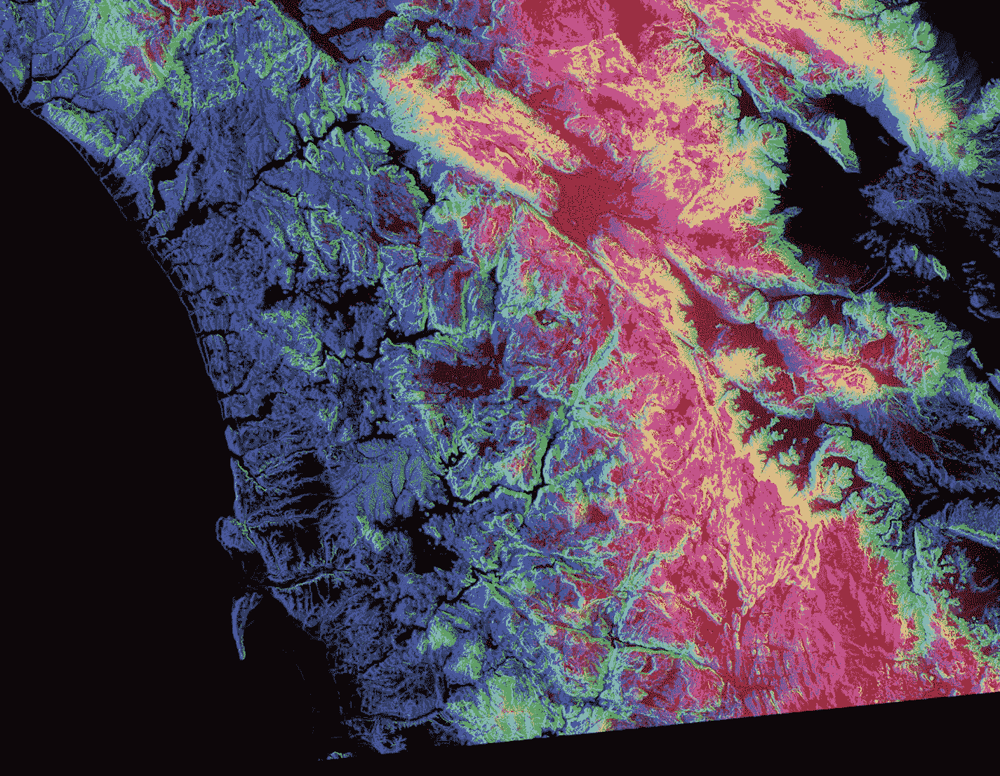
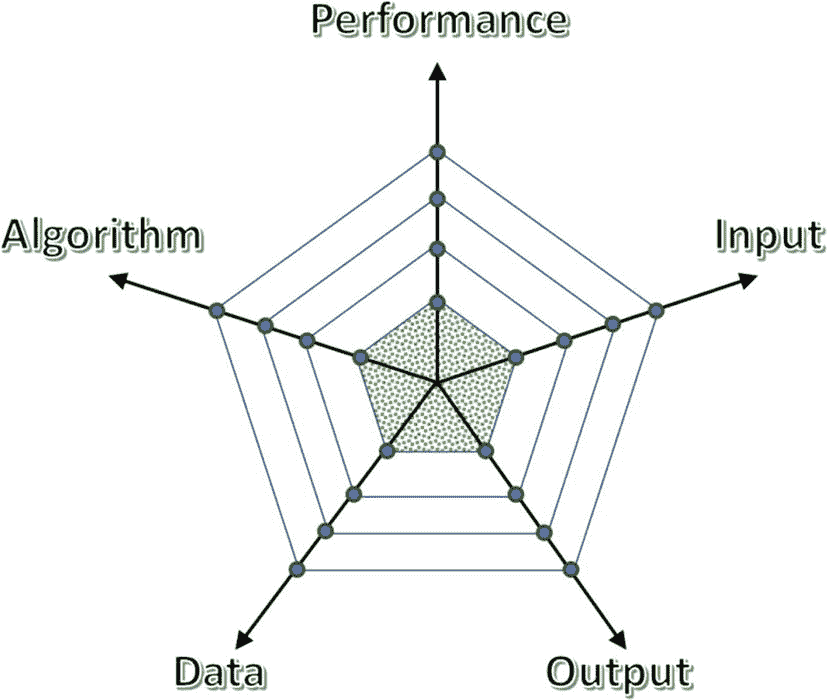
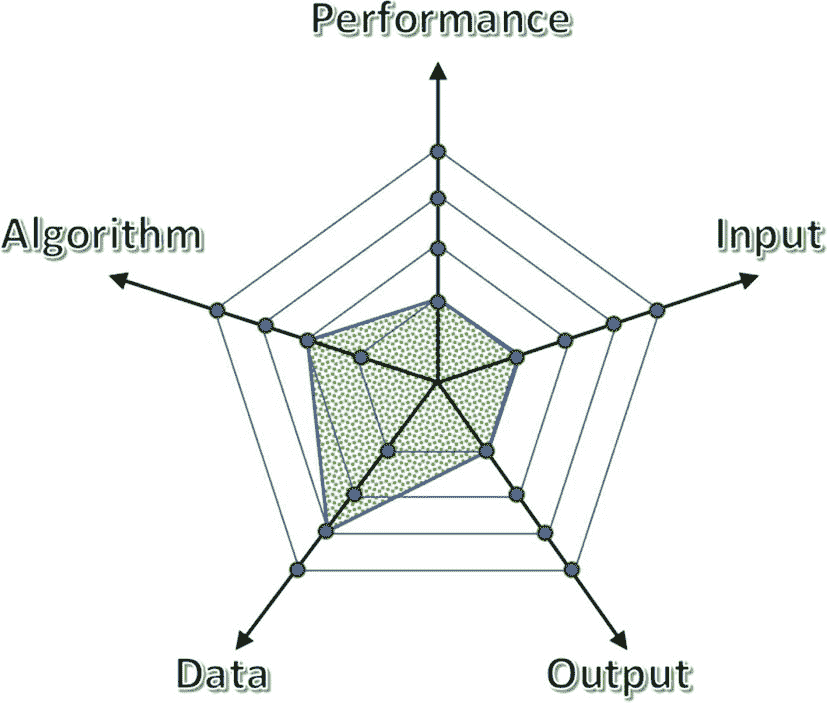
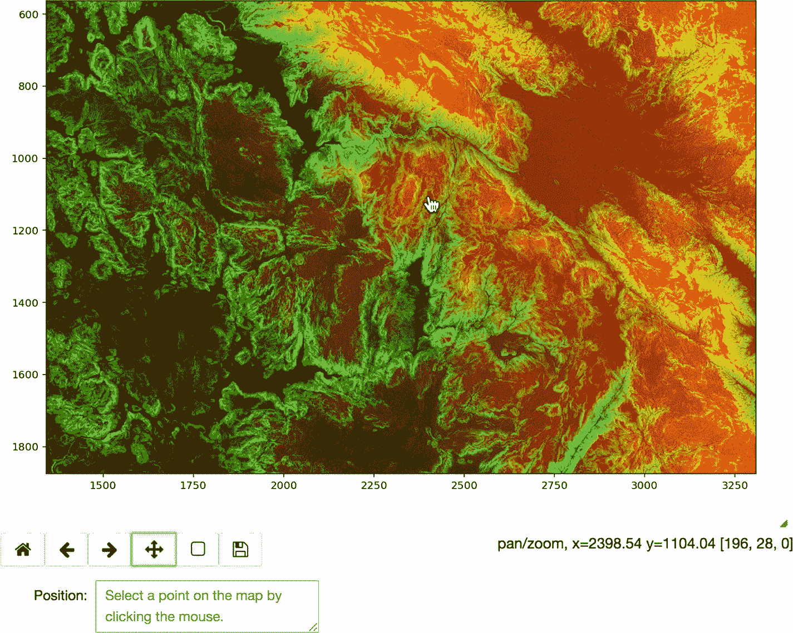
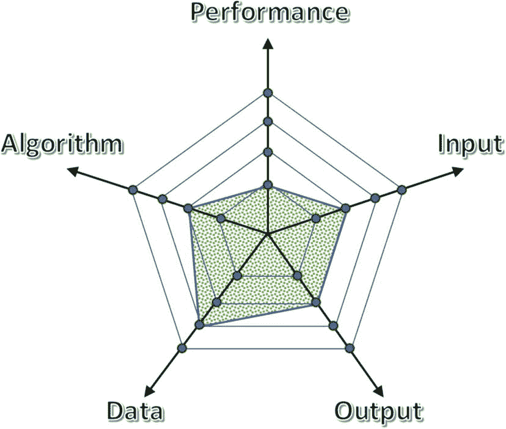
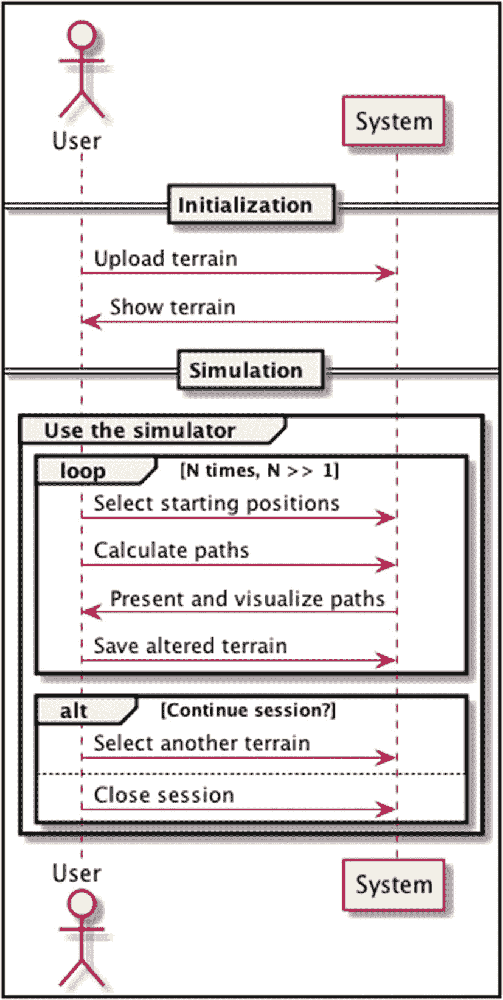
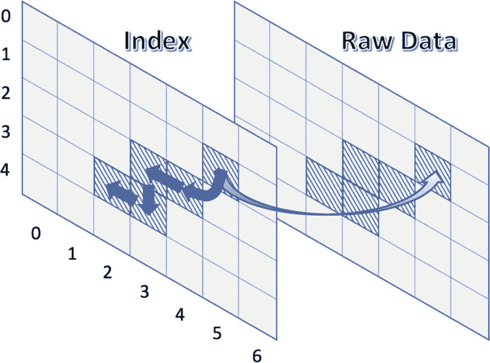
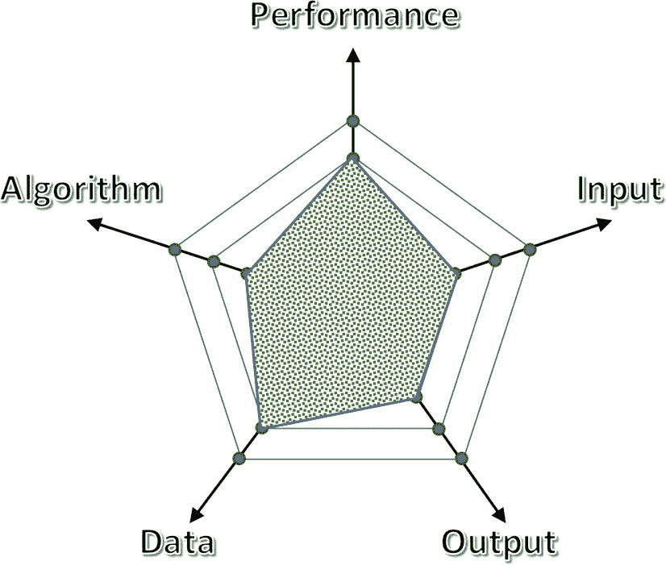

# 5\. 数据处理

数据分析是数据科学过程的核心阶段。它类似于软件开发的构建阶段，即实际生成代码的阶段。重点在于能够处理大量数据，以综合出可操作的见解和知识。数据处理是主要的阶段，数学和软件工程技能在此交织，以应对各种可扩展性问题（规模、速度、复杂性等）。仅仅堆叠各种技术，指望它们能自动神奇地协调一致并产出预期结果，是远远不够的。了解基本范式和机制是必不可少的。这是本章的主题：介绍和举例说明与可扩展数据处理相关的概念。一旦你正确理解了这些概念，你就能更好地理解为什么选择特定的技术是最佳途径。

## 增强版“下降的球”项目

我们将扩展上一章中的示例。提醒一下，以下是 Markdown 格式的原始问题说明（粗体部分将被修改）：

```
### 模拟球在地形中的下降
本项目模拟球在地形中最终落点。
#### 输入
地形的配置以一个整数矩阵给出，代表每个地点的海拔。为简单起见，假设地形被一堵矩形墙包围，防止球逃逸。地形的内部尺寸为 NxM，其中 N 和 M 是介于 3 和 1000 之间的整数。
球的起始位置由一对整数 (a, b) 给出。
#### 输出
结果是一个坐标列表，表示球在地形中的路径。列表的第一个元素是起始位置，最后一个元素是结束位置。如果地形平坦或者球落在最低点（局部最小值），则它们可能是相同的。
#### 规则
球根据以下两条简单规则移动：
- 球从当前位置滚向最低的相邻位置。
- 如果球被更高的点包围，则它停止。
```


### 版本 1.1

数据科学的核心在于以有意义的方式（由业务驱动因素决定）整合不同数据源。为了让我们的产品对更广泛的用户群体更有用，我们将扩展初始系统，使其能够接受以图像编码的真实地形高程数据作为输入；打开本章 `augmented_ball_descend` 源文件夹中的 `Terrain_Simulation_v1.1.ipubn` 笔记本。其余规格应保持有效。图 5-1 展示了来自 WIFIRE 实验室（访问 [`https://wifire.ucsd.edu`](https://wifire.ucsd.edu)）的一个公开可用的卫星图像数据集，该数据集也用于加州大学圣地亚哥分校在 edX 上开设的 MOOC 课程《数据科学 Python》。WIFIRE 系统从外部来源——美国宇航局的全球影像浏览服务（GIBS）（见 [`https://earthdata.nasa.gov`](https://earthdata.nasa.gov)，在 DATA 选项卡下可访问 GIBS）获取这些图像。



**图 5-1**
带有编码地形数据的一段海岸线的卫星图像；每个像素的红-绿-蓝分量分别表示海拔、坡度和坡向。较高的颜色分量值表示较高的海拔、坡度和坡向。

以下是关于我们期望输入的新描述（请注意 Markdown 中着色的方式）：

```
地形配置以矩阵形式给出，该矩阵由代表每个点位高程的整数构成。该矩阵是根据地形的卫星图像计算得出的，其中海拔信息编码在像素的 ∗红色∗ 颜色分量中。为简单起见，假设地形周围有一堵墙，防止球滚出。地形的内部尺寸为 NxM，其中 N 和 M 是整数。
球的初始位置以一对整数 (a, b) 给出。
```

以下代码片段读取图像并输出一些统计数据（以下几个导入语句已分散在笔记本中以突出显示更改）：

```python
import imageio
terrain = imageio.imread('terrain_data/coastline.jpg')
print("The terrain's dimensions are %s with minimum %i, maximum %i, and mean %.2f for points."%\
(terrain.shape, terrain.min(), terrain.max(), terrain.mean()))
```

运行此单元格会产生以下输出：

```
The terrain's dimensions are (3725, 4797, 3) with minimum 0, maximum 255, and mean 75.83 ➥
for points.
```

因此，输入的大小从 5×4 增加到了 3725×4797×3。以下几行代码显示了图 5-1 中描绘的图像：

```python
%matplotlib inline
import matplotlib.pyplot as plt
plt.figure(figsize=(13, 15))
plt.imshow(terrain);
```

#### 边界与移动

第 4 章中的路径查找模块无法直接复用。目前，海拔被编码为范围 [0, 255] 内的整数，我们可能会遇到许多点共享相同海拔的情况。因此，我们还必须参考坡度来决定最低的相邻点。因此，需要对最低相邻点的概念进行更精确的描述，如下所示：

*   具有最低海拔的相邻点即为最低相邻点。
*   如果当前点的坡度大于零，则具有相同海拔的相邻点（若其他点海拔更高）即为最低相邻点。
*   如果存在多个满足上述条件的相邻点，则从西南方向开始，按顺时针方向选择其中一个。

我们显然不需要蓝色分量（坡向）。下一行代码将此层设置为零：

```python
terrain[:, :, 2] = 0
```

#### 路径查找引擎

原始版本的路径查找引擎是作为一组例程实现的。为了提高可维护性，我们将重新设计代码，使用面向对象的构造。清单 5-1 显示了主体结构。这是 `base_patfinder.py` 文件的内容（它通过了 Spyder 的静态代码分析器，得分最高为 10/10）。请注意，抽象方法的嵌入文档并未提及任何具体的实现细节。这些细节应留给子类去实现。

```python
"""The base class for implementing various path finders."""
import abc
from typing import List, Tuple, Set
import numpy as np
class BasePathFinder(metaclass=abc.ABCMeta):
"""
Finds the path of a ball that descends in a terrain from some starting
position.
Args:
terrain: the terrain's configuration comprised from (altitude, slope)
integer pairs.
"""
def __init__(self, terrain: np.ndarray):
self._terrain = terrain
@property
def terrain(self):
"""Gets the current terrain data."""
return self._terrain
def wall(self, position: Tuple[int, int]) -> bool:
"""
Checks whether the provided position is hitting the wall .
Args:
position: the pair of integers representing the ball's potential position.
Output:
True if the position is hitting the wall, or False otherwise.
Examples:
>>> BasePathFinder.__abstractmethods__ = set()
>>> path_finder = BasePathFinder(np.array([[(-2, 0), (3, 0), (2, 0), (1, 0)]]))
>>> path_finder.wall((0, 1))
False
>>> BasePathFinder.__abstractmethods__ = set()
>>> path_finder = BasePathFinder(np.array([[(-2, 0), (3, 0), (2, 0), (1, 0)]]))
>>> path_finder.wall((-1, 0))
True
"""
curr_x, curr_y = position
length, width = self.terrain.shape[:2]
return (curr_x < 0) or (curr_x >= length) or (curr_y < 0) or (curr_y >= width)
@abc.abstractmethod
def next_neighbor(self, position: Tuple[int, int],
visited: Set[Tuple[int, int]]) -> Tuple[int, int]:
"""
Returns the position of the lowest neighbor or the current position.
Args:
position: the pair of integers representing the ball's current position.
visited: the set of visited points.
Output:
The position (pair of coordinates) of the lowest neighbor .
"""
@abc.abstractmethod
def find_path(self, position: Tuple[int, int],
visited: Set[Tuple[int, int]]) -> List[Tuple[int, int]]:
"""
Finds the path that the ball would follow while descending in the terrain.
Args:
position: the pair of integers representing the ball's current position.
visited: the set of visited points (may be preset to avoid certain points).
Output:
The list of coordinates of the path.
"""
if __name__ == "__main__":
import doctest
doctest.testmod()
```

**清单 5-1**  
重构后的路径查找模块，采用了面向对象编程

清单 5-2 展示了我们实现该逻辑的首次尝试。


```python
"""简单的递归路径查找器实现。"""
from typing import List, Tuple, Set
from pathfinder.base_pathfinder import BasePathFinder

class SimplePathFinder(BasePathFinder):
    """使用递归且顺序执行的具体路径查找器。"""

    def next_neighbor(self, position: Tuple[int, int],
                      visited: Set[Tuple[int, int]]) -> Tuple[int, int]:
        """
        采用从西南方向开始的简单顺时针邻居搜索。

        示例：
        >>> path_finder = SimplePathFinder(np.array([[(-2, 0), (3, 0), (2, 0), (1, 0)]]))
        >>> path_finder.next_neighbor((0, 1), set((0, 1)))
        (0, 0)
        """
        curr_x, curr_y = position
        current_slope = self.terrain[position][1]
        min_altitude = self.terrain[position][0]
        min_position = position
        for delta_x in range(-1, 2):
            for delta_y in range(-1, 2):
                new_position = (curr_x + delta_x, curr_y + delta_y)
                if not self.wall(new_position) and not new_position in visited:
                    new_altitude = self.terrain[new_position][0]
                    if new_altitude < min_altitude:
                        min_altitude = new_altitude
                        min_position = new_position
        return min_position

    def find_path(self, position: Tuple[int, int],
                  visited: Set[Tuple[int, int]] = None) -> List[Tuple[int, int]]:
        """
        递归地查找路径。

        示例：
        >>> path_finder = SimplePathFinder(np.array([[(-1, 2), (-2, 1), (-2, 2), (1, 0)]]))
        >>> path_finder.find_path((0, 2))
        [(0, 2), (0, 1)]
        """
        if visited is None:
            visited = set()
        visited.add(position)
        next_position = self.next_neighbor(position, visited)
        if position == next_position:
            return [position]
        return [position] + self.find_path(next_position, visited)

if __name__ == "__main__":
    import doctest
    doctest.testmod()
```
代码清单 5-2：使用递归遍历地形的`SimplePathFinder`类

即使是这个简单的路径查找器，也比第 4 章中的初始变体复杂得多。它使用多维 Numpy 数组代替矩阵来表示地形数据，在`next_neighbor()`方法内部采用了不同的逻辑，并追踪了已访问的点。如果没有最后这一步，很容易引发无限递归。下一个代码单元进行了一个简单的测试，输出结果也已显示（标记为`>>>`）：

```
##### 使用玩具地形测试模拟器；坡度设为零，因此只有高度起作用。
test_terrain = np.array(
    [[(-2, 0), (3, 0),  (2, 0),  (1, 0)],
     [(-2, 0),  (4, 0),  (3, 0),  (0, 0)],
     [(-3, 0),  (3, 0),  (1, 0), (-3, 0)],
     [(-4, 0),  (2, 0), (-1, 0),  (1, 0)],
     [(-5, 0), (-7, 0),  (3, 0),  (0, 0)]])
from pathfinder import SimplePathFinder
path_finder = SimplePathFinder(test_terrain)
path_finder.find_path((1, 1))
>>> [(1, 1), (2, 0), (3, 0), (4, 1)]
```

一切似乎正常，因此我们可以在真实的地形数据上尝试。以下代码片段复用了第 4 章笔记本中的内容：

```
path_finder = SimplePathFinder(terrain)
interact(lambda start_x, start_y: path_finder.find_path((start_x, start_y)),
         start_x = widgets.IntSlider(value=1, max=terrain.shape[0]-1, description='起始 X'),
         start_y = widgets.IntSlider(value=1, max=terrain.shape[1]-1, description='起始 Y'));
```

通过操作滑块，你可以观察路径的计算过程。例如，起始位置`(2966, 1367)`将得出以下路径：

```
[(2966, 1367), (2967, 1368), (2968, 1369), (2969, 1370), (2970, 1371), (2970, 1372), (2971, 1373), (2972, 1374), (2973, 1375), (2974, 1375), (2975, 1375), (2976, 1375), (2977, 1375)]
```

### 版本 1.1 回顾

显然，输入/输出子系统是拙劣的。通过滑块设置起始位置并返回坐标列表的方式很笨拙。诚然，这对于玩具地形来说还可以接受，但现在情况不同了。地图上的`(2966, 1367)`点位于何处？我们如何理解小球的运动？图 5-2 展示了初始版本在各个维度上达到的复杂程度，图 5-3 则展示了本版本达到的复杂程度。



**图 5-2** – 阴影区域代表所有维度的总体进展；维度可根据上下文任意选择。

正如你即将看到的，一个系统在不同维度之间可能达到不同水平。我们的初始版本所有方面都处于基础等级。数据维度涵盖多个方面：数据量、速度、结构复杂度等。算法维度既包括数学模型也包括计算机科学算法。输入和输出分别表示数据采集和结果展示的能力。在我们的案例中，性能与内存和 CPU 消耗相关。



**图 5-3** – 新版本在数据轴上前进了两个单位（更大的规模和增强的结构），在算法轴上前进了一个单位。

我们已经看到输入和输出子系统存在缺陷，因此需要改进。

回顾也常用于各种敏捷方法中。它们为讨论经验教训和潜在改进提供了机会。数据科学工作也需要回顾。正如你将在后续迭代中看到的，很多时候你会发现需要更多探索、预处理和数据收集周期。整个过程是迭代且增量的。

### 版本 1.2

在本版本中，我们将输入和输出子系统各调高一个单位；打开本章`augmented_ball_descend`源文件夹中的`Terrain_Simulation_v1.2.ipubn`笔记本。我们的想法是允许用户通过直接在地图上指定点来输入起始位置。此外，我们希望将输出可视化的呈现在地图上，而不仅仅是返回一组点。


#### 增强输入子系统

首先来看代码清单 5-3，其中展示了一段用于自定义交互式 `matplotlib` 会话（`matplotlib` 将在第 6 章深入讨论）的小型 HTML CSS 代码。尝试跳过此代码单元以观察其效果。

```
%%html

.output_wrapper .ui-dialog-titlebar {display: None;}

代码清单 5-3
移除关闭交互式会话的默认标题和按钮
```

代码清单 5-4 展示了笔记本中用于收集用户输入的主要部分。它使用了代码清单 5-5 中列出的一个辅助类（另请参见本章末尾的练习 5-2）。该类能够区分用户是用鼠标点击选择图像的某个区域，还是选择起始位置。

```
"""
监视用户是在图像上选择区域，还是已经选择了起始位置。
"""
from ipywidgets import Textarea
import matplotlib.pyplot as plt
class InteractionMonitor:
"""
检测鼠标事件以判断用户正在执行的操作。
参数:
fig: 需要监视的 matplotlib 图形。
info_area: 需要更新其值的外部信息区域。
auto_stop_interaction: 选择起始位置后是否应停止交互（True 表示停止）。
"""
def __init__(self, fig: plt.Figure, info_area: Textarea,
auto_stop_interaction: bool = True):
self._fig = fig
self._info_area = info_area
self._auto_stop_interaction = auto_stop_interaction
self._cids = None
self._selecting = False
self._clicked = False
self._clicked_position = None
def _on_click(self, event):
self._clicked = True
def _on_release(self, event):
if not self._selecting:
self._clicked_position = (int(event.xdata), int(event.ydata))
self._info_area.value = str(self._clicked_position)
if self._auto_stop_interaction:
self.stop()
self._selecting = False
self._clicked = False
def _on_motion(self, event):
self._selecting = self._clicked
@property
def clicked_position(self):
"""返回地图上点击的数据位置。"""
return self._clicked_position
def start(self):
"""开始监视图形上的鼠标事件。"""
self._cids = [
self._fig.canvas.mpl_connect('button_press_event', self._on_click),
self._fig.canvas.mpl_connect('button_release_event', self._on_release),
self._fig.canvas.mpl_connect('motion_notify_event', self._on_motion)]
def stop(self):
"""关闭图形并停止交互。"""
plt.close(self._fig)
代码清单 5-5
用于监视用户操作的辅助类
```

```
%matplotlib notebook
from ipywidgets import Textarea
from interactionlib import InteractionMonitor
fig = plt.figure()
plt.imshow(terrain)
info_area = Textarea(
value = ",
placeholder = '通过鼠标点击在地图上选择一个点。',
description = '位置:',
disabled = True
)
display(info_area)
fig.tight_layout(pad = 1.3)
interaction_monitor = InteractionMonitor(fig, info_area)
interaction_monitor.start()
代码清单 5-4
设置交互式会话以获取用户的起始位置
```

### 注意

此前实现的 `matplotlib` 交互式会话仅适用于 Jupyter Notebook（在撰写本文时）。如果您尝试在 JupyterLab 中运行最后一个代码单元，将会收到错误 `Javascript Error: IPython is not defined`。这是一个很好的例子，说明有时您必须解决与主要目标完全无关的问题。

图 5-4 展示了一个选择起始位置的会话。现在球的下降起点一目了然。总而言之，尽管还可以进行大量额外的增强（例如，允许用户直接输入坐标、通过键盘导航等），但输入部分至此完成。



图 5-4

用户放大原始图像的一部分，以便轻松选择所需点（右侧第二个按钮）

可以看到轴上的坐标反映了这种缩放。实际光标位置显示在右侧，同时附有当前海拔、坡度和坡向数据（该组件已归零，因此整个画面由红绿两色组合而成）。坐标上方的小三角形用于调整整个 UI 的大小。选定一个点后，会话关闭，其坐标显示在底部的文本区域中。将此 UI 与之前基于滑块的简陋输入机制进行比较。


#### 增强输出子系统

处理输出将是一项更为轻松的任务。系统只需利用图像的蓝色分量（将其设为 255）来编码球的路径。这张新图像可重复用于下一次运行。因此，笔记本会保存最终图像以供后续使用。当然，原始坐标可能仍有价值，因此系统也应返回这些坐标。

实现上述目标的一种可行方案是新增一个工具方法，用于在地形上可视化计算出的路径。关注点分离原则建议我们将此方法放入一个新类 `PathUtils` 中。该方法需要地形和路径作为参数，并返回一幅新图像。代码清单 5-6 展示了该方法的实现细节，而代码清单 5-7 则揭示了管理工作流程的代码单元。至此，扩展输出子系统的工作完成。

```
path_finder = SimplePathFinder(terrain)
x, y = interaction_monitor.clicked_position
calculated_path = path_finder.find_path((x, y))
print(calculated_path)
%matplotlib inline
from pathfinder import PathUtils
terrain = PathUtils.encode_path(terrain, calculated_path)
plt.figure(figsize=(13, 15))
##### 缩放至计算路径周围区域。
plt.imshow(terrain[max(x - 100, 0):min(x + 100, terrain.shape[0]),
max(y - 100, 0):min(y + 100, terrain.shape[1])]);
new_image_path = 'terrain_data/coastline_with_path.jpg'
imageio.imwrite(new_image_path, terrain)
代码清单 5-7
使用新路径编码工具呈现结果的笔记本代码单元
```

```
"""包含各类与路径相关的工具类和方法。"""
from typing import List, Tuple
import numpy as np
class PathUtils:
"""封装处理路径的静态方法。"""
@staticmethod
def encode_path(terrain: np.ndarray, descend_path: List[Tuple[int, int]]) -> np.ndarray:
"""
通过将路径点的第 3 个（蓝色）分量设为 255，将路径编码到地形中。
参数:
terrain: 由（海拔，坡度，[朝向]）整数对/三元组构成的地形配置。
输出:
新增了第 3 维以编码路径的新地形。
示例:
>>> terrain = np.array([[(-1, 2), (-2, 1), (-2, 2), (1, 0)]])
>>> PathUtils.encode_path(terrain, [(0, 2), (0, 1)])
array([[[ -1,   2,   0],
[ -2,   1, 255],
[ -2,   2, 255],
[  1,   0,   0]]])
"""
##### 根据需要用地形扩展额外维度。
if terrain.shape[2] == 2:
new_shape = terrain.shape[:2] + (3,)
new_terrain = np.zeros(new_shape, terrain.dtype)
new_terrain[:terrain.shape[0], :terrain.shape[1], :2] = terrain
else:
new_terrain = np.copy(terrain)
for point in descend_path:
new_terrain[point][2] = 255
return new_terrain
@staticmethod
def decode_path(terrain: np.ndarray) -> List[Tuple[int, int]]:
"""
通过选取第 3 个（蓝色）分量为 255 的点，从地形中解码路径。
重建的路径可能不唯一，这取决于寻径器逻辑。
参数:
terrain: 编码了单一路径的地形配置。
输出:
保证包含编码路径所有点的解码路径。
点的顺序可能与匹配的寻径器报告的顺序不同。
"""
##### 根据规范实现此方法的额外练习。
raise NotImplementedError
if __name__ == "__main__":
import doctest
doctest.testmod()
代码清单 5-6
PathUtils 类的实现，当前包含一个已完善的静态方法
```

### 版本 1.2 回顾

在提升用户体验（包括信息输入和结果呈现）方面投入了大量精力。UI 工作通常需要大量时间和细心。此外，它需要高度专业化的专业人士，这再次提醒我们将数据科学视为一门需要团队合作的学科。忽视这一点可能会导致开发出不受欢迎的数据产品。例如，在构建推荐系统时，一个众所周知的事实是用户体验与华丽的后端系统同样重要。图 5-5 展示了此版本的雷达图。

如果你尝试当前版本，会发现大多数计算出的路径都非常短。这可能会令人惊讶；毕竟地形数据相当庞大。以下是导致这一现象的原因以及产生更真实输出的可能解决方案：



图 5-5

你应该预期，在发布一个有用、精良且强大的数据产品之后，需要尽快提升性能。它不能长期停留在基础水平。

*   输入的地形数据颗粒度较粗，256 级海拔高度并不足够。注意，我们的寻径器无需任何修改即可接受更高保真度的配置。因此，一个选项是寻找色彩深度更高的图像，或者完全放弃图像而依赖原始数据。

*   当前的邻域查找算法较为初级。我们从物理学中知道，具有高动量的球甚至可以滚上斜坡。此外，即使在平面上它也会滚动一段时间。因此，我们可以实现一个能够更好地模拟球体运动的新寻径器。一个简单的方法是引入一个新的状态变量 `momentum`。球在每处具有朝向更低海拔正坡度的位置，其动量会增加；而在到达最低海拔后，每处位置的动量会减少。在平面上，球每迭代一次会损失少量动量。尝试将此作为额外练习实现，看看会发生什么。

*   不允许球跳回已访问点的约束也可能是一个限制因素。使用更高级的模型，你可以允许这种情况发生，尤其是在引入一些随机性时。

软件架构是交付非功能需求（包括性能）的主要要素。这就是为什么你必须注意以可维护和可演进的方式构建解决方案，并确保组件定义良好且相互关联。任何优化都应在系统的主要部分上进行，在那里性能调优的投资回报率最高；衡量性能（可能使用性能分析器），参考架构确定的性能预算，最后开始进行修改。如果组件是松散耦合的，并暴露清晰的 API，你就可以避免连锁反应。当然，默认情况下，你应该用自动化测试覆盖代码。所有这些质量方面都将帮助你继续进行快速探索——这正是你期望通过使用 Python 和 Jupyter Notebook 技术所能够实现的能力。秘诀在于，你的代码库也必须处于适当的状态，才能让奇迹发生。试想一下，如果所有内容都堆积在一个笔记本中，而没有信息隐藏和封装（这些是通过使用模块和面向对象结构来实现的），那将会是一团乱麻。

下个版本需要进行两次重大重构（假设当前版本已吸引大量不同类型用户，并以高频率访问我们的服务）：

*   允许处理任意大小的地形。当前的解决方案对路径大小施加了人为限制（递归深度取决于栈大小）。

*   允许一次计算多条路径（我们还需要更新 UI 以支持这一点）。我们还应该通过利用所有可用的本地和/或分布式硬件资源来提高性能。


### 版本 1.3

通常，为系统引入新功能和技术升级有三种途径：

1. 实现自有专有解决方案，不重复使用现有的开源或商业成果。
2. 大量复用现有框架，仅花费时间进行组件集成。
3. 结合前两种方案。

如果找不到合适的框架进行复用，你会选择第一种方案。在大多数情况下，这种情况发生的可能性很小。因此，在任何工作开始前，环顾四周了解可用的方案总是有益的。请记住，任何自研软件都需要具备专业知识来进行开发和全面维护。这往往是大多数开发者和组织面临的巨大障碍。例如，安全领域的一条黄金法则是：永远不要自行发明加密算法。公开软件是确保质量的有效方式，因为众多用户会在各种场景下测试并报告各类问题。

与此相反的是，积极复用软件解决方案的做法同样存在诸多问题。对于任何复杂问题，都很难找到开箱即用的解决方案。即便找到了，克服复用软件带来的局限性通常也极为困难；跳出预设的使用模式代价高昂。因此，你必须确信有利于复用系统的模型能够在长期内为你提供支持。

于是，我们来到了第三种选择——在自主开发与复用之间取得平衡。这一方案是大多数数据科学家的默认选择。然而，复用部分并非没有风险，我在这里指的不只是开源软件中的安全漏洞。投入精力和时间学习一个新框架，却因不合适而很快放弃，这毫无意义。草率的复用可能比从头开始做一切更费钱；别忘了，更换核心框架（影响架构）可能会引发大量现有代码的重写。你必须了解基于复用的软件工程的以下特点：

- 在考虑特定框架时，通常需要放宽或变更项目的初始需求集。如果没有这些需求，则应先制定合适的项目章程并收集相关需求。因此，请准备好与项目所有相关利益者重新审视需求。在大型组织中，仅仅因为某个开发者无法让框架适应特定使用场景就忽略需求的情况并不罕见。

- 选择框架时，务必考虑多个候选方案。每个方案各有优劣，因此你需要根据数据产品的核心目标做出权衡。

- 每个新框架都需要一定程度的熟悉和培训。你还必须确保团队成员了解该框架。

- 始终检查框架的新鲜度以及你能获得的支持。没有什么比将一个过时的库引入新产品更糟糕的了。

- 每个框架都会对设计产生重大影响。因此，确保后续切换不会引发连锁反应（可在线查阅依赖反转原则）。

#### 建立基准

为了监控进度，我们需要指定基准。当前系统难以评估大型地形中的长路径。为进行性能测试，我们将创建一个退化的地形配置，以暴露各种运行时间（最坏情况、平均情况和最佳情况）。我们将生成一个方形表面，其点按高度升序排列，然后用最大高度的"墙壁"（类似迷宫）进行增强。最坏情况性能可通过始终从右下角起点进行测量。最佳情况则触碰左上角点。随机选取点并取其平均处理时间可表征平均情况。我们还可以将地形做得足够大，以突破内存限制（即无法将其存储在内存中）。

我们将只在 `Spyder` 内部使用其内置控制台进行研究。你可能希望通过创建自动化测试来记录所有步骤。用于创建测试地形的函数如清单 5-8 所示（位于 `testutils/create_terrain.py` 文件中）。

```
def create_test_terrain(n: int) -> np.ndarray:
"""创建一个方形迷宫状地形，其通道高度递减。
参数:
n: 地形行数和列数
输出:
指定大小的测试地形。
示例:
>>> terrain = create_test_terrain(9)
>>> terrain[:, :, 0]
array([[ 0,  1,  2,  3,  4,  5,  6,  7,  8],
[81, 81, 81, 81, 81, 81, 81, 81, 17],
[26, 25, 24, 23, 22, 21, 20, 19, 18],
[27, 81, 81, 81, 81, 81, 81, 81, 81],
[36, 37, 38, 39, 40, 41, 42, 43, 44],
[81, 81, 81, 81, 81, 81, 81, 81, 53],
[62, 61, 60, 59, 58, 57, 56, 55, 54],
[63, 81, 81, 81, 81, 81, 81, 81, 81],
[72, 73, 74, 75, 76, 77, 78, 79, 80]])
"""
size = n ∗ n
terrain = np.zeros((n, n, 2), dtype=int)
terrain[:, :, 0] = np.arange(0, size).reshape((n, n))
##### 每隔 4 行反转一次，以保持元素的正确顺序。
for i in range(2, n, 4):
terrain[i, :, 0] = np.flip(terrain[i, :, 0])
# 在地形内部创建"墙壁"。
for i in range(1, n, 4):
terrain[i, :-1, 0] = size
for i in range(3, n, 4):
terrain[i, 1:, 0] = size
return terrain
清单 5-8
生成迷宫状测试地形的函数（含嵌入式示例）
```

清单 5-9 展示了添加到 `BasePathFinder` 类中的额外 `find_paths` 方法。请注意，所有子类将立即继承此功能。这是一个恰当面向对象设计如何提升效率的完美示例。

```
def find_paths(self, positions: List[Tuple[int, int]]) -> List[List[Tuple[int, int]]]:
"""
为所有提供的起始位置查找路径。
参数:
positions: 需要计算路径的位置列表。
输出:
按与 positions 相同顺序返回的路径列表。
"""
return [self.find_path(position, None) for position in positions]
清单 5-9
为每个起始位置调用 find_path 的方法
```

以下代码片段执行了一些测试运行（在 `Spyder` 的控制台中逐条输入语句，并确保你位于本章源代码的 `augmented_ball_descend` 子文件夹中）：

```
>> from testutils import create_test_terrain
>> from pathfinder import SimplePathFinder
>>
>> test_terrain = create_test_terrain(10001)
>> path_finder = SimplePathFinder(test_terrain)
>>
>> %time calc_path = path_finder.find_path((0, 0))
CPU times: user 53 μs, sys: 39 μs, total: 92 μs
Wall time: 105 μs
>>
>> %time calc_paths = path_finder.find_paths([(0, 0), (0, 2000)])
CPU times: user 44.6 ms, sys: 1.75 ms, total: 46.3 ms
Wall time: 45.1 ms
>>
>> %time calc_path = path_finder.find_path((0, 3000))
...省略行...
RecursionError: maximum recursion depth exceeded
```


好的，这是根据您的要求翻译后的中文版本。


好吧，我们甚至无法超过 3000 点。让我们摆脱递归，继续我们的测试运行。清单 5-10 展示了简单寻路器类的非递归版本。这个修订版无法与递归思想的优雅性相媲美，但在这里我们无法选择最自然的问题解决范式。在纯函数式语言中，情况会有所不同。

```python
"""Simple nonrecursive path finder implementation."""
from typing import List, Tuple, Set
from pathfinder.simple_pathfinder import SimplePathFinder
class NonRecursiveSimplePathFinder(SimplePathFinder):
"""Concrete path finder that doesn't use recursion."""
def find_path(self, position: Tuple[int, int],
visited: Set[Tuple[int, int]] = None) -> List[Tuple[int, int]]:
"""
Iteratively finds the path (without using recursion).
Example:
>>> path_finder = NonRecursiveSimplePathFinder(np.array([[(-1, 2), (-2, 1), (-2, 2),➥
(1, 0)]]))
>>> path_finder.find_path((0, 2))
[(0, 2), (0, 1)]
"""
if visited is None:
visited = set()
visited.add(position)
calculated_path = [position]
next_position = self.next_neighbor(position, visited)
while position != next_position:
position = next_position
visited.add(position)
calculated_path.append(position)
next_position = self.next_neighbor(position, visited)
return calculated_path
if __name__ == "__main__":
import doctest
doctest.testmod()
清单 5-10
非递归的简单寻路器，理论上能处理所有起始位置
```

以下语句示例了这个新类：

```python
>> from pathfinder import NonRecursiveSimplePathFinder
>> path_finder = NonRecursiveSimplePathFinder(test_terrain)
>>
>> %time calc_paths = path_finder.find_paths([(0, 0), (1000, 1000)])
CPU times: user 1min 46s, sys: 830 ms, total: 1min 46s
Wall time: 1min 46s
```

非递归版本能够处理更长的路径，在使用 Python 编程时这不应让我们感到惊讶（递归变体依赖于*尾递归*，这在纯函数式语言中开销不高）。尽管如此，从点`(1000, 1000)`到最低点的运行时间已经异常缓慢。没有必要尝试更长的距离。

#### 性能优化

如果我们在实际工作前只是宣布一个模糊的目标，比如“代码必须运行得更快”，那么我们的优化尝试很可能会失败。我们必须满足以下所有条件：

*   识别出代码的瓶颈和关键部分；必须在性能分析器下运行你的代码。
*   需要改进的用例是显而易见的；这定义了优化的整体上下文。人们经常针对生产环境中永远不会出现的场景进行优化。
*   代码库的结构具有足够的质量，并包含测试，以避免回归和混乱。

图 5-6 展示了一个用户与我们的系统之间的典型操作序列；我们将只关注一个特定用户，但请记住，我们的服务需要并行支持多个用户。从这个用例中，我们可以得出结论：许多模拟将在同一地形上进行。所有这些运行都可以并行执行，因为模型是静态的（地形数据不会以任何方式更改）。对于动态设置，情况将有所不同。

以下是同时计算多条路径的分析会话的输出：



**图 5-6** 此交互序列将为每个用户独立发生

```python
>> %prun calc_paths = path_finder.find_paths([(0, 0), (0, 10), (0, 100), (0, 1000),➥
(2, 10), (1000, 1000)])
150598334 function calls in 145.934 seconds
Ordered by: internal time
ncalls  tottime  percall  cumtime  percall  filename:lineno(function)
5022106   84.972    0.000  136.366    0.000  simple_pathfinder.py:9(next_neighbor)
45198954   39.729    0.000   45.899    0.000  base_pathfinder.py:26(wall)
90333057   11.665    0.000   11.665    0.000  base_pathfinder.py:21(terrain)
6    5.339    0.890  143.266   23.878  non_recursive_simple_pathfinder.py:9(find_path)
1    2.505    2.505  145.933  145.933  :1()
5022106    1.051    0.000    1.051    0.000  {method 'add' of 'set' objects}
5022100    0.510    0.000    0.510    0.000  {method 'append' of 'list' objects}
1    0.162    0.162  143.428  143.428  base_pathfinder.py:90()
1    0.001    0.001  145.934  145.934  {built-in method builtins.exec}
1    0.000    0.000  143.428  143.428  base_pathfinder.py:79(find_paths)
1    0.000    0.000    0.000    0.000  {method 'disable' of '_lsprof.Profiler' objects}
```

我们假设并优化每种地形的试验次数很多（>> 1）的情况。这可能会对每种地形只模拟一次的极端情况产生负面影响。再次，这是一个很好的例子，说明为什么你应该明确你的用例。

优化程序有三种策略：

*   消除或减少对方法的调用次数。
*   加快方法的速度。
*   结合前两个选项。

显然，有大量的调用针对`terrain`属性和`wall`方法。这些调用完全发生在`next_neighbor`方法中，而该方法针对路径中的每个点被调用一次。如果将来计算下一个点会变得计算密集，那么我们可以通过在初始化期间预处理地形（见图 5-6）来消除反复“重新计算”地形的需要。之后，我们只需通过查询索引来获取下一个点。在某种意义上，你可以将其视为一种*记忆化*。图 5-7 直观地描绘了这个想法。当然，其缺点是会消耗额外的内存来存储预处理的数据。显然，只有当在同一地形上进行大量模拟、且其实时处理代价高昂时，这样做才是有益的。否则，这完全是浪费时间和内存。我们将只加速`next_neighbor`方法，而将预处理留作额外的练习。



**图 5-7**


在这里，模拟过程中根本没有使用原始地形数据。

`next_neighbor()` 方法仅根据当前位置读出下一个点。预处理通过遍历每个点并存储其最佳邻居（如果球无法前往任何其他地方，则该邻居也可能是当前点）来完成。例如，索引单元 `(1, 5)` 引用了下一个邻居，其值为 `(2, 4)`。读取 `(1, 5)` 处的原始地形数据可以获得该点的海拔和坡度。

对于列表中的每个起始位置，`find_path()` 方法都会被调用同样多次。如果我们可以并行化 `find_path()` 的执行，那么就能减少 `find_paths()` 方法的执行时间。

总而言之，我们有了一个计划，并且已经准备好实施了。此时，我们必须从复用的角度重新思考如何推进构建过程。我们绝对应该依赖某个成熟的框架，因为并行和分布式计算领域有丰富的选择。以下是我们对新框架的期望需求：

-   它必须同时支持显式和隐式并行。因此，我们寻找的不仅仅是能够让我们触及多个核心或机器的抽象。例如，Apache Spark 通过*弹性分布式数据集* 抽象暴露了一个直截了当的模型，但迫使我们以特定方式构建问题。对于任意复杂的逻辑，我们需要更接近通用框架的东西，比如 Python 中的 `multiprocessing`。
-   我们不想重写大量现有代码，也不想切换到另一个运行时环境。例如，基于 JVM 的技术就不是首选。
-   理想情况下，我们希望在使用新抽象时保留当前的 API。这也会减少学习时间。

事实证明，有一个开源框架符合我们的期望。Numba（参见 [`http://numba.pydata.org`](http://numba.pydata.org)）是一个即时（JIT）编译器，它可以将包含 Numpy 代码的 Python 函数转换为机器码。它没有特殊的预编译阶段。你只需注释你想要加速的函数即可。Numba 与 Dask 无缝集成，甚至可以生成行为类似于内置 Numpy 函数的通用函数。当你有包含大量条件判断的复杂业务逻辑时，能够加速任意函数就非常重要。在这种情况下，任何粗糙的并行化方案都会变得难以应用。最后，使用 Numba 你还可以针对 GPU 进行优化，这对于获得顶级性能同样至关重要。

清单 5-11 展示了新的 `ParallelSimplePathFinder` 类。它使用继承自 `next_neighbor()` 方法的逻辑来创建索引，因此球移动的规则保持不变。提升性能所需的全部工作就是那个简单的装饰器（`@jit`）。当然，你需要了解 `jit` 装饰函数内容的约束条件。这就是为什么你应该始终设置 `nopython=True`（否则你不会收到警告）。

```
"""Efficient parallel version of the path finder system."""
from typing import Tuple, Set
import numpy as np
from numba import jit
from pathfinder.non_recursive_simple_pathfinder import NonRecursiveSimplePathFinder

class ParallelSimplePathFinder(NonRecursiveSimplePathFinder):
"""Concrete path finder that uses Numba to perform operations in parallel."""

@staticmethod
@jit(nopython=True, parallel=True, cache=True)
def _best_neighbor(terrain: np.ndarray, position: Tuple[int, int]) -> Tuple[int, int]:
curr_x, curr_y = position
length, width = terrain.shape[:2]
current_slope = terrain[position][1]
min_altitude = terrain[position][0]
min_position = position
for delta_x in range(-1, 2):
for delta_y in range(-1, 2):
new_position = (curr_x + delta_x, curr_y + delta_y)
new_x, new_y = new_position
if not ((new_x = length) or
(new_y >= width)) and not new_position == position:
new_altitude = terrain[new_position][0]
if new_altitude < min_altitude:
min_altitude = new_altitude
min_position = new_position
return min_position

def next_neighbor(self, position: Tuple[int, int],
visited: Set[Tuple[int, int]]) -> Tuple[int, int]:
"""
Uses a vectorized clockwise search of neighbors starting at south-west.

Example:
>>> terrain = np.array([[(-2, 0), (2, 0), (2, 1), (3, 1)]])
>>> path_finder = ParallelSimplePathFinder(terrain)
>>> path_finder.next_neighbor((0, 2), set((0, 2)))
(0, 1)
"""
best_neighbor = ParallelSimplePathFinder._best_neighbor(self.terrain, position)
if not best_neighbor in visited:
return best_neighbor
return position

if __name__ == "__main__":
import doctest
doctest.testmod()
```

**清单 5-11** 使用 Numba 的性能调优路径查找器类

现在，让我们重复在基线版本中使用的命令（`path_finder` 变量指向我们的新类）：

```
>> %time calc_paths = path_finder.find_paths([(0, 0), (1000, 1000)])
CPU times: user 8.42 s, sys: 395 ms, total: 8.82 s
Wall time: 8.81 s
```

因此，执行时间从 1 分 46 秒降到了 8.82 秒！这是一个超过 10 倍的改进。好消息是，还有大量进一步减少运行时间的可能性（前面提到的索引就是其中之一）。

### 版本 1.3 回顾

这个版本旨在向你展示一个结构良好的代码库如何帮助系统演进。我们在每次迭代中只做了很小的修改，无需花费时间与混乱代码作斗争。Python 世界充满了等待被复用的框架。你必须避免被其中任何一个过度影响的危险。为了确保你的程序始终能够接受额外的增强，你必须控制并评估其高效运行所需的条件，并避免添加有依赖关系的功能。这结束我们关于这个项目的一系列迭代。图 5-8 显示了这最后一个版本的雷达图。



**图 5-8** 现在性能令人满意，这使我们能够添加新的、复杂的功能。


## 抽象 vs. 潜在特征

到目前为止，我们一直在与软件抽象打交道：框架、类、数据结构等。抽象是我们应对复杂性的主要机制。在适当的抽象层次上处理实体既能提升效率也能保证质量。这些软件抽象都是显式的，因为我们亲手创建了它们。在本节中，你将看到另一类完全不同的抽象，它们会在幕后自然涌现。我们甚至不知道它们代表什么，尽管我们对其产生过程的原理了如指掌。这类产物通常被称为*潜在特征*。

潜在特征能以更简洁的方式描述原始数据；通过使用它们，我们可以在多个方面实现高压缩。除了降低数据量本身，更重要的是，我们可以减少数据集中的维度数量。这直接降低了复杂性，因为许多机器学习算法在低维空间中表现更好（我们将在第 7 章讨论机器学习）。

压缩过程可分为两种基本类型：完全可解释型和部分可解释型。在第 2 章中你已经见识了前者，即通过应用数理统计获得了更紧凑的数据表示。换句话说，我们在保留所有关于客户行为的相关细节的同时对数据集进行了总结。在本节中，你将看到一个部分可解释型压缩过程的示例。

如今，解决方案的可解释性是一个非常重要的议题（参考文献 [1] 对此进行了很好的回顾）。例如，许多公司想知道推荐系统为何以及如何向用户推荐特定商品。你不能仅仅回应说这是由一台利用著名矩阵分解技术的机器决定的。当你开始设计新系统时，请记住潜在特征的这个副作用。

### 压缩评分矩阵

假设你正在构建一个推荐系统，并将用户对商品的评分存储在矩阵 *R* 中。每一行代表一个用户，每一列代表一个商品。对于用户 `u` 和商品 `i`，你可以通过查看矩阵中对应的单元格轻松找到评分 `r[ui]`。显然，许多单元格会是空的，因为用户只会对极少数商品进行评分。随着用户和商品数量达到数百万级，这个矩阵可能会变得极其庞大（即使你将其存储为稀疏矩阵）。显然，没有任何商业推荐系统会使用这种原始矩阵。

线性代数中有一个定理指出：任何秩为 `k` 的矩阵 `R[mxn]` 都可以分解为三个子矩阵 `U[mxk]`、`S[kxk]` 和 `V[kxn]`，使得 `R = USV^T`。`U` 和 `V` 的列是两两正交的，矩阵 `S` 是对角矩阵（其元素称为*奇异值*）。现在，神奇之处与选择潜在特征的数量 `d < k` 有关，这样我们就可以舍弃 `U`、`S` 和 `V` 中的大部分元素。当然，目标仍然是能够近似重构原始矩阵 `R`。其目的是高效计算用户与尚未被评分商品之间的预测评分（我们假设采用多值评分方案，例如星级评分）。^(¹⁵)

下面来自 Spyder 控制台的代码片段创建了一个随机稠密评分矩阵 `R`，将其分解为子矩阵，并展示了在低维情形下（当 `d < rank(R)` 时）会发生什么：

```
>> m = 10, n = 6
>> np.random.seed(10)
>> a = np.random.randint(1, 5, size=(m, n))
>> a
array([[2, 2, 1, 4, 1, 2],
[4, 1, 2, 2, 1, 2],
[2, 3, 1, 2, 1, 3],
[1, 3, 1, 4, 1, 1],
[4, 4, 3, 1, 4, 3],
[3, 2, 1, 1, 3, 2],
[4, 3, 2, 2, 2, 4],
[2, 3, 2, 1, 3, 3],
[3, 2, 1, 2, 4, 2],
[1, 4, 3, 2, 2, 3]])
>>
>> np.linalg.matrix_rank(a)

>>
>> u, s, vt = np.linalg.svd(a, full_matrices=True)
>> u.shape, s.shape, vt.shape
((10, 10), (6,), (6, 6))
>>
>> s
array([18.30683743,  4.73046021,  3.60649612,  2.79133251,  1.65155672, 0.97798699])
>>
>> np.allclose(a, np.dot(u[:, :n] * s, vt))
True
>>
>> d = 5
>> np.allclose(a, np.dot(u[:, :d] * s[:d], vt[:d]))
False
>>
>> np.allclose(a, np.dot(u[:, :d] * s[:d], vt[:d]), atol = 0.3)
True
>>
>> u[:1, :d]
array([[-0.26299616, -0.50400408,  0.2691205 ,  0.10395761,  0.06633331]])
```

奇异值按降序排列，我们保留了前五个潜在特征。当然，我们无法再在低维空间中精确重构 `R`，但我们可以相当准确地估计其值。评分本身包含噪声，我们的目标并非找出已知值。任务是预测未知评分，为此，对 `R` 的近似已经足够。上面最后一行显示了用户 1 的降维向量。它由五个潜在特征表示，这些特征在某种程度上标识了用户的"品味"。在没有进一步深入分析的情况下，我们无从得知它们具体代表"品味"的哪一方面。

这个例子仅触及推荐系统的皮毛，但我希望你已经掌握了核心思想。^(¹⁶) 你会在各处遇到潜在特征；主成分分析方法和神经网络都基于它们。从某种意义上说，你不再需要自己进行特征工程，而是将这项工作交给机器来完成。

### 练习 5-1. 随机路径查找器

`SimplePathFinder` 类按预定义顺序访问潜在邻居。因此，它每次都会生成相同的路径（假设起始位置不变）。这不太符合真实世界的情况，而且是一种无聊的行为。

创建一个新类 `RandomSimplePathFinder`，作为 `SimplePathFinder` 的子类，并重写 `next_neighbor` 方法。如果有多个同等优秀的候选点，它应该随机选择下一个点。如果你认为这样可以减少代码重复，请随意重构父类。

### 练习 5-2. 更可复用的交互监视器

`InteractionMonitor` 类接收一个文本区域，每当用户选择新的起始位置时，就更新其 `value` 属性。这当时是为了我们的目的而设计的，但在其他情况下可能不适用。

改进此类，使其更具可复用性。一种选择是接收一个函数（而不是该信息区域），该函数接受一个表示所选起始位置的元组参数。这样，用户就可以完全控制选择过程。一个很好的用例是选择多个点。这些点可以由你的自定义函数收集，直到达到所需数量为止。之后，你的函数将在 `InteractionMonitor` 实例上调用 `stop` 方法。


## 总结

本章展示了软件工程方法与数据科学特有的方法及概念是如何相互作用的。你已经看到，在多个相互关联的维度上取得进展需要精心的规划和实现。这些维度包括性能、输入、输出、数据和算法。雷达图非常便于你保持条理清晰，并能直观地展示当前系统的优势和劣势。你应该已经潜移默化地领会了主要信息：一旦你在某个特定领域开始尝试复杂操作，事情就会变得混乱。这正是小规模有效的方法未必适用于大规模情况的主要原因。

还有很多框架我们甚至没有提及，但所有框架都应像本章中处理`Numba`一样对待。接下来两段将简要介绍几个值得注意的框架，在后续章节中你还会遇到一些非常强大的框架，例如用于深度神经网络的`PyTorch`（见第 12 章）。我们还会在第 11 章回到`Dask`的话题。

`Dask`（参见[`https://dask.org`](https://dask.org)）是一个用于 Python 并行计算的库（参阅参考文献[1]和[2]可获得极佳的概述）。`Dask`对数值计算的 Python 生态系统（包括`Numpy`、`Pandas`和`Scikit-Learn`）进行并行化。你可以利用`Dask`的隐式和显式并行化能力。此外，`Dask`还能管理无法装入内存的数据，并扩展计算能力以在分布式集群中运行。`Dask`引入了新的抽象，这些抽象模仿了`SciPy`生态系统中底层实体的 API。例如，使用`dask`数组，你可以在后台处理多个较小的`Numpy`数组，同时使用熟悉的`Numpy` API。有一些需要注意的事项。例如，不要尝试使用`vindex`方法（在`dask`数组上实现花式索引）来切片大型`dask`数组。无论如何，将`Dask`和`Numba`结合起来，可以为你提供一个非常强大的组合，用于扩展你的数据科学产品。

`Luigi`（参见[`https://github.com/spotify/luigi`](https://github.com/spotify/luigi)）是一个用于构建复杂批处理作业管线的框架，并内置了对 Hadoop 的支持（这体现了协调不同框架的能力）。另一方面，`Apache Nifi`（参见[`https://nifi.apache.org`](https://nifi.apache.org)）可用于生成可扩展的数据管线。如你所见，这两个框架解决不同的问题，尽管根据你的需求，它们可能被编排在一起协同工作。

