# 6. 数据可视化

可视化是深入了解数据和底层流程的强大方法。在探索阶段广泛应用，以更好地理解数据的结构。结果的可视化展示也是传达关键发现的有效方式；人们通常更容易掌握漂亮且信息丰富的图表，而不是理解隐藏在复杂表格形式中的事实。当然，这并不意味着可视化应该取代其他方法；最佳效果是通过明智地结合多种描述数据和结果的方式来达到的。可视化主题本身非常广泛，因此本章聚焦于两个在其他地方不常讨论的方面：可视化如何帮助优化应用程序，以及如何为高速数据创建动态仪表板。你可以在本书中找到其他用途的例子。

可视化应贯穿于数据科学的过程和产品。它不能被当作一个孤立的实体来对待，更不应被简化为花哨的图表。在这方面，我反感任何僵化的分类，也不喜欢将何种可视化适用于不同场景进行模板化。关于使用各种图表类型对变量进行编码（见参考文献[1]），有一些通用指南，应尽可能遵循。尽管如此，主要信息是：如果可视化有助于从数据中获得可操作的见解，那么它就是有用的。

算法是做数据科学和处理大数据的基础。这一点将在下一个案例研究中得到证明。算法指明了程序的渐近行为（通常用大 O 表示法表示），而包括并行和分布式计算在内的技术则驱动着常数因子。我们将应用各种类型的可视化来展示这些特性。需要强调的是，*程序*的概念可能象征着许多不同类型的计算。计算特征就是其中一种类型。一个快速的算法可以使你的模型在批处理和在线模式下都能正常运行。有关使用交互式可视化展示数据结构和算法实现的例子，你可以访问 Data Structure Visualizations 网站（参见[`https://www.cs.usfca.edu/~galles/visualization`](https://www.cs.usfca.edu/%257Egalles/visualization)）。另一个值得探索的有趣网站是 Python Tutor，它用于可视化 Python 程序的执行（访问[`https://pythontutor.com`](https://pythontutor.com)）。该网站还提供了学习其他流行语言（如 JavaScript、C++、Java 等）的类似站点链接。

生成静态图表与尝试描绘持续变化数据的主要特征完全不同。这将是本章第二部分的主题。高效的仪表板通过可视化业务指标实现对流程的实时监控，以便操作人员能够及时采取行动。

## 可视化温度数据案例研究

本节旨在阐明`matplotlib`的架构，它是最著名的 Python 可视化框架（你应该阅读[`http://aosabook.org/en/matplotlib.html`](http://aosabook.org/en/matplotlib.html)上的权威指南）。为了使主题更易于理解，我们将使用 NOAA 全球历史气候学网络 - 每日数据（GHCN-Daily）版本 3 中的一个公开样本数据集。该样本数据集包含 2010 年 1 月来自单个站点的测量数据。它在本章的源代码中提供，但你也可以直接从[`https://www1.ncdc.noaa.gov/pub/data/cdo/samples/GHCND_sample_csv.csv`](https://www1.ncdc.noaa.gov/pub/data/cdo/samples/GHCND_sample_csv.csv)下载。对于每一天，我们将使用表示最低和最高温度读数的列，单位为十分之一摄氏度。该站点的纬度和经度在相应命名的列中表示。

图 6-1 展示了 `matplotlib` 生态系统的主要组件。许多复杂的扩展都是在其基础上构建的，例如 `Seaborn` 库（你将在后续章节中看到它的实际应用）。你可能想知道为什么 `Pandas` 会出现在这里。嗯，它有自己的可视化子系统，直接依赖于 `matplotlib`。`Matplotlib` 还带有一个简单的脚本库 `pyplot`。它用于快速解决方案，在探索性数据分析期间尤其有用。

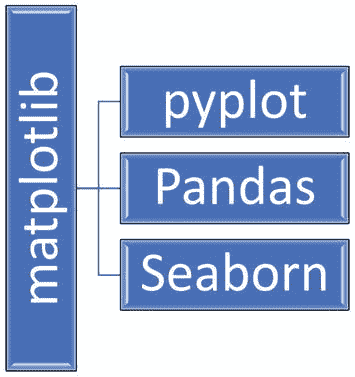

图 6-1

一些位于 `matplotlib` 之上的更高级组件，`matplotlib` 本身可进一步细分为更小的、你可以引用的单元。


### 在地图上显示站点

清单 6-1 展示了使用数据源（本例中唯一的温度传感器）生成地理地图的函数。代码使用了 `mplleaflet` Python 库，将 `matplotlib` 绘图转换为 `Leaflet` 地图（参见 [`https://leafletjs.com`](https://leafletjs.com)）。`temp_plots` 文件夹内的 `plot_stations.py` 模块用于在地图上显示数据源。它通过 `pyplot` 以脚本方式使用 `matplotlib`。

```
import matplotlib.pyplot as plt
import mplleaflet
def plot_stations(longitudes, latitudes, embedded = False):
if embedded:
plt.figure(figsize = (8, 8))
plt.scatter(longitudes, latitudes,
c = 'b',
marker = 'D',
alpha = 0.7,
s = 200)
return mplleaflet.display() if embedded else mplleaflet.show()
```

*清单 6-1: 在地图上显示数据源的模块*

`embedded` 参数应设置为 `True`，以便在 Jupyter notebook 中以行内形式包含生成的地图。清单 6-2 展示了驱动代码的第一部分。

```
import pandas as pd
df = pd.read_csv('GHCND_sample_csv.csv',
usecols = [3, 4, 5, 6, 7],
index_col = 2,
parse_dates = True,
infer_datetime_format = True)
df['TMIN'] = df['TMIN'] / 10
df['TMAX'] = df['TMAX'] / 10
print(df.head())
from plot_stations import plot_stations
plot_stations(df['LONGITUDE'].tolist()[0], df['LATITUDE'].tolist()[0])
```

*清单 6-2: `temp_visualization_demo.py` 模块的第一部分*

执行此代码时，输出如下：

```
LATITUDE  LONGITUDE  TMAX  TMIN
DATE
2010-01-01   48.0355     -98.01 -17.8 -31.1
2010-01-02   48.0355     -98.01 -24.4 -32.2
2010-01-03   48.0355     -98.01 -19.4 -28.9
2010-01-04   48.0355     -98.01 -16.7 -20.0
2010-01-05   48.0355     -98.01 -13.3 -16.7
```

图 6-2 展示了生成的交互式地图，其中的蓝色菱形代表温度传感器。您还会在当前工作目录中找到 `_map.html` 文件。该文件由 `mplleaflet.show()` 自动创建（可以更改输出文件名）。

### 绘制温度图

现在我们将绘制最低和最高温度，并叠加标记出摄氏温度极高（> 0）和极低（< –30）的点。为了使图表更有用，我们还将添加一个额外的 y 轴来显示华氏温度。这次代码依赖于 `matplotlib` 和 Pandas 的可视化功能，并演示了如何在不同的抽象层之间切换。清单 6-3 展示了驱动代码的第二部分，它准备数据并调用我们的自定义绘图函数，该函数如清单 6-4 所示，并显示在图 6-3 中。此解决方案稍作修改后也可用于其他场景（例如，更改轴标题、调整刻度等）。


*图 6-2: 带有温度传感器的交互式地图（仅用几行代码即可获得的相当显著的结果）*

```
min_temp = df['TMIN'].min()
max_temp = df['TMAX'].max()
print("\nMinimum temperature: %g\nMaximum temperature: %g\n" % (min_temp, max_temp))
LIMIT_HIGH = 0
LIMIT_LOW = -30
extreme_high_temps = df['TMAX'][df['TMAX'] > LIMIT_HIGH]
extreme_low_temps = df['TMIN'][df['TMIN'] < LIMIT_LOW]
print('Extreme low temperatures\n', extreme_low_temps)
print('\nExtreme high temperatures\n', extreme_high_temps)
from plot_temps import plot_temps
plot_temps(df, min_temp, max_temp, extreme_low_temps, extreme_high_temps)
```

*清单 6-3: `temp_visualization_demo.py` 模块的第二部分*

以下是前面代码生成的文本报告：

```
from matplotlib.ticker import MultipleLocator
def plot_temps(df, min_temp, max_temp, extreme_low_temps, extreme_high_temps):
ax1 = df.plot.line(y = ['TMAX', 'TMIN'],
figsize = (12, 9),
ylim = (1.3 * min_temp, 1.3 * max_temp),
rot = 45, fontsize = 12, style = ['-r', '-b'], linewidth = 0.6,
legend = False,
x_compat = True)
ax1.lines[0].set_label('Max. temperature')
ax1.lines[-1].set_label('Min. temperature')
ax1.set_title('Low and High Temperatures in January 2010\nNorth Dakota, United States',
fontsize = 20, y = 1.06)
ax1.set_xlabel('Date', fontsize = 14, labelpad = 15)
ax1.set_ylabel('Temperature [\u2103]', fontsize = 14)
ax1.spines['right'].set_visible(False)
ax1.spines['top'].set_visible(False)
ax1.yaxis.set_minor_locator(MultipleLocator(5))
ax1.fill_between(df.index, df['TMAX'], df['TMIN'],
facecolor = 'lightgray', alpha = 0.25)
def fahrenheit_to_celisus(temp):
return 1.8 * temp + 32
ax2 = ax1.twinx()
y_min, y_max = ax1.get_ylim()
ax2.set_ylim(fahrenheit_to_celisus(y_min), fahrenheit_to_celisus(y_max))
ax2.set_ylabel('Temperature [\u2109]', fontsize = 14, labelpad = 15)
ax2.spines['top'].set_visible(False)
ax2.yaxis.set_minor_locator(MultipleLocator(5))
for label in ax2.get_yticklabels():
label.set_fontsize(12)
ax1.scatter(extreme_low_temps.index, extreme_low_temps,
color = 'blue', marker = 'v', s = 100,
label = 'Unusually low temperatures')
ax1.scatter(extreme_high_temps.index, extreme_high_temps,
color = 'red', marker = '^', s = 100,
label = 'Unusually high temperatures')
ax1.legend(loc = 4, frameon = False, title = 'Legend')
```

*清单 6-4: 函数 `plot_temps`，它生成如图 6-3 所示的图表*

```
Minimum temperature: -32.8
Maximum temperature: 3.9
Extreme low temperatures
DATE
2010-01-01   -31.1
2010-01-02   -32.2
2010-01-08   -32.8
2010-01-09   -32.2
Name: TMIN, dtype: float64
Extreme high temperatures
DATE
2010-01-14    3.9
2010-01-16    2.2
2010-01-17    3.3
2010-01-18    0.6
Name: TMAX, dtype: float64
```

注意加粗的行，它们展示了如何从较高的 Pandas 可视化层切换到较低的核心 `matplotlib` 层级。原始接口对于微调图表非常有用。反之亦然，可以通过将参数 `ax` 设置为您自己的轴引用来实现。

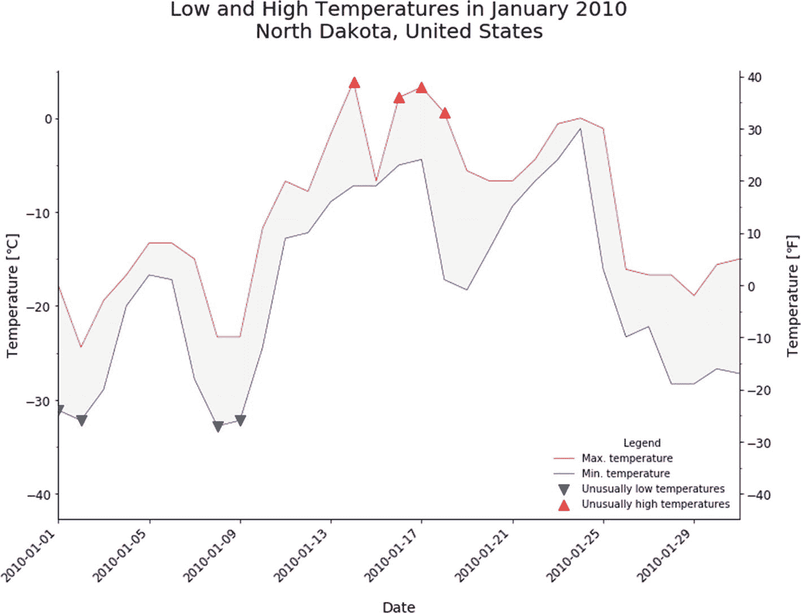

*图 6-3: 带有极端温度（通过阈值定义）标记的最低和最高温度图*

## 最近点对案例研究

寻找最近点对是计算几何中一项广为人知的任务，具有广泛的应用。我们有一组平面上的点，由其 x 和 y 坐标给出，表示为 *P* = {(*x*, *y*) | *x*, *y* ∈ *ℤ*}。我们需要找到欧几里得距离为 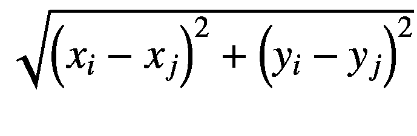 的最近点对 *p*[*i*] ≠ *p*[*j*]。假设点的数量 `n` 在 [2, 10⁷] 范围内。

我们将开发三种具有不同渐近行为的核心变体：O(*n*²)、O(*n*log²*n*) 和 O(*n* log *n*)。您可以通过参考文献 [2] 到 [4] 来复习渐近符号和算法的相关知识。之后，我们将降低常数，以展示它们如何影响整体性能。可视化将帮助我们更清晰地说明结果。这是一个利用可视化更深入地理解程序运行时特性的例子。

本着以 API 为中心和面向对象开发的精神，我们首先将创建一个抽象基类。这样，所有子类都将简单地继承相同的 API，因此客户端可以根据需要平稳地更改实现（另请参见练习 6-1）。清单 6-5 展示了这个基础类（请查看 `closest_pair` 包中的 `base_closest_pair.py` 文件）。拥有一个通用的 API 会促进实验，因为您可以在不干扰系统其余部分的情况下切换实现。此外，清晰的 API 是成功实现代码重用的先决条件。


```python
"""用于实现寻找最近点对的各种变体的基类。"""
import abc
from typing import Tuple, Callable, TypeVar, Sequence, Generic
import numpy as np

Coordinates = TypeVar('Coordinates', Sequence[int], np.ndarray)

class BaseClosestPair(Generic[Coordinates], metaclass=abc.ABCMeta):
    """
    在由 x 和 y 坐标给出的二维点中寻找最近点对。默认距离定义为标准欧几里得距离。

    参数:
        x: 所有点的 x 坐标列表。
        y: 所有点的 y 坐标列表。元素顺序与 x 坐标列表一致，即第 i 个点表示为(x[i], y[i])。
    """
    _x: Coordinates
    _y: Coordinates

    def __init__(self, x: Coordinates, y: Coordinates):
        assert len(x) >= 2 and len(x) == len(y)
        self._x = x
        self._y = y

    @property
    def x(self) -> Coordinates:
        """获取点的 x 坐标。"""
        return self._x

    @property
    def y(self) -> Coordinates:
        """获取点的 y 坐标。"""
        return self._y

    @staticmethod
    def load_from_stdin() -> Tuple[Coordinates, Coordinates]:
        """
        通过依次枚举 x 和 y 坐标从标准输入加载点。
        每个数据必须用空格分隔。

        输出:
            x 和 y 坐标的元组。
        """
        import sys
        data = sys.stdin.read()
        points = list(map(int, data.split()))
        x = points[1::2]
        y = points[2::2]
        return x, y

    @staticmethod
    def generate_points(n: int, seed: int) -> Tuple[Coordinates, Coordinates]:
        """
        生成随机点用于压力测试。

        输出:
            x 和 y 坐标的元组。

        示例:
            >>> BaseClosestPair.generate_points(3, 10)
            ([227077737, -930024104, -78967768], [36293302, 241441628, -968147565])
        """
        import random
        assert n >= 2
        random.seed(seed)
        x = [random.randint(-10**9, 10**9) for _ in range(n)]
        y = [random.randint(-10**9, 10**9) for _ in range(n)]
        return x, y

    @staticmethod
    def distance(x1: int, x2: int, y1: int, y2: int) -> float:
        """
        返回两点之间的欧几里得距离。

        参数:
            x1: 第一个点的 x 坐标。
            x2: 第二个点的 x 坐标。
            y1: 第一个点的 y 坐标。
            y2: 第二个点的 y 坐标。

        输出:
        定义为对应坐标差平方和平方根的两点间距离。

        示例:
            >>> BaseClosestPair.distance(1, 2, 1, 2)
            1.4142135623730951
            >>> BaseClosestPair.distance(1, 1, 1, 1)
            0.0
        """
        from math import sqrt
        return sqrt((x1 - x2)**2 + (y1 - y2)**2)

    @abc.abstractmethod
    def closest_pair(self, distance: Callable[[int, int, int, int], float]) -> Tuple[int, int, float]:
        """
        返回最近点对的索引及其距离的元组。

        参数:
            distance: 接收四个参数(x1, x2, y1, y2)并返回两点间距离的函数。
        """

if __name__ == "__main__":
    import doctest
    doctest.testmod()
```

代码清单 6-5：为后续所有变体指定共享 API 的抽象基类

通过传入新的距离测量函数，可以轻松定制`closest_pair`方法。`generate_points`方法可用于对实现进行压力测试。要对本模块进行类型检查，请在 Spyder 的控制台中执行以下命令（确保你位于本章源代码的`closest_pair`子文件夹中）：

```
!mypy --ignore-missing-imports base_closest_pair.py
```

我们的下一个任务是创建一个小型测试工具，用于测量执行时间并生成合适的可视化效果。实际上，已有现成的软件工具可用于此目的：`cProfile`（更多详情请参阅[`https://docs.python.org/3/library/profile.html`](https://docs.python.org/3/library/profile.html)）和`SnakeViz`（你可能需要通过命令行执行`conda install snakeviz`来安装它）。`cProfile`输出的数据格式可直接被`SnakeViz`使用。

### 版本 1.0

本版本是最近点对算法的朴素实现。它简单地计算所有点对之间的距离并找出最小值。代码清单 6-6 展示了本版本的源代码。

```python
"""最近点对算法的朴素实现。"""
from typing import Tuple, Callable
from closest_pair.base_closest_pair import BaseClosestPair

class NaiveClosestPair(BaseClosestPair):
    def closest_pair(self, distance: Callable[[int, int, int, int], float] =
                     BaseClosestPair.distance
                     ) -> Tuple[int, int, float]:
        """
        遍历所有点对并计算它们之间的距离。

        示例:
            >>> x = [0, 3, 100]
            >>> y = [0, 4, 110]
            >>> ncp = NaiveClosestPair(x, y)
            >>> ncp.closest_pair()
            (0, 1, 5.0)
        """
        from math import inf
        n = len(self.x)
        min_distance = inf
        for i in range(n - 1):
            for j in range(i + 1, n):
                d = distance(self.x[i], self.x[j], self.y[i], self.y[j])
                if d < min_distance:
                    min_distance = d
                    p_i = i
                    p_j = j
        return p_i, p_j, min_distance

if __name__ == "__main__":
    import doctest
    doctest.testmod()
```

代码清单 6-6：该问题的暴力求解实现
```


#### 提示

千万不要低估像 `NaiveClosestPair` 这样简单直接的变体的价值。它可以作为性能对比和正确性验证时非常有用的基线。具体而言，它可以与点生成器一起使用，生成许多低维测试用例。

让我们使用 100 个自动生成的点来分析一次运行。在 Spyder 的控制台中执行以下语句（确保你位于本章的基础源文件夹中；另请参见练习 6-2）：

```
>> from closest_pair import *
>> import cProfile
>> x, y = BaseClosestPair.generate_points(100, 1)
>> ncp = NaiveClosestPair(x, y)
>> %mkdir results
>> cProfile.run('ncp.closest_pair()', filename = 'results/ncp_100_stats')
```

现在，我们应该在 `results` 子文件夹中拥有二进制的性能分析数据。在独立的命令行终端中，执行 `snakeviz results/`。这将启动一个本地 Web 服务器，默认监听 8080 端口。确切的 URL 将打印在命令行上。图 6-4 展示了 SnakeViz 的初始界面。

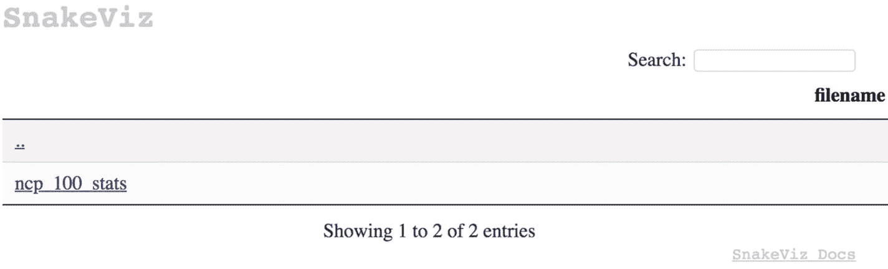

图 6-4

SnakeViz 的入口页面，你可以在此处选择 `ncp_100_stats` 文件进行可视化

如果选择图 6-4 中的 `ncp_100_stats` 文件，那么你将在页面顶部看到类似图 6-5 的内容。我将鼠标悬停在从上往下数的第三个矩形上，它立即显示了一些关于 `closest_pair` 方法执行的更详细信息。这里有独立的框分别表示方法的整体签名（上下文）及其组成部分，包括方法体。

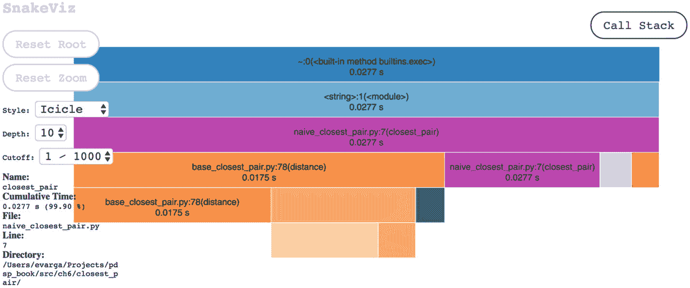

图 6-5

该图是交互式的

图 6-6 显示了下方部分的内容，你可能对此感到熟悉（经典的数据表格展示形式）。拥有多个视图非常方便，因为你可以在显示格式之间平滑切换，以关注所需的细节层次。你可以通过点击列标签对数据进行排序。在这里，行按 `tottime` 的降序排列。这些框是嵌套的，并组织成反映调用栈的层级结构。此外，还使用颜色对元素进行分组。例如，`closest_pair` 方法的签名和方法体被标记为粉色。右侧有一些选项可以自定义视图。图 6-7 展示了所谓的*旭日图*样式。

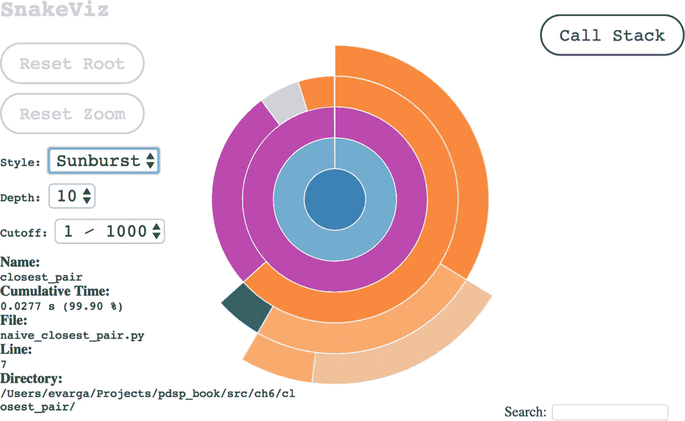

图 6-7

另一种可视化调用层级的方式，有助于把握全局

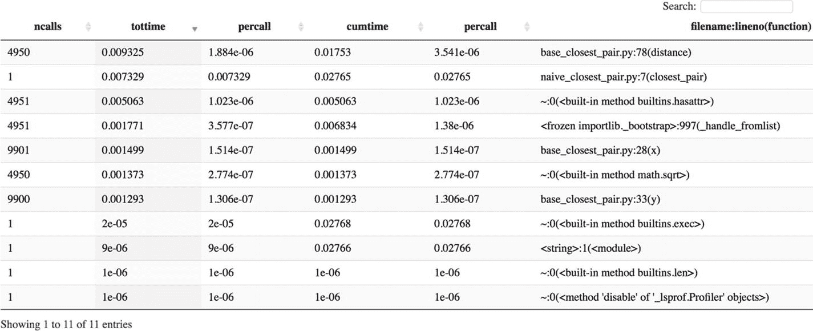

图 6-6

`ncalls` 表示对某个函数的调用次数（例如，4950 = 100 × 99 / 2，这是 `distance` 被调用的次数），而 `tottime` 表示在该方法内部花费的总时间

让我们尝试在规模为 3000 的输入上运行我们的平方级算法。以下是执行步骤：

```
>> x, y = BaseClosestPair.generate_points(3000, 1)
>> ncp = NaiveClosestPair(x, y)
>> cProfile.run('ncp.closest_pair()', filename = 'results/ncp_3000_stats')
```

这将花费更长的时间来完成。通过访问 `http://127.0.0.1:<端口号>/snakeviz/results` 导航回 SnakeViz 的文件夹页面，并选择 `ncp_3000_stats`。按累计时间降序排序表格，你会发现运行时间大约为 20 秒（在我的 Mac 上是 23.48 秒）^(¹⁷)。之前使用 100 个点的运行仅耗时 0.0277 秒；输入规模增加了 30 倍，导致运行时间激增了大约 900 倍。这就是 O(*n*²) 的含义。你的机器上的具体时间会有所不同，但比率将保持不变。无论你采取什么措施来加速（例如，使用 Numba），你都将停留在相同的渐近水平上；换句话说，运行时间的比率将反映对输入规模的平方依赖性。使用更优算法的纯 Python 代码，终将在某个点上超越使用某种慢速算法的、经过超强技术增强的版本。


### 版本 2.0

在本节中，我们将阐述该算法采用**分治**技术的 O(*n*log²*n*) 变体。这种技术将初始问题分解为多个相同类型的子问题，并独立求解它们。如果某个子问题仍然复杂，则使用相同的过程进一步分解。当遇到基础情况（即易于解决的问题）时，分解链条终止。之后，合并子问题的结果，直至得到最终答案。该方法的一个典型示例是归并排序。

该算法的主要步骤如下（参见参考文献[2]）：

1.  根据点的 x 坐标将它们分成两半。更正式地说，如果我们将切割坐标记为 x，那么我们希望生成两组点：L（代表左）和 R（代表右），使得 L 中的所有点满足 *x*[*i*] ≤ *x*，R 中的所有点满足 *x*[*i*] > *x*。
2.  递归地将组 L 和 R 视为独立的子问题，并分别找到它们的解，即元组 (*p*[*L*], *q*[*L*], *d*[*L*]) 和 (*p*[*R*], *q*[*R*], *d*[*R*])。取 d = min(*d*[*L*], *d*[*R*])，并记住最小值来自哪一组。
3.  检查 L 和 R 中是否存在距离小于 d 的点。选择 L 和 R 中所有 x 坐标属于区间 [x – d, x + d] 的点。根据这些中间点（M）的 y 坐标进行排序（排序顺序无关紧要）。
4.  遍历这个排序后的列表，对于每个点，计算它与至多后续七个点的距离，并维护当前找到的最佳点对。记这个三元组为 (*p*[*M*], *q*[*M*], *d*[*M*])。
5.  最终解是 L、M 和 R 中点对的最小值。回想一下，在步骤 2 中我们已经找到了 L 和 R 之间的最小值，因此我们只需要与 M 进行一次额外的比较。

在这个层面上，算法看起来很像一个菜谱。在进行任何详细的编码之前，你甚至可以将这些步骤作为注释放入源代码中。由于所有步骤都处于高层次的细节水平，它们很好地补充了底层的实现细节。这就是伪代码编程（使用伪代码进行规划）背后的核心思想。图 6-8 直观地提供了此算法正确性的证明。在处理大量数据时，证明程序行为的定理至关重要。测试可以揭示代码中的错误，但无法确立基本事实。通常，仅凭测试很难覆盖所有可能的情况（即找到输入中的所有等价类）。建立数学证明（体现在正式的软件开发方法中）的缺点是，它需要大多数软件工程师所缺乏的专业知识。而且，你只能将其应用于系统的核心部分。例如，操作系统内核就是适合这种形式化处理的目标。

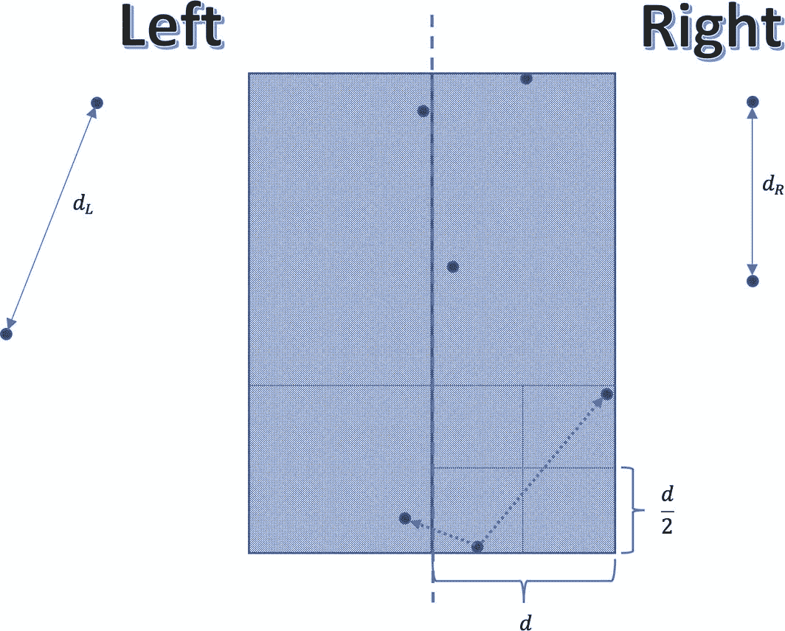

**图 6-8** 注意，在任何大小为 d×d 的块内，最多可以包含四个点

操作系统内核的任何大小为 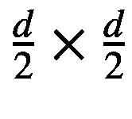 的子块最多只能包含一个点。换句话说，如果一个尺寸为 d×d 的正方形包含五个或更多点，那么它的某些子块必然会包含多个点。然而，在这种情况下，我们会得出矛盾，即 d 没有被正确计算。此外，在这个带状区域中，任何两个距离 < d 的点必定属于同一个 2d×d 大小的矩形。因此，它们肯定会被比较，这保证了正确性。回想一下，这个矩形最多可以包含八个点（包括参考点）。在这里，我们会找到一个比 d 更短的距离，因为最右下方的点与其后续左侧点之间的距离很小。

#### 运行时间分析

假设我们有平面上的 `n` 个点。在步骤 1 中，我们可以使用随机化的分治算法在 O(n) 时间内找到将集合分成两个相等大小子集的中位数点。创建子集 L 和 R 是另一个 O(n) 时间的操作。在解决了两个大小为 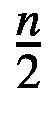 的子问题后，算法在 O(n) 时间内选择属于中间带状区域的点。然后，它在 O(*n* log *n*) 时间内对这些过滤后的点进行排序。最后，它在 O(n) 时间内计算这个带状区域内的距离（对于每个点，它执行一些固定数量的工作）。请记住，对于任何函数 *f* = *kn*，*k* ∈ ℕ，都满足 f = O(n)；也就是说，它受某个线性函数的约束。因此，无论我们连续执行多少次 O(n) 操作，或者我们执行的是 3n、5n 还是 7n 次操作，它们的总体效果都被视为 O(n)。总而言之，总运行时间由递推公式 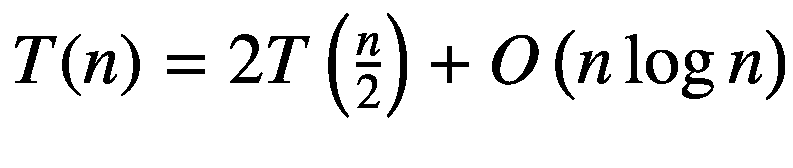 定义。我们不能直接应用主定理，尽管我们可以复用其思想来分析我们的表达式。

如果我们绘制一棵递归树，那么在某个任意层级 k，该树的贡献将是 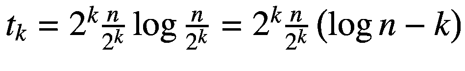。树的深度是 log*n*，因此通过将每一层的贡献相加，我们最终得到 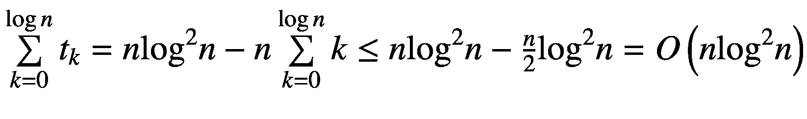。

在步骤 3 中，我们反复根据点的 y 坐标进行排序，这导致了额外的 log*n* 乘数。如果我们能在一开始只做一次排序从而避免重复排序，那么我们将把运行时间降低到 *O*(*n* log *n*)。这从新的递推关系 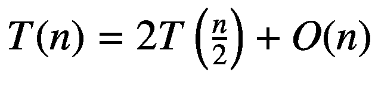 中可以看出，因为我们可以直接应用主定理。当然，在所有的分割和过滤操作中，我们应该小心地保持点的 y 顺序。

### 版本 3.0

为了防止扰乱点的 y 顺序，我们将通过找到正确的索引排列来间接地对它们进行排序。所有排序函数实际上都会计算这个排列，但通常不会显式返回。对原始坐标的所有访问都将通过双重间接寻址进行，如图 6-9 所示。清单 6-7 展示了之前所述算法的快速 O(*n* log *n*) 实现。

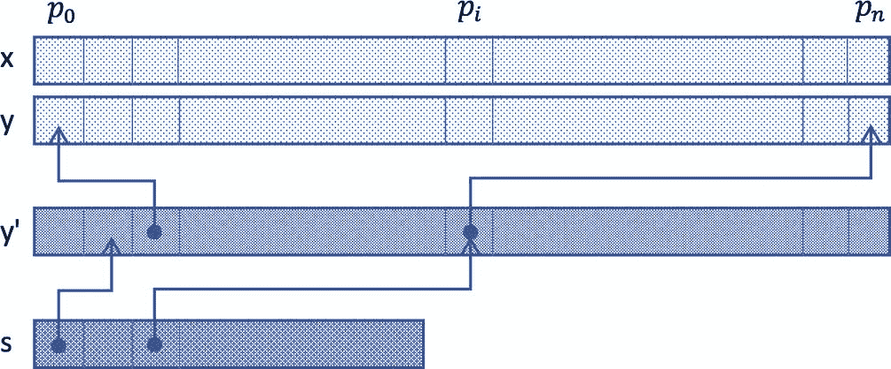

**图 6-9** 数组 `s` 表示属于中间带状区域的点的有序索引

数组 `s` 包含指向已排序索引数组 `y'` 的指针，这些指针最终指向原始位置。以这种方式访问点的复杂性将隐藏在适当的访问器方法中。


```python
"""快速实现最近点对算法。"""
from typing import List, Tuple, Callable
from closest_pair.base_closest_pair import Coordinates, BaseClosestPair

class FastClosestPair(BaseClosestPair):
    _y_prime: List[int]

    def _argsort_y(self) -> List[int]:
        """找到按 y 坐标排列点的索引排列。"""
        return [t[0] for t in sorted(enumerate(self.y), key = lambda t: t[1])]

    def _get_x(self, i: int, s: List[int]) -> int:
        return self.x[self._y_prime[s[i]]]

    def _get_y(self, i: int, s: List[int]) -> int:
        return self.y[self._y_prime[s[i]]]

    def __init__(self, x: Coordinates, y: Coordinates):
        super().__init__(x, y)
        self._y_prime = self._argsort_y()

    def _selection(self, s: List[int], k: int) -> int:
        """返回 s 中包含的按 x 坐标排列的第 k 个最小点的 x 值。"""
        def split(v: int) -> Tuple[List[int], List[int], List[int]]:
            """将点围绕值 v 就地间接拆分为两个集合（左和右）。"""
            store = 0
            sl_idx = 0
            for i in range(len(s)):
                if self._get_x(i, s) < v:
                    s[store], s[i] = s[i], s[store]
                    store += 1
                elif self._get_x(i, s) == v:
                    s[i], s[-1] = s[-1], s[i]
            s[-1], s[store] = s[store], s[-1]
            sl = [s[i] for i in range(store)]
            sv = [s[store]]
            sr = [s[i] for i in range(store + 1, len(s))]
            return sl, sv, sr

        import random
        while len(s) > 1:
            v = self._get_x(random.randint(0, len(s) - 1), s)
            sl, sv, sr = split(v)
            sl_size = len(sl)
            if sl_size > k:
                s = sl
            elif k >= sl_size and k < sl_size + len(sv):
                return v
            else:
                k -= sl_size + len(sv)
                s = sr
        return self._get_x(0, s)

    @staticmethod
    def _merge(sl: List[int], sr: List[int]) -> List[int]:
        """
        将两个有序子列表合并成一个新的有序列表。
        可以预先分配临时存储以进一步优化。
        """
        sl_size = len(sl)
        sr_size = len(sr)
        s = [0] * (sl_size + sr_size)
        k = 0
        i = 0
        j = 0
        while i < sl_size and j < sr_size:
            if sl[i] < sr[j]:
                s[k] = sl[i]
                i += 1
            else:
                s[k] = sr[j]
                j += 1
            k += 1
        if i < sl_size:
            s[k:] = sl[i:]
        else:
            s[k:] = sr[j:]
        return s

    def closest_pair(self) -> Tuple[int, int, float]:
        """
        在 O(n*log n) 时间内计算最小距离。

        示例：
        >>> x = [0, 3, 100]
        >>> y = [0, 4, 110]
        >>> fcp = FastClosestPair(x, y)
        >>> fcp.closest_pair()
        (0, 1, 5.0)
        """
        from math import inf

        def filter_points(s: List[int], d: float, x: int) -> List[int]:
            """返回落在 [x-d, x+d] 区间内的点索引列表。"""
            return [s[i] for i in range(len(s)) if abs(self._get_x(i, s) - x) <= d]

        def find_nearest_neighbor(i: int, s: List[int]) -> Tuple[float, int, int]:
            """
            查找当前点 i 与按 y 坐标排列的后 7 个点之间的最小距离。
            """
            curr_x = self._get_x(i, s)
            curr_y = self._get_y(i, s)
            d = inf
            min_idx = i
            for j in range(i + 1, min(len(s), i + 7 + 1)):
                curr_d = distance(curr_x, self._get_x(j, s), curr_y, self._get_y(j, s))
                if curr_d < d:
                    d = curr_d
                    min_idx = j
            return d, i, min_idx

        def distance(x1: int, x2: int, y1: int, y2: int) -> float:
            """返回两点之间的欧几里得距离。"""
            return ((x1 - x2) ** 2 + (y1 - y2) ** 2) ** 0.5

        def find_minimum_distance(s: List[int]) -> Tuple[int, int, float]:
            """查找最近点对的主要驱动函数。"""
            if len(s) == 1:
                # 我们将单个点的距离视为无穷大。
                return s[0], -1, inf
            if len(s) == 2:
                return s[0], s[1], distance(self._get_x(0, s),
                                            self._get_x(1, s),
                                            self._get_y(0, s),
                                            self._get_y(1, s))

            # 这是输入数组 x 相对于 s 的中位数值。
            median_x = self._selection(s.copy(), len(s) // 2)
            # 围绕中位数分离点。
            sl = []
            sr = []
            for i in range(len(s)):
                if self._get_x(i, s) <= median_x:
                    sl.append(s[i])
                else:
                    sr.append(s[i])

            # 在左侧和右侧组中找到最小距离。
            p_l, q_l, d_l = find_minimum_distance(sl)
            p_r, q_r, d_r = find_minimum_distance(sr)
            if d_l < d_r:
                p_min, q_min = p_l, q_l
                d = d_l
            else:
                p_min, q_min = p_r, q_r
                d = d_r

            # 合并左右索引并保持排序顺序。
            sm = FastClosestPair._merge(sl, sr)

            # 在中间条带内找到最小距离。
            sf = filter_points(sm, d, median_x)

            # 在三组（左、中、右）中找到最终的最小距离。
            d_m, p_m, q_m = min([find_nearest_neighbor(i, sf) for i in range(len(sf))])
            if d_m < d:
                return p_m, q_m, d_m
            else:
                return p_min, q_min, d

        p, q, d = find_minimum_distance(list(range(len(self._y_prime))))
        # 我们需要将点索引映射回原始基数。
        return self._y_prime[p], self._y_prime[q], d


if __name__ == "__main__":
    import doctest
    doctest.testmod()
```

**列表 6-7** `FastClosestPair` 类的实现

显然，这个版本比我们在 1.0 版本中的朴素尝试要复杂得多。让我们看看它在同样的 3000 个点数据集上的表现。创建新报告的步骤如下（假设你继续上一个控制台会话，因此已经定义了数组 `x` 和 `y`）：

```python
>> from closest_pair import FastClosestPair
>> fcp = FastClosestPair(x, y)
>> cProfile.run('fcp.closest_pair()', filename = 'results/fcp_3000_stats')
```

图 6-10 显示了这次运行的图表。如果你在 SnakeViz 中向下滚动，你会看到累积时间已经下降到远低于一秒。一旦你有了一个好的算法，你就可以放心你的解决方案是可扩展的。当然，即使在降低常数因子并应用并行处理之后，这种改进也远未达到绝对下限（另请参见练习 6-3）。不过，这种额外的微调只有在你已经获得良好的渐近行为之后才有意义。

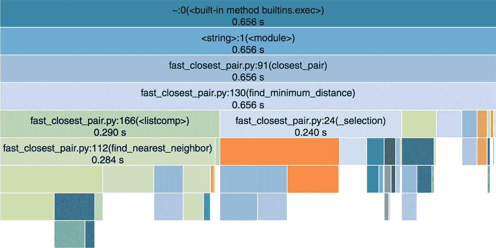

**图 6-10** 该图仅显示冰柱样式图表。显然，由于代码库更复杂，存在许多额外细节。

## 算法演进的探究

从多个角度来看，暴力版本和复杂版本之间的差异确实惊人。除了指数级的加速（从 n × n 到 n × log n），复杂度也成比例增加。尽管如此，通过专注于以 API 为中心的开发，我们类的客户端完全不必了解内部细节。两个版本都可以通过调用基类中指定的公共方法来以完全相同的方式使用。这再次证明了良好的软件工程技能是数据科学工作中的真正救星。

这个故事告诉我们，单纯的技术花招并不能让你走得很远。当然，我们在上一章中展示了 Numba，但真正的突破只能通过数学来实现。这通常适用于计算机科学，而不仅仅是数据科学，尽管对于数据科学来说，效果更加明显，因为没有一种朴素的方法可以应对大数据。

除了与时间相关的性能优化外，你可能还希望测量内存消耗和其他资源。为此，你也有很多选择。可以查看 `memory-profiler` 包（参见 [`pypi.org/project/memory-profiler`](https://pypi.org/project/memory-profiler)）。还有合适的魔法命令包装器 `%memit` 和 `%mprun`。你可以先执行 `%load_ext memory_profiler` 来使用它们。使用 `line_profiler` 模块（参见 [`pypi.org/project/line_profiler`](https://pypi.org/project/line_profiler)）和 `%lprun` 魔法命令进行时间分析也是如此。


### 交互式信息辐射器

我们通常制作主动报告来总结对某些静态数据集的分析发现。标准 Jupyter 笔记本是交付此类实时报告的常见平台。然而，在某些情况下，支撑数据集会随时间持续变化。强制用户重新运行笔记本以获取最新数据集并非可扩展的解决方案（更不用说每次都要重新发送刷新后的笔记本了）。更好的方案是建立一个流水线，让动态报告自动生成。这就是信息辐射器（也称为*仪表盘*）背后的理念。

我们可以区分两大类波动数据：批量处理型数据（以固定间隔累积和处理，例如每小时、每天、每周等）和流式数据（持续更新）。随之而来的仪表盘必须反映这种变化速率，并仅暴露关键的业务指标，以便监控和快速决策。任何多余的细节只会分散用户的注意力。当然，你应该构建哪种类型的仪表盘也取决于你流水线的能力。

假设你从包括风能和太阳能在内的各种发电厂收集电力生产数据。以下信息可能有助于有效评估电网当前和近期的状态：

* 当前的能源生产与消耗
* 不同电厂的能源生产（核电、火电、水电、风电、太阳能等）
* 短期天气预报，这是一个可能显著影响风能和太阳能电厂效能的外部因素

一旦决定要在仪表盘上展示什么，接下来就必须思考如何以最佳方式视觉化传达这些信息。领域知识在这里非常重要。事实证明，桑基图是一个完美的选择。它能直观展示无环有向图中节点间的流动（电力网络可以用这种形式表示）。图 6-11 展示了这种图的一个示例。

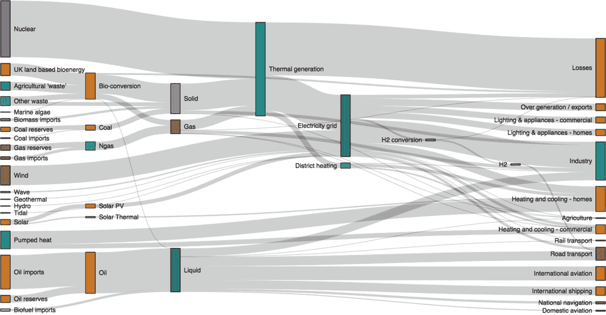

图 6-11

英国未来能源生产和消费的一个虚构场景（参见 [`https://github.com/d3/d3-sankey`](https://github.com/d3/d3-sankey)）

桑基图默认是交互式的，你可以通过点击或悬停来查看特定分支的更多细节。现在想象这个图是你广泛可访问的笔记本的一部分，并且该笔记本会定期被流水线更新。这就是用笔记本制作仪表盘的核心思想（参见参考文献 [5]）。

实现交互式信息辐射器愿景的关键要素（假设我们使用 Jupyter 笔记本作为文档格式）如下：

* 定期更新和发布的数据集（尝试时，可以使用 Kaggle 提供的一些数据集；参见参考文献 [5]）
* 一个能够获取相关数据集并重新运行你的笔记本的仪表盘流水线
* 一个交互式笔记本，很可能利用 Altair（参见 [`https://altair-viz.github.io`](https://altair-viz.github.io) ）、Plotly（参见 [`https://plot.ly`](https://plot.ly) ）、Bokeh（参见 [`https://bokeh.pydata.org`](https://bokeh.pydata.org) ）或类似框架，因为你可能不想从头开始编码

## 领域特定语言的力量

领域特定语言（DSL）通过让你摆脱繁琐的实现细节，从而提高生产力和质量，使你能够仅专注于业务相关的元素。可视化是一个边界清晰的领域，适合用 DSL 来支持。Altair 是一个提供此类 DSL 的框架，使你能够在 Python 中进行声明式可视化。这种能力对于以仪表盘形式构建复杂的交互式工作流程至关重要。将时间花在低级的细枝末节上是低效的，并且是常见的错误来源。让我通过介绍 Anscombe 四重奏来展示 DSL 的力量。除了技术层面，这个例子也很有启发性，能强调可视化的重要性。清单 6-8 展示了如何仅使用 `matplotlib` 来处理这个任务。尽管使用了 `matplotlib` 的面向对象 API，代码看起来仍然是普通的 Python 代码。

```python
import numpy as np
import matplotlib.pyplot as plt
quartets = np.asarray([
(
[10.0, 8.0, 13.0, 9.0, 11.0, 14.0, 6.0, 4.0, 12.0, 7.0, 5.0],
[8.04, 6.95, 7.58, 8.81, 8.33, 9.96, 7.24, 4.26, 10.84, 4.82, 5.68]
),
(
[10.0, 8.0, 13.0, 9.0, 11.0, 14.0, 6.0, 4.0, 12.0, 7.0, 5.0],
[9.14, 8.14, 8.74, 8.77, 9.26, 8.10, 6.13, 3.10, 9.13, 7.26, 4.74]
),
(
[10.0, 8.0, 13.0, 9.0, 11.0, 14.0, 6.0, 4.0, 12.0, 7.0, 5.0],
[7.46, 6.77, 12.74, 7.11, 7.81, 8.84, 6.08, 5.39, 8.15, 6.42, 5.73]
),
(
[8.0, 8.0, 8.0, 8.0, 8.0, 8.0, 8.0, 19.0, 8.0, 8.0, 8.0],
[6.58, 5.76, 7.71, 8.84, 8.47, 7.04, 5.25, 12.50, 5.56, 7.91, 6.89]
)
])
roman = ['I', 'II', 'III', 'IV']
fig = plt.figure(figsize = (12, 9))
fig.suptitle("Anscombe's Quartets", fontsize=16)
axes = fig.subplots(2, 2, sharex = True, sharey = True)
for quartet in range(quartets.shape[0]):
x, y = quartets[quartet]
coef = np.polyfit(x, y, 1)
reg_line = np.poly1d(coef)
ax = axes[quartet // 2, quartet % 2]
ax.plot(x, y, 'ro', x, reg_line(x), '--k')
ax.set_title(roman[quartet])
ax.set_xlim(3, 19.5)
ax.set_ylim(2, 13)
### 打印当前数据集的汇总统计信息
print("Quartet:", roman[quartet])
print("Mean X:", x.mean())
print("Variance X:", x.var())
print("Mean Y:", round(y.mean(), 2))
print("Variance Y:", round(y.var(), 2))
print("Pearson's correlation coef.:", round(np.corrcoef(x, y)[0][1], 2))
print()
plt.show()
```

清单 6-8：在没有高层框架的情况下，有许多需要控制的可变目标

程序将打印关于每个四重奏的以下统计信息（注意它们都是相同的）：

```
Quartet: I
Mean X: 9.0
Variance X: 10.0
Mean Y: 7.5
Variance Y: 3.75
Pearson's correlation coef.: 0.82
Quartet: II
Mean X: 9.0
Variance X: 10.0
Mean Y: 7.5
Variance Y: 3.75
Pearson's correlation coef.: 0.82
Quartet: III
Mean X: 9.0
Variance X: 10.0
Mean Y: 7.5
Variance Y: 3.75
Pearson's correlation coef.: 0.82
Quartet: IV
Mean X: 9.0
Variance X: 10.0
Mean Y: 7.5
Variance Y: 3.75
Pearson's correlation coef.: 0.82
```

然而，一旦将这些数据集可视化，差异就显而易见了，如图 6-12 所示。清单 6-9 展示了实现类似可视化的代码片段，但这次使用的是 Altair 的 DSL（也请参阅关于 DSL 的参考文献 [6]）。代码紧凑，没有不必要的低级细节。使用 DSL，你只需指定你想要完成的任务，让引擎决定交付请求输出的最佳策略。你只需将此代码粘贴到 JupyterLab 笔记本的代码单元格中即可运行。

图 6-13 展示了其图形输出（也请参阅练习 6-4）。

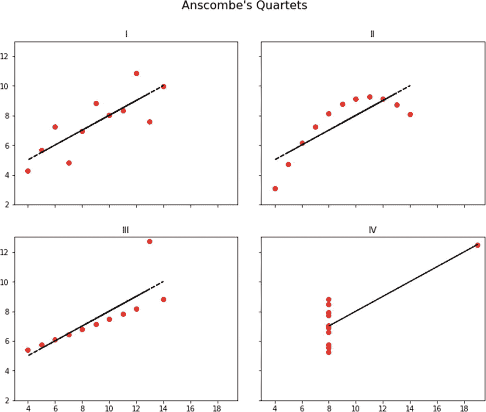

图 6-12

尽管这四个四重奏具有相同的汇总统计信息，但它们显然是不同的

```python
import altair as alt
from vega_datasets import data
source = data.anscombe()
base = alt.Chart(
source, title = "Anscombe's Quartets"
).mark_circle(color = 'red').encode(
alt.X('X', scale = alt.Scale(zero = True)),
alt.Y('Y', scale = alt.Scale(zero = True)),
column = 'Series'
).properties(
width = 150,
height = 150
).interactive()
base
```

清单 6-9：使用 Altair 的 DSL 进行可视化

你需要通过 `conda` 包管理器执行以下语句来安装 Altair（这也会安装有用的 `vega_datasets`，其中已包含 Anscombe 四重奏的数据）：

```bash
conda install -c conda-forge altair vega_datasets
```


#### 提示

你可能希望在某些时刻创建仪表板状态的快照。`Altair`生成的所有图表都包含一个下拉菜单，可将图表保存为图片或导出为 Vega 格式。

该图表是交互式的，你可以平移和缩放每个图表。在交互式仪表板中，你可能希望尽量精简文本信息，并隐藏笔记本中的代码单元格。这些步骤能使图形元素更加突出。

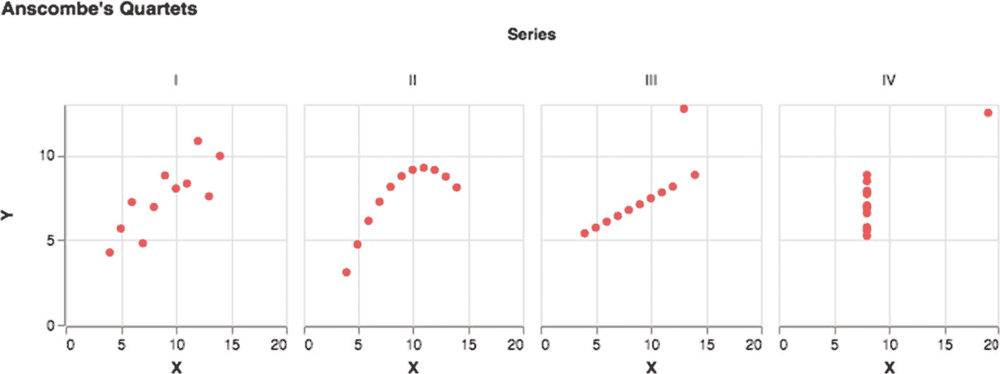

**图 6-13** – 使用 Altair 默认排列的安斯科姆四重奏

该图表是交互式的，你可以平移和缩放每个图表。在交互式仪表板中，你可能希望尽量精简文本信息，并隐藏笔记本中的代码单元格。这些步骤能使图形元素更加突出。

使用声明式框架的另一个优势是，你的笔记本将不再包含与设备相关的冗余内容。构建仪表板的全部意义在于让人们随时随地访问数据。这意味着许多人会使用便携设备浏览数据。无论用户是在台式机、笔记本电脑、平板电脑还是智能手机上查看，你的仪表板都必须完美适配屏幕。处理所有这些适配工作都应交给框架来完成。

#### 练习 6-1. 创建一个工厂

客户端不应直接实例化类；理想情况下，它们甚至不应知晓具体的实现类。这是“针对接口编程，而非针对实现”这一原则背后的信条。有两种设计模式与此愿景相关：工厂方法和抽象工厂。后者在此方向上更进一步，甚至将客户端与工厂实现隔离开来。

重构代码库并引入这些工厂实体。这样一来，客户端只需将相关的投资组合描述（包含所需实现的属性）传递给工厂，即可收到通过共享 API（接口）公开的对象。

#### 练习 6-2. 实现一个测试框架

与其通过控制台尝试不同版本（这有些繁琐），不如创建一个新的实用工具类来测试系统。你的流程应包含以下步骤：

1.  通过调用 `BaseClosestPair.generate_points()` 方法获取一组新的点实例（点的数量上限应为 1000）。
2.  使用某种可靠的基准方法（例如，使用简单的 `NaiveClosestPair` 类）找出正确解。
3.  使用相同的数据集调用目标实现。
4.  比较并报告结果。

由于存在通用的 API，你的测试框架可以接受此类型的任何目标实现。这将为未来的优化尝试创造机会。尝试生成一个 `ParallelClosestPair` 类。请注意，我们的算法本质上是可并行化的，因为左右两组可以独立处理。

#### 练习 6-3. 生成一个超快速变体

到目前为止，我们只使用了纯 Python 结构。不幸的是，这通常不会带来顶级性能的解决方案。列表非常慢，因为它们既灵活又异构。在我们的案例中，使用内置数组是更好的选择。然而，这仍然不够。真正的加速将来自于切换到 Numpy 数组和编译后的代码。

创建一个利用 Numpy 数组的 `UltraFastClosestPair` 类；我建议你在开始此练习之前先完成练习 6-2。请注意，当前源代码中的一些东西会自动消失。例如，Numpy 直接提供了 `argsort()` 方法。此外，你可以使用围绕 Numpy 构建的库。`sortednp` 包（参见 [`pypi.org/project/sortednp`](https://pypi.org/project/sortednp)）非常方便，因为它以 O(n) 时间复杂度实现了 `merge()` 方法。

#### 练习 6-4. 练习在 Altair 中叠加图表

在我们基于 matplotlib 的代码中，请注意回归线是如何与基础散点图结合的；请参阅清单 6-4 中的加粗`plot`指令。所有内容都捆绑在一起，没有将图表作为独立抽象的概念。这在 `Altair` 中完全不同，图表在其中表现为自包含的实体。如果你拥有多个图表的句柄，就可以利用重载的 `+` 运算符以临时方式混合它们。

向由变量 `base` 引用的图表添加回归线。你仍然需要使用 Numpy 来计算系数。有关更多详细信息，请查看以下教程：[`altair-viz.github.io/gallery/poly_fit.html`](https://altair-viz.github.io/gallery/poly_fit.html)。此外，请访问 [`stackoverflow.com/questions/50164001/multiple-column-row-facet-wrap-in-altair`](https://stackoverflow.com/questions/50164001/multiple-column-row-facet-wrap-in-altair) 获取有关如何模拟 matplotlib 子图的帮助。

## 总结

遍历所有类型的可视化是不可能的，因为其数量众多；你可能希望访问 D3 可视化画廊 [`github.com/d3/d3/wiki/Gallery`](https://github.com/d3/d3/wiki/Gallery)，它集中收集了许多类型的可视化。最重要的一点是要始终牢记利益相关者的目标，并思考信息的图形化呈现如何能帮助他们。换句话说，你所做的一切都必须有充分的理由，并且是上下文的一部分。不要仅仅为了娱乐而制作花哨的展示。

交互式展示非常强大，因为它们将分析与图形化呈现结合了起来。当底层数据快速变化时，用户通常喜欢监控这些变化，并可能执行与假设场景相关的操作。因此，将交互集中在这些频繁的活动上，以便用户能够专注于数据，快速进行操作。构建强大的交互式仪表板需要用户体验设计的专业知识和熟练度，这是一个相当广阔的领域。再次，我们得出了相同的结论：任何非平凡的数据科学项目都是团队合作的结果。

仪表板需要自动化，而基于云的服务非常适合此目的。它们提供了必要的可扩展且容错的基础设施，以便你可以顺利地设置你的管道。你可能需要关注两个突出的选项：PythonAnywhere（参见 [`www.pythonanywhere.com`](https://www.pythonanywhere.com)）和 Google Cloud Platform（参见 [`cloud.google.com`](https://cloud.google.com)）。前者依赖于 Amazon Web Services (AWS)。当然，你也可以使用 OpenStack（参见 [`www.openstack.org`](https://www.openstack.org)）创建本地解决方案。你可以通过使用 Kaggle 的 API 和参考文献[5]中的指南快速入门仪表板。


# 7. 机器学习

机器学习被视为人工智能的一个子领域，它涉及从数据中提炼知识的算法与技术。其基本要素是大数据，因为没有机器的帮助，我们试图手动处理海量数据的尝试将毫无希望。作为计算机科学的产物，机器学习试图以算法而非纯粹数学的方式解决问题。机器学习模块的外部观察者会将其视为某种发生在黑箱中的魔法。激进的还原论可能会让我们说，这一切不过是运行在经典计算机系统上的“纯粹”代码。当然，这种说法将是令人反感的。机器学习确实属于软件的一个独立分支，它从数据中学习，而不是盲目遵循预定义的规则。尽管如此，为了高效应用，我们必须了解这些算法如何学习、学习什么，以及在特定上下文中应用何种类型的算法。没有机器学习系统能察觉到它被误用。本章的目标是通过示例，专门阐述机器学习的基础概念和原理。

对机器学习算法进行分组有多种方式。我们可以区分以下三种学习风格：

- **监督学习**：在此类学习中，算法在已知观测数据上进行训练，直到达到理想性能水平。主要挑战在于获取足够多的高质量标记数据以进行恰当训练。该组的成员包括线性回归、逻辑回归、支持向量机、朴素贝叶斯分类器等。

- **无监督学习**：此类算法试图自主发现数据中的隐藏结构，目的是进行分组、寻找有趣的关系（又称关联规则学习）或减少固有维度（用更少的特征描述效果）。该组的成员包括 K-Means 聚类、主成分分析、流形学习、Aprori 算法等。

- **半监督学习**：此类算法试图基于标记样本的指导，解读隐藏结构。无监督学习算法在半标记数据上运行作为预处理步骤，以标记剩余的数据点（一种称为*标签传播*的技术）的情况并不少见。

除了对算法进行分组，我们还可以区分以下不同的学习方法：

- **全批次学习（又称统计学习）**：我们一次性将所有训练数据输入算法。初始训练后，模型参数保持固定。由于其简单性，这种方案在演示各种算法的实际应用中也是最常见的。

- **小批量学习**：我们以分块的方式输入算法。例如，对于极庞大的训练样本，标准的梯度下降优化方法并不可行。这时，随机梯度下降替代方案变得有吸引力，它在任何时刻都只处理一个较小的数据块。

- **在线学习**：这是小批量学习的一个极端情况，其中批次大小缩减为单个观测值。通常的设置是，系统在历史数据上进行预热，然后在生产运行中更新其参数。这种学习方法有许多子变体，为避免嵌套，下面将它们列为单独的组。

- **流式学习**：在此类学习中，算法每次也只处理单个观测值，但无法重新访问历史记录（通用的在线学习算法允许多次遍历数据）。流式系统可以缓存近期项目或保持运行统计（如移动平均值），尽管这些与前面几组中使用的训练语料库相比微不足道。最后，许多流式方法实际上依赖于微批量处理（使用极小批次）。它们仍然被称为流式学习，因为它们不会多次遍历较旧的批次。

- **主动学习**：此方法在运行过程中主动寻求其他实体的反馈。例如，基于在线学习的垃圾邮件过滤器可能会结合用户操作（将某封垃圾邮件重新归类为正常邮件，反之亦然）来持续更新自身。半监督系统可以请求帮助来标记冲突（令人困惑）的观测数据。

- **强化学习**：这种特殊的动态学习方法建立在系统与其环境交互的基础上。通过高效的反馈循环和奖励机制（包含正向和负向奖励），算法学习在特定上下文中哪些行为是合适的。机器人通常以这种方式学习。

我们还可以根据算法的相似性进行分类（例如，神经网络、谱方法、贝叶斯网络等）。尽管如此，任何分类都只能大致列举知识领域，并且存在边界模糊和重叠。然而，有些概念是所有方法共享的。这些将是本章剩余部分的主题。

无论你选择哪种方法，在某个时候，你都需要深入探究许多算法的内部原理，以调整高级参数、将它们组合起来以统一方式工作（又称集成学习），或将它们作为流水线连接起来进行分阶段处理。你最终无法逃避深奥的数学。好消息是，你可以通过渐进的方式应对这一挑战。


## 核心概念与技术阐述

本节使用*普通最小二乘回归*逐步介绍常见的机器学习概念，该方法既易于理解，又足够强大，可作为讨论的基础。它通过在特征（预测变量）之间建立线性关系来预测输出值（响应变量）。特征本身可以是任意阶数和复杂度的（例如，可以是多项式项）。代码清单 7-1 展示了 `data_generator.py` 模块，该模块通过模拟虚构的“现实世界”过程，基于各种标准生成特征和输出。代码清单 7-1 为我们演示框架提供了基础结构，以展示以下概念：现实世界、训练过程、过程参数、运行时模型、运行时参数、估计器、评估指标（损失函数、均方误差、解释方差）、过拟合、欠拟合、特征交互、共线性和正则化。我的意图是宁可通过过度简化来传达核心思想。市面上有很多优秀的机器学习书籍，背后涉及大量复杂数学知识；这个领域非常广阔。

```python
import numpy as np
import pandas as pd
def generate_base_features(sample_size):
    x_normal = np.random.normal(6, 9, sample_size)
    x_uniform = np.random.uniform(0, 1, sample_size)
    x_interacting = x_normal * x_uniform
    x_combined = 3.6 * x_normal + np.random.exponential(2/3, sample_size)
    x_collinear = 5.6 * x_combined
    features = {
        'x_normal': x_normal,
        'x_uniform': x_uniform,
        'x_interacting': x_interacting,
        'x_combined': x_combined,
        'x_collinear': x_collinear
    }
    return pd.DataFrame.from_dict(features)
def identity(x):
    return x
def generate_response(X, error_spread, beta, f=identity):
    error = np.random.normal(0, error_spread, (X.shape[0], 1))
    intercept = beta[0]
    coef = np.array(beta[1:]).reshape(X.shape[1], 1)
    return f(intercept + np.dot(X, coef)) + error
```

*代码清单 7-1*  
`data_generator.py` 模块

我们对每个底层数据生成过程的深入了解，使我们能够准确地阐释这些概念。由 `generate_response` 模拟的现实世界具有以下向量形式：*y* = *f* (*β*[0] + *Xβ*[1 : *n*]) + *ε*（另请参阅侧边栏“线性回归的变体”），其中 `f` 是一个自定义函数。误差项代表了模型无法涵盖的固有*噪声*。我们将其视为高斯随机变量 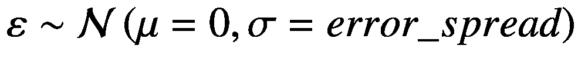；也就是说，它是一个围绕输出值呈正态分布对称波动的项。为简单起见，我们生成*同方差*输出，这意味着误差不相关且均匀（它们不依赖于 `X`）。向量 *β* 是任意的。

外部观察者只能从这个世界中看到记录 (*x*[*i*], *y*[*i*])，其中 *i* ∈ [1, *样本大小*]。如图 7-1 所示，利用一个或多个样本来重建现实世界现象，这既是艺术、工程，也是科学。我们首先*假设*一个特定的模型（例如，具有给定误差分布的线性模型）。然后，我们尝试找出模型参数（如向量 *β* 和 *σ*），并寻找合适的特征（这显然对参数有影响）。总而言之，我们需要假设和计算很多东西。


*图 7-1*

^(¹⁸)从外部我们只能收集观测值，并尝试在特征与输出之间建立合理的关系。

在特征与输出之间建立关系，使我们能够预测未来的结果，或更好地理解系统中正在发生的事情。在图 7-1 中，前面的数字代表假设的预测变量和拟合值（我们在生产中仔细检查和计算的内容），而地球上的数字代表现实世界的数据。我们可以说，如果模型与现实世界之间的匹配程度可以接受，那么我们的模型就非常接近现实世界。

### 线性回归的变体

线性回归的一般形式为 *y* = *m*(*x*) + *ε*。如果 *E*[*ε*|*x*]=0（当同方差性成立时），条件期望函数 *m* 即为 *E*[*y*|*x*]。根据 *m* 的结构，我们可以区分以下类型的线性回归：

*   **参数化**：*m* = *β*[0] + *Xβ*[1 : *n*] 是平滑的、确定的且易于解释。
*   **非参数化**：*m* 是平滑的，必须从数据中发现，灵活但难以解释。
*   **半参数化**：介于前两种情况之间（部分结构化）。

在决定使用哪个版本之前，您必须评估成本效益比。例如，如果您有异常值（无法剔除的极端但有效的观测值），那么简单的参数化线性回归就不是一个好的选择。非参数化版本对异常值更具鲁棒性且不易受影响。

想象一下，您遇到了一位乐于助人的巫师，他揭示了关于现实世界过程的一切。有了这些知识，您预测未来结果的准确度能有多高？您绝对不能说得绝对，因为在做出预测时必须应对随机性；您只能谈论看到特定响应的概率。换句话说，您可以建立一个在给定观测值条件下输出值的条件概率分布。这可以表示为 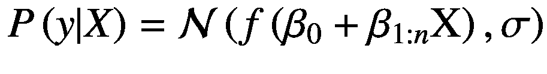

事实上，如果您期望遇到这样一位巫师，您离现实（和理智）并不遥远。`scikit-learn` 框架（ [`https://scikit-learn.org`](https://scikit-learn.org) ）本身就是一个巫师。您只需仔细解读 `scikit-learn` 的“话语”，切勿误用赋予您的力量。本节的目的在于阐明必要的沟通技巧和语言，使您成为这位巫师钟爱的学徒。

代码清单 7-2 展示了 `scikit-learn` 包在实际中的应用，并可视化了一些底层发生的情况。`observer.py` 模块包含用于恢复参数并演示与训练、测试和评估相关的各种效果的函数。您不需要完全理解辅助显示代码（查看 `explain_sse` 和 `plot_mse` 函数）即可跟上进度。`train_model` 函数仅通过使用观测值（即带标签的训练数据）来恢复现实世界的参数。`evaluate_model` 函数通过使用测试数据计算*均方误差 (MSE)* 和*解释方差分数*来检查模型的有效性。在实践中，您应始终选择与问题目标相一致的性能标准。脱离上下文的度量是有误导性的。


```python
import numpy as np
import pandas as pd
import seaborn as sns
import matplotlib.pyplot as plt
plt.style.use('seaborn-whitegrid')
def train_model(model, X_train, y_train):
    model.fit(X_train, y_train)
def evaluate_model(model, X_test, y_test, plot_residuals=False, title=""):
    from sklearn.metrics import mean_squared_error, explained_variance_score
    y_pred = model.predict(X_test)
    if plot_residuals:
        _, ax = plt.subplots(figsize=(9, 9))
        ax.set_title('残差图 - ' + title, fontsize=19)
        ax.set_xlabel('预测值', fontsize=15)
        ax.set_ylabel('残差', fontsize=15)
        sns.residplot(y_pred.squeeze(), y_test.squeeze(),
                      lowess=True,
                      ax=ax,
                      scatter_kws={'alpha': 0.3},
                      line_kws={'color': 'black', 'lw': 2, 'ls': '--'})
    metrics = {
        'explained_variance': explained_variance_score(y_test, y_pred),
        'mse': mean_squared_error(y_test, y_pred)
    }
    return metrics
def make_poly_pipeline(model, degree):
    from sklearn.pipeline import make_pipeline
    from sklearn.preprocessing import PolynomialFeatures
    return make_pipeline(PolynomialFeatures(degree=degree, include_bias=False), model)
def print_parameters(linear_model, metrics):
    print('截距: %.3f' % linear_model.intercept_)
    print('系数: \n', linear_model.coef_)
    print('解释方差得分: %.3f' % metrics['explained_variance'])
    print("均方误差: %.3f" % metrics['mse'])
def plot_mse(model, X, y, title, error_spread):
    def collect_mse():
        from sklearn.model_selection import train_test_split
        from sklearn.model_selection import cross_val_score
        metrics_all = []
        for train_size_pct in range(10, 110, 10):
            X_train, X_test, y_train, y_test = \
                train_test_split(X, y, shuffle=False, train_size=train_size_pct / 100)
            metrics_current = dict()
            metrics_current['percent_train'] = train_size_pct
            train_model(model, X_train, y_train)
            metrics_train = evaluate_model(model, X_train, y_train)
            metrics_current['训练得分'] = metrics_train['mse']
            metrics_cv = cross_val_score(
                model,
                X_train, y_train,
                scoring='neg_mean_squared_error', cv=10)
            metrics_current['交叉验证得分'] = -metrics_cv.mean()
            if X_test.shape[0] > 0:
                metrics_test = evaluate_model(model, X_test, y_test)
                metrics_current['测试得分'] = metrics_test['mse']
            else:
                metrics_current['测试得分'] = np.NaN
            metrics_all.append(metrics_current)
        return pd.DataFrame.from_records(metrics_all)
    import matplotlib.ticker as mtick
    df = collect_mse()
    error_variance = error_spread**2
    ax = df.plot(
        x='percent_train',
        title=title,
        kind='line',
        xticks=range(10, 110, 10),
        sort_columns=True,
        style=['b+--', 'ro-', 'gx:'],
        markersize=10.0,
        grid=False,
        figsize=(8, 6),
        lw=2)
    ax.set_xlabel('训练集大小', fontsize=15)
    ax.xaxis.set_major_formatter(mtick.PercentFormatter())
    y_min, y_max = ax.get_ylim()
    # 待修正：参见练习 2！
    ax.set_ylim(max(0, y_min), min(2 * error_variance, y_max))
    ax.set_ylabel('MSE', fontsize=15)
    ax.title.set_size(19)
    # 绘制并标注最小 MSE。
    ax.axhline(error_variance, color="g", ls="--", lw=1)
    ax.annotate(
        '固有误差水平',
        xy=(15, error_variance),
        textcoords='offset pixels',
        xytext=(10, 80),
        arrowprops=dict(facecolor='black', width=1, shrink=0.05))
def explain_sse(slope, intercept, x, y):
    # 配置图表。
    _, ax = plt.subplots(figsize=(7, 9))
    ax.set_xlabel('x', fontsize=15)
    ax.set_ylabel('y', fontsize=15)
    ax.set_title(r'$SSE = \sum_{i=1}^n (y_i - \hat{y}_i)²$', fontsize=19)
    ax.grid(False)
    ax.spines["top"].set_visible(False)
    ax.spines["right"].set_visible(False)
    ax.tick_params(direction='out', length=6, width=2, colors="black")
    # 展示 x-y 点对。
    ax.scatter(x, y, alpha=0.5, marker="x")
    # 绘制回归线。
    xlims = np.array([np.min(x), np.max(x)])
    ax.plot(xlims, slope * xlims + intercept, lw=2, color="b")
    # 绘制误差项。
    for x_i, y_i in zip(x, y):
        ax.plot([x_i, x_i], [y_i, slope * x_i + intercept], color="r", lw=2, ls="--")
```

请注意统一 API（如`fit`、`predict`等）的优势，它可以让我们与各种模型协作。即便是流水线（pipeline）也能以相同方式处理。清单 7-3 展示了`session.py`模块中的`demo_metrics_and_mse`函数。它描述了使用不同噪声水平从观测数据重建参数的步骤。在没有噪声的情况下，我们得到的是确定性的线性回归。随着噪声增加，参数的估计会变差。

```python
import warnings
warnings.simplefilter(action='ignore', category=FutureWarning)
import numpy as np
import pandas as pd
from sklearn.linear_model import LinearRegression
from data_generator import *
from observer import *
def set_session_seed(seed):
    np.random.seed(seed)    # 实现已发布结果的完美复现。
def demo_metrics_and_mse():
    set_session_seed(100)
    X = generate_base_features(1000)[['x_normal']]
    for noise_level in [0, 2, 15]:
        y = generate_response(X, noise_level, [-1.5, 4.1])
        model = LinearRegression()
        train_model(model, X, y)
        metrics = evaluate_model(model, X, y)
        print('\n 噪声水平为 %d 的迭代' % noise_level)
        print_parameters(model, metrics)
        # 可视化回归线和误差项。
        if noise_level == 15:
            slope = model.coef_[0][0]
            intercept = model.intercept_
            explain_sse(slope, intercept, X[:15].values, y[:15])
```

`warning`模块用于屏蔽`FutureWarning`类型的警告，从而去除输出中的杂乱信息。以下是执行`demo_metrics_and_mse()`后的打印结果：

```
噪声水平为 0 的迭代
截距: -1.500
系数:
[[4.1]]
解释方差得分: 1.000
均方误差: 0.000
噪声水平为 2 的迭代
截距: -1.470
系数:
[[4.0925705]]
解释方差得分: 0.997
均方误差: 4.187
噪声水平为 15 的迭代
截距: -1.535
系数:
[[4.06304243]]
解释方差得分: 0.867
均方误差: 223.945
```

图 7-2 描绘了误差累积的情况；回归线是基于整个数据集计算的，因此在这个子集上看起来有偏差。`MSE`仅仅是平方误差和（`SSE`）的平均值。每条垂直虚红线代表一个单独的误差项（真实值*y*[*i*]与其预测值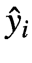之间的差异）。模型的系数使这个`MSE`（损失函数）最小化，而计算向量*β*的对应表达式是一个**无偏最小方差估计量**。它独立于固有噪声因子，并且`MSE`是此误差项离散程度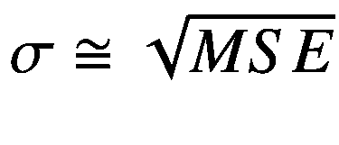的一个估计量。估计值及其依赖的值用帽号符号表示。

> **注意**  
> 仅当对应的预测变量属于比率水平数据类型（存在绝对零点的概念）时，截距才有意义。否则，应将其关闭（参见`LinearRegression`类的构造函数）。


#### 提示

`print_parameters`方法很基础。为了获得完整的 R 风格模型参数摘要，你可能想使用`statsmodels`包（访问[`https://www.statsmodels.org`](https://www.statsmodels.org)）。

一旦模型准备好（训练好），它就可以用于生产环境来处理未见过的数据。这就是我所说的*运行时模型*。所有学习到的（运行时）参数是其组成部分，并且通常可以通过各种通信渠道进行分发。这一特性允许在拥有大量数据的强大机器上单独进行训练。例如，我们在生产环境中处理真实数据所需的只是对应的向量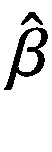。计算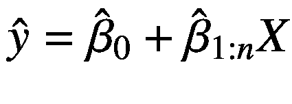可以在任何受限设备上执行。

在使用`world1`（原始模型）时，我们采用了一个简单的训练过程。所有可用数据都被重复用于训练和测试，这是你在实践中应该避免的。在这种情况下，它没有引发问题。我们的模型复杂度与真实情况完美匹配，当更高的噪声导致解释方差下降以及 MSE 上升时，这一点得到了证明。这表明我们没有试图捕捉现实世界中非本质的属性。一个过于复杂的模型能够做到这一点，从而导致*过拟合*。与此相反的是*欠拟合*，即我们的模型甚至弱到无法捕捉基本特征。接下来的两节将详细演示这些方面。

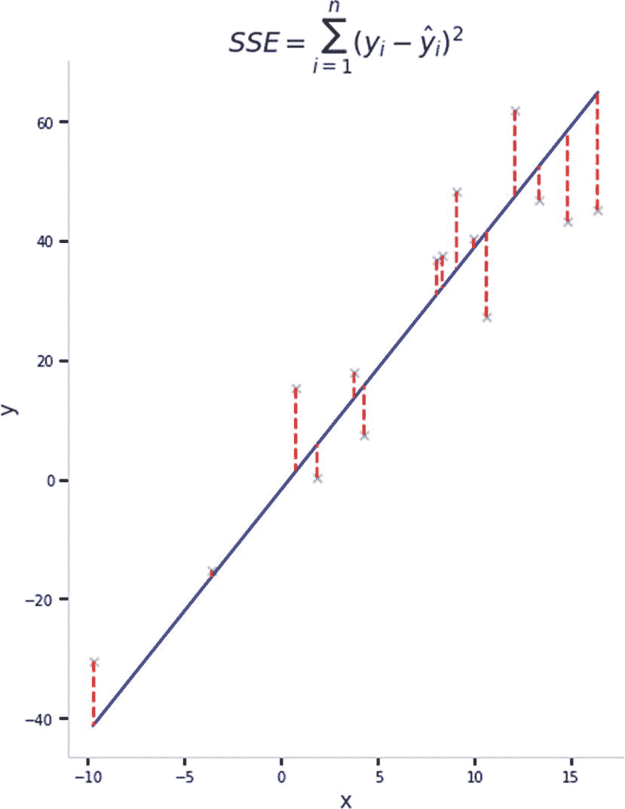

**图 7-2**

误差项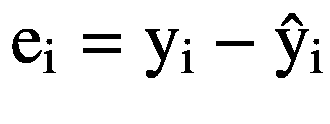被平方、求和并平均，以计算 MSE。均方根误差（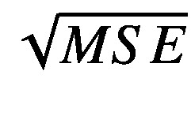）有助于恢复响应变量的原始单位。

### 过拟合

我们将使用不同次数的多项式特征来扩充线性模型；该模型在特征方面本身保持线性。目的是演示过拟合。由于此模型比之前研究的模型更强大，它有足够的能力来涵盖数据中的错误波动；在确定性情况下（无误差），你不会注意到任何差异。机器学习算法无法辨别数据中的不规则性是否关键。存在一种通过将历史数据拆分为训练集和测试集来检测过拟合的机制。

清单 7-4 展示了`demo_overfitting`函数（使用多项式特征）以及`plot_mse`函数（用于绘制不同大小的训练集和测试集的 MSE）。在运行过程中，数据被拆分为不同大小的训练集和测试集。这种训练过程的扩展引入了一个新的过程参数：用于训练目的的数据量（其余保留用于测试）。之前我们只是不加区分地使用所有数据。内部的可视化函数展示了幕后的实际情况。

```
def demo_overfitting():
def visualize_overfitting():
train_model(optimal_model, X, y)
train_model(complex_model, X, y)
_, ax = plt.subplots(figsize=(9, 7))
ax.set_yticklabels([])
ax.set_xticklabels([])
ax.grid(False)
X_test = np.linspace(0, 1.2, 100)
plt.plot(X_test, np.sin(2 * np.pi * X_test), label='True function')
plt.plot(
X_test,
optimal_model.predict(X_test[:, np.newaxis]),
label='Optimal model',
ls='-.')
plt.plot(
X_test,
complex_model.predict(X_test[:, np.newaxis]),
label='Complex model',
ls='--',
lw=2,
color='red')
plt.scatter(X, y, alpha=0.2, edgecolor="b", s=20, label='Training Samples')
ax.fill_between(X_test, -2, 2, where=X_test > 1, hatch='/', alpha=0.05, color="black")
plt.xlabel('x', fontsize=15)
plt.ylabel('y', fontsize=15)
plt.xlim((0, 1.2))
plt.ylim((-2, 2))
plt.legend(loc='upper left')
plt.title('Visualization of How Overfitting Occurs', fontsize=19)
plt.show()
set_session_seed(172)
X = generate_base_features(120)[['x_uniform']]
y = generate_response(X, 0.1, [0, 2 * np.pi], f=np.sin)
optimal_model = make_poly_pipeline(LinearRegression(), 5)
plot_mse(optimal_model, X, y, 'Optimal Model', 0.1)
complex_model = make_poly_pipeline(LinearRegression(), 35)
plot_mse(complex_model, X, y, 'Complex Model', 0.1)
visualize_overfitting()
**清单 7-4**
**包含演示过拟合的函数**
```

当模型与真实情况匹配时，训练集和测试集产生的 MSE 都会围绕可达到的最小 MSE（反映数据中的固有方差）波动，如图 7-3 所示。否则，测试集表现会更差，如图 7-4 所示。这表明模型没有很好地泛化，并且从训练集中拾取了不重要的细节。当模型的复杂度超过所需水平时，交叉验证（CV）得分也会显著恶化。


CV 评分是评估模型性能的一种非常高效的方法。它是各个 CV 评分的平均值。训练数据被随机划分为 K 个大小相等的互补子集（这里我们使用 `K=10`；请参见清单 7-2 中的 `collect_mse` 内部函数以及练习 7-2）；这个数字 `K` 是另一个与过程相关的参数。在每一轮中，一个子集用于测试（更准确地说，用于验证），而其余部分用作真正的训练数据（在后面的“正则化”一节中，我们将使用 *K 折交叉验证* 来设置一个运行时参数）。来自初始数据集的每个数据点仅被用作一次测试数据。通过这种方式，算法循环遍历所有分区，因此总体平均得分确实是一个可靠的性能指标。还有一些极端的变体，其中每次迭代仅使用单个观测值（单例）进行测试（即所谓的 *留一法交叉验证*）。

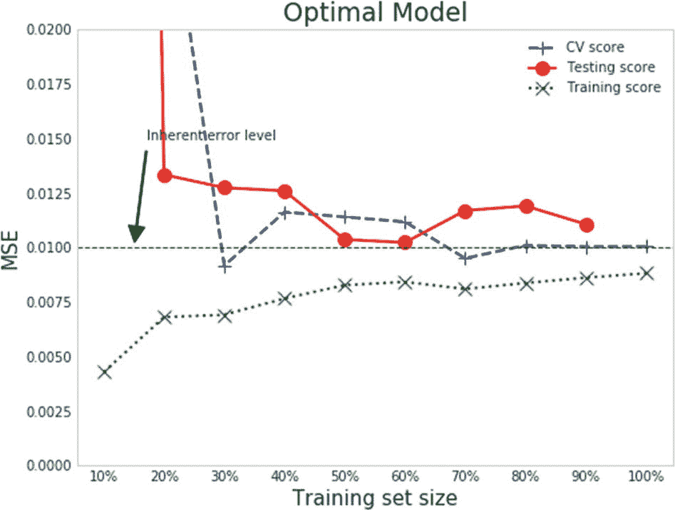

图 7-3：当模型复杂度恰到好处时，测试集的 MSE 接近自然方差

此外，随着我们使用更多的训练数据，CV 分数、测试分数和训练分数之间的方差会减小。当我们使用所有可用数据进行训练时，没有测试分数标记。水平虚线表示数据中的固有误差（可能源于测量误差）。一个合适的模型不应试图体现这一部分。在机器学习中，我们不能简单地指示计算机忘记固有误差。诀窍在于将模型的复杂度设置得恰到好处，使其没有能力去记忆不想要的细节。显然，当训练集足够小时，机器最初会试图吸收所有信息，但后来会放弃并只跟随主要趋势。因此，对于给定的模型复杂度，你必须拥有足够的训练数据。庞大的模型（尤其是深度神经网络）在生产准备就绪之前必须吞噬大量的训练数据。

过拟合和欠拟合（将在下一节中演示）与监督学习的核心问题——即 *偏差-方差权衡*——紧密相关。一个高偏差的模型可能会错过训练数据中的重要方差，而一个高方差的模型可能会试图捕获非本质的属性。平衡这两种力量是训练机器学习算法中最困难的方面之一。例如，必须对决策树给予极度的关注，因为它可能很容易覆盖训练数据中的所有边缘情况。

图 7-5 展示了为何一个过于复杂的模型泛化能力不佳；也就是说，它在测试集上表现不佳。这里所说的测试集并非特指某个领域中完全未知的区域，而仅仅是从训练集中排除的数据点的集合。关于未知空间的推理需要一种不同的学习方法（另见参考文献 [1]），这将是下一个案例研究的主题。

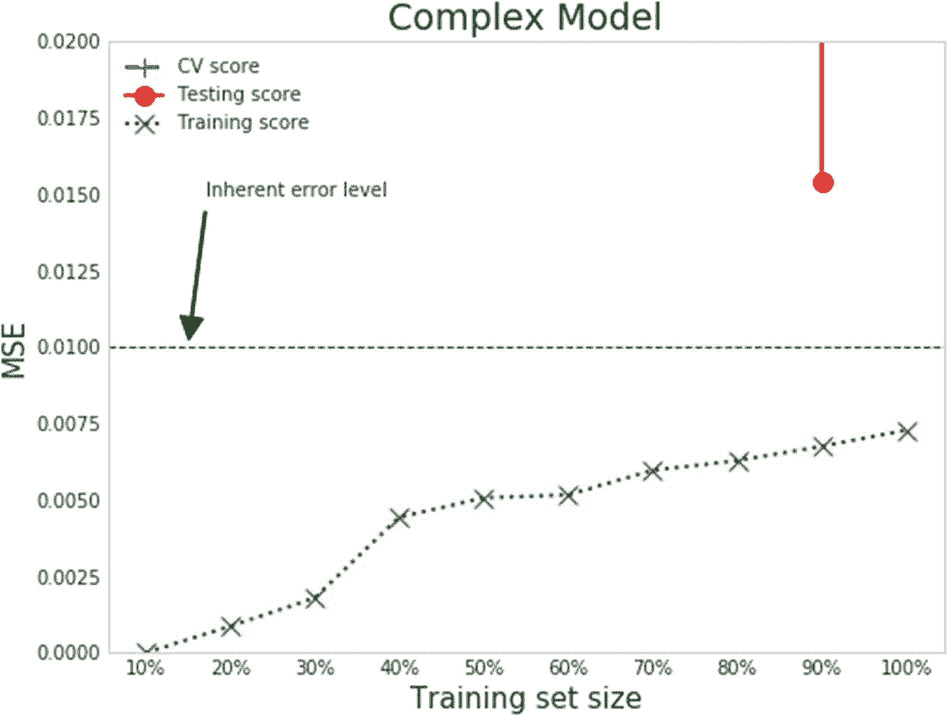

图 7-4：当模型复杂度太高时，测试集的 MSE 上升到固有误差水平之上

这里的交叉验证得分甚至超出了范围。观察到模型在开始时完全记住了一个小的训练样本，并且总是能够跟随意外的波动。应对这种情况的一种方法是向系统提供更多的训练数据。在我们的案例中，只有在使用 60% 的训练集大小时，它才开始在测试集上表现得合理。

### 欠拟合与特征交互

本节介绍特征相互作用的另一种典型情况。其目标是展示仅识别相关特征是不够的。你必须理解它们在现实世界中是如何相互关联的。我们假设有两个模型：一个将各个特征视为独立的，另一个则包含它们的交互作用。

清单 7-5 展示了演示欠拟合的 `demo_underfitting` 函数。当模型与真实情况匹配时，由训练集和测试集引起的 MSE 都围绕着可达到的最小 MSE（类似于图 7-3 所示）波动。相比之下，图 7-6 说明了弱模型会发生什么；显然，向弱模型添加更多数据无济于事。在实践中，欠拟合不如过拟合常见，尤其是在使用强大的深度神经网络时。

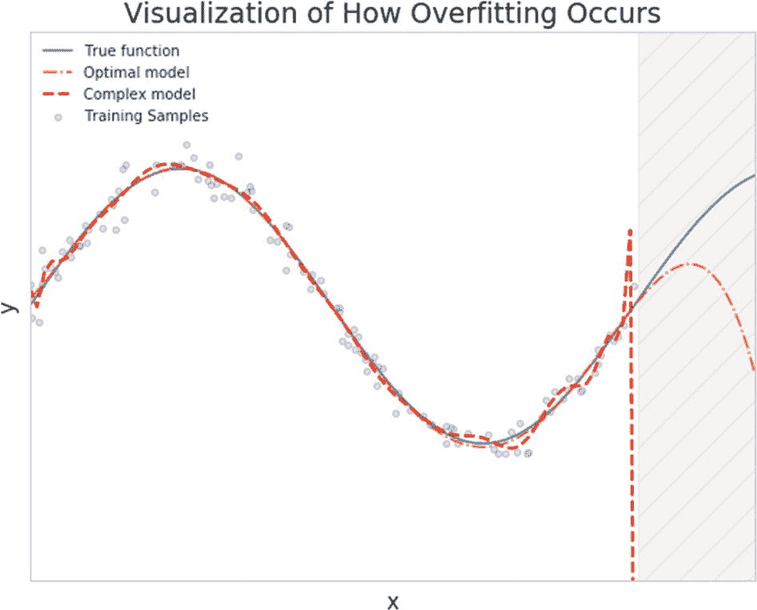

图 7-5：由于试图包含固有误差，复杂模型的预测线呈现锯齿状

在图 7-5 的右侧，你可以看到在未探索区域发生的情况。两条拟合线都偏离了真实函数。

```python
def demo_underfitting():
    set_session_seed(15)
    X = generate_base_features(200)
    X_interacting = X[['x_interacting']]
    y = generate_response(X_interacting, 2, [1.7, -4.3])
    plot_mse(LinearRegression(), X_interacting, y, 'Optimal Model', 2)
    X_weak = X[['x_normal', 'x_uniform']]
    plot_mse(LinearRegression(), X_weak, y, 'Weak Model', 2)
```
清单 7-5：通过特征交互来演示欠拟合的函数

弱模型正确地引入了两个参与的特征，但单独来看，它们无法提供价值。

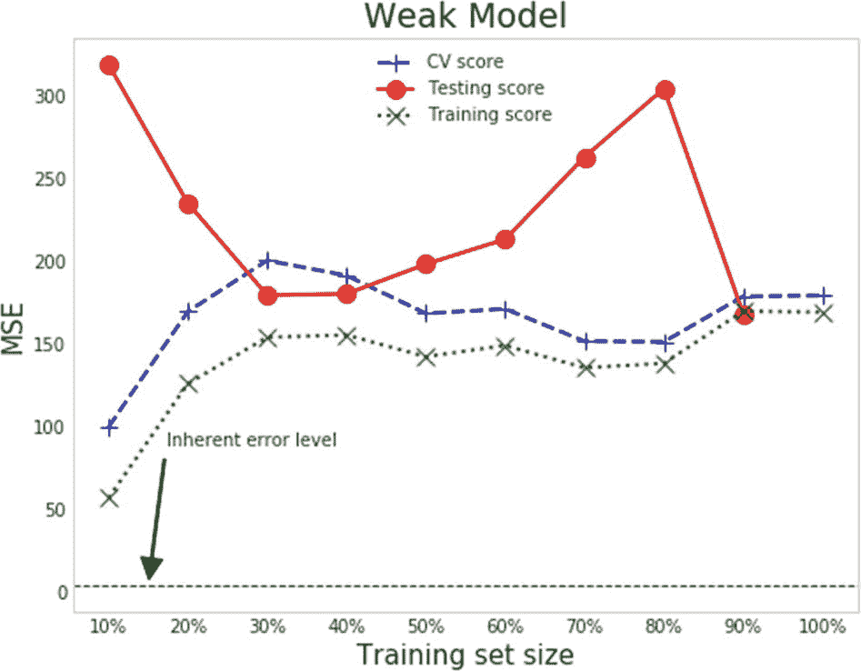

图 7-6：对于弱模型，所有集合的 MSE 都远离固有误差


### 共线性

如果你仔细审视`generate_base_features`函数，就会发现特征`x_normal`、`x_combined`和`x_collinear`之间存在相互关系。我们新的模拟世界仅使用了`x_normal`和`x_combined`。和之前一样，我们将假定这个世界有两种变体：一种使用相同的特征，另一种则也加入了`x_collinear`。代码清单 7-6 展示了演示共线性的代码。在机器学习中，这种现象会对性能和稳定性产生负面影响（因为很难评估特征对结果的影响）。

```
def demo_collinearity():
set_session_seed(10)
X = generate_base_features(1000)
X_world = X[['x_normal', 'x_combined']]
y = generate_response(X_world, 2, [1.1, -2.3, 3.1])
model = LinearRegression()
#### 展示第一个假设模型。
train_model(model, X_world, y)
metrics = evaluate_model(model, X_world, y)
print('\n 打印模型 1 的统计数据')
print_parameters(model, metrics)
#### 展示第二个假设模型。
X_extended_world = X[['x_normal', 'x_combined', 'x_collinear']]
train_model(model, X_extended_world, y)
metrics = evaluate_model(model, X_extended_world, y)
print('\n 打印模型 2 的统计数据')
print_parameters(model, metrics)
#### 生成散点矩阵图。
df = X
df.columns = ['x' + str(i + 1) for i in range(len(df.columns))]
df['y'] = y
pd.plotting.scatter_matrix(df, alpha=0.2, figsize=(10, 10), diagonal="kde")
代码清单 7-6
在 session.py 中扩展 demo_collinearity 函数
```

执行`demo_collinearity()`的输出如下：

```
打印模型 1 的统计数据
截距: 1.021
系数:
[[-2.1290165   3.05443636]]
解释方差得分: 0.999
均方误差: 4.274
打印模型 2 的统计数据
截距: 1.021
系数:
[[-2.1290165   0.09438926  0.52857984]]
解释方差得分: 0.999
均方误差: 4.274
```

这些运行结果之间唯一的区别在于`x_combined`的显著性。这是共线性的典型标志。系统会困惑于该“使用”`x_combined`还是`x_collinear`，因为其中一个直接是另一个的线性组合。此外，`x_normal`和`x_combined`之间也存在强关联。检查这种相互依赖关系的一种实用方法是生成一个*散点矩阵图*，如图 7-7 所示；这是运行`demo_collinearity`的最终结果（列名已重命名，以便在图表中更合适地显示）。也可以生成相关性矩阵，但它只会揭示线性关系。而图表则可能同时展示非线性关联。

独立性假设在机器学习算法中很常见。朴素贝叶斯方法完全依赖于这个特性。特征依赖性会对逻辑回归的收敛性产生负面影响。此外，高度相关的特征是冗余的，只会使模型复杂化。

### 残差图

作为一名数据科学家，你必须不断寻求从多个角度审视问题。同样，你也应该了解互补的绘图技术，因为它们能揭示问题中原本不可见的方面。你刚刚见识了散点矩阵图的效用。在本节中，我们将生成两个世界，一个是线性的，另一个是二次的。两者都有微小的系数、固有的随机性，并且通过真正的线性模型进行近似。代码清单 7-7 包含了`demo_residuals`函数，用以强调残差图的重要性。

图 7-8 展示了两个散点图及其回归线，分别对应线性模型拟合线性世界（案例 1）和线性模型拟合二次世界（案例 2）。两种情况下 MSE 相同，而案例 2 的解释方差得分更优。你会选择哪个案例作为线性模型更合适的拟合？我猜你会选择案例 2。然而，图 7-9 讲述了不同的故事。

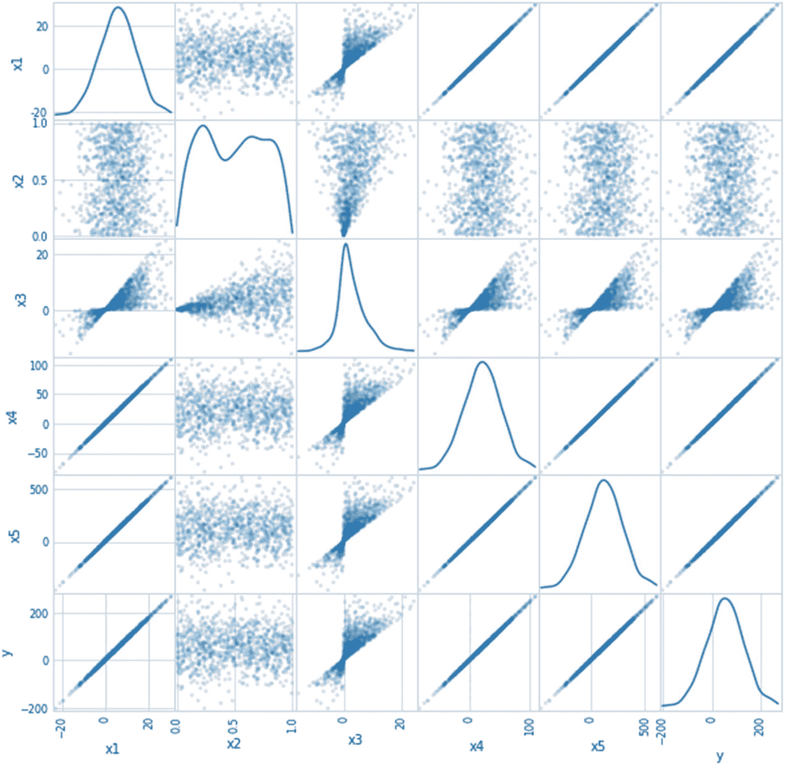

**图 7-7** 所有变量对的散点图，对角线为密度图

注意`x1`、`x4`、`x5`和`y`之间的紧密联系。此外，观察`x3`与其他特征相比的独特形状。

```
def demo_residuals():
def plot_regression_line(x, y, case_num):
_, ax = plt.subplots(figsize=(9, 9))
ax.set_title('回归图 - 案例 ' + str(case_num), fontsize=19)
ax.set_xlabel('x', fontsize=15)
ax.set_ylabel('y', fontsize=15)
sns.regplot(x.squeeze(), y.squeeze(),
ci=None,
ax=ax,
scatter_kws={'alpha': 0.3},
line_kws={'color': 'green', 'lw': 3})
set_session_seed(100)
X = generate_base_features(1000)
X1 = X[['x_normal']]
y1 = generate_response(X1, 0.04, [1.2, 0.00003])
X2 = X1**2
y2 = generate_response(X2, 0.04, [1.2, 0.00003])
model = LinearRegression()
#### 用线性假设模型展示第一个世界。
plot_regression_line(X1, y1, 1)
train_model(model, X1, y1)
metrics = evaluate_model(model, X1, y1, True, '案例 1')
print('\n 打印案例 1 的统计数据')
print_parameters(model, metrics)
#### 用线性假设模型展示第二个世界。
plot_regression_line(X1, y2, 2)
train_model(model, X1, y2)
metrics = evaluate_model(model, X1, y2, True, '案例 2')
print('\n 打印案例 2 的统计数据')
print_parameters(model, metrics)
代码清单 7-7
一个创建两个具有欺骗性方案（其中明显的方案并非明显错误）的函数
```

这段代码在案例 2 中复用了案例 1 的模型实例。你必须仔细阅读文档，了解重复调用`fit`方法时会发生什么。以下是 scikit-learn 教程的引用（参见[`https://scikit-learn.org/stable/tutorial/basic/tutorial.html`](https://scikit-learn.org/stable/tutorial/basic/tutorial.html) ）：“估计器的超参数在其构建后可以通过`set_params()`方法更新。多次调用`fit()`会覆盖之前任何`fit()`学习到的内容。”这种行为正是我们所需要的。

你还必须注意复用训练模型时所用的同一个缩放器实例。验证集和测试集必须以与训练数据集相同的方式进行缩放。忘记这个细节可能会导致微妙的错误。

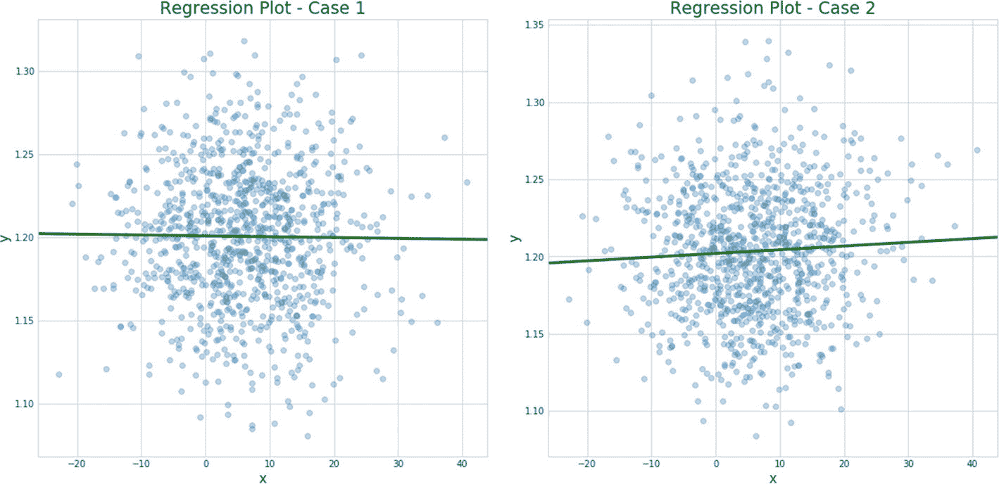

**图 7-8** 案例 1 的斜率方向是错误的，因为本应为正（参见代码清单 7-7）

对于案例 2，斜率是正的，正如它应该的那样。所有迹象都表明这是更好的匹配。

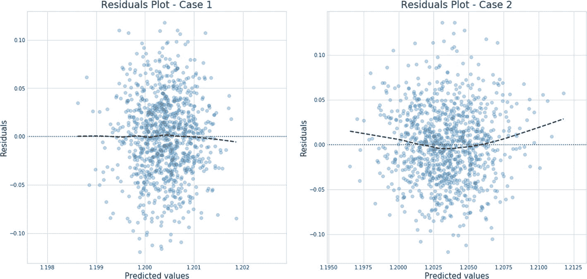

**图 7-9** 残差图明显支持案例 1 而非案例 2，并且给出了清晰的视觉解释；曲线的形状很好地揭示了残差中的“二次”模式

案例 1 没有残差模式。请参见代码清单 7-2 和`evaluate_model`函数（该函数创建残差图，并用最低线条描绘趋势）。


### 正则化

我们无法预先知道哪种模型是最优的。我们可以从弱模型开始逐步增加特征，也可以从过于复杂的模型开始并尝试简化。这两种方法都无法通过人工操作实现规模化扩展。我们的思路是宁可偏向复杂，然后利用某种自动化机制将模型复杂度降低到最优水平。这就是`正则化`的核心思想——一种自动避免过拟合的机制。正则化有多种类型，我们将使用内置交叉验证的`岭回归`。

正则化通过数学优化的语言对系数施加约束，这以`惩罚函数`的形式表达。岭回归（又称吉洪诺夫正则化）旨在使系数尽可能小，因为这与获得复杂度最低的模型等价。因此，岭回归定义了 L2 正则化项（L2 范数）`α ||w||₂²`，并将其添加到基础损失函数（本例中为 MSE）中。向量`w`包含模型的系数（权重），参数`α`则平衡了 MSE 与惩罚项之间的最小化尝试。α值越大，越倾向于奖励更小的系数，反之亦然。Alpha 通过某种试错法（例如对候选列表进行交叉验证）计算得出。代码清单 7-8 展示了用于阐述正则化的函数，其效果展示在图 7-10 中。

```
def demo_regularization():
from sklearn.linear_model import RidgeCV
set_session_seed(172)
x = generate_base_features(120)[['x_uniform']]
y = generate_response(X, 0.1, [0, 2 * np.pi], f=np.sin)
regularized_model = make_poly_pipeline(
RidgeCV(alphas=[1e-3, 1e-2, 1e-1, 1, 5, 10, 20], gcv_mode="auto"),
35)
plot_mse(regularized_model, X, y, 'Regularized Model', 0.1)
代码清单 7-8
演示正则化功能的 demo_regularization 函数实现
```

所有的魔法都发生在 scikit-learn 框架的 `RidgeCV` 类中。

## 金融走势预测案例研究

金融建模领域将为我们揭示`时间序列分析`的某些方面，我们需要对事件做出近乎实时的反应（例如预测股市价格）。这与我们迄今为止使用的`批处理`方式完全不同。我的目标并非开发新一代的股票市场应用程序，而是引导你关注流式数据处理带来的新问题与潜在解决方案。你无法一次性获取此类数据，因此`流处理`技术本质上是增量式的且具有因果性（它们基于当前知识来预测未来结果）。这意味着模型参数会随时间演变，而不是在训练阶段结束时固定不变。与经典方法相比，监控和正则化这种演变也是一些新的任务（参见参考文献[1-2]）。

另一个关键区别在于观测数据的时间戳。在第 2 章的电商客户细分案例中，数据的时间戳是粗略的（数据文件按天分隔）。而在这里，每条记录都有其独立的时间戳，以便我们监测趋势、季节性和其他基于时间模式的规律；相对时序不足以实现这一目的。为避免时区相关问题，最好将时间戳记录为自纪元时间以来的秒数（或采用类似的更高粒度方案）。

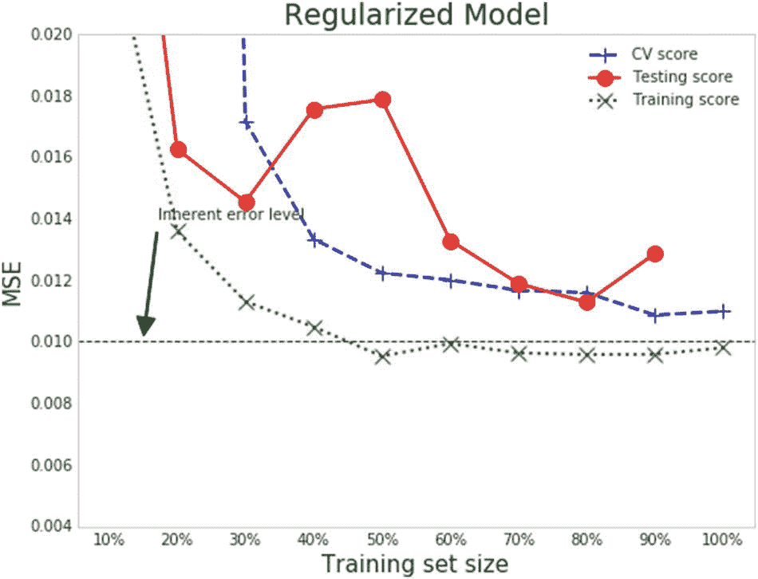

**图 7-10**  
尽管该模型在特征方面的复杂度与我们之前过拟合的例子相同，但由于采用了正则化，它并未像之前那样出现过拟合

### 数据获取

随附的源代码已包含苹果公司（股票代码为 AAPL）的每日时间序列股票数据的 CSV 文件。它位于`stock_market`子文件夹（与其他文件一起）。你可以通过从 Spyder 的 IPython 控制台执行以下命令来获取最新数据，或者处理其他公司的股票（只需修改下面的股票代码并相应重命名目标文件）：

```
!curl -o daily_AAPL.csv
"https://www.alphavantage.co/query?function=TIME_SERIES_DAILY&symbol=AAPL&outputsize=full
&apikey=&datatype=csv"
```

我们依赖 Alpha Vantage 的 API（参见 [`https://www.alphavantage.co/documentation/#daily`](https://www.alphavantage.co/documentation/%2523daily)）来获取每日时间序列数据。你可以从 Alpha Vantage 获取免费 API 密钥，并在上述代码的 URL 中插入该密钥进行标识。该网站上有关于请求限制的详细文档。`outputsize`参数设置为`full`，可获取长达 20 年的历史数据。输出格式（`datatype`参数）设置为`csv`。


### 数据预处理

秉承数据科学流程的精神，我们首先进行一些预处理和探索性数据分析。后续所有步骤都应在 Spyder 的 IPython 控制台中执行（确保你当前位于 `stock_market` 文件夹）。下一条命令显示了已下载文件的前五行：

```
>> !head -n 5 daily_AAPL.csv
timestamp,open,high,low,close,volume
2018-11-07,205.9700,210.0600,204.1300,209.9500,33106489
2018-11-06,201.9200,204.7200,201.6900,203.7700,31882881
2018-11-05,204.3000,204.3900,198.1700,201.5900,66163669
2018-11-02,209.5500,213.6500,205.4300,207.4800,91328654
```

根据 API 文档，“最近的数据点是当前交易日实时更新的价格和交易量信息”。我们将忽略这一点，仅使用稳定数据点。接下来的代码行将股票数据读入一个 Pandas 数据框，并显示前几条记录：

```
>> import pandas as pd
>> stock_data = pd.read_csv('daily_AAPL.csv', usecols=[0, 4, 5], skiprows=[1])
>> stock_data.head()
timestamp   close    volume
0  2018-11-06  203.77  31882881
1  2018-11-05  201.59  66163669
2  2018-11-02  207.48  91328654
3  2018-11-01  222.22  58323180
4  2018-10-31  218.86  38358933
```

我们只需要时间戳、收盘价和交易量字段，并且不包含最近的数据点。此时，查看关于数据类型、行数等的整体信息会很方便。下一条命令展示了这些信息：

```
>> stock_data.info()

RangeIndex: 5247 entries, 0 to 5246
Data columns (total 3 columns):
timestamp    5247 non-null object
close        5247 non-null float64
volume        5247 non-null int64
dtypes: float64(1), int64(1), object(1)
memory usage: 123.1+ KB
```

显然，`timestamp` 列的类型是 `object`，这种类型过于通用，不太方便使用。接下来的代码行将此列转换为 `DateTime` 索引（这允许我们按时间顺序处理数据）：

```
>> stock_data['timestamp'] = pd.to_datetime(stock_data['timestamp'])
>> stock_data.set_index('timestamp', inplace=True, verify_integrity=True)
>> stock_data.head()
close    volume
timestamp
2018-11-06  203.77  31882881
2018-11-05  201.59  66163669
2018-11-02  207.48  91328654
2018-11-01  222.22  58323180
2018-10-31  218.86  38358933
```

图 7-11 展示了 AAPL 收盘价随时间的变化，该图由以下代码片段生成。`style` 参数控制图中线条的外观。为了在灰度图像中区分线条，不能仅依赖颜色。我们在图 7-11 中看到，大约在 2015 年左右价格出现了大幅下跌。根据一份报告（参见 [`http://time.com/money/3991712/apple-stock-price-drop`](http://time.com/money/3991712/apple-stock-price-drop)），原因是 iPhone 销售未达到业务预期。

```
>> import matplotlib.pyplot as plt
>> def plot_time_series(ts, title_prefix, style='b-'):
ax = ts.plot(figsize=(9, 8), lw=2, fontsize=12, style=style)
ax.set_title('%s Over Time' % title_prefix, fontsize=19)
ax.set_xlabel('Year', fontsize=15)
>> plot_time_series(stock_data['close'], 'AAPL Closing Levels')
```

### 发现时间序列中的趋势

图 7-11 中的图表非常不规整，这是由于噪声和季节性的影响。识别时间序列趋势的一种流行方法是使用 *移动平均*。以下命令通过计算 *简单移动平均线 (SMA)* 来绘制收盘价的趋势，如图 7-12 所示：

```
>> stock_data.sort_index(inplace=True)
>> plot_time_series(stock_data['close'].rolling('365D').mean(), 'AAPL Closing Trend')
```

如果我们不对索引进行排序，则会收到错误提示：`ValueError: index must be monotonic`。滚动窗口大小被设置为 365 天。图 7-13 将收盘价趋势和交易量趋势结合在了同一个图表中。交易量随时间变化不大，尽管当价格开始下跌时交易量有所增加。这可能是因为在价格还算不错的时候出现了抛售股票的冲动。这种比较对于特征工程和更深入地洞察行为模式非常有用。以下代码生成了这样一个复合图表：

```
>> def compose_trends(ts):
from sklearn.preprocessing import MinMaxScaler
scaler = MinMaxScaler()
scaled_ts = pd.DataFrame(scaler.fit_transform(ts), columns=ts.columns, index=ts.index)
return pd.concat([scaled_ts['close'].rolling('365D').mean(),
scaled_ts['volume'].rolling('365D').mean()], axis=1)
>> plot_time_series(compose_trends(stock_data), 'AAPL Closing & Volume Trends', ['b-', 'g--'])
```

计算移动平均可以消除数据中的微小波动。同时观察图 7-13 可以发现，价格大幅下跌的斜率小于图 7-11 中的斜率。在将不同特征组合到同一张图之前，对它们进行缩放是很有必要的。在各种机器学习场景中，当某个方向的变化可能完全掩盖其他方向的变化时，数据缩放也是强制要求。这种情况通常发生在不同特征的值域差异巨大时。

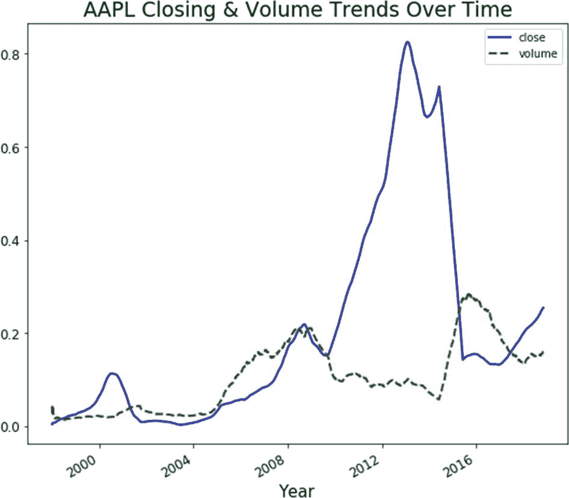

图 7-13

y 轴现在显示的是缩放后的值

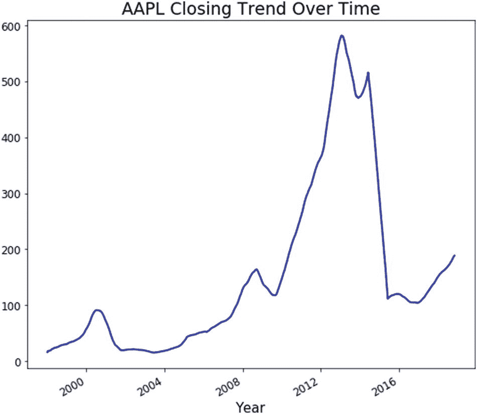

图 7-12

与图 7-11 相比，图表平滑得多

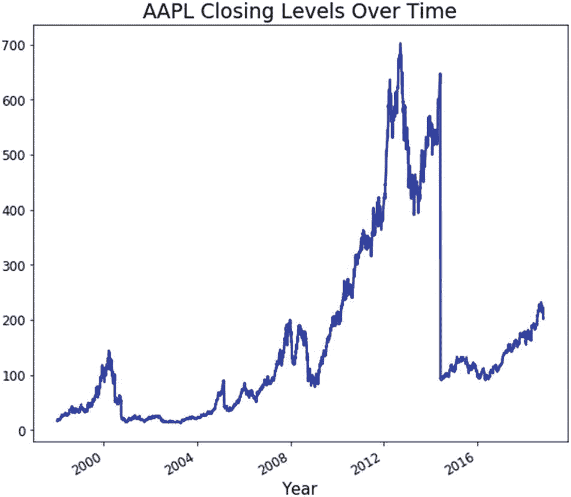

图 7-11

AAPL 收盘价随时间的变化情况


#### 特征转换

在金融领域，关注每日收益率比使用绝对数值更有用。收益率表示资产价值随时间波动的程度。计算收益率主要有两种方式：

* **对数收益率**：`r_t = log(v_t / v_{t-1})`，其中 `v` 表示资产价值（如收盘价、复权收盘价、成交量、复权成交量等）。
* **缩放百分比收益率**：`r_t = (v_t / v_{t-1} - 1)`。Pandas 中有一个 `pct_change` 方法可以计算该数值。对于日收益率而言，缩放百分比收益率近似于对数收益率。这可以从对数函数的泰勒展开式中看出，当 `x = V_t / V_{t-1}` 非常小时，只有第一项（`x - 1`）起作用。

对数收益率具有很好的数学性质（例如可加性、关于收益和损失的对称性等）。以下代码片段为我们的数据框增加了两个新特征：股票价格的每日对数收益率和成交量的每日对数变化量。图 7-14 展示了 AAPL 价格对数收益率随时间的变化，图 7-15 则展示了成交量的相应变化。

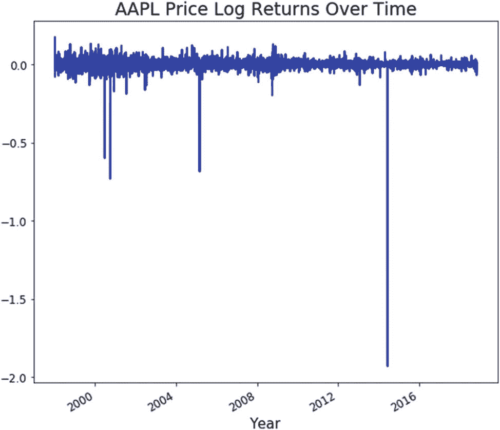

**图 7-14**

该图包含几个远离中心值的向下尖峰。

```
>> import numpy as np
>> stock_data['close_ret'] = np.log(stock_data['close']).diff()
>> stock_data['volume_ret'] = np.log(stock_data['volume']).diff()
>> stock_data.head()
close    volume  close_ret  volume_ret
timestamp
1998-01-02  16.25   6411700        NaN         NaN
1998-01-05  15.88   5820300  -0.023032   -0.096773
1998-01-06  18.94  16182800   0.176216    1.022597
1998-01-07  17.50   9300200  -0.079075   -0.553913
1998-01-08  18.19   6910900   0.038671   -0.296936
>> stock_data.dropna();
>> plot_time_series(stock_data['close_ret'], 'AAPL Price Log Returns')
>> plot_time_series(stock_data['volume_ret'], 'AAPL Volume Log Returns')
```

我们可以将这些尖峰视为异常值，这些数据难以建模和解释（除非你是金融专家）。解决该问题的一种方法是使用波动率归一化的对数收益率。

接下来的代码部分实现了生成股票价格波动率归一化对数收益率的逻辑，结果如图 7-16 所示。无需对成交量收益率执行相同的操作，我们很快会看到原因（其分布近似于正态）。

```
>> ts['close_ret'] /= ts['close_ret'].ewm(halflife=halflife).std()
>> plot_time_series(stock_data['close_ret'], 'AAPL Volatility-Norm. Price Log Returns')
```

23 天的半衰期相当于衰减因子（权重）为 0.97（需要求解方程 `w²³ = 1/2` 来得到 `w`），该因子控制着股票市场对旧事件的记忆时长（或遗忘速度）。第 i 个数据点的衰减因子为 `w^i`。波动率是跨数据点计算的滚动标准差，同时考虑了旧数据的指数衰减。更高的衰减会抑制波动率。你应该尝试调整这个因子，以匹配期望的风险水平。

#### 流式计算量

为简单起见，我们到目前为止都是以批处理模式管理数据。然而，对数收益率、移动平均和波动率都是可以实时计算的数量。对于对数收益率，你只需要缓存最后一个值即可进行更新。对于带有指数加权的波动率也是如此，尽管它不像对数收益率那样显而易见。要跟踪移动平均，你需要存储并更新最后的分子和分母。

假设你知道当前的加权方差 `V_current = sum(w^i * r_i²) / sum(w^i)`，其中 `w` 是衰减因子；对于日收益率，我们可以假设均值为零。分母是几何级数的和，其极限为 `1 / (1 - w)`。当一个新的收益率 `r_0` 到来时，我们有 `V_new = (1 - w) * (w * sum(w^i * r_i²) + r_0) = w * V_current + (1 - w) * r_0`。你可以通过 `sqrt(V_current)` 计算当前波动率。

要在流式模式下进行波动率归一化，你需要将新收益率除以当前波动率：`r_0 <- r_0 / sqrt(V_current)`。当然，你应该在执行 `V_current <- V_new` 更新当前波动率之前进行此操作。

除了计算各种运行总计外，还有一整套可以以流式方式运行的增量算法。例如，*梯度下降*是一种迭代优化方法，它可以一次性处理所有数据。*随机梯度下降*是一种增量和迭代方法，它以在线模式运行并动态更新参数。流式线性回归就使用了这种方法（本章后面会介绍）。

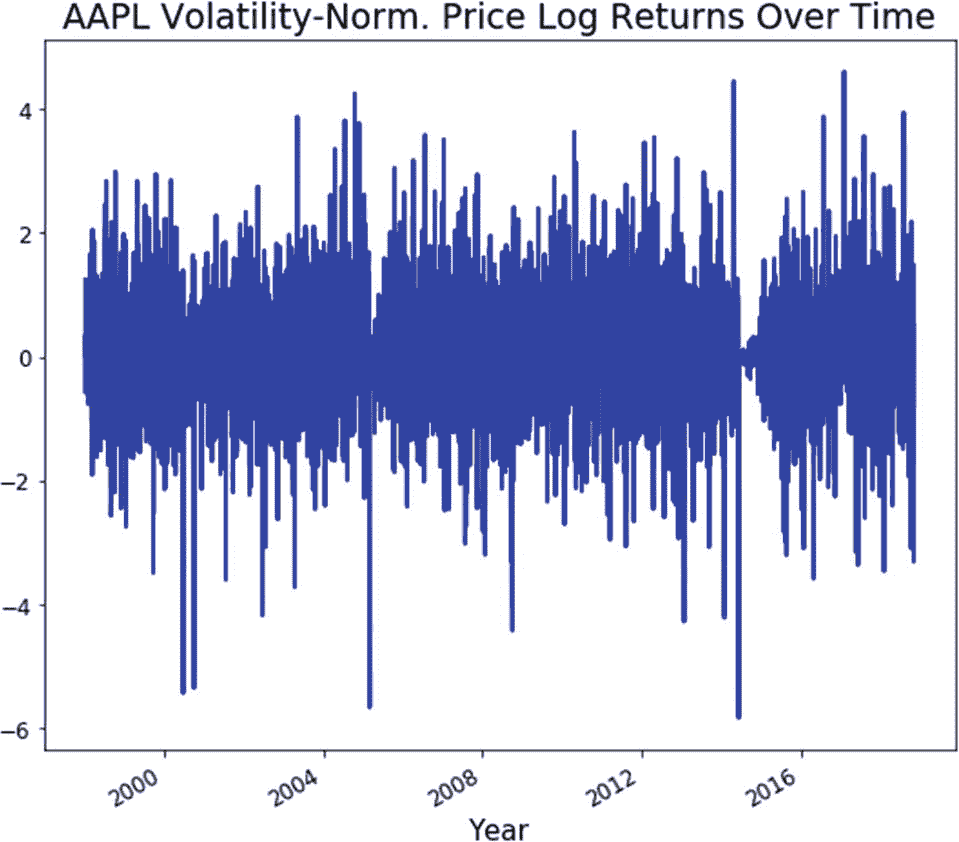

**图 7-16**

归一化平滑了对数收益率，使得时间序列表现更好。

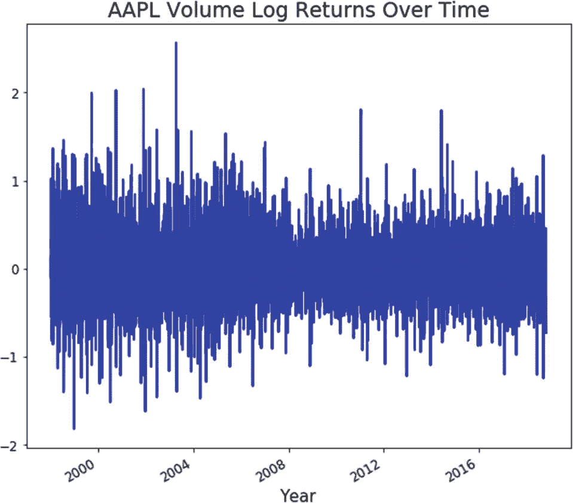

**图 7-15**

该图似乎以零点为中心，但我们仍应目视检查其分布。

为了更好地理解归一化对价格对数收益率的影响，图 7-17 和图 7-18 分别展示了非归一化和归一化变体的直方图。你将在后续部分看到完整的代码。

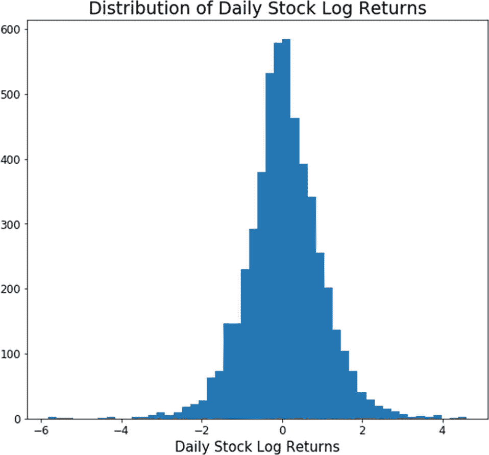

**图 7-18**

归一化价格对数收益率的直方图，呈钟形。

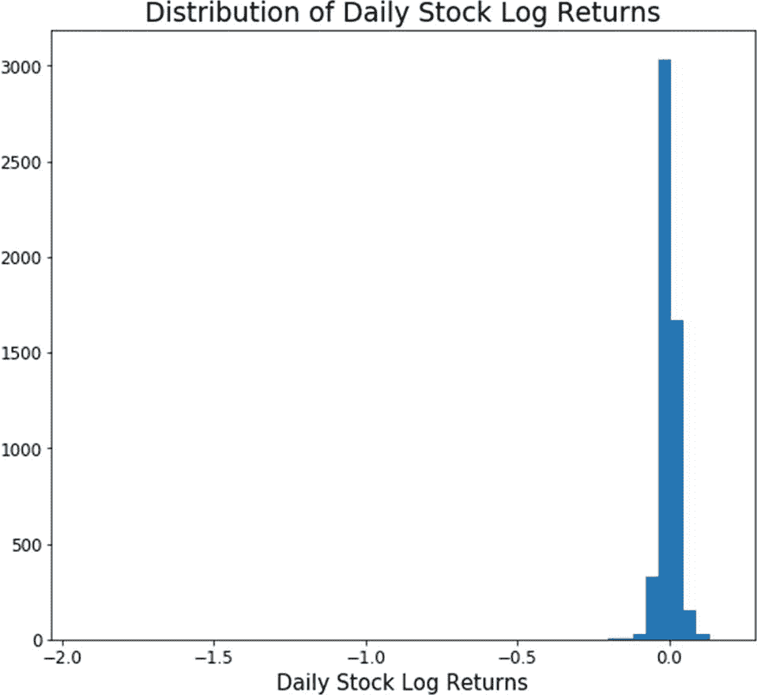

**图 7-17**

非归一化价格对数收益率的直方图，呈严重的左尾分布。

为完整起见，图 7-19 展示了成交量对数收益率的直方图。

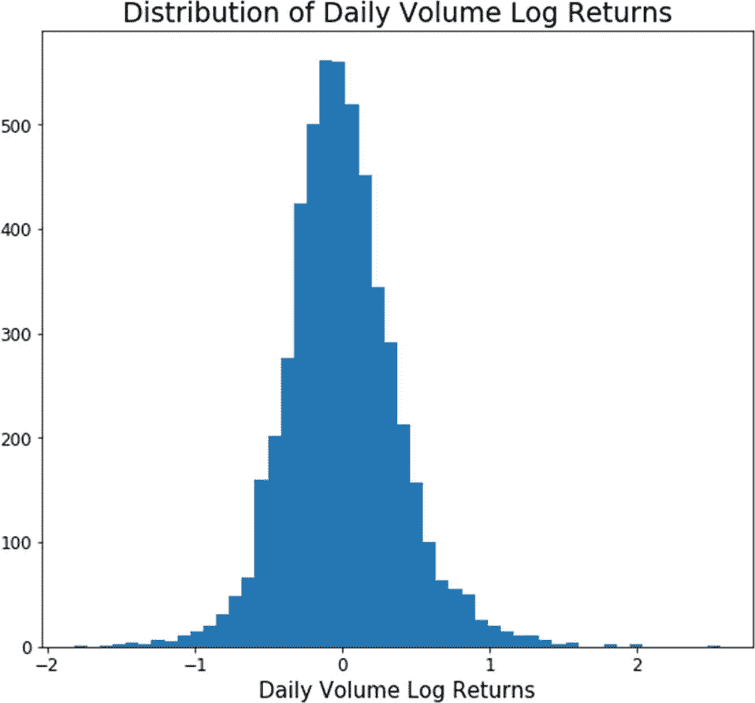

**图 7-19**

该图呈正态分布，带有轻微的右尾。

清单 7-9、7-10 和 7-11 展示了独立的模块，这些模块将所有相关步骤整合到连贯的单元中。预处理阶段到此结束。`driver.py` 模块调用这些函数来实现整个流水线。


`from data_preprocessing import *`
`from data_visualization import *`
`stock_data = read_daily_equity_data('daily_AAPL.csv')`
`stock_data = create_log_returns(stock_data, 23)`
`plot_time_series(stock_data['close'], 'AAPL 收盘价')`
`plot_time_series(stock_data['close'].rolling('365D').mean(), 'AAPL 收盘价趋势')`
`plot_time_series(compose_trends(stock_data), 'AAPL 收盘价与成交量趋势', ['b-', 'g--'])`
```
##### 要生成非归一化的价格对数收益率图，需调用
##### create_log_returns 函数并设置 normalize_close=False。可将其作为附加练习尝试。
```
`plot_time_series(stock_data['close_ret'], 'AAPL 波动率归一化价格对数收益率')`
`plot_time_series(stock_data['volume_ret'], 'AAPL 成交量对数收益率')`
`hist_time_series(stock_data['close_ret'], '每日股票对数收益率', 50)`
`hist_time_series(stock_data['volume_ret'], '每日成交量对数收益率', 50)`
```
清单 7-11
driver.py 模块——连接所有组件的核心（展示文件前半部分）
```

```
import matplotlib.pyplot as plt
def plot_time_series(ts, title_prefix, style='b-'):
    ax = ts.plot(figsize=(9, 8), lw=2, fontsize=12, style=style)
    ax.set_title('%s 随时间变化' % title_prefix, fontsize=19)
    ax.set_xlabel('年份', fontsize=15)
    plt.show()
def hist_time_series(ts, xlabel, bins):
    ax = ts.hist(figsize=(9, 8), xlabelsize=12, ylabelsize=12, bins=bins, grid=False)
    ax.set_title('%s 的分布情况' % xlabel, fontsize=19)
    ax.set_xlabel(xlabel, fontsize=15)
    plt.show()
清单 7-10
data_visualization.py 模块——包含时间序列辅助可视化函数
```

```
import numpy as np
import pandas as pd
def read_daily_equity_data(file):
    stock_data = pd.read_csv(file, usecols=[0, 4, 5], skiprows=[1])
    stock_data['timestamp'] = pd.to_datetime(stock_data['timestamp'])
    stock_data.set_index('timestamp', inplace=True, verify_integrity=True)
    stock_data.sort_index(inplace=True)
    return stock_data
def compose_trends(ts):
    from sklearn.preprocessing import MinMaxScaler
    scaler = MinMaxScaler()
    scaled_ts = pd.DataFrame(scaler.fit_transform(ts), columns=ts.columns, index=ts.index)
    return pd.concat([scaled_ts['close'].rolling('365D').mean(),
                      scaled_ts['volume'].rolling('365D').mean()], axis=1)
def create_log_returns(ts, halflife, normalize_close=True):
    ts['close_ret'] = np.log(ts['close']).diff()
    if normalize_close:
        ts['close_ret'] /= ts['close_ret'].ewm(halflife=halflife).std()
    ts['volume_ret'] = np.log(ts['volume']).diff()
    return ts.dropna()
清单 7-9
data_preprocessing.py 模块——包含为分析阶段准备数据框的函数
```

### 特征工程

目前，我们拥有原始收盘价、原始成交量、波动率归一化的收盘价对数收益率以及成交量对数收益率作为特征（后续还将创建更多特征）。为了解这些特征对潜在目标变量（如预测股价变动）的影响，查阅皮尔逊相关系数 *r* 十分有用。该指标用于衡量两个特征之间的线性关系，取值范围为 [-1, 1]。正相关表示一个值增加/减少时，另一个值也同步变化；负相关则表示相反行为；值为零表示不存在线性关系（尽管变量间可能存在非线性关联）。通常，若 `|r| > 0.3`，则可认为相关性较为显著（此为经验判断，需谨慎参考此准则）。

对数收益率反映了波动情况，探究这些收益率在特定时间段（如 *N* 天）内是呈*均值回归*还是*趋势跟踪*特征具有重要意义。均值回归表明收益率围绕某个均值波动，而趋势跟踪则指其模仿近期走势。我们可以通过固定 `N` 值，计算过去与未来收益率之间的系数 `r` 来发现这一特征。若相关性较低，则表现为均值回归；反之则为趋势跟踪。清单 7-12 展示了报告相关系数并创建过去与未来价格及成交量对数收益率散点图的函数（另见练习 7-3）。该函数调用 `scatter_time_series` 函数生成散点图（见清单 7-13）。

```
def scatter_time_series(ts, x, y):
    ax = ts.plot(x=x, y=y, figsize=(9, 8), kind="scatter", fontsize=12)
    ax.set_title('自相关图', fontsize=19)
    ax.set_xlabel(x, fontsize=15)
    ax.set_ylabel(y, fontsize=15)
    plt.show()
清单 7-13
用于创建追踪自相关的散点图函数（data_visualization.py 模块）
```

```
from data_visualization import *
def report_auto_correlation(ts, periods=5):
    for column in filter(lambda str: str.endswith('_ret'), ts.columns):
        future_column = 'future_' + column
        ts[future_column] = ts[column].shift(-periods).rolling(periods).sum()
        current_column = 'current_' + column
        ts[current_column] = ts[column].rolling(periods).sum()
        print(ts[[current_column, future_column]].corr())
        scatter_time_series(ts, current_column, future_column)
清单 7-12
feature_engineering.py 模块——包含研究自相关性的函数
```

以下是两个变量的相关系数，图 7-20 展示了成交量对数收益率的散点图（建议运行配套源代码查看价格收益率图）：

```
current_close_ret  future_close_ret
current_close_ret           1.000000          0.013661
future_close_ret            0.013661          1.000000
current_volume_ret  future_volume_ret
current_volume_ret            1.000000          -0.419489
future_volume_ret            -0.419489           1.000000
```

我们可以得出结论：价格对数收益率呈现均值回归特征，而成交量对数收益率则遵循相反趋势。

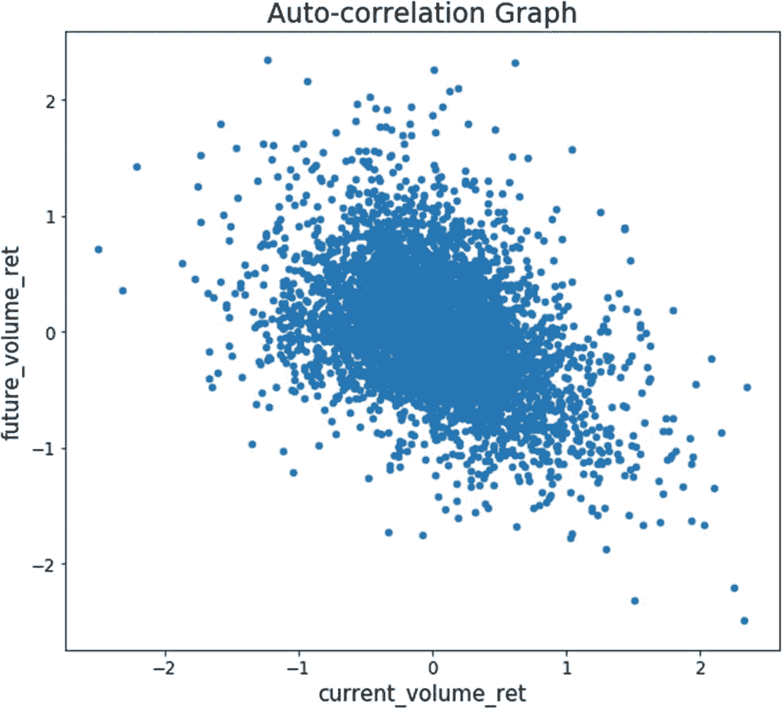

图 7-20

当前成交量对数收益率上升时，未来成交量对数收益率下降，反之亦然

通过改变周期长度，可以找到自相关性的最高水平，这为创建特征提供了基础。5 天似乎是一个良好的选择（您可以使用配套代码库实验不同周期）。因此，我们的目标特征将是未来 5 天的价格变化，而初始基础特征则为当前 5 天的价格和成交量变化。


每个领域都有一组经过验证的、对预测目标有价值的备选特征。有一个名为 TA-Lib 的强大技术分析库，包含 200 个金融指标（参见[`https://mrjbq7.github.io/ta-lib`](https://mrjbq7.github.io/ta-lib)）。我们将使用其中的三个：归一化简单移动平均线（SMA）、相对强弱指数（RSI）和平衡交易量（OBV）。你已经在“发现时间序列中的趋势”一节中见过 SMA。RSI 的定义为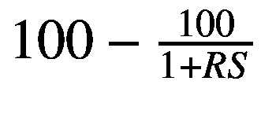，其中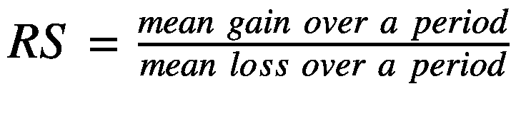。OBV 将成交量流与价格变化联系起来。清单 7-14 包含了用于创建候选特征的代码。

```
def create_features(ts):
from talib import SMA, RSI, OBV
target = 'future_close_ret'
features = ['current_close_ret', 'current_volume_ret']
for n in [14, 25, 50, 100]:
ts['sma_' + str(n)] = SMA(ts['close'].values, timeperiod=n) / ts['close']
ts['rsi_' + str(n)] = RSI(ts['close'].values, timeperiod=n)
ts['obv'] = OBV(ts['close'].values, ts['volume'].values.astype('float64'))
ts.drop(['close', 'volume', 'close_ret', 'volume_ret', 'future_volume_ret'],
axis='columns',
inplace=True)
ts.dropna(inplace=True)
return ts.corr()
Listing 7-14
Code to Create Features Described in Text (Part of feature_engineering.py)
```

该函数返回相关性矩阵，可以使用热力图方便地进行可视化。也可以返回指数加权相关性矩阵，并使用加权移动平均（分别参见 Pandas 的`EWM`对象的`corr`和`mean`方法）。热力图绘制在一个新函数中实现，如清单 7-15 所示（位于我们的可视化模块中）。

```
def heat_corr_plot(corr_matrix):
import numpy as np
import seaborn as sns
mask = np.zeros_like(corr_matrix)
mask[np.triu_indices_from(mask)] = True
_, ax = plt.subplots(figsize=(9, 8))
sns.heatmap(corr_matrix, annot=True, cmap="gist_gray", fmt=".2f", lw=.5, mask=mask, ax=ax)
plt.tight_layout()
plt.show()
Listing 7-15
Code to Report Correlations Using Seaborn’s heatmap Facility
```

最后，`driver.py`模块必须添加以下语句：

```
from feature_engineering import *
report_auto_correlation(stock_data)
corr_matrix = create_features(stock_data)
heat_corr_plot(corr_matrix)
```

图 7-21 显示了可用于特征筛选的相关性矩阵。减少特征数量既可以提高准确性，也可以提升性能。

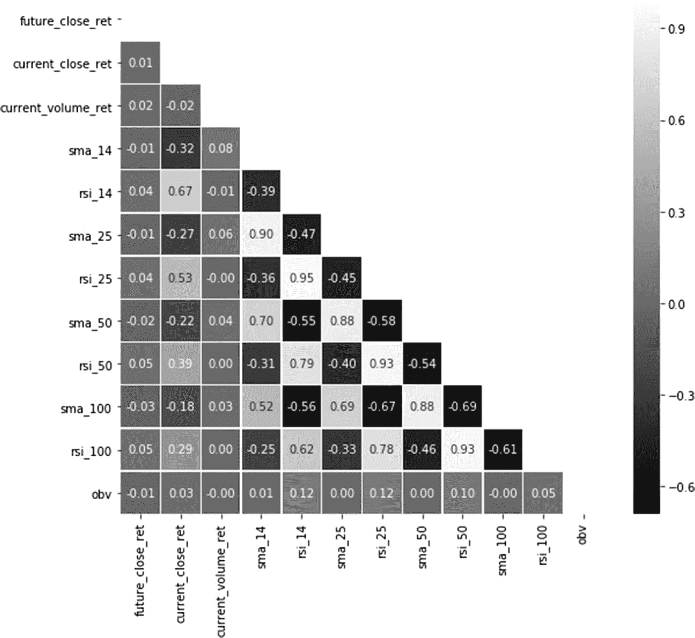

Figure 7-21

此图仅显示了相关性矩阵的相关部分。

所有对角线元素都为 1，因为特征与自身完全对齐。矩阵是对称的，因此右上三角部分是冗余的。没有一个特征与目标强相关，至少在线性方式下如此。

### 实现流式线性回归

流式线性回归会在新训练数据添加到语料库时持续学习并更新其参数。我们依赖 Apache Spark 的 MLlib 框架，该框架提供了`StreamingLinearRegressionWithSGD`类来执行流式回归。我们唯一需要做的是为训练和测试数据提供流式数据源。一种简便的方法是通过队列传递一个*弹性分布式数据集（RDD）*实例列表。将 Pandas 的`DataFrame`的一部分转换为 RDD 很简单。清单 7-16 展示了在线模式下拟合线性模型的实现（另请参见练习 7-4），清单 7-17 展示了`driver.py`模块的最终扩展。你需要安装`pyspark`（参见[`https://spark.apache.org/docs/latest/api/python/index.html`](https://spark.apache.org/docs/latest/api/python/index.html)）。

```
from pyspark.sql import SparkSession
from streaming_regression import *
sparkSession = SparkSession.builder \
.master("local[4]") \
.appName("Streaming Regression Case Study")\
.getOrCreate()
fit_and_predict(sparkSession, stock_data)
Listing 7-17
Last Piece of the Main driver.py Module
```

```
def fit_and_predict(sparkSession, ts):
import numpy as np
from sklearn.model_selection import train_test_split
from pyspark.streaming import StreamingContext
from pyspark.mllib.regression import StreamingLinearRegressionWithSGD
def to_scaled_rdd(pandasDataFrame):
import pandas as pd
from sklearn.preprocessing import RobustScaler
from pyspark.mllib.regression import LabeledPoint
regressors = pandasDataFrame.columns[1:]
num_regressors = len(regressors)
#### FIX ME: As a bonus exercise, read the last paragraph from section about residual
#### plots and make the necessary bug fix! Compare the behavior of this version with the
#### fixed one and see whether you can decipher anything from the outputs.
scaler = RobustScaler()
scaled_regressors = scaler.fit_transform(pandasDataFrame[regressors])
scaled_pandasDataFrame = pd.DataFrame(scaled_regressors, columns=regressors)
scaled_pandasDataFrame['target'] = pandasDataFrame[pandasDataFrame.columns[0]].values
sparkDataFrame = sparkSession.createDataFrame(scaled_pandasDataFrame)
return sparkDataFrame.rdd.map(
lambda row: LabeledPoint(row[num_regressors], row[:num_regressors]))
def report_accuracy(result_rdd):
from pyspark.mllib.evaluation import RegressionMetrics
if not result_rdd.isEmpty():
metrics = RegressionMetrics(
result_rdd.map(lambda t: (float(t[1]), float(t[0]))))
print("MSE = %s" % metrics.meanSquaredError)
print("RMSE = %s" % metrics.rootMeanSquaredError)
print("R-squared = %s" % metrics.r2)
print("MAE = %s" % metrics.meanAbsoluteError)
print("Explained variance = %s" % metrics.explainedVariance)
df_train, df_test = train_test_split(ts, test_size=0.2, shuffle=False)
train_rdd = to_scaled_rdd(df_train)
test_rdd = to_scaled_rdd(df_test)
streamContext = StreamingContext(sparkSession.sparkContext, 1)
train_stream = streamContext.queueStream([train_rdd])
test_stream = streamContext.queueStream([test_rdd])
numFeatures = len(ts.columns) - 1
model = StreamingLinearRegressionWithSGD(stepSize=0.05, numIterations=300)
np.random.seed(0)
model.setInitialWeights(np.random.rand(numFeatures))
model.trainOn(train_stream)
result_stream = model.predictOnValues(test_stream.map(lambda lp: (lp.label, lp.features)))
result_stream.cache()
result_stream.foreachRDD(report_accuracy)
streamContext.start()
streamContext.awaitTermination()
Listing 7-16
Content of the streaming_regression.py Module to Showcase Streaming Linear Regression in Online Mode
```

系统将打印以下报告（阅读后应终止会话）：

```
MSE = 5.663621710391528
RMSE = 2.379836488162901
R-squared = -0.3217279555407153
MAE = 1.8382286514438086
Explained variance = 1.7169768418351132
```

在撰写本文时，`StreamingLinearRegressionWithSGD`类缺少`setIntercept`方法。因此，我们得到了非常“奇怪”的 R 平方和解释方差值。同样至关重要的是，在训练模型之前要记住特征缩放的重要性。如果你不确定回归变量的分布，`RobustScaler`缩放器是一个方便的选择。


### 练习 7-1 提升可复用性

`plot_mse`函数预设了标题和坐标轴的字体大小。为了保持一致性，这种做法在其他地方也重复出现。然而，这种方式是真正的维护噩梦（注意：`explain_sse`重复了相同的设置）。请改进代码，将通用参数的设置集中起来（提示：在[`https://matplotlib.org/users/customizing.html`](https://matplotlib.org/users/customizing.html)阅读关于样式表的内容）。你还能想出哪些方法让代码库更灵活、更易于复用？

当你处理各种机器学习问题时，工具函数会变得非常方便。每次需要绘制 MSE 时都重新造轮子是没有意义的。尽你所能让你的代码库具有可复用性。

### 练习 7-2 修复一个 Bug

在清单 7-2 的`plot_mse`函数内部，你会找到以下两行代码：

```
#### FIX ME: 请参见练习 2！
ax.set_ylim(max(0, y_min), min(2 * error_variance, y_max))
```

你的任务是找出为什么这一行标记的代码是错误的，并实现修复。在现实中，情况甚至更糟，因为没人会给你指出错误的代码段。定位问题的确切位置是纠正错误过程中的一个巨大里程碑。

提示：图 7-6 是在这两行代码都被注释掉的情况下生成的。显然，这种解决方案是一个权宜之计。尝试使用原始的`plot_mse`函数运行`demo_underfitting`，看看会发生什么。

### 练习 7-3 避免副作用

在清单 7-12 中，你可以看到一个具有副作用的函数。它通过增加额外列来修改输入的*数据框*。这个修改是调用清单 7-14 中所示函数的前提条件。所有的链式调用都由驱动模块驱动。

以副作用的方式进行编程通常是一种不好的实践。你可能会疑惑，为什么在调用模型的`fit`方法后，模型会以这种形式被更改（参见清单 7-2）。关键区别在于，模型将其状态封装在一个对象内部，这样你对内部内容的更改有更多的控制权。当普通函数散布着隐含的副作用时，很容易失去控制，造成无法维护的混乱局面。

重构`feature_engineering.py`模块，将特征相关的操作归组到一个专门的类中。比较这种面向对象的方式如何有助于保持对系统内部的控制。

### 练习 7-4 体验流式处理行为

在清单 7-16 中，训练和测试流是按以下方式构建的：

```
train_stream = streamContext.queueStream([train_rdd])
test_stream = streamContext.queueStream([test_rdd])
```

这对于演示解决方案的框架来说是可以的，但在真实环境中毫无意义。流式处理的全部意义在于允许数据持续地分块到达。Apache Spark 甚至允许将流合并，这样你可以通过多个通道获取数据（例如，你也可以监视一个文件夹以获取新的数据文件并实时解析它们）。

重构解决方案，让训练集和测试集包含多个部分。你需要将引用的数据框`df_train`和`df_test`分割成多个部分，并将每个部分转换为一个`RDD`。最后，将这些部分以列表的形式提供给`queueStream`方法。观察你在输出中得到了什么（你应该收到与测试数据片段数量相同的报告）。

附加任务：当前的准确率报告没有暴露出太多关于性能的信息。你可能想要创建一个预测值与实际值（来自测试数据的观测值）的散点图。同时画出理想线（这基本上就是函数`y = x`）。

## 本章小结

本章只是触及了机器学习（ML）领域的皮毛。即使是几十本书也不足以完全涵盖（即使是在入门级别上）所有可用的算法和技术。本章的主要目标是介绍贯穿于机器学习知识领域的通用概念。如果不了解欠拟合、过拟合、正则化、缩放等类似主题，你就无法高效地使用任何机器学习方法。要精通机器学习，你还必须记住数据科学和工程学的黄金法则：“保持简单，傻瓜！”（也就是 KISS 原则）。通常，你甚至不需要机器学习就能解决问题，而且很少有需要启动复杂的深度神经网络的时候。

本章传达的另一个有力信息是：在参数调优方面，科学与艺术之间的界限相当模糊。虽然有一些经验法则（想获得良好的概述，我建议阅读[`http://martin.zinkevich.org/rules_of_ml/rules_of_ml.pdf`](http://martin.zinkevich.org/rules_of_ml/rules_of_ml.pdf)上的文档），但你仍然需要大量的实验和尝试。因此，为了在合理的时间内完成所有这些工作，你需要强大的硬件（在云中作为基础设施或平台即服务很容易获得）。

机器学习完全是关于数学的。你无法逃避这个事实。神经网络似乎为你提供了一条看似不错的逃避路线（我们将在第 12 章详细讨论），但最终你还是需要深入探究其内部原理，以了解正在发生的事情。这与模型的可解释性紧密相关。使用我们的普通最小二乘回归方法，系数很容易解释。一个特定的系数代表当相应特征变化一个单位时，目标变量变化多少。对于更复杂的模型，情况就不同了。无论如何，我将在第 9 章更多地讨论模型的内部特性。

机器学习正受到研究机构和工业界的巨大关注。这并不奇怪，因为随着我们更深入地进入大数据领域，就更需要以高效的方式处理如此大量的数据。只有借助机器的帮助，我们才有望掌控海量数据。一个热门话题是*迁移学习*，它试图提高训练模型的复用性。其思想是利用为一个任务优化的模型也能在其他任务上表现良好（可能只需进行少量的额外调整和训练）。这必将催生一大批新的算法和技术。

机器学习领域的一个迫切需求是，需要一种高效且标准化的方式来交换预测模型。其中一个标准是预测模型标记语言（PMML）。有一个 Python 库可以将 scikit-learn 管道转换为 PMML，网址为[`https://github.com/jpmml/sklearn2pmml`](https://github.com/jpmml/sklearn2pmml)。


# 8. 推荐系统

当人们问及机器学习在工业领域有哪些广泛应用时，推荐系统是一个典型的答案。事实上，这类系统无处不在，我们非常依赖它们。亚马逊或许是运用多种推荐系统来提升用户体验、帮助用户快速找到所需商品的最佳电商网站示例。专注于音乐领域的 Spotify 则是另一个很好的例子。尽管大量使用了机器学习，但推荐系统在以下两个关键方面与传统训练的机器学习系统有所不同：

-   除了基础内容外，它们还尝试结合许多额外线索，以提供更具个性化的选择。
-   它们倾向于偏好可变性而非可预测性，以激发用户的兴奋感。试想一个推荐系统，其推荐内容从不包含令人意外的项目。

这些特性使得评估推荐系统的指标完全不同。如果你试图仅通过标准均方根误差来优化预测准确性，那么你的系统在实践中很可能表现不佳，会被认为很乏味。本章将简要介绍推荐系统，并解释一些核心概念及相关技术。

## 推荐系统简介

要熟悉推荐系统，可以试试无商业负担、免费使用的 MovieLens 项目（`https://movielens.org`）。¹⁹ MovieLens 提供个性化电影推荐。创建账户后，它立即会要求你在六种电影类型中分配三分，以生成初始档案。之后，随着你对电影进行评分和标记，它会进一步了解你，并提供更合适的电影。这是推荐系统中的典型案例：数据越多，系统就能创建关于你的更精细的档案，从而更成功地筛选内容。在这方面，高质量的输入应带来高质量的输出。图 8-1 展示了 MovieLens 主用户界面的部分内容。尝试给几部电影评分，观察系统如何适应你更新的档案。

与 MovieLens 类似，大多数推荐系统收集两种类型的数据：

-   **显式数据**：由用户自愿提供。例如，每次你对电影评分时，都是有意提供反馈。收集大量显式数据需要系统设计者找到巧妙的方法来吸引用户响应，例如提供激励措施。当然，如果你恰当地评价电影，你理应获得更好的推荐，这是任何人愿意费心评价产品的最小激励。
-   **隐式数据**：系统在监控用户活动时自动收集的数据（例如点击、购买等）。甚至时间事件也可能有价值；例如，如果用户在某部特定电影剧本的页面上花费的时间比其他电影页面更长，这可能表明对该电影有更高的兴趣。另一种收集隐式数据的方法是追踪关于电影的推文，以评估它们的总体流行度。总而言之，众多来源可以组合成一个单一的偏好公式。自然，获取隐式数据比获取显式数据更容易，因为它不需要用户的主动参与。


图 8-1

MovieLens 的推荐以行表示不同类别进行展示

为了始终让用户有机会发现新内容，推荐是个性化内容和非个性化内容（例如总体热门项目）的混合。后者可以基于一般人口统计信息（例如年龄组、性别等）进行定制。另一个考虑是，有时你只想探索一些东西，而无需“干扰”你的个人档案（请记住，每次操作都会被追踪，包括浏览和点击，这可能会影响未来的推荐）。在 MovieLens 中，可以通过 `MovieExplorer` 功能实现这一点（该功能可能会随时间变化，因为在撰写本书时它纯粹是试验性的）。无论如何，在设计时请考虑为客户提供类似的“不追踪”选项。

图 8-2 突出了推荐系统与传统数据库及其他信息检索系统的另一个不同之处。推荐系统基于学习到的偏好筛选项目，而数据库则试图尽可能快地回答临时查询。MovieLens 执行的查询集相当静态（例如，列出用户的热门电影、列出最受欢迎的电影等），如图 8-1 所示，尽管你会得到不同的结果。如果你对关系数据库系统执行相同的查询，无论你喜欢与否，你都会得到相同的输出（假设基础内容没有改变）。

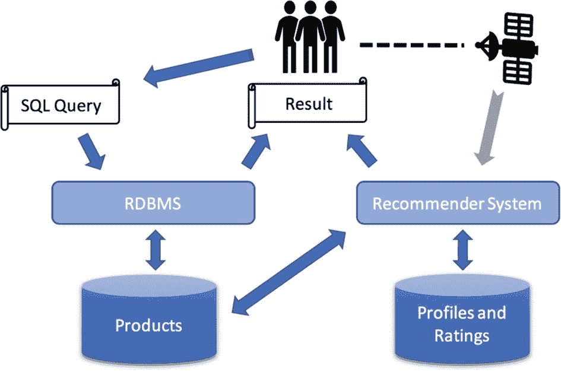

图 8-2


### 推荐系统

在信息检索系统中，用户必须明确识别她正在寻找的内容（例如，在关系数据库中，这是通过发出 SQL 查询来完成的）。

推荐系统会学习用户的喜好和厌恶，并相应地修改底层查询。输出反映了当前的用户画像（即，假设个性化解决方案，结果与用户的口味产生共鸣）。通常，在推荐系统中，你不会经常更改输出类别；它们随着时间的推移是相当稳定的。基于内容的推荐系统可以使用产品数据库来显示项目的详细信息，因此它可以根据项目的属性来编码用户的品味。

与推荐系统相关的有三种主要接口：

- **过滤功能**：尝试从流数据源（如新闻、推文、电子邮件等）中移除不感兴趣的主题（根据用户画像）。例如，个性化新闻推荐引擎可能只挑选对您重要的文章。

- **推荐接口**：呈现您可能喜欢的一组项目，如前文图 8-1 所示。通常，现代推荐系统是混合系统，利用不同的推荐算法来生成混合内容。例如，它既可以为您提供与您品味相匹配的特定项目，也可以为您提供当前流行的项目建议。此外，系统可能仅使用其自身的初始推荐来触发基于对话的交互，其中来自用户的额外反馈可能有助于缩小最终选择范围。

- **预测接口**：尝试准确预测您对某些产品的喜爱程度（例如，您会为一部未看过的电影打多少星）。当然，这些值是估计值，有时可能不准确。总的来说，您给一个项目打 5 星还是 4.5 星并没有那么重要。更重要的是提供您认为有价值的东西。

如今，大多数推荐系统都基于协同过滤技术。协同意味着利用其他用户的数据为您定制推荐。系统可能会将您的品味与其他用户关联起来，这样您就能根据这些用户的喜好和厌恶获得推荐。这是`user-user`类型的过滤。也可以根据评分关联项目，这构成了`item-item`类型的过滤；这是当今大多数系统中首选的可扩展模型。最后，还可以使用“购买了该商品的用户也购买了……”形式的产品关联规则来推荐项目。

基于上下文的系统还使用上下文和环境数据来微调结果（例如，根据您的心情，系统可能在您的一般偏好模型之上提供不同的音乐）。这些数据可以从您的智能手机收集；系统可能使用位置信息将列表缩小到您附近的物体。

## 简单电影推荐器案例研究

我们将构建一个非常简单的混搭应用，用于推荐与用户输入的电影相似的电影。此示例的灵感来自参考文献[3]。该程序将使用两个公共服务并合并它们的结果；这种安排被称为*混搭*。

`TasteDive`（[`tastedive.com`](https://tastedive.com)，这也是其 API 的基础 URL）是一个推荐引擎，根据您的品味推荐相似的音乐、电影、电视节目、书籍、作者、游戏和播客。它提供了一个资源 API（REST Level 2），以编程方式获取相似物（该 API 文档位于`/read/api`）。如果您直接访问`/api/similar`端点（无需输入访问密钥或提供任何其他参数），您将收到以下简化的 JSON 响应（内容可能会随时间变化）：

```json
{
"Similar": {
"Info": [
{
"Name": "!!!",
"Type": "music"
}
],
"Results": [
{
"Name": "Meeting Of Important People",
"Type": "music"
},
{
"Name": "The Vanity Project",
"Type": "music"
},
...
]
}
}
```

您可以免费发出几个 HTTP 请求。您需要一个访问密钥才能将未来的推荐服务投入生产。清单 8-1 显示了从`TasteDive`获取物的类。这个程序完全独立于我们的最终服务。它也可以在许多其他上下文中重用。作为额外的练习，将`requests`模块更改为`requests_with_caching`（请查阅参考文献[3]的第[24 章](https://doi.org/10.1007/978-1-4842-4859-1_24)）。

```python
import requests
class TasteDiveService:
    SUPPORTED_ARTIFACTS = ['music', 'movies', 'shows', 'podcasts', 'books', 'authors', 'games']
    API_URL = 'https://tastedive.com/api/similar'

    def __init__(self, artifact_type = 'movies'):
        assert artifact_type in TasteDiveService.SUPPORTED_ARTIFACTS, 'Invalid artifact type'
        self._artifact_type = artifact_type

    def _retrieve_artifacts(self, name, limit):
        params = {'q': name, 'type': self._artifact_type, 'limit': limit}
        return requests.get(TasteDiveService.API_URL, params).json()

    @staticmethod
    def _extract_titles(response):
        artifacts = response['Similar']['Results']
        return [artifact['Name'] for artifact in artifacts]

    def similar_titles(self, titles, limit = 5):
        """
        Returns a set of similar titles up to the defined limit. Each instance of this class is supposed to work only with one artifact type. This type is specified during object construction.
        """
        assert 0 < limit <= 50, 'Limit must be in range (0, 50].'
        return {similar_title
                for title in titles
                for similar_title in TasteDiveService._extract_titles(
                    self._retrieve_artifacts(title, limit))}
```

清单 8-1 `tastedrive_service.py`模块（位于`simple_recommender`文件夹中），用于从`TasteDive`获取相似物

以下是如何接收与*终结者*相似的电影的示例：

```python
>> td.similar_titles(['Terminator'])
{'Aliens', 'Commando', 'First Blood', 'Predator', 'Terminator Salvation'}
```

`OMDb`服务（请参阅[`www.omdbapi.com`](http://www.omdbapi.com)）提供了一个资源 API 来获取电影信息。我们将使用它来获取电影的评分，以便我们能够根据此标准对来自`TasteDive`的最终结果进行排序。清单 8-2 显示了与`OMDb`通信的类。

```python
import requests
class OMDbService:
    API_URL = 'http://www.omdbapi.com/'

    def __init__(self, api_key):
        self._api_key = api_key

    def retrieve_info(self, title):
        """Returns information about the movie title in JSON format."""
        params = {'apikey': self._api_key, 't': title, 'type': 'movie', 'r': 'json'}
        return requests.get(OMDbService.API_URL, params).json()
```

清单 8-2 `omdb_service.py`模块，用于帮助与`OMDb`服务通信


您需要获取一个 API 密钥才能使用 OMDb。幸运的是，您可以在其网站上申请一个免费密钥（每日限制 1000 次请求）（点击首页上的 `API Key` 标签页）。以下是获取电影 *Terminator* 信息的示例：

```
>> omdb = OMDbService('YOUR API KEY HERE')
>> omdb.retrieve_info('Terminator')
{'Title': 'Terminator',
'Year': '1991',
'Rated': 'N/A',
'Released': 'N/A',
'Runtime': '39 min',
'Genre': 'Short, Action, Sci-Fi',
'Director': 'Ben Hernandez',
'Writer': 'James Cameron (characters), James Cameron (concept), Ben Hernandez (screenplay)',
'Actors': 'Loris Basso, James Callahan, Debbie Medows, Michelle Kovach',
'Plot': 'A cyborg comes from the future, to kill a girl named Sarah Lee.',
'Language': 'English',
'Country': 'USA',
'Awards': 'N/A',
'Poster': 'N/A',
'Ratings': [{'Source': 'Internet Movie Database', 'Value': '6.2/10'}],
'Metascore': 'N/A',
'imdbRating': '6.2',
'imdbVotes': '23',
'imdbID': 'tt5817168',
'Type': 'movie',
'DVD': 'N/A',
'BoxOffice': 'N/A',
'Production': 'N/A',
'Website': 'N/A',
'Response': 'True'}
```

现在我们准备创建自定义电影推荐器，该推荐器将根据评分对推荐内容进行排序。可以使用多种数据源。我们将以互联网电影数据库（Internet Movie Database）作为主要来源，并在必要时回退到`imdbRating`。您也可以利用其他来源（例如烂番茄（Rotten Tomatoes））。清单 8-3 展示了这个简单的推荐混搭服务。

```
from tastedive_service import TasteDiveService
from omdb_service import OMDbService
class SimpleMovieRecommender:
PRIMARY_SOURCE = 'Internet Movie Database'
def __init__(self, omdb_api_key):
self._omdb = OMDbService(omdb_api_key)
self._td = TasteDiveService()
@staticmethod
def _retrieve_rating(omdb_response):
for rating in omdb_response['Ratings']:
if rating['Source'] == SimpleMovieRecommender.PRIMARY_SOURCE:
return float(rating['Value'].split('/')[0])
return float(omdb_response['imdbRating'])
def recommendations(self, titles, limit = 5):
"""
Return a list of recommended movie titles up to the specified limit.
The items are ordered according to their ratings (from top to bottom).
"""
similar_titles = self._td.similar_titles(titles, limit)
ratings = map(
lambda title:
SimpleMovieRecommender._retrieve_rating(self._omdb.retrieve_info(title)),
similar_titles)
return list(map(lambda item: item[1],
sorted(zip(ratings, similar_titles), reverse = True)))
Listing 8-3
simple_movie_recommender.py Module to Offer Similar Movies in Sorted Order
```

以下是一次会话，获取 *Terminator* 的 10 个按排序顺序排列的推荐结果：

```
>> smr = SimpleMovieRecommender('YOUR API KEY')
>> smr.recommendations(['Terminator'], 10)
['Aliens',
'Die Hard',
'Predator',
'First Blood',
'Robocop',
'Lethal Weapon',
'Commando',
'Terminator Salvation',
'Alien: Resurrection',
'Robocop 2']
```

### LensKit for Python 简介

LensKit for Python (LKPY) 是一个用于进行离线推荐实验的开源框架。它具有高度模块化的设计，利用了 PyData 生态系统（[`pydata.org`](https://pydata.org)）。LensKit 使您能够快速启动推荐系统，并使用各种算法和评估策略进行实验。它还集成了外部推荐工具，以提供包括指标和配置在内的通用控制平面。在本节中，我们将演示使用 LensKit 进行研究和教育实验是多么容易。您可以通过执行`conda install -c lenskit lenskit`来安装 LensKit。

图 8-3 描述了 LensKit 的包结构，而图 8-4 展示了`algorithms`包的部分 UML 类图。LensKit 非常灵活，使您能够添加新的算法或指标，这些新内容应能基于对 PyData 标准化数据结构和框架的依赖，与现有组件无缝集成。与之前基于 Java 的 LensKit 系统相比，这是一个重大突破，因为旧系统引入了专有数据格式，并将许多内容（如固化的评估流程、隐式特性和间接配置）隐藏在工具内部。


Figure 8-3

LensKit 的包结构（根包是`lenskit`），各包之间具有定义良好的 API。

`metrics`包接受 Pandas `Series`对象作为输入，因此它可以与任何外部框架结合使用。存在一个细微的不一致之处：缺少一个简单的`knn`包装包，因为`user_knn`和`item_knn`只是最近邻搜索的不同实现（这一点已反映在相应的类名中）。针对`implicit`外部框架还有两个额外的包装类，此处省略。`Fallback`类是一个简单的混合类，它将返回从一组作为输入传入的预测器中获得的第一个结果。当更复杂的算法难以计算结果时，这会很方便，因为一个更简单的版本可能会提供替代答案。我建议您阅读参考文献 [4]，以全面了解实现推荐引擎的各种方法（所有示例均在 RapidMiner 中实现，并带有推荐系统的扩展）。

下一个示例使用小型 MovieLens 数据集，您可以从 [`http://files.grouplens.org/datasets/movielens/ml-latest-small.zip`](http://files.grouplens.org/datasets/movielens/ml-latest-small.zip) 下载该数据集。您应将压缩包解压到`data`子文件夹中（相对于本章源代码目录）。我建议您阅读随压缩包附带的 `README.txt` 文件，以熟悉其内容。


Figure 8-4

所有具体算法类共享的通用 API 遵循 SciPy 风格，这使得无论算法内部细节如何，都能对其进行统一处理。

我们将在此演示使用 LensKit 进行各种推荐引擎实验的好处（另请参见参考文献 [2]）。只需在 IPython 控制台中输入以下语句（确保您位于本章的源代码目录中）；所有步骤都记录在`lkpy_demo.py`文件中，因此您可以通过执行`%load lkpy_demo.py`轻松地一次性执行它们。我们从导入必要的包开始：

```
from itertools import tee
import pandas as pd
from lenskit import batch
from lenskit import crossfold as xf
from lenskit.algorithms import funksvd, item_knn, user_knn
from lenskit.metrics import topn
```

接下来，我们加载数据集并创建一个 Pandas `DataFrame` 对象：


```python
ratings = pd.read_csv('data/ratings.csv')
ratings.rename({'userId': 'user', 'movieId': 'item'}, axis = 'columns', inplace = True)
print(ratings.head())
user  item  rating  timestamp
0     1     1     4.0  964982703
1     1     3     4.0  964981247
2     1     6     4.0  964982224
3     1    47     5.0  964983815
4     1    50     5.0  964982931
```

如上所示，重命名列非常重要。该框架期望用户标识位于`user`列下，项目标识位于`item`列下。接下来，我们生成一个用于基于用户的五折交叉验证的数据集：

```python
xf_dataset_batch, xf_dataset_test = tee(xf.partition_users(ratings[['user', 'item', 'rating']]
, 5, xf.SampleFrac(0.2)))
truth = pd.concat([test for _, test in xf_dataset_test], ignore_index = True)
```

`tee`函数会生成底层生成器的两个副本。一个用于批量评估，另一个用于创建完整的测试数据。此函数后续将用于计算用户的理想 DCG（折损累计增益）。

接下来，我们配置多种不同参数的算法。`MultiEval`工具非常适合遍历各种配置参数并生成推荐结果。每种算法的输出结果会保存在一个组合 Parquet 文件内的指定子文件夹中（你也可以生成单独的文件，然后通过调用`collect_results`进行汇总）。随后，我们可以计算各种指标来评估所达到的复杂程度。

```python
runner = batch.MultiEval('result', False, nprocs = 4)
runner.add_algorithms(
[item_knn.ItemItem(10), item_knn.ItemItem(20), item_knn.ItemItem(30)],
False,
['nnbrs']
)
runner.add_algorithms(
[user_knn.UserUser(10), user_knn.UserUser(20), user_knn.UserUser(30)],
True,
['nnbrs']
)
runner.add_algorithms(
[funksvd.FunkSVD(40, damping = 0, range = (1, 5)),
funksvd.FunkSVD(50, damping = 5, range = (1, 5)),
funksvd.FunkSVD(60, damping = 10, range = (1, 5))],
False,
['features', 'damping']
)
runner.add_datasets(xf_dataset_batch)
runner.run()
```

`UserUser`算法比其他两种算法慢得多。这就是为什么你非常有必要并行运行它的原因。对于每种算法，你可以收集相关属性来追踪其配置。接下来的几条语句会加载结果并将其合并到一个统一、整洁的记录结构中：

```python
runs = pd.read_parquet('result/runs.parquet',
columns = ('AlgoClass','RunId','damping','features','nnbrs'))
runs.rename({'AlgoClass': 'Algorithm'}, axis = 'columns', inplace = True)
def extract_config(x):
from math import isnan
damping, features, nnbrs = x
result = "
if not isnan(damping):
result = "damping=%.2f " % damping
if not isnan(features):
result += "features=%.2f " % features
if not isnan(nnbrs):
result += "nnbrs=%.2f" % nnbrs
return result.strip()
runs['Configuration'] = runs[['damping','features','nnbrs']].apply(extract_config, axis = 1)
runs.drop(columns = ['damping','features','nnbrs'], inplace = True)
recs = pd.read_parquet('result/recommendations.parquet')
recs = recs.merge(runs, on = 'RunId')
recs.drop(columns = ['RunId'], inplace = True)
print(recs.head(10))
item     score  user  rank  rating Algorithm Configuration
0   98154  5.273100     3     1     0.0  ItemItem   nnbrs=10.00
1    4429  5.027890     3     2     0.0  ItemItem   nnbrs=10.00
2    1341  5.002217     3     3     0.0  ItemItem   nnbrs=10.00
3  165103  4.991935     3     4     0.0  ItemItem   nnbrs=10.00
4    4634  4.871810     3     5     0.0  ItemItem   nnbrs=10.00
5   98279  4.871810     3     6     0.0  ItemItem   nnbrs=10.00
6    7008  4.869243     3     7     0.0  ItemItem   nnbrs=10.00
7    6530  4.777890     3     8     0.0  ItemItem   nnbrs=10.00
8   32770  4.777890     3     9     0.0  ItemItem   nnbrs=10.00
9    4956  4.777890     3    10     0.0  ItemItem   nnbrs=10.00
```

`extract_config`方法会收集每种算法相关的配置信息。我们将算法及其配置分组，以判断哪种组合效果最佳。接下来的几行代码计算了 nDCG Top-N 准确率指标（另请参见练习 8-1）：

```python
user_dcg = recs.groupby(['Algorithm', 'Configuration', 'user']).rating.apply(topn.dcg)
user_dcg = user_dcg.reset_index(name='DCG')
ideal_dcg = topn.compute_ideal_dcgs(truth)
user_ndcg = pd.merge(user_dcg, ideal_dcg)
user_ndcg['nDCG'] = user_ndcg.DCG / user_ndcg.ideal_dcg
user_ndcg = user_ndcg.groupby(['Algorithm', 'Configuration']).nDCG.mean()
```

接下来的两行代码生成了条形图，如图 8-5 所示：


**图 8-5** — 每种算法与配置组合对应的平均 nDCG

```python
%matplotlib inline
user_ndcg.plot.bar()
```

LensKit 帮助你试验各种推荐算法，并以标准化的方式对其进行评估。看看 LensKit 未来是否会支持预测模型标记语言（参见 `http://dmg.org`）作为交换推荐模型的一种方式，这将非常有趣。与其手动编写管道代码，不如使用根据 PMML 模式格式化的 XML 输入。PMML 序列化模型可以通过 GUI 工具（如 RapidMiner，它甚至可以通过通用优化器——包括基于遗传算法的优化器——来调整模型参数）进行管理，这进一步简化了整个流程。

## 练习 8-1\. 报告预测准确率

请阅读 [LKPY](https://lkpy.lenskit.org/en/stable/) 文档（`https://lkpy.lenskit.org/en/stable/`）中关于预测准确率指标的内容。注意，我们调用评估器时使用了 `batch.MultiEval('result',` `False`, `nprocs = 4)`。将第二个参数改为 `True` 以启用预测功能。你需要使用 `lenskit.metrics.predict` 包中提供的指标来评估准确率。

这也是尝试使用 `Fallback` 算法来处理缺失数据的好机会。

## 练习 8-2\. 实现一个新指标

在 Top-N 准确率指标中，你会发现两个分类指标（也称为决策支持指标）：精确率（P）和召回率（R）。前者报告有多少推荐元素是相关的，而后者报告推荐系统涵盖了有多少相关项目。召回率至关重要，因为它关系到推荐系统是否真的能通过合适的推荐给用户带来“惊喜”（即避免遗漏有用的内容）。这可能缓解一个被称为*过滤气泡*的已知问题，即推荐系统因用户对特定项目的稀疏输入而产生偏见。许多项目缺少评分这一事实并不意味着它们对用户毫无价值。

通常，我们希望平衡精确率和召回率。简单地将所有内容都返回就能最大化召回率，这很容易做到。F 值指标为我们提供了均衡的解决方案。采用与我们实现 nDCG 类似的方式，实现 `F1 = 2PR / (P + R)`。根据这个新指标对算法进行排名。


  
## 摘要  

在网络世界中，信息与产品供给极为丰富，推荐系统堪称救星。它能筛选出符合我们兴趣的条目（新闻文章、书籍、电影、音乐等，假设为个性化版本）并推荐给我们。为使推荐列表多样化，大多数推荐系统采用混合模式，将高度定制化条目与通用条目相结合。此外，许多系统还会考虑当前情境以缩小推荐范围。推荐系统的整体影响力可通过执行 A/B 测试并监测用户行为是否发生统计学上的显著变化来评估。  

然而，有两个重要议题必须妥善处理：  

*   **用户偏好数据的隐私与保密性**，因为推荐系统可能基于显式与隐式输入积累大量事实信息。必须告知用户这些数据如何处理，以及为何推荐特定条目（这与机器学习模型的可解释性密切相关），并且用户应能管理偏好数据（例如，你应能从系统中删除关于自己的某些事实）。第 9 章深入讨论了隐私与保密性问题。  

*   **基于机器品味塑造所产生的负面偏差**。令人略感不安的是，已有艺术家（以及帮助他们的咨询公司）试图创作迎合主流推荐系统的内容。另一方面，为启动基于内容的引擎，部分系统机械地预处理并从内容中提取特征（例如，对音频数据进行信号处理，以发现歌曲的节奏、音高和印象）。我们绝不愿看到任何分布长尾上的条目仅仅因为对推荐系统不友好而消失。  

# 9. 数据安全  

数据科学的核心是数据，而这不可避免地包含关于个人、组织、政府机构等的敏感信息。任何机密信息都必须以最高谨慎程度处理，并对恶意者保密。保护隐私与从数据中榨取价值是相互对立的力量，类似于在尽力优化软件系统性能的同时保障其安全性。一方改善，另一方就会削弱。作为数据科学家，我们既要确保数据得到妥善保护，又要保证数据科学产品能够抵御滥用及非预期使用（例如，防止其被用于通过推荐特定条目或说服用户以某种特定方式行动来操纵他人）。所有保护措施都应与数据科学产品的实用性良好配合；否则，开发该产品便毫无意义。  

鉴于数据安全是广泛的安全工程领域的一部分，本章的目标仅是引导你关注那些你需要知晓的众多细节。本章包含大量小示例，以务实的方式解释概念。先从攻击类型及应对工具概览入手。接着，为让你了解需要关注的数据隐私法规类型，本章详细阐述了欧盟的《通用数据保护条例》（GDPR），该条例影响所有处理欧盟公民数据的解决方案。最后，本章讨论了如何保护机器学习模型以尊重隐私。  

## 检查是否遭遇泄露  

为理解隐私的实际含义，建议访问网站 `*';--have i been pwned?*`（[`https://haveibeenpwned.com`](https://haveibeenpwned.com)），输入你的电子邮箱地址，检查是否有账户在数据泄露事件中遭到入侵。你可能会对结果感到惊讶。图 9-1 展示了我其中一个邮箱的查询报告，显示了三起事件。报告甚至包含链接，指向详细解释泄露事件发生经过的文章。如果你的报告显示未发现泄露，建议务必点击链接阅读报告，了解“真实场景”中的运作方式。  

  

**图 9-1**  
显示与我的邮箱相关事件的报告  

如果你的地址遭到“入侵”，主要存在两大问题：  

*   由于安全措施不当，你的私人详细信息可能已泄露给恶意人员。  

*   你从未联系过的第三方掌握了你的一些信息。以我为例，尽管我的邮箱被注册在 GeekedIn 系统中，但我从未访问过该网站；他们通过不当抓取公开的 GitHub 个人资料收集了关于用户的数据。  

此案例凸显了收集个人数据的实体与提供个人数据的用户之间重要的相互责任。一方面，实体必须尽最大努力遵守安全标准；另一方面，用户必须了解相关风险，并遵循通用的互联网安全建议。例如，用户应知晓绝不在多个网站上使用相同的账号/密码组合（另请参阅参考文献[1]），绝不通过不安全的连接提供敏感数据，绝不点击可疑邮件中的链接（如何识别垃圾邮件和钓鱼网站本身就是一个话题），等等。现代世界中的计算要求所有参与者具备足够的安全意识。这就像在交通中作为行人一样，无论你是否持有驾照，都需要遵守基本规则。当然，若你立志驾驶机动车，则必须积累足够经验并取得合法驾照。某些大型车辆仅能由专业司机驾驶。数据科学领域亦是如此。随着你积累的数据越来越多，必须确保自身安全技能达到足够水平，因为潜在的数据泄露不仅影响你个人。数据科学的许多领域受到严格监管，公司需要从权威机构获取证书才能处理敏感数据。不同政府机构针对数据安全制定了各种不同的法律法规（下一节我们将以 GDPR 为例进行探讨）。请参阅参考文献[2]，了解一项覆盖整个网络的、旨在建立互联网透明度与自由的有趣倡议。  

大多数数据科学产品通过 API 进行远程访问，这实现了高效的数据交换场景以及混搭应用的创建（见第 8 章）。在任何情况下，数据在传输中和静态存储时都必须受到保护。因此，外部网络通常是公共网络上的某种安全覆盖层（例如，安全的 HTTPS 通道、专用虚拟专用网络等）。互联网环境充满敌意，你的产品最终会成为攻击目标，尤其当它包含珍贵的机密数据时。  


有许多组织致力于分享各种技术的最佳安全实践，你应该至少访问其中几个网站。例如，开放 Web 应用程序安全项目（OWASP）专注于通过推广成熟实践和标准来改善软件安全性（请访问 [`https://www.owasp.org`](https://www.owasp.org) ）。[SecTools.​org](http://sectools.org) （ [`https://sectools.org`](https://sectools.org) ）将许多优秀的网络安全工具汇集在一处。（关于开发安全解决方案的良好概述，请参考参考文献[3]、[4]和[5]。）其他优秀的资源还有专注于开发安全产品的专业会议 SecAppDev（ [`https://secappdev.org`](https://secappdev.org) ），以及 ISO/IEC 27000 系列标准，该标准规定了组织保护信息资产安全的技术（请访问 [`https://www.iso.org/isoiec-27001-information-security.html`](https://www.iso.org/isoiec-27001-information-security.html) ）。

很多时候，你会依赖开源软件来实现你的数据科学产品（另请阅读边栏“OSS 供应链攻击”）。你已经接触过许多免费可用的`Python`数据科学框架。即使理论上你一切都做对了，仅仅通过使用第三方库，仍有可能在你的产品中引入安全漏洞。以下是一些在这方面可能有用的工具示例：

- `Burp Suite`（ [`https://portswigger.net`](https://portswigger.net) ）有助于发现 Web 安全问题。
- `Snort`（ [`https://www.snort.org`](https://www.snort.org) ）是一个入侵防御系统，能够实时监控网络并根据预定义规则采取行动。
- `Snyk`（ [`https://snyk.io`](https://snyk.io) ）自动化查找和修复依赖项中的漏洞。它支持多种编程语言，包括 Python。
- `Clair`（ [`https://github.com/coreos/clair`](https://github.com/coreos/clair) ）对应用容器中的漏洞进行静态分析（支持 Docker）。
- `Docker Bench for Security`（ [`https://github.com/docker/docker-bench-security`](https://github.com/docker/docker-bench-security) ）就如何使你打包的 Docker 应用程序更安全提供了宝贵建议。
- `Gitrob`（ [`https://github.com/michenriksen/gitrob`](https://github.com/michenriksen/gitrob) ）是一个帮助查找推送到 GitHub 公共仓库中的潜在敏感文件的工具。这种疏忽非常常见，尤其是在部署过程混乱的情况下。
- `Vault`（ [`https://www.hashicorp.com/products/vault`](https://www.hashicorp.com/products/vault) ）是一个用于解决`Gitrob`试图检测的问题的工具（参考上一项）。

### OSS 供应链攻击

开源软件（OSS）是一种新的攻击向量，其中社会工程学扮演着核心角色（参考[6]）。一个坏人通过向开源项目做出有价值的贡献开始他的旅程，直到获得项目发起人和其他贡献者的信任。一旦他获得了适当的凭证，他就会直接向开源组件的供应链植入漏洞。例如，曾发生过一起已知的`PyPI`（SSH Decorator）被攻破事件，未来我们很可能会看到更多此类攻击。由于流行的开源框架下载量巨大，虚假代码的传播速度可能非常惊人。别忘了，如果你将开源组件整合到自己的数据科学产品中，你仍然要为产品的安全性承担法律责任；你是责任链的最后一环。因此，始终要检查你考虑使用的任何开源组件的安全状况。

应对这个问题的一种方法是抵制急于寻找最新版本 OSS 的诱惑。版本升级应该以可控的方式进行，可能由集中式企业风险管理（ERM）工具支持；一个好的选择是`JFrog Artifactory`（参见 [`https://jfrog.com/artifactory`](https://jfrog.com/artifactory) ），它有一个免费的社区版。ERM 引入了一个重要的间接层，并且还可以通过缓存工件来提高可用性。开发人员应该只检索经 QA 部门批准的组件。

安全的许多方面都受到各种标准和工具的覆盖。图 9-2 展示了在数据科学产品生命周期中持续发生的四个全局类别的安全活动。还有安全模型可以作为组织安全工作的模板。例如，你可能想了解一下微软安全开发生命周期（ [`https://www.microsoft.com/en-us/sdl`](https://www.microsoft.com/en-us/sdl) ）。


图 9-2

处理安全事件的主要阶段

在一切正常运行时就提前计划好这些至关重要。例如，你必须在首次恢复尝试之前验证备份流程（假设你确实建立了这样一个流程，这是高优先级事项）。你对客户的回应必须在平静时期就制定好；永远不要试图掩盖问题！实际上，正如你稍后将看到的，`GDPR` 甚至强制要求按照第 33 条和第 34 条的规定进行适当通知（条款是`GDPR`中作为强制性规则处理的陈述）。

公司获取你信息的主要方式有三种：披露、收集和推断（另见参考文献[7]的第 10 节，并阅读边栏“什么是隐私？”）。让我们以推荐系统为例（在第 8 章中介绍）。如果你明确给一部电影评分，那么你就是在自愿披露信息。披露是最明显的数据收集形式，因为用户完全知情并控制着这个过程。收集则稍微特殊一些。^(²¹) 也就是说，当你点击电影描述时，系统会记录这些事件并相应地更改你的个人资料。此外，*不*点击推荐的电影也是一个有用的输入，就像你在页面上阅读电影介绍所花的时间一样；观看预告片则是另一个强烈的信号，表明你被该项目所吸引。最后，推断相当神秘。它指的是机器基于看似无害的数据发现关于你的事实的能力。最大的挑战是如何控制这种推断出的信息，防止其被进一步滥用。换句话说，如果你是一些基本事实的所有者，那么你也应该保留对衍生值的所有权。参考文献[8]中给出了一个旨在解决这个难题的好提案。


### 什么是隐私？

术语 `privacy`（隐私）根据视角不同具有不同含义（即它是一个主观概念）。隐私的一个共同属性是与**控制**相关的预期。如果你从未同意接收未经请求的营销信息（电子邮件、短信、通知等），并且没有选择将自己的姓名从相应地址簿中删除的选项，你可能会认为这是一种隐私侵犯。从这个角度来看，**控制权的有无**决定了你是否会将那些信息归类为垃圾邮件。

在隐私级别与数据科学产品的实用性/能力之间存在一个微妙的临界点。在一个极端，只有不存在的（已删除的）数据才是绝对隐私的。当然，在这种情况下，你无法从数据科学服务中获得任何有价值的东西。例如，如果你从未在电影推荐网站上给任何电影评分或执行任何其他活动，那么当你获得完全非个性化的内容时，就不应感到惊讶。另一个极端是**公共数据**，它显然包含最高级别的信息内容，并且完全缺乏隐私。因此，数据科学领域的所有利益相关者都必须在**隐私与效用**之间取得平衡。如果用户能够保持控制权并改变他们关于隐私级别的决定，那么基础就得以妥善建立。

在她的著作 *Privacy in Context: Technology, Policy, and the Integrity of Social Life*（*情境中的隐私：技术、政策与社会生活的完整性*）（斯坦福大学出版社，2009 年）中，海伦·尼森鲍姆教授提出，隐私关乎**情境完整性**。在某些情境下，你假设你私下透露的任何个人信息都不会被以意想不到的方式使用，或在未经你授权的情况下被分享。例如，如果你告诉医生你的健康问题，你假设医生不会将这些细节分享给你的雇主。因此，任何与特定行为规范紧密相关的事物在某种程度上都是一种隐私。

## GDPR 简介

探究这部影响所有处理欧盟公民个人数据（包括在其大数据解决方案中）的组织的欧盟法律是很有趣的（也可以考虑观看[9]中的视频课程）。该法律既适用于总部位于欧盟的组织（无论数据处理发生在何处），也适用于处理欧盟公民数据的非欧盟组织（在本文其余部分，“欧盟”指欧盟和欧洲经济区国家）。GDPR 是先前数据保护法的一项渐进式演进，以适应近期的技术进步（例如物联网、大数据、电子商务等）。本质上，它是一部试图规范组织行为模式以确保它们尊重人们隐私的法律。作为一部法律，它受到当地数据保护机构的严格监督，这些机构负责追究数据安全漏洞的责任。其理念是促成具有共享数据隐私预期的可互操作数据科学解决方案。即使你不在欧盟国家工作，你的组织也有可能代表一家欧盟公司处理数据。此外，审视隐私如何被制定为法律也是有益的。GDPR 并非安全标准，因此如何实施的具体技术细节超出了本书的范畴。

GDPR 由两种类型的条目组成：99 条**条款**和 173 条**序言**。前者可近似视为业务需求，而后者则作为解释条款缘由的原则。我喜欢 [`https://gdpr-info.eu`](https://gdpr-info.eu) 上呈现 GDPR 的方式，它还有一种额外的**关键问题**元素类型（该类型描述了一些应用 GDPR 时的常见问题，并附有条款和序言的引用）²²。我建议你在研读 GDPR 时，始终打开**第 4 条**，因为它包含关键术语的定义（如数据主体、个人数据、控制者、处理者等）。

GDPR 的主要贡献在于将数据与**控制和处理方面**的权利进行映射，这体现在**序言第 1 条**？请参见 [`https://gdpr-info.eu/recitals/no-1/`](https://gdpr-info.eu/recitals/no-1/)：“在处理个人数据方面保护自然人是一项基本权利。”其理念是在人们的基本权利与自由同个人数据处理之间取得平衡，其中包括控制者的权利（任何决定对你的个人数据进行操作的组织的权利）。例如，如果一家公司拥有关于你的极其敏感的数据，那么数据泄露可能会危及你的一些基本权利，例如你保护私人生活和家庭生活的权利（想想那些受 2015 年 Ashley Madison 网站——一个为寻求婚外情的已婚人士提供的约会网站——黑客事件影响的用户）。

**第 5 条**规定了与个人数据处理相关的原则。从某种意义上说，这应该是你进入 GDPR 的切入点。**第 6 条**详细解释了**合法处理**的含义（处理个人数据有六种法律理由）。第 5 条和第 6 条涵盖了数据的基本类别。**第 9 条**还规定了特殊的个人数据类别以及更严格的处理规则。

### 注意

确保始终遵循记录完善的过程来处理与个人数据处理相关的任何决策。任何控制者都必须向监管机构证明已建立适当的治理机制，并且所有保护隐私的措施都得到严格遵守。这是**问责原则**的一部分。


#### 提示

遵守 GDPR 有助于优化你的数据处理流程。第 5 条第 1 款第 c 项就个人数据处理作出如下规定：“个人数据应充分、相关且仅限于实现处理目的所必需的范围（‘数据最小化’）。”因此，你将不得不重新审视静态数据和传输中数据的量级。无论数据安全要求如何，减少数据量都绝对是有益的。

数据主体可依据第 12-23 条向控制者发送与其数据相关的请求。这些请求可主张以下权利：

*   数据主体的访问权，包括获取所有数据及元数据的副本（例如，关于数据来源或处理方式的谱系信息）。
*   更正权，以便数据主体修正数据中的错误。
*   删除权（被遗忘权），以便即使在保留期结束前也可删除数据。当然，出于法律原因，某些删除请求可能无法满足。
*   限制处理权，直至错误数据得到修正或删除。
*   数据可携权，允许控制者之间高效地交换数据（例如，当数据主体选择以自动化方式将数据从一个控制者转移到另一个控制者），并保证能够以标准机器可读格式从控制者处接收数据。
*   反对处理权，该权利基于数据处理可能危及某些基本个人权利与自由的理由。
*   不受包括用户画像在内的自动化决策制约的权利。

控制者必须在一个月内对任何请求做出回应，且不得收费。毫无疑问，在可能的情况下，将许多任务自动化是划算的。一种特别危险的做法是，始终允许人们远程管理其个人数据。与此相关的第 63 条序言建议是：“在可能的情况下，控制者应能够提供对一个安全系统的远程访问，使数据主体能够直接访问其个人数据。”任何通过互联网的远程访问都会立即引发一系列安全问题，一个错误可能是灾难性的。

还有另一组条款，即第 24-43 条，规定了控制者与处理者的义务。这些可视为数据保护要求。第 32 条涉及处理安全，其中包含了控制者和处理者需要实施的具体技术与措施（例如假名化和数据加密）。为了更好地理解 GDPR 的信息安全措施，可将第 63 条序言视为第 32 条的简要总结：

> *为了维护安全并防止违反本条例的处理行为，控制者或处理者应评估处理过程中固有的风险，并实施措施来减轻这些风险，例如加密。这些措施应确保适当的安全水平，包括保密性，同时考虑到技术发展水平以及实施成本与要保护的个人数据的风险及性质之间的关系。在评估数据安全风险时，应考虑个人数据处理所带来的风险，例如意外或非法的破坏、丢失、篡改、未经授权的披露或对传输、存储或以其他方式处理的个人数据的访问，这些可能导致物理、物质或非物质损害。*
>
> ——《通用数据保护条例》(GDPR) 第 83 条序言

GDPR 倡导一种**以人为本、基于风险**的安全体系。理解这一点至关重要，因为任何绝对化的方法都必将失败。像 `ISO 27001`、`NIST` 等安全标准可能会为适当的技术提供指导，但在发生安全事件时，它们应结合对数据主体（而非组织）基本权利和自由的影响来应用。因此，GDPR 第 32 条的核心是风险管理，这是一个适用于任何软件开发项目的广泛主题。这里的主要区别在于，评估风险的严重性必须包括可能受到攻击影响的数据主体数量。^(²³) 此外，需注意数据量会影响风险的概率和影响，因此将风险简单地计算为概率、影响和数据量的乘积是不精确的。换言之，`risk = probability(volume) × impact(volume)`；这两个量都是数据量的函数，并且可能具有非线性关系。例如，你的系统存储的记录越多，它成为攻击目标的可能性就越大。此外，任何数据泄露的影响也会更大，因为会波及更多的数据主体。由于很难将这些量表示为实数，你可以改用序数（借鉴敏捷用户故事估算中的 T 恤尺码法）。例如，低概率和低影响的风险将具有低严重性。


### 注意

不要被数字蒙蔽。如果存在可能危及他人生命的威胁，则应适用最高风险等级。我之前已提到过 Ashley Madison 约会网站的数据泄露事件。至少有两人在数据曝光后自杀身亡，因此任何类似的系统都应将与数据盗窃相关的风险视为严重风险。

所有风险都应登记并存储在一个中心位置。它们应根据某种优先级策略来处理，这与从产品待办列表中选取用户故事的方式非常相似。关键区别在于，IT 团队需要与组织的治理/法律部门密切合作，而不是让产品负责人与客户沟通。以下是一个便捷的清单，可帮助避免忽视那些根据《通用数据保护条例》（GDPR）非常重要的风险：


图 9-3

该架构的主要组件包括策略执行点 (PEP)、策略决策点 (PDP) 和策略信息点 (PIP)，如 David Brossard 在 [*http://bit.ly/abac_architecture*](http://bit.ly/abac_architecture) 中所述。

*   你删除多余数据的能力是否可操作？GDPR 规定，所有数据必须在指定的保留期后或数据主体提出请求时予以删除。作为控制者，你必须注意在任何外部处理者（尤其是在欧盟之外）处强制执行和监督数据删除。

*   你是否存在自认为可能不符合 GDPR 的领域？这是一种特殊的风险类型，你应该根据条款编号来评估风险。换句话说，编号较低的条款比后续列举的条款更为重要。这意味着违反第 5 条中定义的核心原则比不遵守第 32 条更为严重。

*   你对处理者是否有足够的控制？你是否已安排好与处理者合同终止后的事宜？你必须注意在合同完成后取回数据或确保数据被完全擦除。

*   你是否规划了足够的能力来及时响应数据主体的请求？从某种意义上说，这是大多数组织已有的常规客户支持的延伸。

*   你的访问控制机制是否足够灵活，以支持所有与数据处理相关的用例？你可能希望应用一个基于属性的访问控制模型，该模型带有一个推荐的架构，如图 9-3 所示（另请参见参考文献 [10]）。

*   你是否有记录在案的响应计划？你必须在意识到数据泄露事件后的 72 小时内做出响应。当然，该事件可能发生得更早，但 72 小时的期限是从你意识到该事件时才开始计算的。即使在最初的这一期限之后，也应继续调查问题，以纳入防御机制来防止将来此类事件的发生。监管机构通常会协助决定是否以及如何联系数据主体。

*   对员工活动的监控是否符合 GDPR？员工也是组织内部的数据主体，因此过度收集他们活动的数据可能会引发隐私问题。

*   是否按照第 30 条的规定定义并实施了数据处理活动的审计？

参照图 9-2，PEP 可以是 API 网关的一部分，它拦截请求并将相应的授权请求传递给 PDP。PDP 根据预定义的策略决定是否批准每个请求。这些策略由另一个独立组件——策略编写点 (PAP) 进行编辑。PDP 可以从 PIP 收集额外的属性，PIP 是一个从各种外部来源收集属性的中心枢纽。

一个可行的启发式方法是研究公认的行业标准，并确保你的实践与类似企业相匹配。如果你打算开展与医疗保健相关的研究，那么你可能会在该领域找到许多同行公司。只需确保不要落后于它们。同样，这取决于具体情境，所以如果你处理的是 GDPR 中描述的特殊类别数据，请务必小心。

第 32 条还阐述了服务可用性对数据主体的影响。这正是领域驱动设计，尤其是微服务可以大显身手的地方。拥有单一数据库可能构成巨大的安全隐患，因为它可能成为单点故障（在此情况下，是数据泄露的目标）。微服务可以选择不同的技术来处理数据，因此针对特定技术的攻击范围将是有限的。微服务可以作为分布式系统提高可用性，从而实现分区的概念。最后，由于每个微服务负责一个专门的业务领域（即，具有明确限定的上下文），因此可以逐案选择适当的安全措施。例如，医疗保健系统可能拥有独立于核心服务的辅助分区，这些分区不需要与患者记录同等级别的保护。有关构建基于微服务的安全系统的更多信息，请观看参考文献 [5] 中的视频。

依赖微服务交付安全的数据科学产品的另一个好处，或者说积极副作用，是高度关注自动化和 DevOps 范式。集中式日志记录、监控和分布式追踪（全部由工具支持），以及主动执行健壮性和安全性测试（甚至在生产环境中），有助于遵守第 32 条，该条包含有关安全措施的操作意识和有效性的章节。这些默认情况下是 DevOps 文化的一部分，该文化支持在生产环境中运行大规模基于微服务的系统。

## 机器学习与安全

对人工智能 (AI) 系统的攻击是现实存在的。如参考文献 [11] 所述，研究人员成功修改了医疗保健领域 AI 系统所用图像上极为微小的一部分，从而欺骗系统认为存在某种健康问题，或者反过来。在参考文献 [12] 中，研究人员展示了图像识别技术如何以多种方式被欺骗。从机器学习 (ML) 模型中挖掘个人详细信息也是可能的。这给安全增加了另一个需要注意的维度。评估基于 ML 系统的安全风险的主要困难在于，我们无法确切掌握训练好的模型内部包含什么。这与模型的可解释性有关，而大多数模型（包括神经网络使用的模型）都很难理解。因此，无法保证训练好的模型能对某种逆向工程完全免疫。类似的推理也适用于 ML 算法（即，它们也是不同攻击的受害者）。

若想更详细地了解 ML 安全性这一主题，建议阅读参考文献 [13]。另一个极好的知识来源是 EvadeML 项目（访问 [`https://evademl.org`](https://evademl.org)），该项目旨在研究如何使 ML 方法在面对攻击者时更具鲁棒性。在接下来的几个小节中，我将介绍两种攻击类型及其工作原理：决策时攻击（针对模型的攻击）和训练时攻击（针对算法的攻击，通常称为*中毒*攻击）。为使文本更易读并适用于广泛的受众，我将在准确性方面稍作权衡，以使问题更易于理解。


### 成员推断攻击

我们来看一种黑盒攻击（发表于[14]），其目的是判断某个目标模型是否使用监督学习方法，并以给定的部分记录进行了训练。这个案例研究之所以有趣，是因为它利用机器学习的对抗性用途，训练了另一个能够对初始系统预测结果进行分类的机器学习系统。显然，机器学习被用来对抗机器学习，以从目标模型中挤压出信息。机器学习模型对此类攻击的脆弱性是普遍存在的。如今，像亚马逊、谷歌、微软和 BigML 这样的大型云提供商都在提供*机器学习即服务（MLaaS）*，他们的服务产品也容易受到此类攻击（实际上，它们正是[14]中所述攻击的主要目标）。因此，如果对机器学习的安全性抱有不切实际的期望，可能会使你的系统面临风险。当然，许多弱点是可以缓解的，前提是你意识到了这些问题。

其基本思路是向目标模型发送一个查询，并将其预测结果输入对抗系统。^(²⁴) 最终的输出将是一个信号，指示该查询中的数据是否属于训练数据集的一部分。发送查询并收集预测结果是唯一允许与目标模型进行的交互。（白盒攻击依赖于了解目标模型的内部结构细节，因此它比黑盒变体更容易解决。）其前提是，目标模型在接收到来自训练数据集的输入时的行为，与接收到系统从未见过的数据时的行为存在显著差异。从某种意义上说，这种攻击属于侧信道攻击家族。^(²⁵)

我们为什么要关注这个呢？假设我们已经获得某人同意参与一个数据科学项目（同意是 GDPR 中处理个人数据的法律依据之一）。我们向她出示了隐私声明，声明她的数据将仅用于模型训练目的，并将永久安全保管。一旦她同意，任何来自成员推断攻击的潜在数据泄露都会自动成为隐私问题。如果我们的数据科学项目存储了特殊类别的数据，例如健康、财务或类似敏感领域的数据，那么我们必须对此潜在问题保持高度警惕。请注意，你不能声称这种泄露不是你的错，因为你使用的是商业云服务，从而逃避责任。根据 GDPR，作为数据控制者，你对处理者执行的任何数据处理行为负有完全的责任和义务。

这里的侧信道在哪里？在第七章中，我们讨论了过拟合模型的现象。当我们急切地试图减少训练预测误差时，就会发生这种情况。因此，模型会从训练集中拾取那些与泛化无关的微小细节。一个过拟合的模型，会因为你提供的是来自训练数据集的记录还是全新的记录而表现出不同的行为。成员推断攻击正是依赖这种行为差异来将输入分类为属于或不属于训练数据集（过拟合并非唯一可能性，但为简单起见，假设就是它）。显然，避免过拟合有助于防止成员推断攻击，而正则化是实现这一点的一种方法（详见第七章）。因此，改进我们的机器学习系统以获得更好的泛化能力，从安全角度来看也是有益的。

#### 影子训练

影子训练是一种独特的技术，其架构如图 9-4 所示。它与大卫·惠勒提出的*软件工程基本定理*产生了很好的共鸣：“计算机科学中的所有问题都可以通过增加一个间接层来解决。”在影子训练中，影子模型使用与目标模型相同的机器学习平台进行训练。目标系统对我们来说是完全不透明的，包括其私有的训练数据集。影子模型使用合成训练集进行训练。生成影子训练集的一个简单方法是依赖关于目标模型训练数据集来源总体的统计知识。更具体地说，我们需要知道各个特征的边际分布，然后从这些分布中进行采样。最终结果是在统计上有效的、代表目标模型私有训练数据集的样本。我们生成多个具有不同配置的影子模型以提高准确性。影子测试集也以类似方式生成。

第 i 个影子训练集用于生成第 i 个影子模型。该训练数据集包含记录及其真实标签。对于来自匹配训练数据集的每个输入，影子模型的输出都被添加到所谓的攻击训练数据集中（用于训练最终的攻击模型）。测试集则用于在攻击训练数据集中创建表示影子模型对未见数据响应的记录。

攻击模型是一个简单的二分类器，仅用于指示输入是否属于目标的训练数据集。实际上，攻击模型是一组模型，每个输出类对应一个模型（不过，这个细节目前并不那么重要）。要执行攻击，你需要将一个已知记录传递给目标模型，并收集其预测向量。这是一个概率向量，表示类别标签的分布。得分最高的标签被视为预测类别。攻击模型接收这个预测向量和真实的类别标签。这些就是它在训练过程中的输入（见图 9-4）。然后，攻击模型根据它认为给定记录是否属于目标训练数据集的一部分，输出“是”或“否”。


图 9-4

如[14]所述，影子训练过程的整体结构及其执行流程


### 投毒攻击

在此类攻击中，攻击者会修改训练数据集，从而使模型发生偏移。通常，每次修改都伴随着相应的成本。攻击主要分为以下四类：

- **标签修改攻击**：攻击者试图修改数据集中的标签。显然，这仅适用于监督学习方法。对于二元分类器而言，此类操作被称为*标签翻转*。
- **投毒插入攻击**：攻击者试图通过添加虚假记录来污染有限数量的任意特征向量。
- **数据修改攻击**：攻击者试图修改任意数量的记录（包括特征和标签）。
- **温水煮蛙攻击**：攻击者在每次训练迭代中逐步注入带毒记录。其思路是保持增量变化足够小，以避免被检测到。当然，随着时间的推移，累积效应可能非常显著。此攻击名称源自一则寓言：如果将青蛙放入温水中并缓慢加热，青蛙会被煮熟而不会跳出锅；但若直接将其投入沸水中，它则会立刻跳出来。

图 9-5 展示了一个简单线性回归模型如何因插入异常值而被误导的示例。在这种情况下，显而易见的补救措施是移除异常值，这也是一种良好的实践做法。


**图 9-5** 即便仅一个异常值，也可能使回归线严重偏离预期方向。

### 练习 9-1：研究隐私政策

Bitly（请参阅`http://bit.ly`）是一款用于缩短长链接的热门服务。它还能让你跟踪链接的相关使用指标。该服务提供免费套餐，因此你可以开始尝试使用该网站。显然，由于它会收集你的信息（毕竟，你的自定义链接已经透露了大量关于你兴趣的信息），隐私是一个重要问题。

请阅读 Bitly 的隐私政策文档，网址为`https://bitly.com/pages/privacy`。尽管是法律文本，但其风格平易近人。除了了解 Bitly 如何处理你的个人信息外，你还可以从中获得关于如何为自身数据科学产品构建类似文档的思路。

## 本章小结

数据保护是数据科学的核心，因为数据点是个人和组织的代理标志。网络攻击无处不在，随着智能设备承担更重要的职责，这个问题将变得更加普遍。本章仅触及数据安全的皮毛，旨在引导你关注这一重要领域。有大量免费资源可供你进一步扩展知识并积累安全工程经验。一个轻量级的框架是常识安全框架（`https://commonsenseframework.org`），你可以以此为基础来实现安全的解决方案。你还应尝试使用`Foolbox`，这是一个用于生成对抗样本以欺骗神经网络的 Python 工具包。它附带大量代码片段，可用于尝试各种攻击（可在`https://github.com/bethgelab/foolbox`获取）。

作为一名数据科学家，你必须了解技术的局限性，尤其是其安全性方面。对可能影响人类决策的机器抱有不合理的信任是非常危险的。我们正处于人工智能时代的黎明，未来必将出现类似的攻击，并进一步揭示这些技术的可能性和弱点。紧跟学术界最新的 AI 研究至关重要，因为大多数新型攻击都会在已发表的研究论文中描述。

# 10. 图分析

图是表示不同类型网络（例如有向图、无向图、加权图、符号图和二分图）的主要数据结构。网络最自然地表现为一组节点以及节点之间的链接。社交网络是其中非常突出的一类网络。互联网是最大的现实世界网络，很容易被编码成图结构。此外，道路网络及相关路径规划算法同样基于图。本章介绍图的基本元素，展示如何使用强大的 Python 框架`NetworkX`来操作图，并举例说明如何将各种问题转化为图问题。本章还将揭示用于评估图及其关联网络特性的相关度量指标。我们将特别关注二分图及其对应的算法，如图投影。此外，我们还将介绍一些生成具有预定义属性的人工网络的方法。

将现实世界的现象表示为抽象网络（图）的主要原因在于，通过分析该网络的结构来回答关于目标领域的问题。例如，如果将城市表示为节点，城市之间的道路表示为链接，那么我们就可以轻松使用多种算法来计算城市之间的各种路径。其标准可以是寻找最短、最快或最便宜的路线。在社交网络中，发现最具影响力的人是一个有趣的问题，这可以映射到图中节点的中心性概念。能够将问题空间与匹配的图结构关联起来，就已经解决了问题的一半。


## 将使用矩阵视为图问题

理解图的类型和元素的最佳方法是使用 `NetworkX`（`https://networkx.github.io`）进行实践操作。图 10-1 展示了一个通用物联网平台的主要用例。假设你想使用名为 *使用矩阵* 的分析框架来优化系统。该框架为定位代码库调优机会提供了指导。该技术适用于许多场景，包括数据科学产品。表 10-1 描述了使用矩阵的模板。列表示各个用例或功能，行表示资源或数据节点。表 10-2 展示了使用矩阵的一个实例（其中的数值仅为说明该技术而虚构）。

对列 `j` 求和表示由该用例引起的所有资源访问的相对量。对行 `i` 求和表示由所有用例引起的对该资源的访问相对量。异常值标记了可作为优化候选的列/行集合；也就是说，根据边际递减定律，应优先对这些相应的用例和/或资源进行性能调优。特定单元格的值计算公式为 `a[ij] = freq[ij]*n[ij]*p[j]`，其中 `freq[ij]` 表示用例 `j` 关于资源 `i` 的频率（单位时间内用例 `j` 访问该资源的次数），`n[ij]` 表示每次访问的访问次数，`p[j]` 是用例 `j` 的相对优先级。

我们可以将优化任务重新表述为一个图问题。节点（顶点）是用例和资源，而链接（边）根据用例对资源的影响赋予权重。“影响”关系是单向的（从用例指向资源）。该图也展示了其他关系。例如，存在表示用例之间特定 `include` 和 `extend` UML 结构的有向边。最后，参与者也通过“交互”双向关系与用例相关联。总的来说，一个节点可能有多条并行链接的图被称为 *多重图*；我们的图是一个加权有向多重图。所有链接都是双向的且具有某种默认权重的图，则是无向图的一个例子。

现在，计算列/行总和的对应值就很容易了。具体来说，关联到一个资源节点的链接之和表示该行的总和（同理可用于用例节点）。我们也可以提出许多有趣的问题。参与者 1 对系统的使用是否比参与者 2 的使用对资源有更高影响？哪个参与者对资源的利用最密集？哪个参与者与最多的用例交互（直接或间接）？所有这些答案都可以通过使用已有的图算法处理底层图来获得。

### 表 10-2：使用矩阵模板的样本实例

| | 行总计 | 通信 | 管理开发 | 执行数据分析 | 使用商业智能 | 使用运营智能 |
| --- | --- | --- | --- | --- | --- | --- |
| 网络 | **615** | 120*1*5=600 | 5*3*1=15 | 0 | 0 | 0 |
| 消息传递 | **700** | 120*1*5=600 | 0 | 20*2*3=100 | 0 | 0 |
| 数据库 | **2660** | 0 | 0 | 30*10*3=900 | 40*10*2=800 | 80*3*4=960 |
| 列总计 | | **1200** | 15 | 1000 | 800 | 960 |

### 表 10-1：使用矩阵的通用模板

| | *UC*[1] | *UC*[*j*] | *UC*[*n*] |
| --- | --- | --- | --- |
| ***R***[**1**] | | | |
| ***R***[***i***] | | ***a***[**ij**] | |
| ***R***[***m***] | | | |


**图 10-1：** 物联网平台中的主要用例和参与者，以 UML 用例图形式呈现（更多信息请参见参考文献 [1]）。使用矩阵聚焦于用例及其对资源的影响。

表 10-2 中的具体数字是虚构的，并不重要。发送/接收用例未在表 10-2 中明确列出，因为它是其他用例的一部分。当然，你可以以不同的方式构建表格。无论如何，该用例将通过专用关系类型与其他用例关联。请注意，UML 的扩展机制与 Python 中的子类化不同，我们在这里不讨论继承。基于此表，我们可以看到优化数据库（可能对实时数据采集和分析使用不同的技术）是最有益的。

清单 10-1 展示了使用 `NetworkX` 生成匹配图的代码。请注意，我忽略了权重为零的边。该脚本非常简单，展示了使用 `NetworkX` 构建网络的便捷性。通常的惯例是使用大写字母命名引用图的变量。在执行清单 10-1 之前，你需要安装 `pydot`（在 shell 中运行 `conda install pydot` 来部署 `pydot`）。图 10-2 显示了生成的图（另请参见练习 10-1）。


```python
import networkx as nx
G = nx.MultiDiGraph()
#### 添加所有节点及其角色和标签。你可以直接使用标签，但使用
#### 简短的节点标识符可以让代码保持整洁。
G.add_node(0, role='use-case', label="通信")
G.add_node(1, role='use-case', label='管理开发')
G.add_node(2, role='use-case', label='执行数据分析')
G.add_node(3, role='use-case', label='使用商业智能')
G.add_node(4, role='use-case', label='使用运营智能')
G.add_node(5, role='use-case', label='发送/接收数据')
G.add_node(6, role="resource", label="网络")
G.add_node(7, role="resource", label="消息传递")
G.add_node(8, role="resource", label="数据库")
G.add_node(9, role="actor", label="设备")
G.add_node(10, role="actor", label="应用程序")
G.add_node(11, role="actor", label="用户")
#### 添加“影响”关系的边。
G.add_edge(0, 6, weight=600, relation="impact")
G.add_edge(0, 7, weight=600, relation="impact")
G.add_edge(1, 6, weight=15, relation="impact")
G.add_edge(2, 7, weight=100, relation="impact")
G.add_edge(2, 8, weight=900, relation="impact")
G.add_edge(3, 8, weight=800, relation="impact")
G.add_edge(4, 8, weight=960, relation="impact")
#### 添加“包含”关系的边。
G.add_edge(0, 5, relation="include")
G.add_edge(1, 5, relation="include")
G.add_edge(2, 5, relation="include")
#### 添加“扩展”关系的边。
G.add_edge(3, 2, relation="extend")
G.add_edge(4, 2, relation="extend")
#### 添加“交互”关系的边。
G.add_edge(9, 0, relation="interact")
G.add_edge(0, 9, relation="interact")
G.add_edge(10, 1, relation="interact")
G.add_edge(1, 10, relation="interact")
G.add_edge(10, 2, relation="interact")
G.add_edge(2, 10, relation="interact")
G.add_edge(11, 3, relation="interact")
G.add_edge(3, 11, relation="interact")
G.add_edge(11, 4, relation="interact")
G.add_edge(4, 11, relation="interact")
#### 使用 pydot 和 Graphviz 可视化生成的图形。
from networkx.drawing.nx_pydot import write_dot
#### 默认情况下，NetworkX 返回源图的深拷贝。
H = G.copy()
#### 为特定节点设置一些显示属性并提取标签。
node_labels = {}
for node_id in H.nodes():
    node_labels[node_id] = H.node[node_id]['label']
    role = H.node[node_id]['role']
    if role == 'resource':
        H.node[node_id]['style'] = 'filled'
        H.node[node_id]['fillcolor'] = 'cyan'
        H.node[node_id]['shape'] = 'component'
        H.node[node_id]['fixedsize'] = 'shape'
    elif role == 'use-case':
        H.node[node_id]['shape'] = 'oval'
    elif role == 'actor':
        H.node[node_id]['style'] = 'rounded'
        H.node[node_id]['shape'] = 'box'
H.node[5]['style'] = 'dashed'
nx.relabel_nodes(H, node_labels, copy=False)
pos = nx.nx_pydot.graphviz_layout(H)
nx.draw(H, pos=pos, with_labels=True, font_weight="bold")
write_dot(H, 'usage_matrix.dot')
```

**清单 10-1** `usage_matrix.py` 模块的内容

该脚本在当前目录下创建 `'usage_matrix.dot'` 文件。它包含使用 Graphviz ([`www.graphviz.org`](https://www.graphviz.org)) 渲染图形的指令。要生成最终图形，你需要安装此工具。在 shell 窗口中执行以下命令：

```
dot usage_matrix.dot -Tpng -Gsplines=ortho > usage_matrix.png
```

### 注意事项

建议你在添加视觉效果和重新标记节点之前复制一份图形（使用 `copy` 参数进行原地操作）。如果对此不仔细，你可能会花大量时间尝试理解代码其余部分（这些代码是使用之前的标签编写的）发生了什么。保持原始图形整洁，因为它应作为事实来源。


**图 10-2**

想象一下，如果你不能利用 NetworkX 和 Graphviz，需要花多少时间在这张图上。

对于基本绘图，你可以依赖内置的 matplotlib 引擎。但是，你不应该将其用于更复杂的绘图，因为，例如，在 matplotlib 中控制节点框的大小和形状相当繁琐。此外，正如你稍后将遇到的，Graphviz 允许你可视化图形并运行控制布局的算法。找出哪个资源受影响最大，归结为使用图的 `in_degree` 方法计算资源节点的度数（请记住边的方向性）。唯一需要注意的是，你必须指定 `weight` 参数（在我们的案例中，它将指向相关边的自定义 `weight` 属性）。在无向图中，你只需使用 `degree` 方法。

### 对立的质量属性

众所周知，你无法在一个产品中实现所有质量属性（完整列表请参见 [bit.ly/iso-25010](http://bit.ly/iso-25010) 的 ISO/IEC 25010:2011 质量模型）。因此，任何优化工作都必须在相互竞争的力量之间找到平衡。例如，可维护性支持可靠性，反之亦然。性能几乎与所有质量特性相竞争（这就是你应该避免过早优化以及由此产生不必要的意外复杂性的原因）。使用一种称为*符号图*的特殊图形来映射这些关系非常方便，这种图的边根据匹配节点是相互支持还是相互对立，分别用加号或减号标记。NetworkX 允许你将任意属性附加到节点和边（我们已经看到过类似的例子，如 `role`、`label`、`relation` 等）。清单 10-2 展示了如何对可维护性、可靠性和性能之间的相互关系进行建模（注意，这里处理的是无向图）。

```python
import networkx as nx
G = nx.Graph()
G.add_node(0, role='quality-attribute', label="可维护性")
G.add_node(1, role='quality-attribute', label="可靠性")
G.add_node(2, role='quality-attribute', label="性能")
G.add_edge(0, 1, sign='+')
G.add_edge(0, 2, sign='-')
G.add_edge(1, 2, sign='-')
```

**清单 10-2** `signed_graph.py` 模块构建了质量属性之间的关系模型（参见练习 10-2）


### 将模型划分为二分图

图的一个重要类别是二分图，其中节点可以被划分为两个不相交的集合：`L`（左）和`R`（右）。边只允许连接不同集合中的节点；也就是说，不可以存在连接集合`L`或`R`中两个节点的边。例如，在推荐系统中，一组用户和一组电影构成了“`已评分`”关系的二分图。两个用户或两部电影之间互相评分是没有意义的。因此，只有当某个用户对某部电影进行过评分时，用户和电影之间才存在一条边。该边的权重即为实际的评分值。

现在，让我们在第一个多重图`G`中的`Communicate`用例和`Application`参与者之间添加一条新边（参见清单 10-1）：

```
G.add_edge(0, 10, relation="interact")
G.add_edge(10, 0, relation="interact")
```

这模拟了在联邦物联网网络中，一个物联网平台可以像虚拟设备一样运行的情况。即，它可以充当一组从属设备的聚合器，并从更高级别子系统的视角表现为一个新设备。参与者和用例的集合应形成一个二分图。清单 10-3 演示了使用 NetworkX 创建这种类型图的过程。这里，`bipartite.py`通过只选择相关的节点和边，从原始多重图创建了一个二分图。（请注意，此代码假定你已经运行过`usage_matrix.py`，因此所有设置均已就绪。）

```
from networkx.algorithms import bipartite
#### 按先前所述添加两条新边。
G.add_edge(0, 10, relation="interact")
G.add_edge(10, 0, relation="interact")
