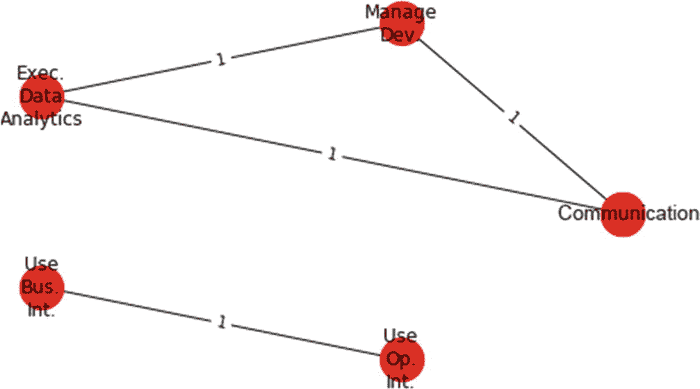

### 从 G 中选出所有参与 'interact' 关系的节点和边，并基于它们创建一个无向图。

```python
H = nx.Graph()
H.add_edges_from((u, v) for u, v, r in G.edges(data='relation') if r == 'interact')
```

#### 附加一个标记，用于指定哪些节点属于哪个组。

```python
for node_id in H.nodes():
    H.node[node_id]['bipartite'] = G.node[node_id]['role'] == 'actor'
nx.relabel_nodes(H, {n: G.node[n]['label'].replace(' ', '\n') for n in H.nodes()}, copy=False)
print("验证 H 是否为二分图：", bipartite.is_bipartite(H))
```

#### 这是一个图投影操作。这里，我们旨在找出哪些用例拥有共同的参与者。权重代表共同性因子。

```python
W = bipartite.weighted_projected_graph(H, [n for n, r in H.nodes(data='bipartite') if r == 0])
```

#### 在底层使用 `matplotlib` 绘制图形。

```python
pos = nx.shell_layout(W)
nx.draw(W, pos=pos, with_labels=True, node_size=800, font_size=12)
nx.draw_networkx_edge_labels(W, pos=pos,
    edge_labels={(u, v): d['weight'] for u, v, d in W.edges(data=True)})
```

```
清单 10-3 模块 `bipartite.py` – 从原始多重图创建二分图
```

NetworkX 并未使用独立的图类型来表示二分图。相反，它使用一种适用于常规图类型的算法。图 10-3 展示了加权投影图。



**图 10-3**

`Application` 参与者使用了图示为三角形的所有三个用例。因此，这三个用例都有一个共同的参与者。另外两个用例则由 `User` 参与者访问。

### 可扩展的图加载

到目前为止，我们纯粹通过代码构建了图。这对于小示例来说没问题，但在现实世界中，你的网络会非常庞大。更好的方法是直接从外部源（例如文本文件或数据库）加载图定义。在本节中，我们将研究如何结合 `Pandas` 和 `NetworkX` 来生成一个其结构保存在 CSV 文件中的图（另请参阅侧边栏“图序列化格式”）。

### 图序列化格式

图通常使用以下主要格式进行序列化：

- **邻接（关联）矩阵**：其结构与我们使用的矩阵非常相似，其中行和列表示节点。在行 `i` 和列 `j` 的每个交叉点，都有一个值 `0`（节点 `i` 和 `j` 之间不存在边）或 `1`（节点 `i` 和 `j` 之间存在边）。你可以在创建新图时将此矩阵作为初始化参数传入。这种矩阵不适合指定额外的节点/边属性，并且非常占用内存。图通常是稀疏的，因此会有很多占据空间的零值。

- **邻接列表**：每个节点对应一行。在一行内，包含邻居节点的标识符。这种格式节省空间，因为只列出了存在的边。孤立的节点则会有一个空行。使用这种格式无法定义额外的属性。`NetworkX` 有一个 `read_adjlist` 方法，用于读取以邻接列表形式保存的图。你可以通过指定 `nodetype` 参数将节点转换为指定的类型。`create_using` 参数是指向所需工厂的指针（例如，你可以强制 `NetworkX` 将图加载为多重图）。文本文件可能包含注释，可以通过为 `comments` 参数传递值来跳过这些注释。

- **边列表**：每一行代表一条边，包含源节点和目标节点的标识符。你可以附加其他项作为边的属性（如权重、关系等）。可以在专门的 `read_edgelist` 方法中为这些属性指定数据类型。请注意，仅凭这种格式无法表示孤立的节点。

- **GraphML**：这是一种全面的标记语言，用于表示各种类型的图（请访问[`http://graphml.graphdrawing.org`](http://graphml.graphdrawing.org)）。`NetworkX` 有一个 `read_graphml` 方法，用于读取以此文件格式保存的图。

我们将准备两个文件：`nodes.csv` 用于存储节点（参见清单 10-4），以及 `edges.edgelist` 用于描述边（参见清单 10-5）。第一个是 CSV 文件，我们将使用 `Pandas` 读取它，以便为节点附加属性。另一个文本文件是带有相应边属性的边列表。清单 10-6 展示了从这些文件加载图的完整代码（参见模块 `load_graph.py`）。`NetworkX` 有一个名为 `from_pandas_dataframe` 的方法，但你无法使用它来分配节点属性（它只支持边属性）。

```python
import networkx as nx
import pandas as pd

G = nx.read_edgelist('edges.edgelist',
    create_using=nx.MultiDiGraph,
    nodetype=int,
    data=(('weight', int), ('relation', str)))

df = pd.read_csv('nodes.csv', index_col=0)
for row in df.itertuples():
    G.node[row.Index]['role'] = row.Role
    G.node[row.Index]['label'] = row.Label

# 生成一份小型报告。
print("节点：\n", G.nodes(data=True), sep="")
print("-" * 20, "\n 边：\n", G.edges(data=True), sep="")
```

```
清单 10-6 – 从 `nodes.csv` 和 `edges.edgelist` 加载图的完整代码
```