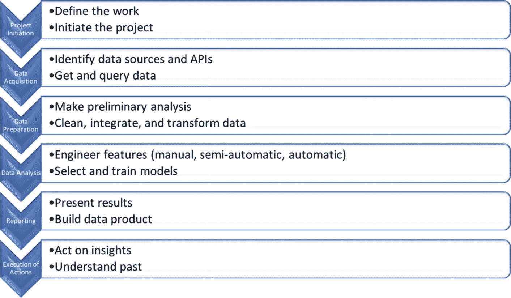
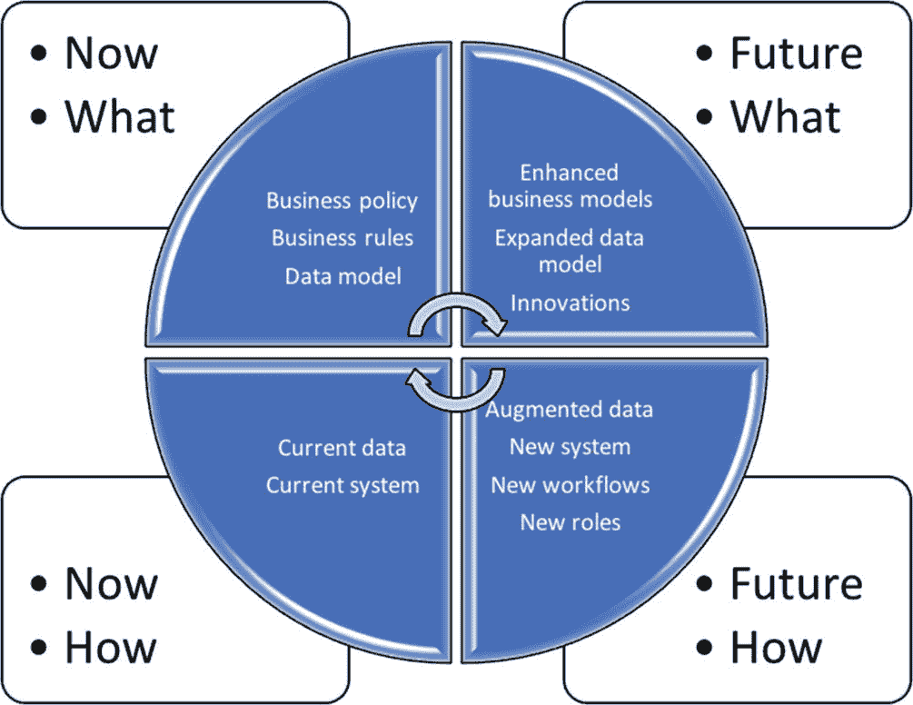
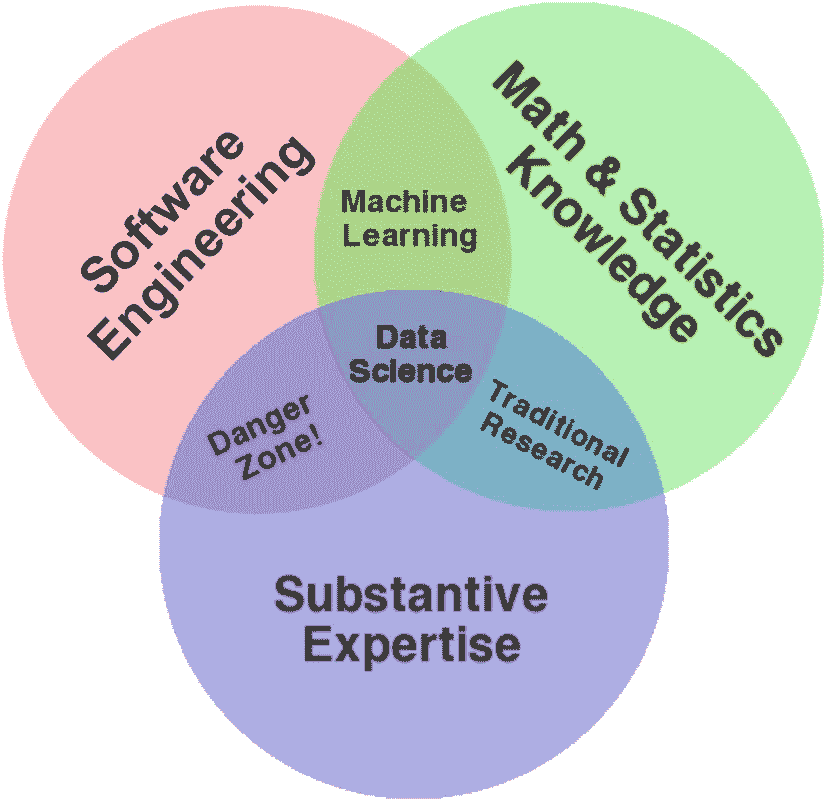
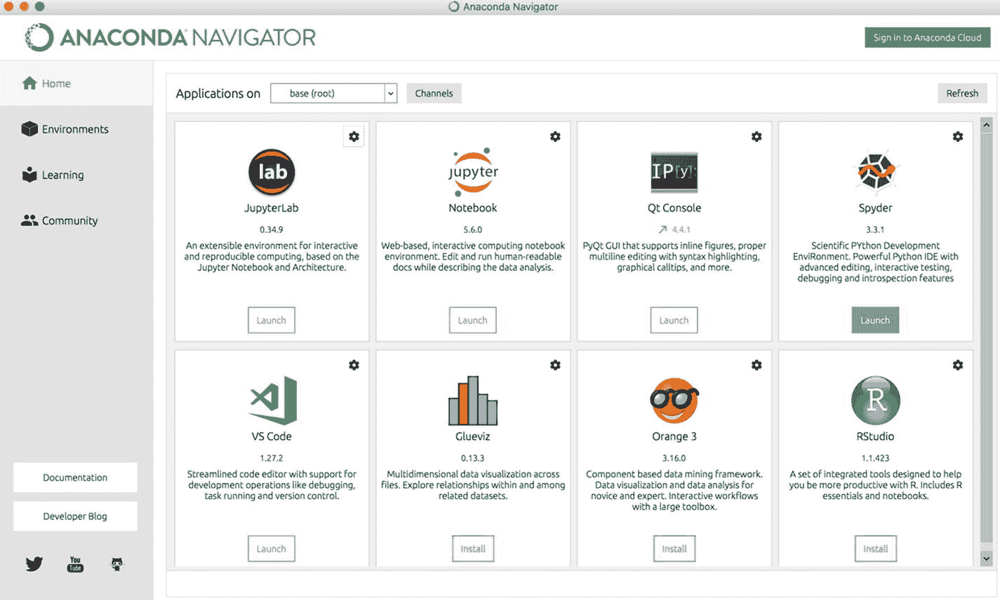
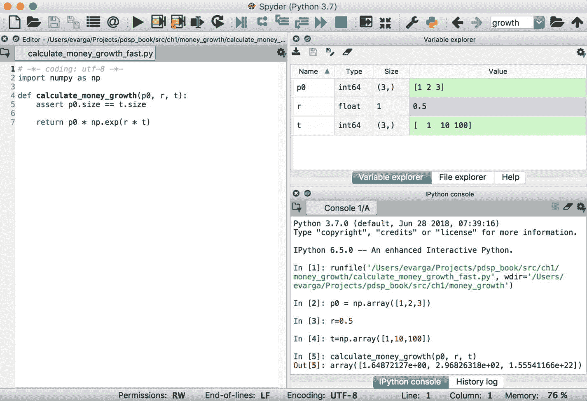

# 1. 数据科学导论

首先，让我在软件工程和数据科学之间做一个类比。软件工程可以概括为将工程原理和方法应用于软件开发，其目标是生产出可靠的软件产品。类似地，数据科学可以描述为将科学原理和方法应用于数据收集、分析和报告，其目标是从数据中合成出可靠且可操作的见解（有时称为`数据产品`）。延续我们的类比，系统/软件开发生命周期（`SDLC`）规定了软件开发过程的主要阶段：项目启动、需求工程、设计、构建、测试、部署和维护。数据科学过程也包含多个阶段：项目启动、数据获取、数据准备、数据分析、报告以及执行行动（另一个“阶段”是数据探索，它更像是一项包罗万象的活动，而非独立的阶段）。与软件开发一样，这些阶段是相互交织的，并且该过程本质上是迭代和增量的。在软件工程和数据科学（以及任何其他迭代和增量工作）中，一个不可或缺的总体活动是回顾，它涉及审查一个项目或过程，以确定哪些是成功的，哪些可以改进。与软件工程的另一个相似之处在于，数据科学也依赖于多维度的团队或团队的团队。一个典型的项目需要领域专家、精通各种技术的软件工程师以及数学家（一个人在不同时间可能扮演不同的角色）。与软件工程的另一个共同点是倾向于自动化（通过大多数活动的可编程性）以提高生产力、可重复性和质量。本章旨在解释关于数据科学的关键概念，并将它们置于恰当的背景中。

## 数据科学项目的主要阶段

图 1-1 展示了数据科学流程的主要阶段。这些阶段不应以瀑布式方式推进（即一个阶段必须结束后才能开始下一个阶段）。相反，一个典型的数据科学项目涉及多次迭代，类似于敏捷软件开发项目。引入“阶段”这一概念，只是为了提醒我们，项目的关注点会随时间从一个阶段转移到另一个阶段。仅看图 1-1 并不明显，但最关键的是项目启动阶段。引用约翰·杜威（《探究理论》，1938 年）的话：

> *有句耳熟能详且意义深远的话说得好：问题提得好，等于解决了一半。*



图 1-1 — 数据科学项目的主要阶段

来自 Volere 需求工程方法的布朗牛模型是解释项目启动阶段的有用资源（参见本章末尾“参考文献”部分的参考文献[1]）。图 1-2 展示了该模型的一个改编版本，描绘了数据科学项目启动时发生的情况。仅仅因为我们有一些数据可以摆弄，并不自动证明一个完整的项目是合理的。重要的是要正确定义问题，评估情况（风险、资产、资源、应急方案），并描述目标，包括评估标准。我们必须最终形成表述清晰的研究问题，并对实施细节有良好的把握。整个努力必须以全局观来审视。起点必须与终点相连，而终点则必须引发进一步的探究。



图 1-2 — 适用于数据科学项目的布朗牛模型改编版

布朗牛模型包含四个部分：*如何*处理解决方案空间，*什么*涉及问题空间，*当下*表示当前状况，而*未来*描述期望状态。每个部分指定了一个特定的视角，这有助于避免利益相关者之间的混淆。布朗牛模型包含一个系统化的流程，用于从当前状态过渡到未来状态，同时满足项目关键利益相关者的利益。没有他们的全球共识，很难判断最终数据产品的成功与否。下一节将通过一个案例研究来说明这个模型。

### 布朗牛模型案例研究

你可能会想，数据科学是不是地平线上新出现的热潮。如果你结合上一节第一段的内容来审视这个问题，你可能会得出结论：它根本不新鲜。现代流行病学之父约翰·斯诺博士就曾出色地应用了数据科学。他关注的研究与 1854 年伦敦的一次霍乱爆发有关（更多详情见“参考文献”部分的[2]）。他完全遵循了数据科学流程，如下所述（数字 1 和 2 表示产生重要里程碑的增量阶段）：


图 1-3 — 斯诺的原始地图。黑色条块表示死亡案例。黑色圆点表示水泵。死亡案例围绕宽街水泵的聚集现象显而易见。

*   **项目启动**：根据疾病的症状（呕吐和腹泻），斯诺博士正确推测，这一定是由人们摄入的食物或水所携带的感染引起的。当时盛行的公众观点是霍乱通过难闻的气味传播（即瘴气理论）。根据布朗牛模型，“当下-如何”是现有的死亡登记以及对霍乱根本原因的完全困惑。“当下-什么”是关于疾病如何传播的普遍错误理论（以及捂住口鼻的无效规则）。“未来-什么”是关于可能引起霍乱的新理论。“未来-如何”是建立受污染水源与霍乱之间因果关系的逐步程序，以及关于应立即采取什么下一步行动的明确建议。同样重要的是要指出，这一发现为进一步研究霍乱开辟了可能性，最终导致了相关细菌的发现。

*   **数据工程 1（获取、准备和探索）**：斯诺记录了伦敦苏荷区（疫情起源地）周边每个死亡案例的位置，并将所有信息标注在一张地图上（如图 1-3 所示）。他还在地图上标记了水泵的位置，以便识别模式。这是一个将可视化与原始表格数据并行使用的绝佳例子；然而，作为一项活动，探索渗透在数据科学流程的所有阶段。

*   **数据分析 1**：在斯诺仔细检查了每一个案例（包括重要的异常值）之后，他建立了死亡案例与宽街水泵之间的强相关性。他保持谨慎，在此阶段没有急于确立因果关系。这是将科学技能应用于数据处理的一个绝佳范例（网络上充斥着将相关性误用为因果关系的尴尬故事）。

*   **回顾**：第一个里程碑为第二部分提供了基础。^(¹) 斯诺重新审视了原始计划，并准备了下一阶段来回答他最初的研究问题。他需要进行一项随机对照实验（确凿达到因果关系的最佳方式），并且必须使用比较的方法。在随机实验中，参与者被分为两组：处理组（例如，那些喝了受污染水的人）和对照组（例如，那些未暴露于感染的人）。比较方法旨在寻找所施加的处理与观察到的结果之间的关联。各组系统性地仅在作为分隔标准的单一特征上存在差异，这一点非常重要。在斯诺的案例中，这个特征就是这些类别的人群所获得的水源供应。幸运的是，有两个供水商，他们的顾客除了水源供应外，在其他任何方面都不是一边倒地存在差异。一家供应商从污水排放点的上游输送清洁水，而另一家则从下游抽取受污染的水。这些组是自然随机化并形成的。

## 数据工程、分析与报告

- **数据工程 2**：斯诺收集了伦敦更大区域内由这些供水商覆盖的所有霍乱病例的雪数据。

- **数据分析 2**：经过仔细分析，很明显人们是由于饮用受污染的水而生病的。正是此时，斯诺能够有把握地宣称受污染的水传播感染与霍乱之间存在因果关系。

- **报告**：斯诺准备了一份详细的表格，显示两组人群的死亡率。治疗组的死亡率是对照组的十倍，因此他对自己的结论充满信心。

- **行动**：当局拆除了宽街水泵的把手以防止进一步感染，这一举措被证明是有效的。此项研究之后开展了进一步的调查和行动。

显然，这是一个来自 19 世纪的引人注目的数据科学项目。那么，为什么数据科学在今天会成为如此热门的话题呢？答案隐藏在该学科的名称本身（数据科学）之中。它之所以再次流行，是因为由大数据所体现的截然不同的数据以及随之而来的复杂问题空间（另见边栏“大数据需要数据科学家”）。在过去，数据相对稀缺，数据管理解决方案也昂贵得多。今天，我们面临一种数据泛滥现象，约翰·奈斯比特对此有如下精辟评论：“我们淹没在信息中，却饥渴于知识。”

## 大数据需要数据科学家

大数据（将在下一节中介绍）指的是规模难以想象的数据。一个类比可以帮助你理解为什么在设计大数据系统时需要数据科学家，这就像设计一座建筑。如果你想设计自己的房子，你也许可以自己绘制平面图（或在网上找一个）交给建筑商；你不需要成为建筑师。将其放大到设计一栋多层公寓楼，那么你必须是一名持证建筑师，但你可以依靠现有的资源和工具来完成设计。

最后，如果你受雇设计世界上最高的摩天大楼，或在海中的人工岛上建造公寓，那么你不仅要是一名持证建筑师，还必须拥有非凡的知识和经验，应用非常规的方法，并设计独特的工具。设计一个大数据系统类似于设计一座摩天大楼，需要拥有广博知识和经验的数据科学家。

### 大数据

大这个概念有多个维度。在大数据领域，这被概括为四个 V：

-   **体量（Volume）** 指的是数据的绝对数量。假设海量数据无法装入单台机器（甚至无法存入磁盘，更不用说内存），因此数据必须分布在数十台联网的机器上。这带来了各种与分布式计算相关的问题，而这些问题在单机情况下是不存在的。

-   **多样性（Variety）** 指数据以多种方式组织这一特性。在经典设置中，我们假设数据是结构良好的，其模式有恰当文档记录。这类数据通常存在于关系型数据库中。对于大数据，我们还必须处理非结构化和半结构化的形式。尽管如此，所有数据最终都需要以统一的方式对齐和管理。

# 大数据的维度

-   **速度（Velocity）** 决定了数据变化的节奏（新数据的到达、现有数据的更新和数据的删除）。除了处理静态数据，很多时候我们必须实时处理数据变化以避免任何数据丢失。这种数据管理被称为*流处理*。数据流可能会到达一个先前使用历史数据训练过的系统，而这种数据组合（历史数据+实时数据）有时被称为*可操作信息*。

-   **真实性（Veracity）** 关乎数据的可信度。当我们整合不同的数据源时，必须处理不准确、不完整和被误用（有时是恶意）的数据。

所有这些 V 都需要新颖的方法、算法和技术。同时，所需软件系统的复杂性和规模也变得更大。这些是数据科学引起研究界和工业界如此关注的主要原因。下面的例子说明了这些维度。

## 大数据示例：MOOC 平台

大规模开放在线课程（MOOC）是通过 MOOC 平台向庞大的全球社区提供的在线课程。一些最受欢迎的平台包括 `Coursera`、`edX`、`Udacity`、`Khan Academy` 和 `Stanford Online`。（大多数课程是免费的，但有些需要付费。）在 MOOC 平台之上生成可操作的洞察属于大数据问题空间。表 1-1 展示了斯诺医生的霍乱项目与基于 MOOC 数据生成平台的数据科学项目在大数据的四个 V 方面的差异。

**表 1-1** 从大数据角度看新旧数据科学项目的差异

|         | 斯诺的项目                                                                                                                       | 基于 MOOC 平台的项目                                                                                                                                                                                              |
| :------ | :------------------------------------------------------------------------------------------------------------------------------- | :---------------------------------------------------------------------------------------------------------------------------------------------------------------------------------------------------------------- |
| **体量** | 受到影响的总人口规模较小，可由单个人追踪。                                                                                           | 一个平台可能托管数百门课程，每门课程可能拥有数千名学生。一门课程由多媒体材料以及参与者创建的内容（相关讨论区的评论、考试答案、作业提交等）组成。仅存储数据，就需要一个巨大的分布式文件系统。                               |
| **多样性** | 数据被明确定义为一组由霍乱导致的死亡地点。                                                                                             | 存在各种类型的数据：结构化的课程材料、非结构化的讨论区内容以及半结构化的作业提交（仅举几例）。                                                                                                                 |
| **速度** | 死亡案例的发生率足够低，可以由一个人追踪（包括可视化工作）。                                                                             | 系统承受着用户异常大量的活动。追踪他们的行为、提供课程内容以及评估考试/作业都需要强大的云基础设施。                                                                                                                 |
| **真实性** | 数据绝对可靠。                                                                                                                       | 在讨论区，你可以找到各种各样的评论。为了给混乱带来秩序，学生可以对帖子进行点赞或点踩，课程工作人员也会发表评论（有时仅仅是为了支持学生的观点）。还有关于如何命名新主题、如何避免重复、如何礼貌行事等的指南。 |

你可能想阅读《视频制作如何影响学生参与度：一项关于 MOOC 视频的实证研究》（见参考文献[3]），这是一份从 MOOC 数据中归纳出通用见解的极佳入门读物（它探索了讲座视频的最佳时长范围）。研究人员追踪了 `edX` 平台上的 862 个 MOOC 视频、超过 12 万名学生以及 690 万次视频观看会话。现在，将这个基于 MOOC 的项目与一个更大的系统之系统进行比较。例如，大型强子对撞机（LHC）是当今最大的数据生产设施。如果将 MOOC 平台比作设计一个结构，那么 LHC 无疑是一个布满昂贵房屋的人工棕榈岛。LHC 设施目前进行的四个实验中的每一个每秒都会产生数千吉字节的数据，每年累计约为 15 拍字节的数据。另一个数据巨兽是物联网（IoT），你可以查阅参考文献[4]了解更多细节。

# 如何学习数据科学

这是数据科学的一个基本话题，因为在各个层面（领域、技术、算法、编程语言等）上持续学习并结合实践，正是这一职业的标志。学习数据科学意味着通过学习、指导和经验，获得对数据科学的知识和理解。有一句古老的中国谚语强调了获取知识相较于纯粹消费的优势：“授人以鱼，不如授人以渔。”这也正是我们在数据科学中努力追求的目标：我们不能仅仅生吞活剥当前的事实，而是要为未来综合知识。

数据科学包含三个相互关联的核心能力领域：领域知识、数学（包括概率论和统计学）以及软件工程。这三者可以很方便地用维恩图来展示，尽管自 Drew Conway 在 2010 年提出原始版本以来，已经出现了无数种变体（你可以在参考文献 [6] 中读到一篇关于这些变体的有趣文章）。大多数人只在某一个特定领域非常擅长，但只要他们在另外两个领域也足够扎实，那就没有问题。请记住，数据科学围绕团队协作展开，这意味着在多个层面的沟通能力至关重要。例如，你必须能够用领域的语言与重要的利益相关者及项目中的其他团队成员进行恰当沟通。为了更具体地阐述这一点，我将给出两个例子：如何获取领域知识以及如何获取编程技能（另见参考文献 [5]）。



## 领域知识的获取——示例

在本节中，我将分享我获取领域知识的策略。我最初是以软件工程师的身份进入数据科学领域的，而作为一个职业，软件工程本身也包含领域理解和数学。尽管如此，数据科学需要对这些领域有不同类型的熟悉程度。除了能够促进有效沟通之外，对领域的深入理解对于以下任务（所有这些都与数据质量问题相关）也是必不可少的：

*   修剪异常值（与数据集其余部分不一致的数据点）
*   删除不完整的观测值
*   用估计值（例如，使用特征的均值）替换不完整观测值的某些部分
*   移除重复项（例如，通过合并记录）

仅仅简单地删除缺失值是不够的。有时，盲目删除数据可能会完全扭曲结果。在进行此类数据清理之前，你必须基于领域知识做出明智的判断。

假设你是金融和银行领域的新手。你接到的任务是实现一个计算资金增长的功能。输入是银行的初始存款（本金投资）*P*[0] 和年利率 `r`（假设它是介于 0 和 1 之间的小数）。该银行使用连续复利。你还注意到一个方便的计算公式：`P = P[0] * e^(rt)`，其中 `t` 是以年为单位的时间。最终金额是 `P`（参见练习 1-2）。很简单，对吧？

你应该抵制住诱惑，不要在理解所有底层术语和机制之前就立即开始编写代码。像这样剖析公式，是深入探究底层原理并理解部分领域的最佳方式（至少根据我的经验是如此）。以下是文中提到的与领域相关的术语：

*   利率
*   年利率
*   复利
*   连续复利
*   最终公式中的数学常数 `e`

利率是当前金额需要增加的百分比。如果我们从 `P[0]` 开始，那么最终会得到 `P[1] = P[0] + P[0] * r = P[0] * (1 + r)`。年利率就是使用上述方程一年后得到的结果。复利依赖于之前累积的金额。因此，两年后我们将有 `P[2] = P[1] + P[1] * r = P[1] * (1 + r) = P[0] * (1 + r)^2`。注意 `P[2]` 是如何间接依赖于 `P[0]` 的。如果一家银行每年多次应用这种复利（比如频率为 `n`），那么我们将使用 `r/n` 作为每次的利率，并连续应用 `n` 次。总而言之，这将得到 `P1 = P0 * (1 + r/n)^n`。最后，复利的连续变体是当我们令 `n` → ∞ 时的情况。

此时，我们必须提醒自己，从微积分中我们知道 `lim (n→∞) (1 + 1/n)^n = lim (t→0) (1 + t)^(1/t) = e`。因此，在代入 `t = 1/(n/r)` 且 `t → 0` 后，我们得到 `lim (n→∞) (1 + r/n)^n = e^r`。如果在 `t` 年内重复这种复利计算，那么我们就得到了最初给定公式中的项。

这种剖析公式和研究术语的技巧，是我在学习新领域时一直使用的方法。一旦你掌握了某个领域的所有概念和词汇，就可以接受那些公式了。在此之前，尽量将领域中任何对你来说新颖的描述拆解成各个组成部分，然后逐一分析。

### 注意

如果你决定使用支持向量机（`SVM`），那么你应该先阅读什么是核方法和核技巧。同样地，在你尝试主成分分析（`PCA`）之前，先阅读关于特征向量、特征值和标准正交基的内容。仅仅因为某个特定的机器学习方法返回了积极结果，你就轻易说服自己取得了一些“了不起”的成就，这太容易了。

## 编程技能的获取——示例

假设你拥有很强的领域知识，但缺乏足够的 Python 编程经验。你最终可能会得到如代码清单 1-1 所示的解决方案（针对上一节中的同一个问题）。我们假设该函数需要处理一个包含不同时间段金额的完整列表。

```python
import math
def calculate_money_growth(p0, r, t):
    # 最终金额列表。
    p = []
    for i in range(len(p0)):
        p.append(p0[i] * math.exp(r * t[i]))
    return p
```

测试将包括使用 `p0 = [1, 2, 3]`、`r = 0.5` 和 `t = [1, 10, 100]` 来调用该函数。在看到预期的输出 `[1.6487212707001282, 296.8263182051532, 1.5554116585761217e+22]` 后，任务将被标记为完成。当然，对于这个微型数据集，一切似乎都很完美。然而，当处理海量数据时，这种方法无法扩展。为了完整性起见，代码清单 1-2 展示了利用 NumPy 的改进版本。请注意代码的简洁性和表达力；它不言自明。它还采用了一种基本的防御性编程元素。

# 基础编程知识与数据科学框架

```python
import numpy as np

def calculate_money_growth(p0, r, t):
    assert p0.size == t.size
    return p0 * np.exp(r * t)
```

仅仅掌握基本的编程知识是不够的。你必须熟悉适用于 Python 的高效且强大的数据科学框架和技术。这些才是解决大数据问题的真正利器。在本书中，我们将看到许多此类框架的实际应用。

## 注意事项

首先，你至少需要精通基于 Python 的数据科学生态系统 `SciPy`。此外，随着代码复杂度的增加，你还需要了解创建可维护解决方案的原则、规则和技巧。例如，如果你从未听说过`防御性编程`，那么是时候提升你的软件工程技能了。如果 `p0` 和 `t` 的长度不同，上述情况会发生什么？在哪里检查这些长度？

## Anaconda 生态系统概览

`Anaconda Distribution` 是一个免费的生态系统（包含一个完善的包和环境管理器），内含预打包的 Python 科学计算和数据科学库。你可以访问 [`https://www.anaconda.com/distribution`](https://www.anaconda.com/distribution) 为你的操作系统下载最新版本。还有一个付费的企业版，但我们将使用免费的社区版本。在撰写本文时，当前版本是 5.3，附带 Python 3.7。你可能想先访问 [`https://docs.anaconda.com`](https://docs.anaconda.com) 的文档。

还有 `Miniconda` 发行版，它只包含最基本的 Python 环境。我们将使用完整发行版，因为我们需要许多捆绑包。如果你想更好地控制安装内容以节省空间，`Miniconda` 是个不错的选择。

成功安装后，启动 `Anaconda Navigator`，这是一个用于管理环境和启动应用程序的仪表板。点击 `Spyder` 的 **Launch** 按钮，如图 1-4 所示。


图 1-4 `Anaconda Navigator` 主页，选中了 Spyder 的 **Launch** 按钮

`Spyder` 是一个成熟的科学 Python 集成开发环境（IDE）。它使用内部的 `IPython` 实例在编辑器中执行代码，并支持交互式计算。图 1-5 展示了用户界面（UI）的布局。


图 1-5 包含三个主要区域的 Spyder UI

编辑器位于左侧，选项卡式的资源管理器组件位于右上方面板（`变量`资源管理器如图 1-5 所示），IPython 控制台位于右下面板，其中包含用于运行我们的快速货币增长计算器的表达式。在我点击工具栏上的 **Run** 按钮（绿色大箭头）后，`runfile` 由 Spyder 自动生成。

如果你成功运行了货币增长计算器（点击工具栏上的 **Open Folder** 按钮选择并加载一个文件）或在 IPython 控制台中计算了任何表达式，那么一切设置正确。你还可以通过运行配置了断点的代码，尝试使用内置的调试器（请参阅 **Debug** 菜单，左侧第一个蓝色按钮）。

## 管理包和环境

`conda` 是用于管理 Anaconda 中包和环境的命令行工具。你应该使用它来代替 `pip`（用于管理标准 Python 包）和 `virtualenv`（用于创建隔离的 Python 环境）。以下是交互式会话的转储，显示了 `base (root)` 环境中的前几个包（观察图 1-4，Spyder 是从这个环境启动的，如其“Applications on”字段所示）：

```
In [6]: packages = !conda list
In [7]: packages
Out[7]:
['# packages in environment at /Users/evarga/anaconda3:',
'#',
'# Name                    Version             Build  Channel',
'_ipyw_jlab_nb_ext_conf    0.1.0              py37_0  ',
'alabaster                 0.7.11             py37_0  ',
'anaconda                  5.3.0              py37_0  ',
'anaconda-client           1.7.2              py37_0  ',
'anaconda-navigator        1.9.2              py37_0  ',
'anaconda-project          0.8.2              py37_0  ',
'appdirs                   1.4.3      py37h28b3542_0  ',
'appnope                   0.1.0              py37_0  ',
'appscript                 1.0.1      py37h1de35cc_1  ',
'asn1crypto                0.24.0             py37_0  ',
```

第一行（粗体）展示了一种在 IPython 会话中直接运行 shell 命令并捕获其输出的简便技术。我使用了 `list` 命令来枚举所有包（Python 包的中心枢纽可通过 [`https://pypi.org`](https://pypi.org) 访问）。要查看可用的 `conda` 命令列表，只需运行 `!conda help`（如果从终端窗口执行 `conda` 命令，请省略感叹号）。

快速货币增长计算器使用了 `numpy` 包，该包已预装在我的基础环境中。如果你没有这个包，请使用 `conda` 工具安装它。现在，你的解决方案可能依赖于某一特定组合的包，但无法在另一台用户的机器上运行（即使那里也存在所有包）。也就是说，每个包都有特定的版本，不同版本之间可能存在不兼容性。手动确保每个应用程序都使用所需的一组包运行是一项艰巨的任务。这就是为什么 `conda` 有`环境`（environment）的概念。你可以将其视为一个唯一命名的命名空间，它将一组包与其他包隔离开来。

你可以在 Anaconda Navigator 中管理环境（选择左侧面板中的 **Environments**，如图 1-4 所示）或从命令行（使用 `conda` 工具）进行管理。我将直接使用该工具。要查看与环境相关的可用操作，请在 shell 中（在你的操作系统上打开一个终端窗口）运行 `conda env --help` 和 `conda create --help`。首先，我将列出我机器上现有的环境：

```
[~]$ conda env list
#### conda environments:
#
base                  *  /Users/evarga/anaconda3
```

我将创建一个名为 `test` 的新环境，使用 Python 3.7，并验证它确实已创建：

```
[~]$ conda create --name test python=3.7
[~]$ conda env list
#### conda environments:
#
base                  *  /Users/evarga/anaconda3
test                     /Users/evarga/anaconda3/envs/test
```

星号标记当前激活的环境（在此例中是 `base`）。`test` 环境仅包含 Python 3.7 及其关联的包；让我们看看这些包是什么（注意 `numpy` 不存在）。

```markdown
# 环境管理与数据科学工作流

## 环境列表与激活

```bash
[~]$ conda list --name test
```

#### 环境中的包位于 /Users/evarga/anaconda3/envs/test:

| 名称                     | 版本               | 构建        | 渠道 |
| ------------------------ | ------------------ | ----------- | ---- |
| ca-certificates           | 2018.03.07         | 0           |      |
| certifi                   | 2018.8.24          | py37_1      |      |
| libcxx                    | 4.0.1              | h579ed51_0  |      |
| libcxxabi                 | 4.0.1              | hebd6815_0  |      |
| libedit                   | 3.1.20170329       | hb402a30_2  |      |
| libffi                    | 3.2.1              | h475c297_4  |      |
| ncurses                   | 6.1                | h0a44026_0  |      |
| openssl                   | 1.0.2p             | h1de35cc_0  |      |
| pip                       | 10.0.1             | py37_0      |      |
| python                    | 3.7.0              | hc167b69_0  |      |
| readline                  | 7.0                | h1de35cc_5  |      |
| setuptools                | 40.4.3             | py37_0      |      |
| sqlite                    | 3.25.2             | ha441bb4_0  |      |
| tk                        | 8.6.8              | ha441bb4_0  |      |
| wheel                     | 0.32.0             | py37_0      |      |
| xz                        | 5.2.4              | h1de35cc_4  |      |
| zlib                      | 1.2.11             | hf3cbc9b_2  |      |

如果你想使用 `test` 环境，必须通过执行 `conda activate test` 来激活它。如果这样做，你会发现 Spyder 不再出现在 Anaconda Navigator 中（它会显示为可供安装状态）。现在你可以通过 `conda install` 向其中安装包来定制这个环境。你也可以通过指定 `--name` 命令行选项来定制一个被动环境。要停用一个已激活的环境，请执行 `conda deactivate`。要移除我们的 `test` 环境，请使用 `conda env remove --name test`。

拥有自定义环境的最大优势在于，你可以将其导出到一个文件中，并将其纳入版本控制（与你的项目一起）。其他人以后可以通过使用这个文件来重新创建你的环境。我建议查阅 `conda` 速查表（参见 [conda 速查表](https://docs.conda.io/projects/conda/en/latest/user-guide/cheatsheet.html)）以获取执行最常见任务的建议。

### 注意

如果你尝试安装一个新包并收到错误，通常可以通过运行 `conda update conda` 将 `conda` 更新到当前版本来解决问题。之后，你应该重试安装。

### 提示

注意不要通过克隆现有环境来创建新环境。确保你的自定义环境不会变得臃肿，这是你需要避免的。

### 共享与复现环境

数据科学注重协作与团队合作。当然，即使在单人项目中，环境也有帮助；它能让你更好地控制包，从而避免无意中搞乱一个正常工作的设置。然而，当他人需要忠实地复现你的工作时，环境的真正威力才会显现。`conda` 工具在此处可以派上用场。

一旦你对环境感到满意，就可以通过输入以下命令将其持久化到一个文件中：

```bash
conda env export --name SOME_ENVIRONMENT --file SOME_FILE
```

如果省略环境名称，则会保存当前激活的环境。通常，你会使用 `environment.yml` 作为目标文件（这是一种默认名称）。此文件应与项目中的其他所有文件一起纳入版本控制。任何拥有此文件的人都可以通过执行以下命令轻松地重新创建你的环境：

```bash
conda create --name SOME_ENVIRONMENT --file SAVED_ENV_FILE
```

你可以通过多种方式共享 Anaconda 特定文件（如笔记本、环境等）。Anaconda Cloud 是一个可行的选择。它允许你共享包、环境、笔记本，甚至整个项目。后者仍处于实验阶段（至少在撰写本文时，`anaconda-project` 包就是这样），但能实现项目设置的全自动化。

## 练习

### 练习 1-1\. 数据科学家的特质

假设你必须证明或反驳这样一个论断：存在整数 `m` 和 `n`，使得 `m`² + `m`*`n` + `n`² 是一个完全平方数（关于数学推理的绝佳介绍，请参见参考文献 [7]）。你会如何着手？（提示：在写一行 Python 代码之前，请三思。）

另一种情况是，你被要求编写一个函数，以最高精度对输入的浮点数组元素求和。你可以忽略性能影响。什么是最佳方法？如果你成功解决了问题，请尝试解释该函数为何如此表现。你是否曾好奇过舍入误差是如何产生的？Python 中的 `float` 数据类型是如何表示的？

数据科学家必须具备良好的分析能力、创造力、常识，并培养提出“为什么？”问题的倾向。

### 练习 1-2\. 命名的抽象

下面的描述及相关代码使用了奇怪的名称 `P`[0] 和 `P`。在金融领域，这些值有既定术语：现值 (PV) 和未来值 (FV)。请修改相关的货币增长计算器，改用这些既定术语。你同意这个简单的操作提高了可理解性吗？

检查你的设计是否合理的最佳方法之一是查看抽象的命名。所有抽象都必须有有意义的名称。否则，你应重新考虑代码的结构。不要将命名视为无关紧要的事（你的代码将由人来阅读和维护）。

## 总结

数据科学是一个高度协作的领域，遵循迭代和增量的流程。该流程包含许多阶段，例如规划、数据工程（采集、预处理、探索）、计算数据分析、报告以及执行行动。其目标要么是从数据中生成可执行的洞察，要么解释过去的现象（也称为根本原因分析）。数据科学家在整个项目中可能扮演不同角色，并且应该具备足够的领域知识、数学和软件工程技能。Python 是数据科学中备受喜爱的语言，因为它提供了强大的框架（此外，它也是一种现代且灵活的编程语言，支持面向对象和函数式两种风格）。

Anaconda 是开发数据科学解决方案的推荐生态系统。它将所有必要的应用程序（如 JupyterLab、Spyder、Glueviz、Orange 3 等）、工具（如 `conda` 管理器）和数据科学包整合到一个连贯的系统中。Anaconda 还提倡多语言编程范式，允许你用多种编程语言实现项目组合中的各个部分。它还通过支持复杂的包和环境管理，解决了构建可复现解决方案的常见问题。
```


