# 为 'interact' 关系添加边。
9 0 1 interact
0 9 1 interact
10 1 1 interact
1 10 1 interact
10 2 1 interact
2 10 1 interact
11 3 1 interact
3 11 1 interact
11 4 1 interact
4 11 1 interact
0 10 1 interact
10 0 1 interact
```

清单 10-5 – `edges.edgelist` 以标准边列表格式存储边


```
Id,Role,Label
0,use-case,Communicate
1,use-case,Manage Dev.
2,use-case,Exec. Data Analytics
3,use-case,Use Bus. Int.
4,use-case,Use Op. Int.
5,use-case,Send/Receive Data
6,resource,Network
7,resource,Messaging
8,resource,Database
9,actor,Device
10,actor,Application
11,actor,User
清单 10-4
包含正确标题行的 nodes.csv 文件内容
```

运行此文件将产生以下报告，确认所有内容已正确加载：

```
Nodes:
[(0, {'role': 'use-case', 'label': 'Communicate'}), (6, {'role': 'resource', 'label': 'Network'}), (7, {'role': 'resource', 'label': 'Messaging'}), (1, {'role': 'use-case', 'label': 'Manage Dev.'}), (2, {'role': 'use-case', 'label': 'Exec. Data Analytics'}), (8, {'role': 'resource', 'label': 'Database'}), (3, {'role': 'use-case', 'label': 'Use Bus. Int.'}), (4, {'role': 'use-case', 'label': 'Use Op. Int.'}), (5, {'role': 'use-case', 'label': 'Send/Receive Data'}), (9, {'role': 'actor', 'label': 'Device'}), (10, {'role': 'actor', 'label': 'Application'}), (11, {'role': 'actor', 'label': 'User'})]

Edges:
[(0, 6, {'weight': 600, 'relation': 'impact'}), (0, 7, {'weight': 600, 'relation': 'impact'}), (0, 5, {'weight': 1, 'relation': 'include'}), (0, 9, {'weight': 1, 'relation': 'interact'}), (0, 10, {'weight': 1, 'relation': 'interact'}), (1, 6, {'weight': 15, 'relation': 'impact'}), (1, 5, {'weight': 1, 'relation': 'include'}), (1, 10, {'weight': 1, 'relation': 'interact'}), (2, 7, {'weight': 100, 'relation': 'impact'}), (2, 8, {'weight': 900, 'relation': 'impact'}), (2, 5, {'weight': 1, 'relation': 'include'}), (2, 10, {'weight': 1, 'relation': 'interact'}), (3, 8, {'weight': 800, 'relation': 'impact'}), (3, 2, {'weight': 1, 'relation': 'extend'}), (3, 11, {'weight': 1, 'relation': 'interact'}), (4, 8, {'weight': 960, 'relation': 'impact'}), (4, 2, {'weight': 1, 'relation': 'extend'}), (4, 11, {'weight': 1, 'relation': 'interact'}), (9, 0, {'weight': 1, 'relation': 'interact'}), (10, 1, {'weight': 1, 'relation': 'interact'}), (10, 2, {'weight': 1, 'relation': 'interact'}), (10, 0, {'weight': 1, 'relation': 'interact'}), (11, 3, {'weight': 1, 'relation': 'interact'}), (11, 4, {'weight': 1, 'relation': 'interact'})]
```

您还可以通过调用`nx.non_edges(G)`来遍历图`G`中不存在的边。返回节点`n`在图`G`中的非邻居的类似函数是`nx.non_neighbors(G, n)`。

## 社交网络

描述社交网络的方法有很多种，但我们在本节中假设：*社交网络* 指的是任何人群网络，其中个体特征和关系对于理解现实世界的动态都至关重要。在数据科学中，我们希望从数据中产生可操作的见解。故事总是始于一个引人入胜的问题。为了推理现实并回答这个问题，我们需要一个模型。事实证明，将人表示为节点，将其关系表示为图中的边，是一个可行的模型。有许多指标可以评估图的各种属性（包括局部和全局）。从中我们可以推断出必要的规则并综合知识。此外，图的度量可以用作机器学习系统中的特征（例如，基于训练数据集中已知事实预测新链接的创建）。

清单 10-7 展示了一个简单的脚本，用于可视化来自图集的一个人工图（参见参考文献[2]），并呈现一些距离和中心性度量。关于图论的全面讲解，请阅读参考文献[3]和[4]。`NetworkX`的文档是关于度量的额外信息的极好来源（请参阅有关算法的部分，您将在其中找到关于各种度量的子章节）。

```
import pandas as pd
import networkx as nx
from networkx.generators.atlas import graph_atlas
import matplotlib.pyplot as plt
G = graph_atlas(681)
### Visualize the graph using the draw_networkx routine.
plt.figure(figsize=(5,5))
nx.draw_networkx(G, node_size=700)
plt.axis('off')
plt.tight_layout();
plt.show()
### Create a data frame to store various centrality measures.
df = pd.DataFrame(index=G.nodes())
df['lcc'] = pd.Series(nx.clustering(G))
df['eccent'] = pd.Series(nx.eccentricity(G))
df['deg-cent'] = pd.Series(nx.degree_centrality(G))
df['clos-cent'] = pd.Series(nx.closeness_centrality(G))
df['btwn-cent'] = pd.Series(nx.betweenness_centrality(G, normalized=True, endpoints=False))
print(df)
print('\nAverage clustering coefficient:',
nx.average_clustering(G))
print('Transitivity:', nx.transitivity(G))
print('Radius:', nx.radius(G))
print('Diameter:', nx.diameter(G))
print('Peripherial nodes:', nx.periphery(G))
print('Central nodes:', nx.center(G))
清单 10-7
模块 artificial_network.py，演示一些局部和全局图度量
```

以下是此程序产生的文本输出，图 10-4 显示了结果图：

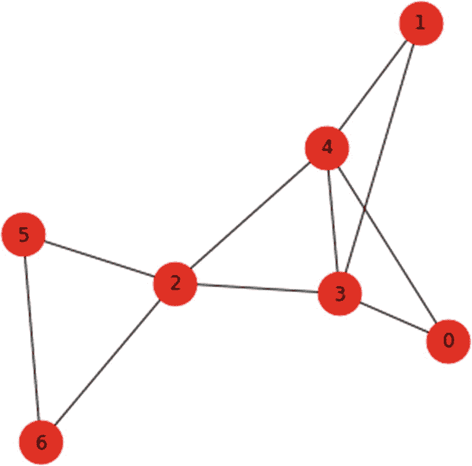

图 10-4

显然，您不能仅依赖单个度量来决定图的某个方面。

```
lcc  eccent  deg-cent  clos-cent  btwn-cent
0  1.000000       3  0.333333       0.50   0.000000
1  1.000000       3  0.333333       0.50   0.000000
2  0.333333       2  0.666667       0.75   0.533333
3  0.500000       2  0.666667       0.75   0.233333
4  0.500000       2  0.666667       0.75   0.233333
5  1.000000       3  0.333333       0.50   0.000000
6  1.000000       3  0.333333       0.50   0.000000
平均聚类系数: 0.761904761904762
传递性: 0.5454545454545454
半径: 2
直径: 3
外围节点: [0, 1, 5, 6]
中心节点: [2, 3, 4]
```

例如，节点 2、3 和 4 都具有相同的中介中心性。尽管如此，介数中心性优先考虑节点 2，因为它在网络中位于更多最短路径上。通过明智地选择和组合不同的度量，您可以得出良好的网络指标。


节点的*局部聚类系数*（`LCC`）表示该节点邻居之间相互连接的对数所占的比例。节点 2 的`LCC`为：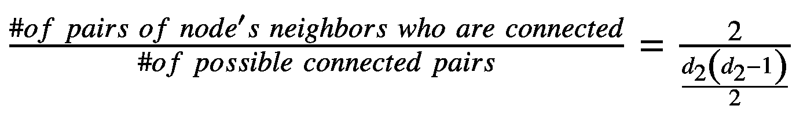 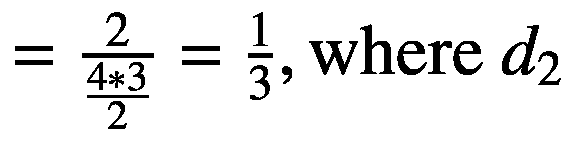 是节点 2 的度数。`LCC`体现了人们形成聚类的倾向；换言之，如果两个人之间存在连接，那么他们也倾向于相互连接（也称为*三元闭包*）。

节点 2、3 和 4 被认为是中心节点，因为它们到其他任意节点的最大最短路径（在我们的衡量标准中，即路径中的跳数）等于网络的半径。图的半径是所有节点中最小离心率的值。节点的*离心率*是该节点与所有其他节点之间的最大距离。图的*直径*是任意节点对之间的最大距离。外围节点的离心率等于直径。需要注意的是，这些度量与平均值一样，极易受到离群值的影响。通过在网络外围添加一连串节点，我们可以轻易地将中心节点向这些新节点偏移。这就是为何使用不同的中心性度量来描述社交网络更为合适。

*平均聚类系数*简单来说是各节点个体聚类系数的均值。*传递性*是另一种全局聚类指标，其计算方式为网络中三角形与*开放三元组*的比例。例如，由节点 2、5 和 4 组成的集合形成一个开放三元组（节点 5 和 4 之间缺失一条形成三角形的边）。传递性更看重高度数节点，这就是为什么它通常低于平均聚类系数（中心节点 2、3 和 4 因未形成三角形而受到更重的惩罚）。

中心性度量试图指示网络中节点的重要性。*度中心性*衡量一个节点与其他节点连接的数量；有影响力的节点通常连接密集。*紧密度中心性*认为重要的节点是那些与其他节点距离近的节点。*介数中心性*通过包含该节点的网络中最短路径的比例来定义节点的重要性。对于边也存在类似的介数中心性概念。

清单 10-8 介绍了社交网络中的一种“Hello World”——空手道俱乐部网络（这个网络非常著名，`NetworkX`已将其作为标准库的一部分），如图 10-5 所示。

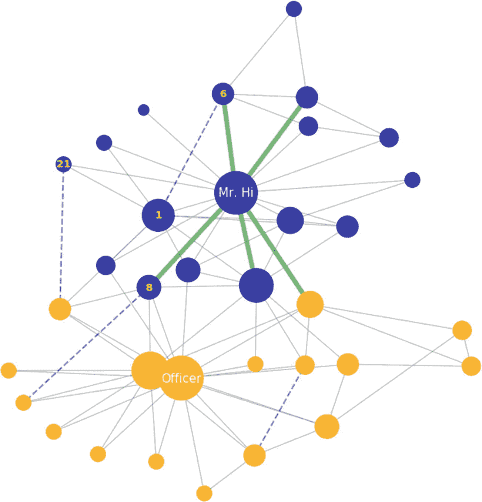

**图 10-5**

空手道俱乐部社交网络，该图清晰地突显了俱乐部一分为二的分裂情况。节点的大小反映了它们的度数。最重要的五个连接以绿色高亮显示。虚线表示候选边。节点的颜色根据它们所属的俱乐部进行着色。

```python
import operator
import pandas as pd
import networkx as nx
import matplotlib.pyplot as plt
G = nx.karate_club_graph()
node_colors = ['orange' if props['club'] == 'Officer' else 'blue'
for _, props in G.nodes(data=True)]
node_sizes = [180 * G.degree(u) for u in G]
plt.figure(figsize=(10, 10))
pos = nx.kamada_kawai_layout(G)
nx.draw_networkx(G, pos,
node_size=node_sizes,
node_color=node_colors, alpha=0.8,
with_labels=False,
edge_color='.6')
main_conns = nx.edge_betweenness_centrality(G, normalized=True)
main_conns = sorted(main_conns.items(), key=operator.itemgetter(1), reverse=True)[:5]
main_conns = tuple(map(operator.itemgetter(0), main_conns))
nx.draw_networkx_edges(G, pos, edgelist=main_conns, edge_color="green", alpha=0.5, width=6)
nx.draw_networkx_labels(G, pos,
labels={0: G.node[0]['club'], 33: G.node[33]['club']},
font_size=15, font_color="white")
candidate_edges = ((8, 15), (30, 21), (29, 28), (1, 6))
nx.draw_networkx_edges(G, pos, edgelist=candidate_edges,
edge_color='blue', alpha=0.5, width=2, style="dashed")
nx.draw_networkx_labels(G, pos,
labels={u: u for t in candidate_edges for u in t},
font_size=13, font_weight="bold", font_color="yellow")
plt.axis('off')
plt.tight_layout();
plt.show()
### Create a data frame to store various centrality measures.
df = pd.DataFrame(index=candidate_edges)
### Add generic and community aware edge features for potential machine learning classification.
df['pref-att'] = list(map(operator.itemgetter(2),
nx.preferential_attachment(G, candidate_edges)))
df['jaccard-c'] = list(map(operator.itemgetter(2),
nx.jaccard_coefficient(G, candidate_edges)))
df['aa-idx'] = list(map(operator.itemgetter(2),
nx.adamic_adar_index(G, candidate_edges)))
df['ccn'] = list(map(operator.itemgetter(2),
nx.cn_soundarajan_hopcroft(G, candidate_edges, 'club')))
df['cra'] = list(map(operator.itemgetter(2),
nx.ra_index_soundarajan_hopcroft(G, candidate_edges, 'club')))
print(df)
Listing 10-8
karate-network.py Module Exemplifying the Well-Known Karate Club Network (see Exercise 10-3)
```

运行此程序后，您将得到以下报告：

```
pref-att  jaccard-c    aa-idx  ccn       cra
8  15        10   0.400000  0.755386    2  0.000000
30 21         8   0.200000  0.455120    1  0.000000
29 28        12   0.166667  0.352956    2  0.058824
1  6         36   0.083333  0.360674    2  0.062500
```

列名指定了以下链接预测度量（顺序同上，从右至左）：

- **优先连接**：倾向于度数中心性高的节点。这就是节点 1 和 6 的得分远高于其他节点的原因。
- **Jaccard 系数**：公共邻居数除以邻居总数后的归一化值。
- **Adamic-Adar 指数**：分母中包含一个对数，与资源分配指数类似。对于节点`A`和`B`，该指数表示通过公共邻居的信息流分散程度。从某种意义上讲，想要连接的节点倾向于直接通信。如果公共邻居具有高度数中心性，那么这种信息流会被分散。
- **社区公共邻居数**：公共邻居的数量，对于属于同一社区的邻居会额外加分。
- **社区资源分配**：类似于资源分配指数，但只统计同一社区内的节点。注意，候选边`(9, 15)`和`(30, 21)`获得的社区资源为零，因为它们来自不同的空手道俱乐部。

在`NetworkX`中（在本文撰写时），还有另外三个真实的社交网络可用。您可以像我们在这里所做的那样，尝试使用它们进行分析。可视化部分可以轻松复用。

在研究社交网络时，生成逼真的网络模型是一个有趣的选择。这些网络旨在模拟所研究真实世界的相关属性。`NetworkX`内部提供了许多网络生成器，包括流行的优先连接模型（遵循*幂律*）和小世界网络（具有较高的聚类系数和较短的平均路径长度）。后者试图模仿*六度分隔*的概念。一旦拥有了一个模型，您就可以将其与来自真实世界的观测（样本）进行比较。如果模型的估计参数（如优先连接模型中的指数`α`和常数`C`）能很好地生成接近真实世界的网络，那么就可以利用图论和计算来分析真实世界现象。例如，您可以使用网络特征（如我们的度量指标）训练分类器，来预测未来连接的概率。


### 练习 10-1\. 美化显示的图网络，第一部分

`NetworkX` 与 `Graphviz` 结合使用，为您提供了丰富的选项来定制图的视觉外观。在图 10-2 中，关系类型或权重之间没有区分。以一种有意义的方式呈现这些信息会很有帮助。以下是一段代码片段，用于遍历有向多重图 `G` 中的边：
```
for i, j, k in G.edges(keys=True):
    print(G.adj[i][j][k])
```
尝试设置边的视觉属性（我们已为节点设置了一些属性）。例如，你可以用不同的颜色标记关系，并将线宽设置为关系的权重。作为附加练习，尝试为演员节点附加自定义图像。这可以通过混入 HTML 内容并使用 `img` 标签引用图像来实现。

### 练习 10-2\. 美化显示的图网络，第二部分

基于在练习 10-1 中获得的经验，可视化一个有符号图（比如我们用来建模质量属性之间关系的那种图）。你可能希望为每条边显示加号或减号，并用不同的颜色进行标记。

你可以通过调用 `G.edges(data=True)` 来遍历无向图 `G` 的边，该调用会返回所有边及其属性。要显示符号，请使用 `G.edge[node_1][node_2]['sign']` 表达式，其中 `node_1` 和 `node_2` 是此边的节点标识符。

### 练习 10-3\. 生成一个 Erdös-Rényi 网络

阅读 `nx.generators.random_graphs.erdos_renyi_graph` 函数的文档，了解如何生成这种随机图。该模型以概率 `p` 选择每条可能的边，它是二项式图的同义词（因为它遵循伯努利概率分布）。

生成的网络与现实世界的网络并不相似（事实上，小世界网络模型在这方面也做得不够好）。尽管如此，该模型极其简单，并且二项式图被用作图论证明的基础。

## 本章小结

现实世界的网络规模巨大，因此它们需要比本文介绍的方法更具可扩展性的方法。一个可行的选择是利用斯坦福网络分析平台（SNAP）框架（访问 [`http://snap.stanford.edu`](http://snap.stanford.edu) ），它也有一个 Python API。存储大型图也是一个问题。有专门用于存储图的数据库系统以及更多图格式（其中大部分都由 `NetworkX` 记录和支持）。图数据库的一个可选方案是 Neo4j（参见 [`https://neo4j.com/developer/python`](https://neo4j.com/developer/python) ）。

图被用来判断现实世界网络（如万维网、交通基础设施、电网等）的鲁棒性。鲁棒性是一种质量属性，它表明网络在遭受故障或攻击（当节点和/或边消失时）时保持其核心结构特性的能力。基本的结构特性是连通性。为此目的，`NetworkX` 提供了多个函数（用于评估节点和边）：`nx.node_connectivity`、`nx.minimum_node_cut`、`nx.edge_connectivity`、`nx.minimum_edge_cut` 和 `nx.all_simple_paths`。这些函数既适用于无向图也适用于有向图。图也是人工智能中各类搜索问题的基础。

# 11\. 复杂性与启发式方法

作为数据科学家，您必须以经济的方式解决基本问题，同时考虑到所有约束条件和功能需求。最大的错误是对某种特定技术产生情感依赖，并试图寻找“合适”的问题来应用它；这充其量只是伪科学。当您试图采用某种复杂方法，而存在更简单、更优雅的方法时，也会出现类似的问题。我无数次看到这两个反复出现的主题。例如，逻辑回归（一种直观的技术）在分类任务中通常可以胜过核化支持向量机，而特征工程中的一点小聪明可能完全省去了使用不透明的神经网络方法的需要。从简单开始并保持简单，或许是给任何数据科学家最好的建议。为了实现简单，您必须投入大量的精力和时间，但最终的结果将是超值的（尤其是在考虑长期效益时）。与简单相伴的是实用主义——在大多数场景中，足够好通常比完美更好。本章将举例说明对简单和实用主义的偏好，并让您了解复杂性和启发式方法的概念。它包含许多小型用例，每个用例都突出了与数据产品的简洁性和有效性相关的特定主题。

在解决问题的同时完全满足客户需求需要两件事：一般的解决问题能力，以及一套将寻找解决方案置于更广阔背景下的规则和原则。前者围绕以下四个步骤（参见参考文献 [1]），如果后来产品添加了新功能，这些步骤通常构成一个永无止境的循环：

1.  理解问题
2.  制定计划
3.  执行计划
4.  回顾并反思结果

许多从业者都熟知并理解这一策略。通常较少被认识到的是，定义并接受一个框架的重要性，该框架将在解决问题的努力中提供系统性指导。我更喜欢 Cynefin 框架（如图 11-1 所示），它是一个用于辅助决策的概念模型。问题解决与决策之间存在紧密关联，因此形成一个处理这两个主题的组合体至关重要。了解框架的当前领域有助于您选择最佳策略；您可能更倾向于在*复杂*领域内选择启发式方法，而在*简单*领域内则不愿应用此类方法。**启发式**是一种技术，您用它来交换一个绝对确定且精确的解决方案，换成一个能充分完成任务的方案。令人惊讶的是，近似解的表现通常与完全计算出来的方法一样好。有时，输入数据本身噪声很大，以至于超过某个阈值的精确度已毫无意义。

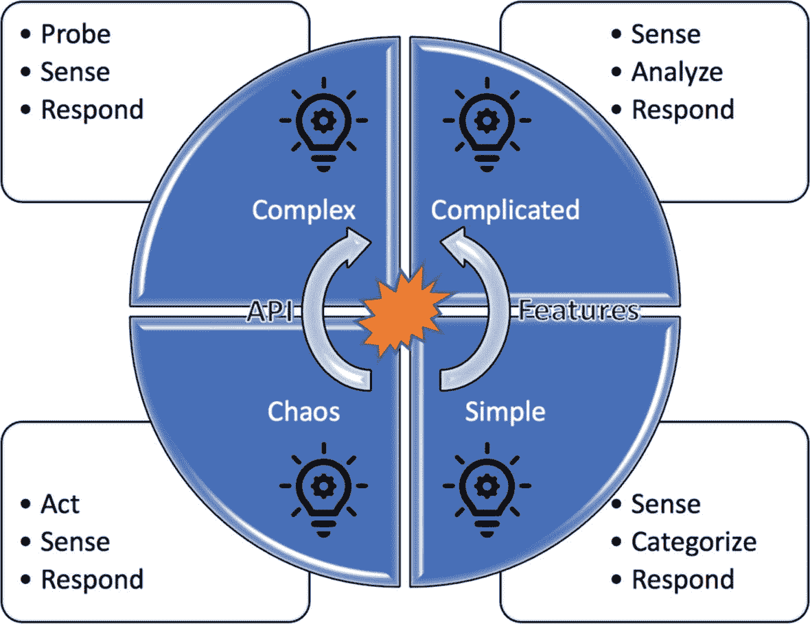

**图 11-1** Cynefin 框架的四个象限（中心是混沌）：简单、繁杂、复杂和混乱

如果没有情境意识，您就会陷入无序状态并做出错误判断。应用 Cynefin 框架还会带来一个伴随的结果。也就是说，要了解您当前的领域，您必须思考测量和度量。例如，达到一个合适的性能特征可能会将您从*简单*领域转移到*繁杂*或*复杂*领域。但是，您会知道为什么在那里，以及您手头有哪些选项。换句话说，您需要就切换决策边界做出深思熟虑的决定。


## 从简单到复杂：应用 Cynefin 框架方法

在图 11-1 的中心区域有一个被称为"混乱"的特殊区域；它代表了你尚不清楚问题所属域的情况，因此需要进一步探索。每个象限都对应一种独立的问题解决方法。简单域要求采用最佳实践，强调该领域已被充分掌握。复杂域需要良好实践，有时可能成为最优解。复合域指向解决方案的涌现特性，你可以运用各种启发式方法找到合适的解决方案。混沌域要求立即采取行动，事后才分析因果关系。请注意，该框架对"复杂"和"复合"两词的定义与《Python 之禅》相反（如图[3-2](https://doi.org/10.1007/978-1-4842-4859-1_3Fig#2)在第三章所示："复合优于复杂"）。

情况会随时间变化，可能导致不同域之间的迁移。新的需求和约束需要不同的解决方案，因此转换会以逆时针方向进行。随着获得更多知识和经验，你可以设计出更简单的解决方案，从而以顺时针方向向其他域移动。通过引入应用程序编程接口形式的强大抽象来隐藏复杂性，是简化客户端事务的有效策略。这意味着不同利益相关者会从不同视角看待整个问题-解决方案空间。最典型的例子可能是 scikit-learn 的通用估计器 API。你可以统一管理多种机器学习算法，无需关心底层实现细节，如图 11-2 所示。

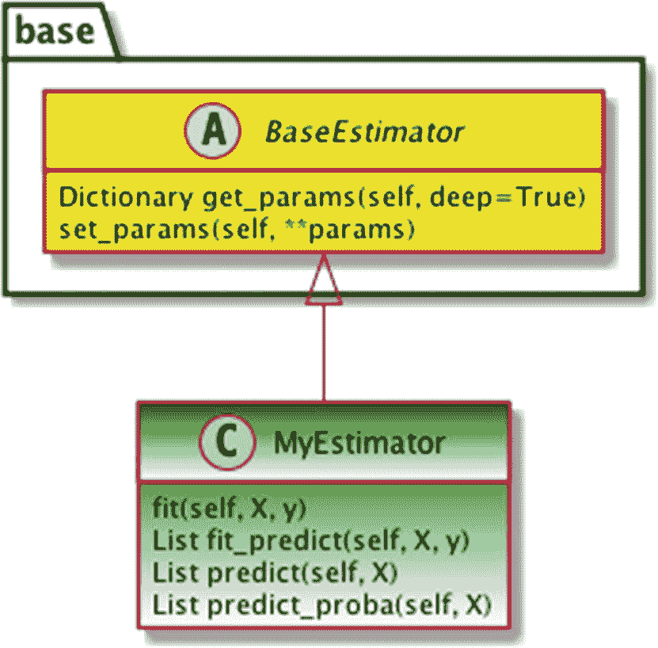

**图 11-2**  
估计器是处理模型训练与使用的对象

基类`BaseEstimator`实现了辅助方法，用于获取和设置估计器实例的参数。`fit`、`fit_predict`、`predict`和`predict_proba`方法构成了统一 API 的一部分，允许你以相同方式处理不同估计器。`MyEstimator`遵循 Python 的鸭子类型约定，提供一致的接口。

### 从简单到复杂

本节提出应对复杂域的三大策略：改进算法的渐近运行时间、应用随机化与采样、以及使用并行/分布式计算。在构建下一个数据科学产品时，这些都应成为可选方案。从最简单的解决方案开始并逐步优化至关重要。为此你需要完整的性能测试工具，此处将进行演示。我选择接下来几个示例，是因为它们既足够简单又能阐明核心要点。

#### 统计数字出现的次数

假设需要统计区间[1, n]内数字`d`出现的次数，其中*n*∈ℕ∧*n*≤10⁵⁰。你可以从清单 11-1 所示的朴素方法开始。不要低估这种暴力程序的价值。它能为更高级的解决方案提供良好的测试生成器（真实数据的来源）。

```
k, n = tuple(map(int, input().split()))
def count_occurrences_digit_naive(k, n):
    k = str(k)
    count = 0
    for i in range(n + 1):
        count += str(i).count(k)
    return count
print(count_occurrences_digit_naive(k, n))
```

**清单 11-1**  
当*n*小于 10⁷ 时表现合理的简单算法

根据非功能性需求（用户不应等待数十年才获得结果），我们显然不能接受这个程序。它运行时间大致呈线性，实在太慢，因此必须像 Cynefin 框架建议的那样超越简单情况。此时正是围绕性能测试构建适当基础设施的时机。测试数据输入到产品中也需要类似工作，这正是数据工程的一部分。我们将使用可视化来追踪时间测量结果。清单 11-2 展示了用于比较不同程序变体的工具。函数以粗体显示构成了此脚本的可重用部分。驱动程序代码位于末尾的条件块中。你只需提供适当的配置。`attach_model`函数会找到与基础模型匹配的正确常数。

```
import time
import numpy as np
import pandas as pd

def measure(f, num_repetitions=5):
    measurements = np.array([])
    for _ in range(num_repetitions):
        start = time.clock()
        f()
        measurements = np.append(measurements, time.clock() - start)
    return measurements.mean()

def execute(config):
    execution_times = {}
    for config_name in config['functions']:
        execution_times[config_name] = np.array([])
    for x in config['span']:
        for config_name in config['functions']:
            execution_times[config_name] = np.append(
                execution_times[config_name],
                measure(lambda: config['functions']config_name))
    return execution_times

def attach_model(execution_times, config, function_name, model_name):
    model_vals = np.vectorize(config['models'][model_name])(config['span'])
    c = np.mean(execution_times[function_name] / model_vals)
    execution_times[model_name] = c * model_vals

def report(execution_times, x_vals, **plot_kwargs):
    df = pd.DataFrame(execution_times)
    df.index = x_vals
    ax = df.plot.line(
        figsize=(10, 8),
        title='Performance Test Report',
        grid=True,
        **plot_kwargs
    )
    ax.set_xlabel('Span')
    ax.set_ylabel('Time [s]')
    return df

if __name__ == '__main__':
    from count_occurrences_digit_naive import count_occurrences_digit_naive
    config = {
        'functions': {
            'naive(k=0)': lambda n: count_occurrences_digit_naive(0, n)
        },
        'models': {
            'O(n)': lambda n: n
        },
        'span': np.geomspace(10**2, 10**7, num=14, dtype=int)
    }
    execution_times = execute(config)
    attach_model(execution_times, config, 'naive(k=0)', 'O(n)')
    print(report(execution_times, config['span'], logx=True, style=['-ro', ':r^']))
```

**清单 11-2**  
用于追踪时间测量结果并可视化的性能测试工具

执行此代码后，你将获得以下报告以及折线图，如图 11-3 所示：

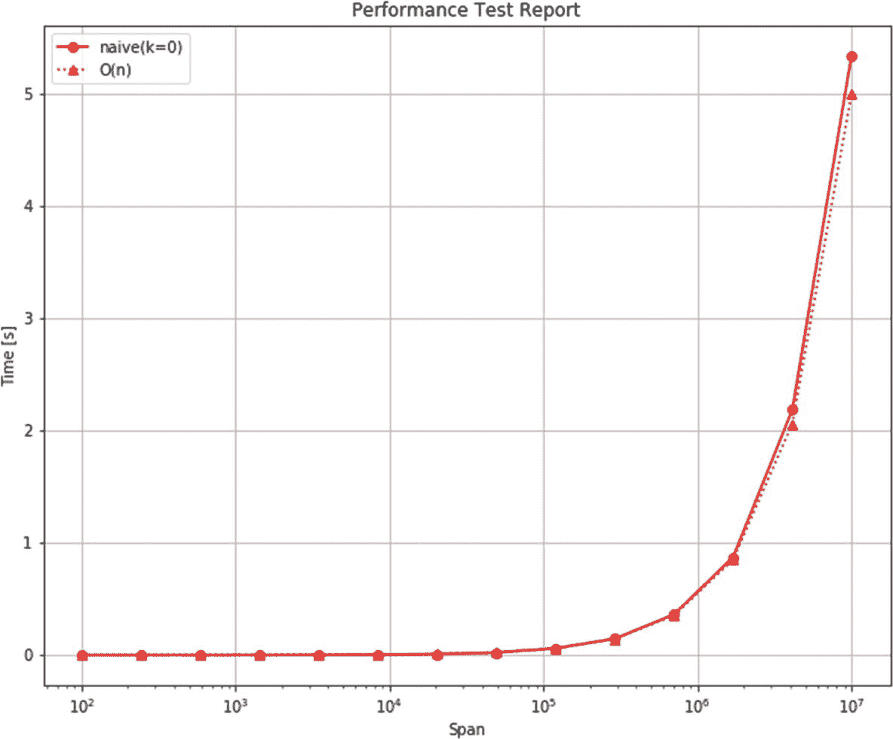

**图 11-3**  
朴素算法及其关联的 O(n)模型的运行时间折线图。x 轴采用对数刻度。


```  
naive(k=0)      O(n)  
100         0.000073  0.000050  
242         0.000111  0.000121  
587         0.000251  0.000293  
1425        0.000608  0.000712  
3455        0.001539  0.001725  
8376        0.003793  0.004183  
20309       0.009700  0.010141  
49238       0.023221  0.024587  
119377      0.060661  0.059611  
289426      0.145676  0.144526  
701703      0.361976  0.350397  
1701254     0.872631  0.849525  
4124626     2.182770  2.059641  
10000000    5.334004  4.993522  
```  

`O(n)` 模型略微低估了实际复杂度，因为代码清单 11-1 的循环体确实依赖于输入规模。尽管如此，当输入规模非常大时（此时运行时间更适合建模为 `O(n log n)`），我们甚至无法等待测试完成。

代码清单 11-3 展示了一个快得多的 `O(log n)` 算法，它通过分析区间 `[1, 10^i - 1]`（`∀ i ∈ ℕ ∧ i ≤ 50`）中数字位数的重复模式得出。数字 1 到 9 遵循相同的模式，而数字 0 略有不同（需要忽略前导零，因此公式更具挑战性）。将驱动程序代码修改为包含这种更快变体后，我们得到了如图 11-4 所示的折线图。执行时间上的差异确实令人震惊。你可以调整测试运行以覆盖完整范围（应省略朴素算法，因为当 `n > 10⁷` 时，其性能无法接受）。将代码推广到处理任意进制（如 16 进制）并不困难。

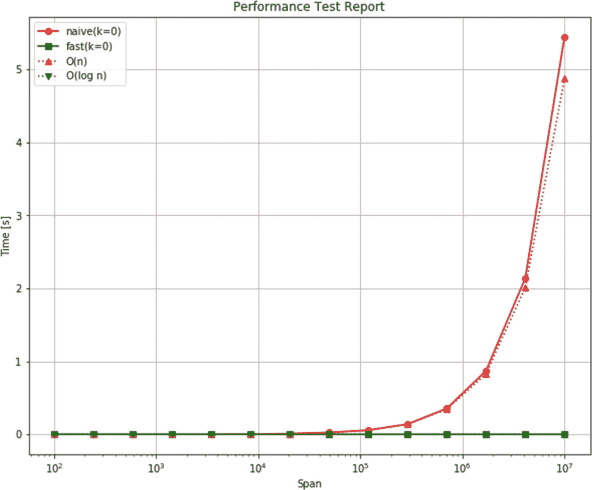  

**图 11-4**

新算法的执行时间极小，以至于在此尺度下均显示为零。`O(log n)` 模型与测量值完全吻合。

```python
def setup():
    MAX_EXPONENT = 50
    # 存储数字 k 在区间 [0, (10**i) - 1] 中出现的次数，i > 0。
    # 如果区间是部分的（复合键的第一部分为 False），则忽略前导零（这是 k == 0 时的特殊情况）。
    table_of_occurrences = {(False, 0): 0, (False, 1): 1,
                            (True, 0): 0, (True, 1): 1}
    for i in range(2, MAX_EXPONENT + 1):
        table_of_occurrences[(True, i)] = i * 10**(i - 1)
        table_of_occurrences[(False, i)] = \
            10**(i - 1) + 10 * table_of_occurrences[(False, i - 1)] - 10
    return table_of_occurrences

def count_occurrences_digit(k, n, table_of_occurrences=setup()):
    digits = str(n)
    num_digits = len(digits)
    count = 0
    is_first_digit = num_digits > 1
    for digit in map(int, digits):
        span = 10**(num_digits - 1)
        count += (digit - 1) * table_of_occurrences[(True, num_digits - 1)]
        count += table_of_occurrences[(k != 0 or not is_first_digit, num_digits - 1)]
        if digit > k:
            if k > 0 or not is_first_digit:
                count += span
        elif digit == k:
            count += (n % span) + 1
        num_digits -= 1
        is_first_digit = False
    return count

if __name__ == '__main__':
    k, n = tuple(map(int, input().split()))
    print(count_occurrences_digit(k, n))
```  

**代码清单 11-3** *改进的对数版本，额外使用* `O(log n)` *内存空间。*

本案例研究展示了在不牺牲准确性的前提下实现加速的场景。此外，改进后的代码不需要任何额外的基础设施支持。**寻找更优算法**应成为你的首要任务（在考虑 Hadoop、Spark 等工具之前）。

## 估计边介数中心性

在第 10 章的图分析部分，我们研究了社交网络中的一些中心性指标，其中就包括边介数中心性。精确计算该指标需要大量 CPU 资源。当网络规模庞大，且只需求得足够好的结果时，**采样**是一个可行的选择。其思路非常简单：基于 N 个样本而非整个网络来计算指标。这通常能给出几乎相同的结果，但耗时大幅缩短。`NetworkX` 已内置对此方法的支持。代码清单 11-4 展示了对比绝对准确结果与采样结果的代码。你可以尝试调整代码，增加样本数量。显然，随着样本量增加，结果会更精确，但运行时间也会增加。你需要通过实验找到最佳平衡点。

```python
import operator
import networkx as nx
import matplotlib.pyplot as plt

G = nx.karate_club_graph()
node_colors = ['orange' if props['club'] == 'Officer' else 'blue'
               for _, props in G.nodes(data=True)]
node_sizes = [180 * G.degree(u) for u in G]

plt.figure(figsize=(10, 10))
pos = nx.kamada_kawai_layout(G)
nx.draw_networkx(G, pos,
                 node_size=node_sizes,
                 node_color=node_colors, alpha=0.8,
                 with_labels=False,
                 edge_color='.6')

### 计算绝对的边介数中心性。
main_conns = nx.edge_betweenness_centrality(G, normalized=True)
main_conns = sorted(main_conns.items(), key=operator.itemgetter(1), reverse=True)[:5]
main_conns = tuple(map(operator.itemgetter(0), main_conns))
nx.draw_networkx_edges(G, pos, edgelist=main_conns, edge_color="green", alpha=0.5, width=6)

### 通过采样 40% 的节点来估计边介数中心性。
NUM_SAMPLES = int(0.4 * len(G))
est_main_conns = nx.edge_betweenness_centrality(G, k=NUM_SAMPLES, normalized=True, seed=10)
est_main_conns = sorted(est_main_conns.items(), key=operator.itemgetter(1), reverse=True)[:5]
est_main_conns = tuple(map(operator.itemgetter(0), est_main_conns))
nx.draw_networkx_edges(G, pos, edgelist=est_main_conns,
                       edge_color='red', alpha=0.9, width=6, style="dashed")
```  

**代码清单 11-4** *为简洁起见，仅重复代码的第一部分，该部分与原始版本略有不同。请注意使用 40% 节点评估* `est_main_conns` *的部分。空手道俱乐部网络非常小，采样在大型网络中才真正有效。但原理是相同的。*

请注意，我设置了 `seed` 参数。这对于其他人使用随机化方法复现结果至关重要。图 11-5 展示了新图。

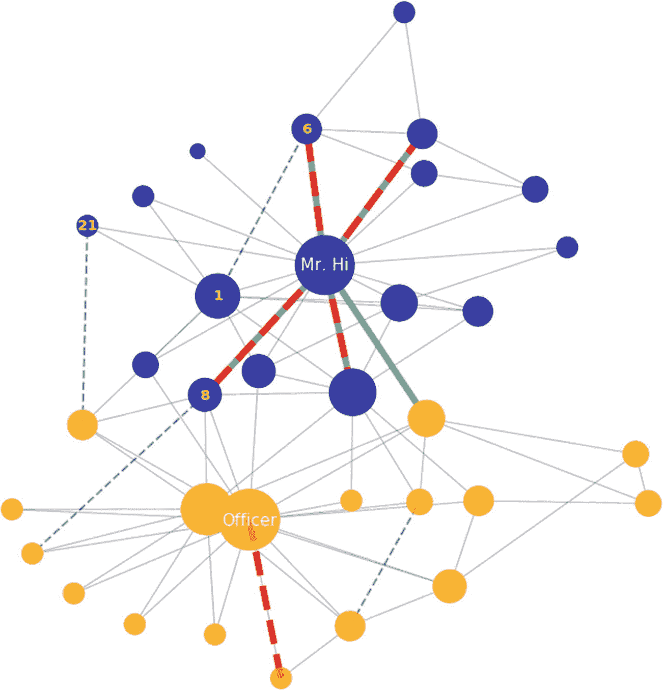  

**图 11-5**

红色的虚线边是通过采样计算得出的。其中大部分与原始边重合，只有一条被误判。

本案例研究展示了如何用准确性换取更好性能。这种随机化方法属于**蒙特卡洛方法**。**拉斯维加斯模型**总能产生准确结果，但在极少数情况下可能运行较慢（快速排序就是一个很好的例子）。无论如何，新代码在不依赖计算集群的情况下运行得更快（参见练习 11-2）。


#### 可整除数的计数

假设你需要找出区间 `[a, b]`（其中 `0 < a < b < 10¹⁸`）内所有能够被自然数 `c ≤ 10¹⁸` 整除的自然数。清单 11-5 展示了解决该问题的 `num_divisible` 函数。该函数的运行速度已接近极限，这意味着你无法显著加快其速度。如果没有额外的需求，比如以下两点，你甚至可以在此时停止：

- 你需要处理的海量三元组 `(a, b, c)` 数量巨大。
- 这些数据无法同时存入内存。

这些条件是很好的信号，表明有必要考虑技术层面的转变，此时应用并行和分布式计算确实合情合理。你可以利用 Dask 框架来处理与上述约束相关的用例。清单 11-5 阐释了利用 Dask 数组背后的核心思想。示例精简到了最核心的要素，以便你更容易理解底层机制（例如，在实际操作中你会处理更大的数据块）。

Dask 提供了用于并行化自定义应用的结构（`delayed` 任务和 futures）。清单 11-5 将输入数组划分为若干数据块，并将它们作为独立块分别处理。这使得它们能够被并行计算。Dask 还以透明的方式处理数组与外部数据之间的所有映射关系。Dask 数组是原始 Numpy 数组网格的一个虚拟视图（Dask 数据帧与底层 Pandas 数据帧的关系也是如此）。你的操作方式就如同所有数据都存储在机器内存中一样。

```python
import numpy as np
import dask.array as da
def num_divisible(a, b, c):
    r = a % c
    if r == 0:
        start = a
    else:
        start = a + (c - r)
    if start > b:
        return 0
    else:
        return 1 + (b - start) // c
num_divisible_vect = np.vectorize(num_divisible)
x = da.asanyarray([(1, 100, 10), (16789, 445267839, 7), (34, 10**18, 3000), (3, 7, 9)])
x = x.rechunk(chunks=(2, -1))
y = x.map_blocks(lambda block: num_divisible_vect(*block.T),
                 chunks=(-1,),
                 drop_axis=1,
                 dtype='i8')
print(y.compute())
清单 11-5
Dask 提供了其自有的数组和数据帧数据结构，其 API 模仿了 Numpy 和 Pandas 中的相应接口。
```

运行上述程序后，你将收到以下输出，这是一个包含四个值的数组，分别对应每个输入的三元组：

```
[             10        63607293 333333333333333             0]
```

本案例研究表明，一旦你真正明确自己需要并行和分布式计算，它就是一项强大的选择。

## 从失序到复杂

复杂域的特点是*已知的未知*，而复合域则关乎*未知的未知*。失序应是一个暂时的状态，用于探索问题空间以理解其归属。从这个意义上说，失序是探索性数据分析的催化剂。

高维数据集是最初困惑的最可能原因。经典的可视化方法在此并不适用，因为你甚至不知道如何表示这些维度。高维数据中存在大量重复且无信息量的特征（例如，那些方差极低或为零的特征）。这些特征应从数据集中剔除。此外，许多特征将被证明与目标变量无关，因此也应作为不相关特征移除。主要目标是降低维度，以便你能“见树又见林”。黄金标准是*主成分分析（PCA）*方法，它应用特征提取，用正交的主成分来描述数据。

### 注意

任何最终使用特征值和特征向量的方法（SVD、PCA、谱方法等）都不可避免地落入复合域。这些实践的主要难点在于它们的输出通常难以解释。你可以推测每个特征向量的含义，但肯定无法准确解读它们。

在本节中，我们将只关注一种名为 t-SNE 的特殊可视化技术，以便一窥高维数据的面貌；关于该主题的精彩互动介绍以及如何避免常见陷阱，请参阅参考文献 [2]。从某种意义上说，这是 Cynefin 框架的一个元应用，因为我们必须将可视化视为复合/复杂，而非简单。

顺便提一下，你也应该尝试使用标准技术窥探数据集，例如，对 Pandas 数据帧使用 `describe` 方法。方差接近零的列是移除的良好候选。此外，你可以使用 Seaborn 中的 `pairplot` 函数对列进行成对可视化。高度相关的列是冗余的，应避免使用。这些操作都与特征选择相关。其中一部分也可以自动化完成。例如，你可以使用实现特征选择算法的 `sklearn.feature_selection` 模块。对于修剪低方差特征，你可以使用 `VarianceThreshold` 类。无论如何，所有这些方法对于低维数据集（列数/特征数少于十个的数据集）都是适用的。

当创建新特征时，特征提取是对特征选择的补充。例如，将实例分箱（这个过程称为*分箱*）就是创建新分类特征的一个例子。我们在第 2 章中已经遇到过这种情况，当时我们按年龄范围对用户进行分组。


### 探索 KDD Cup 1999 数据集

正如 KDD Cup 1999 数据官方网站（参见 [`https://kdd.ics.uci.edu/databases/kddcup99/kddcup99.html`](https://kdd.ics.uci.edu/databases/kddcup99/kddcup99.html)）所述：

- 该数据集用于第三届国际知识发现与数据挖掘工具竞赛，该竞赛与 KDD-99 第五届知识发现与数据挖掘国际会议同期举行。竞赛任务是构建一个网络入侵检测器，即一个能够区分“不良”连接（称为入侵或攻击）与“正常”连接的预测模型。该数据库包含一套标准的审计数据，其中涵盖了在军事网络环境中模拟的各种入侵行为。

清单 11-6 展示了 t-SNE 在揭示 KDD Cup 数据集中的某些模式方面的应用（scikit-learn 已完整封装对该数据集的支持）。总共有 41 个特征。其中，34 个为数值型特征，这是 t-SNE 唯一能接受的特征类型。类别变量应被取消选择或进行编码。t-SNE 方法即使对微小的变化也非常敏感。清单 11-6 中的两个辅助方法会从官方网站下载列描述符（另请参见图 11-6）。

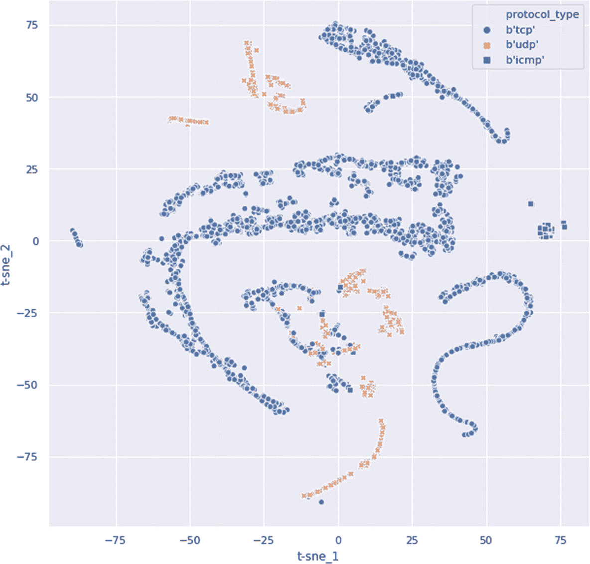

图 11-6

值得注意的是，t-SNE 成功地将 34 个特征压缩为 2 个分量，清晰地突出了数据中的关键模式。

```python
from sklearn.datasets import fetch_kddcup99
from sklearn.manifold import TSNE
import pandas as pd
import matplotlib.pyplot as plt
import seaborn as sns
def retrieve_column_desc():
import requests
r = requests.get('https://kdd.ics.uci.edu/databases/kddcup99/kddcup.names')
column_desc = {}
for row in r.text.split('\n')[1:]:
if row.find(':') > 0:
col_name, col_type = row[:-1].split(':')
column_desc[col_name] = col_type.strip()
return column_desc
def get_numeric_columns(column_desc):
return [name for name in column_desc if column_desc[name] == 'continuous']
column_desc = retrieve_column_desc()
numeric_columns = get_numeric_columns(column_desc)
print('Number of numeric columns:', len(numeric_columns))
X, _ = fetch_kddcup99(subset='SA', random_state=10, return_X_y=True)
X = pd.DataFrame(X, columns=column_desc.keys())
X[numeric_columns] = X[numeric_columns].apply(pd.to_numeric)
#### We need to work on a small sample to get results in any reasonable time frame.
X = X.sample(frac=0.05, random_state=10)
m = TSNE(learning_rate=150, random_state=10)
X_tsne = m.fit_transform(X[numeric_columns])
print('First 10 rows of the TSNE reduced dataset:')
print(X_tsne[:10, :])
X['t-sne_1'] = X_tsne[:, 0]
X['t-sne_2'] = X_tsne[:, 1]
sns.set(rc={'figure.figsize': (10, 10)})
sns.scatterplot(x='t-sne_1', y='t-sne_2',
hue='protocol_type', style="protocol_type",
data=X[numeric_columns + ['protocol_type', 't-sne_1', 't-sne_2']])
plt.show()
清单 11-6
展示 t-SNE 强大功能的代码，不过你需要耐心尝试许多不同的参数设置（学习率、随机状态、困惑度、t-SNE 组件数量等）。
```

符号变量 `protocol_type` 用于标记不同的组（观察右侧绿色的 icmp 集群），各组之间的行为存在良好分离。再一次，t-SNE 在未查看 `protocol_type` 特征的情况下成功地提取出了这些模式。

本案例研究阐明了进行探索性数据分析的重要性，这是判断你的数据科学问题属于 Cynefin 框架中哪个领域的一部分。一旦你确定需要执行特征提取及相关降维操作，就可以通过应用 PCA 或类似技术继续推进。降维有助于你的机器学习工作，因为降维后的数据集无需巨大的存储空间或处理时间，并且能降低模型过拟合的风险。

### Cynefin 与数据科学

前面的一些例子对你来说可能有些抽象，因此本节通过一个具体的数据科学产品来阐述 Cynefin 领域。第 8 章已经介绍了推荐系统，所以这里我们也将使用它。以下列表举例说明了适用于前三个 Cynefin 象限的推荐引擎类型：

- **简单**: 非个性化推荐系统根据产品的整体流行度来提供推荐，或根据当前用户的行为进行各种类型的关联分析。例如，如果用户正在浏览特定类型的产品，推荐系统可能会提供相似的产品。如果用户将某件商品放入购物车，推荐系统可能会提供常与该商品一起购买的其他产品。这是你在网页上看到“购买此商品的顾客也购买了...”版块时的典型情况。

- **复杂**: 结合了协同过滤和基于内容过滤的个性化推荐系统比其非个性化版本更精细、更有用。它们试图通过建立用户画像来对客户进行建模。如今，大多数推荐引擎至少属于该领域。

- **复合**: 多维度和上下文感知的混合推荐系统则更为强大。例如，这些推荐系统可能会根据用户当前的情绪来推荐内容。该领域寻求创新性解决方案，并且经常需要应用启发式算法和近似算法。


### 练习 11-1. 理解算法

对于给定的闭区间 `[a, b]`（其中 `0 <= a <= b <= 10⁸`），以下朴素算法会找出所有各位数字不重复的数字，并输出它们的个数：

```
a, b = tuple(map(int, input().split()))
count = 0
for i in range(a, b + 1):
    s = str(i)
    if len(set(s)) == len(s):
        count += 1
print(count)
```

如果你输入数字 `0` 和 `1000`，你会得到计数 `739`。这是一个简单但低效的程序，其时间复杂度为 *O*((*b* − *a*) log *b*)。下面是一个快得多的 *O*((log *b*)³) 算法：

```
import math
a, b = tuple(map(int, input().split()))
def variation_without_repetition(n, k):
    return math.factorial(n) // math.factorial(n - k)
#### 找出 [0, k] 中有多少个各位数字不重复的数字。
def count_numbers_with_non_repeating_digits(k):
    if k < 0:
        return 0
    if k == 0:
        return 1
    # 我们可以用组合数学找出大部分数字。
    digits = str(k)
    num_digits = len(digits)
    first_digit = int(digits[0])
    span = 10 ** (num_digits - 1)
    s = (first_digit - 1) * variation_without_repetition(9, num_digits - 1)
    # 我们必须小心处理关于前导零的较低区间。
    s += count_numbers_with_non_repeating_digits(span - 1)
    # 我们继续搜索较高部分。
    used_digits = {first_digit}
    t = num_digits == 1
    for i in range(1, num_digits):
        first_digit = int(digits[i])
        allowed_digits = set(range(first_digit + 1)) - used_digits
        v = variation_without_repetition(9 - i, num_digits - 1 - i)
        used_digits.add(first_digit)
        if first_digit not in allowed_digits:
            if len(allowed_digits) == 0 and i == 1:
                t = 0
            else:
                t += len(allowed_digits) * v
            break
        else:
            t += (len(allowed_digits) - (i != num_digits - 1)) * v
    return s + t
print(count_numbers_with_non_repeating_digits(b) - \
      count_numbers_with_non_repeating_digits(a - 1))
```

请尝试完全理解这个程序的工作原理。显然，任何激进的性能调优都会损害代码库的可维护性。不过，如果你能指数级地加速你的算法，那就可以省去使用昂贵且复杂的分布式解决方案的必要。

**加分题：** 你能将这个程序泛化，使其能处理任意进制（例如，十六进制）的数字吗？一旦你理解了前面的代码，这应该不难。这正是先前的朴素算法会立刻失效的地方（对于大于十的进制，搜索空间会急剧增加）。

### 练习 11-2. 数据流式处理

假设你需要生成一个数据流的直方图（即描述流中数值的频率分布）。这听起来只是另一个计数任务。毕竟，对于一组数值，只需使用 Numpy 的 `histogram` 函数即可。唯一的难点是，这个流是无限的，并且数值持续不断地到来。无法将它们全部存储在内存中。这又是一个需要将 Cynefin 域从简单域转变为复杂域的场景。

一个非常流行的解决此问题的算法叫做 *Count Sketch*。这是一种概率性的蒙特卡洛风格的数据结构。其核心思想是使用一个二维数组和一组通用哈希函数来对项目进行计数。基于计数器的值，你可以估算出频率。更多信息，请阅读 [`http://bit.ly/count-sketch`](http://bit.ly/count-sketch)。

请实现一个 Count-Sketch 数据结构，或找到一个开源项目并尝试这种方法。你可以使用 Python 的生成器函数来模拟一个流。

### 练习 11-3. 审视混沌

混沌域需要即时行动。一个很好的例子是异常检测系统，它必须在检测到异常行为的瞬间做出反应。KDD Cup 1999 数据集是练习构建自动化入侵检测设施的绝佳素材。在这个练习中，你将做一些更简单但同样有启发性的内容。

物理学中的胡克定律模拟了当你将弹簧拉伸一定距离时，由具有某种弹性系数 `k` 的弹簧产生的力。公式是 *F* = −*k∆x*，其中负号表示与拉伸方向相反的力。每个弹簧的弹簧常数 `k` 都是独一无二的。

假设你已经收集了一组在不同位移 *∆x* 下的力的读数。只要弹簧在正常工作状态下，我们的弹簧模型就是正确的。不幸的是，如果你过度拉伸弹簧，可能会损坏它。从那时起，你将无法再使用该模型。

请为弹簧实现一个异常检测应用。你的系统应预先记录正常工作条件下的数据，以便能够识别异常。你可能需要查看 `sklearn.neighbors.LocalOutlierFactor` 类。当弹簧损坏时，它产生的数据点将不再靠近正常工作状态下的数据点。这便是你的分类器触发警报的时机。你应该明白，误报（无效警报）是可能发生的。毕竟，在正常使用中，也许从未有人试图将弹簧拉伸到极限。即使没有发生任何坏事，你的系统也可能认为出了问题。这是混沌域的基本特性。在你行动之前，没有太多时间思考。

## 总结

知道某种方法何时合适且可行，是成为一名成功数据科学家的基石。你必须抵制那种为了尝试新事物而围绕某一新兴技术构建产品的炒作和诱惑。算法与数理统计一同，是处理大数据的核心。本章阐述了 Cynefin 框架如何为更好的决策和选择正确的解决方案提供背景。

# 12. 深度学习

深度学习是机器学习的一个领域，它真正实现了人工智能领域的尖端成就。*深度*一词意味着一种复杂结构，旨在通过密集的并行计算（主要利用配备 GPU 的机器集群）来处理海量数据集。在此上下文中，*学习*一词意味着特征工程和模型参数的定制都留给机器去完成。在实践中，将这些术语组合成*深度学习*则意味着多层神经网络。神经网络广泛应用于图像分类、语音识别/合成、时间序列分析等任务。神经网络倾向于模仿我们的大脑细胞在决策活动中协同工作的方式。本章将向你介绍神经网络以及如何使用 `PyTorch` 来构建它们。`PyTorch` 是一个开源的 Python 框架（请访问 [`https://pytorch.org`](https://pytorch.org)），它拥有对于熟悉 `Numpy` 的人来说非常相似的 API。此外，作为本书的最后一章，它举例说明了数据科学生命周期模型的许多阶段（数据准备、特征工程、数据可视化、数据分析和数据产品部署）。不过，首先，让我们思考一下*智能*的概念，以及它何时、如何以及为何如此重要。


## 智能机器

*智能*一词的含义是主观的，并随着历史变迁而改变。在 18、19 世纪，人们为机械装置和自动化蒸汽机感到惊叹，这是完全可以理解的；当我参观伦敦塔桥时，对其燃煤蒸汽机系统中存在的自动化程度印象深刻——这套系统直到 1974 年仍用于操控这座开启式桥梁。当塔桥于 1894 年投入运行时，许多伦敦人可能认为塔桥发动机室内的机器是“智能的”。当然，如今没有人会再认为任何类型的蒸汽机具备智能属性。这是为什么？原因在于，随着人们对某项技术背后机理的理解变得普及，其带来的惊奇程度也会相应下降。因此，我们可以在*智能*与我们对某项技术的兴奋程度之间建立关联。以下是一些值得思考的问题：

- 什么让汽车变得智能？自动驾驶汽车是智能的吗？自动泊车汽车也是智能的吗（尽管其智能程度不及完全自动驾驶汽车）？配备定速巡航系统的汽车到底算不算智能？分界线在哪里？
- 普通果蝇是智能的吗？一只人造的、能自我复制的果蝇，是否是 2019 年之后人工智能的*最先进水平*？
- 是否存在间接的智能迹象？（请查看稍后会讨论的图 12-1。）

假设你有一台“愚蠢”的洗衣机，它内部没有内置任何模糊逻辑或类似的智能算法。此外，假设你偶然发现了一款“智能”洗衣粉（例如在[`https://www.skip.co.za/product-format`](https://www.skip.co.za/product-format)上销售的那种）。不要花太多时间思考洗衣粉中的智能体现在何处，或者模糊逻辑如何能让你的机器变得更聪明。这些方面目前并不重要。相反，试着回答以下问题：将“智能”洗衣粉倒入你“愚蠢”的洗衣机中这一简单行为，就能让它变智能吗？你该如何做出判断？你是否会仅仅根据洗衣机清洗后衣物的洁净程度来评估结果？你还会监控洗衣机的运行方式吗？你会拆解洗衣机，分别分析各个部件（包括洗衣粉），希望能从中找到智能吗？


图 12-1
你和你的团队正在执行寻找宜居行星的任务

想象一下，你和你的团队正在邻近的太阳系中搜寻宜居行星。你们接近了一个很有希望的候选行星，但遇到了一个问题。你们注意到沙滩上有一把铲子。你们不敢降落，不是因为害怕铲子本身，而是害怕它所代表的意义。这是智能生命存在的明确标志，而他们可能不欢迎你们。甚至，这颗行星是由智能生物还是由机器人殖民都无关紧要。重要的是这种间接的智能迹象，它引发了某种程度的敬畏。参考文献[1]对这一观点进行了精彩的阐述，我们将在本章中进一步展开讨论。

长期以来，评估人类和机器的智能水平一直是一个众所周知的难题。解决这个问题的一种方法体现在图灵测试中，该测试衡量机器表现出与人类无法区分的智能行为的能力，如图 12-2 所示。这绝对是一个黑盒测试，它试图仅通过观察外部属性和结果来回答问题。

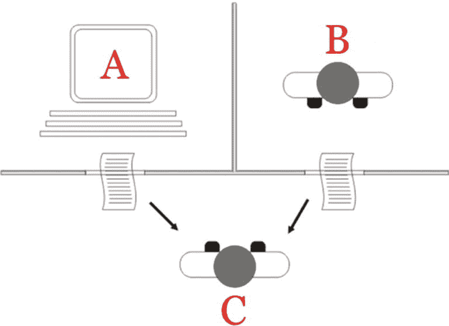
图 12-2
图灵测试设置（来源：[`https://commons.wikimedia.org/wiki/File:Test_de_Turing.jpg`](https://commons.wikimedia.org/wiki/File:Test_de_Turing.jpg)）。询问者（C）试图仅通过提问和查看书面回答来揭示哪个参与者（A 或 B）是人类。

图灵测试旨在为“什么构成智能机器”确立终极标准。也许有一天我们能够达到如此复杂的程度。在那之前，我们必须将注意力集中在更实际的目标上。回到我们洗衣机示例，我们真的关心是谁或什么清洗了一件衣服吗？真正的问题是：“我们能否区分衣服是由人工手洗还是洗衣机洗的？”如果没有区别，那么洗衣机就是一种有用的器具，能让我们更高效，并让我们从琐碎的任务中解脱出来。这就是人机交互的全部意义。从这个意义上说，智能只是一个与我们要处理的任务复杂度相关的必要评分，无论是否借助机器。对于更高级的工作，我们需要采用更先进的技术、方法和工具。我们通常不关心机器所期望的智能水平是来自“愚蠢的硬件+超级智能的软件”、“超智能硬件+愚蠢的软件”，还是“精明的硬件和软件”。有时，即使是一台普通的计算器，也足以让我们在规定时间内以所需的精度解决问题。

### 注意

本着前文的精神，我只在更简单、更易解释的解决方案无法实现时，才考虑使用深度神经网络。深度神经网络对外部观察者来说可能显得神秘，但在内部，它们大致只是线性代数和微积分。尽管如此，在其背后投入的研究和人力是惊人的（开发训练深度神经网络的算法花费了大约 30 年时间，凝聚了许多科学家的共同努力）。关于智能以及看待事物的不同方式，你可能还想查阅参考文献[2]和[3]。

神经网络令人着迷且有趣的成就之一体现在 20Q 游戏（更多细节请阅读参考文献[4]）。该产品在用户玩游戏时不断学习。关于神经网络何时适用的例子以及学习 Keras（本章我将介绍 PyTorch），你也可以查阅参考文献[5]。

## 智能作为符号的掌握

我思考了很久，如何最好地举例说明神经网络内部发生的事情。我认为立刻跳到节点、权重、层和激活函数是不合适的。幸运的是，我设法在 Topcoder 上找到了一个合适的问题陈述，针对一个名为`AToughGame`的游戏，用以演示抽象如何在创造看似智能的行为中相互作用（要跟进此讨论，你必须先阅读其规范；点击[`https://www.topcoder.com/blog/how-to-come-up-with-problem-ideas`](https://www.topcoder.com/blog/how-to-come-up-with-problem-ideas)上的`AToughGame`链接）。如参考文献[1]所述，智能可以被视为在多个粒度级别上掌握产生符号（抽象）的能力。抽象层次结构被积累并相互构建，直到最终解决方案可以用它们来简单描述为止。


### 手动特征工程

图 12-3 以状态图的形式展示了`AToughGame`问题的通用结构。玩家根据给定的概率从一个关卡推进到下一个关卡。主要思路是成对处理状态。这样一来，每次迭代后状态数量就会减少一个。这是一种典型的贪心算法，其安全操作是聚合两个状态。唯一实际的工作就是使用`combine`运算符来实现该算法。难点在于要找出所有可能完成这两个关卡（即这一对关卡）的方式中，宝物的期望值。联合概率仅仅是各个关卡概率的乘积。总而言之，这产生了一个非常快速的线性算法（每个状态只需访问一次就足够了）。

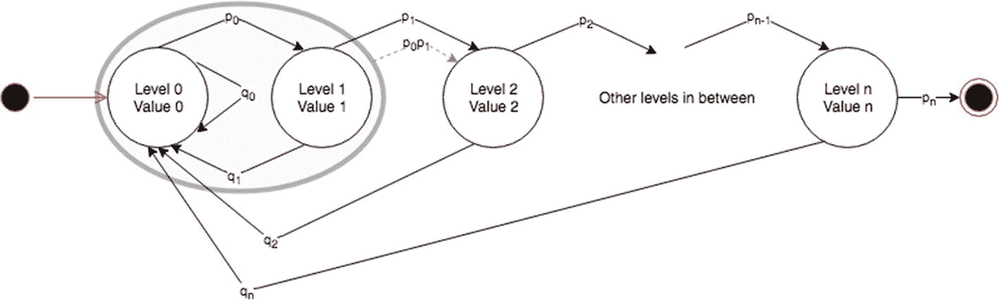

**图 12-3** — 问题的总体状态图

如果通过某个关卡的概率是 `p`，那么相反的结果就是 `q = 1 – p`。最终状态是获胜状态。目标是计算完成所有关卡后收集到的宝物的期望数量。图中显示的是将要首先聚合的初始状态对。

#### 对聚合状态进行建模

关于组合后的状态，有两个问题需要回答：

- 新状态的联合概率是多少？
- 新状态的联合价值（我将用 `v` 表示价值）是多少？

我们已经回答了第一个问题，如图 12-3 所示。新价值是最后一个价值加上考虑到所有可能离开这两个状态的方式后的期望宝物数量之和。最简单的情况是连续通过两个状态，没有在任何一关死亡。下一种可能性是在第 0 关死亡一次，然后连续完成两个状态。第三种情况是在第 0 关连续死亡两次，然后连续完成两个状态。这种模式会无限延续下去。我们可以用公式 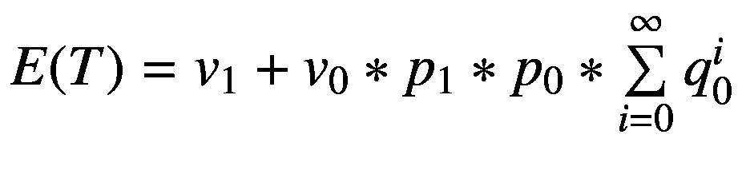 来描述所有这些情况，其中 `E(T)` 是期望宝物数量。

最后一个表达式已经包含了两个强大的抽象。我们现在应该将它们综合起来。别忘了，完成这两个关卡的途径还有很多，这意味着直接操作原始概率很快就会变得笨拙。第一个抽象来自代数，它提供了一个求和的封闭解。这被称为几何级数求和 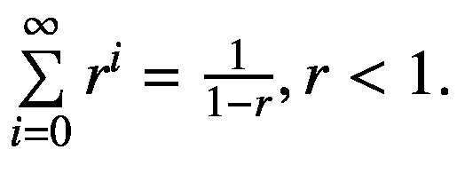。在我们的例子中，参数 `r` 总是一个非负实数。为抽象命名很重要，这个求和将被记为 `series1(r)`。我们的第二个抽象是 *γ* = *p*[0] ∗ *series1*(*q*[0])，其含义是“离开第 0 关的概率”。注意，我们可以不死亡就离开这一关，也可以死亡一次、两次等等再离开。

离开这两个关卡的另一种情况由以下伪代码描述：

```
重复任意多次：
    以任何方式离开第 0 关
    在第 1 关死亡
    至少死亡一次后离开第 0 关
    通过第 1 关
```

得益于之前引入的抽象，我们可以用简洁的方式将上述用例的联合概率表示为 *series1*(*γ* ∗ *q*[1]) ∗ *q*[0] ∗ *γ* ∗ *p*[1]。注意 *γ* 是如何嵌套在 `series1` 内部的。

下一个用例与在不死于第 0 关的情况下，通过在第 1 关多次死亡来积累财富的能力有关。换句话说，这个场景由以下伪代码描述：

```
重复任意多次：
    通过第 0 关
    在第 1 关死亡
    通过第 0 关
    通过第 1 关
```

在这种情况下，每次迭代后，留在第 1 关的宝物数量等于 *v*[0] ∗ *m*，其中 `m` 是迭代次数。为了有效地描述这种情况，我们需要一个新的抽象，它是几何级数求和的衍生形式：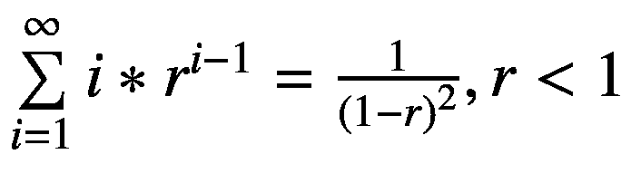。我们将这个抽象命名为 `series2(r)`。因此，联合概率由 *series2*(*p*[0] ∗ *q*[1]) ∗ *p*[0] ∗ *p*[1] 给出。

最后一点是，最后一个用例也可以与第二个用例相关联。换句话说，可以先积累财富，然后在最后一轮，因为至少死亡一次才离开第 0 关而失去所有财富。

#### 将所有部分整合在一起

在重构了每个用例的公式后，完整的解决方案如代码清单 12-1 所示。`combine` 函数接收两个连续关卡的原始概率和价值作为输入，并返回聚合后的概率和宝物的期望值。在此过程中，它从原始数据中构建抽象。这与神经网络从原始输入节点开始，通过隐藏层创建抽象层级，最终输出结果的方式非常相似。

我们可以去掉 *γ*，因为它等于 1。此外，我们可以直接内联 `series1` 和 `series2`，并将表达式 `series1(q1)` 简化为 `1 / p1`。最终结果与展开后的版本几乎完全不同。优化应该作为最后一步。这类优化也同样发生在神经网络内部。并非所有由隐藏层产生的特征都同样有用，也不会以独立的方式被使用（许多特征会被整合到更高级的抽象中）。

```
class AToughGame:
    def expectedGain(self, prob, value):
        def combine(level0, level1):
            p0, v0, p1, v1 = level0[0], level0[1], level1[0], level1[1]
            q0, q1 = 1 - p0, 1 - p1
            return p0 * p1, v1 + v0 * p1 ∗ (p0 + q0 / p1) * (1 - p0 * q1) ** -2
        from functools import reduce
        return reduce(combine, zip(map(lambda p: p / 1000, prob), value))[1]
```

**代码清单 12-1** — `AToughGame.py` 模块，实现了 Topcoder 问题 `AToughGame`

类名和唯一的方法签名是需求规范的一部分（参见练习 12-1）。尽管所有抽象都是手动创建的，但其中的内部细节对于没有阅读过前述说明的人来说是难以理解的。因此，你务必为压缩后的代码附上合适的设计文档。

看看前面的代码，你可能会好奇这九行代码（包括样板代码和空行）中的智慧何在。也许你运行它，看到它在几纳秒内就给出解决方案，会惊叹于它的巧妙。你能想象它包含了所有必要的知识，来考虑玩家可能完成游戏的所有方式吗？这个程序很好地说明了 1990 年代之前 AI 的状况。当时的软件解决方案预先配备了所有必要的启发式规则。

现在，想象一个软件魔法师，它能够解读处理问题所需的所有抽象。这正是神经网络大放异彩的地方。你只需定义解决方案的架构，然后将生成更高级符号的艰巨任务交给网络。上层网络会复用来自下层的抽象。层数越多，产生的特征就越复杂。


### 基于机器的特征工程

现在我们将构建两个版本的神经网络，以演示自动特征工程及其工作原理。第一个版本将从零开始构建，第二个版本将使用 `PyTorch`。你在第 7 章（关于机器学习）中已经看到过线性回归，其中输出被估计为 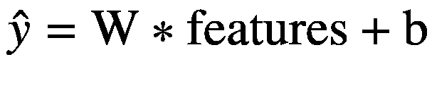（`W` 是特征的权重，`b` 是偏置项）。不过，特征可能包含非线性成分。可以为这个输出关联一个激活函数；这样做可以将线性回归转变为用于分类的逻辑回归。激活函数甚至可以是一个简单的阶跃函数，当 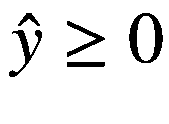 时输出 1，否则输出 0。事实上，任何具有某种阈值来区分正负样本的函数都可以用作激活函数。

图 12-4 展示了一个具有一个输入层、一个隐藏层和一个输出层的神经网络通用结构。输入层的节点数量等于不同特征的数量（此处为两个），再加上一个额外的常数节点来表示偏置。隐藏层的节点数量是可配置的。输出层的节点数量等于目标变量的数量（此处仅有一个）。

隐藏层中带阴影的节点由一个聚合器和一个激活函数组成。节点的聚合器计算匹配的输入权重与输入的乘积，而激活函数则对聚合器的输出值进行变换。当你进行的是分类而非回归任务时，最终的输出节点也可能应用一个激活函数。在图 12-4 中，激活函数是 Sigmoid 函数，其公式也在图中给出（你可以看到其关于输入的导数非常简洁）。

每个神经网络在使用前都必须经过训练，训练本质上是一个寻找合适权重的迭代增量过程。开始时，权重被初始化为一些较小的随机值。一个训练周期（迭代）由两部分组成：前向传播（计算最终输出）和反向传播（通过网络回传误差来更新权重）。周期会重复进行，直到网络收敛到稳定的权重。每次迭代传统上被称为一个*轮次*。

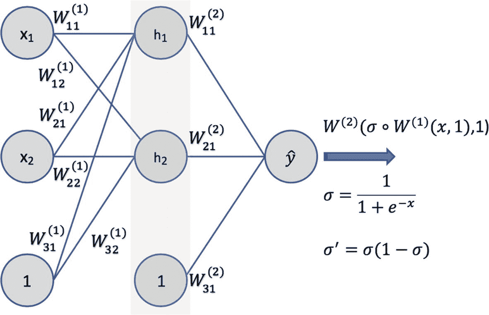

*图 12-4 用于回归任务的具有一个隐藏层的简单神经网络架构*

误差是真值与预测值之间的差，表示为 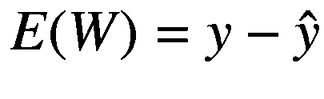。该误差函数对权重的一组偏导数为我们提供了更新权重所需的梯度；这是梯度下降方法的核心。更新权重 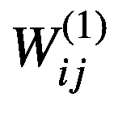 的量是 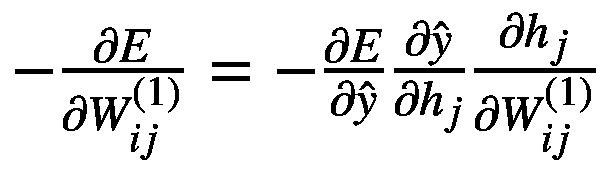，这是链式法则在导数计算中的应用。如果最终输出也应用了激活函数，上述表达式会多出一项。无论如何，这些偏导数只有在激活函数（或多个激活函数；你可以在每一层使用不同的函数）是连续且可微时才是可行的。此外，为了避免深度神经网络中出现的梯度消失问题（当所有偏导数的乘积变得非常小时），激活函数应该将输出分布在一个更大的范围内。在这方面，Sigmoid 函数表现不佳。这就是你会看到双曲正切函数（`tanh`）或线性整流单元（`ReLU`）在发挥作用的原因。后者是隐藏层的默认选择。

为了避免权重突变，存在一个称为*学习率*的超参数。每个梯度都会乘以这个量，从而使优化过程谨慎地朝着最小值（通常是良好的局部最小值）移动。

神经网络的能力源于隐藏节点输出的非线性。在深度神经网络中，随着每一层重复使用前一层的输出，可以从原始输入中创建出复杂的特征。美妙之处在于，你无需担心网络如何以简洁的方式描述问题。当然，缺点是你会很难解释网络的决策过程。还有一个令人惊叹的项目，可以从深度神经网络创建的中间特征中产生视觉效果（请访问 [`https://github.com/google/deepdream`](https://github.com/google/deepdream)）。


#### 从零开始的实现  

清单 12-2 提供了一份仅使用 NumPy 数组的简单神经网络完整实现。这段代码实际上是我在 [`http://bit.ly/project-bikes`](http://bit.ly/project-bikes) 上完成的 Udacity 共享单车项目解决方案（我也推荐 Udacity 上免费的优秀课程《使用 PyTorch 入门深度学习》）。  

```python
import numpy as np

class NeuralNetwork:
    def __init__(self, input_nodes, hidden_nodes, output_nodes, learning_rate):
        self.input_nodes = input_nodes
        self.hidden_nodes = hidden_nodes
        self.output_nodes = output_nodes
        # 使用正态分布将权重初始化为较小的随机值。
        self.weights_input_to_hidden = np.random.normal(
            scale=self.input_nodes ** -0.5,
            size=(self.input_nodes, self.hidden_nodes))
        self.weights_hidden_to_output = np.random.normal(
            scale=self.hidden_nodes ** -0.5,
            size=(self.hidden_nodes, self.output_nodes))
        self.lr = learning_rate
        self.activation_function = lambda x: 1 / (1 + np.exp(-x))  # sigmoid

    def train(self, features, targets):
        delta_weights_i_h = np.zeros(self.weights_input_to_hidden.shape)
        delta_weights_h_o = np.zeros(self.weights_hidden_to_output.shape)
        for X, y in zip(features, targets):
            y_hat, hidden_outputs = self.__forward(X)
            delta_weights_i_h, delta_weights_h_o = self.__backward(
                y_hat, hidden_outputs, X, y, delta_weights_i_h, delta_weights_h_o)
        self.__update_weights(delta_weights_i_h, delta_weights_h_o)

    def run(self, X):
        return self.__forward(X)[0]

    def __forward(self, X):
        hidden_inputs = np.dot(X, self.weights_input_to_hidden)
        hidden_outputs = self.activation_function(hidden_inputs)
        final_inputs = np.dot(hidden_outputs, self.weights_hidden_to_output)
        y_hat = final_inputs
        return y_hat, hidden_outputs

    def __backward(self, y_hat, hidden_outputs, X, y, delta_weights_i_h, delta_weights_h_o):
        error = y - y_hat
        hidden_error = np.dot(self.weights_hidden_to_output, error)
        output_error_term = error
        hidden_error_term = hidden_error * hidden_outputs * (1 - hidden_outputs)
        delta_weights_i_h += np.dot(X[:, np.newaxis], hidden_error_term[np.newaxis, :])
        delta_weights_h_o += np.dot(hidden_outputs[:, np.newaxis], output_error_term[np.newaxis, :])
        return delta_weights_i_h, delta_weights_h_o

    def __update_weights(self, delta_weights_i_h, delta_weights_h_o):
        self.weights_hidden_to_output += self.lr * delta_weights_h_o
        self.weights_input_to_hidden += self.lr * delta_weights_i_h
```

*清单 12-2*  
*面向图 12-4 所示回归任务的简单神经网络实现（不含偏置）*  

该类有两个公有方法：`train` 和 `run`。私有的 `__update_weights` 方法并不计算 delta 权重的平均值，而是假设已提供的学习率包含了这一因子。这是一种常见做法，因为该参数本身就是一个需要针对每个问题单独调整的任意数值。  

权重使用标准差为 `sqrt(n)` 的正态分布初始化为较小的随机值（其中 `n` 是匹配层的输入节点数）。这被称为 Xavier 初始化，你可以在 [`http://bit.ly/xavier-init`](http://bit.ly/xavier-init) 了解更多信息。这是缓解梯度消失问题的另一种方式。  

以下是一份简单的操作指南，用于观察这个网络的运行效果：  

1. 执行 `git clone` [`https://github.com/udacity/deep-learning-v2-pytorch.git`](https://github.com/udacity/deep-learning-v2-pytorch.git) 克隆课程仓库。  
2. 进入 `project-bikesharing` 文件夹，将本章源代码中的 `simple_network1.py` 文件复制到该目录下。  
3. 删除 `my_answers.py` 文件，并将 `simple_network1.py` 重命名为 `my_answers.py`。  
4. 在 Jupyter notebook 实例中打开 `Predicting_bike_sharing_data.ipynb`，并按照说明进行操作。  

`simple_network1.py` 文件中的超参数设置如下：  

```python
iterations = 1000
learning_rate = 0.005
hidden_nodes = 20
output_nodes = 1
```

所有单元测试均应通过，并且你会得到如图 12-5 所示的测试数据折线图。该模型对数据的预测效果相当好，除了年度的最后一周。你可以看到，在 12 月 22 日到年底这段时间内，预测值高于实际数据。网络没有经过充分的训练来识别这个大多数人在圣诞节休假的时期。如果你仔细观察笔记本，会发现测试数据并未覆盖一个典型的时段，而这一关键时期在训练过程中被移除了。此外，`workingday` 这一特征也被从数据中删除了。


#### 使用 PyTorch 实现

清单 12-3 提供了我们简单神经网络的完整实现，但这次使用的是 PyTorch。PyTorch 帮助你减少需要编写的代码量，从而使产品更易于维护。同时，你在实现中引入微妙错误的可能性也更小。最重要的是，PyTorch 拥有大量强大的功能，例如对深度神经网络的支持，包括卷积网络、循环网络、门控循环网络和长短期记忆网络。由于训练深度神经网络的计算量相当大，PyTorch 允许你利用机器上的 GPU（只要你的环境也支持 CUDA 编程模型）。

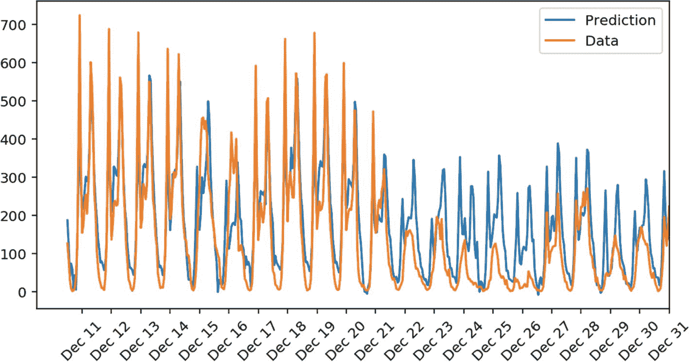

图 12-5

测试数据的实际输出和预测输出

```
from collections import OrderedDict
import torch
from torch import nn
class NeuralNetwork:
def __init__(self, input_nodes, hidden_nodes, output_nodes, learning_rate):
self.model = nn.Sequential(OrderedDict([
('fc', nn.Linear(input_nodes, hidden_nodes)),
('sigmoid', nn.Sigmoid()),
('output', nn.Linear(hidden_nodes, output_nodes))]))
self.device = torch.device("cuda" if torch.cuda.is_available() else "cpu")
self.model.to(self.device)
self.criterion = nn.MSELoss()
self.optimizer = torch.optim.SGD(self.model.parameters(), lr = learning_rate)
def train(self, features, targets):
features, targets = features.to(self.device), targets.to(self.device)
self.model.train()
self.optimizer.zero_grad()
output = self.model(features)
loss = self.criterion(output, targets)
loss.backward()
self.optimizer.step()
def run(self, x):
self.model.eval()
with torch.no_grad():
return self.model(torch.tensor(x.values, dtype = torch.float) \
.to(self.device)).cpu().numpy()
清单 12-3
使用 PyTorch（若可用则利用 GPU）实现的网络版本。超参数也已更改（请参阅 simple_network2.py 模块）。
```

`NeuralNetwork` 类通过鸭子类型优先使用组合而非继承，并将 PyTorch 网络对象保存为内部属性`model`。`OrderedDict` 对于命名网络的每一层非常有用。你可以稍后通过输入 `self.model.<名称>` 轻松引用它们。整个代码只是一系列声明，而不是底层的实现细节。你可以立即从 `train` 方法的主体中读出高级反向传播算法：

1. 将梯度归零（与我们之前在清单 12-2 中所做的相同）。
2. 通过网络进行前向传播。
3. 计算误差。
4. 反向传播误差以找到用于更新权重的适当增量。
5. 更新权重。

PyTorch 使用张量进行操作，张量是 n 维向量。要运行这个新版本，你需要在 `Predicting_bike_sharing_data.ipynb` 笔记本中修改用于训练网络的代码单元格。不要尝试运行单元测试，因为它们与此代码不兼容（你可以将其作为额外练习进行调整）。清单 12-4 显示了使用 PyTorch `DataLoader` 类的更新脚本（以粗体显示的行是对原始版本的补充，并且删除了一些行）。

```
import sys
import torch.utils.data as data_utils
from my_answers import iterations, learning_rate, hidden_nodes, output_nodes
print("Is CUDA available?", "Yes" if torch.cuda.is_available() else "No")
N_i = train_features.shape[1]
network = NeuralNetwork(N_i, hidden_nodes, output_nodes, learning_rate)
losses = {'train':[], 'validation':[]}
train = data_utils.TensorDataset(torch.Tensor(np.array(train_features)),
torch.Tensor(np.array(train_targets)))
train_loader = data_utils.DataLoader(train, batch_size = 128, shuffle = True)
for epoch in range(1, iterations + 1):
for X, y in train_loader:
network.train(X, y)
##### Printing out the training progress
train_loss = MSE(network.run(train_features).T, train_targets['cnt'].values)
val_loss = MSE(network.run(val_features).T, val_targets['cnt'].values)
sys.stdout.write("\rProgress: {:2.1f}".format(100 * epoch / iterations) \
+ "% ... Training loss: " + str(train_loss)[:5] \
+ " ... Validation loss: " + str(val_loss)[:5])
sys.stdout.flush()
losses['train'].append(train_loss)
losses['validation'].append(val_loss)
清单 12-4
使用 PyTorch DataLoader 类的更新脚本
```

图 12-6 显示了训练损失和验证损失随时间的变化。大约 200 个周期后，这两个数值都没有显著改善。你绝对应该在配备 GPU 的高性能机器上训练你的网络，否则完成训练将需要相当长的时间。

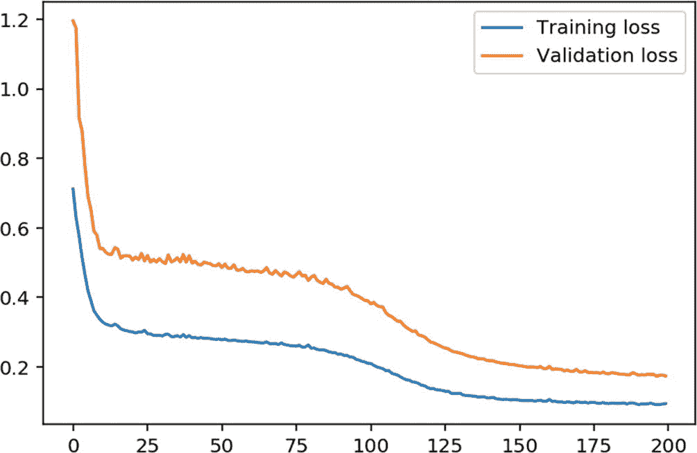

图 12-6

训练过程的效率。你应该始终监控验证损失曲线。如果它开始上升，则说明你的网络过拟合。如果训练损失没有下降，则说明你欠拟合。

### 练习 12-1\. 自定义并行化

在第 11 章中，我们应用 Dask 对数组执行并行操作。在某些情况下，这种形式的并发是不可行的。Dask 还提供了一个选项，可以通过 `dask.delayed` 接口对自定义算法进行并行化。

`expectedGain` 函数返回游戏结束时的预期宝藏数量。假设你想简单地返回连续通过所有级别的总概率。这当前作为最终元组中的第一个元素返回。创建一个新方法 `totalProbability`，该方法仅并行计算这个数量。

查看关于树求和（归约）的示例代码：[`https://examples.dask.org/delayed.html`](https://examples.dask.org/delayed.html)。你将使用乘法来合并节点，而不是使用 Dask 教程中的 `add` 操作。对于这种简单的树归约情况，你不需要自定义过程，但目的是尝试使用 `dask.delayed` 接口并监控 Dask 仪表盘中计算是如何执行的。

### 练习 12-2\. 部署到生产环境

PyTorch（从 1.0 版本开始）提供了将 Python 模型转换为中间格式的能力，该格式可以在 C++ 环境中使用。通过这种方式，你可以用 Python 开发解决方案，然后将其部署为 C++ 应用程序。这种方法满足了与生产环境设置相关的性能要求。

查阅关于在 C++ 中加载 PyTorch 模型的教程：[`https://pytorch.org/tutorials/advanced/cpp_export.html`](https://pytorch.org/tutorials/advanced/cpp_export.html)。在我们的案例中，由于前向实现是统一的（没有基于输入的条件逻辑），你可以通过跟踪将 PyTorch 模型转换为 Torch Script。


## 总结

使用`PyTorch`或其他神经网络框架对于应对深度神经网络固有的复杂性至关重要。`PyTorch`提供了许多现成的附加选项来优化训练过程：dropout、批归一化、各种先进的优化器、不同的激活函数等等。`PyTorch`还允许你将网络持久化存储到外部存储中以便日后使用。你可能希望在每次成功降低验证损失时保存模型。最后，你可以选出性能最佳的版本。

`PyTorch`捆绑了两个主要扩展：`pytorchvision`（用于图像处理）和`pytorchtext`（用于处理文本，例如进行情感分析）。你还可以重用公开可用的预训练模型来实现迁移学习的概念。例如，有些模型是在`ImageNet`（`http://www.image-net.org`）的图像上训练的，具有出色的图像分类功能。

有一个名为`PyTorch Hub`（`https://pytorch.org/hub`）的有趣倡议，旨在高效共享预训练模型，从而实现迁移学习的愿景。神经网络在物联网边缘端也是非常流行的选择。为此，你需要一个超轻量级的预封装引擎。一个例子是英特尔的`神经计算棒`（`http://bit.ly/neural-stick`）。总而言之，每个用例和领域都有非常创新和有趣的方法。

# 索引

### A

`主动学习` `Adamic-Adar 指数` `算法` `Alpha Vantage API` `Anaconda` 发行版 管理包 `Miniconda` 复制环境 `Spyder` 启动 `Apache Arrow` `Apache Parquet` `应用程序编程接口(API)` `CDC` 斐波那契数列 通用序列函数 收益递减规律 角色 `AToughGame` 问题 `attach_model` 函数 `增强型球体下落` 问题 规格说明 v1.1 边界与运动 寻路引擎 回顾 卫星图像数据集 v1.2 增强输入子系统 增强输出子系统 回顾 v1.3 方法 基线 非递归简单寻路器 `ParallelSimplePathFinder` 类 性能优化 回顾 基于复用的软件工程 特征 测试地形函数 `平均聚类系数`

### B

`中介中心性` `球体下落项目` 数据模型 代码 矩阵函数 `NumPy` print 语句 问题规格说明 模拟器 测试自动化 `伯努利概率分布` `偏差-方差权衡` `大数据` 四 V 特征 LHC (大型强子对撞机) MOOC (大规模开放在线课程) 旧式 *vs.* 现代数据科学项目 `二分图` 应用 角色 `bipartite.py` 模块 IoT 平台 评分关系 `煮蛙攻击` `布尔索引` 技术 `棕牛模型` `暴力程序`

### C

`接近中心性` `混沌域` `点击率(CTR)` `最近点对算法` 以 API 为中心和面向对象的开发 `欧几里得距离` 交互式信息辐射器 仪表盘 DSL 表格呈现 数据 v1.0 `暴力` 实现 `SnakeViz` v2.0 分治技术 v3.0 `FastClosestPair` `类` 排序函数 可视化调用层次结构 `Collect_mse` 内部函数 `combine` 函数 `社区` 共同邻居 `社区资源分配` `复杂域` `繁琐域` `概念/技术` 机器学习 共线性 `data_generator.py` 模块 误差项 `evaluate_model` 函数 特征 *vs.* 输出 高斯随机变量 MSE 正态分布 `observer.py` 模块 过拟合 真实世界过程 正则化 `残差` 图 `demo_residuals` 函数 `evaluate_model` 函数 `fit` 方法 `set_params()` 方法 运行时模型 `scikit-learn` 框架 `session.py` 模块 琐碎训练过程 欠拟合 警告模块 `%connect_info` 魔术命令 `消费者驱动契约(CDC)` `交叉验证(CV)分数` `圈复杂度` 升序 内建函数 执行流程 全局评估分数 排序例程 `spyder` `Cynefin` 域 象限 `Cynefin 框架`

### D

`Dask 数组` `Dask 数据框` `Dask 交付` `Dask 框架` `数据工程师` `DataLoader 类` `数据修改攻击` `数据准备` `数据预处理` 金融模型 特征 `AAPL 价格对数` `data_preprocessing.py` `模块` `data_visualization.py` 模块 `driver.py` 模块 直方图 对数收益率 归一化 异常值 收益率 波动率 `IPython` 控制台 `Pandas` 数据框 样式参数 时间序列 `AAPL` 收盘水平 移动平均 缩放 时间戳 `数据处理抽象` *对比* 潜在特征 增强型球体下落案例研究 `参见增强型球体下落` 压缩评分矩阵 `数据科学项目` `棕牛模型` 案例研究 (霍乱) 学习领域知识 领域相关术语 编程经验 旧式 *vs.* 现代 阶段 `数据安全` 备份程序 收集 泄露事件 关于电子邮件的推断 `微软安全开发生命周期` `OWASP` 阶段 问题 可疑电子邮件 工具样本 不安全的连接 `数据流` `数据类型` `数据可视化` 最近点对案例研究 `参见最近点对算法` `matplotlib` 架构 案例研究 地理地图 高级组件 绘制温度 `数据整理` `深度学习` `度中心性` `demo_metrics_and_mse` 函数 `demo_regularization` 函数 `数字` 计数 `失序` `分治` 技术 `可除数` 计数 `文档结构` 摘要 数据科学生命周期 阶段 数据集 缺点 未来工作 动机 项目 `参见维基百科编辑项目` 参考文献 `领域特定语言(DSL)` `driver.py` 脚本 程序 重构 可复用性

### E

`电子商务` 客户细分 CSV 格式 EDA 营销领域 项目在 `Spyder` 中 `参见 Spyder 项目` 结构化数据 `边中介中心性` `欧几里得距离` `欧洲经济区(EEA)` `expectedGain` 函数 `探索性数据分析(EDA)` `extract_config` 方法

### F

`特征工程` 列类型 自定义 `Age_Group` 柱状图 CTR 多层数据框 `NaN` 非零方法 点击次数已定义 `describe` 方法 哑变量 电子商务 已登出类别 `pandas` 包 散点图 `SciPy` `summarize` 函数 `信息茧房` `金融建模` 数据预处理 `参见数据预处理，金融模型` 数据检索 特征工程 相关矩阵 创建特征 `feature_engineering.py` `模块` 热力图 绘制 对数收益率 均值回归 散点图 `TA-Lib` 目标特征 时间序列分析 添加时间戳 `find_path` 方法 `修复缺陷` 软件方法 敏捷方法 正确版本 代码 业务语言 缺陷代码 改进后的修复 单元测试 向量化版本 业务相关参数 经典参数 `NumPy` 框架 `全批量学习` `趣味电梯` 案例研究 分治范式 社会经济/社会技术方面 测试 未优化变体

### G

`通用数据保护条例(GDPR)` 绝对主义方法 架构 基于属性的访问控制模型 行为模式 控制者/处理者 法规 数据泄露 `DevOps` 范式 领域驱动设计 欧盟组织 基本权利 医疗系统 合法处理 微服务 远程访问 请求 风险管理 安全措施 `generate_points` 方法 `地理编码 API` `GitHub` 仓库 `全球历史气候学网络-每日(GHCN-Daily)` `图分析` 二分图 质量属性 社交网络 使用矩阵 内建 `matplotlib` 引擎 通用模板 `Graphviz` 多重图 `NetworkX` 优化任务 样本实例 `用例` `UML` 用例图 `usage_matrix.py` `模块` 同意

### H

`高维数据集` `同方差输出`

### I

`in_degree` 方法 `智能机器` `IPyWidgets` `第 i 个影子模型`


### J

`Jaccard coefficient` `JupyterHub` `JupyterLab` `Anaconda Navigator` `code execution` `abrupt stoppage` `cells` `doctest` `tests` `error message` `Hanoi Tower Solver` `HTML` `notebook` `output` `project` `SeeBall Descend` `project` `screen simulator` `notebook` `Jupyter Notebook` `Jupyter project` `notebook` `principal components` `tools` `Jupyter widgets` 和 `notebook extensions`

### K

`Kafka` `Kaggle` `KDD Cup 1999 Data` `Kernel` `K-fold CV`

### L

`Local clustering coefficient (LCC)` `Label flipping` `Label modification attack` `Large Hadron Collider (LHC)` `Large-scale software system` `adaptive maintenance` `corrective maintenance` `definition` `fixing bugs` `holistic approach` `knowledge areas` `life cycle model` `preparation/planning phase` `preventive correction` `preventive maintenance` `scope` `tournament chess game, analogy` `types` `Las Vegas model` `Lehman’s laws of software evolution` `LensKit for Python (LKPY)` `extract_config` 方法 `Fallback` 类 `knn` 包装包 `lkpy_demo.py` 文件 `MultiEval` 设施 `nDCG` `Top-N accuracy` 指标 `package structure` `PMML` 序列化模型 `README.txt` 文件 `SciPy` 风格 `UML class diagram` `UserUser` 算法 `Linear regression` `nonparametric` `parametric` `semiparametric` `%load lkpy_demo.py` `Logistic regression` `Log returns`

### M

`Machine-based feature engineering` `implementation from scratch` `implementation with PyTorch` `Machine learning` `big data` `concepts/techniques` `SeeConcepts/techniques, machine learning` `methods` `styles` `Machine learning as a service (MLaaS)` `Manual feature engineering` `aggregated state` `combine function` `Massive open online course (MOOC)` `Mean squared error (MSE)` `Membership inference attack` `black-box` `MLaaS` `overfitted model` `training dataset` `white-box` `Mini-batch learning` `Miniconda distribution` `Monstrous models`

### N

`Naive algorithm` `Naming abstractions` `nbconvert` `nbviewer` `NetworkX` `next_neighbor` 方法 `Not a Number (NaN)` `NumPy` 包

### O

`Old vs. Modern data science projects` `Online learning` `Open-source software (OSS)` `OpenStreetMap` `Open triads` `Open Web Application Security Project (OWASP)`

### P

`pairplot` 函数 `Path finder` `find_path` 函数 `terrain` `top-down decomposition` `wall` 函数 `Perl` 模块 `plot_mse` 函数 `Poisoning attack` `categories` `linear regression model` `Poison insertion attack` `Policy authoring point (PAP)` `Policy decision point (PDP)` `Policy enforcement point (PEP)` `Policy information point (PIP)` `Prediction accuracy` 指标 `Predictive Model Markup Language (PMML)` `predict_proba` 方法 `Preferential attachment` `Principal component analysis (PCA)` 方法 `Privacy, meaning` `Problem-solving ability` `Public data sources` `data analysis` `Internet, accessible` `%pwd` 魔法命令 `scikit-learn`

### Q

`Quandl` `Quantitative data`

### R

`read_csv` 函数 `Recommender systems` `machine learning, usage` `mashup` `movie` `JSON` 响应 `OMDb` 服务 `simple_movie_recommender.py` 模块 `tastedrive_service.py` 模块 `MovieLens` `categories` `collaborative filtering` `content-based` `context-based` 系统 `information retrieval` `system interfaces` `relational database` `system types` `untracked option` `standard` `root mean squared error` `Reinforcement learning` `requests` 包 `Resilient distributed dataset (RDD)` `Ridge regression` `runtime model`

### S

`Scalable graph loading` `CSV file` `load graph` `nodes.csv` 文件，内容 `standard edge list format` `Scaled percent returns` `Scatter matrix plot` `SciPy ecosystem` `Semi-supervised learning` `Shadow training` `attack model` `highest-scored label` `overall structure` `target system` `test sets` `Simple domain` `Simple moving average (SMA)` `sklearn.feature_selection` 模块 `Social network` `centrality` `eccentricity` `karate club network` `LCC` `local/global graph metrics` `machine learning systems` `NetworkX’s documentation` `prediction measures` `single metric graph` `six degrees of separation` `Socio-∗ pieces of software` `production` `socio-economic aspects` `socio-technical aspects` `Software engineering` `agile principles` `application` `bug free` `legacy code` `context awareness and communication` `bug` `SeeFixing bug, software engineering` `cone of uncertainty` `constant feedback loop` `context and knowledge oblivious` `cyclomatic complexity` `knowledgeable` `conventions` `faculty code` `large-scale software systems` `legacy code` `Python ecosystem` `quality assurance tools` `risk` `rules and principles` `Software engineering vs. data science` `Source lines of code (SLOC)` `Spyder` `project` `chunk data` `code restructure, CSV file` `dataset download` `feature, association` `SeeFeature engineering` `file sizes` `IPython console` `shell-related magic commands` `driver code` `folder structure` `nyt_data.py` 脚本 `results` `Apache Parquet` `driver.py` `multilevel index` `Parquet engine` `summarize` 函数 `test pipeline` `click-through rate` `get_file_number` 函数 `number of clicks` `traverse` 函数 `UI` `Staged processing` `Stochastic gradient descent` `Streaming linear regression` `Apache Spark’s MLlib` `framework` `driver.py` 模块 `RDD` `setIntercept` 方法 `streaming_regression.py` 模块 `training and test streams` `StreamingLinearRegressionWithSGD` 类 `Streaming system` `Stream processing` `Structured data` `style` 参数 `Sum of squared errors (SSE)` `Supervised learning` `Systems/software development life cycle (SDLC)`

### T

`TA-Lib` `Total cost of ownership (TCO)` `Transitivity` `t-SNE` 方法 `features and components` `power variables` `Turing test` `setup`

### U

`UCI Machine Learning Repository` `Unbiased minimal variance estimator` `Unsupervised learning` `Use cases (UCs)`

### V

`VarianceThreshold` 类 `Variety` `Velocity` `Veracity` `Visualization` `Volume`

### W, X, Y

`Wikipedia edits` `project` `abstract` `data drawbacks` `JupyterLab notebook` `motivation` `specification` `fixing`

### Z

`zipfile` 包

# 地标

1.  封面
2.  目录
3.  正文
