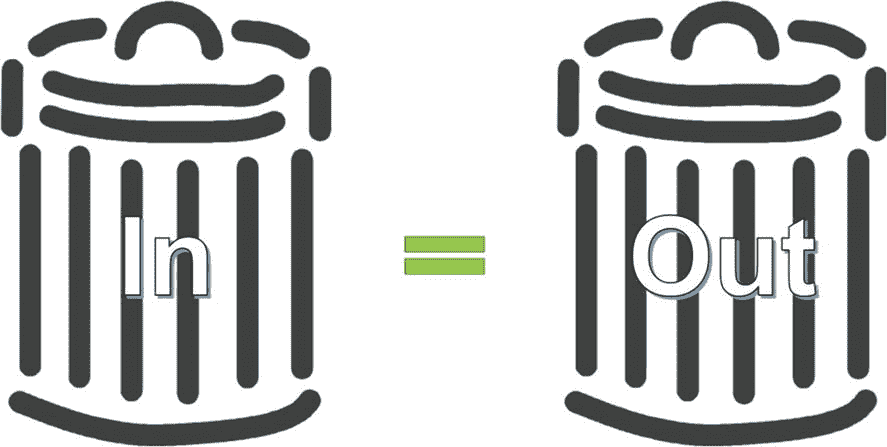
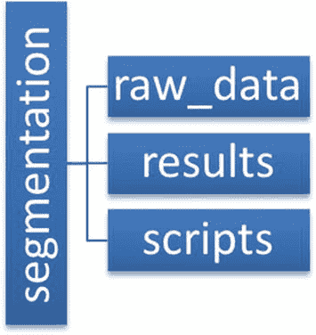
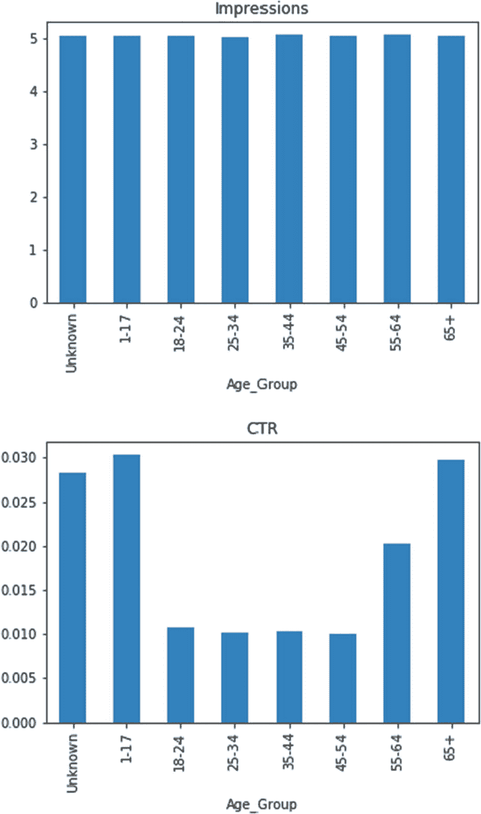
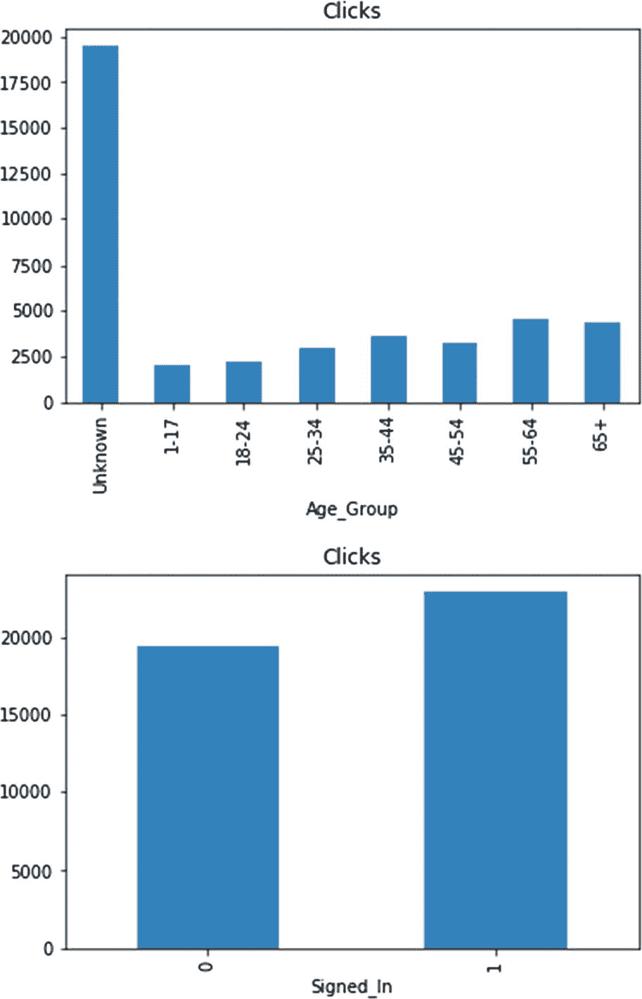
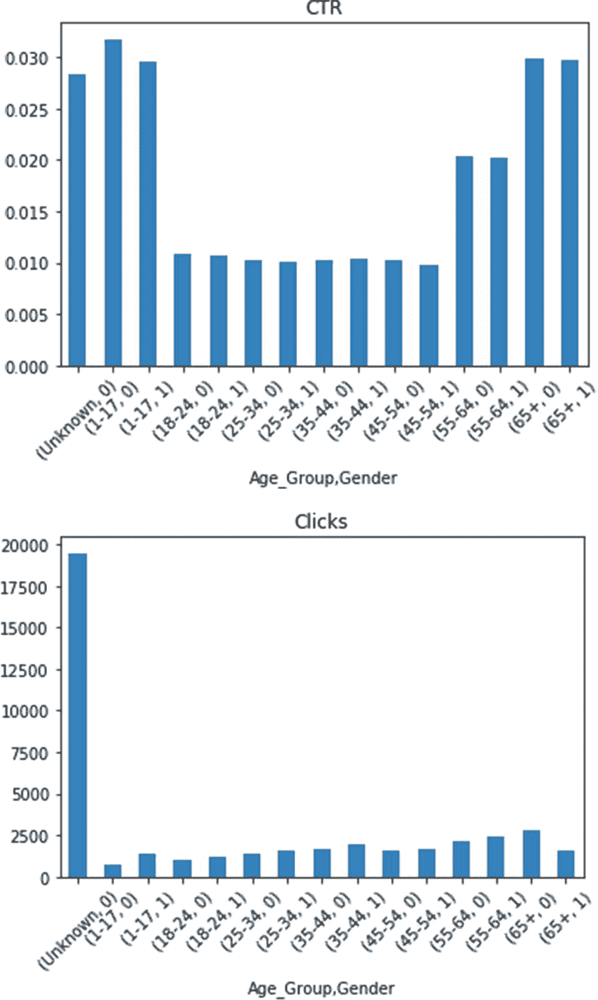
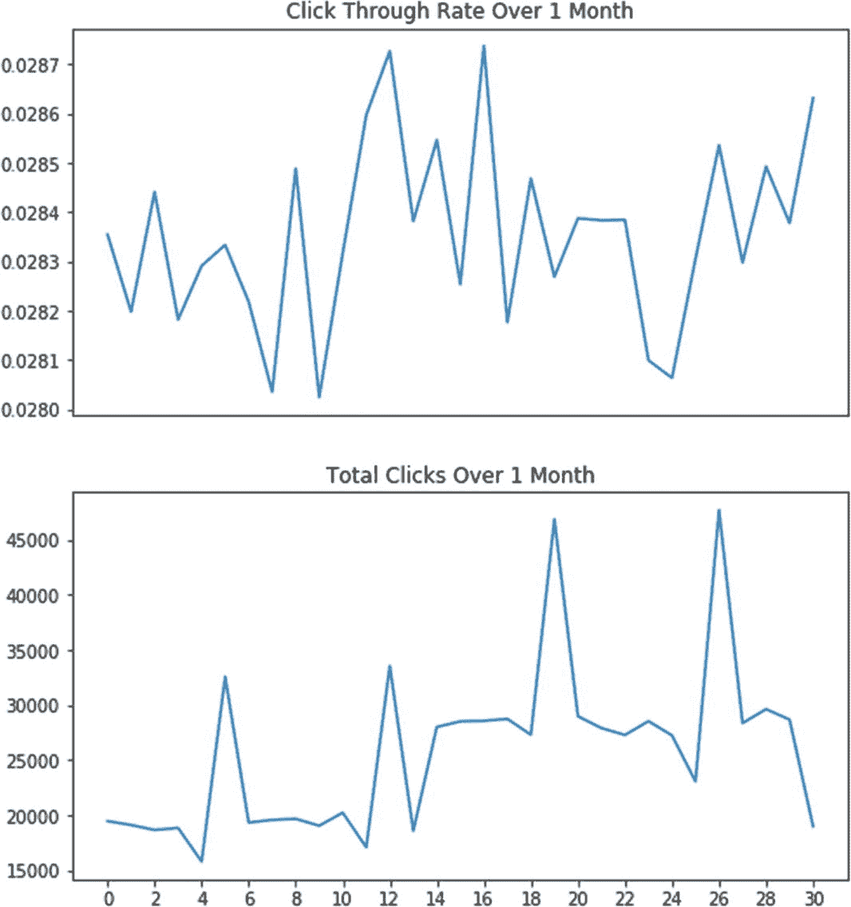

# 2. 数据工程

项目启动后，数据工程团队将接手构建必要的基础设施，以完成数据的获取（识别、检索与查询）、整理、探索和持久化存储。其目标是支持后续的数据分析任务。数据工程所需的技术专长与数据科学流程后续阶段的要求不同。它通常是一门偏向工艺的工程学科，旨在为后续阶段提供必要的输入。往往需要协调多种异构技术来处理数据通信协议和格式、执行探索性可视化、进行预处理（清洗、整合与打包）、扩展及变换数据。所有这些任务都必须在全局项目愿景和使命的背景下，依托领域知识来完成。原始数据源几乎不可能立即处于适合分析的完美状态。即使数据集本身很干净，也常常需要对其进行简化。因此，结合特征选择（删除、添加与组合）的降维也属于数据工程的一部分。本章通过一个详细的案例研究来说明数据工程，该案例涵盖了其大部分方面。本章还介绍了一些公开可用的数据源。

数据工程师还必须对数据收集方法保持探究精神。这一点常常被忽视，而焦点往往放在数据表示上。我们总是可以修改原始数据的格式，但对于数据收集方面的调整却几乎难以想象（除非你愿意重做整个数据获取工作）。例如，如果你收到一份 Excel 格式的调查结果，将其转换并保存到关系数据库中轻而易举。另一方面，如果调查参与者没有经过仔细筛选，那么输入数据就可能存在偏差（偏向特定用户类别）。你无法通过工具或程序来纠正这种错误。

图 2-1 展示了著名的数据准备黄金法则：如果输入的是垃圾，那么输出的也必然是垃圾。



图 2-1

措辞不当的问题无法带来好的答案。同样，糟糕的输入也无法产生好的输出。

## 电商客户细分：案例研究

本案例研究通过使用来自 `https://github.com/oreillymedia/doing_data_science` 的免费小型数据集（另见本章末尾“参考文献”部分的[1]）介绍了探索性数据分析（EDA）。该数据集包含（除其他数据外）2012 年 5 月《纽约时报》主页上展示的广告和记录的点击量的模拟观测数据。共有 31 个 CSV 格式的文件，每天一个文件；每个文件命名为 `nyt<DD>.csv`，其中 `DD` 是月份中的日期（例如，`nyt1.csv` 是 5 月 1 日的文件）。文件中的每一行代表一个用户。跟踪的特征包括：年龄、性别（0=女性，1=男性）、广告展示次数、点击次数以及登录状态（0=未登录，1=已登录）。

上述描述代表了许多数据科学项目通常的起点。基于此描述，我们可以推断本案例研究涉及的是*结构化数据*（另见侧边栏“数据的分类”），因为数据按照 CSV 格式以二维形式组织（行和列），其中每一列的值都是单值且必填的。如果描述中允许某些列取多个值（例如，文本形式的值列表）、允许为空或数据类型可变，那么我们将处理的是*半结构化数据*。然而，我们既不了解数据的质量，也不清楚数据内容是否存在任何隐藏的假设。这就是为什么我们必须进行 EDA：熟悉数据，获取关于用户行为的宝贵见解，并为后续分析做好一切准备。在 EDA 过程中，我们还可以发现数据获取方面的缺陷（如缺失或无效数据），并在进行清洗工作的同时将这些发现作为缺陷报告出来。

### 注

*结构化数据*并不意味着数据是整洁和准确的。它只是强调了我们对数据组织方式、预估数据处理工作量以及复杂度的期望。

### 数据的分类

我们有两种广泛的数据类型：*定量*（数值型）和*定性*（类别型）。只有定量数据才能应用有意义的算术运算。在我们的案例研究中，展示次数是定量变量，而性别虽然是数值编码（例如，我们本可以使用符号 F 和 M），但属于定性变量。

数据类型的度量级别可以是：定类、定序、定距或定比。*定类*是对类别的基本枚举（如性别和登录状态）。比较这些类别或执行数学运算都没有意义。*定序*级别建立了数值的排序（T 恤尺码 XS、S、M、L、XL 就是按尺寸顺序明确排列的类别）。*定距*适用于加法和减法有意义的定量变量。然而，乘法和除法则不适用（这意味着数值没有真正的起始点）。*定比*级别允许所有算术运算，尽管在实践中这些变量通常被限制为非负值。在我们的案例研究中，年龄、展示次数和点击次数都属于该级别（它们都是非负数）。

理解这些级别的区分对于掌握汇总数据所需的适当统计方法至关重要。数据有两个基本描述符：*集中趋势*描述数据*趋向于*何处，而*标准差*描述数据围绕中心值的平均离散程度（这不是精确的公式化表述，但暂时够用）。例如，计算定类数值的平均值毫无意义，只需找出众数（出现最频繁的项）即可。对于定序数据，提供中位数是有意义的；而对于定距和定比数据，我们通常使用均值（当然，对于它们来说，所有集中趋势度量都适用）。

第 1 章涵盖了数据科学流程，并强调了项目启动阶段的重要性，即我们就在工作范围和主要目标建立共同愿景和使命的阶段。数据工程团队必须了解这些，并与项目中的其他利益相关者完全保持一致。这需要足够的领域知识来打开适当的沟通渠道，并使数据工程工作的成果对其他人有用。随意摸索只会让你自欺欺人地以为自己正在进行某种“探索”。所有行动都必须在一个共同背景下进行。

话虽如此，让我们重新审视案例研究的主要目标，并更深入地探究营销领域。最初的数据收集工作旨在提高广告工作的可见性。公司通常在起步阶段就获取数据，这作为其战略宏图的一部分是很常见的。有了这些数据，我们现在需要采取下一步行动，即通过更好地管理用户营销活动来提高销售额。

当用户访问网站时，他们会接触到各种广告；每一次曝光都会增加*展示次数*计数器。目标是吸引用户点击广告，从而创造销售机会。追踪用户行为的一个有用指标是*点击率*（这是领域知识的一部分），其定义为 `点击次数 / 展示次数`。平均而言，这个比率非常小（2% 已被视为高值），因此即使是微小的改进也意义重大。我们的任务是找出提高点击率的最佳策略。

营销领域的一个众所周知的事实是，定制化营销活动远比盲目地向用户投放广告更有效。任何定制化都固有地假设存在不同的用户群体；否则，定制化的基础就不存在。目前，我们不能对营销活动设计或如何划分用户群体做出任何假设。尽管如此，我们可以尝试研究哪种细分方式能显示出用户行为的最大差异。此外，我们必须确定描述用户的最佳指标是什么。总而言之，我们有很多动态目标需要调查；这不应让你感到惊讶，因为我们正处于 EDA 阶段。一旦我们明确了方向，我们就可以通过创建完整的数据准备流水线来实现整个过程的自动化（我们将在后续章节中讨论此类流水线）。

### 在 Spyder 中创建项目

启动 Spyder（如需 Anaconda 设置说明，请参考第 1 章），然后选择菜单项“项目 ➤ 新项目”。在打开的对话框中，指定项目名称（此处为 `segmentation`）、位置（在你的机器上选择一个文件夹作为此项目的父目录）和类型（保持为 `Empty Project`）。在文件资源管理器中，创建如图 2-2 所示的文件夹结构。`raw_data` 文件夹包含解压后的文件，`results` 文件夹存放清洗和准备好的数据，`scripts` 文件夹存储各种 Python 程序。`segmentation` 文件夹包含驱动代码。在后续章节中，你将需要通过选择“文件 ➤ 新建文件”来创建 Python 文件。



图 2-2 Spyder 项目文件夹结构

### 下载数据集

你现在应该下载数据集并解压它。你可以手动、通过 shell 脚本或从 Python 中（列举几种选项）完成此操作。我选择了最后一个选项来演示 Python 中的一些技巧，尽管我更喜欢用 bash 脚本处理这类事情。清单 2-1 展示了下载脚本 `nyt_data.py`，它负责下载数据集并执行必要的清理工作。注意它是如何解压包含我们数据的嵌入式 ZIP 文件的。`cleanup` 过程展示了基本的异常处理。

# 数据获取与初步探索

## 代码示例

```python
import requests, zipfile, io, shutil
unpackedFolder = '/dds_datasets/'
unpackedZipFile = 'dds_ch2_nyt.zip'
def retrieve(sourceFile, destinationFolder):
def cleanup():
try:
shutil.rmtree(destinationFolder + unpackedFolder)
except OSError as e:
print("Folder: %s, Error: %s" % (e.filename, e.strerror))
r = requests.get(sourceFile)
assert r.status_code == requests.codes.ok
z = zipfile.ZipFile(io.BytesIO(r.content))
z.extractall(destinationFolder)
#### 顶层归档文件中包含另一个包含我们数据的 ZIP 文件。
z = zipfile.ZipFile(destinationFolder + unpackedFolder + unpackedZipFile)
z.extractall(destinationFolder)
cleanup()
清单 2-1 nyt_data.py 脚本
```

`requests` 包是 Python 主要的 HTTP 库（参见 [`https://requests.readthedocs.io`](https://requests.readthedocs.io)）。检索到的内容可通过 `r.content` 获取。`zipfile` 包用于管理归档文件，`shutil` 提供高级文件操作。我们用它来删除包含嵌入式归档文件的临时文件夹。清单 2-2 展示了这部分工作的驱动代码。它是用于下载原始数据的 `driver.py` 脚本的第一部分。由于它调用了 `scripts` 文件夹中的脚本，因此必须将该文件夹添加到路径中。驱动程序必须从项目的根文件夹执行。另外，请注意 `fileUrl` 以 `raw` 开头，而不是 `blob`。

```python
import sys
import os
sys.path.append(os.path.abspath('scripts'))
from nyt_data import retrieve
repoUrl = 'https://github.com/oreillymedia/doing_data_science/'
fileUrl = 'raw/master/dds_datasets.zip'
retrieve(repoUrl + fileUrl, 'raw_data')
print('原始数据文件已成功获取。')
清单 2-2 驱动代码
```

执行清单 2-2 后，CSV 文件将位于 `raw_data` 子文件夹中。你可以在 Spyder 的文件资源管理器中轻松验证这一点。

## 探索数据集

让我们从窥探数据集开始我们的旅程。我们将在 Spyder 的 IPython 控制台中执行所有步骤。这提供了一个交互式工作环境，也是 Python 在数据科学家中如此受欢迎的基石。你可以输入语句并立即观察它们的执行结果。无需像编译型语言那样等待冗长的编辑/构建/执行周期。下面是打印当前工作目录的结果（你的输出可能因项目父文件夹而异）^(⁵)：

```
>> %pwd
'/Users/evarga/Projects/pdsp_book/src/ch2/segmentation'
```

`%pwd` 这个魔术命令模仿了原生的 `pwd` bash 命令。你也可以使用 `!pwd` 获得相同的结果（`` `!` `` 是转义字符，用于表示其后为 shell 命令）。与 shell 相关的魔术命令是操作系统无关的，因此在可用时使用它们是有意义的。有时，就像 `!cd` 的情况一样，原生 shell 命令甚至无法正确运行（你必须依赖相应的魔术命令变体）。访问 [`https://ipython.readthedocs.io/en/stable/interactive/magics.html`](https://ipython.readthedocs.io/en/stable/interactive/magics.html) 获取内置魔术命令的帮助；运行 `%man <shell 命令>` 来获取 shell 魔术命令的帮助（例如，尝试 `%man head` 或 `%man wc`）。现在，通过运行 `%cd raw_data` 切换到 `raw_data` 文件夹（观察文件资源管理器如何刷新其显示）。

我建议你始终先用最基本的技术预览一些原始数据文件。当你对数据内容有了初步印象后，再使用更强大的工具和框架进行数据处理。以下是 `nyt1.csv` 文件的转储内容（仅显示前十行）：

```
>> !head -n 10 nyt1.csv
"Age","Gender","Impressions","Clicks","Signed_In"
36,0,3,0,1
73,1,3,0,1
30,0,3,0,1
49,1,3,0,1
47,1,11,0,1
47,0,11,1,1
0,0,7,1,0
46,0,5,0,1
16,0,3,0,1
```

第一行是包含合理命名列的标头。其余行是用户记录。尽管如此，仅凭这十行显示的内容，我们就能立即发现年龄字段有一个异常值：0。我们预料年龄不应该是非正数。稍后我们需要对此进行深入调查。

通过查看文件资源管理器中的文件大小，我们看到所有文件的大小都在 4.5MB 左右（其中几个较大，在 7.5MB 到 8MB 之间）。因此，大多数文件应包含相似数量的记录。让我们找出最小文件和最大文件中的记录数（单击“大小”选项卡按文件大小排序）：

```
>> !wc -l nyt26.csv
362235 nyt26.csv
>> !wc -l nyt13.csv
786045 nyt13.csv
```

因此，记录数在 [360K, 790K] 范围内波动，文件大小在 3.7MB 到 8.0MB 之间；即使在一台性能普通的笔记本电脑上，我们也不应该在处理单个文件时遇到内存问题。

## 发现特征之间的关联

前面提到的列是我们描述每个网页访客的基本特征。在我们深入探讨任何特征工程（即创建更具信息量的特征，例如前面提到的点击率）之前，我们必须了解现有特征之间是如何相互作用的。任何规则或模式都标志着特定的关联（关系）。可视化在这里非常有效，并且是对描述性统计（如最小值、最大值、均值等）的补充。SciPy 生态系统提供了 Pandas 框架来处理表格数据，包括可视化功能，这正是我们这里所需要的（参见参考文献 [3]，其中对 Pandas 有极好的介绍）。回想一下，我们正处于 EDA 阶段，因此不需要任何花哨的功能（第 6 章描述了更高级的可视化）。在控制台中输入以下代码片段：

```python
>> import pandas as pd
>> nyt_data = pd.read_csv('nyt1.csv')
>> nyt_data.head(n=10)
Age  Gender  Impressions  Clicks  Signed_In
0   36       0            3       0          1
1   73       1            3       0          1
2   30       0            3       0          1
3   49       1            3       0          1
4   47       1           11       0          1
5   47       0           11       1          1
6    0       0            7       1          0
7   46       0            5       0          1
8   16       0            3       0          1
9   52       0            4       0          1
```

`pd` 是 `pandas` 包的常用缩写（就像 `np` 是 `numpy` 的缩写一样）。`read_csv` 函数处理了解析 CSV 文件并形成合适的 `DataFrame` 对象的所有繁琐细节。该对象是 Pandas 框架中处理二维数据的主要实体。`head` 方法以整洁的表格格式显示前指定数量的记录。请注意，我们的表格继承了 CSV 文件中的列名。最左侧的数字是索引；默认情况下，它们是从 0 开始的记录编号，但下面的示例展示了如何轻松地重新定义它们。

下一行显示了我们表格的整体维度：

```python
>> nyt_data.shape
(458441, 5)
```

我们有 458441 条记录（行）和 5 个特征（列）。行数对于查找缺失的列值非常有用。因此，你应该始终打印表格的形状。

## 数据描述性统计

下一个代码片段展示了各列的整体描述性统计（请注意自定义索引）：

```
>> summary_stat = nyt_data.describe()
>> summary_stat
Age         Gender  ...         Clicks      Signed_In
count  458441.000000  458441.000000  ...  458441.000000  458441.000000
mean       29.482551       0.367037  ...       0.092594       0.700930
std        23.607034       0.481997  ...       0.309973       0.457851
min         0.000000       0.000000  ...       0.000000       0.000000
25%         0.000000       0.000000  ...       0.000000       0.000000
50%        31.000000       0.000000  ...       0.000000       1.000000
75%        48.000000       1.000000  ...       0.000000       1.000000
max       108.000000       1.000000  ...       4.000000       1.000000
[8 rows x 5 columns]
>> summary_stat['Impressions']
count    458441.000000
mean          5.007316
std           2.239349
min           0.000000
25%           3.000000
50%           5.000000
75%           6.000000
max          20.000000
Name: Impressions, dtype: float64
```

`describe` 方法计算每列的描述性统计（如输出最左侧所示），并将结果作为一个新的 `DataFrame` 返回。当我们显示 `summary_stat` 时，如果所有列无法在屏幕上一屏显示，它会自动省略输出。这就是为什么我们需要专门打印 `Impressions` 列的信息。

乍一看，所有计数都等于总行数，因此我们没有缺失值（至少在这个文件中是这样）。`Age`列的最小值为零，尽管我们已经注意到了这个特殊性。大约 36%的用户是男性，其中 70%的用户已登录（平均值是通过将 1 相加，然后除以行数计算得出的）。诚然，为分类变量呈现平均值并不合适，但`Pandas`无法知道诸如`Gender`或`Signed_In`之类的术语代表什么含义。显然，传达语义远不止是恰当地命名事物那么简单。

## 列数据类型检查与转换

下一个片段检查了`Pandas`对列类型的看法：

```
>> nyt_data.dtypes
Age            int64
Gender         int64
Impressions    int64
Clicks         int64
Signed_In      int64
dtype: object
```

`Gender`和`Signed_In`不是比率级别的值，尽管在许多场景中，对布尔值使用数值编码是有益的（这不会混淆许多机器学习算法）。将定性变量转化为定量变量的过程被称为“制作哑变量”（另请参阅`pandas.get_dummies`函数）。让我们帮助`Pandas`并正确标记我们的名义列：

```
>> nyt_data['Gender'] = nyt_data['Gender'].astype('category')
>> nyt_data['Signed_In'] = nyt_data['Signed_In'].astype('category')
>> nyt_data['Gender'].describe()
count     458441
unique         2
top            0
freq      290176
Name: Gender, dtype: int64
```

第一行展示了如何将列的类型更改为`category`。请注意，统计信息的类型是如何改变以使其对分类变量有意义的。稍后我们将把所有发现打包到一个脚本中，以实现自动化。目前，我们只是在玩数据。请再次思考交互性如何帮助我们完成此任务。接下来的两行生成了两个散点图，`Age` vs. `Impressions`和`Age` vs. `Clicks`，如图 2-3 所示（行尾的分号用于防止打印函数的返回值）：

```
>> nyt_data.plot(x='Age', y="Impressions", c=nyt_data['Gender'], kind="scatter", ➥
colormap='Paired', colorbar=False);
>> nyt_data.plot(x='Age', y="Clicks", c=nyt_data['Gender'], kind="scatter", ➥
colormap='Paired', colorbar=False);
```

由于在`Python`中绘图非常容易，你应该始终制作一些图表。虽然不能保证立即命中目标，但你可能会学到一些东西。例如，我们发现年龄为零并不是数据中的单纯错误（所有用户都被标记为女性，覆盖了展示次数和点击次数的全部范围，并且与非零组之间存在明显的差距）。下一个片段选择了年龄为零的用户：

```
>> zero_age_users = nyt_data[nyt_data['Age'] == 0]
>> zero_age_users.head(n=10)
Age Gender  Impressions  Clicks Signed_In
6     0      0            7       1         0
10    0      0            8       1         0
12    0      0            4       0         0
15    0      0            6       0         0
19    0      0            5       0         0
24    0      0            4       0         0
39    0      0            7       2         0
41    0      0            4       0         0
46    0      0            3       0         0
47    0      0            7       0         0
```


图 2-3 散点图有助于展示数值变量之间的潜在关系。

你可以通过给点着色来添加第三个维度。^(⁶) 深色点表示男性，而浅色点表示女性。由于记录数量非常庞大（点高度重叠），除了零年龄组很特殊之外，我们无法辨别出任何清晰的模式。

加粗的部分展示了“布尔索引”技术（也称为“掩码”），其中使用布尔向量来过滤记录。只有匹配元素为`True`的那些记录才会被选中。根据输出结果，我们看到所有用户都被标记为女性且未登录。

接下来的几行确认了零年龄实际上表示一个未登录的类别：

```
>> logged_in_zero_age_users_mask = (nyt_data['Age'] == 0) & (nyt_data['Signed_In'] == 1)
>> logged_in_zero_age_users_mask.any()
False
>> logged_out_non_zero_age_users_mask = (nyt_data['Age'] > 0) & (nyt_data['Signed_In'] == 0)
>> logged_out_non_zero_age_users_mask.any()
False
```

`any`方法检查布尔掩码中是否至少有一个`True`元素。两次都返回了`False`。因此，我们可以宣布一个非常重要的规则：每个未登录的用户都通过零年龄来标记，这完全合理。如果用户未登录，我们怎么能知道她的年龄呢？请注意，我们逐步得出了这个结论，始终使用数据作为真理的来源，并辅以逻辑和领域知识。总而言之，`Signed_In`列似乎是多余的（非信息性的），但它可能有助于分组的目的。

在这一点上，不要过于担心性能或优雅性。对于同一个问题，可能存在许多解决方案。例如，这是检查所有未登录用户是否年龄为零的另一种方法：

```
>> grouped_by_logged_status = nyt_data.groupby('Signed_In')
>> import numpy as np
>> grouped_by_logged_status.agg([np.min, np.max])['Age']
amin  amax
Signed_In
0             0     0
1             7   108
```

我们根据登录状态对数据进行了分组，并根据最小值和最大值进行了聚合。对于未登录状态，唯一的可能年龄值是零。对于登录状态，最年轻的用户是 7 岁。

## 集成自定义特征

特征工程既是一门艺术，也是一门科学，它高度依赖领域知识。来自学术界和工业界的众多科学家不断寻求描述观测值的新方法。大多数研究成果都会公开发表，以便其他人能够继续推进各种改进。在电子商务领域，事实证明，点击率、人口统计学特征（在我们的案例研究中为性别）以及年龄组（参见参考文献[2]）都是信息量丰富的特征。

我们首先引入一个新列 `Age_Group`，将用户分类为“未知”、“1-17 岁”、“18-24 岁”、“25-34 岁”、“35-44 岁”、“45-54 岁”、“55-64 岁”和“65 岁以上”（同时删除 `Age` 列）：

```python
>> nyt_data['Age_Group'] = pd.cut(nyt_data['Age'], bins=[-1, 0, 17, 24, 34, 44, 54, 64, 120], ➥
labels=["Unknown", "1-17", "18-24", "25-34", "35-44", "45-54", "55-64", "65+"])
>> nyt_data.drop('Age', axis="columns", inplace=True)
>> nyt_data.head(n=10)
Gender  Impressions  Clicks Signed_In Age_Group
0      0            3       0         1     35-44
1      1            3       0         1       65+
2      0            3       0         1     25-34
3      1            3       0         1     45-54
4      1           11       0         1     45-54
5      0           11       1         1     45-54
6      0            7       1         0   Unknown
7      0            5       0         1     45-54
8      0            3       0         1      1-17
9      0            4       0         1     45-54
>> nyt_data['Age_Group'].dtypes
CategoricalDtype(categories=['Unknown', '1-17', '18-24', '25-34', '35-44', '45-54',
'55-64', '65+'],
ordered=True)
```

以下代码将点击率（CTR）列添加到我们的表格中：

```python
>> nyt_data['CTR'] = nyt_data['Clicks'] / nyt_data['Impressions']
>> nyt_data.head(n=10)
Gender  Impressions  Clicks Signed_In Age_Group       CTR
0      0            3       0         1     35-44  0.000000
1      1            3       0         1       65+  0.000000
2      0            3       0         1     25-34  0.000000
3      1            3       0         1     45-54  0.000000
4      1           11       0         1     45-54  0.000000
5      0           11       1         1     45-54  0.090909
6      0            7       1         0   Unknown  0.142857
7      0            5       0         1     45-54  0.000000
8      0            3       0         1      1-17  0.000000
9      0            4       0         1     45-54  0.000000
```

我们必须小心避免潜在的除零问题。`Pandas` 会自动将这些值标记为“非数字（`NaN`）”。我们可以立即删除这些行，但必须谨慎行事。缺乏广告展示是潜在买家被排除在营销活动之外的信号。以下语句显示了有多少用户未看到广告（`True` 值被视为 1，`False` 值被视为 0，因此我们可以直接求和）：

```python
>> np.sum(nyt_data['Impressions'] == 0)
```

这一比例的用户占比很低（约 0.6%），删除它们不会影响分析。下一条语句会修剪掉 `CTR` 为 `NaN` 的行：

```python
>> nyt_data.dropna(inplace=True)
```

点击率是区间 [0, 1] 内的一个数字。因此，我们应该删除所有点击次数大于展示次数的行。下一步是一种通用的健全性检查操作，我们将应用于所有数据文件：

```python
>> nyt_data.drop((nyt_data['Clicks'] > nyt_data['Impressions']).nonzero()[0], inplace=True)
```

布尔掩码必须转换为元素为 `True` 的索引数组。这是 `nonzero` 方法的工作。当然，我们也可能得到一个空数组，但这没关系。您可能已经意识到，除了探索数据之外，我们还在进行数据清理。数据科学中的大多数操作都是相互交织的，很难在活动空间之间划清界限。

以下代码生成了两张柱状图，用于可视化不同年龄段的展示次数和点击率分布（如图 2-4 所示）：

```python
>> grouped_by_age_group = nyt_data.groupby(by='Age_Group').agg(np.mean)
>> grouped_by_age_group['Impressions'].plot(kind='bar', colormap="tab20c", title="Impressions");
>> grouped_by_age_group['CTR'].plot(kind='bar', colormap="tab20c", title="CTR");
```



图 2-4

这两张柱状图清晰地突出了两个特征（展示次数和点击率）之间的差异。最年轻和最年长的用户更容易点击广告。未知年龄组是所有年龄段的混合体。无论如何，按年龄组进行细分被证明是有用的。

另一个有趣的指标可能是不同年龄段和登录状态下的总点击次数。以下代码生成了两张柱状图来可视化这些指标（如图 2-5 所示）：

```python
>> grouped_by_age_group = nyt_data.groupby(by='Age_Group').agg(np.sum)
>> grouped_by_logged_status = nyt_data.groupby(by='Signed_In').agg(np.sum)
>> grouped_by_age_group['Clicks'].plot(kind='bar', colormap="tab20c", title="Clicks");
>> grouped_by_logged_status['Clicks'].plot(kind='bar', colormap="tab20c", title="Clicks");
```

一个惊人的事实是，30% 的未注册用户产生的总点击次数与那 70% 的注册用户相同。此外，我们可以注意到，随着年龄段的增长，点击次数稳步增加。这可能表明，年长者比年轻人有更多钱用于购物。也可能是年长者比年轻人更容易被该网站吸引。将来某个时候探究其原因是有意义的。目前，我们只是尝试各种方法来更好地描述用户行为。



图 2-5

总点击次数代表了相应分组的创收重要程度（潜力）。

图 2-6 展示了点击率和总点击次数在不同年龄段和人口统计学特征组合中的分布情况。接下来的几行代码实现了这一想法：



图 2-6

除了最年轻和最年长年龄组的总点击次数外，不同性别之间没有显著差异。

```
>> grouped_by_age_group_and_gender = nyt_data.groupby(by=['Age_Group', 'Gender'])➥
[['CTR', 'Clicks']].agg([np.mean, np.sum])
>> grouped_by_age_group_and_gender['CTR']['mean'].plot(kind='bar', colormap="tab20c",➥ title="CTR", rot=45);
>> grouped_by_age_group_and_gender['Clicks']['sum'].plot(kind='bar', colormap="tab20c",➥ title="Clicks", rot=45);
```

这些图表也展示了自定义绘图的便捷性。为了增强可读性，我将 X 轴标签旋转了 45 度。

现在，我们已经准备好以表格形式呈现我们的发现；它将整个数据文件压缩为一组描述性统计量，同时仍保留了用户行为的关键特征。这就是借助数理统计进行数据预处理的精髓。接下来的代码片段生成了一个多级索引的数据框。

```python
>> def q25(x):
>>     return x.quantile(0.25)
>> def q75(x):
>>     return x.quantile(0.75)
>> compressed_nyt_data = nyt_data.groupby(by=['Age_Group', 'Gender'])➥
[['CTR', 'Clicks']].agg([np.mean, np.std, np.max, q25, np.median, q75, np.sum])
>> compressed_nyt_data
CTR                      ... Clicks
mean       std amax  q25  ...    q25 median q75    sum
Age_Group Gender                                ...
Unknown   0       0.028355  0.085324  1.0  0.0  ...      0      0   0  19480
1-17      0       0.031786  0.088829  1.0  0.0  ...      0      0   0    683
1       0.029582  0.087169  1.0  0.0  ...      0      0   0   1382
18-24     0       0.010789  0.053556  1.0  0.0  ...      0      0   0   1002
1       0.010685  0.052763  1.0  0.0  ...      0      0   0   1165
25-34     0       0.010186  0.049832  1.0  0.0  ...      0      0   0   1388
1       0.010111  0.051750  1.0  0.0  ...      0      0   0   1549
35-44     0       0.010234  0.050691  1.0  0.0  ...      0      0   0   1707
1       0.010332  0.051503  1.0  0.0  ...      0      0   0   1955
45-54     0       0.010187  0.050994  1.0  0.0  ...      0      0   0   1542
1       0.009754  0.049075  1.0  0.0  ...      0      0   0   1690
55-64     0       0.020378  0.072637  1.0  0.0  ...      0      0   0   2105
1       0.020245  0.071184  1.0  0.0  ...      0      0   0   2451
65+       0       0.029856  0.084455  1.0  0.0  ...      0      0   0   2765
1       0.029709  0.083338  1.0  0.0  ...      0      0   0   1585
[15 rows x 14 columns]
>> compressed_nyt_data['Clicks']
mean       std  amax  q25  median  q75    sum
Age_Group Gender
Unknown   0       0.143049  0.386644     4    0       0    0  19480
1-17      0       0.157664  0.386004     2    0       0    0    683
1       0.147021  0.383844     3    0       0    0   1382
18-24     0       0.053207  0.230291     2    0       0    0   1002
1       0.053995  0.233081     2    0       0    0   1165
25-34     0       0.051310  0.225113     2    0       0    0   1388
1       0.050374  0.224588     2    0       0    0   1549
35-44     0       0.051782  0.225929     2    0       0    0   1707
1       0.052232  0.227133     3    0       0    0   1955
45-54     0       0.051303  0.227742     2    0       0    0   1542
1       0.050018  0.224011     2    0       0    0   1690
55-64     0       0.102026  0.318453     3    0       0    0   2105
1       0.102854  0.320578     3    0       0    0   2451
65+       0       0.152065  0.384822     3    0       0    0   2765
1       0.152801  0.386677     3    0       0    0   1585
```

上表包含足够的信息，甚至可以用来还原其他属性。例如，可以通过将相应的总点击数除以其平均值来计算分组的大小。

## 自动化步骤

清单 2-3 展示了脚本 `nyt_data.py` 的扩展，其中包含一个 `summarize` 函数，该函数汇集了我们探索过程中的所有相关步骤。它接收一个数据文件名，并返回一个包含描述性统计数据的 `DataFrame` 实例，用于描绘用户行为。

### 数据预处理与分析

```python
import pandas as pd
import numpy as np
def summarize(data_file):
def q25(x):
return x.quantile(0.25)
def q75(x):
return x.quantile(0.75)
### 读取并解析 CSV 数据文件。
nyt_data = pd.read_csv(data_file, dtype={'Gender': 'category'})
### 将用户按年龄分组。
nyt_data['Age_Group'] = pd.cut(
nyt_data['Age'],
bins=[-1, 0, 17, 24, 34, 44, 54, 64, 120],
labels=["Unknown",
"1-17",
"18-24",
"25-34",
"35-44",
"45-54",
"55-64",
"65+"])
nyt_data.drop('Age', axis="columns", inplace=True)
#### 创建点击率特征。
nyt_data['CTR'] = nyt_data['Clicks'] / nyt_data['Impressions']
nyt_data.dropna(inplace=True)
nyt_data.drop((nyt_data['Clicks'] > nyt_data['Impressions']).nonzero()[0],
inplace=True)
### 生成最终的数据描述。
compressed_nyt_data = \
nyt_data.groupby(by=['Age_Group', 'Gender'])[['CTR', 'Clicks']] \
.agg([np.mean, np.std, np.max, q25, np.median, q75, np.sum])
return compressed_nyt_data
```

**清单 2-3** 负责预处理单个数据文件的 `summarize` 函数

将`'nyt1.csv'`文件传递给`summarize`后，您应该会得到与上一节相同的结果。现在我们只需要实现处理所有文件的流程。请注意，所有那些初步的迂回步骤和可视化操作都已消失。源代码完全是复杂智力过程的最终成果。

### 检查结果

下一步是创建一个测试管道来处理所有文件。这个测试工具的部分功能将最终转化为数据流水线基础设施。代码清单 2-4 展示了`nyt_data.py`脚本的最后一次扩展。`traverse`函数回调一个自定义收集器，由该收集器进一步处理数据帧实例。该函数使用了 Python 3.4 引入的`pathlib`包。`get_file_number`函数从数据文件名中提取序列号。这一点很重要，因为文件可能以任意顺序被遍历。该文件编号用于索引到一个存储每个数据帧部分值的集合中。

```python
import pathlib
def traverse(sourceFolder, collect):
def get_file_number(data_file):
return int(data_file.name[3:-4]) - 1
for data_file in pathlib.Path(sourceFolder).glob('nyt∗.csv'):
collect(summarize(data_file.absolute()), get_file_number(data_file))
```

代码清单 2-4 回调自定义收集器的 `traverse` 函数

代码清单 2-5 展示了`driver.py`中调用`traverse`并绘制图表的章节，如图 2-7 所示（这些图表对于增强我们分割策略和累积统计数据的表达能力至关重要）。请注意，在代码清单 2-5 中，`traverse`是如何通过回调函数`select_stats_unregistered`来为每个文件收集相关数据的。主程序收集了未注册用户的平均点击率和总点击数，这些数据足以用来提出一个假设。



图 2-7 点击率没有明显的波动模式

```python
import numpy as np
import pandas as pd
from nyt_data import traverse
summary_data = dict()
summary_data.setdefault('CTR', np.empty(31))
summary_data.setdefault('Clicks', np.empty(31))
def select_stats_unregistered(df, file_num):
summary_data['CTR'][file_num] = df['CTR']['mean'][('Unknown', '0')]
summary_data['Clicks'][file_num] = df['Clicks']['sum'][('Unknown', '0')]
traverse('raw_data', select_stats_unregistered)
print('原始数据文件处理成功。')
#### 绘制一段时间内的点击率与总点击数图表。
df = pd.DataFrame.from_dict(summary_data)
import matplotlib.pyplot as plt
fig, axes = plt.subplots(nrows=2, ncols=1)
df['CTR'].plot(
title='一个月内的点击率',
ax=axes[0],
figsize=(8, 9),
xticks=[]
);
df['Clicks'].plot(
xticks=range(0, 31, 2),
title='一个月内的总点击数',
ax=axes[1],
figsize=(8, 9)
);
```

代码清单 2-5 `np.empty` 为 31 天的数据点分配空间

请注意，总点击数存在明显的峰值。它们分别发生在 2012 年 5 月 6 日、13 日、20 日和 27 日，这些日期都是星期日（编号从 0 开始；另请参见练习 2-2）。因此，在这些日子里，网站的流量比工作日高得多。此外，我们看到当月下半月的活动量总体有所增加（可能是因为人们等到 15 日左右才发月薪）。这可能是一种周期性规律，因为在当月最后一天，点击数会回落到月初的水平。最后，在每个星期六，活动量相对于一周中的其他日子略有下降（也许人们通常在星期六较少坐在电脑前）。这些效应十分有趣，值得用更多数据进行深入分析。

### 持久化结果

数据预处理的核心在于保存结果以供后续使用。之前对`driver.py`的扩展仅是将压缩后的数据帧进行可视化。程序运行结束后，只留下图表和原始的 CSV 文件。更好的做法是将数据帧保存到`results`文件夹中，如图 2-2 所示。在后续的数据分析中，可以直接读取这些数据帧，而无需重新开始所有处理工作。可用的文件格式有很多。我们将使用 Apache Parquet（参见 [`https://parquet.apache.org`](https://parquet.apache.org)），它提供了数据帧的分区二进制列式存储格式。以下是 Parquet 的一些优点和重要方面：

*   它能忠实地高效读写数据帧。

*   它支持在多种编程语言和框架之间共享数据。

*   它与 Hadoop 生态系统具有良好的互操作性。

*   Pandas 提供了一个非常直观的 API 来处理数据帧与此格式之间的序列化和反序列化。

代码清单 2-6 展示了`driver.py`中将每个数据帧保存到单独文件的最后部分（代码清单 2-5 中的相应部分应被注释掉；参见练习 2-2）。这组文件为数据科学流程中的这一阶段与下一阶段划清了明确的界限。

```python
def save_stats(df, file_num):
targetFile = 'nyt_summary_' + str(file_num + 1) + '.parquet'
df.columns = ['_'.join(column).rstrip('_') for column in df.columns.values]
df.to_parquet('results/' + targetFile)
traverse('raw_data', save_stats)
print('原始数据文件处理成功。')
```

代码清单 2-6 使用`nyt_summary_.parquet`文件命名约定将数据帧写入 Parquet 文件的代码

在将`DataFrame`实例写入 Parquet 文件之前，必须确保其列名为字符串。代码展示了如何将多级索引转换为扁平结构，其中顶层索引的名称被添加到其子列之前。这种转换是可逆的，因此不会有任何信息丢失。

所有文件写入完成后，你可以在文件资源管理器中浏览它们。它们的大小都是 6KB。可以与初始 CSV 文件的大小进行比较。

#### Parquet 引擎

在代码清单 2-6 中，我们没有指定特定的 Parquet 引擎，这意味着它被设置为 `auto`。在这种情况下，Pandas 会尝试加载 `pyarrow` 或 `fastparquet` 来处理读写操作。如果你没有安装这些库，则会收到以下错误信息：

```
ImportError: 找不到可用的引擎；已尝试: 'pyarrow', 'fastparquet'。
pyarrow 或 fastparquet 是支持 parquet 格式所必需的
```

解决此问题的一个简单方法是执行 `conda install pyarrow`（你也可以指定一个环境）。此命令会安装 `pyarrow` 包，它是 Apache Arrow（参见 [`http://arrow.apache.org`](http://arrow.apache.org)）的 Python 绑定。Arrow 是一个跨语言的开发平台，用于处理平面和分层数据的列式内存格式。借助 `pyarrow`，可以轻松地将 Apache Parquet 文件读取到 Arrow 结构中。能够轻松地在不同格式之间进行转换，是选择特定技术时的一个重要考量标准。

### 重构代码以处理大型 CSV 文件

迄今为止，我们一直采用将数据拆分为更小文件的方法，这无疑是处理海量数据的良好策略。然而，有时即使单个 CSV 文件也可能过大而无法装入内存。当然，你可以尝试垂直扩展，寻找一台性能更强的机器，但这种方式成本高昂且局限性很大。更好的方法是采用*分块*方式处理文件。一个*数据块*是文件中的一个数据片段；处理完当前数据块后，可以将其丢弃并获取新的数据块。这种策略能极大地节省内存，但可能会增加处理时间。

清单 2-7 展示了重构后的 `summarize` 函数版本，该函数以数据块为单位逐块处理数据。关于如何处理数据块，还有许多可以进一步改进的地方。不过，此处旨在以直接明了的方式传达基本思路。关键在于，只有当你确信文件分片和分块处理都无济于事时，才应当转向更高级的框架和配置。这与数据科学的黄金法则（在未证明更复杂方案的必要性之前，优先采用简单方案）是一致的。

```
def summarize(data_file, chunksize):
def q25(x):
return x.quantile(0.25)
def q75(x):
return x.quantile(0.75)
#### 逐块读取并解析 CSV 数据文件。
nyt_data = pd.DataFrame()
for chunk_df in pd.read_csv(
data_file,
dtype={'Gender': 'category'},
chunksize=chunksize):
#### 将用户按年龄段分组。
chunk_df['Age_Group'] = pd.cut(
chunk_df['Age'],
bins=[-1, 0, 17, 24, 34, 44, 54, 64, 120],
labels=["未知",
"1-17 岁",
"18-24 岁",
"25-34 岁",
"35-44 岁",
"45-54 岁",
"55-64 岁",
"65 岁以上"])
#### 创建点击率特征。
chunk_df['CTR'] = chunk_df['Clicks'] / chunk_df['Impressions']
chunk_df.dropna(inplace=True)
chunk_df.drop((chunk_df['Clicks'] > chunk_df['Impressions']).nonzero()[0],
inplace=True)
#### 将数据块追加到主数据框。
nyt_data = nyt_data.append(
chunk_df[['Age_Group', 'Gender', 'Clicks', 'CTR']],
ignore_index=True)
#### 对数据进行最终描述。
compressed_nyt_data = \
nyt_data.groupby(by=['Age_Group', 'Gender'])[['CTR', 'Clicks']] \
.agg([np.mean, np.std, np.max, q25, np.median, q75, np.sum])
return compressed_nyt_data
清单 2-7
重构后的 nyt_data_chunked.py 用于展示分块数据处理
```

`traverse` 函数接受 `chunksize` 作为参数，其默认值设置为 10000。`driver.py` 脚本被重定向以使用新的模块，其余部分运行保持不变。

## 公共数据源

数据分析当然以数据为核心，因此寻找有用的数据源对于开发和测试至关重要。在没有免费可用数据的情况下，你可以合成生成一些数据，或者依赖公司积累的数据。然而，这通常并非必要，因为有许多公共数据源可用；大多数数据源会由社区成员持续检查和改进，并且常常附带关于其预期用途的描述。流行的数据科学框架中也嵌入了高质量的数据集。以下代码片段列出了 `scikit-learn` 自带的数据集（为简洁起见，仅显示部分行）：

```
>> import sklearn.datasets as datasets
>> [item for item in dir(datasets) if not item.startswith('_')]
['base',
'california_housing',
'clear_data_home',
'covtype',
'dump_svmlight_file',
'fetch_20newsgroups',
'fetch_20newsgroups_vectorized',
'fetch_california_housing',
'fetch_covtype',
'fetch_kddcup99',
'fetch_lfw_pairs',
'fetch_lfw_people',
...]
>> datasets.fetch_20newsgroups?
Signature: datasets.fetch_20newsgroups(data_home=None, subset="train", categories=None, shuffle=True, random_state=42, remove=(), download_if_missing=True)
Docstring:
从 20 个新闻组数据集中加载文件名和数据（分类问题）。
如有必要则下载。
=================   ==========
类别                     20
样本总数             18846
维度                        1
特征                     文本
=================   ==========
更多信息请阅读 :ref:`用户指南`。
参数

data_home : 可选，默认：None
指定数据集的下载和缓存文件夹。如果为 None，
所有 scikit-learn 数据都存储在 '~/scikit_learn_data' 子文件夹中。
...
```

以下列表只是互联网上可访问的公共数据源及其提供访问类型的一部分示例：

*   [Data.​gov](http://data.gov) ( [`https://www.data.gov`](https://www.data.gov) ) 是美国联邦政府的数据中心。除了海量数据集，你还可以找到进行研究并创建数据产品的工具和资源。

*   Geocoding API ( [`https://developers.google.com/maps/documentation/geocoding/start`](https://developers.google.com/maps/documentation/geocoding/start) ) 是一个 Google REST 服务，提供地址的地理编码和反向地理编码。它本身不是一个数据集，但在许多数据工程项目中至关重要。

*   GitHub 仓库 ( [`https://github.com/awesomedata/awesome-public-datasets`](https://github.com/awesomedata/awesome-public-datasets) ) 提供了一个按类别划分的公开可用数据集列表。这是一个资源聚合器的例子，减轻了针对性地搜索数据集的负担。

*   [HealthData.​gov](http://healthdata.gov) ( [`https://healthdata.gov`](https://healthdata.gov) ) 为研究机构和企业提供各种健康数据。

*   Kaggle ( [`https://www.kaggle.com`](https://www.kaggle.com) ) 是数据科学项目的中心枢纽。它定期组织数据科学竞赛，并提供丰厚的奖品。许多数据集都附带了内核，这些内核是包含如何使用相应数据集的示例的笔记本。

### 练习 2-1. 提升可重用性

`driver.py` 脚本中包含大量硬编码的值。由于它做了过多不必要的假设，这严重阻碍了其可重用性。请重构代码，使其使用一个在启动时加载的外部配置文件。

别忘了，当前的驱动代码假定输入和输出文件夹是存在的。使用配置文件后，这一假设不再成立。因此，你需要检查这些文件夹是否存在，如果不存在，则按需创建它们。

### 练习 2-2. 避免不可执行代码

`driver.py` 脚本中包含一大块被注释掉的代码。除非这些代码被取消注释，否则它们不会被执行。这种被动的代码往往会与其余源代码库产生差异，因为它很少被维护和测试。此外，大量这样的注释区块会影响代码的可读性。

请重构程序，避免依赖注释来控制哪个部分会运行。有许多可行的替代方案可供选择。例如，尝试引入一个命令行参数，用于选择是进行可视化、生成输出文件，还是两者都做。你可能需要查看 `https://docs.python.org/3/library/argparse.html`。

### 练习 2-3. 扩充数据

有时，你必须为数据补充缺失的特征，并且你应该保持警觉，去寻找可用的解决方案。如果这些解决方案是用不同语言编写的，那么你需要找到一种方法让它们能与 Python 互操作。假设你有一个包含个人姓名的数据集，但缺少一个额外的 `gender` 列。你找到了一个潜在的候选 Perl 模块 `Text::GenderFromName`（参见 `https://metacpan.org/pod/Text::GenderFromName`）。请想办法从 Python 中调用此模块来添加这个额外的属性（你可以在谷歌上搜索到大量建议）。

这类调研工作也是数据工程师的职责之一。专注于分析的人员既没有时间，也没有专业知识来处理特殊的数据整理工作。

### 资源列表

*   National Digital Forecast Database REST Web Service ( `https://graphical.weather.gov/xml/rest.php` ) 以 XML 格式提供来自国家气象局国家数字预报数据库的数据。
*   Natural Earth ( `http://www.naturalearthdata.com` ) 是一个公共领域地图数据集，可与地理信息系统软件集成，以创建动态的、支持地图的查询和可视化。
*   Open Data Network (参见 `https://www.opendatanetwork.com` ) 是另一个资源聚合器的优秀示例。它根据类别和地理区域对数据进行划分。
*   OpenStreetMap ( `https://wiki.openstreetmap.org` ) 提供全球免费地理数据。
*   Quandl ( `https://www.quandl.com` ) 主要是一个金融数据商业平台，但也包含许多免费数据集。数据检索通过一个带有 Python 绑定的优秀 API 实现。
*   Scikit Data Access ( `https://github.com/MITHaystack/scikit-dataaccess` ) 是一个为 Python 精心设计的数据管道和一组数据接口。它为构建你的数据基础设施提供了最佳实践。
*   Statistics Netherlands opendata API client for Python ( `https://cbsodata.readthedocs.io` ) 是使用开放数据协议（参见 `https://www.odata.org` ）标准化与数据源交互的一个绝佳例子。
*   UCI Machine Learning Repository ( `http://archive.ics.uci.edu/ml/index.php` ) 为不同的机器学习任务维护了超过 400 个数据集。每个数据集都正确标记，以识别其适用于哪些问题。这是一个需要下载特定数据集的数据源经典示例。

## 总结

数据工程是数据分析的支撑。它需要深厚的工程技能来处理各种原始数据格式、通信协议、数据存储系统、探索性可视化技术和数据转换。很难例举所有可能的情况。

电子商务客户细分案例研究展示了数理统计的实际应用，将输入数据压缩为一组描述性属性。这些属性忠实地保留了用户的主要行为特征，而这些用户的动作记录在原始数据中。该案例研究最后探讨了如何处理大型数据集以及如何逐块处理它们。这是一项强大的技术，在不借助更高级和分布式方法的情况下，也可能解决问题。

在大多数情况下，处理常见数据源时，你都有标准化的解决方案。例如，要以统一的方式处理不同的关系型数据库管理系统，你可以依赖 Python 数据库 API（参见 `https://www.python.org/dev/peps/pep-0249`）。相比之下，当你需要从非传统数据源（如低级设备）中挖掘信息时，你必须富有创造力并保持警惕。在构思自己的答案之前，始终要寻找重用现有成果的机会。对于低级设备，优秀的 `PyVISA` 库（参见 `https://pyvisa.readthedocs.io`）使你能够独立于接口（例如 GPIB、RS232、USB 和以太网）来控制各种测量设备。

数据密集型系统必须得到安全保障。仅仅将所有部分连接起来并假设在正常情况下一切都会正常工作是不够的。敏感数据在提供进一步处理（尤其是在公开发布之前）之前必须进行匿名化处理，并且必须在存储和传输过程中都进行加密。确保数据的一致性和完整性也至关重要。对恶意篡改的数据进行分析可能会产生有害后果（关于这一点，可参见参考文献[4]中的一个很好的例子）。

实现*数据即商品*的概念正成为一种潮流，就像云计算对计算资源所做的那样。这方面的一个举措来自 Data Rivers（参见文献[5]），其系统执行数据收集、清理（包括擦除个人身份信息）和验证。它使用 Kafka 作为消息中心，并结合 Confluent 的模式注册表来处理海量消息。

另一个有趣的概念是数据科学即服务（观看 [6] 的网络研讨会），它将数据科学付诸实践，并使所有必要的基础设施能够即时提供给企业。


