# 6. 数据可视化

可视化是深入了解数据和底层流程的强大方法。在探索阶段广泛应用，以更好地理解数据的结构。结果的可视化展示也是传达关键发现的有效方式；人们通常更容易掌握漂亮且信息丰富的图表，而不是理解隐藏在复杂表格形式中的事实。当然，这并不意味着可视化应该取代其他方法；最佳效果是通过明智地结合多种描述数据和结果的方式来达到的。可视化主题本身非常广泛，因此本章聚焦于两个在其他地方不常讨论的方面：可视化如何帮助优化应用程序，以及如何为高速数据创建动态仪表板。你可以在本书中找到其他用途的例子。

可视化应贯穿于数据科学的过程和产品。它不能被当作一个孤立的实体来对待，更不应被简化为花哨的图表。在这方面，我反感任何僵化的分类，也不喜欢将何种可视化适用于不同场景进行模板化。关于使用各种图表类型对变量进行编码（见参考文献[1]），有一些通用指南，应尽可能遵循。尽管如此，主要信息是：如果可视化有助于从数据中获得可操作的见解，那么它就是有用的。

算法是做数据科学和处理大数据的基础。这一点将在下一个案例研究中得到证明。算法指明了程序的渐近行为（通常用大 O 表示法表示），而包括并行和分布式计算在内的技术则驱动着常数因子。我们将应用各种类型的可视化来展示这些特性。需要强调的是，`程序`的概念可能象征着许多不同类型的计算。计算特征就是其中一种类型。一个快速的算法可以使你的模型在批处理和在线模式下都能正常运行。有关使用交互式可视化展示数据结构和算法实现的例子，你可以访问 `Data Structure Visualizations` 网站（参见`https://www.cs.usfca.edu/~galles/visualization`）。另一个值得探索的有趣网站是 `Python Tutor`，它用于可视化 Python 程序的执行（访问`https://pythontutor.com`）。该网站还提供了学习其他流行语言（如 JavaScript、C++、Java 等）的类似站点链接。

生成静态图表与尝试描绘持续变化数据的主要特征完全不同。这将是本章第二部分的主题。高效的仪表板通过可视化业务指标实现对流程的实时监控，以便操作人员能够及时采取行动。

## 可视化温度数据案例研究

本节旨在阐明`matplotlib`的架构，它是最著名的 Python 可视化框架（你应该阅读`http://aosabook.org/en/matplotlib.html`上的权威指南）。为了使主题更易于理解，我们将使用 NOAA 全球历史气候学网络 - 每日数据（`GHCN-Daily`）版本 3 中的一个公开样本数据集。该样本数据集包含 2010 年 1 月来自单个站点的测量数据。它在本章的源代码中提供，但你也可以直接从`https://www1.ncdc.noaa.gov/pub/data/cdo/samples/GHCND_sample_csv.csv`下载。对于每一天，我们将使用表示最低和最高温度读数的列，单位为十分之一摄氏度。该站点的纬度和经度在相应命名的列中表示。

图 6-1 展示了 `matplotlib` 生态系统的主要组件。许多复杂的扩展都是在其基础上构建的，例如 `Seaborn` 库（你将在后续章节中看到它的实际应用）。你可能想知道为什么 `Pandas` 会出现在这里。嗯，它有自己的可视化子系统，直接依赖于 `matplotlib`。`Matplotlib` 还带有一个简单的脚本库 `pyplot`。它用于快速解决方案，在探索性数据分析期间尤其有用。

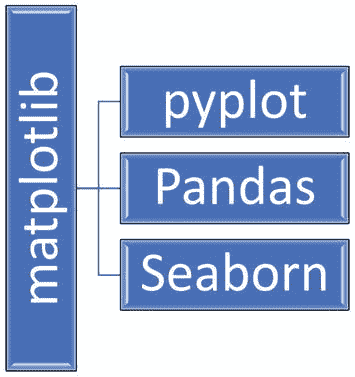

图 6-1

一些位于 `matplotlib` 之上的更高级组件，`matplotlib` 本身可进一步细分为更小的、你可以引用的单元。

### 在地图上显示站点

清单 6-1 展示了使用数据源（本例中唯一的温度传感器）生成地理地图的函数。代码使用了 `mplleaflet` Python 库，将 `matplotlib` 绘图转换为 `Leaflet` 地图（参见 `https://leafletjs.com`）。`temp_plots` 文件夹内的 `plot_stations.py` 模块用于在地图上显示数据源。它通过 `pyplot` 以脚本方式使用 `matplotlib`。

```python
import matplotlib.pyplot as plt
import mplleaflet
def plot_stations(longitudes, latitudes, embedded = False):
if embedded:
plt.figure(figsize = (8, 8))
plt.scatter(longitudes, latitudes,
c = 'b',
marker = 'D',
alpha = 0.7,
s = 200)
return mplleaflet.display() if embedded else mplleaflet.show()
```

*清单 6-1: 在地图上显示数据源的模块*

`embedded` 参数应设置为 `True`，以便在 `Jupyter notebook` 中以行内形式包含生成的地图。清单 6-2 展示了驱动代码的第一部分。

```python
import pandas as pd
df = pd.read_csv('GHCND_sample_csv.csv',
usecols = [3, 4, 5, 6, 7],
index_col = 2,
parse_dates = True,
infer_datetime_format = True)
df['TMIN'] = df['TMIN'] / 10
df['TMAX'] = df['TMAX'] / 10
print(df.head())
from plot_stations import plot_stations
plot_stations(df['LONGITUDE'].tolist()[0], df['LATITUDE'].tolist()[0])
```

*清单 6-2: `temp_visualization_demo.py` 模块的第一部分*

执行此代码时，输出如下：

```
LATITUDE  LONGITUDE  TMAX  TMIN
DATE
2010-01-01   48.0355     -98.01 -17.8 -31.1
2010-01-02   48.0355     -98.01 -24.4 -32.2
2010-01-03   48.0355     -98.01 -19.4 -28.9
2010-01-04   48.0355     -98.01 -16.7 -20.0
2010-01-05   48.0355     -98.01 -13.3 -16.7
```

图 6-2 展示了生成的交互式地图，其中的蓝色菱形代表温度传感器。您还会在当前工作目录中找到 `_map.html` 文件。该文件由 `mplleaflet.show()` 自动创建（可以更改输出文件名）。

### 绘制温度图

现在我们将绘制最低和最高温度，并叠加标记出摄氏温度极高（> 0）和极低（< –30）的点。为了使图表更有用，我们还将添加一个额外的 y 轴来显示华氏温度。这次代码依赖于 `matplotlib` 和 Pandas 的可视化功能，并演示了如何在不同的抽象层之间切换。清单 6-3 展示了驱动代码的第二部分，它准备数据并调用我们的自定义绘图函数，该函数如清单 6-4 所示，并显示在图 6-3 中。此解决方案稍作修改后也可用于其他场景（例如，更改轴标题、调整刻度等）。

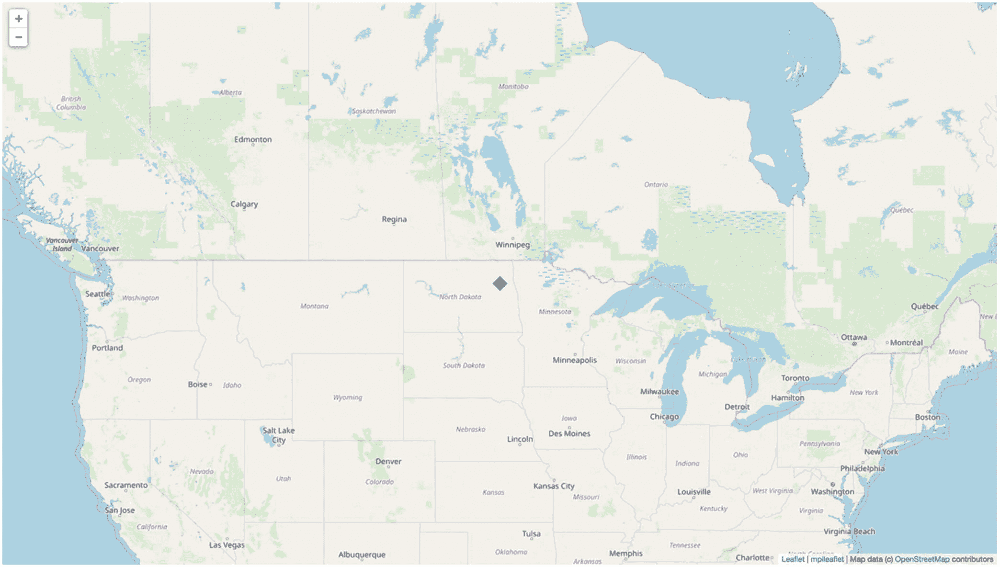

*图 6-2: 带有温度传感器的交互式地图（仅用几行代码即可获得的相当显著的结果）*

```markdown
## 清单 6-3: `temp_visualization_demo.py` 模块的第二部分

以下是前面代码生成的文本报告：

```python
from plot_temps import plot_temps
plot_temps(df, min_temp, max_temp, extreme_low_temps, extreme_high_temps)
```

注意加粗的行，它们展示了如何从较高的 Pandas 可视化层切换到较低的核心 `matplotlib` 层级。原始接口对于微调图表非常有用。反之亦然，可以通过将参数 `ax` 设置为您自己的轴引用来实现。

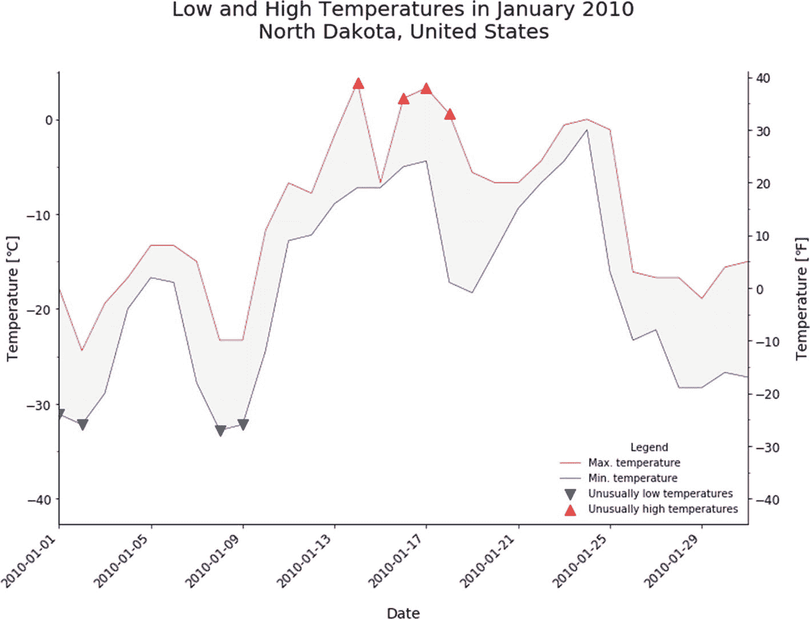

*图 6-3: 带有极端温度（通过阈值定义）标记的最低和最高温度图*

## 最近点对案例研究

寻找最近点对是计算几何中一项广为人知的任务，具有广泛的应用。我们有一组平面上的点，由其 `x` 和 `y` 坐标给出，表示为 `P = {(x, y) | x, y ∈ ℤ}`。我们需要找到欧几里得距离为 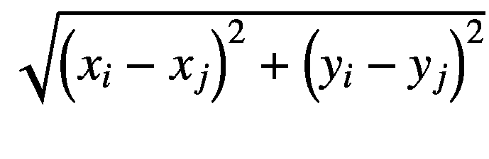 的最近点对 `p[i] ≠ p[j]`。假设点的数量 `n` 在 [2, 10⁷] 范围内。

我们将开发三种具有不同渐近行为的核心变体：O(`n²`)、O(`n*log²*n`) 和 O(`n log n`)。您可以通过参考文献 [2] 到 [4] 来复习渐近符号和算法的相关知识。之后，我们将降低常数，以展示它们如何影响整体性能。可视化将帮助我们更清晰地说明结果。这是一个利用可视化更深入地理解程序运行时特性的例子。

本着以 API 为中心和面向对象开发的精神，我们首先将创建一个抽象基类。这样，所有子类都将简单地继承相同的 API，因此客户端可以根据需要平稳地更改实现（另请参见练习 6-1）。清单 6-5 展示了这个基础类（请查看 `closest_pair` 包中的 `base_closest_pair.py` 文件）。拥有一个通用的 API 会促进实验，因为您可以在不干扰系统其余部分的情况下切换实现。此外，清晰的 API 是成功实现代码重用的先决条件。

## 清单 6-4: 函数 `plot_temps`，它生成如图 6-3 所示的图表

```python
from matplotlib.ticker import MultipleLocator
def plot_temps(df, min_temp, max_temp, extreme_low_temps, extreme_high_temps):
    ax1 = df.plot.line(y = ['TMAX', 'TMIN'],
                       figsize = (12, 9),
                       ylim = (1.3 * min_temp, 1.3 * max_temp),
                       rot = 45, fontsize = 12, style = ['-r', '-b'], linewidth = 0.6,
                       legend = False,
                       x_compat = True)
    ax1.lines[0].set_label('Max. temperature')
    ax1.lines[-1].set_label('Min. temperature')
    ax1.set_title('Low and High Temperatures in January 2010\nNorth Dakota, United States',
                  fontsize = 20, y = 1.06)
    ax1.set_xlabel('Date', fontsize = 14, labelpad = 15)
    ax1.set_ylabel('Temperature [\u2103]', fontsize = 14)
    ax1.spines['right'].set_visible(False)
    ax1.spines['top'].set_visible(False)
    ax1.yaxis.set_minor_locator(MultipleLocator(5))
    ax1.fill_between(df.index, df['TMAX'], df['TMIN'],
                     facecolor = 'lightgray', alpha = 0.25)
    def fahrenheit_to_celisus(temp):
        return 1.8 * temp + 32
    ax2 = ax1.twinx()
    y_min, y_max = ax1.get_ylim()
    ax2.set_ylim(fahrenheit_to_celisus(y_min), fahrenheit_to_celisus(y_max))
    ax2.set_ylabel('Temperature [\u2109]', fontsize = 14, labelpad = 15)
    ax2.spines['top'].set_visible(False)
    ax2.yaxis.set_minor_locator(MultipleLocator(5))
    for label in ax2.get_yticklabels():
        label.set_fontsize(12)
    ax1.scatter(extreme_low_temps.index, extreme_low_temps,
                color = 'blue', marker = 'v', s = 100,
                label = 'Unusually low temperatures')
    ax1.scatter(extreme_high_temps.index, extreme_high_temps,
                color = 'red', marker = '^', s = 100,
                label = 'Unusually high temperatures')
    ax1.legend(loc = 4, frameon = False, title = 'Legend')
```

## 输出报告

```
Minimum temperature: -32.8
Maximum temperature: 3.9
Extreme low temperatures
DATE
2010-01-01   -31.1
2010-01-02   -32.2
2010-01-08   -32.8
2010-01-09   -32.2
Name: TMIN, dtype: float64
Extreme high temperatures
DATE
2010-01-14    3.9
2010-01-16    2.2
2010-01-17    3.3
2010-01-18    0.6
Name: TMAX, dtype: float64
```
```

# 最近点对算法基类

```python
"""用于实现寻找最近点对的各种变体的基类。"""
import abc
from typing import Tuple, Callable, TypeVar, Sequence, Generic
import numpy as np

Coordinates = TypeVar('Coordinates', Sequence[int], np.ndarray)

class BaseClosestPair(Generic[Coordinates], metaclass=abc.ABCMeta):
    """
    在由 x 和 y 坐标给出的二维点中寻找最近点对。默认距离定义为标准欧几里得距离。

    参数:
        x: 所有点的 x 坐标列表。
        y: 所有点的 y 坐标列表。元素顺序与 x 坐标列表一致，即第 i 个点表示为(x[i], y[i])。
    """
    _x: Coordinates
    _y: Coordinates

    def __init__(self, x: Coordinates, y: Coordinates):
        assert len(x) >= 2 and len(x) == len(y)
        self._x = x
        self._y = y

    @property
    def x(self) -> Coordinates:
        """获取点的 x 坐标。"""
        return self._x

    @property
    def y(self) -> Coordinates:
        """获取点的 y 坐标。"""
        return self._y

    @staticmethod
    def load_from_stdin() -> Tuple[Coordinates, Coordinates]:
        """
        通过依次枚举 x 和 y 坐标从标准输入加载点。
        每个数据必须用空格分隔。

        输出:
            x 和 y 坐标的元组。
        """
        import sys
        data = sys.stdin.read()
        points = list(map(int, data.split()))
        x = points[1::2]
        y = points[2::2]
        return x, y

    @staticmethod
    def generate_points(n: int, seed: int) -> Tuple[Coordinates, Coordinates]:
        """
        生成随机点用于压力测试。

        输出:
            x 和 y 坐标的元组。

        示例:
            >>> BaseClosestPair.generate_points(3, 10)
            ([227077737, -930024104, -78967768], [36293302, 241441628, -968147565])
        """
        import random
        assert n >= 2
        random.seed(seed)
        x = [random.randint(-10**9, 10**9) for _ in range(n)]
        y = [random.randint(-10**9, 10**9) for _ in range(n)]
        return x, y

    @staticmethod
    def distance(x1: int, x2: int, y1: int, y2: int) -> float:
        """
        返回两点之间的欧几里得距离。

        参数:
            x1: 第一个点的 x 坐标。
            x2: 第二个点的 x 坐标。
            y1: 第一个点的 y 坐标。
            y2: 第二个点的 y 坐标。

        输出:
        定义为对应坐标差平方和平方根的两点间距离。

        示例:
            >>> BaseClosestPair.distance(1, 2, 1, 2)
            1.4142135623730951
            >>> BaseClosestPair.distance(1, 1, 1, 1)
            0.0
        """
        from math import sqrt
        return sqrt((x1 - x2)**2 + (y1 - y2)**2)

    @abc.abstractmethod
    def closest_pair(self, distance: Callable[[int, int, int, int], float]) -> Tuple[int, int, float]:
        """
        返回最近点对的索引及其距离的元组。

        参数:
            distance: 接收四个参数(x1, x2, y1, y2)并返回两点间距离的函数。
        """

if __name__ == "__main__":
    import doctest
    doctest.testmod()
```

代码清单 6-5：为后续所有变体指定共享 API 的抽象基类

通过传入新的距离测量函数，可以轻松定制`closest_pair`方法。`generate_points`方法可用于对实现进行压力测试。要对本模块进行类型检查，请在 Spyder 的控制台中执行以下命令（确保你位于本章源代码的`closest_pair`子文件夹中）：

```
!mypy --ignore-missing-imports base_closest_pair.py
```

我们的下一个任务是创建一个小型测试工具，用于测量执行时间并生成合适的可视化效果。实际上，已有现成的软件工具可用于此目的：`cProfile`（更多详情请参阅 [`https://docs.python.org/3/library/profile.html`](https://docs.python.org/3/library/profile.html)）和`SnakeViz`（你可能需要通过命令行执行`conda install snakeviz`来安装它）。`cProfile`输出的数据格式可直接被`SnakeViz`使用。

## 版本 1.0

本版本是最近点对算法的朴素实现。它简单地计算所有点对之间的距离并找出最小值。代码清单 6-6 展示了本版本的源代码。

```markdown
#### 代码清单 6-6：该问题的暴力求解实现

```python
"""最近点对算法的朴素实现。"""
from typing import Tuple, Callable
from closest_pair.base_closest_pair import BaseClosestPair

class NaiveClosestPair(BaseClosestPair):
    def closest_pair(self, distance: Callable[[int, int, int, int], float] =
                     BaseClosestPair.distance
                     ) -> Tuple[int, int, float]:
        """
        遍历所有点对并计算它们之间的距离。

        示例:
            >>> x = [0, 3, 100]
            >>> y = [0, 4, 110]
            >>> ncp = NaiveClosestPair(x, y)
            >>> ncp.closest_pair()
            (0, 1, 5.0)
        """
        from math import inf
        n = len(self.x)
        min_distance = inf
        for i in range(n - 1):
            for j in range(i + 1, n):
                d = distance(self.x[i], self.x[j], self.y[i], self.y[j])
                if d < min_distance:
                    min_distance = d
                    p_i = i
                    p_j = j
        return p_i, p_j, min_distance

if __name__ == "__main__":
    import doctest
    doctest.testmod()
```

### 提示

千万不要低估像 `NaiveClosestPair` 这样简单直接的变体的价值。它可以作为性能对比和正确性验证时非常有用的基线。具体而言，它可以与点生成器一起使用，生成许多低维测试用例。

让我们使用 100 个自动生成的点来分析一次运行。在 Spyder 的控制台中执行以下语句（确保你位于本章的基础源文件夹中；另请参见练习 6-2）：

```python
from closest_pair import *

import cProfile

x, y = BaseClosestPair.generate_points(100, 1)

ncp = NaiveClosestPair(x, y)

%mkdir results

cProfile.run('ncp.closest_pair()', filename = 'results/ncp_100_stats')
```

现在，我们应该在 `results` 子文件夹中拥有二进制的性能分析数据。在独立的命令行终端中，执行 `snakeviz results/`。这将启动一个本地 Web 服务器，默认监听 8080 端口。确切的 URL 将打印在命令行上。图 6-4 展示了 SnakeViz 的初始界面。

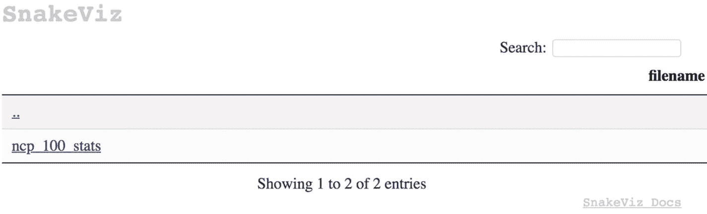

**图 6-4**
SnakeViz 的入口页面，你可以在此处选择 `ncp_100_stats` 文件进行可视化

如果选择图 6-4 中的 `ncp_100_stats` 文件，那么你将在页面顶部看到类似图 6-5 的内容。我将鼠标悬停在从上往下数的第三个矩形上，它立即显示了一些关于 `closest_pair` 方法执行的更详细信息。这里有独立的框分别表示方法的整体签名（上下文）及其组成部分，包括方法体。

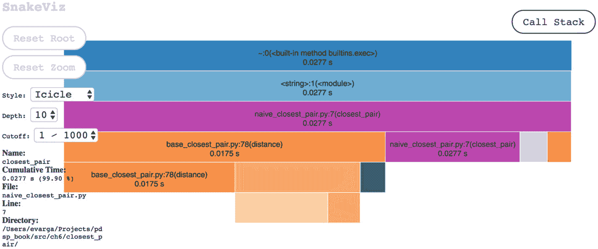

**图 6-5**
该图是交互式的

图 6-6 显示了下方部分的内容，你可能对此感到熟悉（经典的数据表格展示形式）。拥有多个视图非常方便，因为你可以在显示格式之间平滑切换，以关注所需的细节层次。你可以通过点击列标签对数据进行排序。在这里，行按 `tottime` 的降序排列。这些框是嵌套的，并组织成反映调用栈的层级结构。此外，还使用颜色对元素进行分组。例如，`closest_pair` 方法的签名和方法体被标记为粉色。右侧有一些选项可以自定义视图。图 6-7 展示了所谓的 *旭日图* 样式。

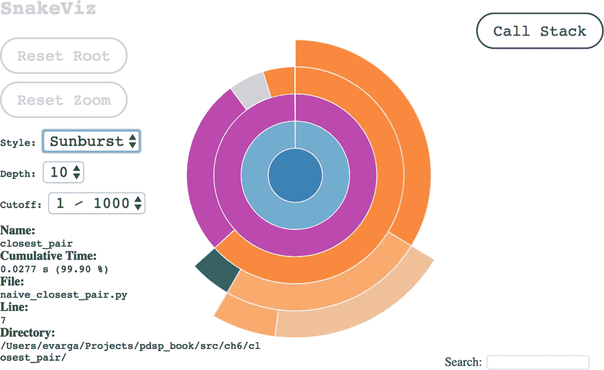

**图 6-7**
另一种可视化调用层级的方式，有助于把握全局

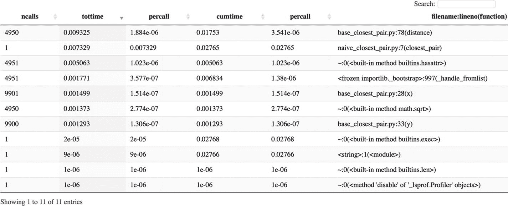

**图 6-6**
`ncalls` 表示对某个函数的调用次数（例如，4950 = 100 × 99 / 2，这是 `distance` 被调用的次数），而 `tottime` 表示在该方法内部花费的总时间

让我们尝试在规模为 3000 的输入上运行我们的平方级算法。以下是执行步骤：

```python
x, y = BaseClosestPair.generate_points(3000, 1)

ncp = NaiveClosestPair(x, y)

cProfile.run('ncp.closest_pair()', filename = 'results/ncp_3000_stats')
```


这将花费更长的时间来完成。通过访问`http://127.0.0.1:<端口号>/snakeviz/results`导航回SnakeViz的文件夹页面，并选择`ncp_3000_stats`。按累计时间降序排序表格，你会发现运行时间大约为 20 秒（在我的 Mac 上是 23.48 秒）^(¹⁷)。之前使用 100 个点的运行仅耗时 0.0277 秒；输入规模增加了 30 倍，导致运行时间激增了大约 900 倍。这就是 O(`n`²) 的含义。你的机器上的具体时间会有所不同，但比率将保持不变。无论你采取什么措施来加速（例如，使用 Numba），你都将停留在相同的渐近水平上；换句话说，运行时间的比率将反映对输入规模的平方依赖性。使用更优算法的纯 Python 代码，终将在某个点上超越使用某种慢速算法的、经过超强技术增强的版本。

### 版本 2.0

在本节中，我们将阐述该算法采用`分治`技术的 O(`n`log²`n`) 变体。这种技术将初始问题分解为多个相同类型的子问题，并独立求解它们。如果某个子问题仍然复杂，则使用相同的过程进一步分解。当遇到基础情况（即易于解决的问题）时，分解链条终止。之后，合并子问题的结果，直至得到最终答案。该方法的一个典型示例是归并排序。

该算法的主要步骤如下（参见参考文献[2]）：

1.  根据点的 x 坐标将它们分成两半。更正式地说，如果我们将切割坐标记为 x，那么我们希望生成两组点：L（代表左）和 R（代表右），使得 L 中的所有点满足`x[i] ≤ x`，R 中的所有点满足`x[i] > x`。
2.  递归地将组 L 和 R 视为独立的子问题，并分别找到它们的解，即元组 (`p[L], q[L], d[L]`) 和 (`p[R], q[R], d[R]`)。取 d = `min(d[L], d[R])`，并记住最小值来自哪一组。
3.  检查 L 和 R 中是否存在距离小于 d 的点。选择 L 和 R 中所有 x 坐标属于区间 [x – d, x + d] 的点。根据这些中间点（M）的 y 坐标进行排序（排序顺序无关紧要）。
4.  遍历这个排序后的列表，对于每个点，计算它与至多后续七个点的距离，并维护当前找到的最佳点对。记这个三元组为 (`p[M], q[M], d[M]`)。
5.  最终解是 L、M 和 R 中点对的最小值。回想一下，在步骤 2 中我们已经找到了 L 和 R 之间的最小值，因此我们只需要与 M 进行一次额外的比较。

在这个层面上，算法看起来很像一个菜谱。在进行任何详细的编码之前，你甚至可以将这些步骤作为注释放入源代码中。由于所有步骤都处于高层次的细节水平，它们很好地补充了底层的实现细节。这就是伪代码编程（使用伪代码进行规划）背后的核心思想。图 6-8 直观地提供了此算法正确性的证明。在处理大量数据时，证明程序行为的定理至关重要。测试可以揭示代码中的错误，但无法确立基本事实。通常，仅凭测试很难覆盖所有可能的情况（即找到输入中的所有等价类）。建立数学证明（体现在正式的软件开发方法中）的缺点是，它需要大多数软件工程师所缺乏的专业知识。而且，你只能将其应用于系统的核心部分。例如，操作系统内核就是适合这种形式化处理的目标。

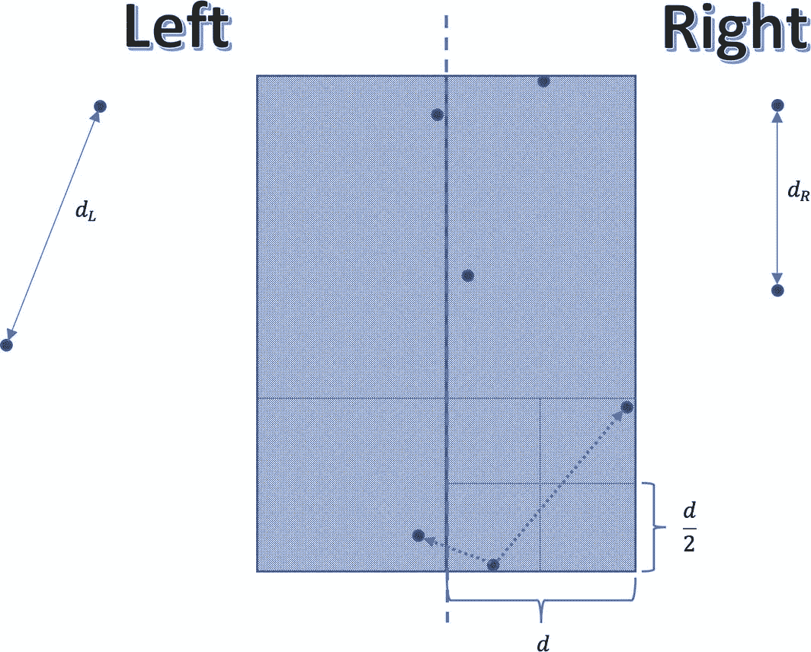

**图 6-8** 注意，在任何大小为 d×d 的块内，最多可以包含四个点

操作系统内核的任何大小为 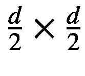 的子块最多只能包含一个点。换句话说，如果一个尺寸为 d×d 的正方形包含五个或更多点，那么它的某些子块必然会包含多个点。然而，在这种情况下，我们会得出矛盾，即 d 没有被正确计算。此外，在这个带状区域中，任何两个距离 < d 的点必定属于同一个 2d×d 大小的矩形。因此，它们肯定会被比较，这保证了正确性。回想一下，这个矩形最多可以包含八个点（包括参考点）。在这里，我们会找到一个比 d 更短的距离，因为最右下方的点与其后续左侧点之间的距离很小。

#### 运行时间分析

假设我们有平面上的 `n` 个点。在步骤 1 中，我们可以使用随机化的分治算法在 O(`n`) 时间内找到将集合分成两个相等大小子集的中位数点。创建子集 L 和 R 是另一个 O(`n`) 时间的操作。在解决了两个大小为 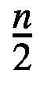 的子问题后，算法在 O(`n`) 时间内选择属于中间带状区域的点。然后，它在 O(`n` log `n`) 时间内对这些过滤后的点进行排序。最后，它在 O(`n`) 时间内计算这个带状区域内的距离（对于每个点，它执行一些固定数量的工作）。请记住，对于任何函数 `f = kn`，`k ∈ ℕ`，都满足 f = O(`n`)；也就是说，它受某个线性函数的约束。因此，无论我们连续执行多少次 O(`n`) 操作，或者我们执行的是 3n、5n 还是 7n 次操作，它们的总体效果都被视为 O(`n`)。总而言之，总运行时间由递推公式 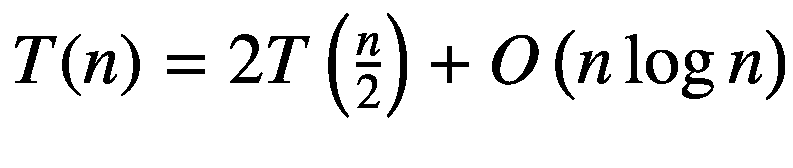 定义。我们不能直接应用主定理，尽管我们可以复用其思想来分析我们的表达式。

如果我们绘制一棵递归树，那么在某个任意层级 k，该树的贡献将是 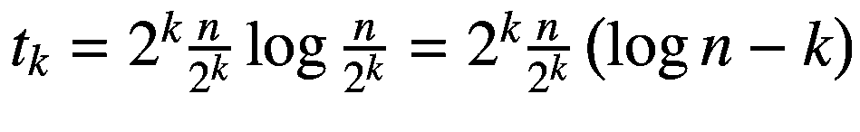。树的深度是 log`n`，因此通过将每一层的贡献相加，我们最终得到 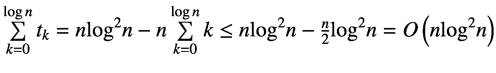。

在步骤 3 中，我们反复根据点的 y 坐标进行排序，这导致了额外的 log`n` 乘数。如果我们能在一开始只做一次排序从而避免重复排序，那么我们将把运行时间降低到 O(`n` log `n`)。这从新的递推关系 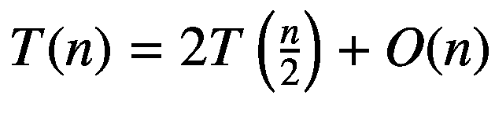 中可以看出，因为我们可以直接应用主定理。当然，在所有的分割和过滤操作中，我们应该小心地保持点的 y 顺序。

### 版本 3.0

为了防止扰乱点的 y 顺序，我们将通过找到正确的索引排列来间接地对它们进行排序。所有排序函数实际上都会计算这个排列，但通常不会显式返回。对原始坐标的所有访问都将通过双重间接寻址进行，如图 6-9 所示。清单 6-7 展示了之前所述算法的快速 O(`n` log `n`) 实现。

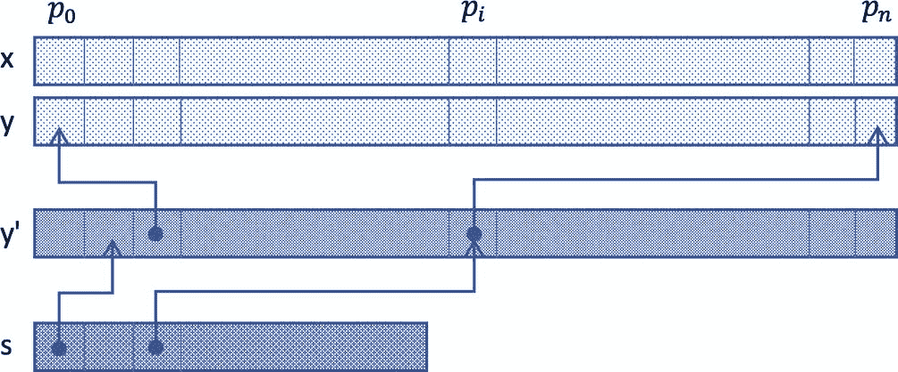

**图 6-9** 数组 `s` 表示属于中间带状区域的点的有序索引

数组 `s` 包含指向已排序索引数组 `y'` 的指针，这些指针最终指向原始位置。以这种方式访问点的复杂性将隐藏在适当的访问器方法中。

```python
"""快速实现最近点对算法。"""

from typing import List, Tuple, Callable

from closest_pair.base_closest_pair import Coordinates, BaseClosestPair

class FastClosestPair(BaseClosestPair):

    _y_prime: List[int]

    def _argsort_y(self) -> List[int]:

        """找到按 y 坐标排列点的索引排列。"""

        return [t[0] for t in sorted(enumerate(self.y), key = lambda t: t[1])]

    def _get_x(self, i: int, s: List[int]) -> int:

        return self.x[self._y_prime[s[i]]]

    def _get_y(self, i: int, s: List[int]) -> int:

        return self.y[self._y_prime[s[i]]]
```

```
def __init__(self, x: Coordinates, y: Coordinates):
    super().__init__(x, y)
    self._y_prime = self._argsort_y()

def _selection(self, s: List[int], k: int) -> int:
    """返回 s 中包含的按 x 坐标排列的第 k 个最小点的 x 值。"""
    def split(v: int) -> Tuple[List[int], List[int], List[int]]:
        """将点围绕值 v 就地间接拆分为两个集合（左和右）。"""
        store = 0
        sl_idx = 0
        for i in range(len(s)):
            if self._get_x(i, s) < v:
                s[store], s[i] = s[i], s[store]
                store += 1
            elif self._get_x(i, s) == v:
                s[i], s[-1] = s[-1], s[i]
        s[-1], s[store] = s[store], s[-1]
        sl = [s[i] for i in range(store)]
        sv = [s[store]]
        sr = [s[i] for i in range(store + 1, len(s))]
        return sl, sv, sr

    import random
    while len(s) > 1:
        v = self._get_x(random.randint(0, len(s) - 1), s)
        sl, sv, sr = split(v)
        sl_size = len(sl)
        if sl_size > k:
            s = sl
        elif k >= sl_size and k < sl_size + len(sv):
            return v
        else:
            k -= sl_size + len(sv)
            s = sr
    return self._get_x(0, s)

@staticmethod
def _merge(sl: List[int], sr: List[int]) -> List[int]:
    """
    将两个有序子列表合并成一个新的有序列表。
    可以预先分配临时存储以进一步优化。
    """
    sl_size = len(sl)
    sr_size = len(sr)
    s = [0] * (sl_size + sr_size)
    k = 0
    i = 0
    j = 0
    while i < sl_size and j < sr_size:
        if sl[i] < sr[j]:
            s[k] = sl[i]
            i += 1
        else:
            s[k] = sr[j]
            j += 1
        k += 1
    if i < sl_size:
        s[k:] = sl[i:]
    else:
        s[k:] = sr[j:]
    return s

def closest_pair(self) -> Tuple[int, int, float]:
    """
    在 O(n*log n) 时间内计算最小距离。
    示例：
    >>> x = [0, 3, 100]
    >>> y = [0, 4, 110]
    >>> fcp = FastClosestPair(x, y)
    >>> fcp.closest_pair()
    (0, 1, 5.0)
    """
    from math import inf
    def filter_points(s: List[int], d: float, x: int) -> List[int]:
        """返回落在 [x-d, x+d] 区间内的点索引列表。"""
        return [s[i] for i in range(len(s)) if abs(self._get_x(i, s) - x) <= d]

    def find_nearest_neighbor(i: int, s: List[int]) -> Tuple[float, int, int]:
        """
        查找当前点 i 与按 y 坐标排列的后 7 个点之间的最小距离。
        """
        curr_x = self._get_x(i, s)
        curr_y = self._get_y(i, s)
        d = inf
        min_idx = i
        for j in range(i + 1, min(len(s), i + 7 + 1)):
            curr_d = distance(curr_x, self._get_x(j, s), curr_y, self._get_y(j, s))
            if curr_d < d:
                d = curr_d
                min_idx = j
        return d, i, min_idx

    def distance(x1: int, x2: int, y1: int, y2: int) -> float:
        """返回两点之间的欧几里得距离。"""
        return ((x1 - x2) ** 2 + (y1 - y2) ** 2) ** 0.5

    def find_minimum_distance(s: List[int]) -> Tuple[int, int, float]:
        """查找最近点对的主要驱动函数。"""
        if len(s) == 1:
            # 我们将单个点的距离视为无穷大。
            return s[0], -1, inf
        if len(s) == 2:
            return s[0], s[1], distance(self._get_x(0, s),
                                        self._get_x(1, s),
                                        self._get_y(0, s),
                                        self._get_y(1, s))
        # 这是输入数组 x 相对于 s 的中位数值。
        median_x = self._selection(s.copy(), len(s) // 2)
        # 围绕中位数分离点。
        sl = []
        sr = []
        for i in range(len(s)):
            if self._get_x(i, s) <= median_x:
                sl.append(s[i])
            else:
```

# 算法演进的探究

```python
sr.append(s[i])

# 在左侧和右侧组中找到最小距离。
p_l, q_l, d_l = find_minimum_distance(sl)
p_r, q_r, d_r = find_minimum_distance(sr)

if d_l < d_r:
    p_min, q_min = p_l, q_l
    d = d_l
else:
    p_min, q_min = p_r, q_r
    d = d_r

# 合并左右索引并保持排序顺序。
sm = FastClosestPair._merge(sl, sr)

# 在中间条带内找到最小距离。
sf = filter_points(sm, d, median_x)

# 在三组（左、中、右）中找到最终的最小距离。
d_m, p_m, q_m = min([find_nearest_neighbor(i, sf) for i in range(len(sf))])

if d_m < d:
    return p_m, q_m, d_m
else:
    return p_min, q_min, d

p, q, d = find_minimum_distance(list(range(len(self._y_prime))))

# 我们需要将点索引映射回原始基数。
return self._y_prime[p], self._y_prime[q], d

if __name__ == "__main__":
    import doctest
    doctest.testmod()
```

**列表 6-7** `FastClosestPair` 类的实现

显然，这个版本比我们在 1.0 版本中的朴素尝试要复杂得多。让我们看看它在同样的 3000 个点数据集上的表现。创建新报告的步骤如下（假设你继续上一个控制台会话，因此已经定义了数组 `x` 和 `y`）：

```python
>> from closest_pair import FastClosestPair
>> fcp = FastClosestPair(x, y)
>> cProfile.run('fcp.closest_pair()', filename = 'results/fcp_3000_stats')
```

图 6-10 显示了这次运行的图表。如果你在 SnakeViz 中向下滚动，你会看到累积时间已经下降到远低于一秒。一旦你有了一个好的算法，你就可以放心你的解决方案是可扩展的。当然，即使在降低常数因子并应用并行处理之后，这种改进也远未达到绝对下限（另请参见练习 6-3）。不过，这种额外的微调只有在你已经获得良好的渐近行为之后才有意义。

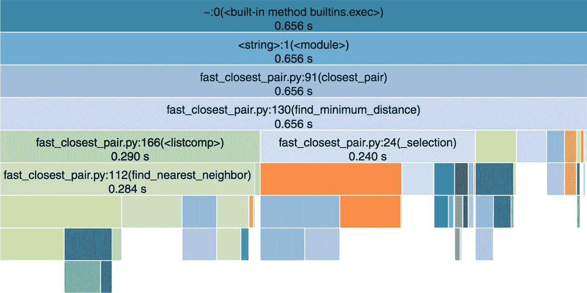

**图 6-10** 该图仅显示冰柱样式图表。显然，由于代码库更复杂，存在许多额外细节。

从多个角度来看，暴力版本和复杂版本之间的差异确实惊人。除了指数级的加速（从 `n × n` 到 `n × log n`），复杂度也成比例增加。尽管如此，通过专注于以 API 为中心的开发，我们类的客户端完全不必了解内部细节。两个版本都可以通过调用基类中指定的公共方法来以完全相同的方式使用。这再次证明了良好的软件工程技能是数据科学工作中的真正救星。

这个故事告诉我们，单纯的技术花招并不能让你走得很远。当然，我们在上一章中展示了 Numba，但真正的突破只能通过数学来实现。这通常适用于计算机科学，而不仅仅是数据科学，尽管对于数据科学来说，效果更加明显，因为没有一种朴素的方法可以应对大数据。

除了与时间相关的性能优化外，你可能还希望测量内存消耗和其他资源。为此，你也有很多选择。可以查看 `memory-profiler` 包（参见 [`pypi.org/project/memory-profiler`](https://pypi.org/project/memory-profiler)）。还有合适的魔法命令包装器 `%memit` 和 `%mprun`。你可以先执行 `%load_ext memory_profiler` 来使用它们。使用 `line_profiler` 模块（参见 [`pypi.org/project/line_profiler`](https://pypi.org/project/line_profiler)）和 `%lprun` 魔法命令进行时间分析也是如此。

## 交互式信息辐射器

我们通常制作主动报告来总结对某些静态数据集的分析发现。标准 Jupyter 笔记本是交付此类实时报告的常见平台。然而，在某些情况下，支撑数据集会随时间持续变化。强制用户重新运行笔记本以获取最新数据集并非可扩展的解决方案（更不用说每次都要重新发送刷新后的笔记本了）。更好的方案是建立一个流水线，让动态报告自动生成。这就是信息辐射器（也称为*仪表盘*）背后的理念。

我们可以区分两大类波动数据：批量处理型数据（以固定间隔累积和处理，例如每小时、每天、每周等）和流式数据（持续更新）。随之而来的仪表盘必须反映这种变化速率，并仅暴露关键的业务指标，以便监控和快速决策。任何多余的细节只会分散用户的注意力。当然，你应该构建哪种类型的仪表盘也取决于你流水线的能力。

假设你从包括风能和太阳能在内的各种发电厂收集电力生产数据。以下信息可能有助于有效评估电网当前和近期的状态：

* 当前的能源生产与消耗
* 不同电厂的能源生产（核电、火电、水电、风电、太阳能等）
* 短期天气预报，这是一个可能显著影响风能和太阳能电厂效能的外部因素

一旦决定要在仪表盘上展示什么，接下来就必须思考如何以最佳方式视觉化传达这些信息。领域知识在这里非常重要。事实证明，桑基图是一个完美的选择。它能直观展示无环有向图中节点间的流动（电力网络可以用这种形式表示）。图 6-11 展示了这种图的一个示例。

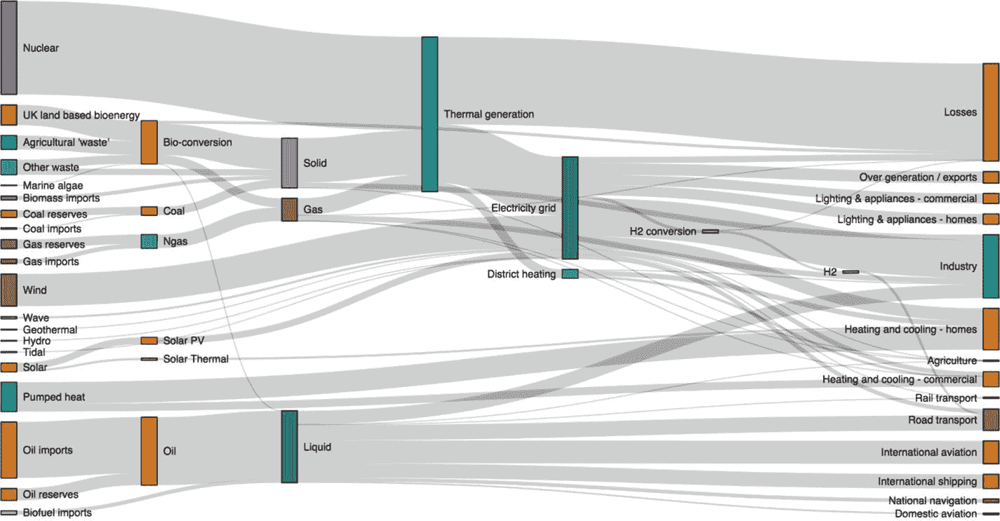

图 6-11

英国未来能源生产和消费的一个虚构场景（参见 [`https://github.com/d3/d3-sankey`](https://github.com/d3/d3-sankey)）

桑基图默认是交互式的，你可以通过点击或悬停来查看特定分支的更多细节。现在想象这个图是你广泛可访问的笔记本的一部分，并且该笔记本会定期被流水线更新。这就是用笔记本制作仪表盘的核心思想（参见参考文献 [5]）。

实现交互式信息辐射器愿景的关键要素（假设我们使用 Jupyter 笔记本作为文档格式）如下：

* 定期更新和发布的数据集（尝试时，可以使用 Kaggle 提供的一些数据集；参见参考文献 [5]）
* 一个能够获取相关数据集并重新运行你的笔记本的仪表盘流水线
* 一个交互式笔记本，很可能利用 Altair（参见 [`https://altair-viz.github.io`](https://altair-viz.github.io) ）、Plotly（参见 [`https://plot.ly`](https://plot.ly) ）、Bokeh（参见 [`https://bokeh.pydata.org`](https://bokeh.pydata.org) ）或类似框架，因为你可能不想从头开始编码

## 领域特定语言的力量

领域特定语言（DSL）通过让你摆脱繁琐的实现细节，从而提高生产力和质量，使你能够仅专注于业务相关的元素。可视化是一个边界清晰的领域，适合用 DSL 来支持。Altair 是一个提供此类 DSL 的框架，使你能够在 Python 中进行声明式可视化。这种能力对于以仪表盘形式构建复杂的交互式工作流程至关重要。将时间花在低级的细枝末节上是低效的，并且是常见的错误来源。让我通过介绍 Anscombe 四重奏来展示 DSL 的力量。除了技术层面，这个例子也很有启发性，能强调可视化的重要性。清单 6-8 展示了如何仅使用 `matplotlib` 来处理这个任务。尽管使用了 `matplotlib` 的面向对象 API，代码看起来仍然是普通的 Python 代码。

```python
import numpy as np
import matplotlib.pyplot as plt

quartets = np.asarray([
(
```

## 绘制并打印Anscombe四重奏数据

```python
[10.0, 8.0, 13.0, 9.0, 11.0, 14.0, 6.0, 4.0, 12.0, 7.0, 5.0],

[8.04, 6.95, 7.58, 8.81, 8.33, 9.96, 7.24, 4.26, 10.84, 4.82, 5.68]

),

(

[10.0, 8.0, 13.0, 9.0, 11.0, 14.0, 6.0, 4.0, 12.0, 7.0, 5.0],

[9.14, 8.14, 8.74, 8.77, 9.26, 8.10, 6.13, 3.10, 9.13, 7.26, 4.74]

),

(

[10.0, 8.0, 13.0, 9.0, 11.0, 14.0, 6.0, 4.0, 12.0, 7.0, 5.0],

[7.46, 6.77, 12.74, 7.11, 7.81, 8.84, 6.08, 5.39, 8.15, 6.42, 5.73]

),

(

[8.0, 8.0, 8.0, 8.0, 8.0, 8.0, 8.0, 19.0, 8.0, 8.0, 8.0],

[6.58, 5.76, 7.71, 8.84, 8.47, 7.04, 5.25, 12.50, 5.56, 7.91, 6.89]

)

])
```

`roman = ['I', 'II', 'III', 'IV']`
`fig = plt.figure(figsize = (12, 9))`
`fig.suptitle("Anscombe's Quartets", fontsize=16)`
`axes = fig.subplots(2, 2, sharex = True, sharey = True)`

```python
for quartet in range(quartets.shape[0]):

x, y = quartets[quartet]

coef = np.polyfit(x, y, 1)

reg_line = np.poly1d(coef)

ax = axes[quartet // 2, quartet % 2]

ax.plot(x, y, 'ro', x, reg_line(x), '--k')

ax.set_title(roman[quartet])

ax.set_xlim(3, 19.5)

ax.set_ylim(2, 13)
```

### 打印当前数据集的汇总统计信息

```python
print("Quartet:", roman[quartet])

print("Mean X:", x.mean())

print("Variance X:", x.var())

print("Mean Y:", round(y.mean(), 2))

print("Variance Y:", round(y.var(), 2))

print("Pearson's correlation coef.:", round(np.corrcoef(x, y)[0][1], 2))

print()
```

`plt.show()`

清单 6-8：在没有高层框架的情况下，有许多需要控制的可变目标

程序将打印关于每个四重奏的以下统计信息（注意它们都是相同的）：

```
Quartet: I

Mean X: 9.0

Variance X: 10.0

Mean Y: 7.5

Variance Y: 3.75

Pearson's correlation coef.: 0.82

Quartet: II

Mean X: 9.0

Variance X: 10.0

Mean Y: 7.5

Variance Y: 3.75

Pearson's correlation coef.: 0.82

Quartet: III

Mean X: 9.0

Variance X: 10.0

Mean Y: 7.5

Variance Y: 3.75

Pearson's correlation coef.: 0.82

Quartet: IV

Mean X: 9.0

Variance X: 10.0

Mean Y: 7.5

Variance Y: 3.75

Pearson's correlation coef.: 0.82
```

然而，一旦将这些数据集可视化，差异就显而易见了，如图 6-12 所示。清单 6-9 展示了实现类似可视化的代码片段，但这次使用的是`Altair`的`DSL`（也请参阅关于`DSL`的参考文献 [6]）。代码紧凑，没有不必要的低级细节。使用`DSL`，你只需指定你想要完成的任务，让引擎决定交付请求输出的最佳策略。你只需将此代码粘贴到`JupyterLab`笔记本的代码单元格中即可运行。

图 6-13 展示了其图形输出（也请参阅练习 6-4）。

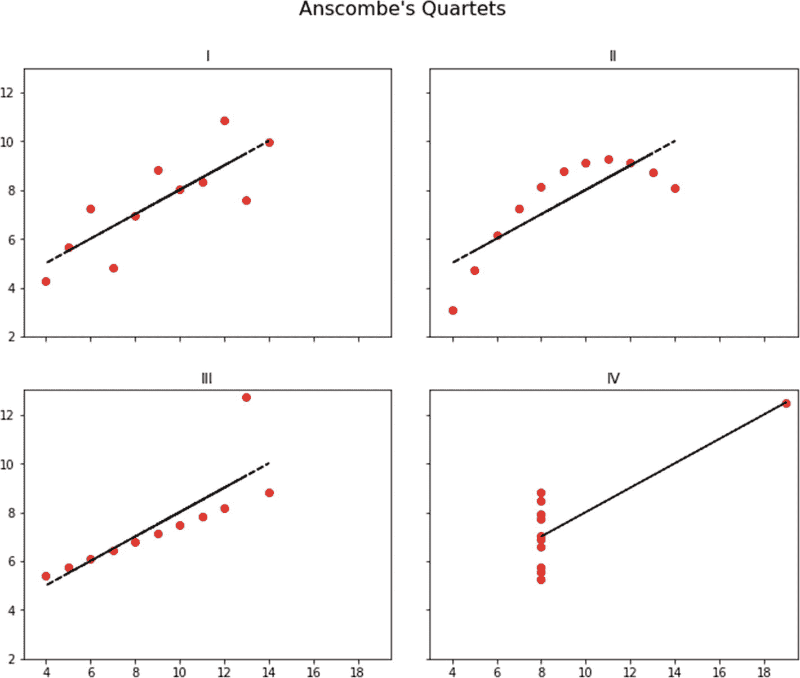

图 6-12：尽管这四个四重奏具有相同的汇总统计信息，但它们显然是不同的

```python
import altair as alt

from vega_datasets import data

source = data.anscombe()

base = alt.Chart(

source, title = "Anscombe's Quartets"

).mark_circle(color = 'red').encode(

alt.X('X', scale = alt.Scale(zero = True)),

alt.Y('Y', scale = alt.Scale(zero = True)),

column = 'Series'

).properties(

width = 150,

height = 150

).interactive()

base
```

清单 6-9：使用`Altair`的`DSL`进行可视化

你需要通过 `conda` 包管理器执行以下语句来安装`Altair`（这也会安装有用的 `vega_datasets`，其中已包含 Anscombe 四重奏的数据）：

```bash
conda install -c conda-forge altair vega_datasets
```

#### 提示

你可能希望在某些时刻创建仪表板状态的快照。`Altair`生成的所有图表都包含一个下拉菜单，可将图表保存为图片或导出为 Vega 格式。

该图表是交互式的，你可以平移和缩放每个图表。在交互式仪表板中，你可能希望尽量精简文本信息，并隐藏笔记本中的代码单元格。这些步骤能使图形元素更加突出。

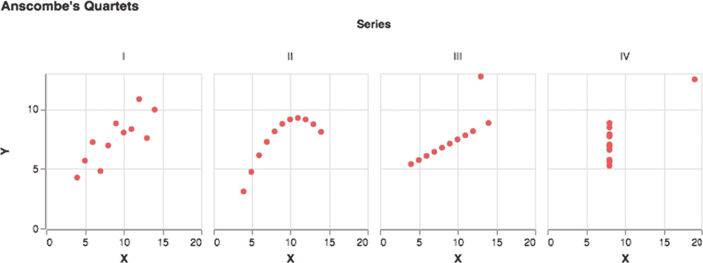

`图 6-13` – 使用 Altair 默认排列的安斯科姆四重奏

该图表是交互式的，你可以平移和缩放每个图表。在交互式仪表板中，你可能希望尽量精简文本信息，并隐藏笔记本中的代码单元格。这些步骤能使图形元素更加突出。

使用声明式框架的另一个优势是，你的笔记本将不再包含与设备相关的冗余内容。构建仪表板的全部意义在于让人们随时随地访问数据。这意味着许多人会使用便携设备浏览数据。无论用户是在台式机、笔记本电脑、平板电脑还是智能手机上查看，你的仪表板都必须完美适配屏幕。处理所有这些适配工作都应交给框架来完成。

### 练习 6-1. 创建一个工厂

客户端不应直接实例化类；理想情况下，它们甚至不应知晓具体的实现类。这是“针对接口编程，而非针对实现”这一原则背后的信条。有两种设计模式与此愿景相关：工厂方法和抽象工厂。后者在此方向上更进一步，甚至将客户端与工厂实现隔离开来。

重构代码库并引入这些工厂实体。这样一来，客户端只需将相关的投资组合描述（包含所需实现的属性）传递给工厂，即可收到通过共享 API（接口）公开的对象。

### 练习 6-2. 实现一个测试框架

与其通过控制台尝试不同版本（这有些繁琐），不如创建一个新的实用工具类来测试系统。你的流程应包含以下步骤：

1.  通过调用 `BaseClosestPair.generate_points()` 方法获取一组新的点实例（点的数量上限应为 1000）。
2.  使用某种可靠的基准方法（例如，使用简单的 `NaiveClosestPair` 类）找出正确解。
3.  使用相同的数据集调用目标实现。
4.  比较并报告结果。

由于存在通用的 API，你的测试框架可以接受此类型的任何目标实现。这将为未来的优化尝试创造机会。尝试生成一个 `ParallelClosestPair` 类。请注意，我们的算法本质上是可并行化的，因为左右两组可以独立处理。

### 练习 6-3. 生成一个超快速变体

到目前为止，我们只使用了纯 Python 结构。不幸的是，这通常不会带来顶级性能的解决方案。列表非常慢，因为它们既灵活又异构。在我们的案例中，使用内置数组是更好的选择。然而，这仍然不够。真正的加速将来自于切换到 Numpy 数组和编译后的代码。

创建一个利用 Numpy 数组的 `UltraFastClosestPair` 类；我建议你在开始此练习之前先完成练习 6-2。请注意，当前源代码中的一些东西会自动消失。例如，Numpy 直接提供了 `argsort()` 方法。此外，你可以使用围绕 Numpy 构建的库。`sortednp` 包（参见 [`pypi.org/project/sortednp`](https://pypi.org/project/sortednp)）非常方便，因为它以 O(n) 时间复杂度实现了 `merge()` 方法。

### 练习 6-4. 练习在 Altair 中叠加图表

在我们基于 matplotlib 的代码中，请注意回归线是如何与基础散点图结合的；请参阅清单 6-4 中的加粗`plot`指令。所有内容都捆绑在一起，没有将图表作为独立抽象的概念。这在 `Altair` 中完全不同，图表在其中表现为自包含的实体。如果你拥有多个图表的句柄，就可以利用重载的 `+` 运算符以临时方式混合它们。

向由变量 `base` 引用的图表添加回归线。你仍然需要使用 Numpy 来计算系数。有关更多详细信息，请查看以下教程：[`altair-viz.github.io/gallery/poly_fit.html`](https://altair-viz.github.io/gallery/poly_fit.html)。此外，请访问 [`stackoverflow.com/questions/50164001/multiple-column-row-facet-wrap-in-altair`](https://stackoverflow.com/questions/50164001/multiple-column-row-facet-wrap-in-altair) 获取有关如何模拟 matplotlib 子图的帮助。

## 总结

遍历所有类型的可视化是不可能的，因为其数量众多；你可能希望访问 D3 可视化画廊 [`github.com/d3/d3/wiki/Gallery`](https://github.com/d3/d3/wiki/Gallery)，它集中收集了许多类型的可视化。最重要的一点是要始终牢记利益相关者的目标，并思考信息的图形化呈现如何能帮助他们。换句话说，你所做的一切都必须有充分的理由，并且是上下文的一部分。不要仅仅为了娱乐而制作花哨的展示。

交互式展示非常强大，因为它们将分析与图形化呈现结合了起来。当底层数据快速变化时，用户通常喜欢监控这些变化，并可能执行与假设场景相关的操作。因此，将交互集中在这些频繁的活动上，以便用户能够专注于数据，快速进行操作。构建强大的交互式仪表板需要用户体验设计的专业知识和熟练度，这是一个相当广阔的领域。再次，我们得出了相同的结论：任何非平凡的数据科学项目都是团队合作的结果。

仪表板需要自动化，而基于云的服务非常适合此目的。它们提供了必要的可扩展且容错的基础设施，以便你可以顺利地设置你的管道。你可能需要关注两个突出的选项：PythonAnywhere（参见 [`www.pythonanywhere.com`](https://www.pythonanywhere.com)）和 Google Cloud Platform（参见 [`cloud.google.com`](https://cloud.google.com)）。前者依赖于 Amazon Web Services (AWS)。当然，你也可以使用 OpenStack（参见 [`www.openstack.org`](https://www.openstack.org)）创建本地解决方案。你可以通过使用 Kaggle 的 API 和参考文献[5]中的指南快速入门仪表板。


