## 7. 机器学习

机器学习被视为人工智能的一个子领域，它涉及从数据中提炼知识的算法与技术。其基本要素是大数据，因为没有机器的帮助，我们试图手动处理海量数据的尝试将毫无希望。作为计算机科学的产物，机器学习试图以算法而非纯粹数学的方式解决问题。机器学习模块的外部观察者会将其视为某种发生在黑箱中的魔法。激进的还原论可能会让我们说，这一切不过是运行在经典计算机系统上的“纯粹”代码。当然，这种说法将是令人反感的。机器学习确实属于软件的一个独立分支，它从数据中学习，而不是盲目遵循预定义的规则。尽管如此，为了高效应用，我们必须了解这些算法如何学习、学习什么，以及在特定上下文中应用何种类型的算法。没有机器学习系统能察觉到它被误用。本章的目标是通过示例，专门阐述机器学习的基础概念和原理。

对机器学习算法进行分组有多种方式。我们可以区分以下三种学习风格：

- **监督学习**：在此类学习中，算法在已知观测数据上进行训练，直到达到理想性能水平。主要挑战在于获取足够多的高质量标记数据以进行恰当训练。该组的成员包括线性回归、逻辑回归、支持向量机、朴素贝叶斯分类器等。

- **无监督学习**：此类算法试图自主发现数据中的隐藏结构，目的是进行分组、寻找有趣的关系（又称关联规则学习）或减少固有维度（用更少的特征描述效果）。该组的成员包括 K-Means 聚类、主成分分析、流形学习、Aprori 算法等。

- **半监督学习**：此类算法试图基于标记样本的指导，解读隐藏结构。无监督学习算法在半标记数据上运行作为预处理步骤，以标记剩余的数据点（一种称为*标签传播*的技术）的情况并不少见。

除了对算法进行分组，我们还可以区分以下不同的学习方法：

- **全批次学习（又称统计学习）**：我们一次性将所有训练数据输入算法。初始训练后，模型参数保持固定。由于其简单性，这种方案在演示各种算法的实际应用中也是最常见的。

- **小批量学习**：我们以分块的方式输入算法。例如，对于极庞大的训练样本，标准的梯度下降优化方法并不可行。这时，随机梯度下降替代方案变得有吸引力，它在任何时刻都只处理一个较小的数据块。

- **在线学习**：这是小批量学习的一个极端情况，其中批次大小缩减为单个观测值。通常的设置是，系统在历史数据上进行预热，然后在生产运行中更新其参数。这种学习方法有许多子变体，为避免嵌套，下面将它们列为单独的组。

- **流式学习**：在此类学习中，算法每次也只处理单个观测值，但无法重新访问历史记录（通用的在线学习算法允许多次遍历数据）。流式系统可以缓存近期项目或保持运行统计（如移动平均值），尽管这些与前面几组中使用的训练语料库相比微不足道。最后，许多流式方法实际上依赖于微批量处理（使用极小批次）。它们仍然被称为流式学习，因为它们不会多次遍历较旧的批次。

- **主动学习**：此方法在运行过程中主动寻求其他实体的反馈。例如，基于在线学习的垃圾邮件过滤器可能会结合用户操作（将某封垃圾邮件重新归类为正常邮件，反之亦然）来持续更新自身。半监督系统可以请求帮助来标记冲突（令人困惑）的观测数据。

- **强化学习**：这种特殊的动态学习方法建立在系统与其环境交互的基础上。通过高效的反馈循环和奖励机制（包含正向和负向奖励），算法学习在特定上下文中哪些行为是合适的。机器人通常以这种方式学习。

我们还可以根据算法的相似性进行分类（例如，神经网络、谱方法、贝叶斯网络等）。尽管如此，任何分类都只能大致列举知识领域，并且存在边界模糊和重叠。然而，有些概念是所有方法共享的。这些将是本章剩余部分的主题。

无论你选择哪种方法，在某个时候，你都需要深入探究许多算法的内部原理，以调整高级参数、将它们组合起来以统一方式工作（又称集成学习），或将它们作为流水线连接起来进行分阶段处理。你最终无法逃避深奥的数学。好消息是，你可以通过渐进的方式应对这一挑战。

### 核心概念与技术阐述

本节使用*普通最小二乘回归*逐步介绍常见的机器学习概念，该方法既易于理解，又足够强大，可作为讨论的基础。它通过在特征（预测变量）之间建立线性关系来预测输出值（响应变量）。特征本身可以是任意阶数和复杂度的（例如，可以是多项式项）。代码清单 7-1 展示了 `data_generator.py` 模块，该模块通过模拟虚构的“现实世界”过程，基于各种标准生成特征和输出。代码清单 7-1 为我们演示框架提供了基础结构，以展示以下概念：现实世界、训练过程、过程参数、运行时模型、运行时参数、估计器、评估指标（损失函数、均方误差、解释方差）、过拟合、欠拟合、特征交互、共线性和正则化。我的意图是宁可通过过度简化来传达核心思想。市面上有很多优秀的机器学习书籍，背后涉及大量复杂数学知识；这个领域非常广阔。

```python
```

### 线性回归的变体

我们对每个底层数据生成过程的深入了解，使我们能够准确地阐释这些概念。由 `generate_response` 模拟的现实世界具有以下向量形式：`y = f(β[0] + Xβ[1 : n]) + ε`（另请参阅侧边栏“线性回归的变体”），其中 `f` 是一个自定义函数。误差项代表了模型无法涵盖的固有`噪声`。我们将其视为高斯随机变量 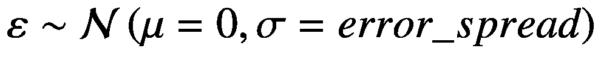；也就是说，它是一个围绕输出值呈正态分布对称波动的项。为简单起见，我们生成`同方差`输出，这意味着误差不相关且均匀（它们不依赖于 `X`）。向量 `β` 是任意的。

外部观察者只能从这个世界中看到记录 (`x[i]`, `y[i]`)，其中 `i` ∈ [1, `样本大小`]。如图 7-1 所示，利用一个或多个样本来重建现实世界现象，这既是艺术、工程，也是科学。我们首先`假设`一个特定的模型（例如，具有给定误差分布的线性模型）。然后，我们尝试找出模型参数（如向量 `β` 和 `σ`），并寻找合适的特征（这显然对参数有影响）。总而言之，我们需要假设和计算很多东西。


*图 7-1*

^(¹⁸)从外部我们只能收集观测值，并尝试在特征与输出之间建立合理的关系。

在特征与输出之间建立关系，使我们能够预测未来的结果，或更好地理解系统中正在发生的事情。在图 7-1 中，前面的数字代表假设的预测变量和拟合值（我们在生产中仔细检查和计算的内容），而地球上的数字代表现实世界的数据。我们可以说，如果模型与现实世界之间的匹配程度可以接受，那么我们的模型就非常接近现实世界。

### 线性回归的变体

线性回归的一般形式为 `y = m(x) + ε`。如果 `E[ε|x]=0`（当同方差性成立时），条件期望函数 `m` 即为 `E[y|x]`。根据 `m` 的结构，我们可以区分以下类型的线性回归：

*   `参数化`：`m = β[0] + Xβ[1 : n]` 是平滑的、确定的且易于解释。
*   `非参数化`：`m` 是平滑的，必须从数据中发现，灵活但难以解释。
*   `半参数化`：介于前两种情况之间（部分结构化）。

在决定使用哪个版本之前，您必须评估成本效益比。例如，如果您有异常值（无法剔除的极端但有效的观测值），那么简单的参数化线性回归就不是一个好的选择。非参数化版本对异常值更具鲁棒性且不易受影响。

想象一下，您遇到了一位乐于助人的巫师，他揭示了关于现实世界过程的一切。有了这些知识，您预测未来结果的准确度能有多高？您绝对不能说得绝对，因为在做出预测时必须应对随机性；您只能谈论看到特定响应的概率。换句话说，您可以建立一个在给定观测值条件下输出值的条件概率分布。这可以表示为 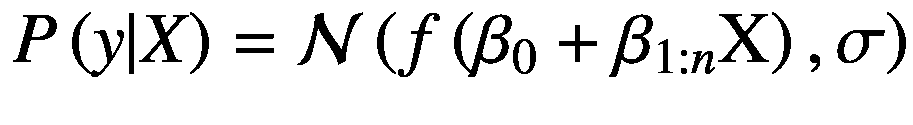

事实上，如果您期望遇到这样一位巫师，您离现实（和理智）并不遥远。`scikit-learn` 框架（ [`https://scikit-learn.org`](https://scikit-learn.org) ）本身就是一个巫师。您只需仔细解读 `scikit-learn` 的“话语”，切勿误用赋予您的力量。本节的目的在于阐明必要的沟通技巧和语言，使您成为这位巫师钟爱的学徒。

代码清单 7-2 展示了 `scikit-learn` 包在实际中的应用，并可视化了一些底层发生的情况。`observer.py` 模块包含用于恢复参数并演示与训练、测试和评估相关的各种效果的函数。您不需要完全理解辅助显示代码（查看 `explain_sse` 和 `plot_mse` 函数）即可跟上进度。`train_model` 函数仅通过使用观测值（即带标签的训练数据）来恢复现实世界的参数。`evaluate_model` 函数通过使用测试数据计算*均方误差 (MSE)* 和*解释方差分数*来检查模型的有效性。在实践中，您应始终选择与问题目标相一致的性能标准。脱离上下文的度量是有误导性的。

```python
import numpy as np

import pandas as pd

import seaborn as sns

import matplotlib.pyplot as plt

plt.style.use('seaborn-whitegrid')

def train_model(model, X_train, y_train):
    model.fit(X_train, y_train)

def evaluate_model(model, X_test, y_test, plot_residuals=False, title=""):
    from sklearn.metrics import mean_squared_error, explained_variance_score
    y_pred = model.predict(X_test)
    if plot_residuals:
        _, ax = plt.subplots(figsize=(9, 9))
        ax.set_title('残差图 - ' + title, fontsize=19)
        ax.set_xlabel('预测值', fontsize=15)
        ax.set_ylabel('残差', fontsize=15)
        sns.residplot(y_pred.squeeze(), y_test.squeeze(),
                      lowess=True,
                      ax=ax,
                      scatter_kws={'alpha': 0.3},
                      line_kws={'color': 'black', 'lw': 2, 'ls': '--'})
    metrics = {
        'explained_variance': explained_variance_score(y_test, y_pred),
        'mse': mean_squared_error(y_test, y_pred)
    }
    return metrics
```


# 多项式流水线与模型评估

```python
def make_poly_pipeline(model, degree):
    from sklearn.pipeline import make_pipeline
    from sklearn.preprocessing import PolynomialFeatures
    return make_pipeline(PolynomialFeatures(degree=degree, include_bias=False), model)
```

## 参数打印与可视化

```python
def print_parameters(linear_model, metrics):
    print('截距: %.3f' % linear_model.intercept_)
    print('系数: \n', linear_model.coef_)
    print('解释方差得分: %.3f' % metrics['explained_variance'])
    print("均方误差: %.3f" % metrics['mse'])

def plot_mse(model, X, y, title, error_spread):
    def collect_mse():
        from sklearn.model_selection import train_test_split
        from sklearn.model_selection import cross_val_score
        metrics_all = []
        for train_size_pct in range(10, 110, 10):
            X_train, X_test, y_train, y_test = \
                train_test_split(X, y, shuffle=False, train_size=train_size_pct / 100)
            metrics_current = dict()
            metrics_current['percent_train'] = train_size_pct
            train_model(model, X_train, y_train)
            metrics_train = evaluate_model(model, X_train, y_train)
            metrics_current['训练得分'] = metrics_train['mse']
            metrics_cv = cross_val_score(
                model,
                X_train, y_train,
                scoring='neg_mean_squared_error', cv=10)
            metrics_current['交叉验证得分'] = -metrics_cv.mean()
            if X_test.shape[0] > 0:
                metrics_test = evaluate_model(model, X_test, y_test)
                metrics_current['测试得分'] = metrics_test['mse']
            else:
                metrics_current['测试得分'] = np.NaN
            metrics_all.append(metrics_current)
        return pd.DataFrame.from_records(metrics_all)

    import matplotlib.ticker as mtick
    df = collect_mse()
    error_variance = error_spread**2
    ax = df.plot(
        x='percent_train',
        title=title,
        kind='line',
        xticks=range(10, 110, 10),
        sort_columns=True,
        style=['b+--', 'ro-', 'gx:'],
        markersize=10.0,
        grid=False,
        figsize=(8, 6),
        lw=2)
    ax.set_xlabel('训练集大小', fontsize=15)
    ax.xaxis.set_major_formatter(mtick.PercentFormatter())
    y_min, y_max = ax.get_ylim()
    # 待修正：参见练习 2！
    ax.set_ylim(max(0, y_min), min(2 * error_variance, y_max))
    ax.set_ylabel('MSE', fontsize=15)
    ax.title.set_size(19)
    # 绘制并标注最小 MSE。
    ax.axhline(error_variance, color="g", ls="--", lw=1)
    ax.annotate(
        '固有误差水平',
        xy=(15, error_variance),
        textcoords='offset pixels',
        xytext=(10, 80),
        arrowprops=dict(facecolor='black', width=1, shrink=0.05))
```

## SSE 可视化

```python
def explain_sse(slope, intercept, x, y):
    # 配置图表。
    _, ax = plt.subplots(figsize=(7, 9))
    ax.set_xlabel('x', fontsize=15)
    ax.set_ylabel('y', fontsize=15)
    ax.set_title(r'$SSE = \sum_{i=1}^n (y_i - \hat{y}_i)²$', fontsize=19)
    ax.grid(False)
    ax.spines["top"].set_visible(False)
    ax.spines["right"].set_visible(False)
    ax.tick_params(direction='out', length=6, width=2, colors="black")
    # 展示 x-y 点对。
    ax.scatter(x, y, alpha=0.5, marker="x")
    # 绘制回归线。
    xlims = np.array([np.min(x), np.max(x)])
    ax.plot(xlims, slope * xlims + intercept, lw=2, color="b")
    # 绘制误差项。
    for x_i, y_i in zip(x, y):
        ax.plot([x_i, x_i], [y_i, slope * x_i + intercept], color="r", lw=2, ls="--")
```

请注意统一 API（如 `fit`、`predict` 等）的优势，它可以让我们与各种模型协作。即便是流水线（`pipeline`）也能以相同方式处理。清单 7-3 展示了 `session.py` 模块中的 `demo_metrics_and_mse` 函数。它描述了使用不同噪声水平从观测数据重建参数的步骤。在没有噪声的情况下，我们得到的是确定性的线性回归。随着噪声增加，参数的估计会变差。

```python
import warnings
warnings.simplefilter(action='ignore', category=FutureWarning)
import numpy as np
import pandas as pd
from sklearn.linear_model import LinearRegression
from data_generator import *
from observer import *

def set_session_seed(seed):
    np.random.seed(seed)    # 实现已发布结果的完美复现。

def demo_metrics_and_mse():
    set_session_seed(100)
```


#### 误差分析与模型评估

```python
X = generate_base_features(1000)[['x_normal']]

for noise_level in [0, 2, 15]:

    y = generate_response(X, noise_level, [-1.5, 4.1])

    model = LinearRegression()

    train_model(model, X, y)

    metrics = evaluate_model(model, X, y)

    print('\n 噪声水平为 %d 的迭代' % noise_level)

    print_parameters(model, metrics)

    # 可视化回归线和误差项。

    if noise_level == 15:

        slope = model.coef_[0][0]

        intercept = model.intercept_

        explain_sse(slope, intercept, X[:15].values, y[:15])
```

`warning`模块用于屏蔽`FutureWarning`类型的警告，从而去除输出中的杂乱信息。以下是执行`demo_metrics_and_mse()`后的打印结果：

```
噪声水平为 0 的迭代

截距: -1.500

系数:

[[4.1]]

解释方差得分: 1.000

均方误差: 0.000

噪声水平为 2 的迭代

截距: -1.470

系数:

[[4.0925705]]

解释方差得分: 0.997

均方误差: 4.187

噪声水平为 15 的迭代

截距: -1.535

系数:

[[4.06304243]]

解释方差得分: 0.867

均方误差: 223.945
```

图 7-2 描绘了误差累积的情况；回归线是基于整个数据集计算的，因此在这个子集上看起来有偏差。`MSE`仅仅是平方误差和（`SSE`）的平均值。每条垂直虚红线代表一个单独的误差项（真实值*y*[*i*]与其预测值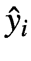之间的差异）。模型的系数使这个`MSE`（损失函数）最小化，而计算向量*β*的对应表达式是一个**无偏最小方差估计量**。它独立于固有噪声因子，并且`MSE`是此误差项离散程度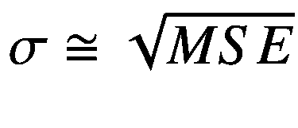的一个估计量。估计值及其依赖的值用帽号符号表示。

> **注意**
> 仅当对应的预测变量属于比率水平数据类型（存在绝对零点的概念）时，截距才有意义。否则，应将其关闭（参见`LinearRegression`类的构造函数）。

#### 提示

`print_parameters`方法很基础。为了获得完整的 R 风格模型参数摘要，你可能想使用`statsmodels`包（访问[`https://www.statsmodels.org`](https://www.statsmodels.org)）。

一旦模型准备好（训练好），它就可以用于生产环境来处理未见过的数据。这就是我所说的*运行时模型*。所有学习到的（运行时）参数是其组成部分，并且通常可以通过各种通信渠道进行分发。这一特性允许在拥有大量数据的强大机器上单独进行训练。例如，我们在生产环境中处理真实数据所需的只是对应的向量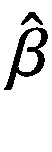。计算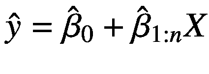可以在任何受限设备上执行。

在使用`world1`（原始模型）时，我们采用了一个简单的训练过程。所有可用数据都被重复用于训练和测试，这是你在实践中应该避免的。在这种情况下，它没有引发问题。我们的模型复杂度与真实情况完美匹配，当更高的噪声导致解释方差下降以及 MSE 上升时，这一点得到了证明。这表明我们没有试图捕捉现实世界中非本质的属性。一个过于复杂的模型能够做到这一点，从而导致*过拟合*。与此相反的是*欠拟合*，即我们的模型甚至弱到无法捕捉基本特征。接下来的两节将详细演示这些方面。

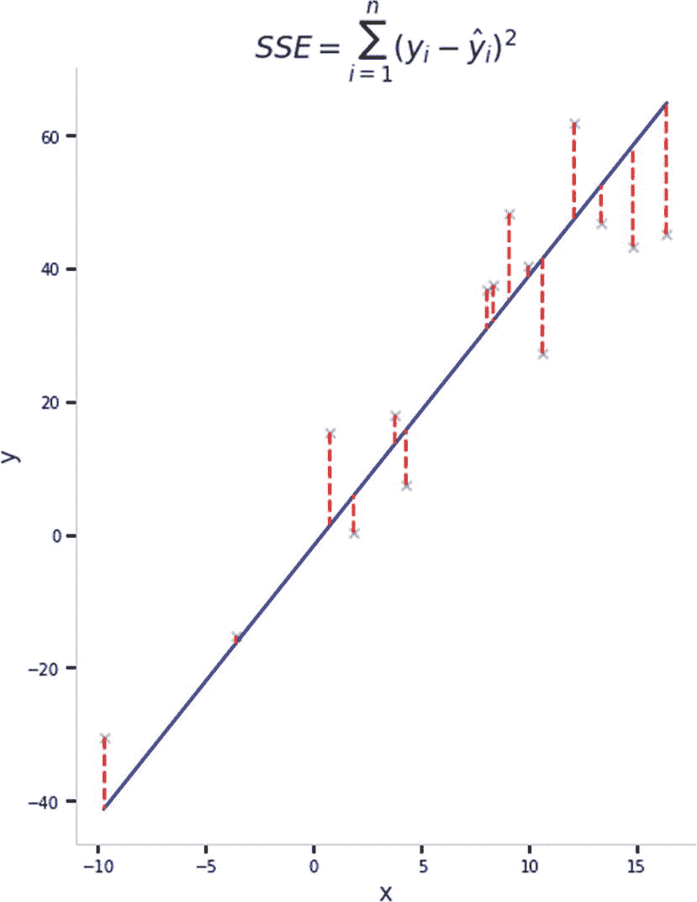

**图 7-2**

误差项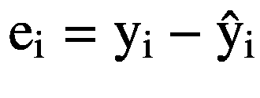被平方、求和并平均，以计算 MSE。均方根误差（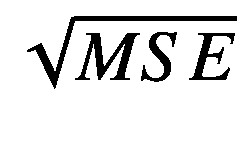）有助于恢复响应变量的原始单位。

### 过拟合

我们将使用不同次数的多项式特征来扩充线性模型；该模型在特征方面本身保持线性。目的是演示过拟合。由于此模型比之前研究的模型更强大，它有足够的能力来涵盖数据中的错误波动；在确定性情况下（无误差），你不会注意到任何差异。机器学习算法无法辨别数据中的不规则性是否关键。存在一种通过将历史数据拆分为训练集和测试集来检测过拟合的机制。

清单 7-4 展示了`demo_overfitting`函数（使用多项式特征）以及`plot_mse`函数（用于绘制不同大小的训练集和测试集的 MSE）。在运行过程中，数据被拆分为不同大小的训练集和测试集。这种训练过程的扩展引入了一个新的过程参数：用于训练目的的数据量（其余保留用于测试）。之前我们只是不加区分地使用所有数据。内部的可视化函数展示了幕后的实际情况。

```python
def demo_overfitting():

def visualize_overfitting():

train_model(optimal_model, X, y)

train_model(complex_model, X, y)

_, ax = plt.subplots(figsize=(9, 7))

ax.set_yticklabels([])

ax.set_xticklabels([])

ax.grid(False)

X_test = np.linspace(0, 1.2, 100)

plt.plot(X_test, np.sin(2 * np.pi * X_test), label='True function')

plt.plot(

X_test,

optimal_model.predict(X_test[:, np.newaxis]),

label='Optimal model',

ls='-.')

plt.plot(

X_test,

complex_model.predict(X_test[:, np.newaxis]),

label='Complex model',

ls='--',

lw=2,

color='red')

plt.scatter(X, y, alpha=0.2, edgecolor="b", s=20, label='Training Samples')

ax.fill_between(X_test, -2, 2, where=X_test > 1, hatch='/', alpha=0.05, color="black")

plt.xlabel('x', fontsize=15)

plt.ylabel('y', fontsize=15)

plt.xlim((0, 1.2))

plt.ylim((-2, 2))

plt.legend(loc='upper left')

plt.title('Visualization of How Overfitting Occurs', fontsize=19)

plt.show()

set_session_seed(172)

X = generate_base_features(120)[['x_uniform']]

y = generate_response(X, 0.1, [0, 2 * np.pi], f=np.sin)

optimal_model = make_poly_pipeline(LinearRegression(), 5)

plot_mse(optimal_model, X, y, 'Optimal Model', 0.1)

complex_model = make_poly_pipeline(LinearRegression(), 35)

plot_mse(complex_model, X, y, 'Complex Model', 0.1)
```

# visualizing overfitting

**清单 7-4**

**包含演示过拟合的函数**

当模型与真实情况匹配时，训练集和测试集产生的 MSE 都会围绕可达到的最小 MSE（反映数据中的固有方差）波动，如图 7-3 所示。否则，测试集表现会更差，如图 7-4 所示。这表明模型没有很好地泛化，并且从训练集中拾取了不重要的细节。当模型的复杂度超过所需水平时，交叉验证（CV）得分也会显著恶化。

CV 评分是评估模型性能的一种非常高效的方法。它是各个 CV 评分的平均值。训练数据被随机划分为 K 个大小相等的互补子集（这里我们使用`K=10`；请参见清单 7-2 中的`collect_mse`内部函数以及练习 7-2）；这个数字`K`是另一个与过程相关的参数。在每一轮中，一个子集用于测试（更准确地说，用于验证），而其余部分用作真正的训练数据（在后面的“正则化”一节中，我们将使用 *K 折交叉验证* 来设置一个运行时参数）。来自初始数据集的每个数据点仅被用作一次测试数据。通过这种方式，算法循环遍历所有分区，因此总体平均得分确实是一个可靠的性能指标。还有一些极端的变体，其中每次迭代仅使用单个观测值（单例）进行测试（即所谓的 *留一法交叉验证*）。

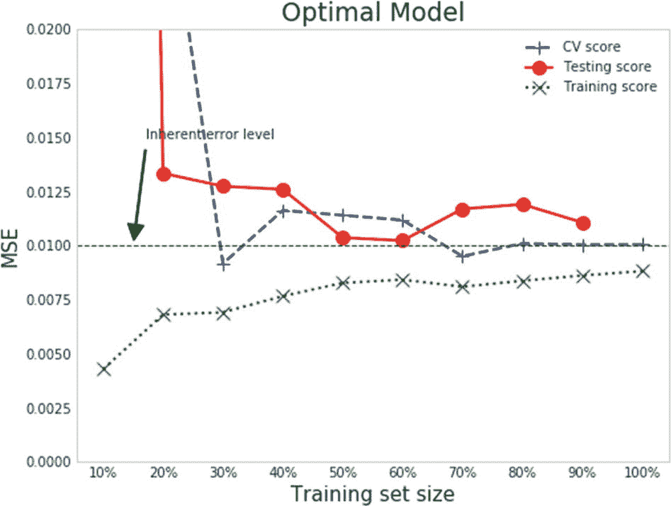

图 7-3：当模型复杂度恰到好处时，测试集的 MSE 接近自然方差

此外，随着我们使用更多的训练数据，CV 分数、测试分数和训练分数之间的方差会减小。当我们使用所有可用数据进行训练时，没有测试分数标记。水平虚线表示数据中的固有误差（可能源于测量误差）。一个合适的模型不应试图体现这一部分。在机器学习中，我们不能简单地指示计算机忘记固有误差。诀窍在于将模型的复杂度设置得恰到好处，使其没有能力去记忆不想要的细节。显然，当训练集足够小时，机器最初会试图吸收所有信息，但后来会放弃并只跟随主要趋势。因此，对于给定的模型复杂度，你必须拥有足够的训练数据。庞大的模型（尤其是深度神经网络）在生产准备就绪之前必须吞噬大量的训练数据。

过拟合和欠拟合（将在下一节中演示）与监督学习的核心问题——即 *偏差-方差权衡*——紧密相关。一个高偏差的模型可能会错过训练数据中的重要方差，而一个高方差的模型可能会试图捕获非本质的属性。平衡这两种力量是训练机器学习算法中最困难的方面之一。例如，必须对决策树给予极度的关注，因为它可能很容易覆盖训练数据中的所有边缘情况。

图 7-5 展示了为何一个过于复杂的模型泛化能力不佳；也就是说，它在测试集上表现不佳。这里所说的测试集并非特指某个领域中完全未知的区域，而仅仅是从训练集中排除的数据点的集合。关于未知空间的推理需要一种不同的学习方法（另见参考文献 [1]），这将是下一个案例研究的主题。

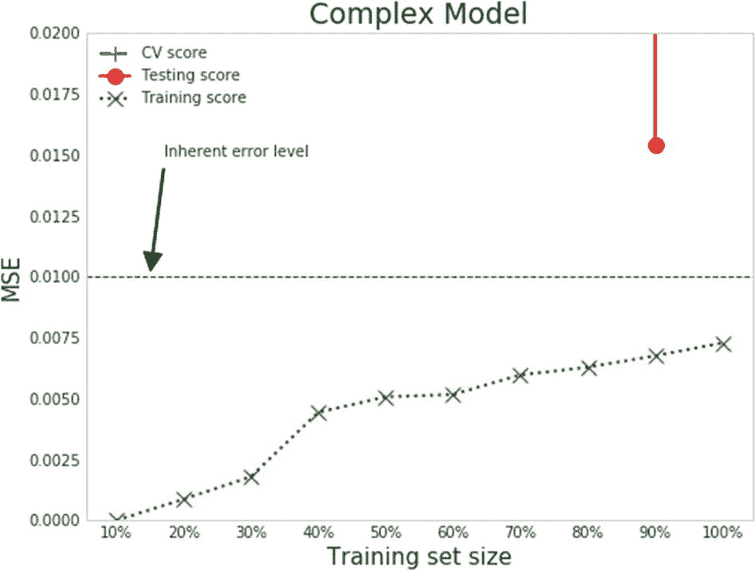

图 7-4：当模型复杂度太高时，测试集的 MSE 上升到固有误差水平之上

这里的交叉验证得分甚至超出了范围。观察到模型在开始时完全记住了一个小的训练样本，并且总是能够跟随意外的波动。应对这种情况的一种方法是向系统提供更多的训练数据。在我们的案例中，只有在使用 60% 的训练集大小时，它才开始在测试集上表现得合理。

# 欠拟合与特征交互

本节介绍特征相互作用的另一种典型情况。其目标是展示仅识别相关特征是不够的。你必须理解它们在现实世界中是如何相互关联的。我们假设有两个模型：一个将各个特征视为独立的，另一个则包含它们的交互作用。

清单 7-5 展示了演示欠拟合的`demo_underfitting`函数。当模型与真实情况匹配时，由训练集和测试集引起的 MSE 都围绕着可达到的最小 MSE（类似于图 7-3 所示）波动。相比之下，图 7-6 说明了弱模型会发生什么；显然，向弱模型添加更多数据无济于事。在实践中，欠拟合不如过拟合常见，尤其是在使用强大的深度神经网络时。

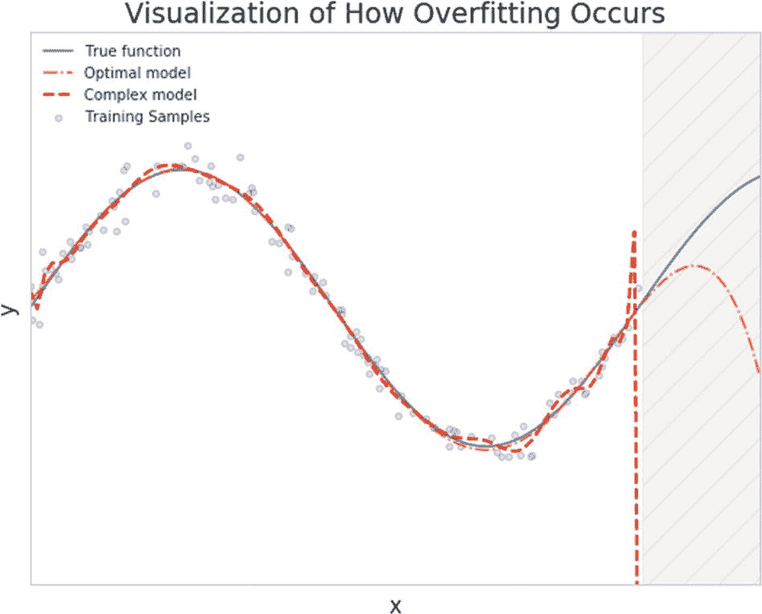

图 7-5：由于试图包含固有误差，复杂模型的预测线呈现锯齿状

在图 7-5 的右侧，你可以看到在未探索区域发生的情况。两条拟合线都偏离了真实函数。

```python
def demo_underfitting():
    set_session_seed(15)
    X = generate_base_features(200)
    X_interacting = X[['x_interacting']]
    y = generate_response(X_interacting, 2, [1.7, -4.3])
    plot_mse(LinearRegression(), X_interacting, y, 'Optimal Model', 2)
    X_weak = X[['x_normal', 'x_uniform']]
    plot_mse(LinearRegression(), X_weak, y, 'Weak Model', 2)
```

清单 7-5：通过特征交互来演示欠拟合的函数

弱模型正确地引入了两个参与的特征，但单独来看，它们无法提供价值。

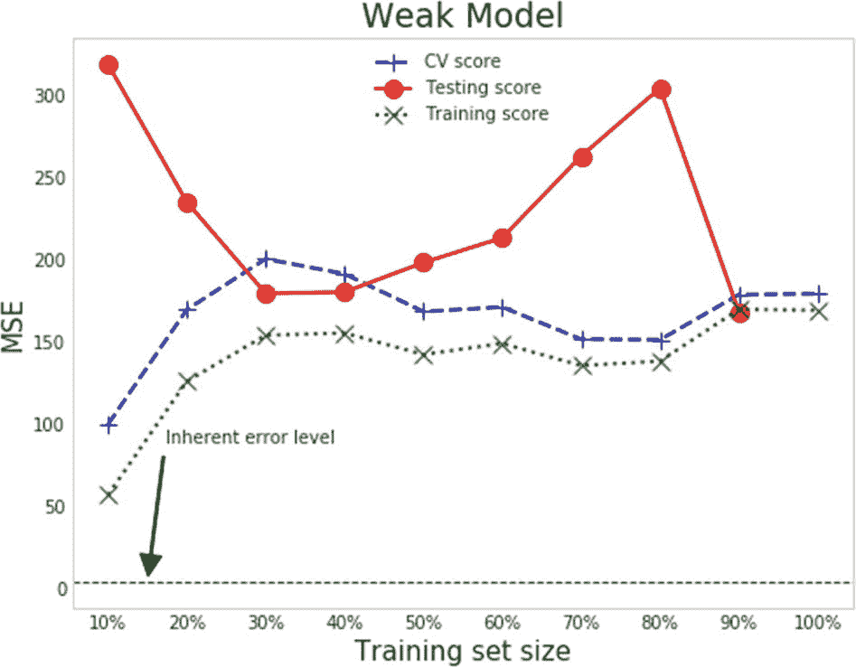

图 7-6：对于弱模型，所有集合的 MSE 都远离固有误差

# 共线性

如果你仔细审视`generate_base_features`函数，就会发现特征`x_normal`、`x_combined`和`x_collinear`之间存在相互关系。我们新的模拟世界仅使用了`x_normal`和`x_combined`。和之前一样，我们将假定这个世界有两种变体：一种使用相同的特征，另一种则也加入了`x_collinear`。代码清单 7-6 展示了演示共线性的代码。在机器学习中，这种现象会对性能和稳定性产生负面影响（因为很难评估特征对结果的影响）。

```python
def demo_collinearity():
    set_session_seed(10)
    X = generate_base_features(1000)
    X_world = X[['x_normal', 'x_combined']]
    y = generate_response(X_world, 2, [1.1, -2.3, 3.1])
    model = LinearRegression()
    # 展示第一个假设模型。
    train_model(model, X_world, y)
    metrics = evaluate_model(model, X_world, y)
    print('\n 打印模型 1 的统计数据')
    print_parameters(model, metrics)
    # 展示第二个假设模型。
    X_extended_world = X[['x_normal', 'x_combined', 'x_collinear']]
    train_model(model, X_extended_world, y)
    metrics = evaluate_model(model, X_extended_world, y)
    print('\n 打印模型 2 的统计数据')
    print_parameters(model, metrics)
    # 生成散点矩阵图。
    df = X
    df.columns = ['x' + str(i + 1) for i in range(len(df.columns))]
    df['y'] = y
    pd.plotting.scatter_matrix(df, alpha=0.2, figsize=(10, 10), diagonal="kde")
```

清单 7-6

在 session.py 中扩展`demo_collinearity`函数

执行`demo_collinearity()`的输出如下：

```
打印模型 1 的统计数据
截距: 1.021
系数:
[[-2.1290165   3.05443636]]
解释方差得分: 0.999
均方误差: 4.274

打印模型 2 的统计数据
截距: 1.021
系数:
[[-2.1290165   0.09438926  0.52857984]]
解释方差得分: 0.999
均方误差: 4.274
```

这些运行结果之间唯一的区别在于 `x_combined` 的显著性。这是共线性的典型标志。系统会困惑于该“使用” `x_combined` 还是 `x_collinear`，因为其中一个直接是另一个的线性组合。此外，`x_normal` 和 `x_combined` 之间也存在强关联。检查这种相互依赖关系的一种实用方法是生成一个 `散点矩阵图`，如图 7-7 所示；这是运行 `demo_collinearity` 的最终结果（列名已重命名，以便在图表中更合适地显示）。也可以生成相关性矩阵，但它只会揭示线性关系。而图表则可能同时展示非线性关联。

独立性假设在机器学习算法中很常见。朴素贝叶斯方法完全依赖于这个特性。特征依赖性会对逻辑回归的收敛性产生负面影响。此外，高度相关的特征是冗余的，只会使模型复杂化。

### 残差图

作为一名数据科学家，你必须不断寻求从多个角度审视问题。同样，你也应该了解互补的绘图技术，因为它们能揭示问题中原本不可见的方面。你刚刚见识了散点矩阵图的效用。在本节中，我们将生成两个世界，一个是线性的，另一个是二次的。两者都有微小的系数、固有的随机性，并且通过真正的线性模型进行近似。代码清单 7-7 包含了 `demo_residuals` 函数，用以强调残差图的重要性。

图 7-8 展示了两个散点图及其回归线，分别对应线性模型拟合线性世界（案例 1）和线性模型拟合二次世界（案例 2）。两种情况下 `MSE` 相同，而案例 2 的解释方差得分更优。你会选择哪个案例作为线性模型更合适的拟合？我猜你会选择案例 2。然而，图 7-9 讲述了不同的故事。

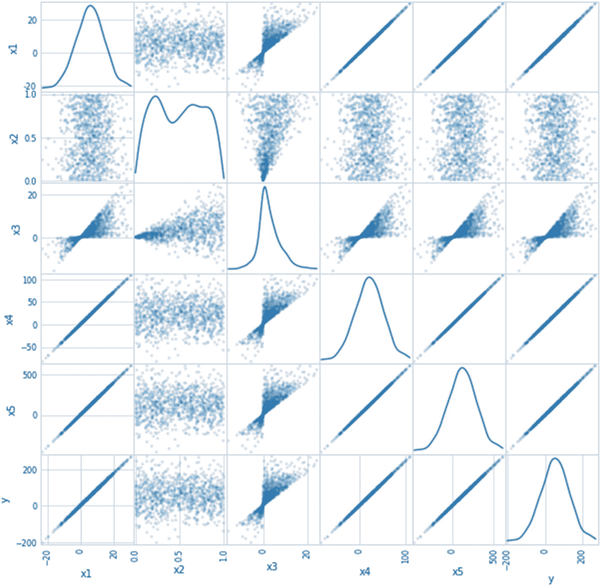

**图 7-7** 所有变量对的散点图，对角线为密度图

注意 `x1`、`x4`、`x5` 和 `y` 之间的紧密联系。此外，观察 `x3` 与其他特征相比的独特形状。

```python
def demo_residuals():

def plot_regression_line(x, y, case_num):

    _, ax = plt.subplots(figsize=(9, 9))

    ax.set_title('回归图 - 案例 ' + str(case_num), fontsize=19)

    ax.set_xlabel('x', fontsize=15)

    ax.set_ylabel('y', fontsize=15)

    sns.regplot(x.squeeze(), y.squeeze(),

                ci=None,

                ax=ax,

                scatter_kws={'alpha': 0.3},

                line_kws={'color': 'green', 'lw': 3})

set_session_seed(100)

X = generate_base_features(1000)

X1 = X[['x_normal']]

y1 = generate_response(X1, 0.04, [1.2, 0.00003])

X2 = X1**2

y2 = generate_response(X2, 0.04, [1.2, 0.00003])

model = LinearRegression()

#### 用线性假设模型展示第一个世界。

plot_regression_line(X1, y1, 1)

train_model(model, X1, y1)

metrics = evaluate_model(model, X1, y1, True, '案例 1')

print('\n 打印案例 1 的统计数据')

print_parameters(model, metrics)

#### 用线性假设模型展示第二个世界。

plot_regression_line(X1, y2, 2)

train_model(model, X1, y2)

metrics = evaluate_model(model, X1, y2, True, '案例 2')

print('\n 打印案例 2 的统计数据')

print_parameters(model, metrics)
```

代码清单 7-7

一个创建两个具有欺骗性方案（其中明显的方案并非明显错误）的函数

这段代码在案例 2 中复用了案例 1 的模型实例。你必须仔细阅读文档，了解重复调用 `fit` 方法时会发生什么。以下是 scikit-learn 教程的引用（参见 [`https://scikit-learn.org/stable/tutorial/basic/tutorial.html`](https://scikit-learn.org/stable/tutorial/basic/tutorial.html) ）：“估计器的超参数在其构建后可以通过 `set_params()` 方法更新。多次调用 `fit()` 会覆盖之前任何 `fit()` 学习到的内容。”这种行为正是我们所需要的。

你还必须注意复用训练模型时所用的同一个缩放器实例。验证集和测试集必须以与训练数据集相同的方式进行缩放。忘记这个细节可能会导致微妙的错误。

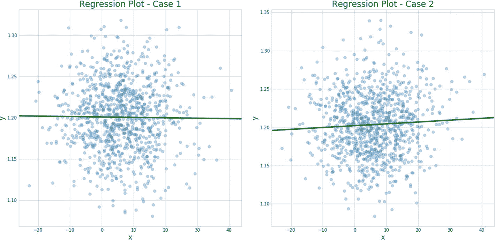

**图 7-8** 案例 1 的斜率方向是错误的，因为本应为正（参见代码清单 7-7）

对于案例 2，斜率是正的，正如它应该的那样。所有迹象都表明这是更好的匹配。

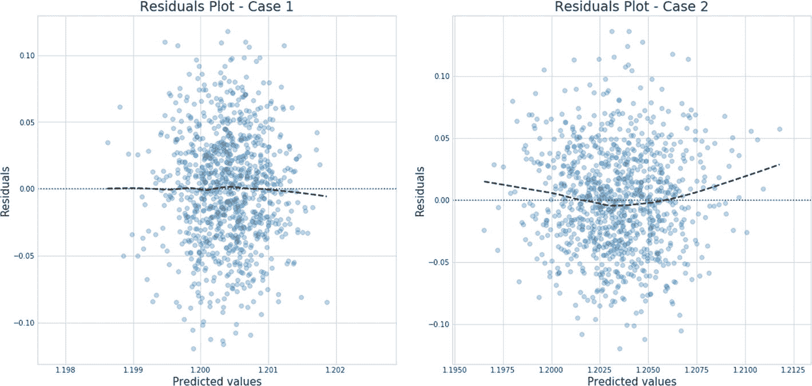

**图 7-9** 残差图明显支持案例 1 而非案例 2，并且给出了清晰的视觉解释；曲线的形状很好地揭示了残差中的“二次”模式

案例 1 没有残差模式。请参见代码清单 7-2 和 `evaluate_model` 函数（该函数创建残差图，并用最低线条描绘趋势）。

### 正则化

我们无法预先知道哪种模型是最优的。我们可以从弱模型开始逐步增加特征，也可以从过于复杂的模型开始并尝试简化。这两种方法都无法通过人工操作实现规模化扩展。我们的思路是宁可偏向复杂，然后利用某种自动化机制将模型复杂度降低到最优水平。这就是 `正则化` 的核心思想——一种自动避免过拟合的机制。正则化有多种类型，我们将使用内置交叉验证的 `岭回归`。

正则化通过数学优化的语言对系数施加约束，这以 `惩罚函数` 的形式表达。岭回归（又称吉洪诺夫正则化）旨在使系数尽可能小，因为这与获得复杂度最低的模型等价。因此，岭回归定义了 L2 正则化项（L2 范数） `α ||w||₂²`，并将其添加到基础损失函数（本例中为 `MSE`）中。向量 `w` 包含模型的系数（权重），参数 `α` 则平衡了 `MSE` 与惩罚项之间的最小化尝试。`α` 值越大，越倾向于奖励更小的系数，反之亦然。`Alpha` 通过某种试错法（例如对候选列表进行交叉验证）计算得出。代码清单 7-8 展示了用于阐述正则化的函数，其效果展示在图 7-10 中。

```python
def demo_regularization():

    from sklearn.linear_model import RidgeCV

    set_session_seed(172)

    x = generate_base_features(120)[['x_uniform']]

    y = generate_response(X, 0.1, [0, 2 * np.pi], f=np.sin)

    regularized_model = make_poly_pipeline(

        RidgeCV(alphas=[1e-3, 1e-2, 1e-1, 1, 5, 10, 20], gcv_mode="auto"),

        35)

    plot_mse(regularized_model, X, y, 'Regularized Model', 0.1)
```

代码清单 7-8

演示正则化功能的 `demo_regularization` 函数实现

### 引言

所有的魔法都发生在 scikit-learn 框架的 `RidgeCV` 类中。

## 金融走势预测案例研究

金融建模领域将为我们揭示`时间序列分析`的某些方面，我们需要对事件做出近乎实时的反应（例如预测股市价格）。这与我们迄今为止使用的`批处理`方式完全不同。我的目标并非开发新一代的股票市场应用程序，而是引导你关注流式数据处理带来的新问题与潜在解决方案。你无法一次性获取此类数据，因此`流处理`技术本质上是增量式的且具有因果性（它们基于当前知识来预测未来结果）。这意味着模型参数会随时间演变，而不是在训练阶段结束时固定不变。与经典方法相比，监控和正则化这种演变也是一些新的任务（参见参考文献[1-2]）。

另一个关键区别在于观测数据的时间戳。在第 2 章的电商客户细分案例中，数据的时间戳是粗略的（数据文件按天分隔）。而在这里，每条记录都有其独立的时间戳，以便我们监测趋势、季节性和其他基于时间模式的规律；相对时序不足以实现这一目的。为避免时区相关问题，最好将时间戳记录为自纪元时间以来的秒数（或采用类似的更高粒度方案）。

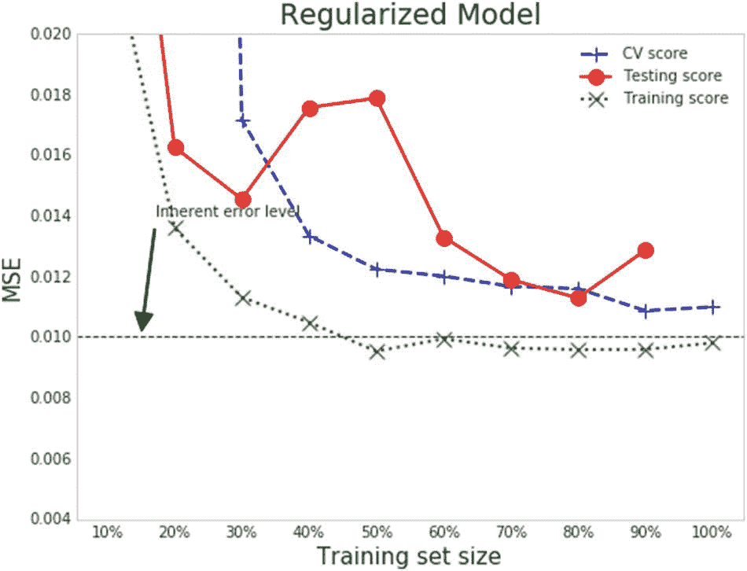

**图 7-10**
尽管该模型在特征方面的复杂度与我们之前过拟合的例子相同，但由于采用了正则化，它并未像之前那样出现过拟合。

### 数据获取

随附的源代码已包含苹果公司（股票代码为 AAPL）的每日时间序列股票数据的 CSV 文件。它位于`stock_market`子文件夹（与其他文件一起）。你可以通过从 Spyder 的 IPython 控制台执行以下命令来获取最新数据，或者处理其他公司的股票（只需修改下面的股票代码并相应重命名目标文件）：

```python
!curl -o daily_AAPL.csv \
"https://www.alphavantage.co/query?function=TIME_SERIES_DAILY&symbol=AAPL&outputsize=full&apikey=&datatype=csv"
```

我们依赖 Alpha Vantage 的 API（参见 [`https://www.alphavantage.co/documentation/#daily`](https://www.alphavantage.co/documentation/%2523daily)）来获取每日时间序列数据。你可以从 Alpha Vantage 获取免费 API 密钥，并在上述代码的 URL 中插入该密钥进行标识。该网站上有关于请求限制的详细文档。`outputsize`参数设置为`full`，可获取长达 20 年的历史数据。输出格式（`datatype`参数）设置为`csv`。

### 数据预处理

秉承数据科学流程的精神，我们首先进行一些预处理和探索性数据分析。后续所有步骤都应在 Spyder 的 IPython 控制台中执行（确保你当前位于`stock_market`文件夹）。下一条命令显示了已下载文件的前五行：

```python
!head -n 5 daily_AAPL.csv
```
```
timestamp,open,high,low,close,volume
2018-11-07,205.9700,210.0600,204.1300,209.9500,33106489
2018-11-06,201.9200,204.7200,201.6900,203.7700,31882881
2018-11-05,204.3000,204.3900,198.1700,201.5900,66163669
2018-11-02,209.5500,213.6500,205.4300,207.4800,91328654
```

根据 API 文档，“最近的数据点是当前交易日实时更新的价格和交易量信息”。我们将忽略这一点，仅使用稳定数据点。接下来的代码行将股票数据读入一个 Pandas 数据框，并显示前几条记录：

```python
import pandas as pd
stock_data = pd.read_csv('daily_AAPL.csv', usecols=[0, 4, 5], skiprows=[1])
stock_data.head()
```
```
  timestamp   close    volume
0 2018-11-06  203.77  31882881
1 2018-11-05  201.59  66163669
2 2018-11-02  207.48  91328654
3 2018-11-01  222.22  58323180
4 2018-10-31  218.86  38358933
```

我们只需要时间戳、收盘价和交易量字段，并且不包含最近的数据点。此时，查看关于数据类型、行数等的整体信息会很方便。下一条命令展示了这些信息：

```python
stock_data.info()
```
```
<class 'pandas.core.frame.DataFrame'>
RangeIndex: 5247 entries, 0 to 5246
Data columns (total 3 columns):
 #   Column     Non-Null Count  Dtype         
---  ------     --------------  -----         
 0   timestamp  5247 non-null   object        
 1   close      5247 non-null   float64       
 2   volume     5247 non-null   int64         
dtypes: float64(1), int64(1), object(1)
memory usage: 123.1+ KB
```

显然，`timestamp`列的类型是`object`，这种类型过于通用，不太方便使用。接下来的代码行将此列转换为`DateTime`索引（这允许我们按时间顺序处理数据）：

```python
stock_data['timestamp'] = pd.to_datetime(stock_data['timestamp'])
stock_data.set_index('timestamp', inplace=True, verify_integrity=True)
stock_data.head()
```
```
            close    volume
timestamp
2018-11-06  203.77  31882881
2018-11-05  201.59  66163669
2018-11-02  207.48  91328654
2018-11-01  222.22  58323180
2018-10-31  218.86  38358933
```

图 7-11 展示了 AAPL 收盘价随时间的变化，该图由以下代码片段生成。`style`参数控制图中线条的外观。为了在灰度图像中区分线条，不能仅依赖颜色。我们在图 7-11 中看到，大约在 2015 年左右价格出现了大幅下跌。根据一份报告（参见 [`http://time.com/money/3991712/apple-stock-price-drop`](http://time.com/money/3991712/apple-stock-price-drop)），原因是 iPhone 销售未达到业务预期。

```python
import matplotlib.pyplot as plt

def plot_time_series(ts, title_prefix, style='b-'):
    ax = ts.plot(figsize=(9, 8), lw=2, fontsize=12, style=style)
    ax.set_title('%s Over Time' % title_prefix, fontsize=19)
    ax.set_xlabel('Year', fontsize=15)

plot_time_series(stock_data['close'], 'AAPL Closing Levels')
```

### 发现时间序列中的趋势

图 7-11 中的图表非常不规整，这是由于噪声和季节性的影响。识别时间序列趋势的一种流行方法是使用*移动平均*。以下命令通过计算*简单移动平均线 (SMA)*来绘制收盘价的趋势，如图 7-12 所示：

```python
stock_data.sort_index(inplace=True)
plot_time_series(stock_data['close'].rolling('365D').mean(), 'AAPL Closing Trend')
```

如果我们不对索引进行排序，则会收到错误提示：`ValueError: index must be monotonic`。滚动窗口大小被设置为 365 天。图 7-13 将收盘价趋势和交易量趋势结合在了同一个图表中。交易量随时间变化不大，尽管当价格开始下跌时交易量有所增加。这可能是因为在价格还算不错的时候出现了抛售股票的冲动。这种比较对于特征工程和更深入地洞察行为模式非常有用。以下代码生成了这样一个复合图表：

```python
def compose_trends(ts):
```

计算移动平均可以消除数据中的微小波动。同时观察图 7-13 可以发现，价格大幅下跌的斜率小于图 7-11 中的斜率。在将不同特征组合到同一张图之前，对它们进行缩放是很有必要的。在各种机器学习场景中，当某个方向的变化可能完全掩盖其他方向的变化时，数据缩放也是强制要求。这种情况通常发生在不同特征的值域差异巨大时。

```python
from sklearn.preprocessing import MinMaxScaler

scaler = MinMaxScaler()

scaled_ts = pd.DataFrame(scaler.fit_transform(ts), columns=ts.columns, index=ts.index)

return pd.concat([scaled_ts['close'].rolling('365D').mean(),

scaled_ts['volume'].rolling('365D').mean()], axis=1)

# >> plot_time_series(compose_trends(stock_data), 'AAPL Closing & Volume Trends', ['b-', 'g--'])
```

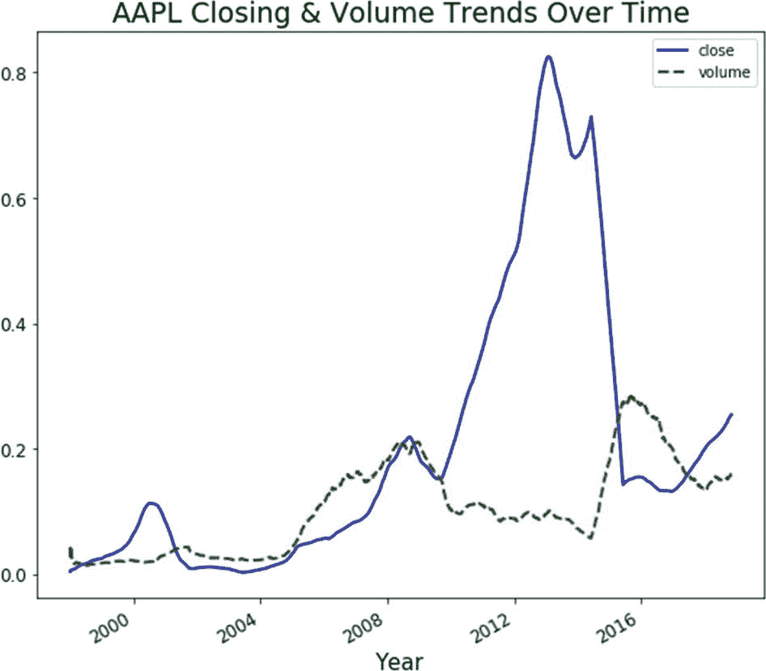
图 7-13：y 轴现在显示的是缩放后的值

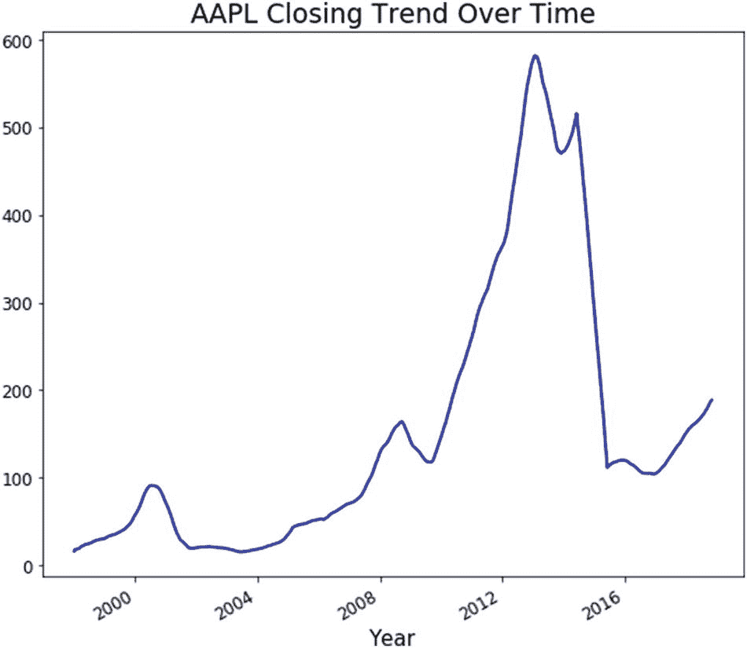
图 7-12：与图 7-11 相比，图表平滑得多

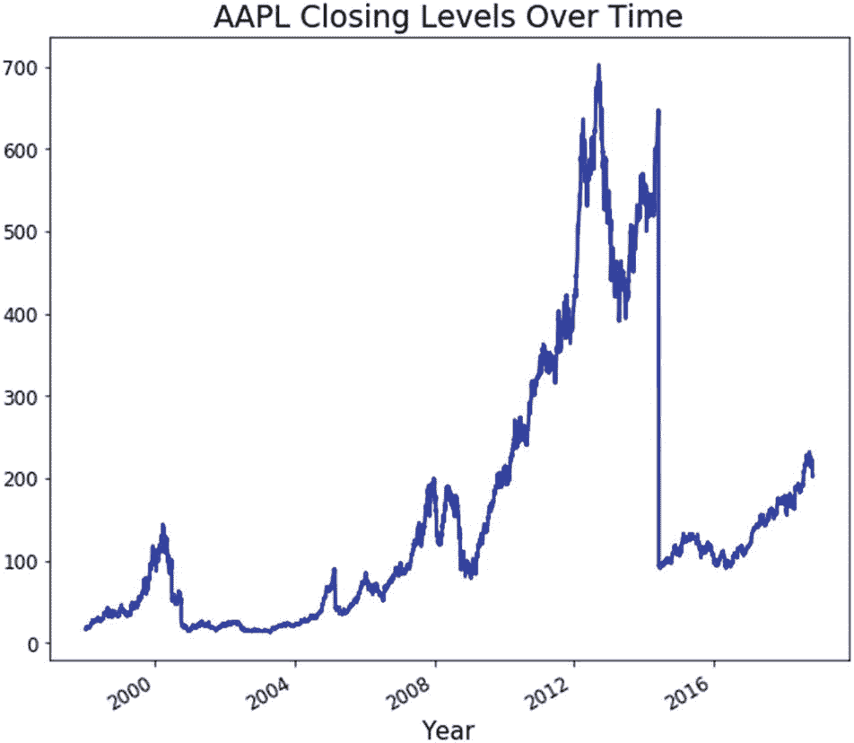
图 7-11：AAPL 收盘价随时间的变化情况

## 特征转换

在金融领域，关注每日收益率比使用绝对数值更有用。收益率表示资产价值随时间波动的程度。计算收益率主要有两种方式：

* **对数收益率**：`r_t = log(v_t / v_{t-1})`，其中 `v` 表示资产价值（如收盘价、复权收盘价、成交量、复权成交量等）。
* **缩放百分比收益率**：`r_t = (v_t / v_{t-1} - 1)`。Pandas 中有一个 `pct_change` 方法可以计算该数值。对于日收益率而言，缩放百分比收益率近似于对数收益率。这可以从对数函数的泰勒展开式中看出，当 `x = V_t / V_{t-1}` 非常小时，只有第一项（`x - 1`）起作用。

对数收益率具有很好的数学性质（例如可加性、关于收益和损失的对称性等）。以下代码片段为我们的数据框增加了两个新特征：股票价格的每日对数收益率和成交量的每日对数变化量。图 7-14 展示了 AAPL 价格对数收益率随时间的变化，图 7-15 则展示了成交量的相应变化。

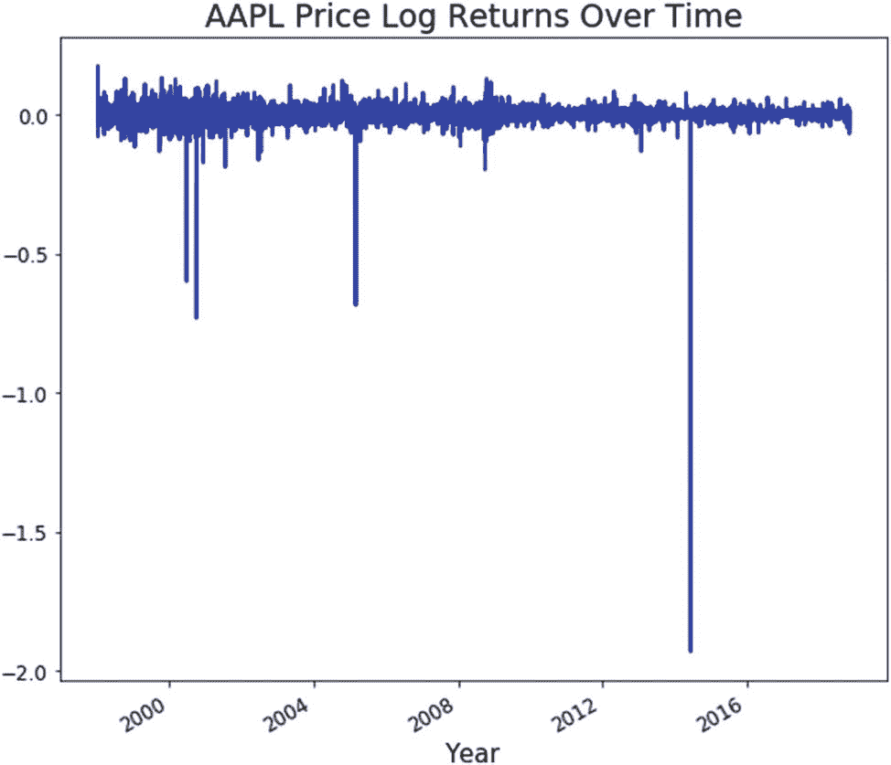
图 7-14：该图包含几个远离中心值的向下尖峰。

```python
# >> import numpy as np

# >> stock_data['close_ret'] = np.log(stock_data['close']).diff()

# >> stock_data['volume_ret'] = np.log(stock_data['volume']).diff()

# >> stock_data.head()

close    volume  close_ret  volume_ret

timestamp

1998-01-02  16.25   6411700        NaN         NaN

1998-01-05  15.88   5820300  -0.023032   -0.096773

1998-01-06  18.94  16182800   0.176216    1.022597

1998-01-07  17.50   9300200  -0.079075   -0.553913

1998-01-08  18.19   6910900   0.038671   -0.296936

# >> stock_data.dropna();

# >> plot_time_series(stock_data['close_ret'], 'AAPL Price Log Returns')

# >> plot_time_series(stock_data['volume_ret'], 'AAPL Volume Log Returns')
```

我们可以将这些尖峰视为异常值，这些数据难以建模和解释（除非你是金融专家）。解决该问题的一种方法是使用波动率归一化的对数收益率。

接下来的代码部分实现了生成股票价格波动率归一化对数收益率的逻辑，结果如图 7-16 所示。无需对成交量收益率执行相同的操作，我们很快会看到原因（其分布近似于正态）。

```python
# >> ts['close_ret'] /= ts['close_ret'].ewm(halflife=halflife).std()

# >> plot_time_series(stock_data['close_ret'], 'AAPL Volatility-Norm. Price Log Returns')
```

### 衰减因子与流式计算

23 天的半衰期相当于衰减因子（权重）为 0.97（需要求解方程 `w²³ = 1/2` 来得到 `w`），该因子控制着股票市场对旧事件的记忆时长（或遗忘速度）。第 i 个数据点的衰减因子为 `w^i`。波动率是跨数据点计算的滚动标准差，同时考虑了旧数据的指数衰减。更高的衰减会抑制波动率。你应该尝试调整这个因子，以匹配期望的风险水平。

### 流式计算量

为简单起见，我们到目前为止都是以批处理模式管理数据。然而，对数收益率、移动平均和波动率都是可以实时计算的数量。对于对数收益率，你只需要缓存最后一个值即可进行更新。对于带有指数加权的波动率也是如此，尽管它不像对数收益率那样显而易见。要跟踪移动平均，你需要存储并更新最后的分子和分母。

假设你知道当前的加权方差 `V_current = sum(w^i * r_i²) / sum(w^i)`，其中 `w` 是衰减因子；对于日收益率，我们可以假设均值为零。分母是几何级数的和，其极限为 `1 / (1 - w)`。当一个新的收益率 `r_0` 到来时，我们有 `V_new = (1 - w) * (w * sum(w^i * r_i²) + r_0) = w * V_current + (1 - w) * r_0`。你可以通过 `sqrt(V_current)` 计算当前波动率。

要在流式模式下进行波动率归一化，你需要将新收益率除以当前波动率：`r_0 <- r_0 / sqrt(V_current)`。当然，你应该在执行 `V_current <- V_new` 更新当前波动率之前进行此操作。

除了计算各种运行总计外，还有一整套可以以流式方式运行的增量算法。例如，*梯度下降*是一种迭代优化方法，它可以一次性处理所有数据。*随机梯度下降*是一种增量和迭代方法，它以在线模式运行并动态更新参数。流式线性回归就使用了这种方法（本章后面会介绍）。

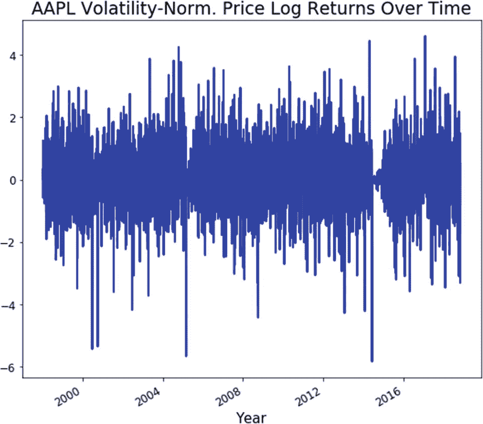

图 7-16 归一化平滑了对数收益率，使得时间序列表现更好。

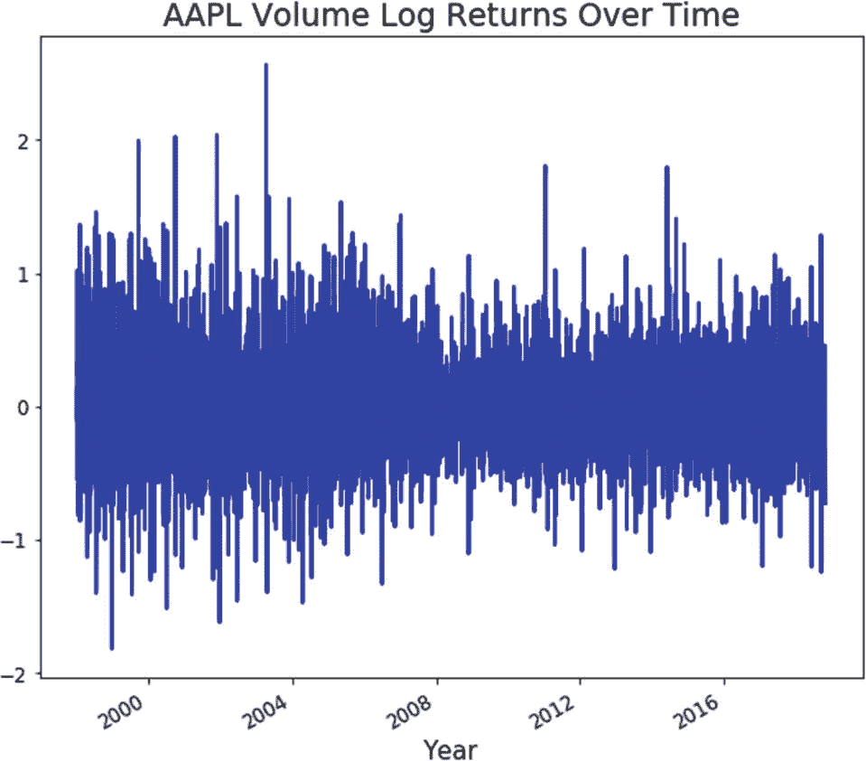

图 7-15 该图似乎以零点为中心，但我们仍应目视检查其分布。

为了更好地理解归一化对价格对数收益率的影响，图 7-17 和图 7-18 分别展示了非归一化和归一化变体的直方图。你将在后续部分看到完整的代码。

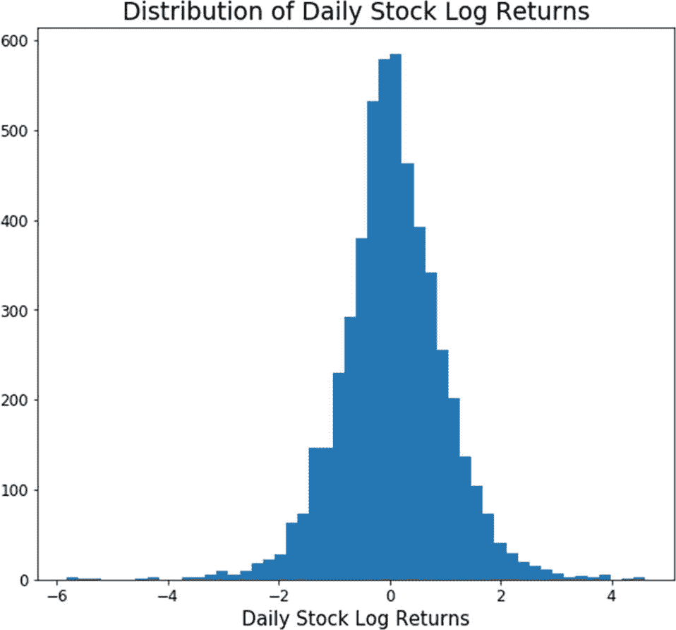

图 7-18 归一化价格对数收益率的直方图，呈钟形。

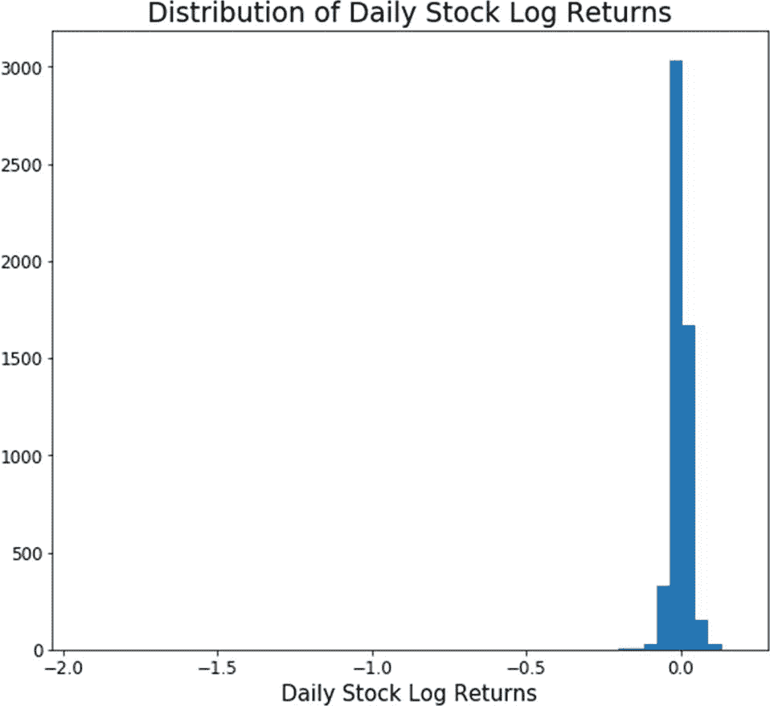

图 7-17 非归一化价格对数收益率的直方图，呈严重的左尾分布。

为完整起见，图 7-19 展示了成交量对数收益率的直方图。

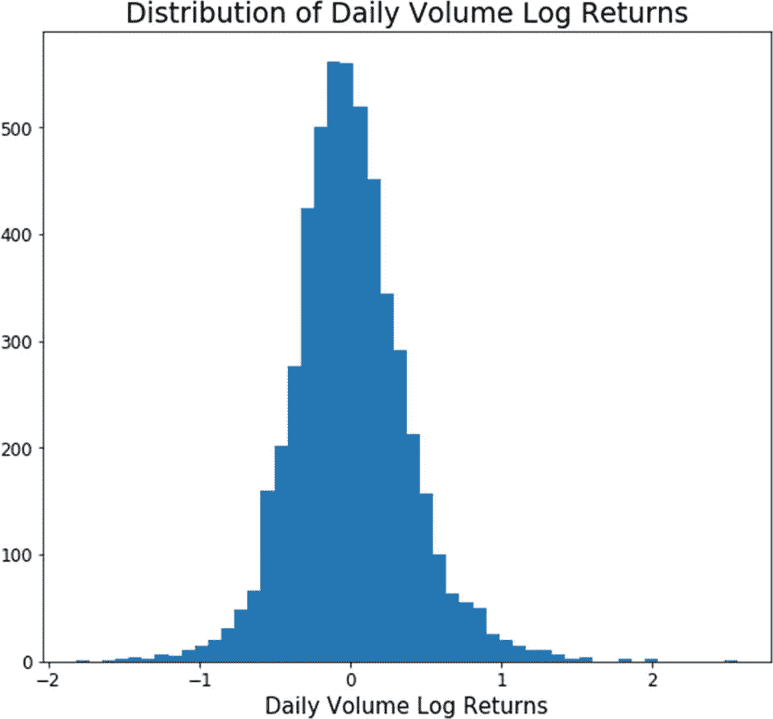

图 7-19 该图呈正态分布，带有轻微的右尾。

清单 7-9、7-10 和 7-11 展示了独立的模块，这些模块将所有相关步骤整合到连贯的单元中。预处理阶段到此结束。`driver.py` 模块调用这些函数来实现整个流水线。

```python
from data_preprocessing import *
from data_visualization import *
stock_data = read_daily_equity_data('daily_AAPL.csv')
stock_data = create_log_returns(stock_data, 23)
plot_time_series(stock_data['close'], 'AAPL 收盘价')
plot_time_series(stock_data['close'].rolling('365D').mean(), 'AAPL 收盘价趋势')
plot_time_series(compose_trends(stock_data), 'AAPL 收盘价与成交量趋势', ['b-', 'g--'])
```

要生成非归一化的价格对数收益率图，需调用 `create_log_returns` 函数并设置 `normalize_close=False`。可将其作为附加练习尝试。

```python
plot_time_series(stock_data['close_ret'], 'AAPL 波动率归一化价格对数收益率')
plot_time_series(stock_data['volume_ret'], 'AAPL 成交量对数收益率')
hist_time_series(stock_data['close_ret'], '每日股票对数收益率', 50)
hist_time_series(stock_data['volume_ret'], '每日成交量对数收益率', 50)
```

**清单 7-11** `driver.py` 模块——连接所有组件的核心（展示文件前半部分）

```python
import matplotlib.pyplot as plt

def plot_time_series(ts, title_prefix, style='b-'):
    ax = ts.plot(figsize=(9, 8), lw=2, fontsize=12, style=style)
    ax.set_title('%s 随时间变化' % title_prefix, fontsize=19)
    ax.set_xlabel('年份', fontsize=15)
    plt.show()

def hist_time_series(ts, xlabel, bins):
    ax = ts.hist(figsize=(9, 8), xlabelsize=12, ylabelsize=12, bins=bins, grid=False)
    ax.set_title('%s 的分布情况' % xlabel, fontsize=19)
    ax.set_xlabel(xlabel, fontsize=15)
    plt.show()
```

**清单 7-10** `data_visualization.py` 模块——包含时间序列辅助可视化函数

```python
import numpy as np
import pandas as pd

def read_daily_equity_data(file):
    stock_data = pd.read_csv(file, usecols=[0, 4, 5], skiprows=[1])
    stock_data['timestamp'] = pd.to_datetime(stock_data['timestamp'])
    stock_data.set_index('timestamp', inplace=True, verify_integrity=True)
    stock_data.sort_index(inplace=True)
    return stock_data

def compose_trends(ts):
    from sklearn.preprocessing import MinMaxScaler
    scaler = MinMaxScaler()
    scaled_ts = pd.DataFrame(scaler.fit_transform(ts), columns=ts.columns, index=ts.index)
    return pd.concat([scaled_ts['close'].rolling('365D').mean(),
                      scaled_ts['volume'].rolling('365D').mean()], axis=1)

def create_log_returns(ts, halflife, normalize_close=True):
    ts['close_ret'] = np.log(ts['close']).diff()
    if normalize_close:
        ts['close_ret'] /= ts['close_ret'].ewm(halflife=halflife).std()
    ts['volume_ret'] = np.log(ts['volume']).diff()
```

# 清单 7-9

`data_preprocessing.py` 模块——包含为分析阶段准备数据框的函数

```python
return ts.dropna()
```

## 特征工程

目前，我们拥有原始收盘价、原始成交量、波动率归一化的收盘价对数收益率以及成交量对数收益率作为特征（后续还将创建更多特征）。为了解这些特征对潜在目标变量（如预测股价变动）的影响，查阅皮尔逊相关系数 `r` 十分有用。该指标用于衡量两个特征之间的线性关系，取值范围为 [-1, 1]。正相关表示一个值增加/减少时，另一个值也同步变化；负相关则表示相反行为；值为零表示不存在线性关系（尽管变量间可能存在非线性关联）。通常，若 `|r| > 0.3`，则可认为相关性较为显著（此为经验判断，需谨慎参考此准则）。

对数收益率反映了波动情况，探究这些收益率在特定时间段（如 `N` 天）内是呈 *均值回归* 还是 *趋势跟踪* 特征具有重要意义。均值回归表明收益率围绕某个均值波动，而趋势跟踪则指其模仿近期走势。我们可以通过固定 `N` 值，计算过去与未来收益率之间的系数 `r` 来发现这一特征。若相关性较低，则表现为均值回归；反之则为趋势跟踪。清单 7-12 展示了报告相关系数并创建过去与未来价格及成交量对数收益率散点图的函数（另见练习 7-3）。该函数调用 `scatter_time_series` 函数生成散点图（见清单 7-13）。

```python
def scatter_time_series(ts, x, y):
    ax = ts.plot(x=x, y=y, figsize=(9, 8), kind="scatter", fontsize=12)
    ax.set_title('自相关图', fontsize=19)
    ax.set_xlabel(x, fontsize=15)
    ax.set_ylabel(y, fontsize=15)
    plt.show()
```

# 清单 7-13

用于创建追踪自相关的散点图函数（`data_visualization.py` 模块）

```python
from data_visualization import *

def report_auto_correlation(ts, periods=5):
    for column in filter(lambda str: str.endswith('_ret'), ts.columns):
        future_column = 'future_' + column
        ts[future_column] = ts[column].shift(-periods).rolling(periods).sum()
        current_column = 'current_' + column
        ts[current_column] = ts[column].rolling(periods).sum()
        print(ts[[current_column, future_column]].corr())
        scatter_time_series(ts, current_column, future_column)
```

# 清单 7-12

`feature_engineering.py` 模块——包含研究自相关性的函数

以下是两个变量的相关系数，图 7-20 展示了成交量对数收益率的散点图（建议运行配套源代码查看价格收益率图）：

```
current_close_ret  future_close_ret
current_close_ret           1.000000          0.013661
future_close_ret            0.013661          1.000000
current_volume_ret  future_volume_ret
current_volume_ret            1.000000          -0.419489
future_volume_ret            -0.419489           1.000000
```

我们可以得出结论：价格对数收益率呈现均值回归特征，而成交量对数收益率则遵循相反趋势。

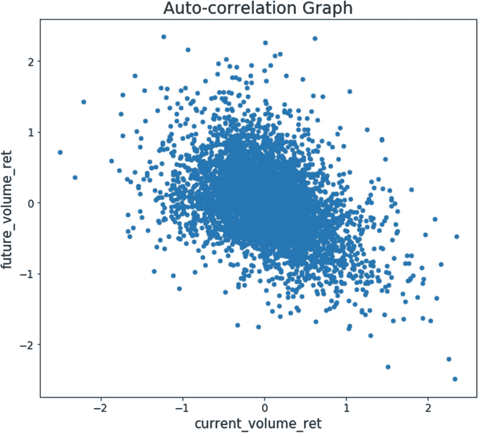

**图 7-20** 当前成交量对数收益率上升时，未来成交量对数收益率下降，反之亦然

通过改变周期长度，可以找到自相关性的最高水平，这为创建特征提供了基础。5 天似乎是一个良好的选择（您可以使用配套代码库实验不同周期）。因此，我们的目标特征将是未来 5 天的价格变化，而初始基础特征则为当前 5 天的价格和成交量变化。

每个领域都有一组经过验证的、对预测目标有价值的备选特征。有一个名为 TA-Lib 的强大技术分析库，包含 200 个金融指标（参见 [`https://mrjbq7.github.io/ta-lib`](https://mrjbq7.github.io/ta-lib)）。我们将使用其中的三个：归一化简单移动平均线（SMA）、相对强弱指数（RSI）和平衡交易量（OBV）。你已经在“发现时间序列中的趋势”一节中见过 SMA。RSI 的定义为 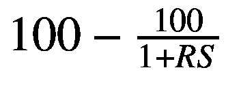，其中 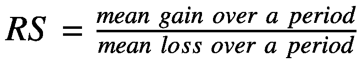。OBV 将成交量流与价格变化联系起来。清单 7-14 包含了用于创建候选特征的代码。

```python
def create_features(ts):
    from talib import SMA, RSI, OBV
    target = 'future_close_ret'
    features = ['current_close_ret', 'current_volume_ret']
    for n in [14, 25, 50, 100]:
        ts['sma_' + str(n)] = SMA(ts['close'].values, timeperiod=n) / ts['close']
        ts['rsi_' + str(n)] = RSI(ts['close'].values, timeperiod=n)
        ts['obv'] = OBV(ts['close'].values, ts['volume'].values.astype('float64'))
    ts.drop(['close', 'volume', 'close_ret', 'volume_ret', 'future_volume_ret'],
            axis='columns',
            inplace=True)
    ts.dropna(inplace=True)
    return ts.corr()
```

# 清单 7-14

用于创建文本中描述的特征的代码（`feature_engineering.py` 模块的一部分）

该函数返回相关性矩阵，可以使用热力图方便地进行可视化。也可以返回指数加权相关性矩阵，并使用加权移动平均（分别参见 Pandas 的 `EWM` 对象的 `corr` 和 `mean` 方法）。热力图绘制在一个新函数中实现，如清单 7-15 所示（位于我们的可视化模块中）。

```python
def heat_corr_plot(corr_matrix):
    import numpy as np
    import seaborn as sns
    mask = np.zeros_like(corr_matrix)
    mask[np.triu_indices_from(mask)] = True
    _, ax = plt.subplots(figsize=(9, 8))
    sns.heatmap(corr_matrix, annot=True, cmap="gist_gray", fmt=".2f", lw=.5, mask=mask, ax=ax)
    plt.tight_layout()
    plt.show()
```

# 清单 7-15

使用 Seaborn 的 `heatmap` 工具报告相关性的代码

最后，`driver.py` 模块必须添加以下语句：

```python
from feature_engineering import *
report_auto_correlation(stock_data)
corr_matrix = create_features(stock_data)
heat_corr_plot(corr_matrix)
```

# 流式线性回归实现

## 流式线性回归原理

图 7-21 显示了可用于特征筛选的相关性矩阵。减少特征数量既可以提高准确性，也可以提升性能。

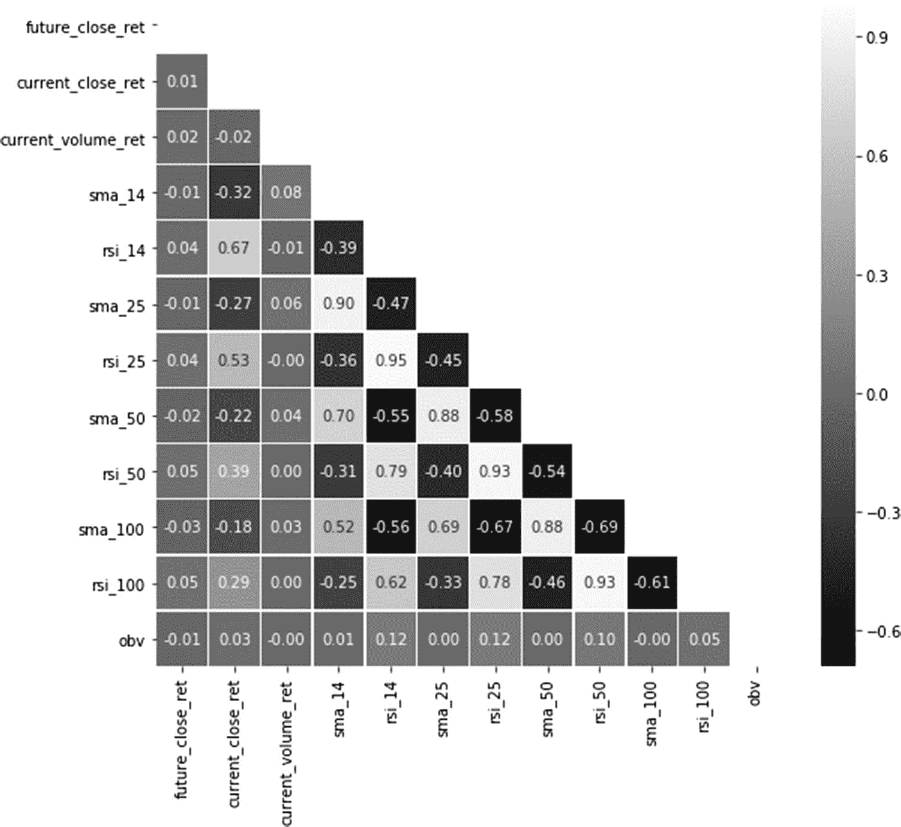

此图仅显示了相关性矩阵的相关部分。

所有对角线元素都为 1，因为特征与自身完全对齐。矩阵是对称的，因此右上三角部分是冗余的。没有一个特征与目标强相关，至少在线性方式下如此。

## 实现细节

流式线性回归会在新训练数据添加到语料库时持续学习并更新其参数。我们依赖 Apache Spark 的 MLlib 框架，该框架提供了`StreamingLinearRegressionWithSGD`类来执行流式回归。我们唯一需要做的是为训练和测试数据提供流式数据源。一种简便的方法是通过队列传递一个弹性分布式数据集（`RDD`）实例列表。将 Pandas 的`DataFrame`的一部分转换为 RDD 很简单。清单 7-16 展示了在线模式下拟合线性模型的实现（另请参见练习 7-4），清单 7-17 展示了`driver.py`模块的最终扩展。你需要安装`pyspark`（参见`https://spark.apache.org/docs/latest/api/python/index.html`）。

```python
# Listing 7-17
# Last Piece of the Main driver.py Module
from pyspark.sql import SparkSession
from streaming_regression import *

sparkSession = SparkSession.builder \
    .master("local[4]") \
    .appName("Streaming Regression Case Study") \
    .getOrCreate()

fit_and_predict(sparkSession, stock_data)
```

```python
# Listing 7-16
# Content of the streaming_regression.py Module to Showcase Streaming Linear Regression in Online Mode
def fit_and_predict(sparkSession, ts):
    import numpy as np
    from sklearn.model_selection import train_test_split
    from pyspark.streaming import StreamingContext
    from pyspark.mllib.regression import StreamingLinearRegressionWithSGD

    def to_scaled_rdd(pandasDataFrame):
        import pandas as pd
        from sklearn.preprocessing import RobustScaler
        from pyspark.mllib.regression import LabeledPoint

        regressors = pandasDataFrame.columns[1:]
        num_regressors = len(regressors)

        #### FIX ME: As a bonus exercise, read the last paragraph from section about residual
        #### plots and make the necessary bug fix! Compare the behavior of this version with the
        #### fixed one and see whether you can decipher anything from the outputs.

        scaler = RobustScaler()
        scaled_regressors = scaler.fit_transform(pandasDataFrame[regressors])
        scaled_pandasDataFrame = pd.DataFrame(scaled_regressors, columns=regressors)
        scaled_pandasDataFrame['target'] = pandasDataFrame[pandasDataFrame.columns[0]].values
        sparkDataFrame = sparkSession.createDataFrame(scaled_pandasDataFrame)

        return sparkDataFrame.rdd.map(
            lambda row: LabeledPoint(row[num_regressors], row[:num_regressors]))

    def report_accuracy(result_rdd):
        from pyspark.mllib.evaluation import RegressionMetrics
        if not result_rdd.isEmpty():
            metrics = RegressionMetrics(
                result_rdd.map(lambda t: (float(t[1]), float(t[0]))))
            print("MSE = %s" % metrics.meanSquaredError)
            print("RMSE = %s" % metrics.rootMeanSquaredError)
            print("R-squared = %s" % metrics.r2)
            print("MAE = %s" % metrics.meanAbsoluteError)
            print("Explained variance = %s" % metrics.explainedVariance)

    df_train, df_test = train_test_split(ts, test_size=0.2, shuffle=False)
    train_rdd = to_scaled_rdd(df_train)
    test_rdd = to_scaled_rdd(df_test)

    streamContext = StreamingContext(sparkSession.sparkContext, 1)
    train_stream = streamContext.queueStream([train_rdd])
    test_stream = streamContext.queueStream([test_rdd])

    numFeatures = len(ts.columns) - 1
    model = StreamingLinearRegressionWithSGD(stepSize=0.05, numIterations=300)
    np.random.seed(0)
    model.setInitialWeights(np.random.rand(numFeatures))

    model.trainOn(train_stream)
    result_stream = model.predictOnValues(test_stream.map(lambda lp: (lp.label, lp.features)))
    result_stream.cache()
    result_stream.foreachRDD(report_accuracy)

    streamContext.start()
    streamContext.awaitTermination()
```

系统将打印以下报告（阅读后应终止会话）：

```
MSE = 5.663621710391528
RMSE = 2.379836488162901
R-squared = -0.3217279555407153
MAE = 1.8382286514438086
Explained variance = 1.7169768418351132
```

在撰写本文时，`StreamingLinearRegressionWithSGD`类缺少`setIntercept`方法。因此，我们得到了非常“奇怪”的 R 平方和解释方差值。同样至关重要的是，在训练模型之前要记住特征缩放的重要性。如果你不确定回归变量的分布，`RobustScaler`缩放器是一个方便的选择。

### 练习 7-1 提升可复用性

`plot_mse`函数预设了标题和坐标轴的字体大小。为了保持一致性，这种做法在其他地方也重复出现。然而，这种方式是真正的维护噩梦（注意：`explain_sse`重复了相同的设置）。请改进代码，将通用参数的设置集中起来（提示：在[`https://matplotlib.org/users/customizing.html`](https://matplotlib.org/users/customizing.html)阅读关于样式表的内容）。你还能想出哪些方法让代码库更灵活、更易于复用？

当你处理各种机器学习问题时，工具函数会变得非常方便。每次需要绘制 MSE 时都重新造轮子是没有意义的。尽你所能让你的代码库具有可复用性。

### 练习 7-2 修复一个 Bug

在清单 7-2 的`plot_mse`函数内部，你会找到以下两行代码：

```
#### FIX ME: 请参见练习 2！

ax.set_ylim(max(0, y_min), min(2 * error_variance, y_max))
```

你的任务是找出为什么这一行标记的代码是错误的，并实现修复。在现实中，情况甚至更糟，因为没人会给你指出错误的代码段。定位问题的确切位置是纠正错误过程中的一个巨大里程碑。

提示：图 7-6 是在这两行代码都被注释掉的情况下生成的。显然，这种解决方案是一个权宜之计。尝试使用原始的`plot_mse`函数运行`demo_underfitting`，看看会发生什么。

### 练习 7-3 避免副作用

在清单 7-12 中，你可以看到一个具有副作用的函数。它通过增加额外列来修改输入的*数据框*。这个修改是调用清单 7-14 中所示函数的前提条件。所有的链式调用都由驱动模块驱动。

以副作用的方式进行编程通常是一种不好的实践。你可能会疑惑，为什么在调用模型的`fit`方法后，模型会以这种形式被更改（参见清单 7-2）。关键区别在于，模型将其状态封装在一个对象内部，这样你对内部内容的更改有更多的控制权。当普通函数散布着隐含的副作用时，很容易失去控制，造成无法维护的混乱局面。

重构`feature_engineering.py`模块，将特征相关的操作归组到一个专门的类中。比较这种面向对象的方式如何有助于保持对系统内部的控制。

### 练习 7-4 体验流式处理行为

在清单 7-16 中，训练和测试流是按以下方式构建的：

```
train_stream = streamContext.queueStream([train_rdd])

test_stream = streamContext.queueStream([test_rdd])
```

这对于演示解决方案的框架来说是可以的，但在真实环境中毫无意义。流式处理的全部意义在于允许数据持续地分块到达。Apache Spark 甚至允许将流合并，这样你可以通过多个通道获取数据（例如，你也可以监视一个文件夹以获取新的数据文件并实时解析它们）。

重构解决方案，让训练集和测试集包含多个部分。你需要将引用的数据框`df_train`和`df_test`分割成多个部分，并将每个部分转换为一个`RDD`。最后，将这些部分以列表的形式提供给`queueStream`方法。观察你在输出中得到了什么（你应该收到与测试数据片段数量相同的报告）。

附加任务：当前的准确率报告没有暴露出太多关于性能的信息。你可能想要创建一个预测值与实际值（来自测试数据的观测值）的散点图。同时画出理想线（这基本上就是函数`y = x`）。

## 本章小结

本章只是触及了机器学习（ML）领域的皮毛。即使是几十本书也不足以完全涵盖（即使是在入门级别上）所有可用的算法和技术。本章的主要目标是介绍贯穿于机器学习知识领域的通用概念。如果不了解欠拟合、过拟合、正则化、缩放等类似主题，你就无法高效地使用任何机器学习方法。要精通机器学习，你还必须记住数据科学和工程学的黄金法则：“保持简单，傻瓜！”（也就是 KISS 原则）。通常，你甚至不需要机器学习就能解决问题，而且很少有需要启动复杂的深度神经网络的时候。

本章传达的另一个有力信息是：在参数调优方面，科学与艺术之间的界限相当模糊。虽然有一些经验法则（想获得良好的概述，我建议阅读[`http://martin.zinkevich.org/rules_of_ml/rules_of_ml.pdf`](http://martin.zinkevich.org/rules_of_ml/rules_of_ml.pdf)上的文档），但你仍然需要大量的实验和尝试。因此，为了在合理的时间内完成所有这些工作，你需要强大的硬件（在云中作为基础设施或平台即服务很容易获得）。

机器学习完全是关于数学的。你无法逃避这个事实。神经网络似乎为你提供了一条看似不错的逃避路线（我们将在第 12 章详细讨论），但最终你还是需要深入探究其内部原理，以了解正在发生的事情。这与模型的可解释性紧密相关。使用我们的普通最小二乘回归方法，系数很容易解释。一个特定的系数代表当相应特征变化一个单位时，目标变量变化多少。对于更复杂的模型，情况就不同了。无论如何，我将在第 9 章更多地讨论模型的内部特性。

机器学习正受到研究机构和工业界的巨大关注。这并不奇怪，因为随着我们更深入地进入大数据领域，就更需要以高效的方式处理如此大量的数据。只有借助机器的帮助，我们才有望掌控海量数据。一个热门话题是*迁移学习*，它试图提高训练模型的复用性。其思想是利用为一个任务优化的模型也能在其他任务上表现良好（可能只需进行少量的额外调整和训练）。这必将催生一大批新的算法和技术。

机器学习领域的一个迫切需求是，需要一种高效且标准化的方式来交换预测模型。其中一个标准是预测模型标记语言（PMML）。有一个 Python 库可以将 scikit-learn 管道转换为 PMML，网址为[`https://github.com/jpmml/sklearn2pmml`](https://github.com/jpmml/sklearn2pmml)。


